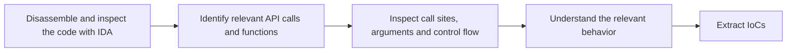
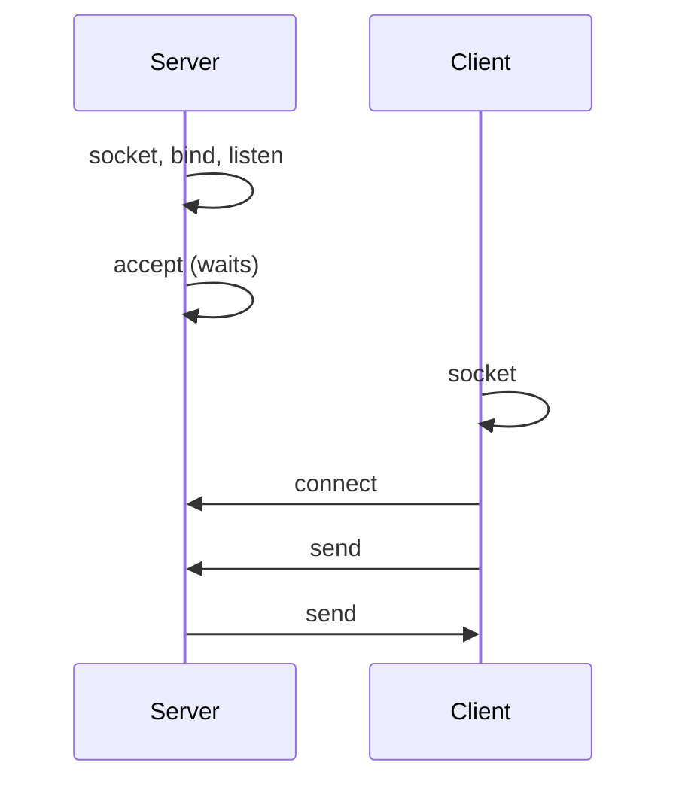
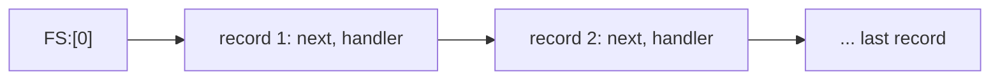
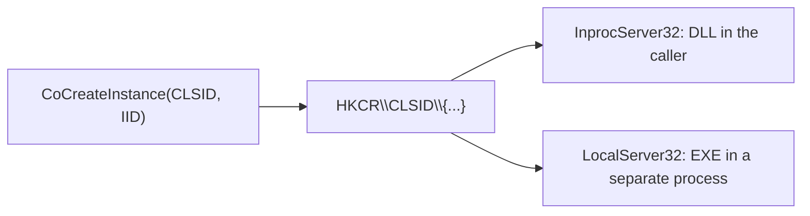

# Advanced Static Analysis

> [!abstract] Purpose and scope
> [[3 - MA - Basic Static Analysis]] stops at the outside of a binary (hashes, strings, imports). **Advanced static analysis reads the code itself**, going from disassembly to malware behavior. To do that you need to recognize what the code asks of the operating system, so this lecture is a tour of Windows from the analyst's point of view: the user/kernel boundary, the Native and Win32 APIs, files, registry, network, and the execution mechanisms (DLLs, processes, threads, exceptions, mutexes, services, COM). It ends with the assembly patterns of common C constructs, complementing [[2 - MA - X86 Assembly]]. The APIs seen here are the same ones traced at runtime in [[4 - MA - Basic Dynamic Analysis]] and stepped through in [[7 - MA - Advanced Dynamic Analysis]]. Concept summaries are collected in [[MOC - Malware Analysis]].
>
> Book references are to *Practical Malware Analysis* (PMA), by **PDF page** of the copy in `pdf/`.

## From disassembly to malware behavior

Reverse engineer the sample under analysis following this workflow:



Tools like IDA provide features to skim through code, search for specific snippets and interpret the code flow. To simplify this part, we **assume that the malware code is not obfuscated or crippled in strange ways**: dealing with that is another topic ([[2 - MA - X86 Assembly#Anti-disassembly|anti-disassembly]], [[5 - MA - Malware Evasion]]).

## Privilege boundary

Vedi [[Protection Rings]].

![[MA-L06-01.png]]

x86 CPUs define four privilege levels, drawn as concentric rings, from the most privileged at the center to the least privileged outside:

- **Ring 0: kernel mode**;
- **Ring 3: user mode**;
- **Rings 1 and 2 are not used by Windows**.

Nearly all code runs in user mode, except the OS and hardware drivers. User-mode code can manipulate hardware **only through the Windows API** (no direct access), and access to some CPU instructions is restricted.

> [!note] Reading the figure
> The picture is the generic x86 model, which places device drivers in rings 1 and 2. Since Windows does not use those rings, its drivers run in ring 0. The same dual-mode idea is explained in [[06 - SO - Interrupt, Syscall, Dual Mode e Processi]].

### User-mode processes

- Each process has its own memory (**isolated address space**), security permissions and resources.
- If a user-mode program executes an invalid instruction and crashes, Windows can **reclaim the resources and terminate the program**. The damage stays contained.

See the [[2 - MA - X86 Assembly#Memory map of a process (WINDOWS EDITION)|Windows memory map]].

### Calling the kernel

It is **not possible to jump directly** from user mode to the kernel. **Special instructions** (`sysenter`, `syscall`, `int 0x2e`) act as **gates** that invoke predefined functions through lookup tables, so user code can enter the kernel only at approved points (see [[System Call]]).

Their presence is an indicator that the code runs functions at kernel level. A normal program lets `ntdll.dll` execute them, so finding one in a sample's own code is suspicious.

### Kernel processes

- All kernel processes **share resources and memory addresses**: there is no isolation between them.
- There are fewer security checks, but **PatchGuard** acts as an integrity mechanism.
- If kernel code executes an invalid instruction, the OS crashes with the **Blue Screen of Death (BSoD)**.
- Some security solutions are supported by kernel-mode components.
- **Kernel-mode malware** is rarer, more specialized and more sophisticated than user-mode malware. **Rootkits** are a common example (see also the Linux side in [[Kernel Rootkits]]).

## The Native API

Vedi [[Native API]].

The **Native API** is a lower-level interface for interacting with Windows.

- `ntdll.dll` manages interactions between user space and the kernel, and **ntdll functions make up the Native API**.
- It is rarely used by goodware.
- It is **popular among malware writers**, as it can be more powerful and stealthier than Windows API calls: monitors hooking only the upper layer do not see it.
- It has limited official documentation.

![[MA-L06-02.png]]

The figure shows the path of a normal call: *user application → Kernel32.dll → Ntdll.dll* in user mode, then across the boundary to *Ntoskrnl.exe → kernel data structures*. A sample that calls `ntdll.dll` directly simply skips the Kernel32 step. This is the bypass mentioned in [[4 - MA - Basic Dynamic Analysis#What to observe: system calls and Windows APIs|Lecture 4]].

### Popular Native API calls in malware

Examples used to get information about the system, processes, threads, handles and other items:

- `NTtQuerySystemInformation`
- `NTtQueryInformationProcess`
- `NTtQueryInformationThread`
- `NTtQueryInformationFile`
- `NTtQueryInformationKey`

These provide more information than any available Win32 API from DLLs. For example, `NtQueryInformationProcess` is also a classic way to detect a debugger ([[Anti-Debugging]]).

> [!warning] Correzione
> `NTtQuery...` is a typo in the slide: the real names are `NtQuerySystemInformation`, `NtQueryInformationProcess`, `NtQueryInformationThread`, `NtQueryInformationFile` and `NtQueryKey`. In particular, the last one is exported as `NtQueryKey`, not `NtQueryInformationKey`. Use the correct names when searching in IDA or in the documentation.

## Windows API (Win32)

The Win32 API provides applications with functions to interact with Windows and access OS services and resources. Programs normally interact with OS resources through **API functions exported by system DLLs**. These are what you will see in the [[3 - MA - Basic Static Analysis#Imports|imports]] and at the call sites.

### Types and Hungarian notation

Vedi [[Windows API Conventions]].

The Windows API has its own names for C data types, for example `DWORD` for 32-bit unsigned integers and `WORD` for 16-bit unsigned integers. With **Hungarian notation**, variable names are prefixed to indicate their type or intended use:

| Type (prefix) | Meaning |
|---|---|
| `WORD` (w) | 16-bit unsigned value |
| `DWORD` (dw) | 32-bit unsigned value |
| Handle (H) | A reference to an object |
| Long Pointer (LP) | Points to another type |

So `dwDesiredAccess` is a 32-bit value and `lpStartupInfo` is a pointer. IDA labels the arguments with these names, so the prefixes tell you what each `push` is.

### Handles

Handles refer to items opened or created in the OS, such as a process, menu, file or window. They are like **immutable pointers** to those objects:

- you **cannot operate on them with arithmetic**;
- you can **store them** and use them later to refer to the same object;
- sometimes you can check validity against `INVALID_HANDLE_VALUE`.

For example, `CreateWindowEx` returns an `HWND`, a handle to the window. To do anything to that window (such as `DestroyWindow`), you use that handle.

For the analyst, this means following a handle from the call that creates it to the calls that use it, which links apparently unrelated API calls together.

### File-system functions

- `CreateFile`, `ReadFile`, `WriteFile`: normal file input/output.
- `CreateFileMapping`, `MapViewOfFile`: **frequently used by malware**, they load file contents into RAM (see [[File Mapping]]):
  - `CreateFileMapping` creates a file-mapping object;
  - `MapViewOfFile` maps the view into the process address space (making the contents visible) and returns a pointer to the base address of the file in memory;
  - they can be used to **execute a file without using the Windows loader**.

> [!quote] Dal libro
> With the pointer returned by `MapViewOfFile`, a program can "read and write anywhere in the file", which is "extremely handy when parsing a file format". File mappings "are commonly used to replicate the functionality of the Windows loader" (PDF p. 205).

### Special files

**Special paths**:

- `\\server\share\file.txt`: programs can access a shared resource on another computer. These are **UNC paths** (Universal Naming Convention).
- `\\?\` prefix for extended paths (both local and UNC): it bypasses normal Win32 path processing, allowing extended-length paths (> 260 characters).

**Namespaces** are special folders in the Windows file system:

- `\` is the lowest namespace and contains everything;
- `\\.\` is the **device namespace**, used for direct disk I/O. The **Witty worm** (2004) wrote to `\\.\PhysicalDisk1` to corrupt the disk.

A string with one of these prefixes in a sample is therefore a strong signal: direct disk access does not go through the file system.

**Alternate Data Streams (ADS)**: see [[Alternate Data Streams]].

- A second stream of data attached to a filename: `File.txt:otherfile.txt`.
- The stream is kept in addition to the primary, visible content of the file.
- It is a feature of the **NTFS** file system.

![[MA-L06-03.png]]

The console session shows the trick:

1. `echo 1 > foo` creates a 4-byte file;
2. `echo 2222... > foo:bar.txt` writes a long string into a stream of the same file;
3. `dir` still reports **4 bytes** with the same date, and the stream is not listed;
4. `notepad foo:bar.txt` opens the hidden content.

So plain `dir` does not reveal data hidden in a stream.

## Windows registry functions

The [[Windows Registry]] stores OS and program configuration settings, such as desktop background and mouse preferences. Malware may use it for **persistence**, to restart when the system reboots. See [[4 - MA - Basic Dynamic Analysis#The Windows Registry|Lecture 4]] for its structure.

The registry comes with 5 root keys:

![[MA-L06-04.png]]

The excerpt lists `HKEY_LOCAL_MACHINE` (global settings), `HKEY_CURRENT_USER` (current user), `HKEY_CLASSES_ROOT` (information defining types), `HKEY_CURRENT_CONFIG` (differences between the current and the standard hardware configuration) and `HKEY_USERS` (default, new and current users).

### Example: the Run key

`HKLM\SOFTWARE\Microsoft\Windows\CurrentVersion\Run` lists the executables that start when a user logs on.

![[MA-L06-05.png]]

In Registry Editor, each value in the `Run` key is a program, of type `REG_SZ`, with its path as data (`AdobeARM.exe`, `jusched.exe`, …). A malicious entry would look just like these, so the **path** and the file behind it are what you check. See [[Registry Persistence]].

### Common registry functions

- `RegOpenKeyEx`: opens a registry key for editing and querying.
- `RegSetValueEx`: adds a new value to the registry and sets its data.
- `RegGetValue`: returns the data for a value entry in the registry.

Documentation often omits the trailing `W` (wide-char) or `A` (ASCII) character in a call like `RegOpenKeyExW`.

### Ex, A and W suffixes

Vedi [[Windows API Conventions]]. These come from Chapter 2 of the book:

![[MA-L06-06.png]]

**Ex**: when Microsoft updates a function and the new one is incompatible with the old, it keeps supporting the old function and gives the new one the same name plus an `Ex` suffix. Functions updated significantly twice have two `Ex` suffixes.

![[MA-L06-07.png]]

**A/W**: many functions that take strings have an `A` or `W` at the end, such as `CreateDirectoryW`. This letter does **not** appear in the documentation: it only indicates that the function takes an ASCII or a wide-character string. Drop it when searching the Microsoft documentation.

### Reading registry code

Listing 7-1 of the book shows code that modifies registry settings. The first lines open the `Run` key, the rest write a value:

```nasm
0040286F   push    2                  ; samDesired
00402871   push    eax                ; ulOptions
00402872   push    offset SubKey      ; "Software\\Microsoft\\Windows\\CurrentVersion\\Run"
00402877   push    HKEY_LOCAL_MACHINE ; hKey
0040287C   call    esi ; RegOpenKeyExW        ; (1)
0040287E   test    eax, eax
00402880   jnz     short loc_4028C5
00402882
00402882 loc_402882:
00402882   lea     ecx, [esp+424h+Data]
00402886   push    ecx                ; lpString
00402887   mov     bl, 1
00402889   call    ds:lstrlenW                ; (2)
0040288F   lea     edx, [eax+eax+2]
00402893   push    edx                ; cbData  ; (3)
00402894   mov     edx, [esp+428h+hKey]
00402898   lea     eax, [esp+428h+Data]       ; (4)
0040289C   push    eax                ; lpData
0040289D   push    1                  ; dwType
0040289F   push    0                  ; Reserved
004028A1   lea     ecx, [esp+434h+ValueName]  ; (5)
004028A8   push    ecx                ; lpValueName
004028A9   push    edx                ; hKey
004028AA   call    ds:RegSetValueExW
```

The markers in the slide (here numbered) follow the logic:

1. `call esi` is an **indirect call**: `esi` was loaded earlier with the address of `RegOpenKeyExW`, and IDA adds it as a comment. Arguments are pushed right to left ([[2 - MA - X86 Assembly#Calling conventions|calling conventions]]). `samDesired` = 2 is `KEY_SET_VALUE`, i.e. the code intends to write. Then `test eax, eax; jnz` leaves on failure, because registry functions return `ERROR_SUCCESS` (0) when they succeed.
2. `lstrlenW` returns the length of the data string, in **characters**.
3. `lea edx, [eax+eax+2]` computes $2n + 2$: the size in **bytes** of a wide string, including the terminating NUL. This is an arithmetic use of `lea`.
4. `lpData` points to the data to write, and `push 1` is `dwType` = `REG_SZ`.
5. `lpValueName` is the value name, followed by the key handle.

Putting it together: the code **adds a value under the HKLM Run key**, so its data will run at logon. The `Data` string is thus an IoC, and writing to HKLM needs admin privileges.

The next two slides annotate the same pattern on another sample:

![[MA-L06-08.png]]

Here the `RegOpenKeyExW` call has **5 parameters**: the two most interesting are the **location for storing the output handle** (`phkResult`, the address of a local variable, obtained with `lea`) and the **access level** (`20006h` = `KEY_WRITE`). The key is `HKEY_CURRENT_USER\...\Run`, so this one needs no admin rights. The *Syntax* box shows the prototype in the documentation order, which is the reverse of the `push` order.

![[MA-L06-09.png]]

`RegSetValueExW` then receives the size of the data (`cbData`), the pointer to the data (`pszPath`, a path, hence `lpData`), the type (`REG_SZ`), the value name (`"System"`, chosen to look harmless) and the handle obtained before, which is finally released with `RegCloseKey`. The `sub`, `sar eax, 1` sequence turns a byte difference into a number of characters, from which `lea edx, ds:4[eax*4]` derives `cbData` ($4n + 4$ bytes). If `eax` is really the character count, this is more than the $2n + 2$ bytes a wide string needs, but the code computing `eax` is not shown on the slide, so this cannot be confirmed.

> [!warning] Correzione
> The slide's annotation says "**Handler** to key": the correct term is **handle** (a handler is a function that handles an event, such as an exception handler).

## Network API

Vedi [[Winsock and WinINet]].

### Berkeley compatible sockets

The **Winsock** libraries, primarily in `ws2_32.dll`, are almost identical in Windows and Unix.

![[MA-L06-10.png]]

The table lists the core functions: `socket`, `bind`, `listen`, `accept`, `connect`, `recv`, `send`. The note adds an analysis tip: `WSAStartup` must be called before any other networking function to allocate resources, so **a breakpoint on `WSAStartup`** finds the start of network activity while debugging.

### Server and client sides

**Server side**: maintains an open socket waiting for connections. It calls, in order, `socket`, `bind`, `listen`, `accept`, then `send` and `recv` as necessary.

**Client side**: connects to a waiting socket. It calls, in order, `socket`, `connect`, then `send` and `recv` as necessary.



The call order tells you the role at a glance: a sample with `bind`/`listen`/`accept` opens a port (a backdoor, for instance), while one with `connect` reaches out to a server.

### The WinINet API

**WinINet** is a higher-level API than Winsock, with functions in `Wininet.dll`. It implements **application-layer protocols** like HTTP and FTP.

- `InternetOpen`: initializes use of the API.
- `InternetOpenURL`: connects to a URL.
- `InternetReadFile`: reads data from a URL.

With this API the malware does not implement HTTP by itself. The typical downloader is just these three calls, and the URL argument is an IoC.

## Execution mechanisms

While `jmp` and `call` transfer control within the current thread, Windows provides mechanisms to **execute code in other threads or processes**, and to coordinate that execution: DLLs, processes, threads, mutexes, services, the Component Object Model (COM) and exceptions.

### Dynamic link libraries (DLLs)

DLLs enable sharing code among applications. Using the DLLs included in Windows makes code smaller, and software companies can also make custom ones. See [[3 - MA - Basic Static Analysis#Dynamic linking|dynamic linking]].

Malware authors use DLLs in multiple ways:

- use **Windows DLLs** to interact with the OS;
- **store malicious code in a DLL** (e.g. load the DLL into another process);
- use **third-party DLLs** (e.g. use a Firefox DLL to connect to a server, instead of the Windows API).

### Basic DLL structure

Vedi [[DLL Structure]].

- DLLs are very similar to EXEs and **share the PE file format**.
- A **single flag in the PE header** discriminates between a DLL and an EXE.
- DLLs have **more exports and fewer imports**.
- `DllMain` is a highly relevant function for initialization and cleanup:
  - it is not exported, but specified as the **entry point in the PE header**;
  - it is called when a function loads or unloads the library, and on thread creation and termination.

> [!warning] Correzione
> "Called when a **function** loads or unloads the library" should read "when a **process** loads or unloads the library". PMA: the function "is called to notify the DLL whenever a process loads or unloads the library" (PDF p. 217).

This matters because code in `DllMain` runs as soon as the DLL is loaded, without any explicit export call. It explains why [[4 - MA - Basic Dynamic Analysis#Launching DLLs|many malicious DLLs do not need an export]].

### Processes

A program being executed by Windows is a **process**, and each process has its own resources (handles, memory, etc.). Each process has one or more execution units called threads. Malware can run in a standalone process, or also have some code execute **in another process**. See [[2 - MA - X86 Assembly#Processes and threads: Windows vs Linux|processes and threads in Lecture 2]].

### Creating a new process

`CreateProcess`:

- `CommandLine` contains the command line to execute for the desired program;
- the `STARTUPINFO` parameter contains handles for the **standard input, output and error** streams. They could be set to a **socket for a remote shell**!

![[MA-L06-11.png]]

The prototype of `CreateProcessA` has ten parameters: the two to look at first are `lpCommandLine` (what runs) and `lpStartupInfo` (where its I/O goes). The remote-shell pattern is thus recognizable statically. The sample connects a socket, copies it to the three handles of `STARTUPINFO`, and launches `cmd.exe`: everything typed on the socket reaches the shell, and its output goes back over the network.

### Threads

**Processes are containers**, and each contains one or more threads. **Threads are what Windows actually executes**:

- independent sequences of instructions, independently scheduled by the OS, which may execute concurrently or in parallel;
- threads within a process **share the same memory space**;
- each thread has **its own stack and CPU execution context**;
  - the context is the register state, including instruction and stack pointers;
  - the OS saves and restores each thread's context in a dedicated structure when switching threads on a CPU core;
- created with `CreateThread`, to run from a designated start function.

For the analyst, the start function passed to `CreateThread` is a new entry point to analyze: following the `call` alone would not reach it. See also [[Thread]].

### Exceptions

Vedi [[Structured Exception Handling]].

Exceptions are caused by **hardware faults** (such as division by zero or invalid memory access) or **raised explicitly by software**. Windows provides **Structured Exception Handling (SEH)** to dispatch them: when an exception occurs, execution may transfer to an appropriate handler.

`FS` is a segment register used to access **thread-specific data**:

![[MA-L06-12.png]]

This pattern **registers a handler** by building a new record on the stack:

```nasm
push offset loc_10061C0    ; (1) handler address
mov  eax, large fs:0       ; current head of the chain
push eax                   ; (2) previous record: "next" field
mov  large fs:0, esp       ; the new record becomes the head
```

After these lines, the stack contains the record `{next, handler}` and `FS:[0]` points to it. When an exception occurs, Windows uses `FS:[0]` to find the **first SEH registration record on the stack**, then traverses the chain to locate a suitable handler.



So code that writes to `fs:0` deserves attention: because control flow reaches the handler through the exception, a disassembler does not show it as a normal branch. Malware uses this to hide its flow, as described in [[7 - MA - Advanced Dynamic Analysis#Exceptions]].

> [!note] 32-bit only
> This stack-based mechanism belongs to 32-bit code. On x64, handlers are described by tables in the PE file, and the thread block is reached through `GS`.

### Mutexes

Vedi [[Mutex Single-Instance Check]].

**Mutexes** are synchronization objects to coordinate access to shared resources (the concept is the same as in [[Semafori]]).

- They are **inter-process communication (IPC) objects**, so they can be shared across threads and processes.
- They can be **named**, and such names are often **hard-coded**:
  - this makes them a good source of **IoCs** to identify malware;
  - malware may use them to check whether another instance is already running.

**Functions for mutexes**:

- `CreateMutex`: creates a mutex (or opens an existing named mutex).
- `OpenMutex`: opens an existing named mutex.
- `WaitForSingleObject`: waits to acquire ownership of a mutex (blocking call). Any subsequent threads attempting to gain access must wait.
- `ReleaseMutex`: called when a thread is done using the mutex.

#### Malware single-instance check

- `OpenMutex` checks whether the mutex `HGL345` exists.
- If not, it is created with `CreateMutex`.
- `test eax, eax` sets the Z flag if `eax` is zero.

![[MA-L06-13.png]]

Following the numbered markers:

1. `OpenMutexW` returns a handle, or `NULL` if the mutex does not exist;
2. `test eax, eax` checks the result;
3. `jz` jumps when `eax` is 0, i.e. when the mutex **does not exist**, and goes to create it;
4. otherwise `exit` is called: another instance is already running;
5. `CreateMutexW` creates `"HGL345"`, marking this instance as the running one.

Why it matters: the name is a hard-coded **IoC**, and it can even be used to **vaccinate** a machine, since a pre-existing mutex with that name makes this sample exit on its own.

### Services

Vedi [[Windows Services]].

**Services** are background processes running without user input.

![[MA-L06-14.png]]

The **Services** tab of Task Manager lists name, PID, description, status and group. Note the many services in the `netsvcs` group: they relate to `svchost`, discussed below.

These processes are managed by the Windows **Service Control Manager (SCM)**. They can run independently of user logon and start automatically when Windows boots.

Each service runs under a **configured security account**:

- some run as **LocalSystem (SYSTEM)**, with extensive local privileges, including access to many protected system resources;
- others run under restricted service accounts or specific user accounts;
- service creation and configuration **require appropriate privileges**.

Malware can install services to establish **persistence**, potentially with elevated privileges.

#### Service API functions

- `OpenSCManager`: returns a handle to the Service Control Manager.
- `CreateService`: adds a new service to the SCM, and can specify whether it will start automatically at boot time.
- `StartService`: starts a stopped service (e.g. one set to start manually).

The sequence of these three calls in a sample is a clear sign of installation as a service, and the `CreateService` arguments give its name and binary path (IoCs).

#### svchost.exe

The `dwServiceType` of `CreateService` determines the `SERVICE_` type:

- `WIN32_OWN_PROCESS` (0x10): dedicated process;
- `WIN32_SHARE_PROCESS` (0x20): can share a process with other services.

`svchost.exe` is a Windows service-host executable that loads and runs services implemented as DLLs (see [[Svchost]]).

- Different services may run within the same `svchost.exe` instance or in separate ones. The actual service code resides in a **DLL**, not in `svchost.exe` itself.
- Analysts shall inspect the service configuration and its **`ServiceDll`** entry to identify the DLL being executed.
- While `svchost.exe` is intended for Windows services, that does not prevent malware from disguising malicious activity through it.

#### Service information in the registry

`HKLM\System\CurrentControlSet\Services\<ServiceName>`:

- `Start` value = 0x03 for "Load on Demand";
- `Type` = 0x20 for `WIN32_SHARE_PROCESS`;
- `ImagePath` = executable/driver path.

![[MA-L06-15.png]]

The `Browser` service matches the description: `Start` = 3, `Type` = 0x20, `ObjectName` = `LocalSystem`, and `ImagePath` = `%SystemRoot%\System32\svchost.exe -k netsvcs`. So the `ImagePath` only says "run inside svchost, group netsvcs": the DLL is found through `ServiceDll`, usually in the service's `Parameters` subkey.

### Component Object Model (COM)

Vedi [[Component Object Model]].

**COM** allows software components to expose functionality through **standardized interfaces**, including across process boundaries.

- Every thread using COM generally initializes the COM library by calling `OleInitialize` or `CoInitializeEx`.
- COM classes and interfaces are identified via **Globally Unique Identifiers (GUIDs)**. The main types are:
  - **Class Identifiers (CLSIDs)** identify classes of objects, in the registry under `HKEY_CLASSES_ROOT\CLSID`;
  - **Interface Identifiers (IIDs)** identify interfaces exposed by objects, in the registry under `HKEY_CLASSES_ROOT\Interface`.

#### COM object activation

Applications instantiate COM objects using `CoCreateInstance`, specifying a CLSID and a requested IID. Windows typically uses the CLSID registration to locate the corresponding implementation:

- `InprocServer32` → **DLL** loaded into the calling process;
- `LocalServer32` → **EXE** running in a separate process.



**Malware relevance**:

- malware can use COM objects to access Windows functionality. In the disassembly this appears as calls through an interface pointer rather than as named imports, so the CLSID and IID constants are the clues to look up;
- **COM hijacking**: malicious modifications to COM registrations can cause legitimate applications to load attacker-controlled code, which also gives persistence.

## Assembly patterns

The following constructs are relevant during a quick code inspection, and complement the hands-on lab sessions on x86 assembly ([[2 - MA - X86 Assembly]]). Vedi [[Recognizing C Constructs]].

### Global vs. local variables

- **Global** variables can be accessed and used by any function in a program.
- **Local** variables can be accessed only by the function that defines them.
- Both are declared similarly in C, but they **look completely different in assembly**.

**Globals** are referenced by **memory address**:

```c
int x = 1;
int y = 2;

void main()
{
    x = x+y;
    printf("Total = %d\n", x);
}
```

```nasm
00401003   mov   eax, dword_40CF60
00401008   add   eax, dword_40C000
0040100E   mov   dword_40CF60, eax    ; x is changed in memory
00401013   mov   ecx, dword_40CF60
00401019   push  ecx
0040101A   push  offset aTotalD       ; "total = %d\n"
0040101F   call  printf
```

**Locals** are referenced by **stack address**, at a constant offset from `ebp` ([[Stack Frame]]):

```c
void main()
{
    int x = 1;
    int y = 2;

    x = x+y;
    printf("Total = %d\n", x);
}
```

```nasm
00401006   mov   dword ptr [ebp-4], 1
0040100D   mov   dword ptr [ebp-8], 2
00401014   mov   eax, [ebp-4]
00401017   add   eax, [ebp-8]
0040101A   mov   [ebp-4], eax
0040101D   mov   ecx, [ebp-4]
00401020   push  ecx
00401021   push  offset aTotalD       ; "total = %d\n"
00401026   call  printf
```

> [!note] The slide fixes the book
> The slide's constants are 1 and 2, patched over the original listing to match the C code. The book's listing assigns 0 to `[ebp-4]` and 1 to `[ebp-8]` (PDF p. 171), which does not match `x = 1; y = 2`.

So the fixed address means the value outlives the function, and every function using it is affected. An `ebp-N` location lives only in the current frame.

### Switch

A `switch` chooses among several code blocks according to a value. Compilers translate it in two ways, and the analyst should recognize both.

#### If style

```c
switch(i)
{
    case 1: printf("i = %d", i+1); break;
    case 2: printf("i = %d", i+2); break;
    case 3: printf("i = %d", i+3); break;
    default: break;
}
```

```nasm
00401013   cmp   [ebp+var_8], 1
00401017   jz    short loc_401027
00401019   cmp   [ebp+var_8], 2
0040101D   jz    short loc_40103D
0040101F   cmp   [ebp+var_8], 3
00401023   jz    short loc_401053
00401025   jmp   short loc_401067      ; default
00401027 loc_401027:
00401027   mov   ecx, [ebp+var_4]
0040102A   add   ecx, 1
0040102D   push  ecx
0040102E   push  offset unk_40C000     ; i = %d
00401033   call  printf
00401038   add   esp, 8
0040103B   jmp   short loc_401067
0040103D loc_40103D:
0040103D   mov   edx, [ebp+var_4]
00401040   add   edx, 2
00401043   push  edx
00401044   push  offset unk_40C004     ; i = %d
00401049   call  printf
0040104E   add   esp, 8
00401051   jmp   short loc_401067
00401053 loc_401053:
00401053   mov   eax, [ebp+var_4]
00401056   add   eax, 3
00401059   push  eax
0040105A   push  offset unk_40C008     ; i = %d
0040105F   call  printf
00401064   add   esp, 8
```

A chain of `cmp`/`jz` selects the case, and each case ends with a `jmp` to the common exit, the compiled `break`.

![[MA-L06-16.png]]

In the graph the same code looks like a **cascade**: each comparison has a *true* branch to its case and a *false* branch to the next comparison, and all paths reconverge at `loc_401067`. It is hard to distinguish from a real sequence of `if`/`else if`. The cost is **linear**: with `i = 3` all three comparisons are executed.

#### Jump table

With one more case, the compiler changes strategy and the assembly is drastically different:

```c
switch(i)
{
    case 1: printf("i = %d", i+1); break;
    case 2: printf("i = %d", i+2); break;
    case 3: printf("i = %d", i+3); break;
    case 4: printf("i = %d", i+3); break;
    default: break;
}
```

```nasm
00401016   sub   ecx, 1
00401019   mov   [ebp+var_8], ecx
0040101C   cmp   [ebp+var_8], 3
00401020   ja    short loc_401082      ; default
00401022   mov   edx, [ebp+var_8]
00401025   jmp   ds:off_401088[edx*4]
0040102C loc_40102C:
           ...
00401040   jmp   short loc_401082
00401042 loc_401042:
           ...
00401056   jmp   short loc_401082
00401058 loc_401058:
           ...
0040106C   jmp   short loc_401082
0040106E loc_40106E:
           ...
00401082 loc_401082:
00401082   xor   eax, eax
00401084   mov   esp, ebp
00401086   pop   ebp
00401087   retn
00401087 _main endp
00401088 off_401088 dd offset loc_40102C
0040108C            dd offset loc_401042
00401090            dd offset loc_401058
00401094            dd offset loc_40106E
```

Vedi [[Jump Tables]]. Reading it step by step:

- `sub ecx, 1` **normalizes** `i` to the range 0-3, since the table starts from index 0;
- `cmp ..., 3; ja` sends out-of-range values to the default. `ja` is an **unsigned** comparison, so `i = 0` also ends there, because $0 - 1$ becomes `0xFFFFFFFF`;
- `jmp ds:off_401088[edx*4]` is the jump itself: it reads the address from the table at offset `index × 4`, since **each entry is a 4-byte address**;
- `off_401088` is the table: four addresses stored right after the function.

With `i = 3`, `edx` = 2, and execution jumps to the third entry, `loc_401058`, **in constant time**.

![[MA-L06-17.png]]

The graph shows the difference from the if style. A range check leads to the default (`loc_401082`), and the block ending in `jmp ds:off_401088[edx*4]` has no visible edges towards the four cases, which are simply listed as separate blocks. IDA reconstructs these targets from the table. The **indirect `jmp` through a table** is the signature to look for.

> [!note] Case 4
> Case 4 prints `i+3`, the same as case 3. This looks like a copy-paste in the book's example, but the assembly matches: `loc_40106E` also adds 3.

### Arrays

In assembly, arrays are accessed using a **base address** as a starting point. The size of each element is not always obvious, but can be determined by seeing **how the array is indexed**.

```c
int b[5] = {123,87,487,7,978};
void main()
{
    int i;
    int a[5];

    for(i = 0; i<5; i++)
    {
        a[i] = i;
        b[i] = i;
    }
}
```

```nasm
00401006   mov   [ebp+var_18], 0
0040100D   jmp   short loc_401018
0040100F loc_40100F:
0040100F   mov   eax, [ebp+var_18]
00401012   add   eax, 1
00401015   mov   [ebp+var_18], eax
00401018 loc_401018:
00401018   cmp   [ebp+var_18], 5
0040101C   jge   short loc_401037
0040101E   mov   ecx, [ebp+var_18]
00401021   mov   edx, [ebp+var_18]
00401024   mov   [ebp+ecx*4+var_14], edx    ; local array a
00401028   mov   eax, [ebp+var_18]
0040102B   mov   ecx, [ebp+var_18]
0040102E   mov   dword_40A000[ecx*4], eax   ; global array b
00401035   jmp   short loc_40100F
```

- `var_18` is `i`: initialization, increment and check against 5 form the `for` loop.
- `a` is local, so its base is on the stack (`ebp + var_14`), while `b` is global, so its base is a fixed address (`dword_40A000`).
- The multiplier 4 reveals the **element size**: 4 bytes, i.e. `int`. The two [[2 - MA - X86 Assembly|addressing modes]] have the shape $base + index \times size$.

### Structs

Structs are similar to arrays, but elements can have **different types**. They are accessed from a **base address** plus a constant **offset**.

```c
struct my_structure {
    int x[5];
    char y;
    double z;
};

struct my_structure *gms;

void test(struct my_structure *q)
{
    int i;
    q->y = 'a';
    q->z = 15.6;
    for(i = 0; i<5; i++){
        q->x[i] = i;
    }
}

void main()
{
    gms = (struct my_structure *) malloc(
    sizeof(struct my_structure));
    test(gms);
}
```

`main`: `gms` is a global, so its base pointer is stored at the fixed location `dword_40EA30`, and it is passed to the `test` function via the stack.

```nasm
00401050   push  ebp
00401051   mov   ebp, esp
00401053   push  20h               ; sizeof(struct my_structure)
00401055   call  malloc
0040105A   add   esp, 4
0040105D   mov   dword_40EA30, eax
00401062   mov   eax, dword_40EA30
00401067   push  eax
00401068   call  sub_401000
0040106D   add   esp, 4
00401070   xor   eax, eax
00401072   pop   ebp
00401073   retn
```

`test`: `arg_0` is the base address of the structure.

```nasm
00401000   push  ebp
00401001   mov   ebp, esp
00401003   push  ecx
00401004   mov   eax,[ebp+arg_0]
00401007   mov   byte ptr [eax+14h], 61h   ; q->y = 'a'
0040100B   mov   ecx, [ebp+arg_0]
0040100E   fld   ds:dbl_40B120             ; load 15.6
00401014   fstp  qword ptr [ecx+18h]       ; q->z
00401017   mov   [ebp+var_4], 0
0040101E   jmp   short loc_401029
00401020 loc_401020:
00401020   mov   edx,[ebp+var_4]
00401023   add   edx, 1
00401026   mov   [ebp+var_4], edx
00401029 loc_401029:
00401029   cmp   [ebp+var_4], 5
0040102D   jge   short loc_40103D
0040102F   mov   eax,[ebp+var_4]
00401032   mov   ecx,[ebp+arg_0]
00401035   mov   edx,[ebp+var_4]
00401038   mov   [ecx+eax*4],edx           ; q->x[i] = i
0040103B   jmp   short loc_401020
0040103D loc_40103D:
0040103D   mov   esp, ebp
0040103F   pop   ebp
00401040   retn
```

The field types are recovered from how they are accessed:

| Offset | Access | Deduction | C field |
|---|---|---|---|
| `0x00` | `[ecx+eax*4]`, loop to 5 | Array of 5 dwords (0x14 bytes) | `int x[5]` |
| `0x14` | `mov byte ptr`, value `0x61` = `'a'` | One byte, a character | `char y` |
| `0x18` | `fld`/`fstp qword ptr` | 8-byte floating point | `double z` |

The struct's size is $0x18 + 8 = 0x20$, which is the `push 20h` of `malloc`. Offsets `0x15-0x17` are **padding**, which aligns the double to an 8-byte boundary. This is the reason why `y` is at `0x14` and `z` at `0x18`, rather than `0x15`.

> [!summary] Key points
> - User-mode code reaches the kernel only through gates, via `ntdll.dll`; direct Native API use is suspicious.
> - Learn to read call sites: Hungarian names, `Ex/A/W` suffixes, `test eax, eax` on the return value, and handles linking the calls together.
> - Each mechanism has a signature and IoCs: `Run` keys, mutex names, service names, `ServiceDll`, CLSIDs.
> - `socket/bind/listen/accept` indicates a server, `socket/connect` a client, and WinINet an HTTP/FTP client.
> - Globals use fixed addresses, locals use `ebp-N`. A `switch` is a `cmp/jz` cascade or an indirect `jmp` through a table. Arrays are `base + i*size`, structs `base + offset`.
