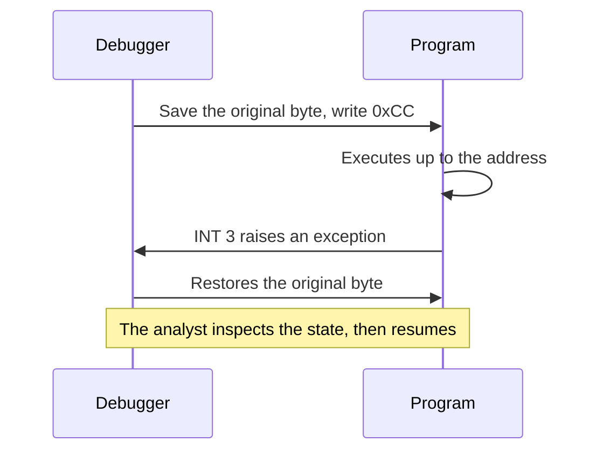
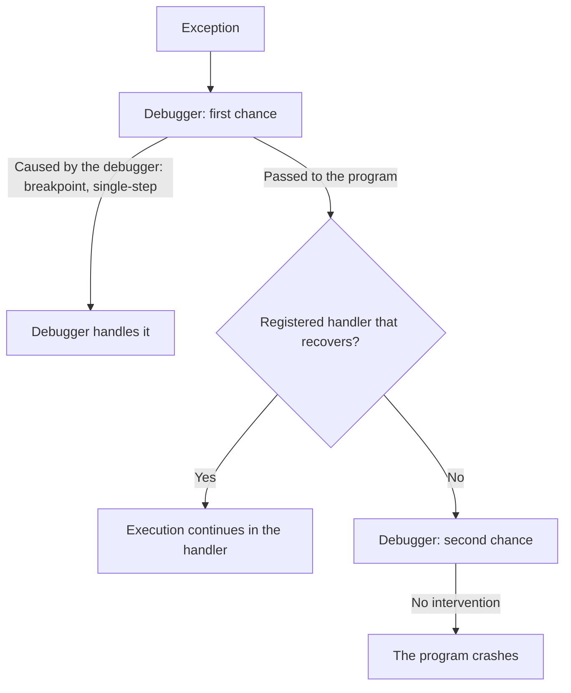

# Advanced Dynamic Analysis

> [!abstract] Purpose and scope
> [[4 - MA - Basic Dynamic Analysis]] watches a sample from the outside, and [[6 - MA - Advanced Static Analysis]] reads its code without running it. **Advanced dynamic analysis combines the two with a debugger**: it runs the code instruction by instruction, showing registers and memory, and lets the analyst change the execution. This lecture explains how debuggers work (stepping, breakpoints, exceptions, ASLR), then shows how to use IDA's debugger in practice. Many tricks from [[5 - MA - Malware Evasion]] target exactly these mechanisms. Concept summaries are collected in [[MOC - Malware Analysis]].
>
> Book references are to *Practical Malware Analysis* (PMA), by **PDF page** of the copy in `pdf/`.

## Malware under the hood

**Basic dynamic analysis** focuses on externally observable behavior, while **advanced static analysis** focuses on malware internals. Both can fall short, for different reasons:

- **malware evasion**, e.g. checks for analysis tools and virtual machines ([[Sandbox Evasion]]);
- **trigger-based behavior**, e.g. a packet carrying a command;
- **code obfuscation and packing** ([[3 - MA - Basic Static Analysis#Obfuscation through packing|Lecture 3]]);
- **anti-disassembly and self-modifying code** ([[2 - MA - X86 Assembly#Anti-disassembly|Lecture 2]]).

A debugger addresses these cases directly. A packed sample eventually unpacks itself in memory, where it can be read. A trigger can be reached by changing a register or forcing a branch, without having to reproduce the real condition.

## Debugging

A debugger supports the analysis of execution at different levels:

- instruction level;
- registers and memory contents;
- function calls;
- threads and exceptions.

It gives the ability to **inspect and control execution** to gain insights. Analysts can also use it to **alter execution**.

### Debugging in user space

There are two ways of debugging:

- **load and run** a program from the debugger;
- **attach** the debugger to a running process.

Loading lets you observe the program from its very first instruction. Attaching is useful when the process is already running, or when you only care about what it does from a certain moment on.

Desirable features:

- inspect and modify memory and registers (including `EIP`);
- capture control-flow transfers and specific instructions;
- control threads (pause/resume);
- modify code.

## Following instructions

Vedi [[Debugger Stepping]].

A debugger can follow **one thread at a time**. **Stepping** lets you execute instructions in a controlled way.

**Single-stepping** goes through the instructions one at a time, exactly as the CPU sees them arriving. It should be used **selectively, on limited code portions**: stepping through a whole program would take forever, so you first locate the interesting region, for example with the API call sites from [[6 - MA - Advanced Static Analysis#From disassembly to malware behavior|static analysis]].

Function calls and returns are **milestones** in the execution:

| Action | What happens | When to use it |
|---|---|---|
| **Step into** a `call` | Enters the called function, whose instructions can then be examined | The function is unknown or interesting |
| **Step over** a `call` | Single-stepping resumes only when the called function returns (if it ever does so) | The function is already understood or irrelevant, e.g. a library call |
| **Step out** of a function | Single-step execution is suspended, and resumes only once execution leaves the function | You entered a function and have seen enough |

> [!warning] "If it ever does so"
> A step over assumes that the function returns. If it never does, for example because it calls `exit` or jumps elsewhere, the debugger does not regain control there and the code runs freely. So set a breakpoint further on when you are not sure.

## Breakpoints

Breakpoints let the program **run until a point of interest is reached**, which complements stepping: you skip what you do not need and stop only where it matters.

- **Instruction breakpoints** pause execution once `EIP` reaches the address of interest.
- **Memory breakpoints** are more general and trap when the CPU accesses specific memory addresses:
  - on read/write access;
  - on write access only;
  - on execute (like an instruction breakpoint).
- **Conditional breakpoints** suspend execution only when an additional condition is matched (e.g. stop at address `0x401130` only when `ECX = 8`).

## Implementing breakpoints

Knowing how each breakpoint is implemented explains its limits and how malware can detect it. This is also the basis of [[Anti-Debugging]].

Instruction breakpoints can be implemented via software or with hardware assistance.

### Software breakpoints

Vedi [[Software Breakpoints]].

A **software breakpoint** replaces the first byte of the instruction at the given address with `INT 3` (opcode `0xCC`).

- The CPU generates a software interrupt, and the debugger captures the event.
- Analysts can insert **as many software breakpoints as they want**.
- They are **conspicuous**, and malware may look for them:
  - by performing a checksum of `.text`;
  - by looking for `0xCC` in its code.

> [!quote] Dal libro
> The debugger shows you the original byte, so you do not see the `0xCC` in its view, but other programs reading that memory do. Self-modifying code may also overwrite the breakpoint and remove it (PDF pp. 250–251).

### Hardware breakpoints

Vedi [[Hardware Breakpoints]].

A **hardware breakpoint** does not alter code, but leverages the **CPU debug registers** to trap execution automatically.

![[MA-L07-01.png]]

The figure shows the debug registers from the Intel manual:

| Register | Role |
|---|---|
| `DR0`-`DR3` | The linear addresses of the breakpoints |
| `DR4`-`DR5` | Reserved |
| `DR6` | Status: which condition was detected |
| `DR7` | Control: enable bits, type and length of each breakpoint |

Consequences:

- **limited number** (4 on x86), one per address register;
- **harder to detect**, because no byte changes in memory, so a checksum of `.text` finds nothing.

> [!quote] Dal libro
> Malware can still modify the debug registers to interfere with hardware breakpoints. As a countermeasure, the General Detect flag in `DR7` triggers a breakpoint before any `mov` that accesses a debug register, so it notices such changes, though only those made with `mov` (PDF p. 252).

### Conditional breakpoints

Vedi [[Memory and Conditional Breakpoints]].

**Conditional breakpoints** evaluate a user-provided condition and suspend execution only when it is satisfied.

- They are very useful on **loops** (e.g. break only after N iterations).
- They are useful also for **function calls** (e.g. an argument-related condition, such as a `CreateFile` on a specific path).
- **Careful**: they slow down execution even when they do not suspend it.

The slowdown comes from their implementation. PMA describes them as software breakpoints that break only if a certain condition holds (PDF p. 252): the program stops at every hit, the debugger evaluates the condition, and it resumes if false. A conditional breakpoint inside a hot loop can therefore make the program much slower, and this delay is measurable by [[Timing Attacks]].

### Memory breakpoints

**Memory breakpoints** can be software or hardware-based:

- **Hardware**: up to 4 bytes (dword size) per registered breakpoint.
- **Software**: they change memory protection attributes (not 100% reliable).
- They are very useful when dealing, for example, with **packed malware**.

> [!note] Details
> "Up to 4 bytes" is the limit in 32-bit code; in x64 long mode, a debug register can also watch 8 bytes. Software memory breakpoints work on whole pages, because that is the granularity of memory protection, so the debugger must filter out the accesses to the rest of the page.

Packing is the typical use. Unpacking stubs first write the code into memory, and then jump to it. A breakpoint **on write** finds the code that unpacks, and one **on execute** in the same region stops just as the unpacked code starts. A write breakpoint on a variable also answers the question "who changes this value?", which is hard to answer by reading the code.

## Exceptions

Vedi [[First and Second-Chance Exceptions]] and, for the registration mechanism, [[6 - MA - Advanced Static Analysis#Exceptions|SEH in Lecture 6]].

**Exceptions** are a mechanism for supporting alternative control flow (e.g. to recover from errors).

- From the CPU perspective, they are an **interrupt**, just like the `int` instruction (see [[Interrupt]]).
- **Debuggers use them to regain control** of the execution:
  - instruction and memory breakpoints;
  - single-stepping, when the **trap flag** `TF` in `EFLAGS` is set.

To handle an exception, a **handler must have been registered**:

- benign programs use handlers for error situations (e.g. division by zero);
- malware authors use them to hinder analysis. For instance, if the debugger catches an exception meant for the malware, it can give away its presence.

Exceptions are passed to the debugger as they occur, and it can catch each one **up to two times**:

- Some APIs behave differently when executing under a debugger, raising exceptions to inform the user.
- **First-chance** exceptions can be passed to the program when they are unrelated to debugging (e.g. a floating-point or division-by-zero error).
- When the program cannot recover from the exception (e.g. there is no corresponding registered handler), the debugger receives it again.
- **Second-chance** exceptions require intervention, or the program will crash.
- Malware often uses exceptions as an **anti-debug technique**.

> [!quote] Dal libro
> First-chance exceptions can often be ignored, since the program may be designed to handle them. Second-chance ones cannot: in malware analysis they may reveal bugs, but it is "more likely that the malware doesn't like the environment" (PDF pp. 254–255).

So a second-chance exception does not necessarily mean a broken sample: it can be a sign of an environment check. To debug a sample that deliberately raises exceptions, pass the first-chance ones to the program, otherwise the logic in its handler never runs.

## Debugging and ASLR

Vedi [[Debugging with ASLR]] and, for the mechanism itself, [[ASLR]].

With ASLR, changing addresses can slow down debugging. For programs compiled with `/DYNAMICBASE`, Windows randomizes the load base address of the module, so the addresses in the disassembly will likely **not match** what you see in a debugger. Comments and notes taken statically then no longer line up with the running program.

There are two ways to deal with this:

**Rebasing in IDA**: IDA offers manual loading for a PE and, better, a **rebase option for the current session** (Edit → Segments → Rebase Program).

![[MA-L07-02.png]]

The dialog lets you set the new value as the address of the first segment, a shift delta, or the image base (here `0x400000`), with the options *Fix up the program* and *Rebase the whole image*. The address that matters is obtained as:

$$\text{runtime address} = \text{address in the disassembly} - \text{image base} + \text{runtime base}$$

For example, with image base `0x400000` and runtime base `0xD40000`, the static address `0x401390` becomes `0xD41390`. **The offset from the base never changes.**

**Editing the PE header**: alternatively, modify the PE header using CFF Explorer (OptionalHeader → DllCharacteristics → *DLL can move*), which clears the request for randomization. Note that **some Windows 10+ settings may override it**.

## Popular debuggers

Many debuggers exist. Some are particularly well suited for malware analysis and reverse engineering:

- WinDbg;
- IDA Pro and IDA Freeware;
- OllyDbg, x64dbg;
- Immunity Debugger;
- radare2 with plugins.

## IDA's debugger

Vedi [[IDA Debugger]].

Recent versions of IDA Freeware include a debugger. It lacks integration with third-party tools like Scylla and some advanced scripting features, so you may still consider using x64dbg sometimes.

![[MA-L07-03.png]]

The screenshot shows the debugger running on `Bomb.exe`. Its advantage over a standalone debugger is that it keeps IDA's analysis, so the names and comments from static work remain available at runtime.

### Main interface

![[MA-L07-04.png]]

There are four quadrants, highlighted in red:

1. **Disassembler** window;
2. **Registers** window;
3. **Stack** window;
4. **Memory dumps** window.

### Memory map

Layout information can be very valuable in the analysis:

![[MA-L07-05.png]]

The **Program Segmentation** pane lists each region with its `R`, `W` and `X` flags.

- **Writable + executable** regions may hint at packing or self-modifying code, since normal code is not writable and normal data is not executable.
- A **changed protection** for a region may suggest the same.
- It lists the **load address for DLLs**.
- Clicking on a base address updates the disassembler (code) or the memory dump (data) view.

Compare the map at different moments: a new RWX region appearing during execution is a good place for a memory breakpoint.

### Panes

IDA offers several panes besides CPU and Memory Map: **Graph**, **Breakpoints**, **Call stack**, **SEH** (exception handling), **Symbols**, **Threads**, and more.

#### Graph pane

![[MA-L07-06.png]]

By right-clicking or pressing `SPACE` on an instruction address in the Disassembler window, you toggle between the classic IDA graph view and the "flat" disassembly one. The graph makes the branches of the current function easy to follow, while the flat view shows the code in address order.

#### Call stack and threads

The **Call Stack** pane shows the sequence of routine calls currently active on the stack, while the **Threads** pane lets the analyst control the state of each thread.

![[MA-L07-07.png]]

The stack is read from the current function (`sub_D41390`, top) back through its callers (`sub_D41000+127`, and so on) down to `kernel32`'s `BaseThreadInitThunk` and `ntdll`. It answers the question "how did execution get here?", and it relies on the [[2 - MA - X86 Assembly#Functions and stack frames|stack frames]] seen in Lecture 2. The addresses are in the `0xD4xxxx` range, an effect of the ASLR discussed above.

![[MA-L07-08.png]]

The Threads pane lists three threads here, all in the *Ready* state. Suspending the others is useful to focus on one, given that the debugger follows one thread at a time (see [[Thread]]).

### Managing stepping

Fine-grained control of the execution:

- **run** until a breakpoint is hit;
- **step into** and **step over** for single-step;
- **execute till return**;
- **restart** the execution.

![[MA-L07-09.png]]

The shortcuts come from the Debugger menu:

| Command | Shortcut |
|---|---|
| Continue process | `F9` |
| Terminate process | `Ctrl+F2` |
| Step into | `F7` |
| Step over | `F8` |
| Run until return | `Ctrl+F7` |
| Run to cursor | `F4` |

### Controlling breakpoints

Instruction breakpoints are intuitive:

- toggle software breakpoints (on/off) with `F2`;
- hardware assistance can be enabled later;
- breakpoints can be controlled from the pane (e.g. enable/disable/remove all);
- there is a **hit count** for each breakpoint;
- memory breakpoints are similar.

![[MA-L07-10.png]]

The settings dialog (here for location `0xD413E3`) contains everything seen in theory: a **Condition** field for conditional breakpoints, the **Hardware** checkbox, and the **Read/Write/Execute** mode with a **Size** for hardware breakpoints, i.e. a memory breakpoint. The *Actions* section also lets you trace without breaking, which is lighter than stopping by hand each time.

![[MA-L07-11.png]]

The Breakpoints pane has columns for type, location, pass count, hardware and condition.

> [!note] Hit count vs. pass count
> The slide says "hit count", while the column in the screenshot is labelled **Pass count**.

### Modifying registers

You can edit general-purpose registers (e.g. `ECX`) or change the instruction pointer.

![[MA-L07-12.png]]

The left part is the context menu in the graph view, with the arrow on **Set IP** (`Ctrl+N`), which moves execution to the selected instruction. The right part is the *Modify register value* dialog.

These are powerful tools. For example, flipping `EAX` after a check, or setting `EIP` past it, skips an environment test without patching anything. But Set IP does not run the skipped instructions, so their effects on the stack and on registers are lost.

### Modifying memory

You can alter memory easily: you can follow an address on the stack first (e.g. to dereference a pointer) or go directly to the dump (e.g. ASCII data), then modify the corresponding data. Experience will tell you which to use every time.

![[MA-L07-13.png]]

The Hex View context menu offers **Edit…** (`F2`) on the bytes of the string `"Public speaking is very easy."`. Editing a string like this one changes what the program compares or sends without touching its code.

### Modifying code

Vedi [[Runtime Patching]].

You can also modify code, provided that there is **enough space to host the desired new instruction(s)**.

- Changes by default **do not survive restarts**. But they can be imported, exported or made permanent using patches (File → Patches).
- Beware of possible **integrity checks** (the same checksums that find software breakpoints).
- Ensure **stack pointer validity** with respect to the frame layout when deleting a function call!

![[MA-L07-14.png]]

> [!warning] Correzione
> The slide says "File->Patches", but the screenshot shows the commands under **Edit → Patch program**: *Change byte*, *Change word*, *Assemble*, *Patched bytes* and *Apply patches to input file*. Look for them there.

**About the stack**: suppose you delete a `call` to a function taking arguments. The `push`es before it remain. In `cdecl` the caller's `add esp, N` remains too, while in `stdcall` the callee cleaned up, so removing the call leaves the arguments on the stack ([[2 - MA - X86 Assembly#Calling conventions|calling conventions]]). You have to also remove the `push`es and fix the balance accordingly, otherwise `esp` no longer matches what the rest of the function expects. Any leftover space can be filled with `nop` (`0x90`).

## Common IDA shortcuts

Learn shortcuts to use IDA more efficiently:

| Shortcut | Action |
|---|---|
| `Escape` | Go back to the previous position in the current view |
| `Ctrl+Enter` | Go forward to the next position in the current view |
| `Space` | Switch between text and graph mode |
| `G` | Jump to an address in the current view |
| `F2` | In disassembly view (static analysis): toggle a breakpoint at the current instruction. During debugging: enter edit mode to change the selected value; press `F2` again to apply the changes |
| `X` | Show cross-references to the selected item (e.g. a function) |
| `N` | Rename the selected reference |

> [!summary] Key points
> - A debugger fills the gaps of the basic and static techniques, seeing the unpacked code and letting you reach triggers.
> - Use single-stepping selectively: step over what you understand, step into what you do not, and stop where it matters with breakpoints.
> - Software breakpoints write `0xCC` and are unlimited but detectable. Hardware ones use `DR0`-`DR3` and `DR7`, are limited to 4 and alter nothing.
> - Conditional breakpoints are slow, and memory breakpoints are the tool for packed samples.
> - Exceptions reach the debugger up to twice. Pass the first-chance ones to the program, and read second-chance ones as a possible sign of an environment check.
> - With ASLR, rebase in IDA: the offset from the base stays the same.
> - In IDA, you can change registers, `EIP`, memory and code, but mind integrity checks and the stack balance.
