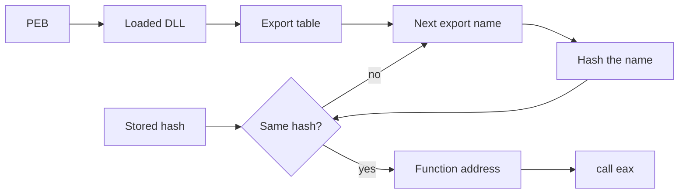

# API Hashing

> [!summary] In breve
> A way to call a Windows function without its name appearing in the binary: the sample stores only a hash of the name and, at runtime, looks for the export whose name produces that hash.

> [!note] Source
> The slides only cite "API hashing algorithms" as an example of hand-written sequences. The details below are general background, not course material.

## The problem it solves

API names normally give away what a sample can do:

| Method | What the analyst sees |
|---|---|
| Normal import | `VirtualAlloc` in the import table |
| `GetProcAddress(h, "VirtualAlloc")` | The string `"VirtualAlloc"`, found with `strings` |
| API hashing | Only a 32-bit number |

It is **not a wrapper**. A wrapper calls another function and adds something to it, whereas the resolver only returns the address of the API. The sample makes the call itself.

## How it works

1. The author computes the hash of the API name in advance and stores only that number.
2. At runtime, the sample finds the loaded DLL, often by walking the module list from the PEB (`fs:[30h]` on 32-bit).
3. It reads the DLL's export table, which lists the names of the exported functions.
4. It hashes each name and compares the result with the stored number.
5. On a match, it gets the function's address and calls it.



## Example: ROR13

ROR13 is a classic algorithm: it rotates the hash right by 13 bits and adds each character.

```asm
    xor  edi, edi        ; hash = 0
    xor  eax, eax
next:
    lodsb                ; al = character at esi, then esi++
    test al, al          ; end of the string?
    jz   done
    ror  edi, 0Dh        ; rotate the hash by 13 bits
    add  edi, eax        ; add the character
    jmp  next
done:
```

| API name | ROR13 hash |
|---|---|
| `LoadLibraryA` | `0xEC0E4E8E` |
| `GetProcAddress` | `0x7C0DFCAA` |
| `VirtualAlloc` | `0x91AFCA54` |

## Why it counts as hand-written

This code often doesn't look like typical compiler output, especially in shellcode, where it is often written directly in assembly. There are no imports or strings to start from, and the decompiler's output can be hard to read.

## How to spot it

- Access to `fs:[30h]`.
- A loop that applies `ror` or `rol` to bytes read from a string.
- A comparison with a 32-bit constant.
- A `call` through a register.
- Very few imports.

## How to defeat it

- **Statically:** a hash can't be inverted, but there are few API names. Apply the same algorithm to all the exports of common DLLs, then look up the number in the resulting table.
- **Dynamically:** set a breakpoint on the `call eax` and check in the debugger which function `EAX` points to.

## Collegamenti

- **Concetti correlati**: [[DLL Structure]] · [[Windows API Conventions]] · [[PEB Debugger Flags]] · [[Debugger Stepping]] · [[Software Breakpoints]]
- **Mappa**: [[MOC - Malware Analysis]]

> [!info] Approfondimento
> - [[2 - MA - X86 Assembly#Analyzing binary code|Lezione 2 — Analyzing binary code]]
> - [[3 - MA - Basic Static Analysis#Runtime linking|Lezione 3 — Runtime linking]]
