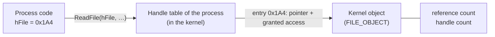

# Handle

> [!summary] In breve
> A **handle** is an opaque value that a process gets back when it opens or creates an OS object (file, process, thread, registry key, mutex, window…). Every later operation on that object goes through the handle. For the analyst, **following a handle** from the call that creates it to the calls that use it links API calls that look unrelated.

## What a handle is

Windows does not let user-mode code touch kernel objects directly: the objects live in kernel memory, which [[Protection Rings|ring 3]] cannot read. So when a program calls `CreateFileW`, `OpenProcess` or `RegOpenKeyExW`, the kernel creates (or finds) the object and returns a **handle**, a small number that stands for it.

The lecture describes handles as **immutable pointers**:

- you **cannot do arithmetic** on them (a handle + 4 is not "the next object");
- you can **store** them and reuse them later to refer to the same object;
- you can sometimes check whether they are valid against `INVALID_HANDLE_VALUE`.

> [!example] From the lecture
> `CreateWindowEx` returns an `HWND`, a handle to the window. To do anything with that window, such as `DestroyWindow`, you pass that handle back.

In the [[Windows API Conventions|Hungarian notation]], handle types start with `H`: `HANDLE`, `HWND`, `HKEY`, `HMODULE`, `HINSTANCE`, `HINTERNET`…

## How it works under the hood

> [!note] Beyond the slides
> This section and the next ones go beyond what the slides say. They explain how handles work, so you can reason about the lecture examples.



- Every process has its own **handle table**, kept by the kernel's **Object Manager**. The handle is (roughly) an **index** into that table, which is why kernel handle values are multiples of 4 (`0x4`, `0x8`, … `0x1A4`).
- Each entry stores the **pointer to the object** and the **access rights granted** when it was opened (e.g. `KEY_WRITE`, `PROCESS_ALL_ACCESS`). The check is done **once**, at open time: later calls only check that the requested operation fits the granted access.
- The same value means nothing in another process: handle `0x1A4` in process A and `0x1A4` in process B are unrelated. To share an object, a process must **duplicate** the handle (`DuplicateHandle`) or let a child **inherit** it.
- Objects are **reference counted**: an object is destroyed only when all handles to it are closed (and no kernel code still references it). `CloseHandle` (or `RegCloseKey` for keys) decrements the count. When a process exits, the kernel closes all of its handles.

This mirrors the Linux [[File Descriptor|file descriptor]]: an integer index into a per-process table that the kernel keeps.

| | Windows handle | Linux file descriptor |
|---|---|---|
| What it is | Index into the process handle table | Index into the process fd table |
| Objects | Files, processes, threads, keys, mutexes, events, sections, tokens… | Files, pipes, sockets ("everything is a file") |
| Typical values | Multiples of 4 (`0x4`, `0x8`…) | Small integers (`0`, `1`, `2`, `3`…) |
| Released by | `CloseHandle`, `RegCloseKey`… | `close` |
| Shared with child | Inheritance (`bInheritHandles`) or `DuplicateHandle` | Inherited on `fork`, unless `O_CLOEXEC` |

## Not all handles are the same

| Kind | Examples | Notes |
|---|---|---|
| **Kernel object** handles | `HANDLE` to a file, process, thread, mutex, event, section; `HKEY` | In the per-process handle table, closed with `CloseHandle` / `RegCloseKey` |
| **USER/GDI** handles | `HWND`, `HMENU`, `HBITMAP`, `HDC` | Managed by the windowing subsystem (`win32k`), not by the handle table. An `HWND` is valid for the whole desktop session, not just one process |
| **Pseudo-handles** | `GetCurrentProcess()` = `(HANDLE)-1`, `GetCurrentThread()` = `(HANDLE)-2` | Constants meaning "me": no table entry, nothing to close |
| **Not really handles** | `HMODULE` / `HINSTANCE` | The **base address** of the loaded module in memory (e.g. `0x400000`), returned by `LoadLibrary`/`GetModuleHandle`. Released with `FreeLibrary`, not `CloseHandle` |
| **Predefined keys** | `HKEY_LOCAL_MACHINE` = `0x80000002`, `HKEY_CURRENT_USER` = `0x80000001` | Fixed constants you will see pushed in the disassembly before `RegOpenKeyEx` |

> [!warning] `INVALID_HANDLE_VALUE` vs `NULL`
> The failure value is not uniform across the API:
> - `CreateFile`, `FindFirstFile`, `CreateToolhelp32Snapshot` return `INVALID_HANDLE_VALUE` (`-1`, i.e. `0xFFFFFFFF`);
> - `OpenProcess`, `CreateThread`, `CreateMutex`, `CreateFileMapping` return `NULL` (`0`).
>
> So in assembly the check can be `cmp eax, 0FFFFFFFFh` or `test eax, eax`, depending on the function. Note also that `-1` is **also** the pseudo-handle of the current process.

## Why handles matter in malware analysis

### Following the data flow statically

A handle is the thread that ties API calls together. In IDA, rename the variable that stores the handle (e.g. `hKey`, `hProcess`) and follow its cross-references: every function that receives it works on the **same object**.

```nasm
lea  eax, [ebp+hKey]          ; where the handle will be written
push eax                      ; phkResult
push 20006h                   ; KEY_WRITE
push 0
push offset SubKey            ; "Software\Microsoft\Windows\CurrentVersion\Run"
push 80000001h                ; HKEY_CURRENT_USER
call RegOpenKeyExW
...
push [ebp+hKey]               ; same handle
call RegSetValueExW           ; writes the persistence value
push [ebp+hKey]
call RegCloseKey
```

This is the [[Registry Persistence|Run-key persistence]] example from Lecture 6: the handle written into `phkResult` by `RegOpenKeyExW` is the one `RegSetValueExW` writes into, and `RegCloseKey` releases it.

> [!tip] Output handles are passed by address
> Many functions return the handle in **`eax`** (`CreateFile`, `OpenProcess`), others write it to a **pointer you pass** (`RegOpenKeyEx`, `CreateProcess` in `PROCESS_INFORMATION`). In the second case, look for a `lea reg, [local]` followed by `push reg`.

### Typical handle chains

| Behavior | Chain of calls sharing the handle |
|---|---|
| Process injection | `OpenProcess` → `VirtualAllocEx` → `WriteProcessMemory` → `CreateRemoteThread` (all on `hProcess`) |
| [[Process Replacement]] | `CreateProcess` (suspended) → `GetThreadContext` / `WriteProcessMemory` / `SetThreadContext` → `ResumeThread` (on `hProcess`, `hThread`) |
| [[File Mapping]] | `CreateFile` → `CreateFileMapping` → `MapViewOfFile` (file handle → section handle → view) |
| Single instance | `OpenMutex` / `CreateMutex` → handle kept open for the whole run ([[Mutex Single-Instance Check]]) |
| Process enumeration | `CreateToolhelp32Snapshot` → `Process32First` / `Process32Next` (looking for analysis tools, see [[Application Artifacts]]) |
| Remote shell | Socket handle copied into `hStdInput`/`hStdOutput`/`hStdError` of `STARTUPINFO`, then `CreateProcess("cmd.exe", …, bInheritHandles = TRUE, …)` |

> [!important] Remote shell and inheritance
> The remote-shell pattern of Lecture 6 works **because of handle inheritance**: with `STARTF_USESTDHANDLES` and `bInheritHandles = TRUE`, the child `cmd.exe` receives the socket as its standard input, output and error.

### Dynamic analysis: open handles are evidence

- [[Process Explorer]] shows, in the lower pane (handle view), every handle a process holds: open files, registry keys, **named mutexes**, events, sections. **Find → Find Handle or DLL** tells you which process holds a given mutex or file.
- Sysinternals `handle.exe` does the same from the command line.
- In memory forensics, the Volatility `windows.handles` plugin lists the handles of each process in a memory dump.

Names of mutexes, events and files held open are good **IoCs**.

### Anti-debugging with an invalid handle

Closing an invalid handle normally just returns an error, but **under a debugger** `CloseHandle`/`NtClose` raises `STATUS_INVALID_HANDLE` (`0xC0000008`). Malware calls `CloseHandle(0x99999999)` inside a `__try` block: if the exception fires, a debugger is attached. See [[Anti-Debugging]] and [[Al-Khaser]].

## Collegamenti

- **Concetti correlati**: [[Windows API Conventions]] · [[Native API]] · [[Protection Rings]] · [[Windows Registry]] · [[Registry Persistence]] · [[File Mapping]] · [[Mutex Single-Instance Check]] · [[Process Replacement]] · [[Process Explorer]] · [[Anti-Debugging]]
- **Altri corsi**: [[File Descriptor]] · [[System Call]] (Sistemi Operativi)
- **Mappa**: [[MOC - Malware Analysis]]

> [!info] Approfondimento
> - [[6 - MA - Advanced Static Analysis#Handles|Lezione 6 — Handles]]
> - [[6 - MA - Advanced Static Analysis#Types and Hungarian notation|Lezione 6 — Types and Hungarian notation]]
> - [[5 - MA - Malware Evasion#`CloseHandle` check|Lezione 5 — `CloseHandle` check]]
