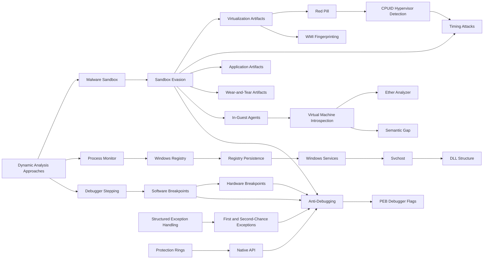

# MOC — Malware Analysis

> [!abstract]
> Map of the *Malware Analysis and Incident Forensics* course (Master's, Sapienza, 2026/27). Every lecture has a full note; lectures 4 to 7 also have short review notes in `Concetti/`. **New lectures are added to the table below** as they are generated (see "How to extend this MOC").

## Lectures

| # | Lecture | Topics |
|---|---|---|
| 1 | [[1 - MA - Introduction]] | course info, attack scenarios (Yahoo!, Equifax, WannaCry, LockBit), kill chain, expected malware behaviors |
| 2 | [[2 - MA - X86 Assembly]] | registers, memory map, addressing, flow control, stack frames, calling conventions, anti-disassembly |
| 3 | [[3 - MA - Basic Static Analysis]] | signatures, hashing, strings, packing, PE format, imports/exports ([[Lab03-Basic-Analysis]]) |
| 4 | [[4 - MA - Basic Dynamic Analysis]] | behavioral analysis approaches, instrumentation, sandboxes, lab setup, Procmon, Process Explorer, registry, persistence, services, network analysis |
| 5 | [[5 - MA - Malware Evasion]] | VM/sandbox detection, timing, VMI, Ether, semantic gap, anti-debugging |
| 6 | [[6 - MA - Advanced Static Analysis]] | user/kernel boundary, Native and Win32 APIs, files, registry, network, execution mechanisms (DLLs, threads, SEH, mutexes, services, COM), C constructs in assembly |
| 7 | [[7 - MA - Advanced Dynamic Analysis]] | stepping, software/hardware/memory/conditional breakpoints, exceptions, ASLR, IDA debugger, patching |

## Concepts by theme

### Dynamic analysis: methods and environment
[[Dynamic Analysis Approaches]] · [[Analysis Instrumentation Levels]] · [[Malware Sandbox]] · [[Malware Naming]] · [[Analysis Lab Setup]] · [[Fake Network Services]]

### Monitoring tools
[[Process Monitor]] · [[Process Explorer]] · [[Regshot]]

### Windows internals
[[Protection Rings]] · [[Native API]] · [[Windows API Conventions]] · [[File Mapping]] · [[Alternate Data Streams]] · [[Winsock and WinINet]]

### Registry and persistence
[[Windows Registry]] · [[Registry Persistence]] · [[Windows Services]] · [[Svchost]] · [[Component Object Model]]

### Execution mechanisms
[[DLL Structure]] · [[Structured Exception Handling]] · [[Mutex Single-Instance Check]] · [[Process Replacement]]

### Reading assembly
[[Recognizing C Constructs]] · [[Jump Tables]]

### Debugging
[[Debugger Stepping]] · [[Software Breakpoints]] · [[Hardware Breakpoints]] · [[Memory and Conditional Breakpoints]] · [[First and Second-Chance Exceptions]] · [[Debugging with ASLR]] · [[IDA Debugger]] · [[Runtime Patching]]

### Evasion: detecting the analysis environment
[[Sandbox Evasion]] · [[Red Pill]] · [[CPUID Hypervisor Detection]] · [[Virtualization Artifacts]] · [[Application Artifacts]] · [[Wear-and-Tear Artifacts]] · [[WMI Fingerprinting]] · [[Timing Attacks]]

### Anti-debugging
[[Anti-Debugging]] · [[PEB Debugger Flags]]

### Building better analysis systems
[[In-Guest Agents]] · [[Virtual Machine Introspection]] · [[Ether Analyzer]] · [[Semantic Gap]]

### Tools and test suites
[[Al-Khaser]]

## Percorsi trasversali

- **Spot the VM**: [[Red Pill]] → [[CPUID Hypervisor Detection]] → [[Timing Attacks]] (latency of the VM exit).
- **Spot the sandbox**: [[Virtualization Artifacts]] → [[WMI Fingerprinting]] → [[Application Artifacts]] → [[Wear-and-Tear Artifacts]].
- **Answer from the defender**: [[In-Guest Agents]] → [[Virtual Machine Introspection]] → [[Ether Analyzer]] → [[Semantic Gap]].
- **Spot the debugger**: [[Anti-Debugging]] → [[PEB Debugger Flags]] → [[Timing Attacks]].
- **Practice**: [[Al-Khaser]] implements most of these checks.
- **From outside to inside**: [[Dynamic Analysis Approaches]] → [[Process Monitor]] and [[Process Explorer]] → [[Debugger Stepping]] → [[IDA Debugger]].
- **How malware survives a reboot**: [[Windows Registry]] → [[Registry Persistence]] → [[Windows Services]] → [[Svchost]] → [[Component Object Model]].
- **From the API to the kernel**: [[Windows API Conventions]] → [[Native API]] → [[Protection Rings]] → [[System Call]].
- **Breakpoints and their detection**: [[Software Breakpoints]] → [[Hardware Breakpoints]] → [[Memory and Conditional Breakpoints]] → [[Anti-Debugging]].
- **Exceptions**: [[Structured Exception Handling]] → [[First and Second-Chance Exceptions]] → [[Anti-Debugging]].
- **Reading code at a glance**: [[Windows API Conventions]] → [[Recognizing C Constructs]] → [[Jump Tables]].
- **Network IoCs**: [[Winsock and WinINet]] → [[Fake Network Services]] → [[Analysis Lab Setup]].
- Static view of the same ideas: [[3 - MA - Basic Static Analysis#Strings]] (artifact strings are IoCs), [[2 - MA - X86 Assembly#Anti-disassembly]], [[1 - MA - Introduction#Obfuscation and evasion]].

## How to extend this MOC

When a new lecture is generated: add a row to the table, add its concept notes to the themes (or create new themes), and add the lecture to `LESSONS` in the generator data file.
