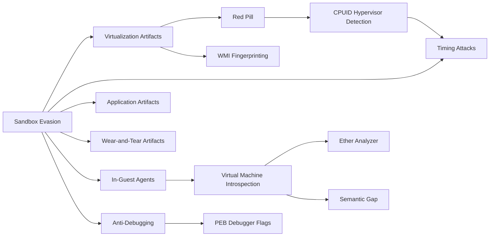

# MOC — Malware Analysis

> [!abstract]
> Map of the *Malware Analysis and Incident Forensics* course (Master's, Sapienza, 2026/27). Every lecture has a full note; the lectures from the **Malware Evasion** block onward also have short review notes in `Concetti/`. Lecture 4 is not in the `pdf/` folder yet; **new lectures are added to the table below** as they are generated (see "How to extend this MOC").

## Lectures

| # | Lecture | Topics |
|---|---|---|
| 1 | [[1 - MA - Introduction]] | course info, attack scenarios (Yahoo!, Equifax, WannaCry, LockBit), kill chain, expected malware behaviors |
| 2 | [[2 - MA - X86 Assembly]] | registers, memory map, addressing, flow control, stack frames, calling conventions, anti-disassembly |
| 3 | [[3 - MA - Basic Static Analysis]] | signatures, hashing, strings, packing, PE format, imports/exports ([[Lab03-Basic-Analysis]]) |
| 5 | [[5 - MA - Malware Evasion]] | VM/sandbox detection, timing, VMI, Ether, semantic gap, anti-debugging |

## Concepts by theme

### Evasion: detecting the analysis environment
[[Sandbox Evasion]] · [[Red Pill]] · [[CPUID Hypervisor Detection]] · [[Virtualization Artifacts]] · [[Application Artifacts]] · [[Wear-and-Tear Artifacts]] · [[WMI Fingerprinting]] · [[Timing Attacks]]

### Anti-debugging
[[Anti-Debugging]] · [[PEB Debugger Flags]]

### Building better analysis systems
[[In-Guest Agents]] · [[Virtual Machine Introspection]] · [[Ether Analyzer]] · [[Semantic Gap]]

### Tools and test suites
[[Al-Khaser]]

## Percorsi trasversali

- **Spot the VM**: [[Red Pill]] → [[CPUID Hypervisor Detection]] → [[Timing Attacks]] (latency of the VM exit).
- **Spot the sandbox**: [[Virtualization Artifacts]] → [[WMI Fingerprinting]] → [[Application Artifacts]] → [[Wear-and-Tear Artifacts]].
- **Answer from the defender**: [[In-Guest Agents]] → [[Virtual Machine Introspection]] → [[Ether Analyzer]] → [[Semantic Gap]].
- **Spot the debugger**: [[Anti-Debugging]] → [[PEB Debugger Flags]] → [[Timing Attacks]].
- **Practice**: [[Al-Khaser]] implements most of these checks.
- Static view of the same ideas: [[3 - MA - Basic Static Analysis#Strings]] (artifact strings are IoCs), [[2 - MA - X86 Assembly#Anti-disassembly]], [[1 - MA - Introduction#Obfuscation and evasion]].

## How to extend this MOC

When a new lecture is generated: add a row to the table, add its concept notes to the themes (or create new themes), and add the lecture to `LESSONS` in the generator data file.
