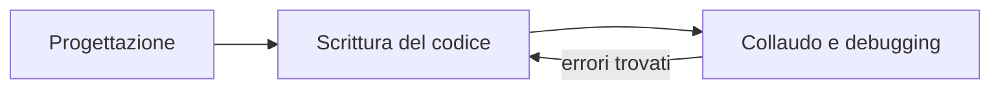

# Introduzione a Java

> [!abstract]
> Il libro usa **Java** come linguaggio per descrivere e implementare tutte le strutture dati e gli algoritmi. Questo capitolo è un ripasso rapido del linguaggio: tipi fondamentali, classi e oggetti, stringhe e array, espressioni e cast, controllo di flusso, input/output, pacchetti e infine il ciclo di sviluppo del software (progettazione, pseudocodice, documentazione, collaudo).
> Non è teoria degli algoritmi, ma tutto quello che viene dopo dà per scontati questi concetti: in particolare la distinzione **tipo fondamentale / variabile riferimento** (che spiega perché le strutture concatenate funzionano) e la **convenzione di pseudocodice** usata nel resto del libro.
> Il capitolo successivo, [[02 - ASD - Progettazione orientata agli oggetti]], approfondisce ereditarietà, interfacce, eccezioni e tipi generici.
> Mappa del corso: [[MOC - Algoritmi e Strutture Dati]].

---

## Per cominciare: il primo programma

Per progettare strutture dati e algoritmi bisogna dare al computer istruzioni dettagliate; il libro sceglie Java, un linguaggio di alto livello orientato agli oggetti. Il capitolo non è un manuale completo: presenta solo le parti del linguaggio che serviranno dopo.

![[ASD-p017-1.png]]

La figura scompone il programma "Hello Universe!" in tutte le sue parti:

- tutto il codice Java **deve stare dentro una classe** (`public class Universe { ... }`);
- gli enunciati eseguibili stanno dentro **metodi** (le "funzioni" di Java);
- `main` è il metodo speciale da cui parte l'esecuzione: `public` (chiunque può eseguirlo), `static` (appartiene alla classe, non a un oggetto), `void` (non restituisce nulla), e riceve `String[] args`, gli argomenti passati sulla riga di comando;
- `System.out.println("Hello Universe!");` invoca il metodo che stampa una stringa; il `;` chiude l'enunciato;
- le parentesi graffe `{ }` delimitano un **blocco** di codice (il corpo della classe e quello del metodo).

### Identificatori e parole riservate

Un **identificatore** (il nome di una classe, di un metodo o di una variabile) è una sequenza di lettere, cifre e underscore che inizia con una lettera; le lettere possono essere di qualunque alfabeto Unicode. Non si possono usare le **parole riservate** del linguaggio (Tabella 1.1):

| | | | | |
|---|---|---|---|---|
| `abstract` | `default` | `goto` | `package` | `synchronized` |
| `assert` | `do` | `if` | `private` | `this` |
| `boolean` | `double` | `implements` | `protected` | `throw` |
| `break` | `else` | `import` | `public` | `throws` |
| `byte` | `enum` | `instanceof` | `return` | `transient` |
| `case` | `extends` | `int` | `short` | `true` |
| `catch` | `false` | `interface` | `static` | `try` |
| `char` | `final` | `long` | `strictfp` | `void` |
| `class` | `finally` | `native` | `super` | `volatile` |
| `const` | `float` | `new` | `switch` | `while` |
| `continue` | `for` | `null` | | |

### Commenti

- `// ...` commento su una riga (*inline comment*);
- `/* ... */` commento a blocco (*block comment*);
- `/** ... */` commento **Javadoc**, letto dallo strumento che genera la documentazione (vedi [[#Javadoc]]).

_(libro, pp. 16–18)_

### I tipi fondamentali

Java ha 8 **tipi fondamentali** (o *primitivi*): una variabile di questi tipi contiene direttamente il valore, non un riferimento.

| Tipo | Contenuto |
|---|---|
| `boolean` | `true` o `false` |
| `char` | carattere Unicode a 16 bit |
| `byte` | intero con segno, complemento a due, 8 bit |
| `short` | intero con segno, 16 bit |
| `int` | intero con segno, 32 bit |
| `long` | intero con segno, 64 bit |
| `float` | virgola mobile IEEE 754, 32 bit |
| `double` | virgola mobile IEEE 754, 64 bit |

Le costanti intere (`14`, `195`) sono `int` a meno di un suffisso `L` (`890L` è `long`); le costanti decimali (`3.1416`, `6.022e23`) sono `double` a meno di un suffisso `F` (`3.1416F` è `float`).

```java
boolean flag = true;
boolean verbose, debug;          // dichiarate ma non inizializzate
char grade = 'A';
byte b = 12;
short s = 24;
int i, j, k = 257;               // solo k inizializzata
long l = 890L;                   // notare la "L"
float pi = 3.1416F;              // notare la "F"
double e = 2.71828, a = 6.022e23;
```

> [!important] Inizializzazione
> - Le **variabili locali** (dichiarate in un blocco) vanno inizializzate prima di essere usate, altrimenti il codice non compila.
> - Le **variabili di esemplare** (campi di una classe) di tipo fondamentale, se non inizializzate, ricevono un valore predefinito: `0` per i numeri, `false` per i booleani, il carattere nullo per `char`.

_(libro, pp. 18–19)_

---

## Classi e oggetti

Nei programmi Java gli "attori" sono gli **oggetti**. Ogni oggetto è un **esemplare** (o istanza, *instance*) di una **classe**, che fa da tipo e da progetto: definisce i dati che l'oggetto contiene e i metodi per leggerli e modificarli. I membri di una classe sono:

- **variabili di esemplare** (o *campi*, *instance variables*): i dati di ogni oggetto; hanno un tipo fondamentale o un tipo classe (*tipo riferimento*);
- **metodi**: blocchi di codice invocati per eseguire azioni. Un metodo che restituisce informazioni senza modificare lo stato è un **metodo di accesso** (*accessor*); uno che modifica le variabili di esemplare è un **metodo modificatore** (*update method*).

Il libro usa come esempio una classe `Counter` (contatore):

```java
public class Counter {
  private int count;                                  // variabile di esemplare
  public Counter() { }                                // costruttore di default (count = 0)
  public Counter(int initial) { count = initial; }    // costruttore alternativo
  public int getCount() { return count; }             // metodo di accesso
  public void increment() { count++; }                // metodo modificatore
  public void increment(int delta) { count += delta; }// metodo modificatore
  public void reset() { count = 0; }                  // metodo modificatore
}
```

`Counter` non ha un `main`: non è un programma completo ma un "mattone" da usare in programmi più grandi.

_(libro, pp. 19–20)_

### Creare e usare oggetti

Vedi [[Variabile riferimento]].

```java
public class CounterDemo {
  public static void main(String[] args) {
    Counter c;                 // dichiara una variabile; nessun contatore ancora costruito
    c = new Counter();         // costruisce un contatore e ne assegna il riferimento a c
    c.increment();             // +1
    c.increment(3);            // +3
    int temp = c.getCount();   // temp vale 4
    c.reset();                 // azzera
    Counter d = new Counter(5);// nuovo contatore con valore 5
    d.increment();             // d vale 6
    Counter e = d;             // e e d si riferiscono allo STESSO oggetto
    temp = e.getCount();       // 6
    e.increment(2);            // ora e (e quindi anche d) vale 8
  }
}
```

La distinzione chiave è tra **tipi fondamentali** e **tipi riferimento**. `Counter c;` dichiara una **variabile riferimento**: può contenere l'indirizzo in memoria di un oggetto `Counter`, oppure il valore speciale `null` ("nessun oggetto"), ma la dichiarazione da sola **non crea alcun oggetto**.

Gli oggetti si creano con `new` seguito da un **costruttore** (un metodo con lo stesso nome della classe). La creazione avviene in tre fasi:

1. l'oggetto viene allocato nella memoria dinamica e i suoi campi ricevono i valori predefiniti (`null` per i riferimenti, `0`, `false`);
2. viene eseguito il costruttore con i parametri passati, che può dare ai campi valori più sensati;
3. `new` restituisce il **riferimento** (l'indirizzo) del nuovo oggetto, che di solito viene assegnato a una variabile.

#### L'operatore "punto"

Con `riferimento.metodo(argomenti)` si invoca un metodo sull'oggetto puntato; con `riferimento.campo` si accede a un campo (se è visibile). Se il riferimento vale `null`, la JVM lancia una `NullPointerException`.

Una classe può avere più metodi con lo stesso nome (**overloading**): Java sceglie quello giusto in base al numero e al tipo degli argomenti. Nome + tipi dei parametri formano la **firma** (*signature*) del metodo. Il tipo restituito **non** fa parte della firma: non si possono definire due metodi che differiscono solo per il tipo restituito.

![[ASD-p022-1.png]]

La figura usa l'analogia del **telecomando**: la variabile riferimento `v` è una scatola che contiene un telecomando, l'oggetto `o` è il televisore. Con il telecomando (i metodi `get`, `set`, …) si controlla l'oggetto a distanza. Un riferimento `null` è una scatola senza telecomando.

> [!example] Più riferimenti, un solo oggetto
> Possono esistere più telecomandi per lo stesso televisore: se cambio canale con uno, lo vedo cambiato anche usando l'altro. Allo stesso modo `Counter e = d;` **non crea un nuovo contatore**: copia il riferimento, quindi `e.increment(2)` modifica l'oggetto che vede anche `d`. Il legame non è permanente: in ogni momento si può assegnare a `e` un altro oggetto o `null`.

_(libro, pp. 20–23)_

### Definire una classe

Una classe è un blocco `{ ... }` che contiene le dichiarazioni dei suoi membri (variabili di esemplare e metodi). Prima di classi, metodi e variabili si possono scrivere dei **modificatori**, parole chiave che aggiungono vincoli alla definizione.

#### Modificatori per il controllo dell'accesso

Vedi [[Modificatori di accesso in Java]].

Regolano la **visibilità** di un membro verso le altre classi. Limitare l'accesso ai propri membri è il principio di **incapsulamento** (vedi [[02 - ASD - Progettazione orientata agli oggetti#Obiettivi, principi e schemi ricorrenti|cap. 2]]).

| Modificatore | Chi può accedere |
|---|---|
| `public` | qualunque classe |
| `protected` | sottoclassi (anche in altri pacchetti) e classi dello stesso pacchetto |
| *(nessuno)* — **package-private** | solo classi dello stesso pacchetto |
| `private` | solo il codice della classe stessa (nemmeno le sottoclassi) |

- Ogni classe `public` deve stare in un file con lo stesso nome: `Counter` → `Counter.java`.
- In `Counter`, `count` è `private`: `CounterDemo` non può leggerlo direttamente, ma può usare il metodo pubblico `getCount()`.

#### Il modificatore `static`

Una variabile `static` appartiene alla **classe intera**, non al singolo oggetto: c'è una sola copia condivisa (es. un contatore di quanti oggetti sono stati creati), che esiste anche se non è stato creato nessun esemplare. Un metodo `static` si invoca con il nome della classe, senza un oggetto: `Math.sqrt(2)`. È utile per comportamenti che non dipendono dallo stato di un particolare esemplare.

#### Il modificatore `abstract`

Un metodo `abstract` ha solo la firma, senza corpo; le sottoclassi dovranno implementarlo. Una classe con almeno un metodo astratto deve essere dichiarata `abstract` e **non si possono creare suoi esemplari** (ma si possono dichiarare variabili di quel tipo). Approfondito nel [[02 - ASD - Progettazione orientata agli oggetti#Classi astratte|Paragrafo 2.3.3]].

#### Il modificatore `final`

- Una **variabile** `final` può essere inizializzata una volta sola: se è di tipo fondamentale diventa una costante; se è un riferimento, punterà sempre allo stesso oggetto (il cui stato interno però può cambiare). Le costanti di classe sono di solito `static final`, perché è inutile che ogni oggetto ne abbia una copia.
- Un **metodo** `final` non può essere ridefinito (*override*) nelle sottoclassi; una **classe** `final` non può avere sottoclassi.

_(libro, pp. 23–25)_

#### Dichiarare variabili di esemplare e metodi

```
[modificatori] tipo identificatore1 [= valoreIniziale1], identificatore2 [= valoreIniziale2];

[modificatori] tipoRestituito nomeMetodo(tipo1 param1, ..., tipoN paramN) {
  // corpo del metodo
}
```

Ogni esemplare ha la **propria copia** delle variabili di esemplare. Un metodo ha una **firma** (nome e parametri: *come* si invoca) e un **corpo** (*cosa* fa). Nel corpo si possono usare le variabili di esemplare, i parametri e invocare altri metodi della classe.

**Tipo restituito.** Si usa `void` se il metodo non restituisce nulla; altrimenti `return valore;`. Un metodo Java restituisce **un solo valore**: per restituirne di più si crea un oggetto composito che li contenga, oppure si modifica lo stato di un oggetto ricevuto come parametro.

_(libro, pp. 26–27)_

#### Parametri: passaggio per valore

Vedi [[Passaggio per valore in Java]].

In Java **tutti i parametri sono passati per valore**: il metodo riceve una *copia* dell'argomento.

- Per un tipo fondamentale si copia il valore: il metodo può cambiare la copia, non l'originale.
- Per un oggetto si copia il **riferimento**: il metodo può *modificare l'oggetto* attraverso la copia, ma se *riassegna* il parametro non tocca la variabile dell'invocante.

```java
public static void badReset(Counter c) {
  c = new Counter();   // riassegna solo la copia locale: l'invocante non vede nulla
}
public static void goodReset(Counter c) {
  c.reset();           // agisce sull'oggetto condiviso: l'invocante vede il contatore azzerato
}
```

Se `strikes` è un contatore che vale 3, `badReset(strikes)` lo lascia a 3, mentre `goodReset(strikes)` lo azzera, perché `c` e `strikes` puntano allo stesso oggetto.

_(libro, pp. 27–28)_

#### Definire costruttori

Vedi [[Costruttore in Java]].

Un **costruttore** inizializza un oggetto appena creato, portandolo in uno stato coerente:

```
[modificatori] NomeClasse(tipo1 param1, ..., tipoN paramN) {
  // corpo del costruttore
}
```

Differenze rispetto a un metodo normale:

1. può avere solo modificatori di visibilità (non `static`, `abstract`, `final`);
2. ha lo **stesso nome della classe**;
3. **non dichiara un tipo restituito** (nemmeno `void`) e non restituisce nulla: è `new` a restituire il riferimento, il costruttore si limita a inizializzare.

Una classe può avere più costruttori con firme diverse. Se non ne definisce nessuno, Java fornisce un **costruttore predefinito implicito** senza argomenti; ma se ne definisce almeno uno, quello implicito sparisce. Per questo `Counter` dichiara esplicitamente `public Counter() { }`: senza di esso `new Counter()` non compilerebbe, perché esiste già `Counter(int)`.

#### La parola chiave `this`

Dentro un metodo non statico, `this` è il riferimento all'oggetto su cui il metodo è stato invocato (in `thing.foo(a, b, c)`, `this` è `thing`). Serve in tre casi:

1. passare l'oggetto corrente a un altro metodo o memorizzarlo;
2. distinguere un campo da una variabile locale o un parametro con lo stesso nome, che lo "mette in ombra":
   ```java
   public Counter(int count) {
     this.count = count;   // campo = parametro
   }
   ```
3. invocare un altro costruttore della stessa classe, riusandone il codice:
   ```java
   public Counter() {
     this(0);   // invoca Counter(int) con valore 0
   }
   ```

_(libro, pp. 28–30)_

#### Il metodo `main` e il collaudo di unità

L'esecuzione di un'applicazione parte da `public static void main(String[] args)`. `args` contiene gli **argomenti sulla riga di comando**: `java Aquarium 45` esegue `Aquarium.main` con `args[0] == "45"` (una stringa, che il programma deve convertire in numero). Negli IDE come Eclipse gli argomenti si impostano dalla configurazione di esecuzione.

Anche una classe pensata come componente (es. `Counter`) può avere un `main` usato per **collaudarla isolatamente**: viene eseguito solo se si lancia `java` proprio su quella classe. Per un collaudo più serio si usano framework come **JUnit**.

_(libro, pp. 30–31)_

---

## Stringhe, involucri, array ed enumerazioni

### La classe `String`

`char` contiene un singolo carattere Unicode (codifica a 16 bit; ASCII è un sottoinsieme a 7 bit). I letterali carattere usano gli apici singoli: `'C'`. Per le sequenze di caratteri Java offre la classe **`String`**, con letterali tra virgolette:

```java
String title = "Data Structures & Algorithms in Java";
```

- **Indicizzazione**: ogni carattere ha un indice pari al numero di caratteri che lo precedono, da `0` a `n-1`. `title.length()` vale 36, `title.charAt(2)` è `'t'`, `title.charAt(4)` è lo spazio.
- **Concatenazione**: `"over" + "load"` produce `"overload"`.
- **Immutabilità**: una volta creata, una `String` non cambia più. Una variabile `String` può però essere riassegnata a un'altra stringa: `greeting = greeting + "!"` crea una **nuova** stringa ricopiando tutti i caratteri, operazione costosa per stringhe lunghe (lo si misura nel [[04 - ASD - Analisi di algoritmi#Analisi sperimentali|cap. 4]]).

### La classe `StringBuilder`

È la versione **modificabile** di una stringa, con metodi come:

| Metodo | Effetto |
|---|---|
| `setCharAt(k, c)` | sostituisce il carattere all'indice `k` con `c` |
| `insert(k, s)` | inserisce la stringa `s` a partire dall'indice `k`, spostando a destra i caratteri successivi |
| `append(s)` | aggiunge `s` in fondo |
| `reverse()` | inverte la sequenza |
| `toString()` | restituisce una `String` con il contenuto attuale |

Un indice fuori dall'intervallo valido genera un errore. L'efficienza di `StringBuilder` è studiata sperimentalmente nel [[04 - ASD - Analisi di algoritmi#Analisi sperimentali|Paragrafo 4.1]] e teoricamente con gli [[07 - ASD - Liste e iteratori#Array dinamici|array dinamici]] (Paragrafo 7.2.4).

_(libro, pp. 31–33)_

### Classi involucro (wrapper)

Vedi [[Classi involucro e auto-boxing]].

Molte strutture dati della libreria Java funzionano solo con **oggetti**, non con valori primitivi. Per questo ogni tipo fondamentale ha una **classe involucro** (*wrapper class*) che contiene un singolo valore di quel tipo:

| Tipo | Classe | Creazione | Accesso |
|---|---|---|---|
| `boolean` | `Boolean` | `new Boolean(true)` | `obj.booleanValue()` |
| `char` | `Character` | `new Character('Z')` | `obj.charValue()` |
| `byte` | `Byte` | `new Byte((byte) 34)` | `obj.byteValue()` |
| `short` | `Short` | `new Short((short) 100)` | `obj.shortValue()` |
| `int` | `Integer` | `new Integer(1045)` | `obj.intValue()` |
| `long` | `Long` | `new Long(10849L)` | `obj.longValue()` |
| `float` | `Float` | `new Float(3.934F)` | `obj.floatValue()` |
| `double` | `Double` | `new Double(3.934)` | `obj.doubleValue()` |

**Auto-boxing / auto-unboxing**: dove serve un `Integer` si può scrivere un `int` (Java esegue implicitamente `new Integer(k)`, *boxing*); dove serve un `int` si può usare un `Integer` (Java chiama `v.intValue()`, *unboxing*).

```java
int j = 8;
Integer a = new Integer(12);
int k = a;                          // unboxing implicito: a.intValue()
int m = j + a;                      // a viene "spacchettato" prima della somma
a = 3 * m;                          // il risultato viene "impacchettato" prima dell'assegnazione
Integer b = new Integer("-135");    // il costruttore accetta anche una stringa
int n = Integer.parseInt("2013");   // metodo statico di conversione
```

> [!note] Nota (Java moderno)
> I costruttori come `new Integer(12)` sono deprecati dalle versioni recenti di Java a favore di `Integer.valueOf(12)` o del semplice auto-boxing; il significato degli esempi non cambia.

_(libro, pp. 33–34)_

### Array

Quando serve una sequenza di valori correlati (i 10 punteggi migliori di un gioco, i pazienti dei 200 letti di un ospedale), invece di 10 o 200 variabili si usa un **array**: una raccolta di variabili **omogenee** (tutte dello stesso tipo) in sequenza. Ogni **cella** ha un **indice** a partire da 0.

![[ASD-p034-1.png]]

La figura mostra un array `punteggi` di 10 interi in ordine decrescente (940, 880, …, 440), con gli indici 0–9 sotto le celle.

- Ogni valore memorizzato è un **elemento**; la lunghezza dell'array è la sua **capacità** (il numero massimo di elementi), letta con `a.length`. Le celle vanno da `a[0]` ad `a[a.length-1]`.
- **Errori di limiti**: usare un indice fuori da `0..a.length-1` è un riferimento *fuori dai limiti*. In linguaggi come il C questo è la base degli attacchi di **buffer overflow**; Java invece controlla ogni accesso e lancia `ArrayIndexOutOfBoundsException`.

**Dichiarare e costruire array.** Gli array sono oggetti particolari (né tipi fondamentali né esemplari di una classe), ma le variabili array sono **variabili riferimento**.

```java
int[] primes;                                        // solo il riferimento, nessun array creato
int[] primes = {2, 3, 5, 7, 11, 13, 17, 19, 23, 29}; // array letterale: capacità esatta
double[] measurements = new double[1000];            // con new: 1000 celle
```

Con `new` tutte le celle ricevono il valore predefinito del tipo: `0` per i numeri, `false` per i `boolean`, `null` per i riferimenti (es. un array di `String`).

_(libro, pp. 34–36)_

### Tipi enumerativi

Per rappresentare una scelta in un insieme finito (i giorni della settimana) un tempo si usavano costanti intere (`static final int MON = 0;`), ma una variabile `int today` non dice che rappresenta un giorno. Java offre i **tipi enumerativi** (`enum`):

```java
public enum Day { MON, TUE, WED, THU, FRI, SAT, SUN };
Day today;
today = Day.TUE;
```

`Day` è un tipo vero: una variabile `Day` può contenere solo uno di quei valori. Per convenzione i nomi dei valori sono in maiuscolo.

_(libro, pp. 36–37)_

---

## Espressioni

Le espressioni combinano **letterali**, variabili e operatori per calcolare nuovi valori.

### Letterali

Un **letterale** (*literal*) è un valore costante scritto nel codice:

- `null`, l'unico letterale riferimento, valido per qualunque tipo oggetto;
- booleani: `true`, `false`;
- interi: `176`, `-52` sono `int`; `176L`, `-52l` sono `long`;
- virgola mobile: `3.1415`, `135.23` sono `double`; con `F`/`f` sono `float`; notazione esponenziale `3.14E2`, `.19e10`;
- caratteri: `'a'`, `'?'` e le sequenze speciali `'\n'` (a capo), `'\t'` (tab), `'\b'` (backspace), `'\r'` (return), `'\f'` (form feed), `'\\'`, `'\''`, `'\"'`;
- stringhe: `"dogs cannot climb trees"`.

_(libro, p. 37)_

### Operatori

**Aritmetici**: `+`, `-`, `*`, `/`, `%` (modulo, il resto della divisione intera). In matematica $n \bmod m = r$ con $n = mq + r$ per qualche intero $q$ e $0 \le r < m$. C'è anche il meno unario. A differenza del C++, Java **non** permette l'overloading degli operatori.

**Concatenazione**: `+` tra stringhe concatena e converte automaticamente in stringa gli operandi non stringa:

```java
String rug = "carpet";
String dog = "spot";
String mess = rug + dog;
String answer = mess + " will cost me " + 5 + " hours!";
// answer == "carpetspot will cost me 5 hours!"
```

**Incremento e decremento**: `++` e `--`. Prefissi (`++i`) modificano la variabile e poi ne usano il valore; postfissi (`i++`) usano il valore e poi lo modificano.

```java
int i = 8;
int j = i++;      // j = 8, poi i = 9
int k = ++i;      // i = 10, poi k = 10
int m = i--;      // m = 10, poi i = 9
int n = 9 + --i;  // i = 8, poi n = 17
```

**Confronto**: `<`, `<=`, `==`, `!=`, `>=`, `>`, con risultato `boolean`; funzionano anche sui `char` (secondo il codice Unicode).

> [!warning] `==` sui riferimenti
> Tra riferimenti esistono solo `==` e `!=`, che verificano se **puntano allo stesso oggetto** (o se entrambi sono `null`). Per verificare che due oggetti *diversi* siano "equivalenti" si usa `a.equals(b)` (vedi [[03 - ASD - Strutture dati fondamentali#Verifica di equivalenza|Paragrafo 3.5]]).

**Logici**: `!` (not), `&&` (and condizionale), `||` (or condizionale). `&&` e `||` usano la **valutazione in cortocircuito**: non valutano l'operando destro se il risultato è già deciso da quello sinistro. È fondamentale per scrivere condizioni come `j < data.length && data[j] != target`, dove il secondo test sarebbe un errore se il primo fosse falso.

**Bit per bit**: `~` (complemento), `&`, `|`, `^` (xor), `<<` (shift a sinistra con zeri), `>>` (shift a destra replicando il bit di segno), `>>>` (shift a destra con zeri).

**Assegnazione**: `variabile = espressione`. Il valore di un'assegnazione è il valore assegnato, quindi `j = k = 25;` funziona (gli `=` si valutano da destra a sinistra).

**Assegnazione composta**: `variabile op= espressione` equivale a `variabile = variabile op espressione`, con la differenza che l'eventuale espressione nella variabile viene valutata **una sola volta**:

```java
a[5] = 10;
j = 5;
a[j++] += 2;   // NON equivale ad a[j++] = a[j++] + 2
// risultato: a[5] = 12, j = 6
```

_(libro, pp. 38–41)_

### Precedenza tra gli operatori

Senza parentesi, `5 + 2 * 3` vale 11 e non 21: Java (come C e C++) usa una tabella di precedenze (Tabella 1.3, dalla più alta alla più bassa):

| # | Operatori | Simboli |
|---|---|---|
| 1 | indice array, invocazione, punto | `[]` `()` `.` |
| 2 | postfissi, prefissi, cast | `expr++` `expr--`, `++expr` `--expr` `+expr` `-expr` `~expr` `!expr`, `(tipo) expr` |
| 3 | moltiplicativi | `*` `/` `%` |
| 4 | additivi | `+` `-` |
| 5 | scorrimento | `<<` `>>` `>>>` |
| 6 | confronto | `<` `<=` `>` `>=` `instanceof` |
| 7 | uguaglianza | `==` `!=` |
| 8 | and bit per bit | `&` |
| 9 | xor bit per bit | `^` |
| 10 | or bit per bit | `\|` |
| 11 | and | `&&` |
| 12 | or | `\|\|` |
| 13 | condizionale | `cond ? valoreSeVero : valoreSeFalso` |
| 14 | assegnazione | `=` `+=` `-=` `*=` `/=` `%=` `<<=` `>>=` `>>>=` `&=` `^=` `\|=` |

A parità di livello si valuta da sinistra a destra, tranne prefissi e assegnazioni (da destra a sinistra).

_(libro, p. 41)_

### Conversioni di tipo

Vedi [[Cast in Java]].

Il **cast** trasforma un valore di un tipo in un valore equivalente di un altro tipo.

**Cast esplicito**: `(tipo) espressione`.

- **Conversione con ampliamento** (*widening*): da `int` a `double`, senza perdita di informazione.
- **Conversione con restrizione** (*narrowing*): da `double` a `int`, con possibile perdita: la parte frazionaria viene **troncata**, non arrotondata.

```java
double d1 = 3.2;
double d2 = 3.9999;
int i1 = (int) d1;          // 3
int i2 = (int) d2;          // 3 (troncamento, non arrotondamento)
double d3 = (double) i2;    // 3.0
```

Tra tipi fondamentali e stringhe non si fa un cast, ma si usano i metodi delle classi involucro: `Integer.parseInt("2014")` → `2014` (lancia `NumberFormatException` se la stringa non è un numero), `Integer.toString(-35)` → `"-35"`.

**Cast implicito**: Java converte da solo quando non c'è perdita di informazione.

```java
int i1 = 42;
double d1 = i1;   // 42.0: ampliamento implicito, lecito
i1 = d1;          // ERRORE di compilazione: "possible loss of precision"
```

Nelle operazioni miste intero/virgola mobile l'intero viene convertito: `3 + 5.7` diventa `3.0 + 5.7 = 8.7`.

> [!example] Divisione tra interi
> - `(double) 7 / 4` vale **1.75**: il cast ha la precedenza, quindi diventa `7.0 / 4`, e poi `4` viene promosso a `4.0`.
> - `(double) (7 / 4)` vale **1.0**: prima si fa la divisione intera `7 / 4 = 1`, poi si converte.

Con le stringhe il cast è solo implicito, tramite la concatenazione:

```java
String s = 22;                       // sbagliato!
String t = (String) 4.5;             // sbagliato!
String u = "Value = " + (String) 13; // sbagliato!

String s = Integer.toString(22);     // corretto
String t = "" + 4.5;                 // corretto, ma pessimo stile
String u = "Value = " + 13;          // corretto
```

_(libro, pp. 42–43)_

---

## Controllo di flusso

### Gli enunciati `if` e `switch`

```java
if (espressioneBooleana)
  corpoSeVera
else
  corpoSeFalsa
```

La condizione **deve** essere un'espressione booleana (non un intero, come invece è permesso in C). La parte `else` è facoltativa e si possono concatenare più `else if`. Ogni corpo è un singolo enunciato o un blocco tra graffe.

```java
if (door.isClosed()) {      // se la porta è chiusa...
  if (door.isLocked())      // ...e chiusa a chiave
    door.unlock();          // apri la serratura
  door.open();              // apri la porta
}
advance();                  // procedi (sempre)
```

![[ASD-p045-1.png]]

Il **diagramma di flusso** (*flowchart*) traduce questo codice: il rombo `door.isClosed()` decide; se è falso si va direttamente ad `advance()`; se è vero si controlla `door.isLocked()`, si esegue eventualmente `door.unlock()` e in ogni caso `door.open()`, poi i rami si ricongiungono su `advance()`. Mostra bene che `advance()` è fuori da entrambi gli `if`.

```java
if (snowLevel < 2) {          // nevicato poco
  goToClass();
  comeHome();
} else if (snowLevel < 5) {   // nevicato un po' di più
  goSledding();
  haveSnowballFight();
} else                        // nevicato tantissimo
  stayAtHome();               // corpo con un solo enunciato: niente graffe
```

**`switch`** sceglie tra più casi in base al valore di un'espressione intera, stringa o enumerativa; è particolarmente comodo con gli `enum`:

```java
switch (d) {
  case MON:
    System.out.println("This is tough.");
    break;
  case TUE:
    System.out.println("This is getting better.");
    break;
  case WED:
    System.out.println("Half way there.");
    break;
  case THU:
    System.out.println("I can see the light.");
    break;
  case FRI:
    System.out.println("Now we are talking.");
    break;
  default:
    System.out.println("Day off!");
}
```

Il controllo salta all'etichetta corrispondente (o a `default`) e poi **prosegue nelle sezioni successive** (*fall-through*) finché non incontra un `break`.

_(libro, pp. 44–46)_

### Cicli

**`while`**: valuta la condizione *prima* di ogni iterazione, quindi il corpo può essere eseguito zero volte.

```java
int j = 0;
while ((j < data.length) && (data[j] != target))
  j++;
```

Alla fine `j` è l'indice della prima occorrenza di `target`, oppure `data.length` (indice non valido = ricerca fallita). Il ciclo è corretto grazie al **cortocircuito** di `&&`: se le due condizioni fossero invertite, `data[j]` con `j == data.length` lancerebbe `ArrayIndexOutOfBoundsException`.

**`do-while`**: valuta la condizione *dopo* il corpo, quindi lo esegue **almeno una volta**. Utile quando la condizione dipende da qualcosa calcolato nel corpo:

```java
String input;
do {
  input = getInputString();   // chiede una stringa all'utente
  handleInput(input);         // la elabora (anche quella vuota)
} while (input.length() > 0); // termina con la stringa vuota
```

**`for` tradizionale**: inizializzazione, condizione, incremento e corpo.

```java
for (inizializzazione; espressioneBooleana; incremento)
  corpoDelCiclo
```

equivale a

```java
{
  inizializzazione;
  while (espressioneBooleana) {
    corpoDelCiclo;
    incremento;
  }
}
```

Le variabili dichiarate nell'inizializzazione sono visibili solo dentro il ciclo.

```java
public static double sum(double[] data) {
  double total = 0;
  for (int j = 0; j < data.length; j++)
    total += data[j];
  return total;
}

public static double max(double[] data) {   // data non vuoto
  double currentMax = data[0];              // ipotizza che il primo sia il massimo
  for (int j = 1; j < data.length; j++)     // esamina tutti gli altri
    if (data[j] > currentMax)
      currentMax = data[j];
  return currentMax;
}
```

**`for-each`**: scorre gli elementi di un array (o di un oggetto `Iterable`, vedi [[07 - ASD - Liste e iteratori#Iteratori|Paragrafo 7.4.1]]) senza indice esplicito.

```java
public static double sum(double[] data) {
  double total = 0;
  for (double val : data)
    total += val;
  return total;
}
```

> [!warning] Il for-each non modifica l'array
> La variabile del ciclo è una **copia** dell'elemento: assegnarle un valore non cambia l'array.
> ```java
> public static void scaleBad(double[] data, double factor) {
>   for (double val : data)
>     val *= factor;          // modifica solo la variabile locale val
> }
> public static void scaleGood(double[] data, double factor) {
>   for (int j = 0; j < data.length; j++)
>     data[j] *= factor;      // sovrascrive la cella
> }
> ```

_(libro, pp. 46–50)_

### Enunciati per il controllo di flusso esplicito

- **`return`**: termina il metodo (con un valore, se il metodo non è `void`). L'ultimo enunciato *eseguito* non è necessariamente l'ultimo *scritto*:
  ```java
  public static double abs(double value) {
    if (value < 0)
      return -value;   // può essere l'ultima riga eseguita
    return value;
  }
  ```
- **`break`**: esce dal `switch`, `for`, `while` o `do-while` più interno.
- **`continue`**: salta il resto dell'iterazione corrente e torna a valutare la condizione del ciclo (senza uscire).

_(libro, pp. 50–51)_

---

## Casi semplici di input/output

Java offre librerie ricche per interfacce grafiche, immagini, suoni, eventi del mouse; il libro si limita all'I/O testuale nella **console** (la finestra di terminale o *shell*).

### Output con `System.out`

`System.out` è un oggetto statico predefinito di tipo `java.io.PrintStream` che scrive sul **dispositivo di output standard** (la console, ma il sistema operativo può redirigerlo su un file o su un altro programma). È un flusso **con buffer**: i caratteri vengono accumulati in memoria e inviati quando il dispositivo è pronto.

| Metodo | Effetto |
|---|---|
| `print(String s)` | stampa `s` |
| `print(Object o)` | stampa `o.toString()` |
| `print(tipoFondamentale b)` | stampa il valore |
| `println(...)` | come `print`, poi va a capo |

```java
System.out.print("Java values: ");
System.out.print(3.1416);
System.out.print(',');
System.out.print(15);
System.out.println(" (double,char,int).");
// stampa: Java values: 3.1416,15 (double,char,int).
```

### Input con `java.util.Scanner`

`System.in` è associato al **dispositivo di input standard** (la tastiera). Il modo semplice per leggerlo è avvolgerlo in uno `Scanner`:

```java
import java.util.Scanner;

public class InputExample {
  public static void main(String[] args) {
    Scanner input = new Scanner(System.in);
    System.out.print("Enter your age in years: ");
    double age = input.nextDouble();
    System.out.print("Enter your maximum heart rate: ");
    double rate = input.nextDouble();
    double fb = (rate - age) * 0.65;   // frequenza "brucia grassi"
    System.out.println("Your ideal fat-burning heart rate is " + fb);
  }
}
```

Con età 21 e frequenza 220 stampa $(220-21) \cdot 0.65 = 129.35$.

Lo `Scanner` divide l'input in **token** separati da *delimitatori* (di default, sequenze di spazi, tab e a capo):

| Metodo | Effetto |
|---|---|
| `hasNext()` | `true` se c'è un altro token |
| `next()` | restituisce il prossimo token come stringa |
| `hasNextTipo()` | `true` se il prossimo token è interpretabile come `Tipo` (`Int`, `Double`, `Boolean`, …) |
| `nextTipo()` | restituisce il prossimo token come valore di `Tipo` (errore se non lo è) |
| `hasNextLine()` | `true` se c'è un'altra riga |
| `nextLine()` | restituisce il resto della riga (senza il newline) |
| `findInLine(String s)` | cerca nella riga un'occorrenza dell'espressione regolare `s`; se c'è la restituisce e avanza, altrimenti `null` |

```java
Scanner input = new Scanner(System.in);
System.out.print("Please enter an integer: ");
while (!input.hasNextInt()) {     // il prossimo token non è un intero
  input.nextLine();               // scarta la riga errata
  System.out.print("Invalid integer; please enter an integer: ");
}
int i = input.nextInt();
```

_(libro, pp. 51–54)_

---

## Un esempio di programma: CreditCard

La classe `CreditCard` modella una carta di credito semplificata (proprietario, banca, numero, limite di credito, saldo) e mette insieme quasi tutti i costrutti visti finora.

```java
public class CreditCard {
  // Variabili di esemplare:
  private String customer;     // nome del proprietario (es. "John Bowman")
  private String bank;         // nome della banca (es. "California Savings")
  private String account;      // numero della carta (es. "5391 0375 9387 5309")
  private int limit;           // limite di credito (in dollari)
  protected double balance;    // saldo attuale (in dollari)

  // Costruttori:
  public CreditCard(String cust, String bk, String acnt, int lim, double initBal) {
    customer = cust;
    bank = bk;
    account = acnt;
    limit = lim;
    balance = initBal;
  }
  public CreditCard(String cust, String bk, String acnt, int lim) {
    this(cust, bk, acnt, lim, 0.0);   // usa saldo zero
  }

  // Metodi di accesso:
  public String getCustomer() { return customer; }
  public String getBank() { return bank; }
  public String getAccount() { return account; }
  public int getLimit() { return limit; }
  public double getBalance() { return balance; }

  // Metodi di aggiornamento:
  public boolean charge(double price) {   // effettua un addebito
    if (price + balance > limit)          // supererebbe il limite
      return false;                       // rifiuta
    balance += price;
    return true;
  }
  public void makePayment(double amount) { // effettua un rimborso
    balance -= amount;
  }

  // Metodo di utilità statico: stampa le informazioni di una carta
  public static void printSummary(CreditCard card) {
    System.out.println("Customer = " + card.customer);
    System.out.println("Bank = " + card.bank);
    System.out.println("Account = " + card.account);
    System.out.println("Balance = " + card.balance);  // cast implicito
    System.out.println("Limit = " + card.limit);      // cast implicito
  }
}
```

Punti da notare:

- 4 campi `private` e uno `protected` (`balance`, che servirà alla sottoclasse `PredatoryCreditCard` del [[02 - ASD - Progettazione orientata agli oggetti#Ereditarietà|cap. 2]]);
- il secondo costruttore usa `this(...)` per riusare il primo con saldo 0;
- `charge` usa un `if` per rifiutare gli addebiti che sforano il limite;
- `printSummary` è `static`: si invoca come `CreditCard.printSummary(card)`.

```java
public static void main(String[] args) {
  CreditCard[] wallet = new CreditCard[3];
  wallet[0] = new CreditCard("John Bowman", "California Savings", "5391 0375 9387 5309", 5000);
  wallet[1] = new CreditCard("John Bowman", "California Federal", "3485 0399 3395 1954", 3500);
  wallet[2] = new CreditCard("John Bowman", "California Finance", "5391 0375 9387 5309", 2500, 300);

  for (int val = 1; val <= 16; val++) {
    wallet[0].charge(3 * val);
    wallet[1].charge(2 * val);
    wallet[2].charge(val);
  }

  for (CreditCard card : wallet) {
    CreditCard.printSummary(card);        // invocazione di metodo statico
    while (card.getBalance() > 200.0) {
      card.makePayment(200);
      System.out.println("New balance = " + card.getBalance());
    }
  }
}
```

> [!example] Verifica dei conti
> $\sum_{val=1}^{16} val = 136$. Quindi:
> - `wallet[0]`: $3 \cdot 136 = 408$ → dopo i rimborsi da 200: 208, 8;
> - `wallet[1]`: $2 \cdot 136 = 272$ → 72;
> - `wallet[2]`: saldo iniziale 300 + 136 = **436** → 236, 36.
>
> È esattamente l'output riportato dal libro (Codice 1.7). Nessun addebito viene rifiutato perché i totali restano sotto i limiti.

_(libro, pp. 54–57)_

---

## Pacchetti e importazione

Ogni classe `public` sta in un file `NomeClasse.java` (che può contenere altre classi, non pubbliche). Più tipi correlati si raggruppano in un **pacchetto** (*package*): i file stanno in una cartella con il nome del pacchetto e iniziano con

```java
package nomepacchetto;
```

I nomi dei pacchetti sono in minuscolo. I file senza `package` finiscono nel **pacchetto di default**. Un tipo si può sempre indicare con il **nome completo** (*fully qualified name*), es. `architecture.Window`. I pacchetti possono avere **sottopacchetti** in sottocartelle: `java.util.zip.Deflater` è la classe `Deflater` del sottopacchetto `java.util.zip`.

Vantaggi dei pacchetti:

- evitano i **conflitti di nomi** (`architecture.Window` ≠ `gui.Window`);
- rendono facile distribuire e riusare un insieme di classi;
- aiutano a trovare le classi correlate in una grande libreria;
- le classi di uno stesso pacchetto si vedono reciprocamente tutti i membri non `private`.

### Enunciati di importazione

Per non scrivere sempre `java.util.Scanner`, si **importa** la classe:

```java
import java.util.Scanner;        // una singola classe
import java.util.*;              // tutte le classi del pacchetto
```

Non si può importare una classe con lo stesso nome di una già definita o importata nel file. Con l'importazione `*`, in caso di conflitto prevale il nome locale; se il conflitto è tra due pacchetti importati con `*`, nessuno dei due nomi brevi è usabile e servono i nomi completi.

_(libro, pp. 57–59)_

---

## Sviluppo del software

Le fasi principali dello sviluppo tradizionale sono:



### Progettazione

È la fase più importante nella programmazione a oggetti: si decide in quali classi dividere il lavoro, come interagiscono, quali dati e azioni ha ciascuna. Regole pratiche:

- **Responsabilità**: dividere il lavoro tra *attori* con responsabilità diverse, descritte con verbi. Gli attori diventano le classi.
- **Indipendenza**: rendere ogni classe il più autonoma possibile; mettere ogni dato nella classe che ha la competenza delle azioni che lo usano.
- **Comportamenti**: definire con precisione i comportamenti di ogni classe e le loro conseguenze sulle altre; diventano i metodi, e l'insieme dei comportamenti è il **protocollo** con cui gli altri interagiscono con la classe.

**Schede CRC** (*Class-Responsibility-Collaborator*): una schedina per componente, con il nome in alto, le responsabilità a sinistra e i collaboratori a destra. Si procede per cicli azione/attore: si individua un'azione e si sceglie l'attore più adatto, finché tutte le azioni sono assegnate. Le schede piccole costringono a dare a ogni classe poche responsabilità.

**UML** (*Unified Modeling Language*): notazione grafica standard per documentare un progetto. Lo **schema di classe** (*class diagram*) ha tre sezioni: nome, variabili, metodi; i tipi seguono i due punti, la visibilità precede il nome (`+` public, `#` protected, `-` private).

![[ASD-p061-1.png]]

Lo schema di `CreditCard`: i campi `customer`, `bank`, `account`, `limit` sono privati (`-`), `balance` è protetto (`#`); tutti i metodi sono pubblici (`+`), con i tipi dei parametri e del valore restituito (es. `charge(price : double) : boolean`).

_(libro, pp. 59–61)_

### Pseudocodice

Lo **pseudocodice** descrive un algoritmo per un lettore umano: più strutturato della prosa, meno dettagliato del codice. Il libro lo usa in tutti i capitoli successivi con queste convenzioni:

| Costrutto | Notazione |
|---|---|
| Espressioni | simboli matematici; `=` assegnazione, `==` uguaglianza |
| Dichiarazione di metodo | **Algorithm** nome(param1, param2, …) |
| Decisione | **if** condizione **then** azioni [**else** azioni], blocchi per indentazione |
| Ciclo while | **while** condizione **do** azioni |
| Ciclo repeat | **repeat** azioni **until** condizione |
| Ciclo for | **for** definizione-variabile-e-incremento **do** azioni |
| Array | $A[i]$, indici da 0 a $n-1$ |
| Invocazione | `object.method(args)` (l'oggetto si omette se è ovvio) |
| Restituzione | **return** valore |
| Commenti | { questo è un commento } |

_(libro, pp. 61–62)_

### Scrittura del codice

Dopo aver deciso classi e responsabilità (magari in pseudocodice) si scrive il codice con un editor (emacs, vi, …) o un **IDE** (*integrated development environment*, es. Eclipse). Il compilatore (`javac`) produce file `.class`, oppure segnala gli errori di sintassi da correggere. Si esegue con `java NomeClasse`; la JVM cerca le classi nelle cartelle elencate nella variabile d'ambiente **CLASSPATH** (separate da `:` in Unix/Linux e `;` in Windows; il `.` iniziale indica la cartella corrente):

```
SET CLASSPATH=.;C:\java;C:\Program Files\Java\                  (Windows)
setenv CLASSPATH ".:/usr/local/java/lib:/usr/netscape/classes"   (Unix)
```

Nel libro verranno presentati anche i **design pattern** ([[02 - ASD - Progettazione orientata agli oggetti#Schemi di progetto (design pattern)|Paragrafo 2.1.3]]), soluzioni ricorrenti per strutturare classi e interazioni.

_(libro, pp. 62–63)_

### Documentazione e stile

#### Javadoc

Il programma **javadoc** legge i commenti `/** ... */` con particolari **marcatori** (*tag*) e genera pagine HTML di documentazione per classi, metodi e variabili.

![[ASD-p063-1.png]]

La figura mostra la pagina generata per `CreditCard.charge`: la firma `public boolean charge(double price)`, la frase descrittiva, la sezione *Parameters* (da `@param`) e la sezione *Returns* (da `@return`).

Marcatori principali: `@author` (autore, uno per riga), `@throws NomeEccezione descrizione`, `@param nomeParametro descrizione`, `@return descrizione`.

```java
/**
 * Un semplice modello di carta di credito.
 *
 * @author Michael T. Goodrich
 * @author Roberto Tamassia
 * @author Michael H. Goldwasser
 */
public class CreditCard {
  /**
   * Costruisce un nuovo esemplare di carta di credito.
   * @param cust     il nome del proprietario (es. "John Bowman")
   * @param bk       il nome della banca (es. "California Savings")
   * @param acnt     il numero della carta (es. "5391 0375 9387 5309")
   * @param lim      il limite di credito (in dollari)
   * @param initBal  il saldo attuale (in dollari)
   */
  public CreditCard(String cust, String bk, String acnt, int lim, double initBal) { ... }

  /**
   * Addebita sulla carta il prezzo indicato, se non si supera il limite di credito.
   * @param price  la somma da addebitare
   * @return true se l'addebito viene accettato, altrimenti false
   */
  public boolean charge(double price) { ... }

  /**
   * Elabora un rimborso che riduce il saldo.
   * @param amount  la somma rimborsata
   */
  public void makePayment(double amount) { ... }
}
```

#### Leggibilità e convenzioni stilistiche

- **Nomi significativi**, leggibili ad alta voce. Classi con la maiuscola (`Date`, `DeviceManager`); metodi e variabili con la minuscola (`isFull()`, `studentName`).
- **Costanti con nome o `enum`** al posto dei valori letterali; le costanti in maiuscolo:
  ```java
  public class Student {
    public static final int MIN_CREDITS = 12;
    public static final int MAX_CREDITS = 24;
    public enum Year {FRESHMAN, SOPHOMORE, JUNIOR, SENIOR};
    // variabili di esemplare, costruttori, metodi...
  }
  ```
- **Indentazione** per evidenziare i blocchi (di solito 4 spazi; il libro ne usa 2 per stare nella pagina).
- **Ordine dentro una classe**: costanti, variabili di esemplare, costruttori, metodi.
- **Commenti** che aggiungono significato: brevi a fine riga, a blocco per spiegare lo scopo di un metodo o un passaggio complicato.

_(libro, pp. 63–66)_

### Collaudo e debugging

Il **collaudo** (*testing*) verifica sperimentalmente la correttezza; il **debugging** cerca gli errori (*bug*) eseguendo il programma passo per passo. Sono spesso le fasi più lunghe.

#### Collaudo

Non si possono provare tutti gli input possibili, quindi si sceglie un sottoinsieme rappresentativo. Livelli minimi di copertura:

- **method coverage**: ogni metodo eseguito almeno una volta;
- **statement coverage**: ogni enunciato eseguito almeno una volta.

I programmi sbagliano soprattutto nei **casi speciali**. Per un metodo che ordina un array di interi bisogna provare: array vuoto, array di un elemento, tutti gli elementi uguali, array già ordinato, array ordinato al contrario. Vanno provati anche i **casi limite** delle strutture interne (inserire/rimuovere all'inizio o alla fine). Utili anche grandi input casuali (`java.util.Random`).

Tra i metodi esiste una gerarchia invocante-invocato (A sta sopra B se A invoca B). Due strategie:

| Strategia | Ordine | Tecnica tipica |
|---|---|---|
| **Top-down** | dall'alto verso il basso | **stubbing**: i metodi di livello inferiore sono sostituiti da *stub* che ne simulano il comportamento (es. restituiscono una stringa fissa invece di leggere un file) |
| **Bottom-up** | dal basso verso l'alto | **unit testing**: si collaudano prima i metodi/le classi che non dipendono da altri, poi quelli che usano solo componenti già collaudati |

Il bottom-up aiuta a isolare la causa di un errore, perché i componenti sottostanti sono già verificati. In Java si può usare il `main` di una classe per collaudarla; meglio ancora **JUnit**, che raggruppa i casi di prova in *test suite* e permette il **collaudo regressivo** (*regression testing*): rieseguire automaticamente tutti i test dopo ogni modifica per verificare di non aver introdotto nuovi errori.

> [!tip] Collegamento
> Stub, unit test e regression testing sono trattati anche in [[Mock e Stub]] e [[Unit, Functional e Integration Test]] (Lab Architetture Software e Sicurezza).

#### Debugging

La tecnica più semplice è inserire **stampe** dei valori delle variabili, che però andranno poi tolte. Meglio usare un **debugger**: permette di inserire **breakpoint** in cui l'esecuzione si ferma per ispezionare le variabili, anche **condizionali** (attivi solo quando un'espressione è vera). Il JDK include `jdb` (a riga di comando); gli IDE hanno debugger grafici.

_(libro, pp. 66–68)_

---

> [!summary] Riepilogo
> - Tutto il codice Java vive in **classi**; l'esecuzione parte da `main`.
> - **8 tipi fondamentali** (valori) contro i **tipi riferimento** (indirizzi di oggetti, o `null`). Assegnare un riferimento non copia l'oggetto.
> - `new` alloca, il **costruttore** inizializza; `this` indica l'oggetto corrente.
> - Visibilità: `public` > `protected` > package-private > `private`; `static` = della classe; `final` = non modificabile/ridefinibile; `abstract` = senza implementazione.
> - Parametri **sempre per valore** (per gli oggetti si copia il riferimento).
> - `String` è immutabile, `StringBuilder` no; classi involucro + auto-boxing; array con indici `0..length-1` e controllo dei limiti.
> - Cast: ampliamento implicito, restrizione solo esplicita (con troncamento).
> - `&&`/`||` in cortocircuito; `for-each` non modifica l'array.
> - Sviluppo: progettazione (CRC, UML), pseudocodice, Javadoc, collaudo (top-down con stub, bottom-up/unit test, regression) e debugging.
