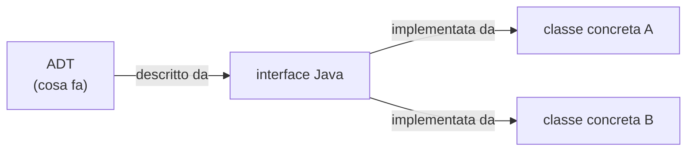
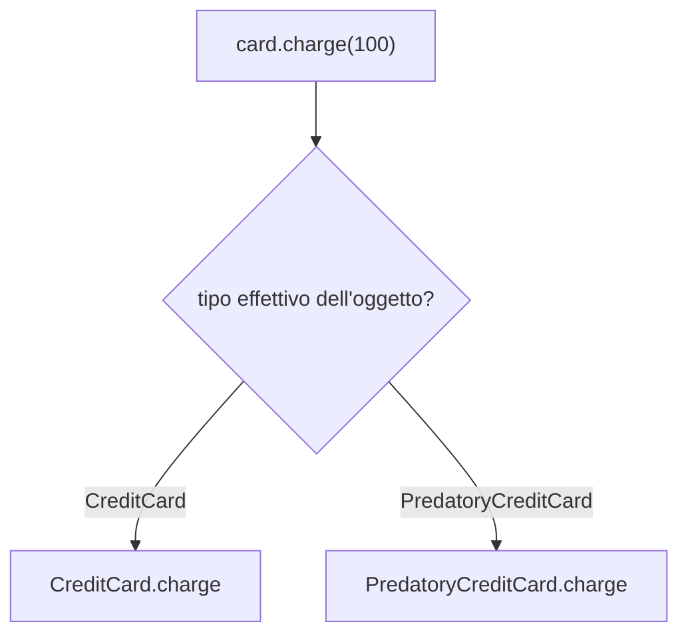
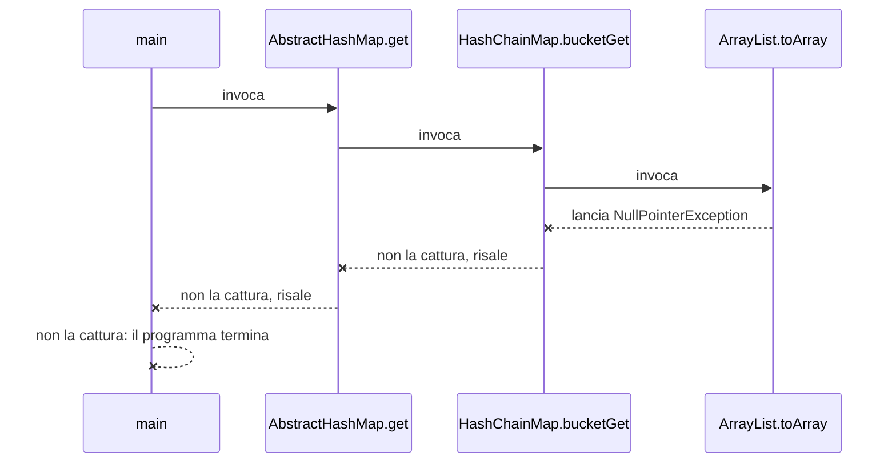

# Progettazione orientata agli oggetti

> [!abstract]
> Dopo il ripasso del linguaggio ([[01 - ASD - Introduzione a Java]]), il capitolo spiega **come** si progettano le classi: gli obiettivi (solidità, flessibilità, riutilizzo), i principi (astrazione, incapsulamento, modularità) e gli strumenti che Java offre per realizzarli: **ereditarietà** e **polimorfismo**, **interfacce** e **classi astratte**, **eccezioni**, **cast** tra riferimenti, **tipi generici** e **classi annidate**.
> Sono le basi di tutto il resto del libro: ogni struttura dati sarà descritta da un **ADT** (un'interfaccia Java) e realizzata da una o più classi concrete, spesso generiche (`<E>`), con classi annidate per i nodi e con eccezioni per segnalare gli usi scorretti.
> Mappa del corso: [[MOC - Algoritmi e Strutture Dati]].

---

## Obiettivi, principi e schemi ricorrenti

Nel paradigma a oggetti ogni oggetto è esemplare di una classe, che mostra all'esterno una vista sintetica e coerente dei suoi esemplari, nascondendo i dettagli interni. Una classe specifica i **campi** (variabili di esemplare) e i **metodi** (operazioni).

### Obiettivi della progettazione orientata agli oggetti

![[ASD-p072-1.png]]

La figura associa a ogni obiettivo un'immagine: il martello per la **solidità**, la spina adattabile per la **flessibilità**, le graffette (oggetti semplici riusati ovunque) per la **possibilità di riutilizzo**.

- **Solidità** (*robustness*). Il software deve essere **corretto** (output giusto per ogni input previsto) e **robusto**: deve gestire anche input inattesi senza comportamenti disastrosi (es. un prezzo negativo → chiedere un nuovo valore o terminare in modo controllato). È vitale nei sistemi critici: tra il 1985 e il 1987 la macchina per radioterapia **Therac-25** somministrò sovradosaggi a sei pazienti, alcuni morti, a causa di errori software.
- **Flessibilità** (*adaptability*). I programmi grandi vivono per anni e devono evolvere con le condizioni d'uso. È legata alla **portabilità** (funzionare con modifiche minime su hardware o sistemi operativi diversi), uno dei punti di forza di Java.
- **Possibilità di riutilizzo** (*reusability*). Lo stesso codice dovrebbe servire come componente in più applicazioni, riducendo i costi. Va fatto con attenzione: uno degli errori del Therac-25 fu proprio il riuso inappropriato del software del Therac-20, non pensato per quell'hardware.

_(libro, pp. 72–73)_

### Principi della progettazione orientata agli oggetti

![[ASD-p074-1.png]]

I tre principi sono rappresentati da un progetto tecnico (**astrazione**: si descrive il sistema ad alto livello), un interruttore (**incapsulamento**: si usa l'interfaccia senza vedere i fili) e un insieme di icone separate (**modularità**: unità funzionali distinte).

#### Astrazione

Vedi [[Tipo di dato astratto]].

L'**astrazione** scompone un sistema complesso nelle sue parti fondamentali, dando a ognuna un nome e descrivendone le funzionalità. Applicata alle strutture dati porta al **tipo di dato astratto** (*abstract data type*, **ADT**): un modello matematico che specifica

- il tipo dei dati memorizzati,
- le operazioni ammesse,
- i tipi dei parametri di ogni operazione.

Un ADT dice **cosa** fa ogni operazione, non **come** lo fa. In Java un ADT si descrive con un'**interfaccia** (un elenco di firme di metodi senza corpo, [[#Interfacce in Java]]) e si realizza con una **classe** che la **implementa**, cioè dà un corpo a tutti i suoi metodi (e può averne anche altri).



Questo schema torna in tutto il libro: ad esempio l'ADT pila del [[06 - ASD - Pile, code e code doppie|cap. 6]] è l'interfaccia `Stack`, realizzata sia con un array sia con una lista concatenata.

#### Incapsulamento

I componenti di un sistema non devono rendere noti i dettagli interni della loro implementazione. Il programmatore di un componente deve solo rispettarne l'**interfaccia pubblica**; per il resto è libero di cambiare l'implementazione senza rompere il codice altrui. Favorisce solidità e flessibilità: correzioni e nuove funzionalità richiedono modifiche **locali**. In Java si realizza con i [[01 - ASD - Introduzione a Java#Modificatori per il controllo dell'accesso|modificatori di accesso]] (`private` per i dati, `public` per i metodi dell'interfaccia).

#### Modularità

Il sistema va diviso in **unità funzionali distinte** con interazioni chiare. Componenti separati si collaudano e si correggono più facilmente prima di integrarli, e questo aumenta la solidità del programma.

_(libro, pp. 73–75)_

### Schemi di progetto (design pattern)

Conoscere i principi non basta: servono tecniche concrete. Un **design pattern** descrive una soluzione generale a un problema di progettazione ricorrente, in forma astratta e adattabile. È composto da:

- un **nome**;
- un **contesto** (in quali scenari si applica);
- un **modello** (*template*, come si applica);
- un **risultato** (cosa produce, con un'analisi).

Il libro presenta due famiglie di pattern, che verranno spiegati quando servono:

| Pattern per algoritmi | Dove | Pattern per l'ingegneria del software | Dove |
|---|---|---|---|
| Ricorsione | cap. 5 ([[05 - ASD - Ricorsione]]) | Template method | 2.3.3, 10.5.1, 11.2.1 |
| Ammortamento | 7.2.3, 11.4.4, 14.7.3 | Composizione | 2.5.2, 2.6, 9.2.1 |
| Divide-and-conquer | 12.1.1 | Adattatore | 6.1.3 |
| Prune-and-search | 12.5.1 | Posizione | 7.3, 8.1.2, 14.7.3 |
| Forza bruta | 13.2.1 | Iteratore | 7.4 |
| Metodo greedy | 13.4.2, 14.6.2, 14.7 | Metodo-fabbrica (*factory method*) | 8.3.1, 11.2.1 |
| Programmazione dinamica | 13.5 | Comparatore | 9.2.2, 10.3, cap. 12 |
| | | Localizzatore | 9.5.1 |

_(libro, pp. 75–76)_

---

## Ereditarietà

Vedi [[Ereditarietà in Java]].

Un modo naturale di organizzare i componenti di un software è una **gerarchia**, dove astrazioni simili sono raggruppate per livelli, dal più specifico (in basso) al più generale (in alto).

![[ASD-p076-1.png]]

Nella gerarchia di edifici, *Casa* è sotto *Edificio* e sopra *Casa a due piani* e *Casa di campagna*. In termini insiemistici l'insieme delle case è un **sottoinsieme** degli edifici e un **superinsieme** delle case di campagna. Il legame tra i livelli è la relazione **"è un"** (*is a*): una casa è un edificio, una casa di campagna è una casa.

La gerarchia permette di mettere le funzionalità comuni ai livelli alti (riuso) e di vedere i comportamenti specifici come estensioni del caso generale. In OOP questo meccanismo è l'**ereditarietà** (*inheritance*): si definisce una nuova classe (**sottoclasse**, classe figlia) a partire da una esistente (**superclasse**, classe di base, classe genitore). Si dice che la sottoclasse **estende** la superclasse.

La sottoclasse eredita automaticamente tutti i metodi della superclasse (**tranne i costruttori**) e può differenziarsi in due modi:

1. **aggiungere** nuovi campi e metodi;
2. **ridefinire** (*override*, sovrascrivere) metodi ereditati con una nuova implementazione.

> [!tip] Collegamento
> Lo stesso meccanismo si può simulare in C mettendo la struct "genitore" come primo campo della struct "figlia": vedi [[Ereditarietà in C]] (Sistemi Operativi).

_(libro, pp. 76–77)_

### Estensione della classe CreditCard

Come esempio si estende la [[01 - ASD - Introduzione a Java#Un esempio di programma: CreditCard|classe `CreditCard`]] con una `PredatoryCreditCard` (carta "da rapina") che:

1. addebita una **commissione di 5 \$** per ogni tentativo di addebito rifiutato perché supererebbe il limite;
2. applica un **interesse mensile** sul saldo non rimborsato, calcolato da un tasso annuo (*APR, annual percentage rate*) passato al costruttore.

![[ASD-p077-1.png]]

Lo schema UML mostra `CreditCard` in alto e `PredatoryCreditCard` sotto, collegate da una freccia con **punta vuota** orientata dalla sottoclasse alla superclasse: è il simbolo dell'ereditarietà. La sottoclasse elenca solo ciò che aggiunge o ridefinisce: il campo privato `apr`, il metodo ridefinito `charge` e il nuovo metodo `processMonth`.

```java
public class PredatoryCreditCard extends CreditCard {
  // Variabile di esemplare aggiunta
  private double apr;                       // tasso di interesse annuo

  // Costruttore di questa classe
  public PredatoryCreditCard(String cust, String bk, String acnt, int lim,
                             double initialBal, double rate) {
    super(cust, bk, acnt, lim, initialBal); // inizializza la superclasse
    apr = rate;
  }

  // Nuovo metodo per l'addebito degli interessi mensili
  public void processMonth() {
    if (balance > 0) {                      // interessi solo se il saldo è positivo
      double monthlyFactor = Math.pow(1 + apr, 1.0/12); // tasso mensile
      balance *= monthlyFactor;
    }
  }

  // Ridefinisce il metodo charge della superclasse
  public boolean charge(double price) {
    boolean isSuccess = super.charge(price); // invoca il metodo ereditato
    if (!isSuccess)
      balance += 5;                          // commissione di 5 $
    return isSuccess;
  }
}
```

Analisi del codice:

- **`extends CreditCard`**: Java ammette solo **ereditarietà singola** tra classi (una sola superclasse). Una classe senza `extends` estende implicitamente `java.lang.Object`, la **superclasse universale**.
- **Campi**: ogni `PredatoryCreditCard` ha i 5 campi ereditati (`customer`, `bank`, `account`, `limit`, `balance`) più `apr`; nella sottoclasse si dichiara solo il nuovo.
- **Costruttore**: i costruttori non si ereditano. La prima istruzione deve inizializzare la parte ereditata invocando il costruttore della superclasse con **`super(...)`** (analogo a `this(...)`). Se un costruttore non chiama esplicitamente né `super(...)` né `this(...)`, Java inserisce implicitamente `super()` (senza argomenti).
- **`processMonth`** legge e modifica `balance`: è possibile perché in `CreditCard` era `protected`.
- **`charge` ridefinito** riusa la versione originale con `super.charge(price)` e aggiunge la commissione solo in caso di rifiuto; restituisce lo stesso booleano, mantenendo invariata l'interfaccia esterna.

> [!example] Perché la radice dodicesima
> Non si può dividere il tasso annuo per 12: con l'interesse composto si otterrebbe un tasso annuo effettivo più alto di quello dichiarato. Il fattore mensile corretto è
> $$f = (1 + apr)^{1/12}, \qquad f^{12} = 1 + apr$$
> Con $apr = 0.0825$: $(1.0825)^{1/12} \approx 1.006628$, cioè lo 0,6628% al mese; dopo 12 mesi 100 \$ diventano esattamente 108,25 \$.

_(libro, pp. 77–79)_

### Polimorfismo e smistamento dinamico

Vedi [[Polimorfismo e smistamento dinamico]].

**Polimorfismo** significa "molte forme": una variabile riferimento può riferirsi a oggetti di tipi diversi.

```java
CreditCard card = new PredatoryCreditCard(...);
```

È lecito per il **Principio di sostituzione di Liskov**: una variabile (o un parametro) di un tipo può ricevere un riferimento a un esemplare di qualunque sua sottoclasse, diretta o indiretta. È la relazione "è un": una carta "da rapina" è una carta di credito (ma non viceversa).

Due regole, una al momento della compilazione e una al momento dell'esecuzione:

| | Cosa conta | Conseguenza |
|---|---|---|
| **Compilazione** | il **tipo dichiarato** della variabile | con `CreditCard card` si possono invocare solo metodi di `CreditCard`: `card.charge(100)` sì, `card.processMonth()` è un errore di compilazione |
| **Esecuzione** | il **tipo effettivo** dell'oggetto | `card.charge(100)` esegue `PredatoryCreditCard.charge` se l'oggetto è una `PredatoryCreditCard`: è lo **smistamento dinamico** (*dynamic dispatch*) |



L'operatore **`instanceof`** verifica a runtime il tipo effettivo: `card instanceof PredatoryCreditCard` è `true` se l'oggetto è una `PredatoryCreditCard` o una sua sottoclasse ([[#Cast]]).

> [!tip] Come funziona sotto
> In C++ lo smistamento dinamico si realizza con una tabella di puntatori a funzione per classe: vedi [[Vtable]].

_(libro, pp. 79–80)_

### Gerarchie di ereditarietà

Una classe ha una sola superclasse, ma una superclasse può avere molte sottoclassi. Il secondo esempio è una gerarchia per generare **progressioni numeriche**, sequenze in cui ogni numero dipende dai precedenti:

- **aritmetica**: si somma una costante (0, 4, 8, 12, …);
- **geometrica**: si moltiplica per una costante (1, 2, 4, 8, …);
- **di Fibonacci**: ogni termine è la somma dei due precedenti (0, 1, 1, 2, 3, 5, …).

![[ASD-p081-1.png]]

La classe di base `Progression` ha tre sottoclassi: `ArithmeticProgression`, `GeometricProgression`, `FibonacciProgression`.

#### La classe di base `Progression`

Genera la progressione 0, 1, 2, … ed è progettata per essere specializzata facilmente.

```java
/** Genera una semplice progressione: 0, 1, 2, ... */
public class Progression {
  protected long current;                         // variabile di esemplare

  /** Costruisce una progressione che parte da zero. */
  public Progression() { this(0); }

  /** Costruisce una progressione con il valore iniziale dato. */
  public Progression(long start) { current = start; }

  /** Restituisce il valore successivo della progressione. */
  public long nextValue() {
    long answer = current;
    advance();                                    // fa avanzare la progressione
    return answer;
  }

  /** Assegna a current il valore successivo della progressione. */
  protected void advance() {
    current++;
  }

  /** Visualizza i successivi n valori, separati da spazi. */
  public void printProgression(int n) {
    System.out.print(nextValue());                // primo valore senza spazio
    for (int j = 1; j < n; j++)
      System.out.print(" " + nextValue());        // spazio seguito dal valore
    System.out.println();
  }
}
```

La scelta di progetto chiave è separare `advance()` (protetto) da `nextValue()` (pubblico): `nextValue` salva il valore corrente, chiama `advance` e lo restituisce. Così **una sottoclasse deve solo ridefinire `advance`** per cambiare il tipo di progressione.

#### Progressione aritmetica

```java
public class ArithmeticProgression extends Progression {
  protected long increment;

  /** Costruisce la progressione 0, 1, 2, ... */
  public ArithmeticProgression() { this(1, 0); }        // parte da 0, incremento 1

  /** Costruisce la progressione 0, stepsize, 2*stepsize, ... */
  public ArithmeticProgression(long stepsize) { this(stepsize, 0); }

  /** Costruisce una progressione aritmetica arbitraria. */
  public ArithmeticProgression(long stepsize, long start) {
    super(start);
    increment = stepsize;
  }

  /** Aggiunge increment al valore di current. */
  protected void advance() {
    current += increment;
  }
}
```

`ArithmeticProgression(4, 2)` genera 2, 6, 10, 14, …

#### Progressione geometrica

Il valore iniziale predefinito è 1 (partendo da 0 si otterrebbe sempre 0); la costante moltiplicativa si chiama **base**.

```java
public class GeometricProgression extends Progression {
  protected long base;

  /** Costruisce la progressione 1, 2, 4, 8, 16, ... */
  public GeometricProgression() { this(2, 1); }          // parte da 1, base 2

  /** Costruisce la progressione 1, b, b^2, b^3, ... */
  public GeometricProgression(long b) { this(b, 1); }

  /** Costruisce una progressione geometrica arbitraria. */
  public GeometricProgression(long b, long start) {
    super(start);
    base = b;
  }

  /** Moltiplica per base il valore di current. */
  protected void advance() {
    current *= base;
  }
}
```

`GeometricProgression(3)` genera 1, 3, 9, 27, …; `GeometricProgression(3, 2)` genera 2, 6, 18, 54, …

#### Progressione di Fibonacci

Qui il valore successivo dipende dai **due** precedenti, quindi serve un campo in più, `prev`.

```java
public class FibonacciProgression extends Progression {
  protected long prev;

  /** Costruisce la serie di Fibonacci tradizionale: 0, 1, 1, 2, 3, ... */
  public FibonacciProgression() { this(0, 1); }

  /** Costruisce una serie di Fibonacci generalizzata, dati primo e secondo valore. */
  public FibonacciProgression(long first, long second) {
    super(first);
    prev = second - first;              // valore fittizio "prima del primo"
  }

  /** Sostituisce (prev, current) con (current, current + prev). */
  protected void advance() {
    long temp = prev;
    prev = current;
    current += temp;
  }
}
```

> [!note] Il trucco di `prev = second - first`
> La prima chiamata a `nextValue()` restituisce `first` e poi esegue `advance()`, che calcola il nuovo `current = first + prev`. Perché il secondo valore sia proprio `second` serve `prev = second - first`: infatti `first + (second - first) = second`. Esempio con 4 e 6: `prev = 2`, poi 4, 6, 10, 16, 26, 42, …

![[ASD-p085-1.png]]

Lo schema UML dettagliato mostra che `Progression` ha il campo protetto `current` e i metodi `nextValue`, `printProgression` (pubblici) e `advance` (protetto, `#`); ogni sottoclasse aggiunge **un** campo (`increment`, `base`, `prev`) e ridefinisce solo `advance()`.

#### Collaudo della gerarchia

```java
public class TestProgression {
  public static void main(String[] args) {
    Progression prog;
    // ArithmeticProgression
    System.out.print("Arithmetic progression with default increment: ");
    prog = new ArithmeticProgression();
    prog.printProgression(10);
    System.out.print("Arithmetic progression with increment 5: ");
    prog = new ArithmeticProgression(5);
    prog.printProgression(10);
    System.out.print("Arithmetic progression with start 2: ");
    prog = new ArithmeticProgression(5, 2);
    prog.printProgression(10);
    // GeometricProgression
    System.out.print("Geometric progression with default base: ");
    prog = new GeometricProgression();
    prog.printProgression(10);
    System.out.print("Geometric progression with base 3: ");
    prog = new GeometricProgression(3);
    prog.printProgression(10);
    // FibonacciProgression
    System.out.print("Fibonacci progression with default start values: ");
    prog = new FibonacciProgression();
    prog.printProgression(10);
    System.out.print("Fibonacci progression with start values 4 and 6: ");
    prog = new FibonacciProgression(4, 6);
    prog.printProgression(8);
  }
}
```

```
Arithmetic progression with default increment: 0 1 2 3 4 5 6 7 8 9
Arithmetic progression with increment 5: 0 5 10 15 20 25 30 35 40 45
Arithmetic progression with start 2: 2 7 12 17 22 27 32 37 42 47
Geometric progression with default base: 1 2 4 8 16 32 64 128 256 512
Geometric progression with base 3: 1 3 9 27 81 243 729 2187 6561 19683
Fibonacci progression with default start values: 0 1 1 2 3 5 8 13 21 34
Fibonacci progression with start values 4 and 6: 4 6 10 16 26 42 68 110
```

La variabile `prog` è **polimorfica**: è dichiarata `Progression` ma punta di volta in volta a oggetti di tipo diverso, e `printProgression` → `nextValue` → `advance` esegue sempre la versione giusta grazie allo smistamento dinamico.

> [!note] Overflow
> Con `long` (64 bit con segno, massimo $2^{63}-1 \approx 9{,}2 \cdot 10^{18}$): la progressione aritmetica con incremento 1 va in overflow dopo circa $2^{63}$ passi; quella geometrica di base 3 dopo 40 passi, perché $3^{40} \approx 1{,}2 \cdot 10^{19} > 2^{63}$; quella di Fibonacci intorno al 94° termine, che supera $2^{63}$.

_(libro, pp. 81–86)_

---

## Interfacce e classi astratte

Perché due oggetti interagiscano, ciascuno deve conoscere i "messaggi" (metodi) che l'altro accetta: è l'**API** (*application programming interface*) o semplicemente **interfaccia** della classe. Nell'approccio per ADT l'interfaccia definisce un tipo e i metodi per elaborarlo, con argomenti di tipo specificato. Il compilatore controlla che i tipi passati corrispondano a quelli dichiarati: è la **tipizzazione forte** (*strong typing*). Definire interfacce costa un po' di lavoro, ma obbliga all'incapsulamento e fa emergere errori che altrimenti passerebbero inosservati.

_(libro, p. 87)_

### Interfacce in Java

Vedi [[Interfacce e classi astratte]].

Un'**interfaccia** Java è un insieme di **firme di metodi** senza corpo e senza dati; non ha costruttori e non si possono crearne esemplari. Una classe che la **implementa** (`implements`) deve fornire un corpo a **tutti** i suoi metodi: l'interfaccia garantisce quindi che la classe abbia certi metodi con una certa firma.

Esempio: un inventario di oggetti d'antiquariato, alcuni dei quali sono **vendibili** e/o **trasportabili**.

```java
/** Interfaccia che descrive oggetti che possono essere venduti. */
public interface Sellable {
  /** Restituisce una descrizione dell'oggetto. */
  public String description();
  /** Restituisce il prezzo in centesimi. */
  public int listPrice();
  /** Restituisce il prezzo minimo, in centesimi, che verrà accettato. */
  public int lowestPrice();
}

/** Classe per fotografie che possono essere vendute. */
public class Photograph implements Sellable {
  private String descript;    // descrizione
  private int price;          // prezzo richiesto
  private boolean color;      // true se a colori

  public Photograph(String desc, int p, boolean c) {
    descript = desc;
    price = p;
    color = c;
  }
  public String description() { return descript; }
  public int listPrice() { return price; }
  public int lowestPrice() { return price/2; }
  public boolean isColor() { return color; }   // metodo in più, non richiesto da Sellable
}

/** Interfaccia per oggetti che possono essere trasportati. */
public interface Transportable {
  /** Restituisce il peso in grammi. */
  public int weight();
  /** Restituisce true se e solo se l'oggetto è pericoloso. */
  public boolean isHazardous();
}
```

Una classe può **implementare più interfacce** (pur estendendo una sola classe):

```java
/** Oggetti che possono essere venduti, inscatolati e spediti. */
public class BoxedItem implements Sellable, Transportable {
  private String descript;     // descrizione
  private int price;           // prezzo in centesimi
  private int weight;          // peso in grammi
  private boolean haz;         // true se pericoloso
  private int height = 0;      // dimensioni della scatola in centimetri
  private int width = 0;
  private int depth = 0;

  public BoxedItem(String desc, int p, int w, boolean h) {
    descript = desc;
    price = p;
    weight = w;
    haz = h;
  }
  public String description() { return descript; }
  public int listPrice() { return price; }
  public int lowestPrice() { return price/2; }
  public int weight() { return weight; }
  public boolean isHazardous() { return haz; }
  public int insuredValue() { return price*2; }
  public void setBox(int h, int w, int d) {
    height = h;
    width = w;
    depth = d;
  }
}
```

_(libro, pp. 87–89)_

### Ereditarietà multipla per interfacce

Estendere più tipi si chiama **ereditarietà multipla**; in Java è ammessa **solo per le interfacce**. Il motivo: le classi definiscono campi e corpi dei metodi, quindi ereditare da due classi con campi omonimi o metodi con la stessa firma creerebbe conflitti; le interfacce, che non hanno né campi né corpi, non hanno questo problema.

Un uso tipico è approssimare i **mixin** di linguaggi come Smalltalk e C++ (classi non pensate per creare esemplari ma per aggiungere funzionalità ad altre): un'interfaccia può "mescolare" interfacce non correlate e aggiungere metodi propri.

```java
public interface Insurable extends Sellable, Transportable {
  /** Restituisce il valore assicurato, in centesimi */
  public int insuredValue();
}

public class BoxedItem2 implements Insurable {
  // ... stesso codice di BoxedItem
}
```

Ora `insuredValue` diventa obbligatorio, mentre prima era un metodo facoltativo di `BoxedItem`.

> [!warning] Correzione
> Il libro scrive `public class BoxedItem2 extends Insurable`. Una **classe** non può *estendere* un'interfaccia: deve *implementarla*, quindi la forma corretta è `class BoxedItem2 implements Insurable`. Un'**interfaccia** invece estende altre interfacce con `extends` (come fa `Insurable`).

Esempi di "mixin" nella libreria Java: `java.lang.Cloneable` (clonare esemplari), `java.lang.Comparable` (confrontarli, imponendo un **ordinamento naturale**), `java.util.Observer` (ricevere notifiche quando oggetti osservati cambiano stato).

_(libro, pp. 89–90)_

### Classi astratte

Una **classe astratta** sta a metà tra una classe normale e un'interfaccia:

| | Interfaccia | Classe astratta | Classe concreta |
|---|---|---|---|
| Metodi senza corpo (astratti) | tutti | sì, alcuni | no |
| Metodi con corpo (concreti) | no | sì | sì |
| Campi (variabili di esemplare) | no | sì | sì |
| Costruttori | no | sì (invocabili con `super`) | sì |
| Si possono creare esemplari | no | no | sì |
| Quante se ne possono estendere/implementare | molte | una sola (ereditarietà singola) | una sola |

Una sottoclasse di una classe astratta deve implementare tutti i metodi astratti, altrimenti resta astratta a sua volta. Le classi astratte sono più potenti delle interfacce (possono contenere codice comune) ma più vincolanti (ereditarietà singola). Nel libro servono soprattutto per il **riuso**: le funzionalità comuni a una famiglia di classi vanno in una classe astratta, e le sottoclassi concrete aggiungono solo ciò che le distingue.

Nella gerarchia delle progressioni, `Progression` avrebbe dovuto essere astratta: nessuno ha bisogno dei suoi esemplari (sarebbero solo una progressione aritmetica di passo 1) e nessuna sottoclasse usa la sua versione di `advance`. Ecco la versione astratta:

```java
public abstract class AbstractProgression {
  protected long current;
  public AbstractProgression() { this(0); }
  public AbstractProgression(long start) { current = start; }

  public long nextValue() {                  // metodo concreto
    long answer = current;
    advance();                               // fa progredire current
    return answer;
  }

  public void printProgression(int n) {      // metodo concreto
    System.out.print(nextValue());
    for (int j = 1; j < n; j++)
      System.out.print(" " + nextValue());
    System.out.println();
  }

  protected abstract void advance();         // nessun corpo
}
```

Vedi [[Schema template method]].

`nextValue` invoca `advance` anche se qui `advance` non ha un corpo: è lo **schema con modello di metodo** (*template method pattern*). La classe astratta definisce un comportamento concreto (`nextValue`) che dipende da comportamenti astratti (`advance`); appena una sottoclasse fornisce questi ultimi, il comportamento ereditato è completo.

_(libro, pp. 90–92)_

---

## Eccezioni

Vedi [[Eccezioni in Java]].

Le **eccezioni** sono eventi inattesi durante l'esecuzione: una risorsa non disponibile, un input imprevisto, un errore logico. In Java sono **oggetti** che vengono **lanciati** (*thrown*) dal codice che incontra il problema (o dalla JVM, ad esempio quando esaurisce la memoria) e possono essere **catturati** (*caught*) da un blocco di codice circostante che le gestisce. Un'eccezione non catturata termina il programma con un messaggio.

> [!note] Attenzione al nome
> Queste sono eccezioni **del linguaggio Java**. Le [[Eccezioni]] di Sistemi Operativi (trap, fault, abort) sono un'altra cosa: interrupt generati dalla CPU.

### Catturare eccezioni

Se un'eccezione non viene catturata, la JVM stampa un messaggio e la traccia del **runtime stack**, cioè la pila delle invocazioni attive in quel momento:

```
Exception in thread "main" java.lang.NullPointerException
  at java.util.ArrayList.toArray(ArrayList.java:358)
  at net.datastructures.HashChainMap.bucketGet(HashChainMap.java:35)
  at net.datastructures.AbstractHashMap.get(AbstractHashMap.java:62)
  at dsaj.design.Demonstration.main(Demonstration.java:12)
```

L'eccezione **risale la pila**: ogni metodo, dal più recente (`toArray`) fino a `main`, ha l'occasione di catturarla o di lasciarla passare al chiamante. Qui nessuno la cattura e il programma termina.



Si gestiscono con **`try-catch`**:

```java
try {
  corpoControllato
} catch (TipoDiEccezione1 variabile1) {
  corpoContromisura1
} catch (TipoDiEccezione2 variabile2) {
  corpoContromisura2
} ...
```

- Se `corpoControllato` non lancia eccezioni, i `catch` vengono saltati.
- Se la lancia, il blocco si interrompe **subito** e si esegue il `catch` il cui tipo corrisponde all'eccezione; la variabile del `catch` punta all'oggetto eccezione. Poi si prosegue dopo l'intero `try-catch`.
- Se nessun `catch` corrisponde, l'eccezione prosegue nel contesto circostante.

Contromisure possibili: stampare un messaggio e terminare; ignorarla in silenzio (`catch` vuoto, in casi particolari); lanciare un'altra eccezione più specifica. Esistono anche la clausola **`finally`** (eseguita sempre, utile per chiudere file), il **try-with-resources** (Java SE 7, rilascia automaticamente le risorse) e il **multi-catch** (`catch (A | B e)`).

```java
public static void main(String[] args) {
  int n = DEFAULT;
  try {
    n = Integer.parseInt(args[0]);
    if (n <= 0) {
      System.out.println("n must be positive. Using default.");
      n = DEFAULT;
    }
  } catch (ArrayIndexOutOfBoundsException e) {
    System.out.println("No argument specified for n. Using default.");
  } catch (NumberFormatException e) {
    System.out.println("Invalid integer argument. Using default.");
  }
}
```

La riga `n = Integer.parseInt(args[0])` può fallire in due modi:

1. nessun argomento → `args` è vuoto e `args[0]` lancia `ArrayIndexOutOfBoundsException`;
2. argomento non numerico (es. `"abc"`) → `parseInt` lancia `NumberFormatException`.

Il controllo `n <= 0` è un normale `if` messo **dentro** il `try`: viene eseguito solo se la conversione è riuscita. Con lo stesso messaggio per entrambi i casi si può scrivere `catch (ArrayIndexOutOfBoundsException | NumberFormatException e)`.

_(libro, pp. 92–95)_

### Lanciare eccezioni

Si lancia un'eccezione con `throw` seguito da un oggetto eccezione, di solito creato sul momento con un messaggio:

```java
public void ensurePositive(int n) {
  if (n < 0)
    throw new IllegalArgumentException("That's not positive!");
  // ...
}
```

`throw` termina immediatamente il metodo.

#### La clausola `throws`

Nella firma di un metodo si possono dichiarare le eccezioni che può lanciare (direttamente o propagandole da metodi invocati):

```java
public static int parseInt(String s) throws NumberFormatException
```

Serve a chi usa il metodo per prepararsi a gestirle (più tipi separati da virgole, o una superclasse comune). Non sostituisce la documentazione `@throws` di Javadoc. Per molte eccezioni è **facoltativa**: `Scanner.nextInt()` può lanciare `IllegalStateException`, `NoSuchElementException` e `InputMismatchException`, ma la sua firma non ne dichiara nessuna. Il perché dipende dalla gerarchia delle eccezioni.

_(libro, pp. 95–96)_

### La gerarchia delle eccezioni in Java

![[ASD-p097-1.png]]

Tutti gli oggetti lanciabili discendono da **`Throwable`**, che ha due rami:

- **`Error`** (es. `VirtualMachineError` → `OutOfMemoryError`, `IOError`): situazioni gravi, di solito irrecuperabili, lanciate dalla JVM (file di classe non valido, memoria esaurita);
- **`Exception`**: situazioni a cui il programma può ragionevolmente reagire. Da qui discendono `IOException` (→ `FileNotFoundException`, `EOFException`) e **`RuntimeException`** (→ `IllegalArgumentException` → `NumberFormatException`, `IndexOutOfBoundsException` → `ArrayIndexOutOfBoundsException`, `NoSuchElementException`, `NullPointerException`, `ClassCastException`).

#### Eccezioni a controllo obbligatorio e non obbligatorio

| | **Unchecked** (controllo non obbligatorio) | **Checked** (controllo obbligatorio) |
|---|---|---|
| Quali | `RuntimeException` e sottoclassi | tutte le altre `Exception` |
| Causa tipica | **errori logici** del programmatore (indice sbagliato, parametro non valido) | eventi esterni difficili da prevedere (file mancante, rete interrotta) |
| Regola | nessun obbligo | ogni eccezione checked che può uscire da un metodo **deve** essere dichiarata nella sua firma con `throws`; chi lo invoca deve catturarla con `try-catch` **oppure** dichiararla a sua volta |

La logica: gli errori di programmazione andrebbero eliminati prima del rilascio, quindi non ha senso obbligare a catturarli ovunque; gli eventi esterni invece possono capitare anche a un programma corretto e vanno gestiti esplicitamente.

**Definire nuove eccezioni.** Il libro usa solo eccezioni esistenti, sottoclassi di `RuntimeException`, per segnalare gli usi scorretti delle strutture dati. Chi vuole tipi propri li definisce come sottoclassi di `Exception` (checked), di `RuntimeException` (unchecked) o di un sottotipo più adatto.

_(libro, pp. 96–98)_

---

## Cast e tipi generici

### Cast

Vedi [[Cast in Java]].

Il cast tra **riferimenti** segue le stesse idee del [[01 - ASD - Introduzione a Java#Conversioni di tipo|cast tra tipi fondamentali]].

**Conversione con ampliamento** (*widening*), da un tipo $T$ a un tipo $U$ "più ampio":

- $T$ e $U$ classi e $U$ superclasse di $T$;
- $T$ e $U$ interfacce e $U$ superinterfaccia di $T$;
- $T$ classe che implementa l'interfaccia $U$.

È **automatica** e verificata dal compilatore (nessun controllo a runtime). L'abbiamo già usata con il polimorfismo: `CreditCard card = new PredatoryCreditCard(...);`.

**Conversione con restrizione** (*narrowing*), da $T$ a un tipo $S$ "più ristretto":

- $T$ e $S$ classi e $S$ sottoclasse di $T$;
- $T$ e $S$ interfacce e $S$ sottointerfaccia di $T$;
- $T$ interfaccia implementata dalla classe $S$.

Richiede un **cast esplicito** e viene verificata **a runtime**, perché il compilatore non può sapere se l'oggetto è davvero di tipo $S$.

```java
CreditCard card = new PredatoryCreditCard(...);          // ampliamento
PredatoryCreditCard pc = (PredatoryCreditCard) card;     // restrizione
```

> [!warning] Correzione
> Il libro introduce questo esempio come "un cast con restrizione dal tipo `PredatoryCreditCard` al tipo `CreditCard`". È il contrario: la restrizione va dal tipo **più generale** `CreditCard` (tipo dichiarato di `card`) al tipo **più specifico** `PredatoryCreditCard`, come mostra il codice stesso.

**`ClassCastException`.** Il cast da $T$ a $S$ riesce solo se l'oggetto è effettivamente di tipo $S$; altrimenti viene lanciata `ClassCastException`. `Number` è la superclasse astratta di `Integer` e `Double`:

```java
Number n;
Integer i;
n = new Integer(3);
i = (Integer) n;           // valido
n = new Double(3.1415);
i = (Integer) n;           // NON valido: ClassCastException
```

Per evitarla senza riempire il codice di `try-catch` si controlla prima con **`instanceof`** (`riferimento instanceof Tipo` è `true` se l'oggetto è compatibile con `Tipo`):

```java
n = new Integer(3);
if (n instanceof Integer)
  i = (Integer) n;         // eseguito
n = new Double(3.1415);
if (n instanceof Integer)
  i = (Integer) n;         // non eseguito
```

**Cast con un'interfaccia.** Le interfacce garantiscono i metodi, ma a volte serve un cast per accedere ai dettagli concreti.

```java
public interface Person {
  public boolean equals(Person other);   // è la stessa persona?
  public String getName();
  public int getAge();
}

public class Student implements Person {
  String id;
  String name;
  int age;
  public Student(String i, String n, int a) {
    id = i;
    name = n;
    age = a;
  }
  protected int studyHours() { return age/2; }   // tanto per dire...
  public String getID() { return id; }           // matricola
  public String getName() { return name; }       // da Person
  public int getAge() { return age; }            // da Person
  public boolean equals(Person other) {          // da Person
    if (!(other instanceof Student)) return false;  // non possono essere uguali
    Student s = (Student) other;                    // ora il cast è sicuro
    return id.equals(s.id);                         // confronto tra matricole
  }
  public String toString() {
    return "Student(ID:" + id + ", Name:" + name + ", Age:" + age + ")";
  }
}
```

`equals` riceve un `Person` qualsiasi: prima verifica con `instanceof` che sia uno `Student`, poi fa il cast per leggere il campo `id`.

_(libro, pp. 98–101)_

### Programmazione mediante tipi generici

Vedi [[Tipi generici in Java]].

I **generics** (Java SE 5) permettono di definire classi e metodi in funzione di **parametri formali di tipo**, specificati solo quando la classe viene usata.

**Il problema.** Spesso serve trattare una coppia di valori come un solo oggetto (ad esempio per restituirla da un metodo). Definire una nuova classe che contiene altri oggetti è lo **schema di composizione** (*composition design pattern*). Ma le coppie possono essere di tipi diversi: (`String`, `Double`) per un titolo azionario e il suo prezzo, (`Book`, `Integer`) per un libro e la sua quantità in magazzino. Si vuole **una sola** classe per tutte.

**Stile "classico"** (prima di Java 5), basato su `Object`, supertipo universale:

```java
public class ObjectPair {
  Object first;
  Object second;
  public ObjectPair(Object a, Object b) {
    first = a;
    second = b;
  }
  public Object getFirst() { return first; }
  public Object getSecond() { return second; }
}

ObjectPair bid = new ObjectPair("ORCL", 32.07);  // ampliamento (32.07 → Double → Object)
String stock = bid.getFirst();                   // ERRORE: restrizione da Object a String
String stock = (String) bid.getFirst();          // serve un cast esplicito
```

Lo svantaggio: i metodi di accesso restituiscono `Object`, quindi i **cast espliciti** si moltiplicano ovunque, e un errore di tipo si scopre solo a runtime.

**Con i generics:**

```java
public class Pair<A,B> {
  A first;
  B second;
  public Pair(A a, B b) {
    first = a;
    second = b;
  }
  public A getFirst() { return first; }
  public B getSecond() { return second; }
}
```

- `<A,B>` sono i **parametri formali di tipo** (per convenzione una lettera maiuscola), usabili nel corpo come tipi di campi, parametri e valori restituiti.
- Usando la classe si danno i **parametri di tipo effettivi**: `Pair<String,Double> bid;`. Devono essere tipi oggetto, non primitivi (`Double`, non `double`; per fortuna c'è l'auto-boxing).
- Creazione:
  ```java
  bid = new Pair<>("ORCL", 32.07);               // "diamante" + inferenza di tipo (Java SE 7)
  bid = new Pair<String,Double>("ORCL", 32.07);  // tipi espliciti (prima di Java 7)
  bid = new Pair("ORCL", 32.07);                 // stile classico: usa Object, warning
  ```
- Niente più cast:
  ```java
  String stock = bid.getFirst();
  double price = bid.getSecond();   // auto-unboxing da Double
  ```

#### Tipi generici e array

Java permette di **dichiarare** array di tipo parametrico ma **non di crearli** direttamente; si crea un array non parametrico e lo si assegna con un cast (il compilatore emette un *warning*, perché la correttezza dei tipi non è garantita al 100%). Due casi:

1. **fuori** da una classe generica, un array di esemplari con parametri effettivi:
   ```java
   Pair<String,Double>[] holdings;
   holdings = new Pair<String,Double>[25];   // errore di compilazione
   holdings = new Pair[25];                  // corretto, con warning
   holdings[0] = new Pair<>("ORCL", 32.07);  // valido
   ```
2. **dentro** una classe generica, un array del parametro formale `T`:
   ```java
   public class Portfolio<T> {
     T[] data;
     public Portfolio(int capacity) {
       data = new T[capacity];                 // errore di compilazione
       data = (T[]) new Object[capacity];      // corretto, con warning
     }
     public T get(int index) { return data[index]; }
     public void set(int index, T element) { data[index] = element; }
   }
   ```

Questo trucco `(E[]) new Object[capacity]` comparirà in tutte le strutture basate su array del libro (pile, code, liste, heap).

#### Metodi generici

Anche un singolo metodo può essere generico, dichiarando i parametri di tipo tra i modificatori:

```java
public class GenericDemo {
  public static <T> void reverse(T[] data) {
    int low = 0, high = data.length - 1;
    while (low < high) {          // scambia data[low] e data[high]
      T temp = data[low];
      data[low++] = data[high];   // post-incremento di low
      data[high--] = temp;        // post-decremento di high
    }
  }
}
```

Si invoca con `GenericDemo.reverse(books)` e il tipo viene dedotto. Non funziona su array di tipi primitivi (l'auto-boxing non si applica a interi array). Lo stesso metodo si potrebbe scrivere con lo stile classico su `Object[]`.

#### Tipi generici vincolati

Un parametro di tipo si può **vincolare** con `extends` (classe o interfaccia): solo i tipi che soddisfano il vincolo sono ammessi, e in cambio nel codice generico si possono usare i metodi garantiti dal vincolo.

```java
public class ShoppingCart<T extends Sellable> {
  // con qualsiasi variabile di tipo T si possono invocare
  // description(), listPrice() e lowestPrice()
}
```

Nel [[09 - ASD - Code prioritarie|cap. 9]] si vedrà il caso tipico `K extends Comparable<K>`.

_(libro, pp. 101–105)_

---

## Classi annidate

Una classe può essere definita **dentro** un'altra (*nested class*). Si usa quando una classe è strettamente legata a un'altra: aumenta l'incapsulamento e riduce i conflitti di nomi. Nelle strutture dati è molto utile per rappresentare una piccola parte della struttura (es. il **nodo** di una lista) o classi ausiliarie per navigarla (es. un **iteratore**); il libro le userà spesso.

```java
public class CreditCard {
  private static class Transaction {
    /* dettagli omessi */
  }
  // variabile di esemplare di CreditCard
  Transaction[] history;   // transazioni di questa carta
}
```

- La classe che contiene è la **classe esterna** (*outer class*); la classe annidata è un suo **membro**, con nome completo `CreditCard.Transaction` (dentro `CreditCard` basta `Transaction`). Un'altra classe può avere una sua `Transaction` annidata senza conflitti.
- La classe annidata ha i **propri** modificatori: se è `private`, solo la classe esterna può usarla.

| | Classe annidata **statica** | Classe **interna** (annidata non statica, *inner class*) |
|---|---|---|
| Legame con la classe esterna | nessuno: si comporta come una classe normale | ogni esemplare è legato all'esemplare esterno che l'ha creato |
| Chi può crearne esemplari | chiunque abbia accesso | solo un metodo non statico della classe esterna |
| Accesso all'esemplare esterno | no | sì, con `NomeClasseEsterna.this` (diverso da `this`, che è l'esemplare interno) |
| Membri privati dell'esterna | — | accessibili; può usare anche i parametri di tipo dell'esterna generica |
| Uso tipico nel libro | `Node` di una lista | iteratori |

_(libro, pp. 106–107)_

---

> [!summary] Riepilogo
> - **Obiettivi**: solidità, flessibilità, riuso. **Principi**: astrazione (ADT = cosa, non come), incapsulamento (solo l'interfaccia pubblica è vincolante), modularità.
> - **Design pattern**: soluzioni generali (nome, contesto, modello, risultato), per algoritmi e per l'ingegneria del software.
> - **Ereditarietà** (`extends`, singola): si eredita tutto tranne i costruttori; `super(...)` per il costruttore della superclasse, `super.metodo()` per la versione ereditata; override per ridefinire.
> - **Polimorfismo**: il tipo dichiarato decide cosa si può invocare (compilazione), il tipo effettivo decide quale codice si esegue (**dynamic dispatch**).
> - **Interfacce** (solo firme, ereditarietà multipla) vs **classi astratte** (anche codice e campi, ereditarietà singola); **template method**.
> - **Eccezioni**: `try-catch-finally`, `throw`, `throws`; `Error` vs `Exception`; **checked** (da dichiarare) vs **unchecked** (`RuntimeException`).
> - **Cast tra riferimenti**: ampliamento automatico, restrizione esplicita e controllata a runtime (`ClassCastException`, `instanceof`).
> - **Generics**: `Pair<A,B>`, diamante, niente cast; array generici con `(T[]) new Object[n]`; metodi generici; vincoli `T extends X`.
> - **Classi annidate**: statiche (es. nodi) e interne (es. iteratori, con accesso a `Esterna.this`).
