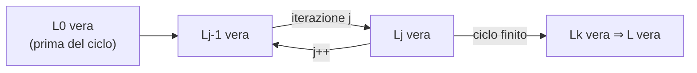

# Analisi di algoritmi

> [!abstract]
> Per dire che una struttura dati o un algoritmo è "buono" serve un modo **oggettivo** per misurarne l'efficienza. Il capitolo parte dalle **misure sperimentali** (cronometrare il programma), ne mostra i limiti e costruisce un metodo teorico: **contare le operazioni elementari** in funzione della dimensione $n$ dell'input, concentrandosi sul **caso peggiore** e ignorando i fattori costanti con la **notazione asintotica** ($O$, $\Omega$, $\Theta$). Presenta le **sette funzioni** che compaiono in quasi tutte le analisi del libro, applica il metodo a una serie di esempi (massimo di un array, costruzione di stringhe, intersezione di insiemi, unicità, medie dei prefissi) e chiude con le **tecniche di dimostrazione** (controesempio, contrapposizione, contraddizione, induzione, invariante di ciclo).
> Da qui in poi ogni operazione del libro sarà accompagnata dal suo costo in notazione $O$; le "operazioni in tempo costante" delle [[03 - ASD - Strutture dati fondamentali|liste del cap. 3]] trovano qui la loro definizione formale.
> Mappa del corso: [[MOC - Algoritmi e Strutture Dati]].

---

## Introduzione: cosa vuol dire "buono"

La leggenda di Archimede: per capire se la corona del re era d'oro puro, Archimede (dopo l'"Eureka!" nella vasca) immerse la corona e una massa d'oro di pari peso, confrontando l'acqua spostata. La corona ne spostò di più: non era oro puro. La morale è che serve uno **strumento di analisi** per giudicare.

- Una **struttura dati** (*data structure*) è un modo sistematico di organizzare i dati e accedervi.
- Un **algoritmo** è una procedura passo-passo che risolve un problema in un tempo finito.

Lo strumento principale del libro è il **tempo di esecuzione** (e in secondo piano lo **spazio** di memoria). Il tempo cresce con la dimensione dell'input, può variare tra input diversi della stessa dimensione e dipende dall'ambiente hardware (processore, clock, memoria, disco) e software (sistema operativo, linguaggio, compilato o interpretato). L'obiettivo è esprimere il tempo come **funzione della dimensione dell'input**, con un modello matematico indipendente dalla macchina.

_(libro, pp. 156–157)_

---

## Analisi sperimentali

Il modo più diretto: implementare l'algoritmo, eseguirlo su input diversi e misurare il tempo.

```java
long startTime = System.currentTimeMillis();   // istante iniziale
/* esecuzione dell'algoritmo */
long endTime = System.currentTimeMillis();     // istante finale
long elapsed = endTime - startTime;            // tempo trascorso
```

`currentTimeMillis()` restituisce i millisecondi trascorsi da "the epoch" (00:00 del 1° gennaio 1970, UTC); conta solo la **differenza** tra le due letture. Per operazioni molto veloci c'è `System.nanoTime()`. Si ripete l'esperimento con molte dimensioni $n$, si disegna il grafico ($n$ in ascissa, tempo $t$ in ordinata) e magari si cerca con la statistica la funzione che meglio approssima i dati.

I tempi misurati variano da macchina a macchina e perfino tra esecuzioni sulla stessa macchina (altri processi condividono CPU e memoria), ma gli esperimenti sono utili per **confrontare** algoritmi nelle stesse condizioni.

### Esempio: costruire stringhe lunghe

Due modi di costruire una stringa con $n$ copie di un carattere (es. `repeat('*', 40)`):

```java
/** Usa la concatenazione per costruire una stringa con n copie di c. */
public static String repeat1(char c, int n) {
  String answer = "";
  for (int j = 0; j < n; j++)
    answer += c;
  return answer;
}

/** Usa StringBuilder per costruire una stringa con n copie di c. */
public static String repeat2(char c, int n) {
  StringBuilder sb = new StringBuilder();
  for (int j = 0; j < n; j++)
    sb.append(c);
  return sb.toString();
}
```

Risultati (Tabella 4.1):

| $n$ | `repeat1` (ms) | `repeat2` (ms) |
|---|---|---|
| 50 000 | 2 884 | 1 |
| 100 000 | 7 437 | 1 |
| 200 000 | 39 158 | 2 |
| 400 000 | 170 173 | 3 |
| 800 000 | 690 836 | 7 |
| 1 600 000 | 2 874 968 | 13 |
| 3 200 000 | 12 809 631 | 28 |
| 6 400 000 | 59 594 275 | 58 |
| 12 800 000 | 265 696 421 | 135 |

![[ASD-p159-1.png]]

Lo stesso dato in scala **log-log** (logaritmica su entrambi gli assi). Le due serie sono quasi rette ma con **pendenze diverse**: in un grafico log-log una funzione $c \cdot n^k$ diventa una retta di pendenza $k$, quindi `repeat1` ha pendenza circa 2 (quadratica) e `repeat2` circa 1 (lineare).

`repeat2` è enormemente più veloce: `repeat1` impiega circa 265 milioni di ms (più di 3 giorni) per 12,8 milioni di caratteri, `repeat2` una frazione di secondo. Raddoppiando $n$, il tempo di `repeat1` diventa più del quadruplo, quello di `repeat2` circa il doppio. La spiegazione teorica è in [[#Costruire stringhe lunghe]].

### Difficoltà nelle analisi sperimentali

1. Due algoritmi si confrontano bene solo se gli esperimenti sono fatti **nello stesso ambiente** hardware e software.
2. Gli esperimenti coprono solo un **insieme limitato di input**: casi importanti possono restare fuori.
3. L'algoritmo deve essere **interamente implementato**: è il limite più grave, perché nelle prime fasi di un progetto non ha senso implementare un'alternativa che un'analisi ad alto livello scarterebbe subito.

_(libro, pp. 157–160)_

### Superare le analisi sperimentali

Si vuole un metodo che:

1. valuti l'efficienza relativa di due algoritmi **indipendentemente dall'ambiente**;
2. lavori su una **descrizione ad alto livello** (pseudocodice), senza implementare;
3. tenga conto di **tutti** i possibili input.

#### Contare le operazioni elementari

Si fissa un insieme di **operazioni elementari** (o primitive):

- assegnare un valore a una variabile;
- seguire un riferimento a un oggetto;
- eseguire un'operazione aritmetica;
- confrontare due numeri;
- accedere a un elemento di un array tramite indice;
- invocare un metodo;
- restituire un valore da un metodo.

Ognuna corrisponde a un numero **costante** di istruzioni hardware. Invece di misurarne il tempo esatto, si **contano**: se $t$ è il numero di operazioni elementari eseguite, il tempo reale è proporzionale a $t$ (ipotesi: operazioni elementari diverse hanno tempi simili).

#### Contare le operazioni in funzione della dimensione dei dati

A ogni algoritmo si associa una funzione $f(n)$: il numero di operazioni elementari in funzione della dimensione $n$ dell'input.

#### Porre l'attenzione sul caso peggiore

Vedi [[Analisi del caso peggiore]].

Input diversi della stessa dimensione possono richiedere tempi diversi.

![[ASD-p162-1.png]]

Ogni barra è il tempo dello stesso algoritmo su un input diverso (A–G). Il **caso peggiore** è il massimo (5 ms, input A e D), il **caso migliore** il minimo (circa 2,5 ms, input E); il **caso medio** dipende da quanto spesso capita ciascun input: se arrivassero solo input di tipo A o D, la "media" coinciderebbe con il caso peggiore.

- L'**analisi del caso medio** (*average-case analysis*) richiede una distribuzione di probabilità sugli input, spesso difficile da definire, e calcoli probabilistici sofisticati.
- L'**analisi del caso peggiore** basta individuare l'input peggiore, di solito facile. In più porta ad algoritmi migliori: un algoritmo che va bene nel caso peggiore va bene con qualunque input (come un atleta che si allena sempre in salita).

Salvo diversa indicazione, nel libro i tempi sono **nel caso peggiore**, in funzione di $n$.

_(libro, pp. 160–162)_

---

## Le sette funzioni usate in questo libro

Vedi [[Funzioni di crescita]].

Quasi tutte le analisi del libro usano solo queste sette funzioni (le sezioni che ne usano altre sono marcate con un asterisco).

### La funzione costante

$$f(n) = c$$

Il valore non dipende da $n$. La costante di riferimento è $g(n) = 1$: ogni altra costante è $c \cdot g(n)$. Descrive il costo di un'**operazione elementare** (sommare due numeri, assegnare, confrontare).

### La funzione logaritmo

$$f(n) = \log_b n, \qquad x = \log_b n \iff b^x = n \quad (b > 1)$$

Compare sorprendentemente spesso. In informatica la base usuale è **2** (i numeri sono in binario), e si omette: $\log n = \log_2 n$. Per ogni base $\log_b 1 = 0$. (Il tasto LOG delle calcolatrici di solito è in base 10.)

Una buona approssimazione intera è $\lceil \log_b n \rceil$, dove $\lceil x \rceil$ (**ceiling**, parte intera superiore) è il più piccolo intero $\ge x$: è il numero di volte che si divide $n$ per $b$ prima di arrivare a un numero $\le 1$.

- $\lceil \log_3 27 \rceil = 3$, perché $((27/3)/3)/3 = 1$;
- $\lceil \log_4 64 \rceil = 3$, perché $((64/4)/4)/4 = 1$;
- $\lceil \log_2 12 \rceil = 4$, perché $(((12/2)/2)/2)/2 = 0{,}75 \le 1$.

**Proposizione 4.1 (Regole dei logaritmi).** Per $a > 0$, $b > 1$, $c > 0$, $d > 1$:

1. $\log_b(ac) = \log_b a + \log_b c$
2. $\log_b(a/c) = \log_b a - \log_b c$
3. $\log_b(a^c) = c \log_b a$
4. $\log_b a = \log_d a / \log_d b$ (cambio di base)
5. $b^{\log_d a} = a^{\log_d b}$

Convenzioni: $\log n^c$ significa $\log(n^c)$; $\log^c n$ significa $(\log n)^c$.

> [!example] Esempio 4.2
> - $\log(2n) = \log 2 + \log n = 1 + \log n$ (regola 1)
> - $\log(n/2) = \log n - \log 2 = \log n - 1$ (regola 2)
> - $\log n^3 = 3 \log n$ (regola 3)
> - $\log 2^n = n \log 2 = n$ (regola 3)
> - $\log_4 n = (\log n)/\log 4 = (\log n)/2$ (regola 4)
> - $2^{\log n} = n^{\log 2} = n^1 = n$ (regola 5)
>
> La regola 4 permette di calcolare $\log_2 n = \mathrm{LOG}\,n / \mathrm{LOG}\,2$ con una calcolatrice in base 10.

### La funzione lineare

$$f(n) = n$$

Compare quando si fa un'operazione elementare per ciascuno di $n$ elementi (es. confrontare $x$ con ogni elemento di un array: $n$ confronti). È il miglior tempo possibile per un algoritmo che deve leggere $n$ oggetti non già in memoria: solo leggerli costa $n$.

### La funzione n log n

$$f(n) = n \log n$$

Cresce appena più della lineare e molto meno della quadratica. È il tempo dei **migliori algoritmi di ordinamento** per valori arbitrari ([[12 - ASD - Ordinamento e selezione|cap. 12]]).

### La funzione quadratica

$$f(n) = n^2$$

Nasce tipicamente da **cicli annidati**: il ciclo esterno gira $n$ volte e ogni volta quello interno fa $n$ operazioni, per $n \cdot n = n^2$.

#### I cicli annidati e la funzione quadratica

Capita spesso che il ciclo interno faccia 1 operazione alla prima iterazione esterna, 2 alla seconda, …, $n$ all'ultima. Il totale è $1 + 2 + \dots + n$. Si racconta che nel 1787 il piccolo **Carl Gauss** sommò quasi subito i numeri da 1 a 100 ottenendo 5050, probabilmente con questa identità:

**Proposizione 4.3.** Per ogni intero $n \ge 1$:
$$\sum_{i=1}^{n} i = 1 + 2 + \dots + n = \frac{n(n+1)}{2}$$

![[ASD-p166-1.png]]

Due dimostrazioni "visive": la somma è l'area di $n$ rettangoli di base 1 e altezze $1, 2, \dots, n$.
(a) I rettangoli coprono un grande triangolo di area $n^2/2$ (base e altezza $n$) più $n$ triangolini di area $1/2$: totale $n^2/2 + n/2$.
(b) Per $n$ pari, accoppiando il primo con l'ultimo, il secondo con il penultimo, ecc., si ottiene un rettangolo di base $n/2$ e altezza $n+1$: totale $n(n+1)/2$.

Lezione: se le operazioni del ciclo interno crescono di 1 a ogni iterazione esterna, il totale è $n^2/2 + n/2$: circa la metà di $n^2$, ma comunque **quadratico**.

### La funzione cubica e le altre polinomiali

$$f(n) = n^3$$

Compare più raramente. Lineare, quadratica e cubica sono casi particolari delle **funzioni polinomiali**:

$$f(n) = a_0 + a_1 n + a_2 n^2 + \dots + a_d n^d, \qquad a_d \ne 0$$

dove $a_i$ sono i **coefficienti** e $d$ è il **grado**. Esempi: $2 + 5n + n^2$, $1 + n^3$, $1$, $n$, $n^2$. Tra tempi polinomiali, un grado più basso è in generale migliore.

#### Sommatorie

$$\sum_{i=a}^{b} f(i) = f(a) + f(a+1) + \dots + f(b)$$

Nascono naturalmente dall'analisi dei cicli. La Proposizione 4.3 diventa $\sum_{i=1}^n i = n(n+1)/2$ e un polinomio si scrive $f(n) = \sum_{i=0}^{d} a_i n^i$.

### La funzione esponenziale

$$f(n) = b^n$$

$b$ è la **base** (di solito 2), $n$ l'esponente. Una parola di $n$ bit rappresenta tutti gli interi non negativi minori di $2^n$; un ciclo che raddoppia le operazioni a ogni passo ne fa $2^n$ all'$n$-esima iterazione.

**Proposizione 4.4 (Regole degli esponenti).** Per interi positivi $a, b, c$:

1. $(b^a)^c = b^{ac}$
2. $b^a b^c = b^{a+c}$
3. $b^a / b^c = b^{a-c}$

Esempi: $256 = 16^2 = (2^4)^2 = 2^8$; $243 = 3^5 = 3^{2+3} = 3^2 \cdot 3^3 = 9 \cdot 27$; $16 = 1024/64 = 2^{10}/2^6 = 2^4$.

Estensioni: $b^{1/k}$ è la radice $k$-esima di $b$ ($25^{1/2} = 5$, $27^{1/3} = 3$, $16^{1/4} = 2$); $b^{a/c} = (b^a)^{1/c}$ (es. $9^{3/2} = 729^{1/2} = 27$); per $x$ reale si approssima con frazioni $a/c \to x$ (es. $2^\pi$ è ben definito); per esponenti negativi $b^{-d} = 1/b^d$ (es. $2^{-3} = 1/8$).

#### Somme geometriche

**Proposizione 4.5.** Per ogni intero $n \ge 0$ e reale $a > 0$, $a \ne 1$:
$$\sum_{i=0}^{n} a^i = 1 + a + a^2 + \dots + a^n = \frac{a^{n+1} - 1}{a - 1}$$

Descrive un ciclo in cui ogni iterazione costa un fattore $a$ in più della precedente. Esempio noto a ogni informatico:
$$1 + 2 + 4 + \dots + 2^{n-1} = 2^n - 1$$
il massimo intero senza segno rappresentabile con $n$ bit.

_(libro, pp. 162–169)_

### Confrontare velocità di crescita

| costante | logaritmica | lineare | n-log-n | quadratica | cubica | esponenziale |
|---|---|---|---|---|---|---|
| $1$ | $\log n$ | $n$ | $n \log n$ | $n^2$ | $n^3$ | $a^n$ |

Idealmente le operazioni sulle strutture dati dovrebbero costare un tempo costante o logaritmico, e gli algoritmi un tempo lineare o $n \log n$. Quadratico e cubico sono meno pratici; l'esponenziale è inutilizzabile salvo per input minuscoli.

![[ASD-p170-1.png]]

Le sette funzioni in scala log-log, per $n$ da $10^0$ a $10^{15}$: costante (piatta), logaritmica, lineare, $n \log n$, quadratica, cubica sono rette sempre più ripide; l'**esponenziale** ($2^n$) schizza fuori dal grafico già prima di $n = 10^2$.

#### Le funzioni parte intera inferiore e superiore

Il tempo è un numero intero di operazioni, ma ad esempio il logaritmo non lo è; si usano quindi:

- $\lfloor x \rfloor$ (**floor**, "pavimento"): il più grande intero $\le x$, es. $\lfloor 3{,}7 \rfloor = 3$;
- $\lceil x \rceil$ (**ceiling**, "soffitto"): il più piccolo intero $\ge x$, es. $\lceil 5{,}2 \rceil = 6$.

_(libro, pp. 169–170)_

---

## Analisi asintotica

Ci interessa l'**andamento** (*growth rate*) del tempo al crescere di $n$, ignorando i fattori costanti: ogni passo dello pseudocodice o del codice ad alto livello corrisponde comunque a un numero costante di operazioni elementari, quindi basta contare **a meno di una costante**.

### La notazione "O-grande"

Vedi [[Notazione asintotica]].

Siano $f(n)$ e $g(n)$ funzioni dagli interi positivi ai reali positivi. Si dice che **$f(n)$ è $O(g(n))$** se esistono una costante reale $c > 0$ e una costante intera $n_0 \ge 1$ tali che

$$f(n) \le c \cdot g(n) \qquad \text{per ogni } n \ge n_0$$

![[ASD-p171-1.png]]

Prima di $n_0$ la curva $f(n)$ può stare sopra $c \cdot g(n)$; da $n_0$ in poi resta **sempre sotto**. È questo che significa "$f$ cresce al massimo come $g$, a meno di una costante".

> [!example] Esempio 4.6 — $8n + 5$ è $O(n)$
> Serve $8n + 5 \le cn$ per $n \ge n_0$. Con $c = 9$: $8n + 5 \le 9n \iff n \ge 5$, quindi $n_0 = 5$. Va bene anche $c = 13$, $n_0 = 1$ ($8n + 5 \le 13n \iff 5 \le 5n$). Le coppie possibili sono infinite: c'è un compromesso tra $c$ e $n_0$.

**Come si scrive.** $O$ esprime "minore o uguale" in senso asintotico, quindi non si dice "$f(n) \le O(g(n))$" (il $\le$ è già incluso). Anche "$f(n) = O(g(n))$" è comune ma impreciso, perché "=" suggerirebbe la simmetria e "$O(g(n)) = f(n)$" non ha senso. Il libro scrive "**$f(n)$ è $O(g(n))$**"; formalmente $O(g(n))$ è un **insieme di funzioni** e si può scrivere $f(n) \in O(g(n))$.

#### Alcune proprietà della notazione O-grande

O-grande permette di ignorare **fattori costanti** e **termini di ordine inferiore**.

> [!example] Esempio 4.7 — $5n^4 + 3n^3 + 2n^2 + 4n + 1$ è $O(n^4)$
> Per $n \ge 1$ ogni potenza è $\le n^4$, quindi la somma è $\le (5+3+2+4+1) n^4 = 15 n^4$: $c = 15$, $n_0 = 1$.

**Proposizione 4.8.** Se $f(n) = a_0 + a_1 n + \dots + a_d n^d$ con $a_d > 0$, allora $f(n)$ è $O(n^d)$.
*Dimostrazione*: per $n \ge 1$ vale $1 \le n \le n^2 \le \dots \le n^d$, quindi $f(n) \le (|a_0| + |a_1| + \dots + |a_d|)\, n^d$; basta $c = \sum |a_i|$, $n_0 = 1$.

Quindi **il termine di grado massimo decide l'andamento**. Altri esempi (usando $\log n \le n$ per $n \ge 1$):

| Esempio | Affermazione | Costanti |
|---|---|---|
| 4.9 | $5n^2 + 3n\log n + 2n + 5$ è $O(n^2)$ | $\le 15n^2$, $c = 15$, $n_0 = 1$ |
| 4.10 | $20n^3 + 10n\log n + 5$ è $O(n^3)$ | $\le 35n^3$ per $n \ge 1$ |
| 4.11 | $3\log n + 2$ è $O(\log n)$ | $\le 5\log n$ per $n \ge 2$ (per $n = 1$ il logaritmo vale 0, quindi $n_0 = 2$) |
| 4.12 | $2^{n+2}$ è $O(2^n)$ | $2^{n+2} = 4 \cdot 2^n$, $c = 4$, $n_0 = 1$ |
| 4.13 | $2n + 100\log n$ è $O(n)$ | $\le 102n$ per $n \ge 1$ |

#### Caratterizzare le funzioni nel modo più stringente

$f(n) = 4n^3 + 3n^2$ è anche $O(n^5)$ e $O(n^4)$, ma la caratterizzazione corretta è **$O(n^3)$**. È come chiedere a un contadino quanto manca al prossimo negozio di alimentari: "meno di 12 ore" è vero ma inutile, "c'è un supermercato a pochi minuti" è la risposta utile. Si scrive anche la funzione nella forma **più semplice**: non si dice che $2n^2$ è $O(4n^2 + 6n\log n)$, ma che è $O(n^2)$.

Dai nomi delle funzioni vengono i nomi degli algoritmi: un algoritmo $O(n^2)$ è **tempo-quadratico**, uno con tempo $5n + 20\log n + 4$ è **tempo-lineare**.

_(libro, pp. 170–174)_

### Omega-grande e Theta-grande

**$\Omega$-grande.** $f(n)$ è **$\Omega(g(n))$** se $g(n)$ è $O(f(n))$, cioè se esistono $c > 0$ e $n_0 \ge 1$ con
$$f(n) \ge c \cdot g(n) \qquad \text{per } n \ge n_0$$
Esprime "asintoticamente maggiore o uguale".

> [!example] Esempio 4.14 — $3n\log n - 2n$ è $\Omega(n\log n)$
> $3n\log n - 2n = n\log n + 2n(\log n - 1) \ge n\log n$ per $n \ge 2$ (dove $\log n \ge 1$): $c = 1$, $n_0 = 2$.

**$\Theta$-grande.** $f(n)$ è **$\Theta(g(n))$** se è sia $O(g(n))$ sia $\Omega(g(n))$, cioè se esistono $c' > 0$, $c'' > 0$, $n_0 \ge 1$ con
$$c' g(n) \le f(n) \le c'' g(n) \qquad \text{per } n \ge n_0$$
Le due funzioni crescono **alla stessa velocità**, a meno di costanti.

> [!example] Esempio 4.15 — $3n\log n + 4n + 5\log n$ è $\Theta(n\log n)$
> $3n\log n \le 3n\log n + 4n + 5\log n \le (3+4+5)\, n\log n$ per $n \ge 2$.

| Notazione | Significato intuitivo | Definizione |
|---|---|---|
| $f$ è $O(g)$ | $f \le g$ asintoticamente | $f(n) \le c\,g(n)$ da $n_0$ in poi |
| $f$ è $\Omega(g)$ | $f \ge g$ asintoticamente | $f(n) \ge c\,g(n)$ da $n_0$ in poi |
| $f$ è $\Theta(g)$ | $f \approx g$ asintoticamente | $c'g(n) \le f(n) \le c''g(n)$ da $n_0$ in poi |

_(libro, p. 174)_

### Analisi comparativa

Se A è $O(n)$ e B è $O(n^2)$, A è **asintoticamente migliore**, anche se per $n$ piccoli B può essere più veloce. Le sette funzioni sono ordinate per crescita:

$$1, \quad \log n, \quad n, \quad n\log n, \quad n^2, \quad n^3, \quad 2^n$$

| $n$ | $\log n$ | $n$ | $n\log n$ | $n^2$ | $n^3$ | $2^n$ |
|---|---|---|---|---|---|---|
| 8 | 3 | 8 | 24 | 64 | 512 | 256 |
| 16 | 4 | 16 | 64 | 256 | 4 096 | 65 536 |
| 32 | 5 | 32 | 160 | 1 024 | 32 768 | 4 294 967 296 |
| 64 | 6 | 64 | 384 | 4 096 | 262 144 | $1{,}84 \times 10^{19}$ |
| 128 | 7 | 128 | 896 | 16 384 | 2 097 152 | $3{,}40 \times 10^{38}$ |
| 256 | 8 | 256 | 2 048 | 65 536 | 16 777 216 | $1{,}15 \times 10^{77}$ |
| 512 | 9 | 512 | 4 608 | 262 144 | 134 217 728 | $1{,}34 \times 10^{154}$ |

Quanto conta il punto di vista asintotico: dimensione massima risolvibile in un tempo dato, con tempi misurati in **microsecondi** (Tabella 4.4):

| Tempo di esecuzione (µs) | 1 secondo | 1 minuto | 1 ora |
|---|---|---|---|
| $400n$ | 2 500 | 150 000 | 9 000 000 |
| $2n^2$ | 707 | 5 477 | 42 426 |
| $2^n$ | 19 | 25 | 31 |

> [!example] Verifica
> 1 s $= 10^6$ µs: $400n \le 10^6 \Rightarrow n = 2500$; $2n^2 \le 10^6 \Rightarrow n = \lfloor\sqrt{5 \cdot 10^5}\rfloor = 707$; $2^n \le 10^6 \Rightarrow n = 19$ ($2^{20} > 10^6$). In un'ora ($3{,}6 \cdot 10^9$ µs) l'esponenziale arriva solo a 31.

Nemmeno un hardware molto più veloce compensa un algoritmo asintoticamente lento. Con un computer **256 volte più veloce**, se $m$ era la vecchia dimensione massima (Tabella 4.5):

| Tempo | Nuova dimensione massima |
|---|---|
| $400n$ | $256\,m$ |
| $2n^2$ | $16\,m$ (perché $\sqrt{256} = 16$) |
| $2^n$ | $m + 8$ (perché $2^8 = 256$) |

#### Qualche precauzione

- Le costanti nascoste possono essere enormi: $10^{100} n$ è $O(n)$, ma un algoritmo $10\,n\log n$ è preferibile, perché $10^{100}$ (un **googol**) supera il numero stimato di atomi nell'universo osservabile.
- In generale un algoritmo $O(n\log n)$ con costante ragionevole è **efficiente**; un quadratico può andare bene per $n$ piccoli; un esponenziale come $O(2^n)$ non è mai efficiente.

#### Tempi di esecuzione esponenziali

La leggenda dell'inventore degli scacchi: chiede al re un chicco di riso per la prima casella, 2 per la seconda, 4 per la terza, … Sulla 64ª casella ci sarebbero $2^{63} = 9\,223\,372\,036\,854\,775\,808$ chicchi, circa nove miliardi di miliardi.

La linea tra efficiente e inefficiente si traccia tra **polinomiale** ($O(n^c)$ con $c > 1$ costante) ed **esponenziale** ($O(b^n)$ con $b > 1$). Va presa *cum grano salis* (un $O(n^{100})$ non è certo efficiente), ma come misura della **trattabilità** di un problema è considerata solida.

_(libro, pp. 175–177)_

---

## Esempi di analisi di algoritmi

### Operazioni tempo-costanti

Tutte le operazioni elementari costano $O(1)$. Per gli array in particolare:

- `A.length` è $O(1)$: la lunghezza è memorizzata esplicitamente nell'array;
- `A[j]` è $O(1)$: gli elementi stanno in un **blocco contiguo** di memoria, quindi l'indirizzo di `A[j]` si calcola come inizio + $j \cdot$ dimensione dell'elemento, senza scorrere l'array.

### Trovare l'elemento massimo in un array

```java
/** Restituisce il valore massimo di un array di numeri non vuoto. */
public static double arrayMax(double[] data) {
  int n = data.length;
  double currentMax = data[0];       // per ora il primo è il massimo
  for (int j = 1; j < n; j++)        // esamina tutti gli altri
    if (data[j] > currentMax)        // se data[j] è il massimo finora...
      currentMax = data[j];          // ...lo memorizza
  return currentMax;
}
```

**Proposizione 4.16.** `arrayMax` su un array di $n$ numeri richiede tempo $O(n)$.
*Dimostrazione*: inizializzazione (righe 3–4) e `return` costano un numero costante di operazioni; ogni iterazione del ciclo costa un numero costante di operazioni e il ciclo gira $n-1$ volte. Il totale è $c'(n-1) + c''$ per costanti opportune, che è $\le c' n$ se $c'' \le c'$: quindi $O(n)$.

#### Un'ulteriore analisi dell'algoritmo che trova il massimo

Quante volte viene aggiornato `currentMax`? Nel **caso peggiore** (array crescente) $n - 1$ volte. Se l'ordine è **casuale** (tutte le permutazioni equiprobabili, elementi distinti), il $j$-esimo elemento è il massimo dei primi $j$ con probabilità $1/j$; il numero atteso di aggiornamenti (contando l'inizializzazione) è il **numero armonico**

$$H_n = \sum_{j=1}^{n} \frac{1}{j}$$

che è $O(\log n)$. In media, quindi, gli aggiornamenti sono solo logaritmici.

### Costruire stringhe lunghe

Le `String` di Java sono immutabili: `answer += c` equivale ad `answer = answer + c`, che **crea una nuova stringa** copiando tutti i caratteri. Creare una stringa di lunghezza $k$ costa tempo proporzionale a $k$, e in `repeat1` le stringhe create hanno lunghezza $1, 2, \dots, n$. Il totale è

$$1 + 2 + \dots + n = \frac{n(n+1)}{2} \quad \Rightarrow \quad O(n^2)$$

Per un algoritmo quadratico, raddoppiando $n$ il tempo si quadruplica ($(2n)^2 = 4n^2$): è proprio quello che mostra la Tabella 4.1 (a meno dei termini di ordine inferiore). `repeat2` invece raddoppia: `StringBuilder` costruisce una stringa di lunghezza $n$ in tempo $O(n)$ con la tecnica degli [[07 - ASD - Liste e iteratori#Array dinamici|array dinamici]] (Paragrafo 7.2.1).

### Intersezione vuota di tre insiemi

Dati tre insiemi $A$, $B$, $C$ (array senza duplicati interni), il problema dell'**intersezione vuota** (*three-way set disjointness*) chiede se **non** esiste un $x$ con $x \in A$, $x \in B$, $x \in C$.

```java
/** true se e solo se non esiste un elemento comune ai tre array. */
public static boolean disjoint1(int[] groupA, int[] groupB, int[] groupC) {
  for (int a : groupA)
    for (int b : groupB)
      for (int c : groupC)
        if ((a == b) && (b == c))
          return false;        // trovato un valore comune
  return true;                 // gli insiemi sono disgiunti
}
```

Prova tutte le triple: con tre insiemi di dimensione $n$, caso peggiore $O(n^3)$.

Osservazione: se $a \ne b$ è inutile scorrere tutto $C$.

```java
public static boolean disjoint2(int[] groupA, int[] groupB, int[] groupC) {
  for (int a : groupA)
    for (int b : groupB)
      if (a == b)              // esamina C solo se a e b coincidono
        for (int c : groupC)
          if (a == c)          // quindi anche b == c
            return false;
  return true;
}
```

Il caso peggiore scende a **$O(n^2)$**, e non solo nei casi fortunati:

- il ciclo su $A$ costa $O(n)$; quello su $B$ gira $n$ volte, quindi $O(n^2)$ in totale; anche il confronto `a == b` si esegue $O(n^2)$ volte;
- poiché $A$ e $B$ non hanno duplicati interni, le coppie con $a = b$ sono **al massimo $n$**: il ciclo su $C$ parte al massimo $n$ volte e costa $O(n)$ ogni volta, quindi $O(n^2)$.

Sommando (Proposizione 4.8): $O(n^2)$. Con l'ordinamento si scende a $O(n\log n)$ (esercizio C-4.35).

### Unicità degli elementi

Problema dell'**unicità degli elementi** (*element uniqueness*): dato un array di $n$ elementi, sono tutti distinti?

```java
/** true se e solo se non ci sono duplicati nell'array. */
public static boolean unique1(int[] data) {
  int n = data.length;
  for (int j = 0; j < n-1; j++)
    for (int k = j+1; k < n; k++)
      if (data[j] == data[k])
        return false;          // trovata una coppia di duplicati
  return true;
}
```

Tutte le coppie $(j, k)$ con $j < k$: la prima iterazione esterna fa $n-1$ iterazioni interne, la seconda $n-2$, … per un totale di $(n-1) + (n-2) + \dots + 1$, cioè **$O(n^2)$**.

#### L'ordinamento come strumento di soluzione dei problemi

Ordinando, gli eventuali duplicati diventano **adiacenti**: basta una scansione.

```java
public static boolean unique2(int[] data) {
  int n = data.length;
  int[] temp = Arrays.copyOf(data, n);   // copia dei dati
  Arrays.sort(temp);                     // ordina la copia
  for (int j = 0; j < n-1; j++)
    if (temp[j] == temp[j+1])            // confronta elementi consecutivi
      return false;
  return true;
}
```

I migliori algoritmi di ordinamento (compreso `Arrays.sort`) costano $O(n\log n)$ nel caso peggiore; la scansione $O(n)$. Totale **$O(n\log n)$**.

### Medie dei prefissi

Data una sequenza $x$ di $n$ numeri, le **medie dei prefissi** (*prefix averages*) sono

$$a_j = \frac{\sum_{i=0}^{j} x_i}{j+1}, \qquad j = 0, \dots, n-1$$

Servono ad esempio per i rendimenti medi di un fondo sull'ultimo anno, sugli ultimi 3, sugli ultimi 5, o per l'uso medio di un sito web su periodi diversi.

#### Un algoritmo tempo-quadratico

```java
/** a[j] = media di x[0], ..., x[j] */
public static double[] prefixAverage1(double[] x) {
  int n = x.length;
  double[] a = new double[n];     // riempito di zeri
  for (int j = 0; j < n; j++) {
    double total = 0;             // calcola x[0] + ... + x[j]
    for (int i = 0; i <= j; i++)
      total += x[i];
    a[j] = total / (j+1);         // memorizza la media
  }
  return a;
}
```

- `n = x.length` e `return a`: $O(1)$;
- creare e azzerare `a`: $O(n)$;
- `total = 0`, `a[j] = ...` e la gestione di `j`: $n$ volte ciascuno, $O(n)$;
- `total += x[i]` e la gestione di `i`: $1 + 2 + \dots + n = n(n+1)/2$ volte, $O(n^2)$.

Totale: **$O(n^2)$**.

#### Un algoritmo tempo-lineare

Il primo algoritmo ricalcola da capo la somma del prefisso per ogni $j$. Ma $x_0 + \dots + x_j = (x_0 + \dots + x_{j-1}) + x_j$: basta mantenere la somma **aggiornandola** a ogni passo.

```java
public static double[] prefixAverage2(double[] x) {
  int n = x.length;
  double[] a = new double[n];     // riempito di zeri
  double total = 0;               // somma del prefisso
  for (int j = 0; j < n; j++) {
    total += x[j];                // aggiorna la somma con x[j]
    a[j] = total / (j+1);         // memorizza la media
  }
  return a;
}
```

Inizializzazioni $O(1)$, creazione di `a` $O(n)$, ciclo $n$ volte con corpo $O(1)$: totale **$O(n)$**.

| Problema | Soluzione semplice | Soluzione migliore | Idea |
|---|---|---|---|
| Massimo di un array | — | $O(n)$ | una scansione |
| Stringa di $n$ caratteri | `repeat1`: $O(n^2)$ | `repeat2`: $O(n)$ | evitare le copie (`StringBuilder`) |
| Intersezione di 3 insiemi | `disjoint1`: $O(n^3)$ | `disjoint2`: $O(n^2)$ | potare i casi inutili |
| Unicità degli elementi | `unique1`: $O(n^2)$ | `unique2`: $O(n\log n)$ | ordinare prima |
| Medie dei prefissi | `prefixAverage1`: $O(n^2)$ | `prefixAverage2`: $O(n)$ | riusare la somma precedente |

_(libro, pp. 177–184)_

---

## Semplici tecniche di dimostrazione

Per affermare in modo rigoroso che un algoritmo è corretto o veloce serve una **dimostrazione**.

### Dimostrare con un esempio

- "**Esiste** un $x \in S$ con la proprietà $P$" si dimostra trovandone uno.
- "**Ogni** $x \in S$ ha la proprietà $P$" si **confuta** con un **controesempio**: un $x \in S$ senza $P$.

> [!example] Esempio 4.17
> Il Professor Amongus sostiene che ogni numero $2^i - 1$, con $i > 1$ intero, è primo. Ha torto: $2^4 - 1 = 15 = 3 \cdot 5$.

### Dimostrare per contrapposizione o contraddizione

**Contrapposizione.** "Se $p$ allora $q$" equivale a "se non $q$ allora non $p$", che a volte è più facile da dimostrare.

> [!example] Esempio 4.18 — Se $ab$ è pari, allora $a$ è pari oppure $b$ è pari
> Contrapposizione: se $a$ e $b$ sono dispari, $ab$ è dispari. Sia $a = 2j + 1$, $b = 2k + 1$: allora $ab = 4jk + 2j + 2k + 1 = 2(2jk + j + k) + 1$, dispari.

L'esempio usa le **leggi di De Morgan**: la negazione di "$p$ oppure $q$" è "non $p$ e non $q$"; la negazione di "$p$ e $q$" è "non $p$ oppure non $q$".

**Contraddizione.** Per dimostrare $q$ si suppone $q$ falso e si arriva a un assurdo (es. $2 \ne 2$, $1 > 3$): allora $q$ deve essere vero.

> [!example] Esempio 4.19 — Se $ab$ è dispari, allora $a$ e $b$ sono dispari
> Supponiamo per assurdo che $a$ sia pari oppure $b$ sia pari; per simmetria, $a$ pari: $a = 2j$. Allora $ab = 2(jb)$ è pari, contro l'ipotesi. Quindi $a$ e $b$ sono dispari.

### Dimostrare per induzione o mediante invariante di ciclo

Vedi [[Dimostrazione per induzione]].

#### Induzione

Molte affermazioni hanno la forma "$q(n)$ è vero per ogni $n \ge 1$": un insieme infinito di casi, non verificabili uno per uno. L'**induzione** costruisce, per ogni $n$, una catena finita di implicazioni:

1. **caso base**: si dimostra $q(n)$ per $n = 1$ (ed eventualmente $n = 2, \dots, k$);
2. **passo induttivo**: per $n > k$ si dimostra che "se $q(j)$ è vero per ogni $j < n$, allora $q(n)$ è vero".

> [!example] Proposizione 4.20 — Fibonacci: $F(n) < 2^n$
> Con $F(1) = 1$, $F(2) = 2$, $F(n) = F(n-2) + F(n-1)$ per $n > 2$.
> - **Casi base**: $F(1) = 1 < 2 = 2^1$; $F(2) = 2 < 4 = 2^2$.
> - **Passo induttivo** ($n > 2$): per ipotesi induttiva su $n-2$ e $n-1$,
> $$F(n) = F(n-2) + F(n-1) < 2^{n-2} + 2^{n-1} < 2^{n-1} + 2^{n-1} = 2^n$$

> [!example] Proposizione 4.21 — $\sum_{i=1}^n i = n(n+1)/2$ (di nuovo)
> - **Caso base** $n = 1$: $1 = 1 \cdot 2/2$.
> - **Passo induttivo** $n \ge 2$: per ipotesi $\sum_{i=1}^{n-1} i = (n-1)n/2$, quindi
> $$\sum_{i=1}^{n} i = n + \frac{(n-1)n}{2} = \frac{2n + n^2 - n}{2} = \frac{n^2 + n}{2} = \frac{n(n+1)}{2}$$

L'induzione è uno schema per costruire, per qualunque $n$, una sequenza finita di implicazioni che parte da un fatto vero e arriva a $q(n)$.

#### Invarianti di ciclo

Vedi [[Invariante di ciclo]].

Per dimostrare un'affermazione $L$ su un ciclo la si spezza in una sequenza $L_0, L_1, \dots, L_k$ tale che:

1. $L_0$ è vera **prima** che il ciclo inizi (*inizializzazione*);
2. se $L_{j-1}$ è vera prima dell'iterazione $j$, allora $L_j$ è vera dopo (*mantenimento*);
3. $L_k$ vera implica $L$ vera (*conclusione*).

```java
/** Restituisce il minimo indice j con data[j] == val, oppure -1. */
public static int arrayFind(int[] data, int val) {
  int n = data.length;
  int j = 0;
  while (j < n) {           // val è diverso da tutti i primi j elementi di data
    if (data[j] == val)
      return j;             // trovato all'indice j
    j++;                    // passa al prossimo indice
    // val è diverso da tutti i primi j elementi di data
  }
  return -1;                // val non è presente in data
}
```

Invariante $L_j$: **all'inizio dell'iterazione $j$, `val` è diverso da tutti i primi $j$ elementi di `data`**.

- **Inizializzazione** ($j = 0$): tra "i primi zero elementi" non ce n'è nessuno uguale a `val`: vero banalmente.
- **Mantenimento**: nell'iterazione $j$ si confronta `val` con `data[j]`. Se sono uguali si restituisce $j$, che è corretto perché nessun elemento precedente era uguale (per l'invariante). Altrimenti c'è un elemento in più diverso da `val`, e dopo `j++` l'invariante vale per il nuovo $j$.
- **Conclusione**: se il ciclo termina senza `return`, è $j = n$ e vale $L_n$: nessun elemento è uguale a `val`, quindi restituire $-1$ è corretto.



_(libro, pp. 184–188)_

---

> [!summary] Riepilogo
> - Gli **esperimenti** (`currentTimeMillis`, `nanoTime`) sono utili ma dipendono dall'ambiente, coprono pochi input e richiedono l'implementazione.
> - Si **contano le operazioni elementari** in funzione di $n$, nel **caso peggiore**.
> - **Sette funzioni**: $1 < \log n < n < n\log n < n^2 < n^3 < 2^n$; regole di logaritmi ed esponenti; $\sum i = n(n+1)/2$; $\sum a^i = (a^{n+1}-1)/(a-1)$.
> - **$O$** (≤), **$\Omega$** (≥), **$\Theta$** (=) a meno di costanti, da un certo $n_0$ in poi; un polinomio di grado $d$ è $O(n^d)$; usare sempre la forma più stringente e più semplice.
> - Gli algoritmi asintoticamente migliori vincono anche contro hardware molto più veloce; polinomiale = trattabile, esponenziale = no (con cautela).
> - Esempi: `arrayMax` $O(n)$; `repeat1` $O(n^2)$ vs `repeat2` $O(n)$; `disjoint` $O(n^3) \to O(n^2)$; `unique` $O(n^2) \to O(n\log n)$; prefix averages $O(n^2) \to O(n)$.
> - Dimostrazioni: esempio/controesempio, contrapposizione, contraddizione (De Morgan), **induzione** (base + passo), **invariante di ciclo** (inizializzazione, mantenimento, conclusione).
