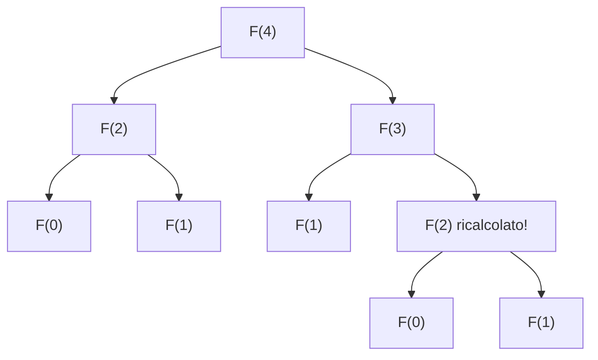

# Ricorsione

> [!abstract]
> La **ricorsione** è il secondo modo, dopo i cicli, per ripetere un'operazione: un metodo invoca se stesso su un problema più piccolo. Il capitolo la introduce con quattro esempi (fattoriale, righello, **ricerca binaria**, spazio occupato da un file system), mostra come **analizzarne il costo** contando le attivazioni (con l'induzione del [[04 - ASD - Analisi di algoritmi#Dimostrare per induzione o mediante invariante di ciclo|cap. 4]]), classifica le ricorsioni in **lineari, binarie e multiple**, dà regole di progetto e mette in guardia dalle ricorsioni **inefficienti** (Fibonacci esponenziale) e **infinite** (`StackOverflowError`). Chiude con la **ricorsione in coda** e la sua trasformazione in un ciclo.
> La ricorsione tornerà ovunque: negli alberi e nei loro attraversamenti ([[08 - ASD - Alberi|cap. 8]]), negli ordinamenti divide-and-conquer ([[12 - ASD - Ordinamento e selezione|cap. 12]]), nella DFS sui grafi ([[14 - ASD - Algoritmi per grafi|cap. 14]]).
> Mappa del corso: [[MOC - Algoritmi e Strutture Dati]].

---

## Introduzione

Vedi [[Ricorsione]].

La **ricorsione** (*recursion*) è la tecnica con cui un metodo esegue una o più invocazioni di **se stesso**, oppure con cui una struttura dati si definisce tramite **esemplari più piccoli** dello stesso tipo. Esempi in arte e natura: i frattali, le **matriosche** (ogni bambola, tranne la più piccola, ne contiene un'altra).

È un'alternativa elegante ai cicli: alcuni linguaggi (Scheme, Smalltalk) non hanno nemmeno i cicli e usano solo la ricorsione. In Java la ricorsione usa lo stesso meccanismo delle normali invocazioni: l'invocazione corrente resta **sospesa** finché quella ricorsiva non termina.

I quattro esempi iniziali:

- il **fattoriale**, con una definizione naturalmente ricorsiva;
- il **righello in pollici**, un semplice frattale;
- la **ricerca binaria**, uno degli algoritmi più importanti dell'informatica;
- il **file system**, con cartelle annidate a profondità arbitraria.

_(libro, pp. 196–197)_

---

## Esempi di ricorsione

### Funzione fattoriale

Il **fattoriale** di un intero $n \ge 0$:

$$n! = \begin{cases} 1 & \text{se } n = 0 \\ n \cdot (n-1) \cdot (n-2) \cdots 3 \cdot 2 \cdot 1 & \text{se } n \ge 1 \end{cases}$$

Ad esempio $5! = 120$. $n!$ è il numero di **permutazioni** di $n$ elementi distinti: `a`, `b`, `c` si dispongono in $3! = 6$ modi (abc, acb, bac, bca, cab, cba).

Osservando che $5! = 5 \cdot (4 \cdot 3 \cdot 2 \cdot 1) = 5 \cdot 4!$ si ottiene la definizione **ricorsiva**:

$$n! = \begin{cases} 1 & \text{se } n = 0 \\ n \cdot (n-1)! & \text{se } n \ge 1 \end{cases}$$

Struttura tipica di una definizione ricorsiva:

- uno o più **casi base**, con valori fissati (qui $0! = 1$);
- uno o più **casi ricorsivi**, che definiscono la funzione in termini di se stessa (qui $n! = n \cdot (n-1)!$).

#### Un'implementazione ricorsiva della funzione fattoriale

```java
public static int factorial(int n) throws IllegalArgumentException {
  if (n < 0)
    throw new IllegalArgumentException();   // n non può essere negativo
  else if (n == 0)
    return 1;                               // caso base
  else
    return n * factorial(n-1);              // caso ricorsivo
}
```

Nessun ciclo: la ripetizione nasce dalle invocazioni ricorsive. Il processo termina perché a ogni invocazione il parametro cala di 1 fino al caso base.

Per visualizzare l'esecuzione si usa un **diagramma di ricorsione** (*recursion trace*): un riquadro per invocazione, una freccia verso il basso per ogni nuova invocazione e una freccia verso l'alto, con il valore restituito, quando un'invocazione termina.

![[ASD-p198-1.png]]

`factorial(5)` invoca `factorial(4)`, …, fino a `factorial(0)` che restituisce 1. Poi i valori risalgono: $1 \cdot 1 = 1$, $2 \cdot 1 = 2$, $3 \cdot 2 = 6$, $4 \cdot 6 = 24$, $5 \cdot 24 = 120$.

A ogni invocazione (ricorsiva o no) Java crea un **record di attivazione** (*activation record* o *activation frame*) con i parametri, le variabili locali e il punto del codice in esecuzione. Quando un metodo ne invoca un altro (o se stesso), quello corrente viene sospeso e nel suo record si annota dove riprendere; poi si crea il record della nuova invocazione. L'importante è che **ogni invocazione attiva ha il suo record**: così le diverse copie di `n` non si confondono.

> [!tip] Collegamento
> I record di attivazione sono gli stack frame visti a basso livello in [[Stack Frame]] e [[05 - SO - Stack e Context Switch]] (Sistemi Operativi).

_(libro, pp. 197–199)_

### Disegnare un righello in pollici

Per il fattoriale la ricorsione non ha vantaggi su un ciclo. Un esempio più interessante è disegnare un **righello in pollici**: a ogni pollice c'è un segmento di **lunghezza maggiore** (*major tick length*) con il numero; tra due pollici ci sono segmenti più corti (*minor ticks*) ogni mezzo pollice, quarto di pollice, ecc., e **ogni volta che l'intervallo si dimezza la lunghezza del segmento cala di 1**.

![[ASD-p199-1.png]]

(a) righello di 2 pollici con lunghezza maggiore 4; (b) 1 pollice con lunghezza maggiore 5; (c) 3 pollici con lunghezza maggiore 3. Ogni riga di trattini è un segmento; le etichette 0, 1, 2, 3 sono i pollici.

#### Un approccio ricorsivo al disegno di un righello

Il righello è un **frattale**: in (b), tra i segmenti 0 e 1 c'è un segmento centrale di lunghezza 4 (mezzo pollice), e le parti sopra e sotto di esso sono identiche, ciascuna con un segmento centrale di lunghezza 3. In generale, un intervallo con segmento centrale di lunghezza $L \ge 1$ è composto da:

1. un intervallo con segmento centrale di lunghezza $L - 1$;
2. un segmento di lunghezza $L$;
3. un intervallo con segmento centrale di lunghezza $L - 1$.

```java
/** Disegna un righello lungo nInches pollici con lunghezza maggiore data. */
public static void drawRuler(int nInches, int majorLength) {
  drawLine(majorLength, 0);              // segmento 0 con etichetta
  for (int j = 1; j <= nInches; j++) {
    drawInterval(majorLength - 1);       // segmenti interni al pollice j
    drawLine(majorLength, j);            // segmento j con etichetta
  }
}
private static void drawInterval(int centralLength) {
  if (centralLength >= 1) {              // altrimenti non fa nulla (caso base)
    drawInterval(centralLength - 1);     // parte superiore
    drawLine(centralLength);             // segmento centrale (senza etichetta)
    drawInterval(centralLength - 1);     // parte inferiore
  }
}
private static void drawLine(int tickLength, int tickLabel) {
  for (int j = 0; j < tickLength; j++)
    System.out.print("-");
  if (tickLabel >= 0)
    System.out.print(" " + tickLabel);
  System.out.print("\n");
}
/** Disegna un segmento della lunghezza data (senza etichetta). */
private static void drawLine(int tickLength) {
  drawLine(tickLength, -1);
}
```

`drawRuler` disegna il righello completo; `drawLine` (in due versioni, con e senza etichetta) disegna un segmento. Il lavoro vero lo fa `drawInterval`, che segue esattamente la scomposizione: caso base $L = 0$ (non disegna nulla), altrimenti due chiamate su $L-1$ con un segmento di lunghezza $L$ in mezzo.

#### Illustrare il disegno di un righello usando un diagramma di ricorsione

Qui ogni invocazione ne genera **due**, quindi il diagramma si disegna come lo schema di un documento (indentato):

![[ASD-p201-1.png]]

`drawInterval(3)` chiama `drawInterval(2)`, che chiama `drawInterval(1)`, che chiama `drawInterval(0)` (nulla), `drawLine(1)` (stampa `-`), `drawInterval(0)`; poi `drawLine(2)` (`--`), e così via. A destra c'è ciò che viene stampato: `-`, `--`, `-`, `---`, poi la prima parte si ripete. La seconda chiamata a `drawInterval(2)` non è espansa ma è identica alla prima.

_(libro, pp. 199–201)_

### Ricerca binaria

Vedi [[Ricerca binaria]].

La **ricerca binaria** (o per bisezione, *binary search*) trova in modo efficiente un valore in una sequenza **ordinata** di $n$ elementi memorizzata in un array. È il motivo principale per cui spesso si tengono i dati ordinati.

![[ASD-p202-1.png]]

Un array ordinato di 16 elementi (2, 4, 5, 7, 8, 9, 12, 14, 17, 19, 22, 25, 27, 28, 33, 37) con gli indici 0–15 in alto.

- Se la sequenza **non è ordinata**, si usa la **ricerca lineare** (o sequenziale): si esaminano gli elementi uno dopo l'altro. Nel caso peggiore li guarda tutti: $O(n)$.
- Se è **ordinata** e con **accesso casuale** (ogni elemento raggiungibile per indice in tempo costante), si può fare molto meglio, come nel gioco "più alto o più basso" (*high-low*): dato un elemento di valore $v$, tutti quelli prima sono $\le v$ e tutti quelli dopo sono $\ge v$.

Un elemento è un **candidato** se non si può ancora escludere che sia quello cercato. L'algoritmo mantiene due indici `low` e `high` tali che tutti i candidati stanno in `[low, high]`; all'inizio `low = 0`, `high = n − 1`. Si confronta il valore cercato (*target*) con il **candidato mediano**, di indice

$$mid = \lfloor (low + high)/2 \rfloor$$

e si hanno tre casi:

1. `target == data[mid]`: trovato;
2. `target < data[mid]`: si cerca ricorsivamente nella metà sinistra, `[low, mid − 1]`;
3. `target > data[mid]`: si cerca ricorsivamente nella metà destra, `[mid + 1, high]`.

Se si arriva a `low > high` l'intervallo dei candidati è vuoto: ricerca fallita.

```java
/**
 * Restituisce true se e solo se target si trova nella porzione di array indicata.
 * Considera solo la porzione tra data[low] e data[high].
 */
public static boolean binarySearch(int[] data, int target, int low, int high) {
  if (low > high)
    return false;                                         // intervallo vuoto
  else {
    int mid = (low + high) / 2;
    if (target == data[mid])
      return true;                                        // trovato
    else if (target < data[mid])
      return binarySearch(data, target, low, mid - 1);    // metà sinistra
    else
      return binarySearch(data, target, mid + 1, high);   // metà destra
  }
}
```

![[ASD-p203-1.png]]

Ricerca di 22. (1) `low = 0`, `high = 15`, `mid = 7` (14): 22 > 14, si va a destra. (2) `low = 8`, `high = 15`, `mid = 11` (25): 22 < 25, si va a sinistra. (3) `low = 8`, `high = 10`, `mid = 9` (19): 22 > 19, a destra. (4) `low = mid = high = 10`: `data[10] = 22`, trovato. Le celle grigie sono i candidati rimasti.

La ricerca lineare è $O(n)$, la binaria **$O(\log n)$**: con $n$ = un miliardo, $\log_2 n$ è circa 30 (dimostrazione nella [[#Effettuare una ricerca binaria|Proposizione 5.2]]).

_(libro, pp. 202–203)_

### File System

I sistemi operativi definiscono le **cartelle** (directory) in modo ricorsivo: un file system ha una cartella radice (*top-level directory*) che contiene file e altre cartelle, che a loro volta contengono file e cartelle, a profondità arbitraria; alla fine ci sono cartelle che contengono solo file.

![[ASD-p204-1.png]]

La cartella `/user/rt/courses/` contiene `cs016/` e `cs252/`. `cs016/` contiene il file `grades` e le cartelle `homeworks/` (hw1, hw2, hw3) e `programs/` (pr1, pr2, pr3); `cs252/` contiene `projects/` (con `papers/` → buylow, sellhigh e `demos/` → market) e il file `grades`.

Molte operazioni del sistema operativo (copiare o eliminare una cartella) sono ricorsive. L'esempio: calcolare lo **spazio su disco** usato da una cartella e da tutto il suo contenuto. Si distingue:

- lo **spazio effettivo** di un'entità (quello occupato direttamente da essa);
- lo **spazio cumulativo** (dell'entità più tutto ciò che contiene, ricorsivamente).

![[ASD-p205-1.png]]

Dentro ogni riquadro c'è lo spazio effettivo, sopra ogni cartella quello cumulativo. Ad esempio `cs016/` occupa direttamente 2K, ma cumulativamente $2 + 8 + 10 + 229 = 249$K (sé stessa, `grades`, `homeworks/`, `programs/`). La radice occupa 5124K in totale.

Lo spazio cumulativo è lo spazio effettivo più lo spazio cumulativo di ogni entità contenuta direttamente:

```
Algorithm DiskUsage(path):
  Input: una stringa che indica un'entità del file system
  Output: lo spazio cumulativo usato da quell'entità e dal suo contenuto
  total = size(path)                       { spazio effettivo dell'entità }
  if path rappresenta una cartella then
    for ogni entità child contenuta in path do
      total = total + DiskUsage(child)     { invocazione ricorsiva }
  return total
```

#### La classe java.io.File

Un oggetto `java.io.File` rappresenta un percorso del sistema operativo. Metodi usati:

| Metodo | Effetto |
|---|---|
| `new File(pathString)` / `new File(parentFile, childString)` | crea il riferimento a partire dal percorso completo, oppure dalla cartella genitore e dal nome |
| `file.length()` | spazio effettivo in byte |
| `file.isDirectory()` | `true` se è una cartella |
| `file.list()` | array con i nomi delle entità contenute (es. per `cs016`: `{"grades", "homeworks", "programs"}`) |

#### Implementazione in Java

```java
/**
 * Calcola lo spazio cumulativo (in byte) della porzione di file system con radice
 * nel percorso dato, stampando un riassunto come il comando Unix 'du'.
 */
public static long diskUsage(File root) {
  long total = root.length();                  // spazio occupato direttamente
  if (root.isDirectory()) {                    // se è una cartella,
    for (String childname : root.list()) {     // per ogni figlio
      File child = new File(root, childname);  // crea l'oggetto che lo rappresenta
      total += diskUsage(child);               // e somma il suo spazio
    }
  }
  System.out.println(total + "\t" + root);     // stampa il riassunto
  return total;
}
```

#### Diagramma di ricorsione

La `println` (non necessaria per il risultato) produce un diagramma di ricorsione nel formato del comando Unix **`du`** (*disk usage*) con l'opzione `-a`:

```
8       /user/rt/courses/cs016/grades
3       /user/rt/courses/cs016/homeworks/hw1
2       /user/rt/courses/cs016/homeworks/hw2
4       /user/rt/courses/cs016/homeworks/hw3
10      /user/rt/courses/cs016/homeworks
57      /user/rt/courses/cs016/programs/pr1
97      /user/rt/courses/cs016/programs/pr2
74      /user/rt/courses/cs016/programs/pr3
229     /user/rt/courses/cs016/programs
249     /user/rt/courses/cs016
26      /user/rt/courses/cs252/projects/papers/buylow
55      /user/rt/courses/cs252/projects/papers/sellhigh
82      /user/rt/courses/cs252/projects/papers
4786    /user/rt/courses/cs252/projects/demos/market
4787    /user/rt/courses/cs252/projects/demos
4870    /user/rt/courses/cs252/projects
3       /user/rt/courses/cs252/grades
4874    /user/rt/courses/cs252
5124    /user/rt/courses/
```

C'è **un'invocazione per ogni entità**, e ogni riga viene stampata appena prima che l'invocazione termini: per questo il contenuto di una cartella compare **prima** della cartella stessa (`grades`, `homeworks`, `programs` prima di `cs016`). È un attraversamento in **post-ordine** ([[08 - ASD - Alberi#Attraversamenti in pre-ordine e post-ordine per alberi generici|cap. 8]]).

_(libro, pp. 204–207)_

---

## Analisi di algoritmi ricorsivi

Si contano le operazioni eseguite **dentro il corpo di ciascuna attivazione** (escludendo le invocazioni che fa) e poi si **sommano su tutte le attivazioni**. È lo stesso metodo che si usa per un metodo non ricorsivo che ne invoca altri. Spesso aiuta guardare il diagramma di ricorsione per capire quante attivazioni ci sono e come i parametri influenzano il lavoro di ciascuna.

### Calcolare il fattoriale

`factorial(n)` genera $n + 1$ attivazioni (il parametro va da $n$ a 0) e ognuna fa $O(1)$ operazioni: totale **$O(n)$**.

### Disegnare un righello in pollici

La misura giusta è il numero di righe stampate: ogni invocazione di `drawInterval(c)` con $c > 0$ chiama `drawLine` una volta e `drawInterval(c-1)` due volte.

**Proposizione 5.1.** Per ogni $c \ge 0$, `drawInterval(c)` stampa esattamente $2^c - 1$ righe.

*Dimostrazione (per induzione).* **Caso base**: `drawInterval(0)` non stampa nulla, e $2^0 - 1 = 0$. **Passo induttivo**: `drawInterval(c)` stampa la riga centrale più due volte le righe di `drawInterval(c-1)`, quindi per ipotesi induttiva $1 + 2(2^{c-1} - 1) = 1 + 2^c - 2 = 2^c - 1$.

Questo ragionamento è un esempio di **equazione di ricorrenza** ($T(c) = 2T(c-1) + 1$), strumento che verrà formalizzato nel [[12 - ASD - Ordinamento e selezione|Paragrafo 12.1.4]].

### Effettuare una ricerca binaria

Ogni invocazione fa un numero costante di operazioni, quindi il tempo è proporzionale al numero di invocazioni.

**Proposizione 5.2.** La ricerca binaria in un array ordinato di $n$ elementi richiede tempo $O(\log n)$.

*Dimostrazione.* Il numero di candidati è `high − low + 1`, e ogni invocazione lo **almeno dimezza**:

$$(mid - 1) - low + 1 = \left\lfloor \frac{low + high}{2} \right\rfloor - low \le \frac{high - low + 1}{2}$$
$$high - (mid + 1) + 1 = high - \left\lfloor \frac{low + high}{2} \right\rfloor \le \frac{high - low + 1}{2}$$

All'inizio ci sono $n$ candidati, dopo la prima invocazione al massimo $n/2$, dopo la seconda $n/4$, dopo la $j$-esima $n/2^j$. Nel caso peggiore (ricerca fallita) si continua finché non restano candidati, cioè il numero massimo di invocazioni è il più piccolo $r$ con $n/2^r < 1$, ossia $r > \log n$:

$$r = \lfloor \log n \rfloor + 1$$

quindi $O(\log n)$.

### Calcolare l'occupazione di spazio sul disco

Sia $n$ il numero di entità coinvolte (nella figura del file system $n = 19$).

**Numero di invocazioni: esattamente $n$.** Ogni entità $e$ viene passata a `diskUsage` una sola volta, quando si elabora la cartella che la contiene. Formalmente, per induzione sul **livello di annidamento** (*nesting level*): l'entità iniziale ha livello 0 e ha una sola invocazione (quella iniziale); se ogni entità di livello $k$ ha una sola invocazione, ogni entità di livello $k+1$ ne riceve una sola, nel ciclo della cartella di livello $k$ che la contiene.

**Costo totale.** Il ragionamento "ci sono $O(n)$ invocazioni e ognuna può avere un ciclo di $O(n)$ iterazioni (se una cartella contiene tutte le altre entità), quindi $O(n^2)$" dà un limite vero ma **non stretto**: non tutte le cartelle possono contenere $n$ entità. Conviene contare **tutte le iterazioni dei cicli `for` insieme**: ogni iterazione fa un'invocazione ricorsiva, e le invocazioni sono $n$ in tutto (compresa quella iniziale), quindi le iterazioni totali sono $n - 1$. Il tempo è $O(n)$ fuori dai cicli più $O(n)$ per tutti i cicli: **$O(n)$**.

Questo modo di ragionare sull'**effetto cumulativo** di una serie di operazioni, invece di supporre che ognuna sia nel suo caso peggiore, si chiama **analisi ammortizzata** (rivista negli [[07 - ASD - Liste e iteratori#Analisi ammortizzata degli array dinamici|array dinamici]]). Il file system è implicitamente un **albero**, e `diskUsage` è un caso particolare di **attraversamento di un albero**: il risultato $O(n)$ sarà generalizzato nel [[08 - ASD - Alberi#Algoritmi di attraversamento di alberi|Paragrafo 8.4]].

_(libro, pp. 208–211)_

---

## Ulteriori esempi di ricorsione

Vedi [[Ricorsione lineare, binaria e multipla]].

Si classificano le ricorsioni in base al **massimo numero di invocazioni ricorsive** che una singola attivazione può fare:

| Tipo | Invocazioni per attivazione | Forma del diagramma | Esempi |
|---|---|---|---|
| **Lineare** | al massimo 1 | una catena | fattoriale, ricerca binaria, `linearSum`, `reverseArray`, `power` |
| **Binaria** (o doppia) | al massimo 2 | un albero binario | righello, `binarySum`, `fibonacciBad` |
| **Multipla** | più di 2 | un albero generico | `diskUsage`, `PuzzleSolve` |

### Ricorsione lineare

Ogni attivazione fa al massimo una nuova invocazione. La **ricerca binaria è lineare** nonostante il nome: ha due rami ricorsivi, ma ne esegue solo uno. "Lineare" si riferisce alla **forma del diagramma** (una catena), non al tempo: la ricerca binaria è lineare ma $O(\log n)$.

#### Sommare ricorsivamente gli elementi di un array

Somma dei primi $n$ interi di un array: se $n = 0$ è 0, altrimenti è la somma dei primi $n-1$ più l'ultimo.

![[ASD-p212-1.png]]

La somma dei 16 elementi si ottiene aggiungendo l'ultimo (7, in bianco) alla somma dei primi 15 (in grigio).

```java
/** Restituisce la somma dei primi n interi dell'array dato. */
public static int linearSum(int[] data, int n) {
  if (n == 0)
    return 0;
  else
    return linearSum(data, n-1) + data[n-1];
}
```

![[ASD-p213-1.png]]

Diagramma di `linearSum(data, 5)` con `data` = 4, 3, 6, 2, 8: si scende fino a `linearSum(data, 0)` che restituisce 0, poi le somme risalgono: 0+4 = 4, 4+3 = 7, 7+6 = 13, 13+2 = 15, 15+8 = 23.

$n + 1$ invocazioni di costo costante: tempo **$O(n)$**. Anche lo **spazio** (oltre all'array) è $O(n)$, perché alla massima profondità ci sono $n + 1$ record di attivazione contemporaneamente in memoria.

#### Invertire una sequenza usando la ricorsione

Per invertire un array si scambiano primo e ultimo e si inverte ricorsivamente il resto. Si invoca con `reverseArray(data, 0, n-1)`.

```java
/** Inverte il sottoarray data[low]...data[high], estremi compresi. */
public static void reverseArray(int[] data, int low, int high) {
  if (low < high) {                         // almeno due elementi
    int temp = data[low];                   // scambia data[low] e data[high]
    data[low] = data[high];
    data[high] = temp;
    reverseArray(data, low + 1, high - 1);  // ricorsione sul resto
  }
}
```

![[ASD-p214-1.png]]

Inversione di 4 3 6 2 7 8 9 5: a ogni passo si scambiano i due estremi della parte grigia (non ancora invertita), che si accorcia di 2: 4↔5, 3↔9, 6↔8, 2↔7. Risultato: 5 9 8 7 2 6 3 4.

Il caso base si raggiunge con `low == high` ($n$ dispari) o `low == high + 1` ($n$ pari). Le invocazioni sono $1 + \lfloor n/2 \rfloor$: tempo **$O(n)$**.

#### Algoritmi ricorsivi per l'elevamento a potenza

Vedi [[Elevamento a potenza ricorsivo]].

Calcolare $power(x, n) = x^n$ per $n \ge 0$ intero (diverso da `Math.pow`).

**Versione banale**, da $x^n = x \cdot x^{n-1}$:

$$power(x, n) = \begin{cases} 1 & \text{se } n = 0 \\ x \cdot power(x, n-1) & \text{altrimenti} \end{cases}$$

```java
/** Calcola x elevato alla n, con n intero non negativo. */
public static double power(double x, int n) {
  if (n == 0)
    return 1;
  else
    return x * power(x, n-1);
}
```

$n + 1$ invocazioni: $O(n)$.

**Versione con elevamento al quadrato** (*repeated squaring*). Sia $k = \lfloor n/2 \rfloor$ (in Java `k = n / 2` tra `int`):

- se $n$ è pari, $(x^k)^2 = x^{2k} = x^n$;
- se $n$ è dispari, $2k = n - 1$, quindi $x^n = (x^k)^2 \cdot x$ (come $2^{13} = (2^6 \cdot 2^6) \cdot 2$).

$$power(x, n) = \begin{cases} 1 & \text{se } n = 0 \\ \left(power(x, \lfloor n/2 \rfloor)\right)^2 \cdot x & \text{se } n > 0 \text{ dispari} \\ \left(power(x, \lfloor n/2 \rfloor)\right)^2 & \text{se } n > 0 \text{ pari} \end{cases}$$

```java
public static double power(double x, int n) {
  if (n == 0)
    return 1;
  else {
    double partial = power(x, n/2);   // divisione intera, tronca
    double result = partial * partial;
    if (n % 2 == 1)                   // n dispari: un fattore x in più
      result *= x;
    return result;
  }
}
```

> [!warning] Una sola chiamata, non due
> Scrivere `power(x, n/2) * power(x, n/2)` farebbe **due** invocazioni ricorsive e il numero totale tornerebbe $O(n)$. Il guadagno viene dal calcolare `power(x, n/2)` **una volta sola** e salvarlo in `partial`.

![[ASD-p216-1.png]]

`power(2, 13)` → `power(2, 6)` → `power(2, 3)` → `power(2, 1)` → `power(2, 0)` = 1. Risalendo: $1 \cdot 1 \cdot 2 = 2$ (1 dispari), $2 \cdot 2 \cdot 2 = 8$ (3 dispari), $8 \cdot 8 = 64$ (6 pari), $64 \cdot 64 \cdot 2 = 8192$ (13 dispari).

L'esponente si almeno dimezza a ogni invocazione: come nella ricerca binaria, le invocazioni sono $O(\log n)$, ognuna $O(1)$, totale **$O(\log n)$**. Anche lo spazio scende: profondità di ricorsione $O(\log n)$ invece di $O(n)$.

_(libro, pp. 212–216)_

### Ricorsione binaria o doppia

Un metodo che fa **due** invocazioni ricorsive usa la ricorsione binaria (come il righello). Esempio: sommare un array dividendolo a metà, sommando ricorsivamente le due metà e poi i due risultati. Si invoca con `binarySum(data, 0, n-1)`.

```java
/** Restituisce la somma del sottoarray data[low]...data[high], estremi compresi. */
public static int binarySum(int[] data, int low, int high) {
  if (low > high)                    // zero elementi
    return 0;
  else if (low == high)              // un elemento
    return data[low];
  else {
    int mid = (low + high) / 2;
    return binarySum(data, low, mid) + binarySum(data, mid + 1, high);
  }
}
```

![[ASD-p217-1.png]]

Diagramma di `binarySum(data, 0, 7)`: ogni nodo indica `(low, high)`. (0,7) si divide in (0,3) e (4,7), poi in (0,1), (2,3), (4,5), (6,7), fino alle foglie (0,0), …, (7,7). È un albero binario completo.

Con $n$ potenza di 2: la profondità è $1 + \log n$, quindi lo **spazio** aggiuntivo è $O(\log n)$ (meglio di `linearSum`), ma le invocazioni sono $2n - 1$, quindi il **tempo** resta $O(n)$.

### Ricorsione multipla

Più di due invocazioni ricorsive per attivazione: ad esempio `diskUsage`, che ne fa una per ogni entità della cartella.

Un'altra applicazione tipica è **enumerare tutte le configurazioni** di un rompicapo combinatorio, come i **rompicapi della somma** (*summation puzzle*):

$$\text{pot} + \text{pan} = \text{bib} \qquad \text{dog} + \text{cat} = \text{pig} \qquad \text{boy} + \text{girl} = \text{baby}$$

dove a ogni lettera va assegnata una cifra diversa (0–9) in modo che l'uguaglianza sia vera. A mano si usa l'intuito per scartare configurazioni; un computer può invece **enumerarle tutte** e verificarle (se non sono troppe). Algoritmo generale: enumerare tutte le sequenze di lunghezza $k$ **senza ripetizioni** di elementi presi da un universo $U$:

1. genera ricorsivamente le sequenze di $k-1$ elementi;
2. aggiungi in fondo a ciascuna un elemento non ancora presente.

L'insieme $U$ contiene gli elementi **non ancora usati**. Per i rompicapi della somma $U = \{0, \dots, 9\}$ e ogni posizione della sequenza corrisponde a una lettera (b, o, y, …). Equivale a enumerare i sottoinsiemi ordinati di dimensione $k$ di $U$.

```
Algorithm PuzzleSolve(k, S, U):
  Input: un intero k, una sequenza S e un insieme U
  Output: l'enumerazione di tutte le estensioni di S a lunghezza k
          con elementi di U senza ripetizioni
  for each e in U do
    aggiungi e in fondo a S
    rimuovi e da U                    { e ora è in uso }
    if k == 1 then
      verifica se S risolve il rompicapo
      if S risolve il rompicapo then
        aggiungi S all'output         { una soluzione }
    else
      PuzzleSolve(k − 1, S, U)        { invocazione ricorsiva }
    rimuovi e dalla fine di S
    reinserisci e in U                { e torna disponibile }
```

![[ASD-p219-1.png]]

`PuzzleSolve(3, (), {a,b,c})`: l'invocazione iniziale ne genera 3 (con `a`, `b`, `c` come primo elemento), ognuna ne genera 2, e ogni foglia produce una permutazione (abc, acb, bac, bca, cab, cba). Con 4 elementi l'invocazione iniziale ne farebbe 4, ognuna con un sottoalbero simile.

Le ultime due righe dell'algoritmo **annullano** la scelta fatta: è lo schema del *backtracking*, che esplora una scelta e poi la disfa per provare la successiva.

_(libro, pp. 216–219)_

---

## Progettazione di algoritmi ricorsivi

Un algoritmo ricorsivo ha di solito questa forma:

- **verifica dei casi base**: almeno uno, definiti in modo che ogni catena di invocazioni ne raggiunga uno; i casi base **non** usano la ricorsione;
- **ricorsione**: altrimenti si fanno una o più invocazioni ricorsive (eventualmente scegliendo tra alternative con un `if`), ognuna delle quali deve **avvicinarsi a un caso base**.

### Aggiungere parametri a una ricorsione

Conviene pensare a come definire **sottoproblemi con la stessa struttura** del problema originale (provando a mano su piccoli esempi se non è ovvio). Spesso bisogna **ridefinire il problema aggiungendo parametri**: la firma naturale per l'utente è `binarySearch(data, target)`, ma la ricorsione ha bisogno di `low` e `high` per delimitare il sottoarray (lo stesso vale per `reverseArray`, `linearSum`, `binarySum`).

Per offrire un'interfaccia pulita si rende **privato** il metodo ricorsivo con i parametri in più e si aggiunge un metodo **pubblico** che lo invoca:

```java
/** Restituisce true se e solo se target appartiene all'array data. */
public static boolean binarySearch(int[] data, int target) {
  return binarySearch(data, target, 0, data.length - 1);   // versione con più parametri
}
```

_(libro, pp. 219–220)_

---

## Ricorsioni fuori controllo

La ricorsione è potente ma si usa facilmente male.

### Unicità degli elementi, versione ricorsiva

Riprendendo il problema dell'[[04 - ASD - Analisi di algoritmi#Unicità degli elementi|unicità degli elementi]]: per $n = 1$ gli elementi sono banalmente distinti; per $n \ge 2$ sono distinti se e solo se i primi $n-1$ sono distinti, gli ultimi $n-1$ sono distinti, e primo e ultimo sono diversi (l'unica coppia non controllata dai sottoproblemi).

```java
/** true se gli elementi in data[low]...data[high] sono distinti. */
public static boolean unique3(int[] data, int low, int high) {
  if (low >= high) return true;                              // al massimo un elemento
  else if (!unique3(data, low, high-1)) return false;        // duplicato nei primi n-1
  else if (!unique3(data, low+1, high)) return false;        // duplicato negli ultimi n-1
  else return (data[low] != data[high]);                     // primo e ultimo diversi?
}
```

È **terribilmente inefficiente**. Ogni invocazione su $n$ elementi ne genera 2 su $n-1$, che ne generano 4 su $n-2$, 8 su $n-3$, …: nel caso peggiore

$$1 + 2 + 4 + \dots + 2^{n-1} = 2^n - 1$$

invocazioni ([[04 - ASD - Analisi di algoritmi#Somme geometriche|Proposizione 4.5]]), quindi **$O(2^n)$**. Il problema non è la ricorsione in sé ma il modo in cui è usata (esercizio C-5.12).

### Una ricorsione inefficiente per calcolare i numeri di Fibonacci

Vedi [[Fibonacci ricorsivo]].

$$F_0 = 0, \qquad F_1 = 1, \qquad F_n = F_{n-2} + F_{n-1} \text{ per } n > 1$$

```java
/** Restituisce (in modo inefficiente) l'n-esimo numero di Fibonacci. */
public static long fibonacciBad(int n) {
  if (n <= 1)
    return n;
  else
    return fibonacciBad(n-2) + fibonacciBad(n-1);
}
```

Sia $c_n$ il numero di invocazioni generate da `fibonacciBad(n)`: $c_n = 1 + c_{n-2} + c_{n-1}$.

| $n$ | 0 | 1 | 2 | 3 | 4 | 5 | 6 | 7 | 8 |
|---|---|---|---|---|---|---|---|---|---|
| $c_n$ | 1 | 1 | 3 | 5 | 9 | 15 | 25 | 41 | 67 |

Ogni due indici il numero **più che raddoppia** ($c_4 > 2c_2$, $c_5 > 2c_3$, …), quindi $c_n > 2^{n/2}$: **esponenziale**. Il motivo: la chiamata per $F_n$ calcola $F_{n-2}$ e poi, in quella per $F_{n-1}$, lo **ricalcola** da capo, e così via a cascata.



### Una ricorsione efficiente per calcolare i numeri di Fibonacci

Si ridefinisce il problema: il metodo restituisce **una coppia** di numeri consecutivi $\{F_n, F_{n-1}\}$ (con la convenzione $F_{-1} = 0$). Così ogni livello passa al successivo anche il valore che altrimenti andrebbe ricalcolato, e basta **una** invocazione ricorsiva.

```java
/** Restituisce un array con due numeri di Fibonacci consecutivi, F(n) e F(n-1). */
public static long[] fibonacciGood(int n) {
  if (n <= 1) {
    long[] answer = {n, 0};
    return answer;
  } else {
    long[] temp = fibonacciGood(n - 1);              // {F(n-1), F(n-2)}
    long[] answer = {temp[0] + temp[1], temp[0]};    // {F(n), F(n-1)}
    return answer;
  }
}
```

Ricorsione lineare con $n$ invocazioni di costo costante: **$O(n)$**. Tra esponenziale e lineare la differenza è "tra il giorno e la notte".

_(libro, pp. 220–223)_

### Massima profondità di ricorsione in Java

La **ricorsione infinita** si ha quando le invocazioni non raggiungono mai un caso base. Consuma CPU e soprattutto memoria (un record di attivazione per invocazione).

```java
/** Ricorsione infinita: da NON invocare. */
public static int fibonacci(int n) {
  return fibonacci(n);   // in fondo, F(n) è uguale a F(n)...
}
```

Gli errori possono essere più subdoli: nella ricerca binaria, scrivere `binarySearch(data, target, mid, high)` invece di `mid + 1` può causare una ricorsione infinita, perché su un sottoarray di due elementi ($mid = low$) l'invocazione ricorsiva riceve **lo stesso** intervallo. Ogni invocazione deve **progredire** verso un caso base (ad esempio facendo decrescere un parametro).

Per limitare i danni Java limita lo spazio per i record di attivazione: superato il limite, la JVM lancia **`StackOverflowError`** (lo *stack* è la struttura del [[06 - ASD - Pile, code e code doppie#Pile (stack)|Paragrafo 6.1]]). Il limite dipende dalla versione, tipicamente circa **mille** invocazioni contemporanee.

- Per la ricerca binaria basta e avanza: con profondità $O(\log n)$ servirebbe un array di circa $2^{1000}$ elementi, più degli atomi dell'universo.
- Per le ricorsioni lineari con profondità $n$ (come `linearSum`) il limite può essere un problema. Si può aumentare lo spazio con l'opzione `-Xss` della JVM, oppure riscrivere l'algoritmo con un **ciclo**.

> [!warning] Correzione
> A p. 225 il libro elenca "il metodo `fibonacciGood` (Codice 5.13)", ma `fibonacciGood` è il **Codice 5.14**; il Codice 5.13 è `fibonacciBad`.

_(libro, pp. 223–224)_

---

## Eliminare la ricorsione in coda

Vedi [[Ricorsione in coda]].

La ricorsione sfrutta la struttura ripetitiva dei problemi e porta spesso a descrizioni più leggibili, ma ha un costo: la JVM deve gestire i record di attivazione di tutte le invocazioni annidate. Quando la memoria conta può servire una versione **non ricorsiva**.

In generale si può simulare la ricorsione con una **pila** esplicita ([[06 - ASD - Pile, code e code doppie|cap. 6]]): la memoria si sposta dalla pila dell'interprete alla nostra, ma scegliendo bene cosa memorizzare si può risparmiare.

Alcune ricorsioni si eliminano **senza memoria ausiliaria**: le **ricorsioni in coda** (*tail recursion*). Una ricorsione è in coda se ogni invocazione ricorsiva è **l'ultima azione** del contesto, e il suo eventuale valore viene **restituito subito** dall'invocazione che la contiene. Una ricorsione in coda è necessariamente lineare.

| Metodo | In coda? | Perché |
|---|---|---|
| `binarySearch` | sì | `return binarySearch(...)` |
| `reverseArray` | sì | l'invocazione è l'ultima istruzione |
| `factorial` | no | dopo `factorial(n-1)` c'è ancora la moltiplicazione `n * ...` |
| `linearSum` | no | dopo c'è `+ data[n-1]` |
| `power` (entrambe) | no | dopo ci sono moltiplicazioni |
| `fibonacciGood` | no | dopo si costruisce l'array `answer` |

Una ricorsione in coda si trasforma meccanicamente in un ciclo: il corpo va dentro un ciclo, e l'invocazione ricorsiva con nuovi parametri diventa un'**assegnazione** di nuovi valori ai parametri. Molti compilatori lo fanno automaticamente come ottimizzazione.

```java
/** true se e solo se target si trova nell'array data. */
public static boolean binarySearchIterative(int[] data, int target) {
  int low = 0;
  int high = data.length - 1;
  while (low <= high) {
    int mid = (low + high) / 2;
    if (target == data[mid])
      return true;           // trovato
    else if (target < data[mid])
      high = mid - 1;        // al posto di binarySearch(data, target, low, mid - 1)
    else
      low = mid + 1;         // al posto di binarySearch(data, target, mid + 1, high)
  }
  return false;              // ciclo finito senza successo
}
```

Il caso base `low > high` diventa la condizione opposta del ciclo, `while (low <= high)`.

Anche molte ricorsioni lineari non in coda si riscrivono facilmente con un ciclo (fattoriale, Fibonacci, somma, inversione):

```java
/** Inverte il contenuto dell'array dato. */
public static void reverseArray(int[] data) {
  int low = 0, high = data.length - 1;
  while (low < high) {          // scambia data[low] e data[high]
    int temp = data[low];
    data[low++] = data[high];   // post-incremento di low
    data[high--] = temp;        // post-decremento di high
  }
}
```

_(libro, pp. 224–226)_

---

> [!summary] Riepilogo
> - Ricorsione = casi base + casi ricorsivi che si avvicinano ai casi base; ogni invocazione ha il suo **record di attivazione**.
> - Esempi: fattoriale $O(n)$; righello ($2^c - 1$ righe per `drawInterval(c)`); **ricerca binaria** $O(\log n)$ (al massimo $\lfloor\log n\rfloor + 1$ invocazioni); `diskUsage` $O(n)$ con ragionamento ammortizzato.
> - Analisi: lavoro di ogni attivazione sommato su tutte le attivazioni; spesso per induzione.
> - **Lineare** (catena: `linearSum`, `reverseArray`, `power`), **binaria** (`binarySum`: spazio $O(\log n)$, tempo $O(n)$), **multipla** (`diskUsage`, `PuzzleSolve` con backtracking).
> - `power` con elevamento al quadrato: $O(\log n)$ purché si faccia **una** chiamata.
> - Trappole: `unique3` e `fibonacciBad` sono **esponenziali** (ricalcolano gli stessi sottoproblemi); `fibonacciGood` restituisce una coppia ed è $O(n)$; ricorsione infinita → `StackOverflowError` (circa 1000 livelli, `-Xss`).
> - **Ricorsione in coda**: l'invocazione ricorsiva è l'ultima azione → si trasforma in un ciclo (`binarySearchIterative`).
