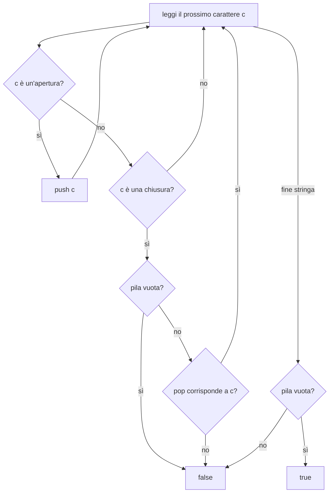
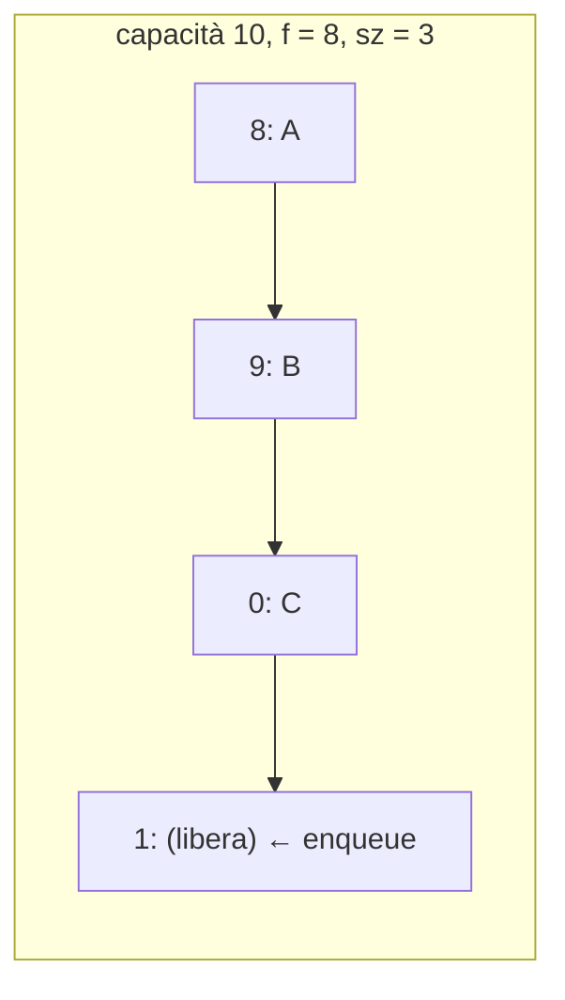

# Pile, code e code doppie

> [!abstract]
> Il capitolo presenta i primi veri **tipi di dato astratto** (ADT, [[02 - ASD - Progettazione orientata agli oggetti#Astrazione|cap. 2]]) del libro, tre contenitori lineari che differiscono solo per **dove** si inserisce e si rimuove:
> - la **pila** (*stack*, LIFO): si inserisce e si rimuove dalla cima;
> - la **coda** (*queue*, FIFO): si inserisce in fondo e si rimuove dall'inizio;
> - la **coda doppia** (*deque*): si inserisce e si rimuove da entrambe le estremità.
>
> Per ciascuno si definisce l'interfaccia Java, la si implementa con un **array** (anche circolare) e con le **liste concatenate** del [[03 - ASD - Strutture dati fondamentali|cap. 3]] (schema **adattatore**), si analizzano i costi (tutto $O(1)$) e si vedono applicazioni: inversione di sequenze, verifica di parentesi e tag HTML, round robin e problema di Josephus.
> Le pile torneranno nella simulazione della ricorsione ([[05 - ASD - Ricorsione#Eliminare la ricorsione in coda|cap. 5]]) e nella DFS iterativa, le code nella visita in ampiezza di alberi e grafi ([[08 - ASD - Alberi|cap. 8]], [[14 - ASD - Algoritmi per grafi|cap. 14]]).
> Mappa del corso: [[MOC - Algoritmi e Strutture Dati]].

---

## Pile (stack)

Vedi [[Pila (ADT)]].

Una **pila** (*stack*) è un contenitore in cui gli oggetti si inseriscono e si rimuovono con la politica **LIFO** (*last-in, first-out*): l'ultimo entrato è il primo a uscire. Si può inserire in qualunque momento, ma si può vedere o togliere solo l'elemento inserito più di recente, quello **in cima** (*top of the stack*).

Il nome viene dalle pile di piatti a molla dei ristoranti: si "spinge" giù un piatto (*push*) e se ne fa "saltare fuori" uno (*pop*).

![[ASD-p231-1.png]]

Il distributore di caramelle PEZ è una pila fisica: le caramelle stanno in un tubo a molla e quando si apre il coperchio esce (pop) solo quella in cima.

> [!example] Applicazioni
> - **Esempio 6.1**: il browser memorizza in una pila gli indirizzi visitati; ogni nuovo sito viene inserito in cima e il pulsante "indietro" li estrae a ritroso.
> - **Esempio 6.2**: l'**annulla** (*undo*) di un editor conserva le modifiche in una pila e le annulla dalla più recente.

### La pila come tipo di dato astratto

Le pile sono le strutture dati più semplici ma tra le più importanti: si usano in moltissime applicazioni e come componente di strutture e algoritmi più complessi. L'ADT pila ha due metodi di aggiornamento:

| Metodo | Effetto |
|---|---|
| `push(e)` | aggiunge `e` in cima alla pila |
| `pop()` | rimuove e restituisce l'elemento in cima (`null` se la pila è vuota) |

e tre metodi di accesso:

| Metodo | Effetto |
|---|---|
| `top()` | restituisce l'elemento in cima senza rimuoverlo (`null` se vuota) |
| `size()` | numero di elementi |
| `isEmpty()` | `true` se la pila è vuota |

Gli elementi possono essere di qualunque tipo e una pila nasce vuota.

> [!example] Esempio 6.3 — operazioni su una pila di interi
> | Operazione | Restituisce | Contenuto (cima a destra) |
> |---|---|---|
> | `push(5)` | – | (5) |
> | `push(3)` | – | (5, 3) |
> | `size()` | 2 | (5, 3) |
> | `pop()` | 3 | (5) |
> | `isEmpty()` | false | (5) |
> | `pop()` | 5 | () |
> | `isEmpty()` | true | () |
> | `pop()` | null | () |
> | `push(7)` | – | (7) |
> | `push(9)` | – | (7, 9) |
> | `top()` | 9 | (7, 9) |
> | `push(4)` | – | (7, 9, 4) |
> | `size()` | 3 | (7, 9, 4) |
> | `pop()` | 4 | (7, 9) |
> | `push(6)` | – | (7, 9, 6) |
> | `push(8)` | – | (7, 9, 6, 8) |
> | `pop()` | 8 | (7, 9, 6) |

#### La pila come interfaccia in Java

L'API della pila diventa un'interfaccia Java **generica**: `Stack<Integer>` è una pila di interi, e il parametro `E` è il tipo del parametro di `push` e del valore restituito da `pop` e `top`.

```java
/**
 * Una raccolta di oggetti inseriti e rimossi secondo il principio last-in first-out.
 * Pur avendo uno scopo simile, questa interfaccia è diversa da java.util.Stack.
 */
public interface Stack<E> {
  /** Restituisce il numero di elementi nella pila. */
  int size();
  /** Verifica se la pila è vuota. */
  boolean isEmpty();
  /** Inserisce un elemento in cima alla pila. */
  void push(E e);
  /** Restituisce l'elemento in cima senza rimuoverlo (null se la pila è vuota). */
  E top();
  /** Rimuove e restituisce l'elemento in cima (null se la pila è vuota). */
  E pop();
}
```

Un'interfaccia non si può istanziare: servono classi concrete. Se ne vedono due, una con un array e una con una lista concatenata.

#### La classe java.util.Stack

Java ha da sempre una classe `java.util.Stack`, ma esiste solo per compatibilità storica: la sua interfaccia è incoerente con il resto della libreria e la documentazione ne sconsiglia l'uso a favore della **coda doppia** ([[#Code doppie|Paragrafo 6.3]]).

| Nostro ADT | `java.util.Stack` |
|---|---|
| `size()` | `size()` |
| `isEmpty()` | `empty()` ⟵ |
| `push(e)` | `push(e)` |
| `pop()` | `pop()` |
| `top()` | `peek()` ⟵ |

Inoltre `pop` e `peek` di `java.util.Stack` lanciano `EmptyStackException` su pila vuota, mentre il nostro ADT restituisce `null`.

_(libro, pp. 230–234)_

### Una semplice implementazione di pila basata su array

Gli elementi stanno in un array `data` di capacità $N$ fissa: il fondo della pila è `data[0]` e la cima è `data[t]`, con l'indice $t$ pari alla dimensione meno uno.

![[ASD-p234-1.png]]

L'array `data` contiene gli elementi A, B, C, … fino a M nella cella `t`; le celle da `t+1` a `N−1` sono libere.

La dimensione è $t + 1$; per convenzione la pila vuota ha $t = -1$.

```java
public class ArrayStack<E> implements Stack<E> {
  public static final int CAPACITY = 1000;     // capacità predefinita
  private E[] data;                            // array generico degli elementi
  private int t = -1;                          // indice della cima
  public ArrayStack() { this(CAPACITY); }      // pila con capacità predefinita
  public ArrayStack(int capacity) {            // pila con capacità data
    data = (E[]) new Object[capacity];         // cast sicuro, ma warning del compilatore
  }
  public int size() { return (t + 1); }
  public boolean isEmpty() { return (t == -1); }
  public void push(E e) throws IllegalStateException {
    if (size() == data.length) throw new IllegalStateException("Stack is full");
    data[++t] = e;                             // incrementa t PRIMA di usarlo
  }
  public E top() {
    if (isEmpty()) return null;
    return data[t];
  }
  public E pop() {
    if (isEmpty()) return null;
    E answer = data[t];
    data[t] = null;                            // aiuta il garbage collector
    t--;
    return answer;
  }
}
```

L'array generico si crea con il trucco `(E[]) new Object[capacity]` visto nel [[02 - ASD - Progettazione orientata agli oggetti#Tipi generici e array|Paragrafo 2.5.2]].

#### Uno svantaggio di questa implementazione

La **capacità fissa**: se è sovrastimata si spreca memoria; se è sottostimata, un `push` su pila piena lancia `IllegalStateException` e l'elemento viene rifiutato. Due alternative senza limite e con spazio proporzionale al numero di elementi: la pila su **lista concatenata** (subito sotto) e l'**array dinamico** ([[07 - ASD - Liste e iteratori#Array dinamici|Paragrafo 7.2.1]]).

#### Analisi dell'implementazione di pila basata su array

La correttezza segue dalla definizione di $t$ (in `push` lo si incrementa prima di scrivere, così si usa la prima cella libera). Ogni metodo esegue un numero costante di operazioni:

| Metodo | Tempo |
|---|---|
| `size` | $O(1)$ |
| `isEmpty` | $O(1)$ |
| `top` | $O(1)$ |
| `push` | $O(1)$ |
| `pop` | $O(1)$ |

Lo spazio è $O(N)$, con $N$ fissato alla creazione e indipendente dal numero $n \le N$ di elementi presenti.

#### Recupero della memoria non più utilizzata in Java

In `pop` la riga `data[t] = null` non serve alla correttezza, ma alla **garbage collection**: Java recupera la memoria degli oggetti che nessun riferimento raggiunge più ([[15 - ASD - Gestione della memoria e B-alberi#Garbage collection|Paragrafo 15.1.3]]). Se l'array conservasse il riferimento all'oggetto rimosso, il garbage collector non potrebbe liberarlo, anche se il resto del programma non lo usa più.

#### Esempio di utilizzo

```java
Stack<Integer> S = new ArrayStack<>();   // contenuto: ()
S.push(5);                               // (5)
S.push(3);                               // (5, 3)
System.out.println(S.size());            // (5, 3)      stampa 2
System.out.println(S.pop());             // (5)         stampa 3
System.out.println(S.isEmpty());         // (5)         stampa false
System.out.println(S.pop());             // ()          stampa 5
System.out.println(S.isEmpty());         // ()          stampa true
System.out.println(S.pop());             // ()          stampa null
S.push(7);                               // (7)
S.push(9);                               // (7, 9)
System.out.println(S.top());             // (7, 9)      stampa 9
S.push(4);                               // (7, 9, 4)
System.out.println(S.size());            // (7, 9, 4)   stampa 3
System.out.println(S.pop());             // (7, 9)      stampa 4
S.push(6);                               // (7, 9, 6)
S.push(8);                               // (7, 9, 6, 8)
System.out.println(S.pop());             // (7, 9, 6)   stampa 8
```

Grazie all'auto-boxing si passano `int` a `push` anche se il tipo è `Integer`.

_(libro, pp. 234–237)_

### Realizzare una pila con una lista semplicemente concatenata

Con una [[03 - ASD - Strutture dati fondamentali#Liste semplicemente concatenate|lista semplicemente concatenata]] lo spazio è sempre proporzionale al numero di elementi e non c'è capacità massima. La cima della pila va messa alla **testa** della lista, perché lì inserimenti e rimozioni costano $O(1)$ (in coda la rimozione no).

#### Lo schema progettuale adattatore (adapter)

Vedi [[Schema adattatore]].

Lo schema **adattatore** (*adapter*) serve a far corrispondere i metodi di una classe esistente a quelli di un'interfaccia correlata ma diversa: la nuova classe contiene un esemplare della classe esistente come **campo privato** e implementa ogni metodo invocando il metodo corrispondente di quel campo.

| Metodo della pila | Metodo della lista |
|---|---|
| `size()` | `list.size()` |
| `isEmpty()` | `list.isEmpty()` |
| `push(e)` | `list.addFirst(e)` |
| `pop()` | `list.removeFirst()` |
| `top()` | `list.first()` |

```java
public class LinkedStack<E> implements Stack<E> {
  private SinglyLinkedList<E> list = new SinglyLinkedList<>();   // lista vuota
  public LinkedStack() { }                    // la pila nasce da una lista vuota
  public int size() { return list.size(); }
  public boolean isEmpty() { return list.isEmpty(); }
  public void push(E element) { list.addFirst(element); }
  public E top() { return list.first(); }
  public E pop() { return list.removeFirst(); }
}
```

Tutti i metodi sono $O(1)$.

### Invertire un array usando una pila

Per la politica LIFO, una pila **inverte** l'ordine: se si inseriscono 1, 2, 3 escono 3, 2, 1. Per invertire un array (già fatto ricorsivamente nel [[05 - ASD - Ricorsione#Invertire una sequenza usando la ricorsione|Paragrafo 5.3.1]]) si inseriscono tutti gli elementi in una pila e poi li si estrae riscrivendo l'array dalla prima cella.

```java
/** Metodo generico che inverte il contenuto di un array. */
public static <E> void reverse(E[] a) {
  Stack<E> buffer = new ArrayStack<>(a.length);
  for (int i = 0; i < a.length; i++)
    buffer.push(a[i]);
  for (int i = 0; i < a.length; i++)
    a[i] = buffer.pop();
}

public static void main(String[] args) {
  Integer[] a = {4, 8, 15, 16, 23, 42};       // possibile grazie all'auto-boxing
  String[] s = {"Jack", "Kate", "Hurley", "Jin", "Michael"};
  System.out.println("a = " + Arrays.toString(a));
  System.out.println("s = " + Arrays.toString(s));
  System.out.println("Reversing...");
  reverse(a);
  reverse(s);
  System.out.println("a = " + Arrays.toString(a));
  System.out.println("s = " + Arrays.toString(s));
}
```

```
a = [4, 8, 15, 16, 23, 42]
s = [Jack, Kate, Hurley, Jin, Michael]
Reversing...
a = [42, 23, 16, 15, 8, 4]
s = [Michael, Jin, Hurley, Kate, Jack]
```

_(libro, pp. 237–239)_

### Corrispondenza tra parentesi e tra marcatori HTML

Vedi [[Verifica di delimitatori con una pila]].

Due applicazioni che verificano che i **delimitatori** siano accoppiati correttamente.

Nelle espressioni aritmetiche si usano parentesi tonde `( )`, graffe `{ }` e quadre `[ ]`; ogni simbolo di apertura deve avere il corrispondente di chiusura, come in `[(5 + x) − (y + z)]`.

| Espressione | Esito |
|---|---|
| `()(()){([()])}` | corretta |
| `((()(()){([()])}))` | corretta |
| `)(()){([()])}` | sbagliata (chiude prima di aprire) |
| `({[])}` | sbagliata (`]` chiude una `{`) |
| `(` | sbagliata (non chiusa) |

#### Un algoritmo per trovare corrispondenze tra delimitatori

Si scandisce l'espressione da sinistra a destra:

- simbolo di **apertura** → `push` sulla pila;
- simbolo di **chiusura** → se la pila è vuota l'espressione è sbagliata; altrimenti si fa `pop` e si controlla che il simbolo estratto sia l'apertura corrispondente;
- alla fine l'espressione è corretta **se e solo se la pila è vuota** (altrimenti qualche apertura non è stata chiusa).

Con un'espressione di lunghezza $n$ si fanno al massimo $n$ `push` e $n$ `pop`: tempo $O(n)$.

> [!warning] Correzione
> Il libro scrive "al massimo $m$ invocazioni di push e $n$ invocazioni di pop" dopo aver chiamato $m$ la lunghezza dell'espressione: il secondo valore è un refuso, sono al massimo $m$ (= la stessa lunghezza) anche le `pop`.

```java
/** Verifica se nell'espressione data le parentesi sono accoppiate correttamente. */
public static boolean isMatched(String expression) {
  final String opening = "({[";                       // delimitatori di apertura
  final String closing = ")}]";                       // corrispondenti chiusure
  Stack<Character> buffer = new LinkedStack<>();
  for (char c : expression.toCharArray()) {
    if (opening.indexOf(c) != -1)                     // apertura
      buffer.push(c);
    else if (closing.indexOf(c) != -1) {              // chiusura
      if (buffer.isEmpty())                           // niente da chiudere
        return false;
      if (closing.indexOf(c) != opening.indexOf(buffer.pop()))
        return false;                                 // coppia sbagliata
    }
  }
  return buffer.isEmpty();                            // tutte le aperture chiuse?
}
```

Le due stringhe `"({["` e `")}]"` sono allineate: il simbolo all'indice $k$ della prima si chiude con quello all'indice $k$ della seconda. `indexOf(c)` restituisce la posizione di `c` nella stringa, oppure $-1$; per aggiungere altri delimitatori basta allungare le due stringhe.



#### Corrispondenze in un linguaggio a marcatori

Lo stesso schema verifica i linguaggi a marcatori (*markup*) come **HTML** e **XML**: le parti di testo sono racchiuse da un **marcatore di apertura** `<nome>` e uno di **chiusura** `</nome>`.

![[ASD-p241-1.png]]

(a) un documento HTML, (b) come lo visualizza un browser. Marcatori usati: `<body>` (corpo del documento), `<h1>` (intestazione), `<center>` (testo centrato), `<p>` (paragrafo), `<ol>` (elenco numerato), `<li>` (elemento dell'elenco). Ogni apertura ha la sua chiusura e i marcatori sono annidati correttamente.

```java
/** Verifica se in una stringa HTML i marcatori aperti e chiusi corrispondono. */
public static boolean isHTMLMatched(String html) {
  Stack<String> buffer = new LinkedStack<>();
  int j = html.indexOf('<');                    // prossimo '<', se c'è
  while (j != -1) {
    int k = html.indexOf('>', j+1);             // prossimo '>'
    if (k == -1)
      return false;                             // marcatore non valido
    String tag = html.substring(j+1, k);        // toglie < e >
    if (!tag.startsWith("/"))                   // marcatore di apertura
      buffer.push(tag);
    else {                                      // marcatore di chiusura
      if (buffer.isEmpty())
        return false;                           // niente da chiudere
      if (!tag.substring(1).equals(buffer.pop()))
        return false;                           // marcatore non corrispondente
    }
    j = html.indexOf('<', k+1);                 // prossimo '<', se c'è
  }
  return buffer.isEmpty();                      // tutti i marcatori chiusi?
}
```

`indexOf(c, start)` cerca a partire dall'indice `start`; `substring(a, b)` restituisce i caratteri da `a` a `b−1`. I browser reali tollerano molti errori, ma in teoria tutti i marcatori dovrebbero corrispondere.

_(libro, pp. 239–242)_

---

## Code (queue)

Vedi [[Coda (ADT)]].

La **coda** (*queue*) è la "parente stretta" della pila: gli elementi si inseriscono e si rimuovono con la politica **FIFO** (*first-in, first-out*). Si inserisce in qualunque momento, ma si rimuove solo l'elemento che è in coda **da più tempo**. Gli elementi entrano dalla **fine** (*back*) ed escono dall'**inizio** (*front*), come le persone in fila per un'attrazione.

![[ASD-p242-1.png]]

Code FIFO del mondo reale: (a) persone in fila alla biglietteria; (b) chiamate telefoniche messe in coda verso un centro servizi.

Si usano code ovunque le richieste vadano servite in ordine di arrivo: negozi, teatri, prenotazioni, liste d'attesa di un ristorante, stampanti condivise, server web.

### Il tipo di dato astratto coda

Metodi di aggiornamento:

| Metodo | Effetto |
|---|---|
| `enqueue(e)` | aggiunge `e` in fondo alla coda |
| `dequeue()` | rimuove e restituisce il primo elemento (`null` se vuota) |

Metodi di accesso:

| Metodo | Effetto |
|---|---|
| `first()` | restituisce il primo elemento senza rimuoverlo (`null` se vuota), analogo a `top` della pila |
| `size()` | numero di elementi |
| `isEmpty()` | `true` se la coda è vuota |

```java
public interface Queue<E> {
  /** Restituisce il numero di elementi nella coda. */
  int size();
  /** Verifica se la coda è vuota. */
  boolean isEmpty();
  /** Inserisce un elemento in fondo alla coda. */
  void enqueue(E e);
  /** Restituisce il primo elemento senza rimuoverlo (null se vuota). */
  E first();
  /** Rimuove e restituisce il primo elemento (null se vuota). */
  E dequeue();
}
```

> [!example] Esempio 6.4 — operazioni su una coda di interi
> | Operazione | Restituisce | Contenuto (first … last) |
> |---|---|---|
> | `enqueue(5)` | – | (5) |
> | `enqueue(3)` | – | (5, 3) |
> | `size()` | 2 | (5, 3) |
> | `dequeue()` | 5 | (3) |
> | `isEmpty()` | false | (3) |
> | `dequeue()` | 3 | () |
> | `isEmpty()` | true | () |
> | `dequeue()` | null | () |
> | `enqueue(7)` | – | (7) |
> | `enqueue(9)` | – | (7, 9) |
> | `first()` | 7 | (7, 9) |
> | `enqueue(4)` | – | (7, 9, 4) |

#### L'interfaccia java.util.Queue

`java.util.Queue` ha funzionalità analoghe ma non impone la politica FIFO (la implementano anche le code prioritarie). Quando la classe è FIFO, la corrispondenza è:

| Nostro ADT | `java.util.Queue` (lancia eccezioni) | `java.util.Queue` (restituisce un valore speciale) |
|---|---|---|
| `enqueue(e)` | `add(e)` | `offer(e)` |
| `dequeue()` | `remove()` | `poll()` |
| `first()` | `element()` | `peek()` |
| `size()` | `size()` | |
| `isEmpty()` | `isEmpty()` | |

Su coda vuota `remove()` ed `element()` lanciano `NoSuchElementException`, mentre `poll()` e `peek()` restituiscono `null`. Su una coda a capacità limitata e piena, `add` lancia `IllegalStateException` e `offer` restituisce `false`.

_(libro, pp. 242–245)_

### Implementazione di coda basata su array

Primo tentativo: il primo elemento in `data[0]`, il secondo in `data[1]`, ecc.

![[ASD-p245-1.png]]

La coda A, B, C, … con A (il primo inserito) nella cella 0.

Ma allora `dequeue` deve togliere `data[0]` e **far scorrere** tutti gli altri a sinistra: $O(n)$. Meglio non spostare niente: si mette `null` nella cella liberata e si tiene un indice **`f`** che indica dove si trova il primo elemento. Così `dequeue` è $O(1)$.

![[ASD-p245-2.png]]

Dopo alcune `dequeue` l'inizio della coda (F) si è spostato all'indice `f`; le celle a sinistra sono vuote.

Resta un problema: con capacità $N$ si dovrebbero poter tenere $N$ elementi, ma spostando sempre a destra sia l'inizio sia la fine si arriva in fondo all'array anche con meno di $N$ elementi presenti.

#### L'uso di un array circolare

Vedi [[Array circolare]].

Si lascia che inizio e fine "**si riavvolgano**" (*wrap around*): dopo l'indice $N - 1$ si riprende dall'indice 0.

![[ASD-p246-1.png]]

La coda va da F (all'indice `f`) fino a P (indice $N-1$) e prosegue con Q e R nelle celle 0 e 1: l'ultima cella dell'array contiene un elemento **intermedio** della coda.

Lo strumento è l'operatore **modulo** `%` (il resto della divisione intera): `14 / 3` vale 4 e `14 % 3` vale 2. Per far avanzare l'inizio si calcola

$$f = (f + 1) \bmod N$$

Con $N = 10$: da 7 si passa a $(7+1) \bmod 10 = 8$, da 8 a 9, e da 9 a $(9+1) \bmod 10 = 0$.

#### Un'implementazione di coda in Java

Variabili di esemplare:

- `data`: l'array degli elementi;
- `f`: l'indice del primo elemento (se la coda non è vuota);
- `sz`: il numero di elementi (diverso dalla lunghezza dell'array).

```java
/** Implementazione dell'ADT coda con un array di lunghezza fissa. */
public class ArrayQueue<E> implements Queue<E> {
  // variabili di esemplare
  private E[] data;                     // array generico degli elementi
  private int f = 0;                    // indice del primo elemento
  private int sz = 0;                   // numero di elementi
  public static final int CAPACITY = 1000;

  // costruttori
  public ArrayQueue() { this(CAPACITY); }
  public ArrayQueue(int capacity) {
    data = (E[]) new Object[capacity];  // cast sicuro, ma warning
  }

  // metodi
  public int size() { return sz; }
  public boolean isEmpty() { return (sz == 0); }
  public void enqueue(E e) throws IllegalStateException {
    if (sz == data.length) throw new IllegalStateException("Queue is full");
    int avail = (f + sz) % data.length; // aritmetica modulare
    data[avail] = e;
    sz++;
  }
  public E first() {
    if (isEmpty()) return null;
    return data[f];
  }
  public E dequeue() {
    if (isEmpty()) return null;
    E answer = data[f];
    data[f] = null;                     // aiuta il garbage collector
    f = (f + 1) % data.length;
    sz--;
    return answer;
  }
}
```

#### Aggiungere e rimuovere elementi

- **`enqueue`**: non c'è un campo per la fine della coda, ma la prima cella libera si calcola come `avail = (f + sz) % data.length`, usando la dimensione **prima** dell'inserimento.
  - capacità 10, `sz = 3`, `f = 5`: elementi nelle celle 5, 6, 7 → nuovo elemento in $(5+3) \bmod 10 = 8$;
  - capacità 10, `sz = 3`, `f = 8`: elementi nelle celle 8, 9, 0 → nuovo elemento in $(8+3) \bmod 10 = 1$ (*wraparound*).
- **`dequeue`**: si salva `data[f]`, si azzera la cella (per il garbage collector) e si fa avanzare `f` con `(f + 1) % data.length`.



#### Analisi dell'efficienza di una coda basata su array

| Metodo | Tempo |
|---|---|
| `size` | $O(1)$ |
| `isEmpty` | $O(1)$ |
| `first` | $O(1)$ |
| `enqueue` | $O(1)$ |
| `dequeue` | $O(1)$ |

Spazio $O(N)$, con $N$ fissato alla creazione.

_(libro, pp. 245–248)_

### Coda realizzata con una lista semplicemente concatenata

Si adatta di nuovo `SinglyLinkedList`: l'**inizio** della coda è la testa della lista (dove si rimuove in $O(1)$) e la **fine** è la coda della lista (dove la lista semplice sa solo inserire, ed è proprio ciò che serve).

```java
public class LinkedQueue<E> implements Queue<E> {
  private SinglyLinkedList<E> list = new SinglyLinkedList<>();   // lista vuota
  public LinkedQueue() { }
  public int size() { return list.size(); }
  public boolean isEmpty() { return list.isEmpty(); }
  public void enqueue(E element) { list.addLast(element); }
  public E first() { return list.first(); }
  public E dequeue() { return list.removeFirst(); }
}
```

#### Analisi dell'efficienza di una coda basata su lista concatenata

Tutti i metodi di `SinglyLinkedList` usati sono $O(1)$ nel caso peggiore, quindi anche quelli di `LinkedQueue`.

| | Array circolare | Lista concatenata |
|---|---|---|
| Capacità | fissa ($N$) | illimitata |
| Spazio | $O(N)$ | $O(n)$, ma ogni elemento costa anche un nodo con il riferimento `next` |
| Costo per operazione | $O(1)$, poche operazioni elementari (un indice modulare, una scrittura, un contatore) | $O(1)$, ma più operazioni (creare e inizializzare un nodo, collegarlo, aggiornare il contatore) |

In pratica, a parità di $O(1)$, la versione con array è più veloce.

_(libro, pp. 249)_

### Coda circolare

Generalizzando la [[03 - ASD - Strutture dati fondamentali#Liste concatenate circolari|lista circolare]] del cap. 3, si definisce una coda con l'operazione `rotate()`:

```java
public interface CircularQueue<E> extends Queue<E> {
  /**
   * Sposta in fondo alla coda il suo primo elemento.
   * Se la coda è vuota non fa niente.
   */
  void rotate();
}
```

Si implementa facilmente adattando `CircularlyLinkedList` (classe `LinkedCircularQueue`). Il vantaggio rispetto a `LinkedQueue`: `Q.rotate()` è più efficiente di `Q.enqueue(Q.dequeue())`, perché non crea, distrugge o ricollega nessun nodo. È l'astrazione naturale per le disposizioni circolari: turni di gioco e scheduling **round robin** ([[Round Robin]]).

#### Il problema di Josephus

Vedi [[Problema di Josephus]].

Nel gioco della "**patata bollente**" ($n$ bambini in cerchio si passano un oggetto; al suono della campanella chi ha la patata esce, il cerchio si stringe e si continua finché resta un solo vincitore), se la campanella suona sempre dopo $k$ passaggi, determinare in anticipo il vincitore è il **problema di Josephus** (dal nome di un personaggio storico che usò una strategia simile in un contesto ben più tragico).

#### Risolvere il problema di Josephus usando una coda

La patata è sempre all'**inizio** della coda circolare; passarla equivale a `rotate()`. Dopo $k - 1$ rotazioni si elimina l'elemento in testa.

```java
public class Josephus {
  /** Determina il vincitore del problema di Josephus usando una coda circolare. */
  public static <E> E Josephus(CircularQueue<E> queue, int k) {
    if (queue.isEmpty()) return null;
    while (queue.size() > 1) {
      for (int i = 0; i < k-1; i++)     // ruota k-1 elementi
        queue.rotate();
      E e = queue.dequeue();            // elimina l'elemento in testa
      System.out.println("    " + e + " is out");
    }
    return queue.dequeue();             // il vincitore
  }

  /** Costruisce una coda circolare dagli elementi di un array. */
  public static <E> CircularQueue<E> buildQueue(E a[]) {
    CircularQueue<E> queue = new LinkedCircularQueue<>();
    for (int i = 0; i < a.length; i++)
      queue.enqueue(a[i]);
    return queue;
  }

  /** Metodo di collaudo */
  public static void main(String[] args) {
    String[] a1 = {"Alice", "Bob", "Cindy", "Doug", "Ed", "Fred"};
    String[] a2 = {"Gene", "Hope", "Irene", "Jack", "Kim", "Lance"};
    String[] a3 = {"Mike", "Roberto"};
    System.out.println("First winner is " + Josephus(buildQueue(a1), 3));
    System.out.println("Second winner is " + Josephus(buildQueue(a2), 10));
    System.out.println("Third winner is " + Josephus(buildQueue(a3), 7));
  }
}
```

> [!example] Che cosa stampa (simulato)
> - $k = 3$ su Alice…Fred: escono Cindy, Fred, Doug, Bob, Ed → vince **Alice**.
> - $k = 10$ su Gene…Lance: escono Jack, Irene, Lance, Gene, Kim → vince **Hope**.
> - $k = 7$ su Mike, Roberto: esce Mike → vince **Roberto**.

Il tempo è $O(nk)$: $n-1$ eliminazioni, ognuna preceduta da $k-1$ rotazioni $O(1)$ (con tecniche più avanzate si fa di meglio).

_(libro, pp. 250–251)_

---

## Code doppie

Vedi [[Coda doppia (deque)]].

Una **coda doppia** (*double-ended queue*, abbreviata **deque**, pronunciata "deck" per non confonderla con `dequeue`) permette inserimenti e rimozioni a **entrambe** le estremità. È più generale sia della pila sia della coda. Esempio: in un ristorante, la prima persona in fila viene fatta entrare, ma poi si scopre che non c'è posto e va rimessa **all'inizio**; oppure l'ultima persona si stanca e se ne va **dalla fine**. (Se le persone potessero andarsene da qualunque posizione servirebbe una struttura ancora più generale.)

### Il tipo di dato astratto coda doppia

| Metodo | Effetto |
|---|---|
| `addFirst(e)` | inserisce `e` all'inizio |
| `addLast(e)` | inserisce `e` alla fine |
| `removeFirst()` | rimuove e restituisce il primo (`null` se vuota) |
| `removeLast()` | rimuove e restituisce l'ultimo (`null` se vuota) |
| `first()` | primo elemento senza rimuoverlo (`null` se vuota) |
| `last()` | ultimo elemento senza rimuoverlo (`null` se vuota) |
| `size()` | numero di elementi |
| `isEmpty()` | `true` se vuota |

```java
/**
 * Interfaccia per una coda doppia: inserimenti e rimozioni ai due estremi.
 * Versione semplificata di java.util.Deque.
 */
public interface Deque<E> {
  int size();
  boolean isEmpty();
  /** Primo elemento, senza rimuoverlo (null se vuota). */
  E first();
  /** Ultimo elemento, senza rimuoverlo (null se vuota). */
  E last();
  /** Inserisce un elemento all'inizio. */
  void addFirst(E e);
  /** Inserisce un elemento alla fine. */
  void addLast(E e);
  /** Rimuove e restituisce il primo elemento (null se vuota). */
  E removeFirst();
  /** Rimuove e restituisce l'ultimo elemento (null se vuota). */
  E removeLast();
}
```

> [!example] Esempio 6.5 — operazioni su una deque di interi
> | Operazione | Restituisce | D |
> |---|---|---|
> | `addLast(5)` | – | (5) |
> | `addFirst(3)` | – | (3, 5) |
> | `addFirst(7)` | – | (7, 3, 5) |
> | `first()` | 7 | (7, 3, 5) |
> | `removeLast()` | 5 | (7, 3) |
> | `size()` | 2 | (7, 3) |
> | `removeLast()` | 3 | (7) |
> | `removeFirst()` | 7 | () |
> | `addFirst(6)` | – | (6) |
> | `last()` | 6 | (6) |
> | `addFirst(8)` | – | (8, 6) |
> | `isEmpty()` | false | (8, 6) |
> | `last()` | 6 | (8, 6) |

### Implementazione di una coda doppia

#### Implementare una coda doppia con un array circolare

Come `ArrayQueue`: array circolare, indice `f` del primo elemento e dimensione; l'indice dell'ultimo si calcola con l'aritmetica modulare. Attenzione al **decremento circolare** (per `addFirst`):

- incremento: `f = (f + 1) % N` va bene;
- decremento: `f = (f - 1) % N` è **sbagliato**, perché con `f = 0` dà `-1 % 10`, che in Java vale **−1** (il `%` di Java conserva il segno del dividendo);
- corretto: **`f = (f - 1 + N) % N`**, che con `f = 0` dà $N - 1$.

(Dettagli nell'esercizio P-6.40.)

#### Implementare una coda doppia con una lista doppiamente concatenata

Servono inserimenti e rimozioni efficienti a entrambi gli estremi, quindi una [[03 - ASD - Strutture dati fondamentali#Liste doppiamente concatenate|lista doppiamente concatenata]]. La `DoublyLinkedList` del Paragrafo 3.4.1 ha **già tutti i metodi** dell'interfaccia: basta aggiungere `implements Deque<E>` alla sua dichiarazione.

#### Prestazioni delle operazioni di una coda doppia

| Metodo | Tempo |
|---|---|
| `size`, `isEmpty` | $O(1)$ |
| `first`, `last` | $O(1)$ |
| `addFirst`, `addLast` | $O(1)$ |
| `removeFirst`, `removeLast` | $O(1)$ |

Spazio: $O(N)$ con l'array circolare, $O(n)$ con la lista doppia.

### Code doppie nel Java Collections Framework

La libreria Java ha l'interfaccia `java.util.Deque` con le implementazioni `java.util.ArrayDeque` (array circolare) e `java.util.LinkedList` (lista doppiamente concatenata). Anche qui ci sono due versioni per ogni metodo:

| Nostro ADT | `java.util.Deque` (lancia eccezioni) | `java.util.Deque` (restituisce un valore speciale) |
|---|---|---|
| `first()` | `getFirst()` | `peekFirst()` |
| `last()` | `getLast()` | `peekLast()` |
| `addFirst(e)` | `addFirst(e)` | `offerFirst(e)` |
| `addLast(e)` | `addLast(e)` | `offerLast(e)` |
| `removeFirst()` | `removeFirst()` | `pollFirst()` |
| `removeLast()` | `removeLast()` | `pollLast()` |
| `size()` | `size()` | |
| `isEmpty()` | `isEmpty()` | |

Su deque vuota `getFirst`, `getLast`, `removeFirst`, `removeLast` lanciano `NoSuchElementException`, mentre i `peek…`/`poll…` restituiscono `null`; su deque piena (a capacità limitata) `addFirst`/`addLast` lanciano un'eccezione e `offerFirst`/`offerLast` restituiscono `false`.

I metodi "silenziosi" sono comodi nel paradigma **produttore-consumatore**, dove è normale cercare un elemento non ancora prodotto o inserire in una coda piena (vedi [[Produttore-Consumatore]], Sistemi di Calcolo 2). Non vanno bene invece se `null` può essere un elemento valido.

_(libro, pp. 251–255)_

---

> [!summary] Riepilogo
> | ADT | Politica | Inserimento | Rimozione | Implementazioni |
> |---|---|---|---|---|
> | **Pila** | LIFO | `push` in cima | `pop` dalla cima | `ArrayStack` (array, capacità fissa), `LinkedStack` (testa di una lista semplice) |
> | **Coda** | FIFO | `enqueue` in fondo | `dequeue` dall'inizio | `ArrayQueue` (array circolare con `f` e `sz`), `LinkedQueue` (lista semplice: testa = inizio, coda = fine), `LinkedCircularQueue` (+ `rotate`) |
> | **Deque** | entrambe | `addFirst`, `addLast` | `removeFirst`, `removeLast` | array circolare (decremento con `(f−1+N)%N`), `DoublyLinkedList` |
>
> - Tutte le operazioni sono $O(1)$; con array lo spazio è $O(N)$ e c'è un limite di capacità, con liste è $O(n)$ ma con più memoria e più operazioni per elemento.
> - **Adattatore**: una classe che avvolge un'altra e ne rinomina i metodi (`LinkedStack`, `LinkedQueue`).
> - Applicazioni: inversione con una pila, verifica di parentesi e tag HTML (pila vuota alla fine), round robin e **Josephus** con una coda circolare ($O(nk)$).
> - Mettere a `null` le celle liberate aiuta il **garbage collector**.
