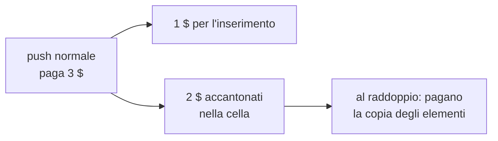
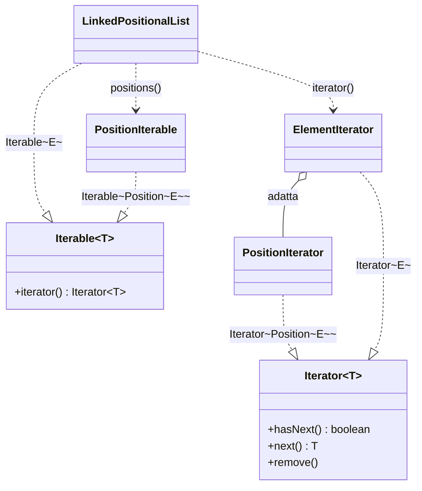

# Liste e iteratori

> [!abstract]
> Pile, code e deque ([[06 - ASD - Pile, code e code doppie|cap. 6]]) permettono di inserire e rimuovere solo alle estremità. Qui si vogliono sequenze in cui si può operare **in qualunque punto**. Il problema è che array e liste concatenate identificano le posizioni in modo diverso:
> - con un **indice** intero, naturale per gli array: si ottiene la **lista con indice** (`ArrayList`), resa illimitata dagli **array dinamici**, il cui costo si studia con l'**analisi ammortizzata**;
> - con una **posizione** astratta, naturale per le liste concatenate: si ottiene la **lista posizionale**, implementata con una lista doppiamente concatenata e operazioni tutte $O(1)$.
>
> Si introducono poi gli **iteratori** (e `Iterable`, base del ciclo for-each), si confrontano le nostre strutture con il **Java Collections Framework**, si ordina una lista posizionale con l'insertion sort e si chiude con un caso di studio: la **lista dei preferiti**, con l'euristica **move-to-front**.
> Le posizioni torneranno negli alberi ([[08 - ASD - Alberi|cap. 8]]) e nelle code prioritarie flessibili ([[09 - ASD - Code prioritarie|cap. 9]]).
> Mappa del corso: [[MOC - Algoritmi e Strutture Dati]].

---

## Liste

Le sequenze del cap. 6 sono **lineari**, ma la deque, la più generale, opera solo agli estremi. Ora si vogliono inserimenti e rimozioni in qualunque punto. Non è facile trovare un'unica astrazione efficiente sia con gli array sia con le liste concatenate:

- negli **array** una posizione è identificata da un **indice** intero: l'indice di un elemento è il numero di elementi che lo precedono (da $0$ a $n-1$);
- nelle **liste concatenate** l'indice ha ancora senso, ma per raggiungere l'elemento $i$-esimo bisogna attraversare una parte della lista, con costo proporzionale a $i$.

L'interfaccia `java.util.List` contiene, tra gli altri, questi metodi basati su indice:

| Metodo | Effetto | Indici validi |
|---|---|---|
| `size()` | numero di elementi | |
| `isEmpty()` | `true` se vuota | |
| `get(i)` | restituisce l'elemento di indice $i$ | $[0, size()-1]$ |
| `set(i, e)` | sostituisce con $e$ l'elemento di indice $i$ e restituisce il vecchio | $[0, size()-1]$ |
| `add(i, e)` | inserisce $e$ all'indice $i$, spostando avanti i successivi | $[0, size()]$ |
| `remove(i)` | rimuove e restituisce l'elemento di indice $i$, spostando indietro i successivi | $[0, size()-1]$ |

L'indice di un elemento **cambia nel tempo** se si inserisce o si rimuove prima di lui. Per `add` è valido anche l'indice `size()`: il nuovo elemento diventa l'ultimo.

> [!example] Esempio 7.1 — operazioni su una lista di caratteri
> | Operazione | Restituisce | Lista |
> |---|---|---|
> | `add(0, A)` | – | (A) |
> | `add(0, B)` | – | (B, A) |
> | `get(1)` | A | (B, A) |
> | `set(2, C)` | errore | (B, A) |
> | `add(2, C)` | – | (B, A, C) |
> | `add(4, D)` | errore | (B, A, C) |
> | `remove(1)` | A | (B, C) |
> | `add(1, D)` | – | (B, D, C) |
> | `add(1, E)` | – | (B, E, D, C) |
> | `get(4)` | errore | (B, E, D, C) |
> | `add(4, F)` | – | (B, E, D, C, F) |
> | `set(2, C)` | D | (B, E, C, C, F) |
> | `get(2)` | C | (B, E, C, C, F) |

```java
/** Una versione semplificata dell'interfaccia java.util.List. */
public interface List<E> {
  /** Restituisce il numero di elementi nella lista. */
  int size();
  /** Restituisce true se e solo se la lista è vuota. */
  boolean isEmpty();
  /** Restituisce l'elemento di indice i, senza rimuoverlo. */
  E get(int i) throws IndexOutOfBoundsException;
  /** Sostituisce con e l'elemento di indice i; restituisce l'elemento sostituito. */
  E set(int i, E e) throws IndexOutOfBoundsException;
  /** Inserisce e all'indice i, spostando gli elementi successivi. */
  void add(int i, E e) throws IndexOutOfBoundsException;
  /** Rimuove e restituisce l'elemento di indice i, spostando i successivi. */
  E remove(int i) throws IndexOutOfBoundsException;
}
```

_(libro, pp. 262–264)_

---

## Liste con indice

Vedi [[Lista con indice]].

L'implementazione ovvia usa un array $A$ in cui $A[i]$ contiene l'elemento di indice $i$. Per ora con capacità fissa; con l'[[#Array dinamici|array dinamico]] diventerà illimitata, cioè la **lista con indice** che Java chiama `ArrayList` (e che C++ e le prime versioni di Java chiamano *vector*).

- `get(i)` e `set(i, e)` sono immediati: accedono direttamente ad $A[i]$.
- `add(i, e)` e `remove(i)` devono **far scorrere** gli elementi per mantenere la regola "l'elemento di indice $i$ sta nella cella $i$".

![[ASD-p265-1.png]]

(a) per inserire all'indice $i$ si spostano di una cella verso destra gli elementi da $i$ a $n-1$ (partendo dall'ultimo); (b) per rimuovere l'elemento di indice $i$ si spostano di una cella verso sinistra gli elementi da $i+1$ a $n-1$.

```java
public class ArrayList<E> implements List<E> {
  // variabili di esemplare
  public static final int CAPACITY = 16;    // capacità predefinita
  private E[] data;                         // array generico degli elementi
  private int size = 0;                     // numero di elementi
  // costruttori
  public ArrayList() { this(CAPACITY); }
  public ArrayList(int capacity) {
    data = (E[]) new Object[capacity];
  }
  // metodi pubblici
  public int size() { return size; }
  public boolean isEmpty() { return size == 0; }
  public E get(int i) throws IndexOutOfBoundsException {
    checkIndex(i, size);
    return data[i];
  }
  public E set(int i, E e) throws IndexOutOfBoundsException {
    checkIndex(i, size);
    E temp = data[i];
    data[i] = e;
    return temp;
  }
  public void add(int i, E e) throws IndexOutOfBoundsException, IllegalStateException {
    checkIndex(i, size + 1);
    if (size == data.length)                // spazio esaurito
      throw new IllegalStateException("Array is full");
    for (int k = size - 1; k >= i; k--)     // sposta a destra, partendo da destra
      data[k+1] = data[k];
    data[i] = e;                            // spazio pronto per il nuovo elemento
    size++;
  }
  public E remove(int i) throws IndexOutOfBoundsException {
    checkIndex(i, size);
    E temp = data[i];
    for (int k = i; k < size - 1; k++)      // sposta a sinistra per chiudere il buco
      data[k] = data[k+1];
    data[size - 1] = null;                  // aiuta il garbage collector
    size--;
    return temp;
  }
  // metodo ausiliario
  /** Verifica che l'indice sia nell'intervallo [0, n-1]. */
  protected void checkIndex(int i, int n) throws IndexOutOfBoundsException {
    if (i < 0 || i >= n)
      throw new IndexOutOfBoundsException("Illegal index: " + i);
  }
}
```

In `add` lo scorrimento parte **dall'ultimo elemento** (altrimenti si sovrascriverebbero elementi non ancora spostati); `checkIndex(i, size + 1)` permette anche `i == size`.

#### Prestazioni di una semplice implementazione basata su array

| Metodo | Tempo (caso peggiore) |
|---|---|
| `size()` | $O(1)$ |
| `isEmpty()` | $O(1)$ |
| `get(i)` | $O(1)$ |
| `set(i, e)` | $O(1)$ |
| `add(i, e)` | $O(n)$ |
| `remove(i)` | $O(n)$ |

Il caso peggiore di `add` e `remove` è $i = 0$: bisogna spostare tutti gli elementi. Anche in media (indici equiprobabili) si spostano $n/2$ elementi, quindi $O(n)$. Più precisamente costano $O(n - i + 1)$, perché si spostano solo gli elementi da $i$ in poi: alla **fine** della lista (`add(n, e)`, `remove(n-1)`) costano $O(1)$.

Di conseguenza, adattando una `ArrayList` a deque con il primo elemento all'indice 0, `addLast`/`removeLast` sono $O(1)$ ma `addFirst`/`removeFirst` sono $O(n)$. Con un **array circolare** (come nell'`ArrayQueue` del [[06 - ASD - Pile, code e code doppie#L'uso di un array circolare|cap. 6]]) anche le operazioni all'indice 0 diventano $O(1)$, rinunciando alla regola "indice = cella" (esercizio C-7.25).

_(libro, pp. 264–267)_

### Array dinamici

Vedi [[Array dinamico]].

Tutte le implementazioni con array viste finora hanno una **capacità fissa**: un array troppo grande spreca memoria, uno troppo piccolo prima o poi rifiuta un inserimento. La `ArrayList` di Java non ha questo limite grazie al "trucco" dell'**array dinamico**.

Gli elementi stanno comunque in un normale array, cioè in **celle di memoria consecutive**:

![[ASD-p267-1.png]]

Un array di 12 celle agli indirizzi da 2146 a 2157; le celle vicine (2144–2145 e 2158–2160, tratteggiate) possono essere occupate da altri dati, quindi l'array **non si può allungare sul posto**.

L'idea:

1. la lista tiene un array interno spesso **più grande** del numero di elementi (es. capacità 8 per 5 elementi): aggiungere in fondo usa la prossima cella libera;
2. quando l'array è pieno, la lista chiede un **array più grande**, ci copia gli elementi e abbandona il vecchio (recuperato dal garbage collector), come un **paguro** che cambia conchiglia quando cresce.

### Implementare un array dinamico

Quando un inserimento supererebbe la capacità dell'array $A$:

1. si crea un nuovo array $B$ più grande;
2. si copia $B[k] = A[k]$ per $k = 0, \dots, n-1$;
3. si pone $A = B$ (d'ora in poi si usa il nuovo array);
4. si inserisce il nuovo elemento.

![[ASD-p268-1.png]]

(a) si crea il nuovo array $B$; (b) si copiano gli elementi di $A$ nella parte iniziale di $B$; (c) la variabile $A$ ora punta al nuovo array (il vecchio, nel tratteggio, verrà raccolto dal garbage collector).

```java
/** Ridimensiona l'array interno con capacità >= size. */
protected void resize(int capacity) {
  E[] temp = (E[]) new Object[capacity];   // cast sicuro, warning del compilatore
  for (int k = 0; k < size; k++)
    temp[k] = data[k];
  data = temp;                             // usa il nuovo array
}
```

La regola usuale è **raddoppiare** la capacità (giustificata nel paragrafo seguente). `add` invoca `resize` invece di lanciare un'eccezione:

```java
public void add(int i, E e) throws IndexOutOfBoundsException {
  checkIndex(i, size + 1);
  if (size == data.length)        // spazio esaurito
    resize(2 * data.length);      // raddoppia la capacità
  // ... il resto del metodo non cambia
}
```

I costruttori restano utili: la capacità iniziale non è più un limite, ma se corrisponde alla dimensione finale si evitano copie inutili e sprechi di spazio.

_(libro, pp. 267–269)_

### Analisi ammortizzata degli array dinamici

Vedi [[Analisi ammortizzata]].

Chiamiamo **push** l'inserimento di un elemento in fondo alla lista. Una singola push può costare $\Omega(n)$ (se provoca un ridimensionamento con copia di $n$ elementi). Ma dopo un raddoppio ci sono $n$ celle libere: a ogni push costosa seguono molte push economiche.

![[ASD-p270-1.png]]

Operazioni elementari per ogni push, partendo da capacità 1: quasi tutte costano 1, ma quando la lista raggiunge dimensione 2, 4, 8, 16 c'è un picco (la copia), sempre più alto ma sempre più raro.

Lo strumento è l'**ammortamento**: si immagina il computer come un distributore a gettoni in cui ogni unità costante di lavoro costa un **ciber-dollaro**. Ogni operazione deve essere pagata, ma si può **far pagare di più** alcune operazioni e **accantonare** il resto per pagare quelle costose.

**Proposizione 7.2.** Sia $L$ una lista con indice inizialmente vuota e capacità 1, implementata con un array dinamico che raddoppia quando è pieno. Il tempo totale per $n$ push è $O(n)$.

*Dimostrazione.* Ipotesi: una push senza ridimensionamento costa 1 ciber-dollaro; far crescere l'array da $k$ a $2k$ costa $k$ ciber-dollari (la copia). Si fa pagare **3** ciber-dollari ogni push: 1 per l'inserimento e **2 accantonati** nella cella in cui è stato inserito l'elemento.

![[ASD-p271-1.png]]

(a) l'array di 8 celle è pieno e nelle celle 4–7 ci sono 2 ciber-dollari ciascuna (8 in tutto); (b) la push successiva provoca il raddoppio: la copia degli 8 elementi è pagata con gli 8 ciber-dollari accantonati; il nuovo elemento è pagato con uno dei 3 della push corrente, e gli altri 2 vengono accantonati nella cella 8.

L'overflow avviene quando $L$ ha $2^i$ elementi e l'array ha dimensione $2^i$; il raddoppio costa $2^i$ ciber-dollari, che si trovano già nelle celle da $2^{i-1}$ a $2^i - 1$ ($2^{i-1}$ celle × 2). Quei soldi non sono ancora stati spesi, perché il precedente overflow è avvenuto quando gli elementi hanno superato $2^{i-1}$. In totale si pagano $3n$ ciber-dollari per $n$ push: il **costo ammortizzato** di una push è $O(1)$ e il totale $O(n)$. $\blacksquare$



#### Aumento geometrico della capacità

Il ragionamento vale per **qualunque progressione geometrica** della capacità (non solo il raddoppio): conta che lo spazio aggiunto a ogni ridimensionamento sia **proporzionale** alla dimensione attuale. La base è un compromesso tempo/spazio: con base 2, dopo un ridimensionamento l'array è circa il doppio del necessario; con base 1,25 si spreca meno spazio ma si fanno più ridimensionamenti. Si può anche dimostrare $O(1)$ ammortizzato con un costo diverso da 3 ciber-dollari (esercizio R-7.7).

#### Attenzione alla progressione aritmetica

Aggiungere a ogni ridimensionamento un numero **costante** di celle sembra più parsimonioso, ma è molto peggio. Con incremento 1 ogni push ridimensiona e il costo totale è $1 + 2 + \dots + n = O(n^2)$; con incremento 2 o 3 si migliora di poco:

![[ASD-p273-1.png]]

Costo delle push con incremento fisso: (a) di 2 celle, (b) di 3 celle. I picchi sono sempre più alti e **non diventano più rari**: arrivano ogni 2 o ogni 3 push.

**Proposizione 7.3.** $n$ push su una lista inizialmente vuota, con un array dinamico che cresce di un incremento fisso $c > 0$, richiedono tempo $\Omega(n^2)$.

*Dimostrazione.* Le copie avvengono in array di dimensione $c, 2c, 3c, \dots, mc$ con $m = \lceil n/c \rceil$. Il tempo totale è proporzionale a
$$\sum_{i=1}^{m} ci = c \cdot \frac{m(m+1)}{2} \ge c \cdot \frac{\frac{n}{c}\left(\frac{n}{c}+1\right)}{2} \ge \frac{1}{2c} n^2$$
quindi $\Omega(n^2)$. $\blacksquare$

Con dati abbastanza grandi anche un incremento di 10000 celle diventa insignificante.

#### Utilizzo della memoria e diminuzione della dimensione dell'array

Con la crescita geometrica la dimensione finale dell'array è proporzionale al numero di elementi inseriti: spazio $O(n)$. Ma se si **rimuovono** molti elementi, l'array può restare enorme rispetto agli elementi rimasti. Un'implementazione robusta **riduce** l'array quando serve, mantenendo $O(1)$ ammortizzato, ma evitando oscillazioni continue tra crescita e riduzione (che romperebbero il limite). Una strategia corretta: **dimezzare** la capacità quando gli elementi scendono sotto **un quarto** della capacità; così la capacità è sempre al massimo il quadruplo degli elementi (esercizi C-7.29–C-7.31).

_(libro, pp. 269–274)_

### La classe StringBuilder di Java

Ora si spiega l'esperimento del [[04 - ASD - Analisi di algoritmi#Analisi sperimentali|cap. 4]] (`repeat1` quadratico, `repeat2` lineare). `StringBuilder` memorizza i caratteri in un **array dinamico**: per lo stesso argomento della Proposizione 7.2, una serie di `append` che produce una stringa di lunghezza $n$ costa $O(n)$ in tutto (gli inserimenti in mezzo, come in `ArrayList`, non hanno questa garanzia). La concatenazione ripetuta di `String` equivale invece a un array dinamico con **progressione aritmetica di passo 1**: ogni volta si copiano tutti i caratteri in un array più lungo di una sola cella, quindi $O(n^2)$.

_(libro, p. 274)_

---

## Liste posizionali

Vedi [[Lista posizionale]].

Gli indici vanno bene con gli array, ma non con le liste concatenate (per raggiungere un indice bisogna contare dall'inizio o dalla fine) e non descrivono bene una posizione "locale": l'indice di un elemento cambia ogni volta che si inserisce o rimuove prima di lui. Ad esempio, per indicare una persona in coda servirebbe sapere in ogni istante quante persone ha davanti.

![[ASD-p275-1.png]]

Una persona in coda alla biglietteria indicata con "io": si vuole identificare la sua **posizione** senza un numero intero, così da poter descrivere chi abbandona la coda prima di arrivare all'inizio, o chi si infila subito prima o subito dopo un amico.

Altro esempio: in un **word processor** il **cursore** indica una posizione nel testo senza usare indici ("cancella il carattere sotto il cursore", "inserisci dopo il cursore"), e si può fare riferimento all'inizio di un capitolo anche mentre il testo cambia.

Si definisce quindi la **lista posizionale** (*positional list*). Si progetta pensando a una lista concatenata, dove inserire e rimuovere in un punto noto costa $O(1)$; per farlo serve un riferimento al **nodo**. Ma esporre i nodi violerebbe **astrazione** e **incapsulamento**:

- l'utente non deve occuparsi di nodi e sentinelle (es. per inserire all'inizio con `addBetween` dovrebbe passare la sentinella `header`);
- se l'utente non può manipolare i nodi, la struttura è più **robusta**: non si possono rompere i collegamenti (ad esempio passando a `addBetween` o `remove` un nodo che non appartiene alla lista);
- l'incapsulamento lascia libertà di cambiare l'implementazione, anche usando un array (esercizio C-7.43).

### Posizioni

Una **posizione** (*position*) è un ADT minimo che astrae la collocazione di un elemento, con un solo metodo:

- `getElement()`: restituisce l'elemento memorizzato in questa posizione.

Una posizione $p$ associata all'elemento $e$ di una lista $L$ è un **segnalibro stabile**: non cambia se l'indice di $e$ cambia per inserimenti o rimozioni altrove, e nemmeno se in $p$ si sostituisce $e$ con un altro elemento. Diventa **non valida** solo se viene rimossa esplicitamente dalla lista.

### Il tipo di dato astratto lista posizionale

Una lista posizionale è un contenitore di posizioni, ognuna con un elemento. Metodi di accesso (per una lista $L$):

| Metodo | Restituisce |
|---|---|
| `first()` | la posizione del primo elemento (`null` se vuota) |
| `last()` | la posizione dell'ultimo elemento (`null` se vuota) |
| `before(p)` | la posizione immediatamente prima di $p$ (`null` se $p$ è la prima) |
| `after(p)` | la posizione immediatamente dopo $p$ (`null` se $p$ è l'ultima) |
| `isEmpty()` | `true` se $L$ non contiene elementi |
| `size()` | il numero di elementi |

Una posizione non valida per $L$ provoca un errore. Diversamente dalla deque, `first()` e `last()` restituiscono **posizioni**, non elementi (il primo elemento è `first().getElement()`): una posizione permette poi di muoversi nella lista.

```java
Position<String> cursor = guests.first();
while (cursor != null) {
  System.out.println(cursor.getElement());
  cursor = guests.after(cursor);   // passa alla posizione successiva, se c'è
}
```

Funziona anche su lista vuota, perché `first()` restituisce `null`, così come `after` sull'ultima posizione.

#### Metodi di aggiornamento di una lista posizionale

| Metodo | Effetto |
|---|---|
| `addFirst(e)` | inserisce $e$ all'inizio, restituisce la sua posizione |
| `addLast(e)` | inserisce $e$ alla fine, restituisce la sua posizione |
| `addBefore(p, e)` | inserisce $e$ subito prima di $p$, restituisce la sua posizione |
| `addAfter(p, e)` | inserisce $e$ subito dopo di $p$, restituisce la sua posizione |
| `set(p, e)` | sostituisce con $e$ l'elemento in $p$, restituisce il vecchio |
| `remove(p)` | rimuove e restituisce l'elemento in $p$; $p$ diventa non valida |

`addFirst(e)` sembra ridondante rispetto ad `addBefore(first(), e)`, ma quest'ultimo non funziona su una lista vuota (dove `first()` è `null`); idem per `addLast`.

> [!example] Esempio 7.4 — operazioni su una lista posizionale di interi
> Il pedice indica la posizione in cui sta ciascun elemento.
>
> | Operazione | Restituisce | Lista |
> |---|---|---|
> | `addLast(8)` | $p$ | $(8_p)$ |
> | `first()` | $p$ | $(8_p)$ |
> | `addAfter(p, 5)` | $q$ | $(8_p, 5_q)$ |
> | `before(q)` | $p$ | $(8_p, 5_q)$ |
> | `addBefore(q, 3)` | $r$ | $(8_p, 3_r, 5_q)$ |
> | `r.getElement()` | 3 | $(8_p, 3_r, 5_q)$ |
> | `after(p)` | $r$ | $(8_p, 3_r, 5_q)$ |
> | `before(p)` | null | $(8_p, 3_r, 5_q)$ |
> | `addFirst(9)` | $s$ | $(9_s, 8_p, 3_r, 5_q)$ |
> | `remove(last())` | 5 | $(9_s, 8_p, 3_r)$ |
> | `set(p, 7)` | 8 | $(9_s, 7_p, 3_r)$ |
> | `remove(q)` | errore | $(9_s, 7_p, 3_r)$ |
>
> L'ultima operazione fallisce perché $q$ è stata rimossa (`remove(last())`) ed è quindi non valida.

#### Definizione delle interfacce in Java

`getElement()` su una posizione rimossa lancia `IllegalStateException`; passare a un metodo della lista una posizione non valida lancia `IllegalArgumentException`.

```java
public interface Position<E> {
  /**
   * Restituisce l'elemento memorizzato in questa posizione.
   * @return l'elemento memorizzato
   * @throws IllegalStateException se la posizione non è più valida
   */
  E getElement() throws IllegalStateException;
}

/** Interfaccia per le liste posizionali. */
public interface PositionalList<E> {
  int size();
  boolean isEmpty();
  /** Prima Position della lista (null se vuota). */
  Position<E> first();
  /** Ultima Position della lista (null se vuota). */
  Position<E> last();
  /** Position che precede p (null se p è la prima). */
  Position<E> before(Position<E> p) throws IllegalArgumentException;
  /** Position che segue p (null se p è l'ultima). */
  Position<E> after(Position<E> p) throws IllegalArgumentException;
  /** Inserisce e all'inizio; ne restituisce la posizione. */
  Position<E> addFirst(E e);
  /** Inserisce e alla fine; ne restituisce la posizione. */
  Position<E> addLast(E e);
  /** Inserisce e prima di p; ne restituisce la posizione. */
  Position<E> addBefore(Position<E> p, E e) throws IllegalArgumentException;
  /** Inserisce e dopo p; ne restituisce la posizione. */
  Position<E> addAfter(Position<E> p, E e) throws IllegalArgumentException;
  /** Sostituisce l'elemento in p; restituisce l'elemento sostituito. */
  E set(Position<E> p, E e) throws IllegalArgumentException;
  /** Rimuove e restituisce l'elemento in p (poi p non è più valida). */
  E remove(Position<E> p) throws IllegalArgumentException;
}
```

_(libro, pp. 274–280)_

### Implementazione con lista doppiamente concatenata

Si usa una lista doppiamente concatenata con sentinelle, come nel [[03 - ASD - Strutture dati fondamentali#Liste doppiamente concatenate|Paragrafo 3.4]]; cambia la gestione delle posizioni. Idea chiave: **i nodi sono le posizioni**. La classe `Node` (privata, annidata) implementa `Position`; i metodi pubblici usano solo il tipo `Position`, quindi l'utente può chiamare su di essi solo `getElement()`.

```java
/** Lista posizionale implementata con una lista doppiamente concatenata. */
public class LinkedPositionalList<E> implements PositionalList<E> {
  //---------------- classe Node annidata ----------------
  private static class Node<E> implements Position<E> {
    private E element;      // elemento memorizzato
    private Node<E> prev;   // nodo precedente
    private Node<E> next;   // nodo successivo
    public Node(E e, Node<E> p, Node<E> n) {
      element = e;
      prev = p;
      next = n;
    }
    public E getElement() throws IllegalStateException {
      if (next == null)                   // convenzione: nodo non più valido
        throw new IllegalStateException("Position no longer valid");
      return element;
    }
    public Node<E> getPrev() { return prev; }
    public Node<E> getNext() { return next; }
    public void setElement(E e) { element = e; }
    public void setPrev(Node<E> p) { prev = p; }
    public void setNext(Node<E> n) { next = n; }
  } //------------- fine della classe Node -------------

  private Node<E> header;    // sentinella iniziale
  private Node<E> trailer;   // sentinella finale
  private int size = 0;

  /** Costruisce una lista vuota. */
  public LinkedPositionalList() {
    header = new Node<>(null, null, null);
    trailer = new Node<>(null, header, null);
    header.setNext(trailer);
  }

  // metodi ausiliari privati
  /** Verifica che la posizione sia valida e la restituisce come nodo. */
  private Node<E> validate(Position<E> p) throws IllegalArgumentException {
    if (!(p instanceof Node)) throw new IllegalArgumentException("Invalid p");
    Node<E> node = (Node<E>) p;           // cast sicuro
    if (node.getNext() == null)           // convenzione: nodo rimosso
      throw new IllegalArgumentException("p is no longer in the list");
    return node;
  }
  /** Restituisce il nodo come Position (null se è una sentinella). */
  private Position<E> position(Node<E> node) {
    if (node == header || node == trailer)
      return null;                        // le sentinelle non escono dalla lista
    return node;
  }

  // metodi pubblici di accesso
  public int size() { return size; }
  public boolean isEmpty() { return size == 0; }
  public Position<E> first() { return position(header.getNext()); }
  public Position<E> last() { return position(trailer.getPrev()); }
  public Position<E> before(Position<E> p) throws IllegalArgumentException {
    Node<E> node = validate(p);
    return position(node.getPrev());
  }
  public Position<E> after(Position<E> p) throws IllegalArgumentException {
    Node<E> node = validate(p);
    return position(node.getNext());
  }

  // metodo ausiliario privato
  /** Aggiunge e tra i due nodi dati. */
  private Position<E> addBetween(E e, Node<E> pred, Node<E> succ) {
    Node<E> newest = new Node<>(e, pred, succ);
    pred.setNext(newest);
    succ.setPrev(newest);
    size++;
    return newest;
  }

  // metodi pubblici di aggiornamento
  public Position<E> addFirst(E e) {
    return addBetween(e, header, header.getNext());     // subito dopo header
  }
  public Position<E> addLast(E e) {
    return addBetween(e, trailer.getPrev(), trailer);   // subito prima di trailer
  }
  public Position<E> addBefore(Position<E> p, E e) throws IllegalArgumentException {
    Node<E> node = validate(p);
    return addBetween(e, node.getPrev(), node);
  }
  public Position<E> addAfter(Position<E> p, E e) throws IllegalArgumentException {
    Node<E> node = validate(p);
    return addBetween(e, node, node.getNext());
  }
  public E set(Position<E> p, E e) throws IllegalArgumentException {
    Node<E> node = validate(p);
    E answer = node.getElement();
    node.setElement(e);
    return answer;
  }
  public E remove(Position<E> p) throws IllegalArgumentException {
    Node<E> node = validate(p);
    Node<E> predecessor = node.getPrev();
    Node<E> successor = node.getNext();
    predecessor.setNext(successor);
    successor.setPrev(predecessor);
    size--;
    E answer = node.getElement();
    node.setElement(null);   // aiuta il garbage collector
    node.setNext(null);      // convenzione per i nodi non validi
    node.setPrev(null);
    return answer;
  }
}
```

I due metodi ausiliari rendono robusti i cast tra `Position` e `Node`:

- **`validate(p)`**: per ogni posizione ricevuta dall'utente controlla che sia davvero un `Node` e che non sia stata rimossa (convenzione: `next == null`), poi la converte in nodo;
- **`position(node)`**: prima di restituire un nodo all'utente, sostituisce le sentinelle con `null`, così l'utente non le vede mai.

`remove` azzera tutti i campi del nodo rimosso: `next == null` è il segnale che la posizione non è più valida.

#### Le prestazioni di una lista posizionale concatenata

| Metodo | Tempo |
|---|---|
| `size()`, `isEmpty()` | $O(1)$ |
| `first()`, `last()` | $O(1)$ |
| `before(p)`, `after(p)` | $O(1)$ |
| `addFirst(e)`, `addLast(e)` | $O(1)$ |
| `addBefore(p, e)`, `addAfter(p, e)` | $O(1)$ |
| `set(p, e)` | $O(1)$ |
| `remove(p)` | $O(1)$ |

Spazio $O(n)$. È il contrario di `ArrayList`, che è lineare per inserimenti e rimozioni arbitrari. Gli indici però non sono supportati: si possono aggiungere contando i nodi (esercizio C-7.38), con tempo proporzionale alla parte attraversata.

#### Implementazione di una lista posizionale con un array

Si può fare anche con un array, ma una posizione **non** può contenere solo l'indice $i$: l'indice cambia con gli inserimenti e le rimozioni precedenti, e una posizione già consegnata all'utente punterebbe alla cella sbagliata. Soluzione: ogni cella contiene un **oggetto-posizione** che memorizza l'elemento **e** il proprio indice attuale.

![[ASD-p285-1.png]]

Le celle 0–3 puntano a oggetti-posizione (0, JFK), (1, BWI), (2, PVD), (3, SFO): da una posizione si ricava l'indice, da un indice la posizione.

`before(p)` legge l'indice in $p$ e guarda la cella precedente. A ogni inserimento o rimozione bisogna aggiornare l'indice di tutte le posizioni spostate: `addFirst`, `addBefore`, `addAfter` e `remove` costano $O(n)$, gli altri metodi $O(1)$.

_(libro, pp. 280–285)_

---

## Iteratori

Vedi [[Iteratore]].

Un **iteratore** è uno schema progettuale che astrae la **scansione di una sequenza un elemento alla volta**, indipendentemente da come la sequenza è organizzata (contenitore, flusso dalla rete, risultati generati al volo). L'interfaccia `java.util.Iterator` ha due metodi:

| Metodo | Effetto |
|---|---|
| `hasNext()` | `true` se c'è almeno un altro elemento |
| `next()` | restituisce l'elemento successivo |

È generica: ad esempio `Scanner` implementa `Iterator<String>`. Se si chiama `next()` quando non ci sono più elementi si ottiene `NoSuchElementException` (lo si evita controllando `hasNext()`).

```java
while (iter.hasNext()) {
  String value = iter.next();
  System.out.println(value);
}
```

C'è un terzo metodo, **facoltativo**:

- `remove()`: rimuove dalla raccolta l'elemento restituito dall'ultima `next()`; lancia `IllegalStateException` se `next` non è mai stata chiamata o se `remove` è già stata chiamata dopo l'ultima `next`. Gli iteratori che non la supportano lanciano `UnsupportedOperationException`.

### L'interfaccia Iterable e il ciclo for-each in Java

Un iteratore fa **una sola scansione** e non si può "riavvolgere". Una struttura che vuole permettere più scansioni (anche simultanee) offre un metodo che restituisce un **nuovo iteratore** ogni volta: è l'interfaccia **`Iterable`**, con il solo metodo

- `iterator()`: restituisce un iteratore sugli elementi del contenitore.

Un contenitore come `ArrayList` è *iterabile* (non è esso stesso un iteratore). `Iterable` è ciò che rende possibile il [[01 - ASD - Introduzione a Java#Cicli|ciclo for-each]]:

```java
for (TipoElemento nome : contenitore) {
  corpo
}
```

è un'abbreviazione di

```java
Iterator<TipoElemento> iter = contenitore.iterator();
while (iter.hasNext()) {
  TipoElemento nome = iter.next();
  corpo
}
```

Nel for-each non si può chiamare `remove` dell'iteratore: serve un iteratore esplicito. Esempio: rimuovere i numeri negativi.

```java
ArrayList<Double> data;    // popolata con numeri casuali
Iterator<Double> walk = data.iterator();
while (walk.hasNext())
  if (walk.next() < 0.0)
    walk.remove();
```

_(libro, pp. 285–287)_

### Implementazione di iteratori

| Stile | Funzionamento | Pro | Contro |
|---|---|---|---|
| **A fotografia** (*snapshot*) | alla creazione copia la sequenza in una struttura privata | semplice; le modifiche successive al contenitore non lo influenzano | costruzione $O(n)$ e spazio $O(n)$ |
| **Pigro** (*lazy*) | scorre la struttura originale passo per passo a ogni `next()` | costruzione $O(1)$, spazio $O(1)$ | risente delle modifiche fatte al contenitore durante la scansione |

Molti iteratori della libreria Java sono **fail-fast**: diventano inutilizzabili appena il contenitore viene modificato in modo inatteso. Qui si implementano iteratori pigri con `remove` (ma senza fail-fast).

#### Iteratore per esemplari di ArrayList

`ArrayList<E>` implementa `Iterable<E>` con un metodo `iterator()` che restituisce un esemplare della **classe interna** (non statica, [[02 - ASD - Progettazione orientata agli oggetti#Classi annidate|Paragrafo 2.6]]) `ArrayIterator`: essendo interna, accede ai campi privati della lista (`data`, `size`). Ogni iteratore tiene l'indice `j` del prossimo elemento e un flag `removable`.

```java
//---------------- classe ArrayIterator annidata ----------------
/**
 * Classe interna non statica: ogni esemplare ha un riferimento implicito
 * alla lista che lo contiene e può accedere ai suoi membri.
 */
private class ArrayIterator implements Iterator<E> {
  private int j = 0;                   // indice del prossimo elemento
  private boolean removable = false;   // si può chiamare remove adesso?

  /** true se ci sono ancora elementi da restituire. */
  public boolean hasNext() { return j < size; }   // size è un campo della lista

  /** Restituisce il prossimo elemento. */
  public E next() throws NoSuchElementException {
    if (j == size) throw new NoSuchElementException("No next element");
    removable = true;                  // questo elemento potrà essere rimosso
    return data[j++];                  // post-incremento: j è pronto per la prossima volta
  }

  /** Rimuove l'elemento restituito dall'ultima next. */
  public void remove() throws IllegalStateException {
    if (!removable) throw new IllegalStateException("nothing to remove");
    ArrayList.this.remove(j-1);        // l'ultimo restituito
    j--;                               // il prossimo elemento è scivolato a sinistra
    removable = false;                 // niente remove fino alla prossima next
  }
} //------------- fine della classe ArrayIterator -------------

/** Restituisce un iteratore sugli elementi della lista. */
public Iterator<E> iterator() {
  return new ArrayIterator();          // nuovo esemplare della classe interna
}
```

`ArrayList.this.remove(j-1)` chiama il `remove(int)` della **lista esterna** (dentro la classe interna `this` sarebbe l'iteratore); dopo la rimozione gli elementi scorrono a sinistra, quindi `j` va decrementato.

#### Iteratore per esemplari di LinkedPositionalList

L'iteratore deve restituire elementi o posizioni? Iterare sulle **posizioni** è più generale (da una posizione si ottiene l'elemento), ma per un contenitore lo standard è iterare sugli **elementi**, così da scrivere `for (String guest : waitlist)`. La classe supporta entrambi:

- `iterator()` restituisce un iteratore di **elementi** (la classe implementa `Iterable<E>`);
- `positions()` restituisce un oggetto **`Iterable`** di posizioni (non direttamente un `Iterator`), così si può scrivere `for (Position<String> p : waitlist.positions())`.

Servono tre classi interne:

```java
//---------------- classe PositionIterator annidata ----------------
private class PositionIterator implements Iterator<Position<E>> {
  private Position<E> cursor = first();   // prossima posizione da restituire
  private Position<E> recent = null;      // ultima posizione restituita
  public boolean hasNext() { return (cursor != null); }
  public Position<E> next() throws NoSuchElementException {
    if (cursor == null) throw new NoSuchElementException("nothing left");
    recent = cursor;                      // potrà essere rimossa
    cursor = after(cursor);
    return recent;
  }
  public void remove() throws IllegalStateException {
    if (recent == null) throw new IllegalStateException("nothing to remove");
    LinkedPositionalList.this.remove(recent);   // rimuove dalla lista esterna
    recent = null;                        // niente remove fino alla prossima next
  }
} //------------- fine della classe PositionIterator -------------

//---------------- classe PositionIterable annidata ----------------
private class PositionIterable implements Iterable<Position<E>> {
  public Iterator<Position<E>> iterator() { return new PositionIterator(); }
} //------------- fine della classe PositionIterable -------------

/** Restituisce una vista iterabile delle posizioni della lista. */
public Iterable<Position<E>> positions() {
  return new PositionIterable();
}

//---------------- classe ElementIterator annidata ----------------
/* Adatta l'iteratore di posizioni perché restituisca elementi. */
private class ElementIterator implements Iterator<E> {
  Iterator<Position<E>> posIterator = new PositionIterator();
  public boolean hasNext() { return posIterator.hasNext(); }
  public E next() { return posIterator.next().getElement(); }   // l'elemento!
  public void remove() { posIterator.remove(); }
}

/** Restituisce un iteratore sugli elementi della lista. */
public Iterator<E> iterator() { return new ElementIterator(); }
```

`ElementIterator` è un'applicazione dello [[06 - ASD - Pile, code e code doppie#Lo schema progettuale adattatore (adapter)|schema adattatore]]: avvolge un `PositionIterator` e ne restituisce gli elementi.



_(libro, pp. 287–291)_

---

## L'infrastruttura Java Collections Framework

Il **Java Collections Framework** (JCF), nel pacchetto `java.util`, contiene molte delle strutture del libro. L'interfaccia radice è **`Collection`** (con `size()`, `isEmpty()`, `iterator()`, …), superinterfaccia di `Deque`, `List`, `Queue` e, più avanti, `Set` ([[10 - ASD - Mappe, tabelle hash e skip list#Insiemi, multi-insiemi e multi-mappe|Paragrafo 10.5.1]]); `Map` ([[10 - ASD - Mappe, tabelle hash e skip list#Mappe|Paragrafo 10.1]]) è a parte.

| Classe | Interfacce | Proprietà | Rappresentazione |
|---|---|---|---|
| `ArrayBlockingQueue` | Queue | capacità limitata, thread-safe, bloccante | array |
| `LinkedBlockingQueue` | Queue | capacità limitabile, thread-safe, bloccante | lista concatenata |
| `ConcurrentLinkedQueue` | Queue | thread-safe | lista concatenata |
| `ArrayDeque` | Queue, Deque | — | array |
| `LinkedBlockingDeque` | Queue, Deque | capacità limitabile, thread-safe, bloccante | lista concatenata |
| `ConcurrentLinkedDeque` | Queue, Deque | thread-safe | lista concatenata |
| `ArrayList` | List | — | array |
| `LinkedList` | Queue, Deque, List | — | lista concatenata |

- **Thread-safe** (supporto alla **concorrenza**): più thread possono usare la struttura insieme in sicurezza.
- **Bloccante** (*blocking*): un accesso a una struttura vuota attende che un altro thread inserisca un elemento; un inserimento in una struttura piena attende che si liberi spazio.

### Iteratori di lista in Java

`java.util.LinkedList` **non** espone le posizioni. Per scorrerla e modificarla senza indici si usa un **`ListIterator`** (da `listIterator()`), che si comporta come un **cursore**: sta prima del primo elemento, tra due elementi o dopo l'ultimo.

| Metodo | Effetto |
|---|---|
| `add(e)` | inserisce $e$ nella posizione attuale |
| `hasNext()` / `hasPrevious()` | c'è un elemento dopo / prima della posizione attuale? |
| `next()` | restituisce l'elemento dopo e sposta il cursore dopo di esso |
| `previous()` | restituisce l'elemento prima e sposta il cursore prima di esso |
| `nextIndex()` / `previousIndex()` | indice dell'elemento dopo / prima |
| `remove()` | rimuove l'elemento restituito dall'ultima `next` o `previous` |
| `set(e)` | sostituisce con $e$ l'elemento restituito dall'ultima `next` o `previous` |

Usare più iteratori che modificano la stessa lista è rischioso: per questo sono **fail-fast**. Se uno dei cinque iteratori di una `LinkedList` $L$ modifica $L$ (o la si modifica con i suoi metodi), gli altri lanciano `ConcurrentModificationException` al primo uso.

### Confronto con il nostro ADT lista posizionale

`java.util.List` è implementata con un array (`ArrayList`, "A") e con una lista concatenata (`LinkedList`, "L").

| Nostro ADT | `java.util.List` | `ListIterator` | Commenti |
|---|---|---|---|
| `size()` | `size()` | | $O(1)$ |
| `isEmpty()` | `isEmpty()` | | $O(1)$ |
| | `get(i)` | | A: $O(1)$; L: $O(\min\{i, n-i\})$ |
| `first()` | `listIterator()` | | il primo elemento è il successivo |
| `last()` | `listIterator(size())` | | l'ultimo elemento è il precedente |
| `before(p)` | | `previous()` | $O(1)$ |
| `after(p)` | | `next()` | $O(1)$ |
| `set(p, e)` | | `set(e)` | $O(1)$ |
| | `set(i, e)` | | A: $O(1)$; L: $O(\min\{i, n-i\})$ |
| | `add(i, e)` | | $O(n)$ |
| `addFirst(e)` | `add(0, e)` | | A: $O(n)$; L: $O(1)$ |
| `addFirst(e)` | `addFirst(e)` | | solo L, $O(1)$ |
| `addLast(e)` | `add(e)` | | $O(1)$ |
| `addLast(e)` | `addLast(e)` | | solo L, $O(1)$ |
| `addAfter(p, e)` | | `add(e)` | inserisce al cursore; A: $O(n)$, L: $O(1)$ |
| `addBefore(p, e)` | | `add(e)` | inserisce al cursore; A: $O(n)$, L: $O(1)$ |
| `remove(p)` | | `remove()` | rimuove al cursore; A: $O(n)$, L: $O(1)$ |
| | `remove(i)` | | A: $O(1)$; L: $O(\min\{i, n-i\})$ |

> [!warning] Correzione
> Nella Tabella 7.4 il libro indica per `remove(i)` di `ArrayList` un tempo $O(1)$. Rimuovere all'indice $i$ in un array richiede di far scorrere gli elementi successivi: il costo è $O(n-i)$, quindi $O(n)$ nel caso peggiore (come nella [[#Prestazioni di una semplice implementazione basata su array|Tabella 7.1]]); è $O(1)$ solo in fondo alla lista.

### Algoritmi basati su liste nel Java Collections Framework

La classe **`java.util.Collections`** (da non confondere con l'interfaccia `Collection`) offre metodi statici:

| Metodo | Effetto |
|---|---|
| `copy(L_dest, L_src)` | copia gli elementi di `L_src` negli stessi indici di `L_dest` |
| `disjoint(C, D)` | `true` se le collezioni non hanno elementi uguali |
| `fill(L, e)` | sostituisce ogni elemento di $L$ con $e$ |
| `frequency(C, e)` | numero di elementi di $C$ uguali a $e$ |
| `max(C)` / `min(C)` | massimo / minimo secondo l'ordinamento naturale |
| `replaceAll(L, e, f)` | sostituisce con $f$ ogni elemento di $L$ uguale a $e$ |
| `reverse(L)` | inverte l'ordine |
| `rotate(L, d)` | ruota circolarmente di $d$ posti (anche negativo) |
| `shuffle(L)` | permutazione pseudocasuale |
| `sort(L)` | ordina secondo l'ordinamento naturale |
| `swap(L, i, j)` | scambia gli elementi di indice $i$ e $j$ |

#### Convertire liste in array

L'interfaccia `Collection` offre `toArray()` (array di `Object`) e `toArray(A)` (array dello stesso tipo di $A$); per una lista l'ordine è conservato. Così si possono usare metodi pensati per gli array su qualunque contenitore.

#### Convertire array in liste

`Arrays.asList(A)` restituisce una lista con gli stessi elementi di $A$ che **usa $A$ come rappresentazione interna**: le modifiche alla lista si riflettono su $A$ (effetto collaterale da usare con attenzione, ma comodo). $A$ deve essere un array di riferimenti (es. `Integer[]`, non `int[]`).

```java
Integer[] arr = {1, 2, 3, 4, 5, 6, 7, 8};    // usa l'auto-boxing
List<Integer> listArr = Arrays.asList(arr);
Collections.shuffle(listArr);                 // effetto collaterale: mescola arr
```

_(libro, pp. 291–295)_

---

## Ordinare una lista posizionale

Si adatta a `PositionalList` l'[[03 - ASD - Strutture dati fondamentali#Ordinare un array|insertion sort]] del cap. 3:

- `marker` è la posizione **più a destra** della parte già ordinata;
- `pivot` è la posizione subito dopo `marker`, l'elemento da sistemare;
- `walk` scorre a sinistra da `marker` finché l'elemento precedente è maggiore del pivot.

![[ASD-p296-1.png]]

La parte ordinata (15, 22, 25, 29, 36, fino a `marker`) è evidenziata; il `pivot` 23 va inserito subito prima di `walk` (25), cioè tra 22 e 25.

```java
/** Insertion sort di una lista posizionale di interi in ordine non decrescente */
public static void insertionSort(PositionalList<Integer> list) {
  Position<Integer> marker = list.first();       // ultima posizione ordinata
  while (marker != list.last()) {
    Position<Integer> pivot = list.after(marker);
    int value = pivot.getElement();              // numero da sistemare
    if (value > marker.getElement())             // il pivot è già a posto
      marker = pivot;
    else {                                       // va spostato: cerca l'elemento...
      Position<Integer> walk = marker;           // ...più a sinistra maggiore di value
      while (walk != list.first() && list.before(walk).getElement() > value)
        walk = list.before(walk);
      list.remove(pivot);                        // rimuove il pivot...
      list.addBefore(walk, value);               // ...e lo reinserisce prima di walk
    }
  }
}
```

Con la lista posizionale non c'è bisogno di far scorrere gli elementi: si toglie il pivot e lo si reinserisce in $O(1)$ (la ricerca della posizione resta lineare).

_(libro, pp. 295–296)_

---

## Caso di studio: gestire frequenze di accesso

La lista posizionale è utile in molti contesti: le carte in mano a un giocatore raggruppate per seme, i caratteri di un editor modificati attorno a un cursore. Qui si contano gli **accessi** a ogni elemento per sapere quali sono i più popolari (le pagine più visitate di un browser, le canzoni più ascoltate). Nuovo ADT, la **lista dei preferiti** (*favorites list*), con `size`, `isEmpty` e:

| Metodo | Effetto |
|---|---|
| `access(e)` | accede a $e$ (aggiungendolo se non c'è) e ne incrementa il conteggio |
| `remove(e)` | rimuove $e$, se presente |
| `getFavorites(k)` | restituisce un contenitore iterabile con i $k$ elementi con più accessi |

### Implementazione con una lista ordinata

Gli elementi si tengono in ordine **non crescente di numero di accessi**; per accedere o rimuovere si scorre la lista dal più popolare. Così `getFavorites(k)` restituisce semplicemente i primi $k$.

Un accesso incrementa il conteggio di un elemento, che può superare quello di chi lo precede: per ripristinare l'ordine si fa **un passo di insertion sort**, scorrendo all'indietro fino al posto giusto.

#### Lo schema progettuale di composizione

Se la lista contenesse solo gli elementi sarebbe difficile tenere i conteggi associati agli elementi giusti durante i riordini. Si usa lo **schema di composizione** (*composition pattern*): un oggetto composto da altri, la classe annidata `Item` che contiene **elemento e conteggio**. La lista dei preferiti è una `PositionalList<Item<E>>`; `Item` non è mai visibile all'utente.

```java
/** Lista di elementi ordinati per frequenza di accesso. */
public class FavoritesList<E> {
  //---------------- classe Item annidata ----------------
  protected static class Item<E> {
    private E value;
    private int count = 0;
    /** Nuovo elemento con conteggio zero. */
    public Item(E val) { value = val; }
    public int getCount() { return count; }
    public E getValue() { return value; }
    public void increment() { count++; }
  } //------------- fine della classe Item -------------

  PositionalList<Item<E>> list = new LinkedPositionalList<>();   // lista di Item
  public FavoritesList() { }

  // metodi ausiliari
  /** Il valore del preferito in posizione p. */
  protected E value(Position<Item<E>> p) { return p.getElement().getValue(); }
  /** Il conteggio del preferito in posizione p. */
  protected int count(Position<Item<E>> p) { return p.getElement().getCount(); }
  /** La posizione con valore e (null se non c'è). */
  protected Position<Item<E>> findPosition(E e) {
    Position<Item<E>> walk = list.first();
    while (walk != null && !e.equals(value(walk)))
      walk = list.after(walk);
    return walk;
  }
  /** Sposta a sinistra l'Item in posizione p secondo il conteggio. */
  protected void moveUp(Position<Item<E>> p) {
    int cnt = count(p);                     // conteggio aggiornato
    Position<Item<E>> walk = p;
    while (walk != list.first() && count(list.before(walk)) < cnt)
      walk = list.before(walk);             // conteggio minore a sinistra
    if (walk != p)
      list.addBefore(walk, list.remove(p)); // rimuove e reinserisce
  }

  // metodi pubblici
  public int size() { return list.size(); }
  public boolean isEmpty() { return list.isEmpty(); }
  /** Accede a e (eventualmente nuovo) e ne incrementa il conteggio. */
  public void access(E e) {
    Position<Item<E>> p = findPosition(e);  // cerca un elemento esistente
    if (p == null)
      p = list.addLast(new Item<E>(e));     // se nuovo, in fondo
    p.getElement().increment();
    moveUp(p);                              // se serve, lo sposta a sinistra
  }
  /** Rimuove l'elemento uguale a e (se c'è). */
  public void remove(E e) {
    Position<Item<E>> p = findPosition(e);
    if (p != null)
      list.remove(p);
  }
  /** I k elementi con più accessi. */
  public Iterable<E> getFavorites(int k) throws IllegalArgumentException {
    if (k < 0 || k > size())
      throw new IllegalArgumentException("Invalid k");
    PositionalList<E> result = new LinkedPositionalList<>();
    Iterator<Item<E>> iter = list.iterator();
    for (int j = 0; j < k; j++)
      result.addLast(iter.next().getValue());
    return result;
  }
}
```

### Uso di una lista con l'euristica move-to-front

Vedi [[Euristica move-to-front]].

Con la lista ordinata `access(e)` costa tempo proporzionale alla posizione di $e$: se è il $k$-esimo più popolare, $O(k)$. Spesso però vale la **località dei riferimenti** (*locality of reference*): un elemento appena usato ha alta probabilità di essere riusato a breve (vedi [[Località dei Riferimenti]], Sistemi di Calcolo).

L'euristica **move-to-front** sfrutta questa località: a ogni accesso l'elemento viene **spostato all'inizio** della lista. Esempio con $n$ elementi e questa sequenza di accessi: $n$ accessi all'elemento 1, poi $n$ all'elemento 2, …, poi $n$ all'elemento $n$ ($n^2$ accessi in tutto).

| | Costo dell'accesso all'elemento $k$ | Totale |
|---|---|---|
| Lista ordinata per conteggio | $O(k)$ (l'elemento è in posizione $k$) | $n + 2n + \dots + n \cdot n = n \cdot \frac{n(n+1)}{2} = O(n^3)$ |
| Move-to-front | $O(1)$ dopo il primo accesso (è sempre in testa) | $O(n^2)$ |

È però solo un'**euristica**: esistono sequenze di accessi per cui move-to-front è più lenta della lista ordinata.

#### I compromessi relativi all'euristica move-to-front

Senza l'ordine per conteggio, `getFavorites(k)` deve **cercare** i $k$ elementi:

1. copia tutti gli elementi in una lista temporanea `temp`;
2. per $k$ volte scandisce `temp`, trova l'elemento con conteggio massimo, lo rimuove da `temp` e lo aggiunge al risultato.

Costo $O(kn)$: $O(n)$ se $k$ è costante (la "top ten"), $O(n^2)$ se $k$ è proporzionale a $n$ (il "top 25%"). Alternative: con una coda prioritaria ([[09 - ASD - Code prioritarie|cap. 9]]) si arriva a $O(n + k\log n)$ (esercizio P-9.51); ordinando `temp` ([[12 - ASD - Ordinamento e selezione|cap. 12]]) si ottiene $O(n\log n)$, preferibile se $k$ è $\Omega(\log n)$; con un ordinamento specializzato per chiavi intere ([[12 - ASD - Ordinamento e selezione#Bucket-sort|Paragrafo 12.3.2]]) si arriva a $O(n)$ per ogni $k$.

#### Implementare l'euristica move-to-front in Java

`FavoritesListMTF` estende `FavoritesList` e ridefinisce solo `moveUp` (che ora porta l'elemento in testa) e `getFavorites`:

```java
/** Lista dei preferiti con l'euristica move-to-front. */
public class FavoritesListMTF<E> extends FavoritesList<E> {
  /** Sposta in testa l'Item in posizione p a cui si è appena acceduto. */
  protected void moveUp(Position<Item<E>> p) {
    if (p != list.first())
      list.addFirst(list.remove(p));        // rimuove e reinserisce in testa
  }

  /** I k elementi con più accessi. */
  public Iterable<E> getFavorites(int k) throws IllegalArgumentException {
    if (k < 0 || k > size())
      throw new IllegalArgumentException("Invalid k");
    // copia della lista originale
    PositionalList<Item<E>> temp = new LinkedPositionalList<>();
    for (Item<E> item : list)
      temp.addLast(item);
    // trova e rimuove ripetutamente l'elemento con conteggio massimo
    PositionalList<E> result = new LinkedPositionalList<>();
    for (int j = 0; j < k; j++) {
      Position<Item<E>> highPos = temp.first();
      Position<Item<E>> walk = temp.after(highPos);
      while (walk != null) {
        if (count(walk) > count(highPos))
          highPos = walk;
        walk = temp.after(walk);
      }
      // trovato l'elemento con conteggio massimo
      result.addLast(value(highPos));
      temp.remove(highPos);
    }
    return result;
  }
}
```

È un bell'esempio di **template method** ([[02 - ASD - Progettazione orientata agli oggetti#Classi astratte|cap. 2]]): `access` della superclasse resta invariato e chiama il `moveUp` ridefinito.

_(libro, pp. 296–302)_

---

> [!summary] Riepilogo
> - **Lista con indice** (`ArrayList`): `get`/`set` $O(1)$, `add`/`remove` $O(n-i+1)$ (costosi all'inizio, economici in fondo).
> - **Array dinamico**: quando è pieno si copia in un array **più grande di un fattore costante** (es. doppio); costo **ammortizzato** $O(1)$ per push (dimostrazione con i ciber-dollari: 3 per push, 2 accantonati); con incremento **fisso** si ha $\Omega(n^2)$. Per le rimozioni: dimezzare sotto un quarto di riempimento. Spiega `StringBuilder` vs concatenazione.
> - **Lista posizionale**: le posizioni sono segnalibri stabili; con una lista doppia (i nodi sono le posizioni, `validate`/`position` proteggono l'incapsulamento) tutto è $O(1)$.
> - **Iteratori**: `hasNext`/`next`/(`remove`); `Iterable.iterator()` abilita il for-each; iteratori snapshot vs pigri, fail-fast; classi interne con `Esterna.this`.
> - **JCF**: `Collection`, `List`, `Queue`, `Deque`, `ListIterator`, `Collections`, `toArray`, `Arrays.asList`.
> - **Insertion sort** su lista posizionale; **lista dei preferiti** con lo schema di composizione (`Item`) e l'euristica **move-to-front** (località dei riferimenti).
