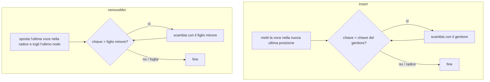

# Code prioritarie

> [!abstract]
> La coda del [[06 - ASD - Pile, code e code doppie|cap. 6]] serve gli elementi in ordine di arrivo (FIFO); spesso invece conta la **priorità** (aerei in atterraggio, passeggeri in lista d'attesa). La **coda prioritaria** memorizza coppie **chiave-valore** e restituisce sempre quella con **chiave minima**. Il capitolo definisce l'ADT, spiega come confrontare chiavi (**ordine totale**, `Comparable`, `Comparator`), confronta due implementazioni con liste (non ordinata e ordinata) e arriva allo **heap**, un albero binario completo ([[08 - ASD - Alberi|cap. 8]]) memorizzato in un array, con inserimenti e rimozioni in $O(\log n)$ e costruzione **bottom-up** in $O(n)$. Usando una coda prioritaria si ottiene uno **schema di ordinamento** che, a seconda dell'implementazione, diventa **selection sort**, **insertion sort** o **heap sort** ($O(n\log n)$). Chiude la **coda prioritaria flessibile** (rimozione e cambio di chiave di una voce qualsiasi), che servirà a Dijkstra e Prim-Jarník nel [[14 - ASD - Algoritmi per grafi|cap. 14]].
> Mappa del corso: [[MOC - Algoritmi e Strutture Dati]].

---

## La coda prioritaria come tipo di dato astratto

### Priorità

In un call center le chiamate vengono servite nell'ordine di arrivo: è una coda FIFO. Ma in molte situazioni FIFO non basta:

- il **controllo del traffico aereo** decide quale aereo far atterrare in base a distanza dalla pista, tempo d'attesa, carburante rimasto;
- la **lista d'attesa** per un volo pieno tiene conto dell'ora del check-in, ma anche del prezzo del biglietto e dello status di *frequent flyer*: un posto liberato può andare a chi è arrivato dopo, se ha priorità migliore.

Una **coda prioritaria** (*priority queue*) è un contenitore di elementi, ciascuno con una **chiave** (*key*) scelta da chi lo inserisce: si può inserire qualunque elemento ma si può rimuovere solo quello con priorità migliore, cioè per convenzione con **chiave minima** (chiave 1 ha priorità su chiave 2). Le chiavi possono essere oggetti qualsiasi purché **confrontabili** tra loro secondo un **ordinamento totale** (ad esempio i giudizi diversi di più analisti finanziari sullo stesso titolo).

### La coda prioritaria come ADT

Vedi [[Coda prioritaria (ADT)]].

Un elemento e la sua priorità formano una **voce** (*entry*), un oggetto composito chiave-valore.

| Metodo | Effetto |
|---|---|
| `insert(k, v)` | crea e inserisce una voce con chiave $k$ e valore $v$ |
| `min()` | restituisce (senza rimuovere) una voce con chiave minima; `null` se vuota |
| `removeMin()` | rimuove e restituisce una voce con chiave minima; `null` se vuota |
| `size()` | numero di voci |
| `isEmpty()` | `true` se vuota |

Possono esserci più voci con chiavi uguali: `min` e `removeMin` ne scelgono una arbitrariamente. Per ora la chiave di una voce non cambia dopo l'inserimento (il cambio di chiave è nella [[#Code prioritarie flessibili|coda flessibile]]).

> [!example] Esempio 9.1
> | Metodo | Restituisce | Contenuto (mostrato in ordine, ma non è obbligatorio tenerlo così) |
> |---|---|---|
> | `insert(5, A)` | | {(5,A)} |
> | `insert(9, C)` | | {(5,A), (9,C)} |
> | `insert(3, B)` | | {(3,B), (5,A), (9,C)} |
> | `min()` | (3,B) | {(3,B), (5,A), (9,C)} |
> | `removeMin()` | (3,B) | {(5,A), (9,C)} |
> | `insert(7, D)` | | {(5,A), (7,D), (9,C)} |
> | `removeMin()` | (5,A) | {(7,D), (9,C)} |
> | `removeMin()` | (7,D) | {(9,C)} |
> | `removeMin()` | (9,C) | {} |
> | `removeMin()` | null | {} |
> | `isEmpty()` | true | {} |

_(libro, pp. 360–362)_

---

## Implementare una coda prioritaria

### L'oggetto composito Entry

Per tenere insieme chiave e valore anche quando le voci si spostano si usa lo **schema di composizione** (come `Item` nella [[07 - ASD - Liste e iteratori#Lo schema progettuale di composizione|lista dei preferiti]]):

```java
/** Interfaccia per una coppia chiave-valore. */
public interface Entry<K,V> {
  K getKey();     // chiave memorizzata nella voce
  V getValue();   // valore memorizzato nella voce
}

/** Interfaccia per l'ADT coda prioritaria. */
public interface PriorityQueue<K,V> {
  int size();
  boolean isEmpty();
  Entry<K,V> insert(K key, V value) throws IllegalArgumentException;
  Entry<K,V> min();
  Entry<K,V> removeMin();
}
```

`insert` restituisce la voce creata: nella coda flessibile servirà a identificarla.

### Confrontare chiavi totalmente ordinate

Vedi [[Comparatore]].

La regola di confronto $\le$ deve essere un **ordine totale**: per ogni chiave $k_1, k_2, k_3$:

- **confrontabilità** (totalità): $k_1 \le k_2$ oppure $k_2 \le k_1$;
- **antisimmetria**: se $k_1 \le k_2$ e $k_2 \le k_1$ allora $k_1 = k_2$;
- **transitività**: se $k_1 \le k_2$ e $k_2 \le k_3$ allora $k_1 \le k_3$;
- (dalla totalità segue la **riflessività**: $k \le k$).

Così il **minimo** $k_{min}$ (con $k_{min} \le k$ per ogni $k$) è ben definito.

#### L'interfaccia Comparable

Una classe definisce l'**ordinamento naturale** dei suoi esemplari implementando `java.lang.Comparable` e il metodo `compareTo`: `a.compareTo(b)` restituisce un intero $i$ con $i < 0$ se $a < b$, $i = 0$ se $a = b$, $i > 0$ se $a > b$. Per `String` è l'ordine **lessicografico** (alfabetico esteso a Unicode, sensibile a maiuscole/minuscole).

#### L'interfaccia Comparator

Per confrontare con un criterio **diverso** da quello naturale si usa un **comparatore** `java.util.Comparator`, un oggetto **esterno** alla classe delle chiavi con il metodo `compare(a, b)` (stesso significato del risultato).

```java
public class StringLengthComparator implements Comparator<String> {
  /** Confronta due stringhe in base alla lunghezza. */
  public int compare(String a, String b) {
    if (a.length() < b.length()) return -1;
    else if (a.length() == b.length()) return 0;
    else return 1;
  }
}
```

#### Comparatori e ADT coda prioritaria

La coda prioritaria riceve nel costruttore un **comparatore** e lo usa per ogni confronto. Per comodità, se non lo si passa si usa l'ordine naturale tramite un `DefaultComparator`:

```java
public class DefaultComparator<E> implements Comparator<E> {
  public int compare(E a, E b) throws ClassCastException {
    return ((Comparable<E>) a).compareTo(b);
  }
}
```

### La classe di base AbstractPriorityQueue

Raccoglie ciò che è comune alle implementazioni: la classe annidata `PQEntry` (implementa `Entry`), il comparatore `comp`, un metodo `compare` tra voci, la verifica delle chiavi e `isEmpty`.

```java
/** Classe astratta di supporto per le implementazioni di PriorityQueue. */
public abstract class AbstractPriorityQueue<K,V> implements PriorityQueue<K,V> {
  //---------------- classe PQEntry annidata ----------------
  protected static class PQEntry<K,V> implements Entry<K,V> {
    private K k;   // chiave
    private V v;   // valore
    public PQEntry(K key, V value) {
      k = key;
      v = value;
    }
    // metodi dell'interfaccia Entry
    public K getKey() { return k; }
    public V getValue() { return v; }
    // metodi ausiliari, non nell'interfaccia
    protected void setKey(K key) { k = key; }
    protected void setValue(V value) { v = value; }
  } //------------- fine della classe PQEntry -------------

  /** Il comparatore che definisce l'ordine delle chiavi. */
  private Comparator<K> comp;
  /** Coda prioritaria vuota con il comparatore dato. */
  protected AbstractPriorityQueue(Comparator<K> c) { comp = c; }
  /** Coda prioritaria vuota con l'ordine naturale delle chiavi. */
  protected AbstractPriorityQueue() { this(new DefaultComparator<K>()); }
  /** Confronta due voci in base alle chiavi. */
  protected int compare(Entry<K,V> a, Entry<K,V> b) {
    return comp.compare(a.getKey(), b.getKey());
  }
  /** Verifica che la chiave sia utilizzabile. */
  protected boolean checkKey(K key) throws IllegalArgumentException {
    try {
      return (comp.compare(key, key) == 0);   // confrontandola con sé stessa
    } catch (ClassCastException e) {
      throw new IllegalArgumentException("Incompatible key");
    }
  }
  public boolean isEmpty() { return size() == 0; }
}
```

`checkKey` confronta la chiave **con sé stessa**: se il tipo non è compatibile con il comparatore, il cast fallisce e si lancia `IllegalArgumentException`.

_(libro, pp. 362–366)_

### Realizzare una coda prioritaria con una lista non ordinata

Le voci stanno in una `LinkedPositionalList` in ordine qualunque. `insert` le aggiunge in fondo in $O(1)$; `min` e `removeMin` devono **cercare** il minimo scorrendo tutta la lista, $O(n)$.

```java
public class UnsortedPriorityQueue<K,V> extends AbstractPriorityQueue<K,V> {
  private PositionalList<Entry<K,V>> list = new LinkedPositionalList<>();
  public UnsortedPriorityQueue() { super(); }
  public UnsortedPriorityQueue(Comparator<K> comp) { super(comp); }
  /** Posizione di una voce con chiave minima (solo se non vuota). */
  private Position<Entry<K,V>> findMin() {
    Position<Entry<K,V>> small = list.first();
    for (Position<Entry<K,V>> walk : list.positions())
      if (compare(walk.getElement(), small.getElement()) < 0)
        small = walk;                         // chiave più piccola trovata
    return small;
  }
  public Entry<K,V> insert(K key, V value) throws IllegalArgumentException {
    checkKey(key);
    Entry<K,V> newest = new PQEntry<>(key, value);
    list.addLast(newest);
    return newest;
  }
  public Entry<K,V> min() {
    if (list.isEmpty()) return null;
    return findMin().getElement();
  }
  public Entry<K,V> removeMin() {
    if (list.isEmpty()) return null;
    return list.remove(findMin());
  }
  public int size() { return list.size(); }
}
```

### Realizzare una coda prioritaria con una lista ordinata

Le voci si tengono **ordinate per chiave non decrescente**: il minimo è sempre il primo, quindi `min` e `removeMin` sono $O(1)$. `insert` però deve trovare il posto giusto: scorre la lista dalla fine all'indietro finché la nuova chiave è minore, $O(n)$ nel caso peggiore.

```java
public class SortedPriorityQueue<K,V> extends AbstractPriorityQueue<K,V> {
  private PositionalList<Entry<K,V>> list = new LinkedPositionalList<>();
  public SortedPriorityQueue() { super(); }
  public SortedPriorityQueue(Comparator<K> comp) { super(comp); }
  public Entry<K,V> insert(K key, V value) throws IllegalArgumentException {
    checkKey(key);
    Entry<K,V> newest = new PQEntry<>(key, value);
    Position<Entry<K,V>> walk = list.last();
    // scorre all'indietro cercando una chiave più piccola
    while (walk != null && compare(newest, walk.getElement()) < 0)
      walk = list.before(walk);
    if (walk == null)
      list.addFirst(newest);                  // la nuova chiave è la minima
    else
      list.addAfter(walk, newest);            // newest va dopo walk
    return newest;
  }
  public Entry<K,V> min() {
    if (list.isEmpty()) return null;
    return list.first().getElement();
  }
  public Entry<K,V> removeMin() {
    if (list.isEmpty()) return null;
    return list.remove(list.first());
  }
  public int size() { return list.size(); }
}
```

#### Confronto tra le due implementazioni basate su lista

| Metodo | Lista non ordinata | Lista ordinata |
|---|---|---|
| `size`, `isEmpty` | $O(1)$ | $O(1)$ |
| `insert` | $O(1)$ | $O(n)$ |
| `min` | $O(n)$ | $O(1)$ |
| `removeMin` | $O(n)$ | $O(1)$ |

Spazio $O(n)$. Un compromesso netto: o inserimenti veloci o rimozioni veloci.

_(libro, pp. 366–369)_

---

## Heap

Vedi [[Heap binario]].

Lo **heap binario** (o semplicemente **heap**, "mucchio") ottiene inserimenti **e** rimozioni in tempo **logaritmico**, con un compromesso tra "tutto ordinato" e "niente ordinato": un albero binario parzialmente ordinato.

> [!warning] Non confondere
> Lo heap come struttura dati non ha nulla a che vedere con la **memoria heap** dell'ambiente di esecuzione di Java ([[15 - ASD - Gestione della memoria e B-alberi|Paragrafo 15.1.2]]).

### La struttura dati heap

Uno heap è un albero binario $T$ che memorizza voci e soddisfa due proprietà.

**Proprietà di ordinamento dello heap** (relazionale): per ogni posizione $p$ diversa dalla radice, la chiave in $p$ è **non minore** della chiave del genitore di $p$.

Di conseguenza le chiavi lungo ogni percorso radice-foglia sono non decrescenti e la **chiave minima è sempre nella radice** ("in cima al mucchio").

**Proprietà di completezza** (strutturale): uno heap di altezza $h$ è un **albero binario completo**: i livelli $0, 1, \dots, h-1$ sono pieni (il livello $i$ ha $2^i$ nodi) e i nodi del livello $h$ occupano le posizioni **più a sinistra**. Equivalentemente: con la [[08 - ASD - Alberi#Albero binario rappresentato con un array|numerazione per livelli]], un albero completo di $n$ nodi usa esattamente i numeri da $0$ a $n-1$.

![[ASD-p371-1.png]]

Uno heap di 13 voci: la radice (4,C) ha la chiave minima; ogni figlio ha chiave $\ge$ del genitore (es. (5,A) e (6,Z) sotto (4,C); (15,K) e (9,F) sotto (5,A)). I livelli 0–2 sono pieni e i sei nodi del livello 3 sono a sinistra. L'**ultima posizione** è (13,W).

#### L'altezza di uno heap

**Proposizione 9.2.** Uno heap con $n$ voci ha altezza $h = \lfloor \log n \rfloor$.

*Dimostrazione.* I livelli $0, \dots, h-1$ contengono $1 + 2 + \dots + 2^{h-1} = 2^h - 1$ nodi, e il livello $h$ ne ha tra 1 e $2^h$. Quindi
$$n \ge 2^h - 1 + 1 = 2^h \qquad\text{e}\qquad n \le 2^h - 1 + 2^h = 2^{h+1} - 1$$
Dalla prima $h \le \log n$, dalla seconda $h \ge \log(n+1) - 1$; essendo $h$ intero, $h = \lfloor \log n \rfloor$. $\blacksquare$

Quindi ogni operazione che costa quanto l'altezza costa $O(\log n)$.

### Implementare una coda prioritaria con uno heap

`size` e `isEmpty` sono banali; `min` restituisce la radice. Le operazioni interessanti sono `insert` e `removeMin`.

#### Aggiunta di una voce a uno heap

Per conservare la completezza, la nuova voce va nel nuovo nodo subito **a destra dell'ultimo nodo** del livello più basso (o nella prima posizione di un nuovo livello se quello è pieno).

#### Risalita lungo lo heap dopo un inserimento

L'albero resta completo ma può violare l'ordinamento. Se la nuova posizione $p$ non è la radice, si confronta $k_p$ con la chiave del genitore $q$: se $k_p \ge k_q$ va tutto bene; se $k_p < k_q$ si **scambiano** le voci di $p$ e $q$ e si ripete un livello più su. È l'**up-heap bubbling** (la nuova voce "risale come una bolla").

![[ASD-p373-1.png]]

Inserimento della chiave 2, voce (2,T), nello heap precedente: (a) heap iniziale; (b) la nuova voce va come figlio destro di (20,B); (c, d) $2 < 20$: scambio.

![[ASD-p374-1.png]]

(e, f) $2 < 6$: nuovo scambio con (6,Z); (g, h) $2 < 4$: scambio con la radice (4,C). Ora (2,T) è la radice e l'ordinamento è ripristinato.

Nel caso peggiore la voce risale fino alla radice: gli scambi sono al massimo l'altezza, $\lfloor \log n \rfloor$.

#### Eliminazione di una voce avente chiave minima

La voce minima è nella radice, ma non si può semplicemente togliere la radice (resterebbero due sottoalberi staccati). Per conservare la completezza si toglie invece l'**ultimo nodo** (il più a destra del livello più profondo), dopo averne **copiato la voce nella radice** al posto di quella da eliminare.

![[ASD-p375-1.png]]

(a, b) la voce minima (4,C) viene rimossa e sostituita dalla voce dell'ultima posizione, (13,W); l'ultimo nodo viene eliminato. (c, d) $13 > 5$: scambio con il figlio minore (5,A).

#### Discesa lungo lo heap dopo una rimozione

L'albero è completo ma probabilmente viola l'ordinamento. Partendo da $p$ = radice:

- se $p$ non ha figlio destro, sia $c$ il figlio sinistro;
- altrimenti sia $c$ il **figlio con chiave minore**.

Se $k_p \le k_c$ va tutto bene; altrimenti si scambiano $p$ e $c$ e si continua da $c$. È il **down-heap bubbling**. Si sceglie il figlio **minore** perché, salendo, la sua chiave deve essere $\le$ di quella del fratello: così l'ordinamento è ripristinato localmente.

![[ASD-p376-1.png]]

(e, f) $13 > 9$: scambio con (9,F); (g, h) $13 > 12$: scambio con (12,H). (13,W) è ora una foglia e l'heap è corretto.

Anche qui gli scambi sono al massimo l'altezza, $\lfloor \log n \rfloor$.



#### Rappresentazione con array di un albero binario completo

La [[08 - ASD - Alberi#Albero binario rappresentato con un array|rappresentazione con array]] è perfetta per un albero completo: gli indici sono consecutivi da $0$ a $n-1$ e l'**ultima posizione** è semplicemente l'indice $n - 1$ (in una struttura concatenata trovarla costa di più, esercizio C-9.33).

![[ASD-p378-1.png]]

Lo heap della Figura 9.1 con la numerazione per livelli (0–12) e l'array corrispondente: (4,C), (5,A), (6,Z), (15,K), (9,F), (7,Q), (20,B), (16,X), (25,J), (14,E), (12,H), (11,S), (13,W).

Se la dimensione massima non è nota si usa un **array dinamico** ([[07 - ASD - Liste e iteratori#Array dinamici|cap. 7]]): spazio $O(n)$, tempi uguali ma **ammortizzati**.

#### Implementazione di uno heap in Java

Si usa un `ArrayList` di voci; "posizioni" sono indici, e i metodi ausiliari calcolano genitore e figli. Gli spostamenti passano tutti per `swap`, `upheap` e `downheap`.

```java
/** Coda prioritaria realizzata con uno heap su array. */
public class HeapPriorityQueue<K,V> extends AbstractPriorityQueue<K,V> {
  protected ArrayList<Entry<K,V>> heap = new ArrayList<>();
  public HeapPriorityQueue() { super(); }
  public HeapPriorityQueue(Comparator<K> comp) { super(comp); }
  // metodi ausiliari
  protected int parent(int j) { return (j-1) / 2; }   // divisione intera
  protected int left(int j) { return 2*j + 1; }
  protected int right(int j) { return 2*j + 2; }
  protected boolean hasLeft(int j) { return left(j) < heap.size(); }
  protected boolean hasRight(int j) { return right(j) < heap.size(); }
  /** Scambia le voci agli indici i e j. */
  protected void swap(int i, int j) {
    Entry<K,V> temp = heap.get(i);
    heap.set(i, heap.get(j));
    heap.set(j, temp);
  }
  /** Fa risalire la voce di indice j finché serve. */
  protected void upheap(int j) {
    while (j > 0) {                     // fino alla radice (o a un break)
      int p = parent(j);
      if (compare(heap.get(j), heap.get(p)) >= 0) break;   // ordine corretto
      swap(j, p);
      j = p;                            // continua dal genitore
    }
  }
  /** Fa scendere la voce di indice j finché serve. */
  protected void downheap(int j) {
    while (hasLeft(j)) {                // fino a una foglia (o a un break)
      int leftIndex = left(j);
      int smallChildIndex = leftIndex;  // il destro può essere minore
      if (hasRight(j)) {
        int rightIndex = right(j);
        if (compare(heap.get(leftIndex), heap.get(rightIndex)) > 0)
          smallChildIndex = rightIndex; // il figlio destro è minore
      }
      if (compare(heap.get(smallChildIndex), heap.get(j)) >= 0)
        break;                          // ordine corretto
      swap(j, smallChildIndex);
      j = smallChildIndex;              // continua dal figlio scelto
    }
  }
  // metodi pubblici
  public int size() { return heap.size(); }
  public Entry<K,V> min() {
    if (heap.isEmpty()) return null;
    return heap.get(0);
  }
  public Entry<K,V> insert(K key, V value) throws IllegalArgumentException {
    checkKey(key);
    Entry<K,V> newest = new PQEntry<>(key, value);
    heap.add(newest);                   // in fondo alla lista
    upheap(heap.size() - 1);            // up-heap sulla nuova voce
    return newest;
  }
  public Entry<K,V> removeMin() {
    if (heap.isEmpty()) return null;
    Entry<K,V> answer = heap.get(0);
    swap(0, heap.size() - 1);           // il minimo va in fondo
    heap.remove(heap.size() - 1);       // e lo si toglie
    downheap(0);                        // poi si sistema la radice
    return answer;
  }
}
```

### Analisi di una coda prioritaria realizzata con uno heap

- lo heap ha $n$ nodi, ognuno con un riferimento a una voce;
- l'altezza è $O(\log n)$ (Proposizione 9.2);
- `min` guarda la radice: $O(1)$;
- trovare l'ultima posizione costa $O(1)$ con l'array, $O(\log n)$ con una struttura concatenata;
- up-heap e down-heap fanno al massimo un numero di scambi pari all'altezza.

| Metodo | Tempo |
|---|---|
| `size`, `isEmpty` | $O(1)$ |
| `min` | $O(1)$ |
| `insert` | $O(\log n)$* |
| `removeMin` | $O(\log n)$* |

\* ammortizzato con un array dinamico; nel caso peggiore con un albero concatenato. Spazio $O(n)$.

> [!warning] Correzione
> La didascalia della Tabella 9.3 dice che sono ammortizzati i tempi di "`min` e `removeMin`". Sono invece **`insert` e `removeMin`** (le operazioni che cambiano la dimensione dell'array, come indica l'asterisco nella tabella); `min` è sempre $O(1)$.

Lo heap è efficiente **sia** negli inserimenti **sia** nelle rimozioni, a differenza delle implementazioni con liste.

_(libro, pp. 369–381)_

### Costruzione di uno heap dal basso verso l'alto (bottom-up)

Vedi [[Costruzione bottom-up di uno heap]].

$n$ inserimenti successivi in uno heap vuoto costano $O(n\log n)$. Ma se **tutte** le $n$ voci sono note subito (come nella prima fase dell'heap sort) si può costruire lo heap **dal basso verso l'alto** in $O(n)$.

Per semplicità sia $n = 2^{h+1} - 1$ (tutti i livelli pieni, $h = \log(n+1) - 1$). La costruzione ha $h + 1 = \log(n+1)$ fasi:

1. si costruiscono $(n+1)/2$ heap **di una voce** (le foglie);
2. si formano $(n+1)/4$ heap di 3 voci unendo coppie di heap elementari con una nuova voce in radice, che eventualmente scende (down-heap);
3. si formano $(n+1)/8$ heap di 7 voci unendo coppie di heap da 3 con una nuova radice e down-heap;
4. in generale, alla fase $i$ ($2 \le i \le h$) si formano $(n+1)/2^i$ heap di $2^i - 1$ voci unendo coppie di heap da $2^{i-1} - 1$ voci;
5. all'ultima fase ($h + 1$) si uniscono i due heap da $(n-1)/2$ voci con la radice.

![[ASD-p383-1.png]]

Costruzione bottom-up di uno heap di 15 voci (solo le chiavi): (a, b) le 8 foglie (16, 15, 4, 12, 6, 7, 23, 20); (c, d) si aggiungono 4 radici (25, 5, 11, 27) e si fa down-heap (es. 25 scende sotto 15); (e, f) si aggiungono 2 radici (7, 8) e si fa down-heap; (g, h) si aggiunge la radice 14, che scende fino al livello giusto. I percorsi di down-heap sono evidenziati.

#### Implementazione in Java della costruzione bottom-up di uno heap

Unire due heap della stessa dimensione sotto una posizione $p$ significa semplicemente fare **down-heap** sulla voce in $p$. Con l'array: si mettono tutte le voci in ordine qualsiasi e si chiama `downheap` su ogni posizione **interna**, dalla più profonda (il genitore dell'ultima) fino alla radice (sulle foglie non serve).

```java
/** Coda prioritaria inizializzata con le coppie chiave-valore date. */
public HeapPriorityQueue(K[] keys, V[] values) {
  super();
  for (int j = 0; j < Math.min(keys.length, values.length); j++)
    heap.add(new PQEntry<>(keys[j], values[j]));
  heapify();
}
/** Costruzione bottom-up in tempo lineare. */
protected void heapify() {
  int startIndex = parent(size() - 1);   // genitore dell'ultima voce
  for (int j = startIndex; j >= 0; j--)  // fino alla radice
    downheap(j);
}
```

#### Analisi asintotica della costruzione bottom-up di uno heap

Intuizione: invece di un up-heap per ogni nodo si fa un **down-heap** per ogni nodo, e la maggior parte dei nodi sta **in basso**, dove il down-heap è corto.

**Proposizione 9.3.** La costruzione bottom-up di uno heap di $n$ voci costa $O(n)$ (con confronti $O(1)$).

*Dimostrazione.* Il costo è dominato dai down-heap dei nodi interni. Per ogni nodo interno $v$ sia $\pi_v$ il percorso da $v$ alla foglia che lo segue in ordine simmetrico: si va al figlio destro e poi sempre a sinistra fino a una foglia. La lunghezza $\|\pi_v\|$ è proporzionale all'altezza del sottoalbero di $v$, quindi limita il costo del down-heap su $v$; il totale è al massimo $\sum_v \|\pi_v\|$.

I percorsi $\pi_v$ sono **disgiunti** sui rami: un ramo verso destra appartiene solo al percorso del suo nodo genitore; un ramo verso sinistra appartiene solo al percorso del nodo interno che ha come successore in ordine simmetrico la foglia raggiunta scendendo a sinistra da quel ramo, e nodi interni diversi hanno successori diversi. Quindi $\sum_v \|\pi_v\| \le$ numero di rami $= n - 1$, cioè $O(n)$. $\blacksquare$

![[ASD-p385-1.png]]

Lo heap finale della figura precedente con ogni ramo etichettato con la chiave del nodo interno il cui percorso $\pi_v$ lo contiene: nessun ramo ha due etichette (i rami tratteggiati non appartengono a nessun percorso).

_(libro, pp. 381–385)_

### Utilizzo della classe java.util.PriorityQueue

Java non ha un'interfaccia per le code prioritarie ma ha la classe `java.util.PriorityQueue`, che implementa `java.util.Queue` servendo gli elementi per priorità (ordine naturale o comparatore). Differenza principale: non distingue chiave e valore, ma usa un **solo tipo di elemento**, che fa da chiave. Per avere coppie si inseriscono oggetti compositi come `java.util.AbstractMap.SimpleEntry` (che implementa `java.util.Map.Entry`) con un comparatore sulle chiavi.

| Nostro ADT | `java.util.PriorityQueue` |
|---|---|
| `insert(k, v)` | `add(new SimpleEntry(k, v))` |
| `min()` | `peek()` |
| `removeMin()` | `remove()` |
| `size()` | `size()` |
| `isEmpty()` | `isEmpty()` |

È realizzata con uno heap: `add`/`remove` $O(\log n)$, `peek`/`size`/`isEmpty` $O(1)$. Ha anche `remove(e)`, che rimuove un elemento qualsiasi ma in $O(n)$ (ricerca sequenziale).

_(libro, pp. 385–386)_

---

## Ordinare con una coda prioritaria

Vedi [[Ordinamento con coda prioritaria]].

Per ordinare una sequenza $S$ di $n$ elementi confrontabili con una coda prioritaria $P$:

1. **Fase 1**: si inseriscono tutti gli elementi di $S$ come chiavi in $P$ ($n$ `insert`);
2. **Fase 2**: si estraggono da $P$ con $n$ `removeMin` e si rimettono in $S$ nell'ordine di estrazione (non decrescente).

```java
/** Ordina la sequenza S usando una coda prioritaria P inizialmente vuota. */
public static <E> void pqSort(PositionalList<E> S, PriorityQueue<E,?> P) {
  int n = S.size();
  for (int j = 0; j < n; j++) {
    E element = S.remove(S.first());
    P.insert(element, null);        // element è la chiave, null il valore
  }
  for (int j = 0; j < n; j++) {
    E element = P.removeMin().getKey();
    S.addLast(element);             // la chiave minima in fondo a S
  }
}
```

È più uno **schema** che un algoritmo: il tempo dipende da come è implementata $P$, e dà origine a tre algoritmi classici.

### Ordinamento per selezione e ordinamento per inserimento

#### Ordinamento per selezione

Con $P$ come **lista non ordinata**: la Fase 1 costa $O(n)$ (inserimenti $O(1)$), ma nella Fase 2 ogni `removeMin` deve "**selezionare**" il minimo scorrendo $P$: è il **selection sort**.

| Passo | Sequenza $S$ | Coda prioritaria $P$ |
|---|---|---|
| Inizio | (7, 4, 8, 2, 5, 3, 9) | () |
| Fase 1 (a) | (4, 8, 2, 5, 3, 9) | (7) |
| Fase 1 (b) | (8, 2, 5, 3, 9) | (7, 4) |
| ⋮ | ⋮ | ⋮ |
| Fase 1 (g) | () | (7, 4, 8, 2, 5, 3, 9) |
| Fase 2 (a) | (2) | (7, 4, 8, 5, 3, 9) |
| Fase 2 (b) | (2, 3) | (7, 4, 8, 5, 9) |
| Fase 2 (c) | (2, 3, 4) | (7, 8, 5, 9) |
| Fase 2 (d) | (2, 3, 4, 5) | (7, 8, 9) |
| Fase 2 (e) | (2, 3, 4, 5, 7) | (8, 9) |
| Fase 2 (f) | (2, 3, 4, 5, 7, 8) | (9) |
| Fase 2 (g) | (2, 3, 4, 5, 7, 8, 9) | () |

Le `removeMin` costano $O(n), O(n-1), \dots, O(1)$: la Fase 2 costa $O(n + (n-1) + \dots + 1) = O(n^2)$ (Proposizione 4.3), quindi tutto il selection sort è **$O(n^2)$**.

#### Ordinamento per inserimento

Con $P$ come **lista ordinata**: la Fase 2 diventa $O(n)$, ma ora il collo di bottiglia è la Fase 1, dove ogni `insert` deve **inserire** l'elemento al posto giusto: è l'**insertion sort** (lo stesso del [[03 - ASD - Strutture dati fondamentali#Ordinare un array|cap. 3]]).

| Passo | Sequenza $S$ | Coda prioritaria $P$ |
|---|---|---|
| Inizio | (7, 4, 8, 2, 5, 3, 9) | () |
| Fase 1 (a) | (4, 8, 2, 5, 3, 9) | (7) |
| Fase 1 (b) | (8, 2, 5, 3, 9) | (4, 7) |
| Fase 1 (c) | (2, 5, 3, 9) | (4, 7, 8) |
| Fase 1 (d) | (5, 3, 9) | (2, 4, 7, 8) |
| Fase 1 (e) | (3, 9) | (2, 4, 5, 7, 8) |
| Fase 1 (f) | (9) | (2, 3, 4, 5, 7, 8) |
| Fase 1 (g) | () | (2, 3, 4, 5, 7, 8, 9) |
| Fase 2 (a) | (2) | (3, 4, 5, 7, 8, 9) |
| Fase 2 (b) | (2, 3) | (4, 5, 7, 8, 9) |
| ⋮ | ⋮ | ⋮ |
| Fase 2 (g) | (2, 3, 4, 5, 7, 8, 9) | () |

Fase 1: $O(n + (n-1) + \dots + 1) = O(n^2)$, quindi insertion sort è **$O(n^2)$**. Se però nella Fase 1 si cerca la posizione **partendo dalla fine** della lista, su una sequenza già ordinata si spende $O(n)$; in generale il costo è $O(n + I)$, dove $I$ è il numero di **inversioni** (coppie di elementi nell'ordine sbagliato).

### Heap Sort

Vedi [[Heap sort]].

Con $P$ come **heap**:

- Fase 1: l'$i$-esimo `insert` costa $O(\log i)$, quindi $O(n\log n)$ in tutto (oppure $O(n)$ con la [[#Costruzione di uno heap dal basso verso l'alto (bottom-up)|costruzione bottom-up]]);
- Fase 2: il $j$-esimo `removeMin` costa $O(\log(n - j + 1))$, quindi $O(n\log n)$.

**Proposizione 9.4.** Heap sort ordina $n$ elementi in tempo $O(n\log n)$ (con confronti $O(1)$): molto meglio dell'$O(n^2)$ di selection e insertion sort.

| Implementazione di $P$ | Algoritmo | Fase 1 | Fase 2 | Totale |
|---|---|---|---|---|
| lista non ordinata | selection sort | $O(n)$ | $O(n^2)$ | $O(n^2)$ |
| lista ordinata | insertion sort | $O(n^2)$ | $O(n)$ | $O(n^2)$ |
| heap | heap sort | $O(n\log n)$ (o $O(n)$ bottom-up) | $O(n\log n)$ | $O(n\log n)$ |

#### Implementare heap sort sul posto

Se $S$ è un array, si può usare **parte di $S$ stesso** come heap, senza strutture ausiliarie:

1. si usa uno heap orientato al **massimo** (ogni chiave è **non minore** dei figli), cambiando il codice o usando un comparatore invertito. In ogni istante le celle $0..i-1$ contengono lo heap e le celle $i..n-1$ il resto della sequenza;
2. **Fase 1**: lo heap cresce da sinistra: al passo $i$ ($i = 1, \dots, n$) si aggiunge allo heap l'elemento nella cella $i - 1$;
3. **Fase 2**: lo heap si restringe da destra: al passo $i$ si estrae il **massimo** e lo si mette nella cella $n - i$.

Un algoritmo che usa solo una piccola quantità di memoria oltre alla sequenza si dice **sul posto** (*in-place*).

![[ASD-p391-1.png]]

Fase 2 di heap sort sul posto su (9, 7, 5, 2, 6, 4) (heap di massimo, in grigio): (a) heap iniziale con 9 in radice; (b) 9 va in fondo e 4 scende: heap (7, 6, 5, 2, 4); (c) 7 va in fondo: (6, 4, 5, 2); (d) 6 in fondo: (5, 4, 2); (e) 5 in fondo: (4, 2); (f) 4 in fondo: resta (2). L'array finale è ordinato: 2, 4, 5, 6, 7, 9. A destra l'albero implicito con il percorso di down-heap evidenziato.

_(libro, pp. 386–390)_

---

## Code prioritarie flessibili

Vedi [[Coda prioritaria flessibile]].

Per la lista d'attesa della compagnia aerea servono altre operazioni:

- un passeggero se ne va: bisogna **rimuovere** la sua voce, che non è necessariamente la minima (`remove`);
- una passeggera mostra la tessera frequent-flyer: bisogna **cambiare la chiave** della sua voce (`replaceKey`);
- un nome è scritto male: bisogna **cambiare il valore** (`replaceValue`).

### Il tipo di dato astratto coda prioritaria flessibile

La **coda prioritaria flessibile** (*adaptable priority queue*) estende l'ADT con:

| Metodo | Effetto |
|---|---|
| `remove(e)` | rimuove la voce $e$ |
| `replaceKey(e, k)` | sostituisce con $k$ la chiave della voce $e$ |
| `replaceValue(e, v)` | sostituisce con $v$ il valore della voce $e$ |

L'utente identifica la voce con l'oggetto `Entry` che gli è stato restituito da `insert`, usato come **testimone** (*token*); una voce non valida (es. già rimossa) provoca un errore. Serve un modo per **ritrovare** la voce senza scandire tutto: sarà essenziale per Dijkstra e Prim-Jarník ([[14 - ASD - Algoritmi per grafi|Paragrafi 14.6.2 e 14.7.1]]).

### Entry consapevoli della propria posizione

Si estende `PQEntry` con un terzo campo, l'**indice** della voce nell'array dello heap: è una voce **consapevole della propria posizione** (*location-aware entry*), lo schema **localizzatore** (simile alla lista posizionale su array del [[07 - ASD - Liste e iteratori#Implementazione di una lista posizionale con un array|cap. 7]]).

![[ASD-p392-1.png]]

Lo heap memorizzato come array di voci con tre campi (chiave, valore, indice): (4,C,0), (5,A,1), (6,Z,2), (15,K,3), (9,F,4), … La variabile `token` dell'utente punta alla voce (9,F,4).

Ogni volta che una voce viene spostata bisogna aggiornarne l'indice.

![[ASD-p393-1.png]]

Dopo `removeMin()`: (4,C) è stata rimossa, (16,X) è salita in radice e poi è scesa scambiandosi con (5,A) e poi con (9,F). Gli indici sono aggiornati: `token` punta ancora alla stessa voce (9,F), che ora ha indice 1.

### Implementare una coda prioritaria flessibile

`HeapAdaptablePriorityQueue` estende `HeapPriorityQueue`. Idea chiave: in `HeapPriorityQueue` **tutti** gli spostamenti passano per `swap`, quindi basta ridefinire `swap` perché aggiorni gli indici. Un nuovo metodo `bubble` decide se far salire o scendere una voce la cui chiave è cambiata.

```java
/** Coda prioritaria flessibile con uno heap su array. */
public class HeapAdaptablePriorityQueue<K,V> extends HeapPriorityQueue<K,V>
                                             implements AdaptablePriorityQueue<K,V> {
  //---------------- classe AdaptablePQEntry annidata ----------------
  /** Estende PQEntry con l'informazione sulla posizione. */
  protected static class AdaptablePQEntry<K,V> extends PQEntry<K,V> {
    private int index;                 // indice nell'array dello heap
    public AdaptablePQEntry(K key, V value, int j) {
      super(key, value);
      index = j;
    }
    public int getIndex() { return index; }
    public void setIndex(int j) { index = j; }
  } //------------- fine della classe AdaptablePQEntry -------------

  public HeapAdaptablePriorityQueue() { super(); }
  public HeapAdaptablePriorityQueue(Comparator<K> comp) { super(comp); }

  // metodi ausiliari
  /** Verifica che la voce sia valida controllandone la posizione. */
  protected AdaptablePQEntry<K,V> validate(Entry<K,V> entry)
                                  throws IllegalArgumentException {
    if (!(entry instanceof AdaptablePQEntry))
      throw new IllegalArgumentException("Invalid entry");
    AdaptablePQEntry<K,V> locator = (AdaptablePQEntry<K,V>) entry;
    int j = locator.getIndex();
    if (j >= heap.size() || heap.get(j) != locator)
      throw new IllegalArgumentException("Invalid entry");
    return locator;
  }
  /** Scambia le voci agli indici i e j aggiornandone gli indici. */
  protected void swap(int i, int j) {
    super.swap(i, j);
    ((AdaptablePQEntry<K,V>) heap.get(i)).setIndex(i);
    ((AdaptablePQEntry<K,V>) heap.get(j)).setIndex(j);
  }
  /** Ripristina l'ordinamento spostando la voce j in su o in giù. */
  protected void bubble(int j) {
    if (j > 0 && compare(heap.get(j), heap.get(parent(j))) < 0)
      upheap(j);
    else
      downheap(j);                     // forse non serve alcuno spostamento
  }

  public Entry<K,V> insert(K key, V value) throws IllegalArgumentException {
    checkKey(key);
    Entry<K,V> newest = new AdaptablePQEntry<>(key, value, heap.size());
    heap.add(newest);
    upheap(heap.size() - 1);
    return newest;
  }
  /** Rimuove la voce data. */
  public void remove(Entry<K,V> entry) throws IllegalArgumentException {
    AdaptablePQEntry<K,V> locator = validate(entry);
    int j = locator.getIndex();
    if (j == heap.size() - 1)          // è l'ultima voce
      heap.remove(heap.size() - 1);    // basta toglierla
    else {
      swap(j, heap.size() - 1);        // la scambia con l'ultima
      heap.remove(heap.size() - 1);    // la toglie
      bubble(j);                       // e sistema quella spostata
    }
  }
  /** Sostituisce la chiave di una voce. */
  public void replaceKey(Entry<K,V> entry, K key) throws IllegalArgumentException {
    AdaptablePQEntry<K,V> locator = validate(entry);
    checkKey(key);
    locator.setKey(key);
    bubble(locator.getIndex());        // con la nuova chiave può servire spostarla
  }
  /** Sostituisce il valore di una voce. */
  public void replaceValue(Entry<K,V> entry, V value) throws IllegalArgumentException {
    AdaptablePQEntry<K,V> locator = validate(entry);
    locator.setValue(value);
  }
}
```

- `validate` verifica che la voce sia proprio quella memorizzata all'indice che dichiara.
- `remove` mette al posto della voce l'**ultima** (per conservare la completezza) e chiama `bubble`, perché quella voce può essere troppo piccola o troppo grande per la nuova posizione.

> [!warning] Correzione
> Nel Codice 9.12 il secondo costruttore è scritto `public HeapAdaptablePriorityQueue(Comparator<K> c) { super(comp); }`: il parametro si chiama `c` ma viene passato `comp`, che non esiste in quel punto (non compila). Deve essere `super(c)` (o il parametro deve chiamarsi `comp`, come sopra).

#### Prestazioni delle implementazioni di coda prioritaria flessibile

| Metodo | Tempo |
|---|---|
| `size`, `isEmpty`, `min` | $O(1)$ |
| `insert` | $O(\log n)$ |
| `remove` | $O(\log n)$ |
| `removeMin` | $O(\log n)$ |
| `replaceKey` | $O(\log n)$ |
| `replaceValue` | $O(1)$ |

Spazio $O(n)$: le stesse prestazioni dello heap normale, più `remove` e `replaceKey` logaritmici.

_(libro, pp. 390–395)_

---

> [!summary] Riepilogo
> - **Coda prioritaria**: voci (chiave, valore), `insert`, `min`, `removeMin`; le chiavi devono avere un **ordine totale** (`Comparable` per l'ordine naturale, `Comparator` per criteri esterni).
> - Liste: **non ordinata** (insert $O(1)$, min/removeMin $O(n)$) vs **ordinata** (insert $O(n)$, min/removeMin $O(1)$).
> - **Heap**: albero binario **completo** con chiave di ogni nodo $\ge$ quella del genitore; altezza $\lfloor\log n\rfloor$; su array ($2j+1$, $2j+2$, $\lfloor(j-1)/2\rfloor$, ultima posizione $n-1$). **Up-heap** dopo `insert`, **down-heap** (verso il figlio minore) dopo `removeMin`: $O(\log n)$.
> - **Costruzione bottom-up** in $O(n)$: down-heap su ogni nodo interno dal basso (percorsi $\pi_v$ disgiunti).
> - **pqSort**: lista non ordinata → **selection sort** $O(n^2)$; lista ordinata → **insertion sort** $O(n^2)$ ($O(n+I)$ con le inversioni); heap → **heap sort** $O(n\log n)$, anche **sul posto** con uno heap di massimo.
> - **Coda flessibile**: `remove(e)`, `replaceKey(e,k)` in $O(\log n)$, `replaceValue` in $O(1)$, grazie alle voci **consapevoli della posizione** (indice aggiornato in `swap`) e a `bubble`.
