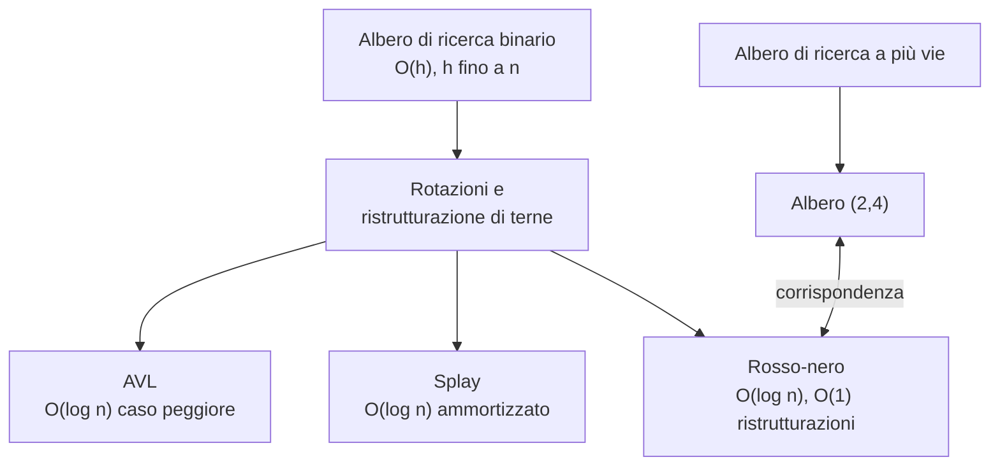

# Alberi di ricerca

> [!abstract]
> Nel [[10 - ASD - Mappe, tabelle hash e skip list|capitolo 10]] la **mappa ordinata** era realizzata con una tabella ordinata (ricerca veloce, aggiornamenti lenti) o con una skip list (tempi logaritmici solo *attesi*). Questo capitolo usa gli **alberi** del [[08 - ASD - Alberi|capitolo 8]] per ottenere una mappa ordinata con tutte le operazioni in tempo $O(h)$, dove $h$ è l'altezza dell'albero.
>
> Il problema è che un albero di ricerca binario "semplice" può degenerare in una lista ($h = n$). Il resto del capitolo mostra quattro modi per tenere bassa l'altezza:
> - **alberi AVL**: vincolo sulle altezze dei figli, $O(\log n)$ nel caso peggiore;
> - **alberi splay**: nessun vincolo, ma ogni accesso porta il nodo in radice → $O(\log n)$ **ammortizzato**;
> - **alberi (2,4)**: nodi con 2–4 figli e foglie tutte alla stessa profondità;
> - **alberi rosso-nero**: versione binaria degli alberi (2,4), con $O(1)$ ristrutturazioni per aggiornamento.
>
> Tutte le implementazioni Java estendono la stessa classe `TreeMap` tramite metodi "aggancio" (schema template method, [[02 - ASD - Progettazione orientata agli oggetti|cap. 2]]). Gli alberi a più vie torneranno con i B-alberi nel [[15 - ASD - Gestione della memoria e B-alberi|capitolo 15]].
>
> Indice dei concetti: [[MOC - Algoritmi e Strutture Dati]]



---

## Alberi di ricerca binari

Vedi [[Albero di ricerca binario]].

Le tre operazioni fondamentali di una mappa ([[10 - ASD - Mappe, tabelle hash e skip list#Mappe|Paragrafo 10.1]]) sono:

| Metodo | Effetto |
|---|---|
| `get(k)` | restituisce il valore $v$ associato a $k$, o `null` |
| `put(k, v)` | associa $v$ a $k$, restituendo l'eventuale valore precedente |
| `remove(k)` | elimina la voce con chiave $k$ e ne restituisce il valore, o `null` |

La **mappa ordinata** aggiunge le ricerche "approssimate" (`higherEntry(k)`, `floorEntry(k)`, …), gli intervalli `subMap(k1, k2)` e l'iterazione in ordine di chiave. Un albero binario è la struttura naturale per tutto questo, purché tra le chiavi esista un ordine totale.

**Definizione.** Un *albero di ricerca binario* (*binary search tree*, BST) è un [[08 - ASD - Alberi|albero binario proprio]] in cui ogni posizione interna $p$ memorizza una coppia $(k, v)$ tale che:

- le chiavi nel **sottoalbero sinistro** di $p$ sono **minori** di $k$;
- le chiavi nel **sottoalbero destro** di $p$ sono **maggiori** di $k$.

In questo libro le **foglie non contengono dati**: sono *sentinelle* (segnaposto) che semplificano gli algoritmi, perché ogni ricerca fallita termina in una foglia ben definita. In pratica si possono sostituire con riferimenti `null`, dimezzando il numero di nodi (in un albero binario proprio con $n$ nodi interni ci sono $n+1$ foglie).

![[ASD-p459-1.png]]

La figura mostra un BST con chiavi intere (i valori non sono disegnati, perché non influenzano la disposizione). I quadratini sono le foglie sentinella. Si verifica la proprietà ovunque: ad esempio tutto il sottoalbero sinistro di 44 (8, 17, 21, 28, 29, 32) è minore di 44, e il sottoalbero di 65 contiene solo chiavi tra 44 e 88.

> [!tip] La proprietà chiave: l'attraversamento in ordine simmetrico
> Un attraversamento *inorder* ([[08 - ASD - Alberi#Attraversamento in ordine simmetrico di un albero binario|cap. 8]]) di un BST visita le chiavi **in ordine crescente**. È questa proprietà che permette di iterare la mappa ordinata in $O(n)$ e che tutte le ristrutturazioni del capitolo dovranno preservare.

_(libro, pp. 458–459)_

### Ricerca in un albero di ricerca binario

L'algoritmo di ricerca tratta il BST come un **albero di decisione**: in ogni nodo interno $p$ ci si chiede se la chiave cercata $k$ è minore, uguale o maggiore di `key(p)`.

- **minore** → si prosegue nel sottoalbero sinistro;
- **uguale** → ricerca con successo;
- **maggiore** → si prosegue nel sottoalbero destro;
- se si arriva a una **foglia**, la ricerca fallisce.

```text
Algoritmo TreeSearch(p, k):
    if p è esterna then
        return p                          { ricerca senza successo }
    else if k == key(p) then
        return p                          { ricerca con successo }
    else if k < key(p) then
        return TreeSearch(left(p), k)     { ricorsione a sinistra }
    else                                  { ora sappiamo che k > key(p) }
        return TreeSearch(right(p), k)    { ricorsione a destra }
```

Nel caso di ricerca fallita viene restituita **la foglia in cui termina il percorso**: è esattamente il punto in cui la chiave *dovrebbe* stare, e servirà all'inserimento.

![[ASD-p460-1.png]]

(a) Ricerca di 65: $65 > 44$ → destra; $65 < 88$ → sinistra; trovato. (b) Ricerca di 68: $44 \to 88 \to 65 \to 82 \to 76$, poi $68 < 76$ porta alla foglia sinistra di 76 → fallimento.

#### Analisi della ricerca

Ogni chiamata ricorsiva fa $O(1)$ lavoro e scende di un livello, quindi si visitano al più $h+1$ nodi: la ricerca costa $O(h)$.

![[ASD-p461-1.png]]

La figura usa la rappresentazione "a triangolo" di un albero: il percorso a zig-zag scende dalla radice spendendo $O(1)$ per livello, per un totale di $O(h)$.

> [!warning] Il punto debole
> $h$ può arrivare a $n$ (albero degenere), quindi $O(h)$ non è di per sé una buona garanzia. Tutto il resto del capitolo serve a garantire $h = O(\log n)$.

La ricerca è la procedura ausiliaria di `get`, `put`, `remove` e di quasi tutti i metodi della mappa ordinata (`lowerEntry`, `higherEntry`, … si ottengono navigando dall'ultimo nodo visitato), che quindi costano tutti $O(h)$.

_(libro, pp. 459–461)_

### Inserimenti e rimozioni

#### Inserimento

`put(k, v)` comincia con una ricerca di $k$:
- se la chiave esiste, si sostituisce il valore;
- altrimenti la ricerca termina in una foglia $p$, che viene **trasformata in nodo interno** con la nuova voce e due nuove foglie figlie. La proprietà di BST resta vera perché la voce finisce *proprio dove la ricerca si aspettava di trovarla*.

L'operazione di supporto sull'albero binario è:

- `expandExternal(p, e)`: memorizza la voce $e$ nella foglia $p$ e le aggiunge due foglie come figli.

```text
Algoritmo TreeInsert(k, v):
    Input: Una chiave k da associare al valore v
    p = TreeSearch(root(), k)
    if k == key(p) then
        Assegna v come valore della voce memorizzata in p
    else
        expandExternal(p, (k, v))
```

![[ASD-p462-1.png]]

Inserimento di 68 nell'albero di prima: (a) il percorso di ricerca ($44 \to 88 \to 65 \to 82 \to 76$) termina nella foglia sinistra di 76; (b) quella foglia diventa il nodo 68, con due nuove foglie.

#### Rimozione

La rimozione è più delicata perché la voce da togliere può stare **in qualunque punto** dell'albero, non solo in fondo. Si cerca $k$ con `TreeSearch(root(), k)`; se si ottiene una foglia non c'è niente da eliminare, altrimenti in posizione $p$ ci sono due casi.

**Caso 1: al più un figlio di $p$ è interno.** Sia $r$ il figlio interno (o uno qualsiasi, se entrambi sono foglie). Si eliminano $p$ e il fratello foglia di $r$, e **$r$ risale** al posto di $p$. Tutte le relazioni antenato–discendente rimaste esistevano già, quindi la proprietà di BST è preservata.

![[ASD-p463-1.png]]

Rimozione di 32 (che ha solo il figlio interno $r = 28$): il sottoalbero di 28 sale al posto di 32.

**Caso 2: entrambi i figli di $p$ sono interni.** Non si può togliere $p$ senza lasciare un "buco" con due sottoalberi orfani. Allora:

1. si trova la posizione $r$ con il **predecessore** di $k$ (la chiave massima tra quelle minori di $k$): è il nodo interno **più a destra del sottoalbero sinistro** di $p$;
2. si copia la voce di $r$ in $p$. La proprietà regge: tutte le chiavi a destra di $p$ sono maggiori di quella di $r$, tutte le altre a sinistra sono minori;
3. si elimina $r$, che essendo il più a destra **non ha un figlio destro interno** → si ricade nel Caso 1.

![[ASD-p464-1.png]]

Rimozione di 88 (due figli interni): il predecessore è 82 ($r$), che viene copiato in $p$; poi si elimina il vecchio nodo 82, il cui figlio 76 risale.

> [!note] Costo
> Anche la rimozione percorre un solo cammino dalla radice verso il basso, sposta al più una voce e rimuove un nodo: tempo $O(h)$.

> [!tip] Predecessore o successore
> Si potrebbe usare simmetricamente il **successore** (il nodo più a sinistra del sottoalbero destro). Il libro sceglie il predecessore, e lo stesso fa il codice (`treeMax(left(p))`).

_(libro, pp. 461–464)_

### Implementazione in Java

La classe `TreeMap` estende `AbstractSortedMap` (cap. 10), da cui eredita il confronto tra chiavi tramite [[Comparatore|comparatore]], la classe `MapEntry` e i metodi `keySet`/`values` basati su `entrySet`. L'albero è memorizzato come **albero binario proprio con foglie sentinella** (le voci solo nei nodi interni), usando una sottoclasse di `LinkedBinaryTree` del [[08 - ASD - Alberi|cap. 8]].

Due scelte servono già a preparare gli alberi bilanciati:
- il campo `tree` è di tipo `BalanceableBinaryTree` (descritto nel [[#Infrastruttura Java per bilanciare alberi di ricerca|Paragrafo 11.2.1]]);
- in punti strategici il codice chiama `rebalanceAccess`, `rebalanceInsert`, `rebalanceDelete`, che qui non fanno nulla ma sono **agganci** (*hook*) per le sottoclassi.

**Codice 11.3** — costruttori, `size`, `expandExternal`, `treeSearch`:

```java
/** Un'implementazione di mappa ordinata che usa un albero di ricerca binario. */
public class TreeMap<K,V> extends AbstractSortedMap<K,V> {
  // per rappresentare la struttura ad albero usiamo una sottoclasse di
  // LinkedBinaryTree, BalanceableBinaryTree (illustrata nel Paragrafo 11.2).
  protected BalanceableBinaryTree<K,V> tree = new BalanceableBinaryTree<>();

  /** Costruisce una mappa vuota usando l'ordinamento naturale tra le chiavi. */
  public TreeMap() {
    super();                 // il costruttore di AbstractSortedMap
    tree.addRoot(null);      // crea una foglia sentinella come radice
  }
  /** Costruisce una mappa vuota ordinando le chiavi con il comparatore dato. */
  public TreeMap(Comparator<K> comp) {
    super(comp);
    tree.addRoot(null);
  }
  /** Restituisce il numero di voci presenti nella mappa. */
  public int size() {
    return (tree.size() - 1) / 2;   // solo i nodi interni hanno una voce
  }
  /** Metodo ausiliario usato per inserire una nuova voce in una foglia. */
  private void expandExternal(Position<Entry<K,V>> p, Entry<K,V> entry) {
    tree.set(p, entry);          // memorizza in p la nuova voce
    tree.addLeft(p, null);       // aggiunge nuove foglie-sentinella come figli
    tree.addRight(p, null);
  }
  // Omessi per brevità: metodi protected che abbreviano le operazioni sull'albero,
  // ad esempio root() al posto di tree.root()
  protected Position<Entry<K,V>> root() { return tree.root(); }

  /** Restituisce la posizione nel sottoalbero di p che ha la chiave data. */
  private Position<Entry<K,V>> treeSearch(Position<Entry<K,V>> p, K key) {
    if (isExternal(p))
      return p;                               // chiave non trovata: foglia terminale
    int comp = compare(key, p.getElement());
    if (comp == 0)
      return p;                               // chiave trovata
    else if (comp < 0)
      return treeSearch(left(p), key);        // sottoalbero sinistro
    else
      return treeSearch(right(p), key);       // sottoalbero destro
  }
```

`size()` sfrutta il fatto che un albero proprio con $n$ nodi interni ha $2n+1$ nodi in totale: $n = (\text{tree.size()} - 1)/2$.

**Codice 11.4** — `get`, `put`, `remove`:

```java
  public V get(K key) throws IllegalArgumentException {
    checkKey(key);
    Position<Entry<K,V>> p = treeSearch(root(), key);
    rebalanceAccess(p);                       // per sottoclassi di alberi bilanciati
    if (isExternal(p)) return null;           // ricerca infruttuosa
    return p.getElement().getValue();         // corrispondenza trovata
  }
  public V put(K key, V value) throws IllegalArgumentException {
    checkKey(key);
    Entry<K,V> newEntry = new MapEntry<>(key, value);
    Position<Entry<K,V>> p = treeSearch(root(), key);
    if (isExternal(p)) {                      // la chiave è nuova
      expandExternal(p, newEntry);
      rebalanceInsert(p);                     // hook
      return null;
    } else {                                  // sostituisce il valore esistente
      V old = p.getElement().getValue();
      set(p, newEntry);
      rebalanceAccess(p);                     // hook
      return old;
    }
  }
  public V remove(K key) throws IllegalArgumentException {
    checkKey(key);
    Position<Entry<K,V>> p = treeSearch(root(), key);
    if (isExternal(p)) {                      // chiave non trovata
      rebalanceAccess(p);
      return null;
    } else {
      V old = p.getElement().getValue();
      if (isInternal(left(p)) && isInternal(right(p))) {   // entrambi i figli interni
        Position<Entry<K,V>> replacement = treeMax(left(p));
        set(p, replacement.getElement());
        p = replacement;
      } // ora al massimo uno dei figli di p è interno
      Position<Entry<K,V>> leaf = (isExternal(left(p)) ? left(p) : right(p));
      Position<Entry<K,V>> sib = sibling(leaf);
      remove(leaf);
      remove(p);                              // sib risale nella posizione p
      rebalanceDelete(sib);                   // hook
    }
    return old;
  }
```

> [!warning] Correzione
> Nel Codice 11.4 del libro la riga 88 è `rebalanceDelete(p);`. Ma a quel punto `p` è appena stato rimosso dall'albero (riga 87), mentre il Paragrafo 11.2.1 dice che l'argomento deve essere "il figlio del nodo eliminato che ha preso il suo posto", cioè `sib`. Le sottoclassi (AVL, splay, rosso-nero) usano infatti l'argomento come posizione ancora presente nell'albero (`parent(p)`, `isRed(p)`, `sibling(p)`). Qui la chiamata è trascritta come `rebalanceDelete(sib)`.

**Codice 11.5** — massimo di un sottoalbero e ricerche approssimate:

```java
  /** Restituisce la posizione con chiave massima nel sottoalbero di radice p. */
  protected Position<Entry<K,V>> treeMax(Position<Entry<K,V>> p) {
    Position<Entry<K,V>> walk = p;
    while (isInternal(walk))
      walk = right(walk);
    return parent(walk);              // vogliamo il genitore della foglia
  }
  public Entry<K,V> lastEntry() {
    if (isEmpty()) return null;
    return treeMax(root()).getElement();
  }
  /** Voce con chiave massima tra quelle non maggiori di key. */
  public Entry<K,V> floorEntry(K key) throws IllegalArgumentException {
    checkKey(key);
    Position<Entry<K,V>> p = treeSearch(root(), key);
    if (isInternal(p)) return p.getElement();       // corrispondenza esatta
    while (!isRoot(p)) {
      if (p == right(parent(p)))
        return parent(p).getElement();  // il genitore ha la chiave che cerchiamo
      else
        p = parent(p);
    }
    return null;                        // nessuna chiave non maggiore di key
  }
  /** Voce con chiave massima tra quelle minori di key. */
  public Entry<K,V> lowerEntry(K key) throws IllegalArgumentException {
    checkKey(key);
    Position<Entry<K,V>> p = treeSearch(root(), key);
    if (isInternal(p) && isInternal(left(p)))
      return treeMax(left(p)).getElement();         // predecessore di p
    // altrimenti la ricerca è fallita o manca il figlio sinistro
    while (!isRoot(p)) {
      if (p == right(parent(p)))
        return parent(p).getElement();
      else
        p = parent(p);
    }
    return null;
  }
```

L'idea di `floorEntry`: se la ricerca fallisce in una foglia, si risale finché non si arriva da un **figlio destro**; quel genitore è il primo antenato con chiave minore di `key`, ed è la più grande tra quelle minori (tutto ciò che sta tra lui e la foglia è maggiore di `key`).

**Codice 11.6** — scansione completa e per intervallo:

```java
  /** Restituisce un contenitore iterabile con tutte le voci della mappa. */
  public Iterable<Entry<K,V>> entrySet() {
    ArrayList<Entry<K,V>> buffer = new ArrayList<>(size());
    for (Position<Entry<K,V>> p : tree.inorder())
      if (isInternal(p)) buffer.add(p.getElement());
    return buffer;
  }
  /** Restituisce le voci con chiavi in [fromKey, toKey). */
  public Iterable<Entry<K,V>> subMap(K fromKey, K toKey) {
    ArrayList<Entry<K,V>> buffer = new ArrayList<>(size());
    if (compare(fromKey, toKey) < 0)           // controlla che fromKey < toKey
      subMapRecurse(fromKey, toKey, root(), buffer);
    return buffer;
  }
  private void subMapRecurse(K fromKey, K toKey, Position<Entry<K,V>> p,
                             ArrayList<Entry<K,V>> buffer) {
    if (isInternal(p))
      if (compare(p.getElement(), fromKey) < 0)
        // la chiave di p è minore di fromKey: le voci cercate sono a destra
        subMapRecurse(fromKey, toKey, right(p), buffer);
      else {
        subMapRecurse(fromKey, toKey, left(p), buffer);   // prima a sinistra
        if (compare(p.getElement(), toKey) < 0) {         // p è nell'intervallo
          buffer.add(p.getElement());
          subMapRecurse(fromKey, toKey, right(p), buffer); // poi a destra
        }
      }
  }
```

`subMapRecurse` è un attraversamento inorder **potato**: non scende nei sottoalberi che sicuramente stanno fuori dall'intervallo.

_(libro, pp. 464–468)_

### Prestazioni di un albero di ricerca binario

| Metodo | Tempo d'esecuzione |
|---|---|
| `size`, `isEmpty` | $O(1)$ |
| `get`, `put`, `remove` | $O(h)$ |
| `firstEntry`, `lastEntry` | $O(h)$ |
| `ceilingEntry`, `floorEntry`, `lowerEntry`, `higherEntry` | $O(h)$ |
| `subMap` | $O(s + h)$ |
| `entrySet`, `keySet`, `values` | $O(n)$ |

(Tabella 11.1: $h$ altezza, $s$ numero di voci restituite da `subMap`; spazio $O(n)$.)

Quasi tutto dipende da $h$, perché quasi tutto è "un cammino dalla radice verso il basso". Il BST è quindi efficiente **solo se è basso**:

- **caso migliore**: albero completo, $h \approx \log n$ → tempi logaritmici;
- **caso peggiore**: $h = n$, come una lista ordinata. Succede ad esempio inserendo le chiavi in ordine crescente.

![[ASD-p469-1.png]]

Inserendo 10, 20, 30, 40 in quest'ordine, ogni nuova chiave va a destra della precedente: l'albero è una catena e la ricerca diventa lineare.

> [!warning] Correzione
> Il libro indica come altezza minima $h = \lceil \log(n+1) \rceil - 1$. Questo vale contando **solo i nodi interni**; con le foglie sentinella usate nel resto del capitolo (dove la catena di Figura 11.7 ha altezza $n$) l'altezza minima è $\lceil \log(n+1) \rceil$, coerente con la disuguaglianza $\log(n+1) \le h$ usata più avanti nella dimostrazione della Proposizione 11.8. La differenza è di un'unità e non cambia l'ordine $O(\log n)$.

> [!note] E in media?
> Un BST costruito con una sequenza **casuale** di inserimenti e rimozioni ha altezza attesa $O(\log n)$ (la dimostrazione richiede probabilità avanzata ed è fuori dal libro). Ma se non si può garantire la casualità (ad esempio dati già ordinati, caso frequentissimo) servono alberi che garantiscano $O(\log n)$ nel **caso peggiore**.

_(libro, pp. 468–469)_

---

## Alberi di ricerca bilanciati

Il resto del capitolo presenta quattro strutture con prestazioni robuste. Tre di esse (AVL, splay, rosso-nero) sono BST normali **arricchiti con operazioni che cambiano la forma dell'albero** per ridurne l'altezza. L'operazione base è la rotazione.

### Rotazioni

Vedi [[Rotazione e ristrutturazione di una terna]].

Una **rotazione** fa salire un figlio $x$ al di sopra del genitore $y$:

![[ASD-p470-1.png]]

Da sinistra a destra (rotazione "a destra" di $x$) o viceversa. Le chiavi di $T_1$ sono minori di $x$, quelle di $T_2$ stanno tra $x$ e $y$, quelle di $T_3$ sono maggiori di $y$.

Per preservare la proprietà di BST:
- se $x$ era figlio **sinistro** di $y$, dopo la rotazione $y$ diventa figlio **destro** di $x$ (e viceversa);
- il sottoalbero "di mezzo" $T_2$ (chiavi tra $x$ e $y$) passa da figlio destro di $x$ a figlio sinistro di $y$.

Effetti:
- con una struttura concatenata cambia un numero costante di collegamenti → **$O(1)$**;
- la profondità dei nodi in $T_1$ **diminuisce** di 1, quella dei nodi in $T_3$ **aumenta** di 1, quella di $T_2$ non cambia. È questo che permette di "spostare peso" da un lato all'altro.

### Ristrutturazione di una terna di nodi

Combinando una o due rotazioni si ottiene la **ristrutturazione di una terna** (*trinode restructuring*), che agisce su una posizione $x$, il genitore $y$ e il nonno $z$.

```text
Algoritmo restructure(x):
    Input:  una posizione x di un BST T che ha sia il genitore y sia il nonno z
    Output: l'albero T dopo la ristrutturazione (rotazione singola o doppia) di x, y, z
    1. Sia (a, b, c) l'elenco delle posizioni x, y, z in ordine simmetrico (da sinistra
       a destra), e sia (T1, T2, T3, T4) l'elenco ordinato dei quattro sottoalberi
       di x, y, z che non hanno radice in x, y o z.
    2. Sostituire il sottoalbero di radice z con un nuovo sottoalbero di radice b.
    3. a diventa figlio sinistro di b, con T1 e T2 come sottoalberi sinistro e destro.
    4. c diventa figlio destro di b, con T3 e T4 come sottoalberi sinistro e destro.
```

Il trucco è rinominare i tre nodi come $a < b < c$ secondo l'ordine simmetrico: i **quattro casi** possibili (a seconda di dove stanno $x$ e $y$) diventano così **un unico caso**. Il risultato ha sempre il nodo "di mezzo" $b$ in cima.

![[ASD-p472-1.png]]

- (a), (b): il percorso $z \to y \to x$ va due volte **nella stessa direzione** (destra-destra o sinistra-sinistra) → basta una **rotazione singola** di $y$;
- (c), (d): le direzioni sono **opposte** (destra-sinistra o sinistra-destra) → serve una **rotazione doppia**: $x$ (la chiave di mezzo) ruota prima sopra $y$ e poi sopra $z$.

In ogni caso il costo è $O(1)$.

_(libro, pp. 469–472)_

### Infrastruttura Java per bilanciare alberi di ricerca

`TreeMap` è già una mappa funzionante, ma con altezza potenzialmente $O(n)$. È stata progettata per essere estesa da `AVLTreeMap`, `SplayTreeMap` e `RBTreeMap`, e offre loro tre forme di supporto.

#### Agganci per il ribilanciamento

- in `put`, dopo aver aggiunto un nodo in $p$: `rebalanceInsert(p)`;
- in `remove`, dopo aver eliminato un nodo: `rebalanceDelete(p)`, dove $p$ è il figlio che ha preso il posto del nodo eliminato;
- in `get`, `put`, `remove`, quando **non** ci sono modifiche strutturali: `rebalanceAccess(p)`, con $p$ il nodo più profondo visitato (interno o foglia). Serve soprattutto agli alberi splay.

In `TreeMap` hanno corpo vuoto (Codice 11.8):

```java
protected void rebalanceInsert(Position<Entry<K,V>> p) { }
protected void rebalanceDelete(Position<Entry<K,V>> p) { }
protected void rebalanceAccess(Position<Entry<K,V>> p) { }
```

Le sottoclassi ridefiniscono solo quelli che servono: è lo [[Schema template method|schema template method]] del [[02 - ASD - Progettazione orientata agli oggetti|cap. 2]] (l'algoritmo generale è fisso nella superclasse, i passi variabili sono delegati).

#### Metodi protected per rotazione e ristrutturazione

L'albero è un'istanza della classe annidata `BalanceableBinaryTree`, sottoclasse di `LinkedBinaryTree`, che aggiunge i metodi `rotate` e `restructure` (non usati da `TreeMap`, ma pronti per tutte le sottoclassi) e un ausiliario `relink`, che collega un genitore e un figlio nella direzione indicata.

`restructure` distingue i casi della figura precedente: direzioni uguali (destra-destra, sinistra-sinistra) → rotazione singola di $y$; direzioni opposte → rotazione doppia di $x$.

#### Nodi specializzati con una variabile aggiuntiva

Molte strategie hanno bisogno di un'informazione di bilanciamento in ogni nodo (altezza per gli AVL, colore per i rosso-nero). La classe `BSTNode` estende `LinkedBinaryTree.Node` aggiungendo un intero `aux`.

Problema: i nodi vengono creati dai metodi di basso livello di `LinkedBinaryTree` (`addLeft`, `addRight`, …), che non sanno nulla di `BSTNode`. Soluzione: lo **schema metodo fabbrica** (*factory method design pattern*). `LinkedBinaryTree` crea i nodi sempre tramite il metodo protected `createNode`; `BalanceableBinaryTree` lo **ridefinisce** per restituire un `BSTNode`. Così tutti i metodi ereditati creano automaticamente nodi del tipo giusto.

> [!warning] Correzione
> Nel testo del Paragrafo 11.2.1 la classe è chiamata una volta `BalanceableSearchTree`: il nome corretto, usato nel codice e nel resto del capitolo, è `BalanceableBinaryTree`.

**Codici 11.9 e 11.10** — la classe `BalanceableBinaryTree`:

```java
/** Una sottoclasse di LinkedBinaryTree con supporto per il bilanciamento. */
protected static class BalanceableBinaryTree<K,V>
                       extends LinkedBinaryTree<Entry<K,V>> {
  //------------- classe BSTNode annidata -------------
  protected static class BSTNode<E> extends Node<E> {
    int aux = 0;
    BSTNode(E e, Node<E> parent, Node<E> leftChild, Node<E> rightChild) {
      super(e, parent, leftChild, rightChild);
    }
    public int getAux() { return aux; }
    public void setAux(int value) { aux = value; }
  } //---------- fine della classe BSTNode annidata ----------

  // metodi relativi al campo aux e basati su una posizione
  public int getAux(Position<Entry<K,V>> p) {
    return ((BSTNode<Entry<K,V>>) p).getAux();
  }
  public void setAux(Position<Entry<K,V>> p, int value) {
    ((BSTNode<Entry<K,V>>) p).setAux(value);
  }
  // Sovrascrive il metodo-fabbrica in modo che crei un BSTNode (e non un Node)
  protected Node<Entry<K,V>> createNode(Entry<K,V> e, Node<Entry<K,V>> parent,
                                        Node<Entry<K,V>> left, Node<Entry<K,V>> right) {
    return new BSTNode<>(e, parent, left, right);
  }

  /** Collega un nodo genitore con un suo figlio, nella direzione specificata. */
  private void relink(Node<Entry<K,V>> parent, Node<Entry<K,V>> child,
                      boolean makeLeftChild) {
    child.setParent(parent);
    if (makeLeftChild)
      parent.setLeft(child);
    else
      parent.setRight(child);
  }
  /** Ruota la Position p attorno al proprio genitore. */
  public void rotate(Position<Entry<K,V>> p) {
    Node<Entry<K,V>> x = validate(p);
    Node<Entry<K,V>> y = x.getParent();      // ipotizziamo che esista
    Node<Entry<K,V>> z = y.getParent();      // nonno (forse null)
    if (z == null) {
      root = x;                              // x diventa radice dell'albero
      x.setParent(null);
    } else
      relink(z, x, y == z.getLeft());        // x diventa figlio di z
    // ora ruotiamo x e y, trasferendo il sottoalbero intermedio
    if (x == y.getLeft()) {
      relink(y, x.getRight(), true);         // figlio destro di x → sinistro di y
      relink(x, y, false);                   // y diventa figlio destro di x
    } else {
      relink(y, x.getLeft(), false);         // figlio sinistro di x → destro di y
      relink(x, y, true);                    // y diventa figlio sinistro di x
    }
  }
  /** Ristruttura x insieme ai suoi due antenati più prossimi. */
  public Position<Entry<K,V>> restructure(Position<Entry<K,V>> x) {
    Position<Entry<K,V>> y = parent(x);
    Position<Entry<K,V>> z = parent(y);
    if ((x == right(y)) == (y == right(z))) {  // direzioni che corrispondono
      rotate(y);                               // rotazione singola di y
      return y;                                // y è la nuova radice del sottoalbero
    } else {                                   // direzioni diverse
      rotate(x);                               // rotazione doppia di x
      rotate(x);
      return x;                                // x è la nuova radice del sottoalbero
    }
  }
}
```

> [!warning] Correzione
> Nel Codice 11.9 del libro il metodo `getAux(Position p)` è scritto senza `return`: `((BSTNode<Entry<K,V>>) p).getAux();`. Così non compila (un metodo `int` deve restituire un valore); qui è riportato con il `return`.

> [!tip] Lettura di `(x == right(y)) == (y == right(z))`
> Confronta due booleani: è vero quando $x$ e $y$ sono **entrambi** figli destri o **entrambi** figli sinistri, cioè nei casi a rotazione singola.

_(libro, pp. 470–476)_

---

## Alberi AVL

Vedi [[Albero AVL]].

### Definizione di albero AVL

L'idea più semplice: aggiungere al BST una regola che tenga l'altezza logaritmica. Ricordando che l'**altezza** di una posizione è il numero di archi del cammino più lungo da essa a una foglia ([[Profondità e altezza di un albero]]; le foglie hanno altezza 0):

> **Proprietà di bilanciamento in altezza**: per ogni posizione interna $p$ di $T$, le altezze dei figli di $p$ differiscono al più di 1.

Un BST con questa proprietà si chiama **albero AVL**, dalle iniziali degli inventori.

> [!warning] Correzione
> Il libro scrive "Aderson-Vel'skii e Landis". Gli inventori (1962) sono **Adel'son-Vel'skii** (Georgij Adel'son-Vel'skij) e **Landis** (Evgenij Landis): da qui la sigla A-V-L.

![[ASD-p476-1.png]]

Sopra ogni nodo è indicata l'altezza. Ad esempio 78 ha figli di altezza 2 (50) e 1 (88): differenza 1, va bene. 17 ha una foglia (altezza 0) e 32 (altezza 1): va bene.

Conseguenza immediata: ogni sottoalbero di un AVL è un AVL.

### Altezza di un albero AVL

**Proposizione 11.1.** L'altezza di un albero AVL con $n$ voci è $O(\log n)$.

**Dimostrazione (idea: il problema inverso).** Invece di limitare $h$ dall'alto, si limita dal basso $n(h)$, il **numero minimo di nodi interni** di un AVL di altezza $h$.

- $n(1) = 1$, $n(2) = 2$.
- Per $h \ge 3$, l'AVL "più magro" di altezza $h$ ha una radice e due sottoalberi AVL minimi, uno di altezza $h-1$ e l'altro (al minimo consentito) di altezza $h-2$:
$$n(h) = 1 + n(h-1) + n(h-2) \tag{11.1}$$

È una ricorrenza alla [[Fibonacci ricorsivo|Fibonacci]], quindi esponenziale. Formalmente: $n(h)$ è crescente, quindi $n(h-1) > n(h-2)$ e, ignorando l'1,
$$n(h) > 2\,n(h-2) \tag{11.2}$$
cioè $n(h)$ almeno raddoppia ogni volta che $h$ cresce di 2. Iterando:
$$n(h) > 2\,n(h-2) > 4\,n(h-4) > 8\,n(h-6) > \dots > 2^i\, n(h-2i) \tag{11.3}$$
Si sceglie $i = \lceil h/2 \rceil - 1$, così che $h - 2i$ valga 1 o 2 (casi base noti, entrambi $\ge 1$):
$$n(h) > 2^{\lceil h/2 \rceil - 1} \cdot n(h - 2\lceil h/2 \rceil + 2) \ge 2^{\lceil h/2 \rceil - 1} \cdot n(1) \ge 2^{h/2 - 1} \tag{11.4}$$
Prendendo i logaritmi: $\log n(h) > \frac{h}{2} - 1$, quindi
$$h < 2 \log n(h) + 2 \tag{11.5}$$
Poiché un AVL con $n$ voci ha $n \ge n(h)$, si ottiene $h < 2\log n + 2 = O(\log n)$. $\blacksquare$

Ne segue subito che `get` costa $O(\log n)$. Resta da vedere come **mantenere** la proprietà dopo inserimenti e rimozioni.

_(libro, pp. 476–478)_

### Operazioni di modifica

Una posizione è **bilanciata** se le altezze dei figli differiscono al più di 1, altrimenti **sbilanciata**. Un AVL è un BST in cui tutte le posizioni sono bilanciate. Inserimento e rimozione partono come nel BST standard e poi **riparano** le parti sbilanciate.

#### Inserimento

L'inserimento trasforma una foglia $p$ in un nodo interno. Possono sbilanciarsi **solo gli antenati di $p$**, perché sono gli unici il cui sottoalbero è cambiato.

**Strategia "cerca e ripara":**
1. $z$ = la **prima posizione sbilanciata** risalendo da $p$ verso la radice;
2. $y$ = il figlio di $z$ **più alto** (è un antenato di $p$);
3. $x$ = il figlio di $y$ **più alto** (i due figli di $y$ non possono avere la stessa altezza; $x$ è antenato di $p$ o $p$ stesso);
4. si esegue `restructure(x)`.

![[ASD-p479-1.png]]

(a) Dopo l'inserimento di 54, i nodi 78 e 44 diventano sbilanciati. Risalendo da 54 il primo sbilanciato è $z = 78$ (figli di altezza 3 e 1); $y = 50$, $x = 62$. (b) `restructure(62)`: le direzioni sono opposte (50 è figlio sinistro di 78, 62 è figlio destro di 50) → rotazione doppia, 62 sale in cima con figli 50 e 78. Anche 44 torna bilanciato.

**Perché una sola ristrutturazione basta.** Poiché $z$ è il primo antenato sbilanciato, l'altezza di $y$ è cresciuta di 1 e ora supera di 2 quella del fratello. $y$ è rimasto bilanciato, quindi prima dell'inserimento i suoi due sottoalberi avevano la stessa altezza, e quello cresciuto è quello di $x$. Indicando con $h$ l'altezza del figlio più alto di $x$:

![[ASD-p480-1.png]]

(a) Prima dell'inserimento: $z$ ha altezza $h+2$. (b) Dopo: il sottoalbero di $x$ cresce, $y$ arriva a $h+2$, $z$ a $h+3$ e diventa sbilanciato ($h+2$ contro $h$). (c) Dopo la ristrutturazione: $x$, $y$, $z$ sono bilanciati e **la radice del sottoalbero torna ad altezza $h+2$**, esattamente quella che $z$ aveva prima. Quindi nessun antenato vede più cambiare l'altezza: **una sola ristrutturazione ripristina tutto**.

#### Rimozione

La rimozione standard elimina un nodo con al più un figlio interno. Se $p$ è il figlio che ne prende il posto, sul cammino da $p$ alla radice può esserci **al più un** nodo sbilanciato (Esercizio C-11.41).

Si usa ancora `restructure`, con una regola diversa per $x$:
- $z$ = prima posizione sbilanciata risalendo da $p$;
- $y$ = figlio più alto di $z$ (questa volta **non** è antenato di $p$: sta dall'altra parte);
- $x$ = figlio più alto di $y$; se i due figli di $y$ hanno **la stessa altezza**, si sceglie quello **"allineato"** con $y$ (se $y$ è figlio sinistro, $x$ è il figlio sinistro di $y$, e viceversa), così la ristrutturazione è una rotazione singola.

![[ASD-p481-1.png]]

(a) Rimozione di 32: la radice 44 diventa sbilanciata (sinistra altezza 1, destra 3). $z = 44$, $y = 62$, $x = 78$. (b) `restructure(78)`: rotazione singola, 62 diventa radice.

> [!important] Differenza con l'inserimento
> Dopo una rimozione, la ristrutturazione ripristina il bilanciamento **localmente** ma può **diminuire di 1** l'altezza del sottoalbero, sbilanciando un antenato più in alto. Bisogna quindi continuare a risalire fino alla radice: nel caso peggiore servono $O(\log n)$ ristrutturazioni (contro una sola nell'inserimento).

_(libro, pp. 478–481)_

### Prestazioni degli alberi AVL

L'altezza è $O(\log n)$, ogni operazione percorre un cammino e la manutenzione (aggiornare altezze, ristrutturare) costa $O(1)$ per livello. Quindi:

| Metodo | Tempo d'esecuzione |
|---|---|
| `size`, `isEmpty` | $O(1)$ |
| `get`, `put`, `remove` | $O(\log n)$ |
| `firstEntry`, `lastEntry` | $O(\log n)$ |
| `ceilingEntry`, `floorEntry`, `lowerEntry`, `higherEntry` | $O(\log n)$ |
| `subMap` | $O(s + \log n)$ |
| `entrySet`, `keySet`, `values` | $O(n)$ |

(Tabella 11.2, caso peggiore.)

![[ASD-p482-1.png]]

Ogni operazione ha una **fase di discesa** (la ricerca) e una **fase di salita** (aggiornamento delle altezze e ristrutturazioni), entrambe $O(1)$ per livello su $O(\log n)$ livelli.

_(libro, pp. 482)_

### Implementazione in Java degli alberi AVL

`AVLTreeMap` estende `TreeMap` e usa il campo `aux` di ogni nodo per memorizzare **l'altezza** (0 per le foglie). Inserimento e rimozione, pur diversi, si riparano con un unico metodo `rebalance(p)`:

- risale da $p$ verso la radice, ricalcolando l'altezza di ogni posizione dai figli;
- se trova una posizione sbilanciata, esegue `restructure(tallerChild(tallerChild(p)))`;
- si ferma quando un'altezza **non cambia** rispetto a prima (o viene riportata al valore precedente dalla ristrutturazione), oppure alla radice. Per accorgersene confronta `oldHeight` e `newHeight`.

```java
/** Un'implementazione di mappa ordinata che usa un albero AVL. */
public class AVLTreeMap<K,V> extends TreeMap<K,V> {
  public AVLTreeMap() { super(); }
  public AVLTreeMap(Comparator<K> comp) { super(comp); }
  /** Restituisce l'altezza della posizione data. */
  protected int height(Position<Entry<K,V>> p) {
    return tree.getAux(p);
  }
  /** Ricalcola l'altezza della posizione data sulla base delle altezze dei figli. */
  protected void recomputeHeight(Position<Entry<K,V>> p) {
    tree.setAux(p, 1 + Math.max(height(left(p)), height(right(p))));
  }
  /** Restituisce true se e solo se p ha fattore di bilanciamento 0, 1 o -1. */
  protected boolean isBalanced(Position<Entry<K,V>> p) {
    return Math.abs(height(left(p)) - height(right(p))) <= 1;
  }
  /** Restituisce il figlio di p che ha altezza non minore di quella dell'altro. */
  protected Position<Entry<K,V>> tallerChild(Position<Entry<K,V>> p) {
    if (height(left(p)) > height(right(p))) return left(p);    // vincitore
    if (height(left(p)) < height(right(p))) return right(p);   // vincitore
    // figli con la stessa altezza: controlla la direzione sinistra/destra
    if (isRoot(p)) return left(p);                  // la scelta è ininfluente
    if (p == left(parent(p))) return left(p);       // restituisci il figlio "allineato"
    else return right(p);
  }
  /** Risale da p ristrutturando le terne sbilanciate, finché serve. */
  protected void rebalance(Position<Entry<K,V>> p) {
    int oldHeight, newHeight;
    do {
      oldHeight = height(p);        // non ancora ricalcolata se è un nodo interno
      if (!isBalanced(p)) {         // individuato uno sbilanciamento
        // ristrutturazione: p diventa la radice risultante, si ricalcolano le altezze locali
        p = restructure(tallerChild(tallerChild(p)));
        recomputeHeight(left(p));
        recomputeHeight(right(p));
      }
      recomputeHeight(p);
      newHeight = height(p);
      p = parent(p);
    } while (oldHeight != newHeight && p != null);
  }
  /** Sovrascrive il metodo di TreeMap invocato dopo un inserimento. */
  protected void rebalanceInsert(Position<Entry<K,V>> p) {
    rebalance(p);
  }
  /** Sovrascrive il metodo di TreeMap invocato dopo una rimozione. */
  protected void rebalanceDelete(Position<Entry<K,V>> p) {
    if (!isRoot(p))
      rebalance(parent(p));
  }
}
```

> [!tip] `tallerChild` implementa entrambe le regole
> Per l'inserimento i figli di $y$ non hanno mai la stessa altezza, quindi vince sempre il più alto. Per la rimozione, a parità, sceglie il figlio "allineato" con il genitore: è proprio la regola descritta sopra.

_(libro, pp. 483–484)_

---

## Alberi splay

Vedi [[Albero splay]].

Un **albero splay** (*splay tree*, "albero allargato") è concettualmente diverso dagli altri alberi bilanciati:
- **non garantisce** un limite logaritmico all'altezza;
- **non memorizza** nessuna informazione aggiuntiva nei nodi (né altezze né colori).

La sua efficienza viene da un'operazione di spostamento verso la radice, lo **splaying** ("estensione"), applicata al nodo più profondo raggiunto da ogni inserimento, rimozione **e anche ricerca**. È una variante, per gli alberi, dell'[[Euristica move-to-front|euristica move-to-front]] vista per le liste nel [[07 - ASD - Liste e iteratori|capitolo 7]]: gli elementi usati spesso finiscono vicino alla radice. Il risultato sorprendente è un tempo **ammortizzato** $O(\log n)$ per tutte le operazioni.

### Splaying o estensione

Per **estendere** un nodo $x$ lo si porta in radice con una sequenza di ristrutturazioni. Non vanno bene rotazioni qualsiasi: la mossa dipende da $x$, dal genitore $y$ e dal nonno $z$.

**zig-zig**: $x$ e $y$ sono entrambi figli sinistri o entrambi figli destri. Si promuove $x$: $y$ diventa figlio di $x$ e $z$ diventa figlio di $y$, rispettando l'ordine simmetrico.

![[ASD-p485-1.png]]

(a) prima: $z=10$, $y=20$, $x=30$ in catena verso destra; (b) dopo: 30 in cima, 20 suo figlio, 10 figlio di 20. Esiste la configurazione simmetrica a sinistra.

> [!important] zig-zig ≠ ristrutturazione AVL
> In una ristrutturazione di terna (AVL) con direzioni uguali, in cima andrebbe $y$ (il nodo di mezzo). Nello zig-zig invece in cima va **$x$**, ottenuto ruotando **prima $y$ e poi $x$**. È questa differenza che produce la buona analisi ammortizzata.

**zig-zag**: uno tra $x$ e $y$ è figlio sinistro e l'altro destro. Si promuove $x$ che prende $y$ e $z$ come figli (è la rotazione doppia di prima).

![[ASD-p485-2.png]]

(a) prima: $z=10$, $y=30$, $x=20$ a zig-zag; (b) dopo: 20 in cima con figli 10 e 30.

**zig**: $y$ è la radice ($x$ non ha nonno). Una rotazione singola porta $x$ sopra $y$.

![[ASD-p486-1.png]]

(a) prima: $y = 10$ radice, $x = 20$ figlio destro; (b) dopo: 20 radice.

Si ripete zig-zig o zig-zag finché $x$ ha un nonno, e uno zig finale se $x$ è figlio della radice, fino a quando $x$ diventa radice.

![[ASD-p487-1.png]]

Esempio di estensione del nodo 14: (a) il primo passo è uno zig-zag (14, 12, 15); (b) dopo lo zig-zag 14 è salito di due livelli; (c) il passo successivo è uno zig-zig.

![[ASD-p488-1.png]]

(d) dopo lo zig-zig; (e) un altro zig-zig (14, 10, 8); (f) 14 è la radice. Si noti come anche il cammino che portava a 14 sia diventato più corto: lo splaying tende a dimezzare la profondità dei nodi incontrati.

_(libro, pp. 484–488)_

### Quando si esegue l'estensione?

- **Ricerca di $k$**: se $k$ è trovato in $p$ si estende $p$; altrimenti si estende il **genitore della foglia** in cui la ricerca è fallita. (L'esempio sopra può seguire una ricerca riuscita di 14 o una fallita di 15.)
- **Inserimento di $k$**: si estende il nuovo nodo interno che contiene $k$.

![[ASD-p489-1.png]]

Sequenza di inserimenti: (a) albero iniziale con 1; (b) inserimento di 3, prima dello zig; (c) dopo lo splaying 3 è radice; (d) inserimento di 2, prima dello zig-zag; (e) dopo; (f) inserimento di 4, prima dello zig-zig; (g) dopo: 4 è radice e l'albero è una catena 4–3–2–1.

- **Rimozione di $k$**: si estende il **genitore del nodo effettivamente rimosso** (che può essere quello con $k$ o il predecessore che l'ha sostituito).

![[ASD-p490-1.png]]

(a) Rimozione di 8 dalla radice: si copia in radice il predecessore 7 (nodo $w$), si elimina $w$ e si estende il suo genitore $p = 6$; (b) primo passo zig-zig; (c) dopo lo zig-zig; (d) passo zig; (e) 6 è radice.

_(libro, pp. 486–490)_

### Implementazione in Java degli alberi splay

L'implementazione è un adattamento semplice di `TreeMap`. Si noti che `TreeMap` chiama `rebalanceAccess` non solo in `get`, ma anche in `put` quando aggiorna una chiave esistente e in `remove` quando la rimozione fallisce: in tutti questi casi lo splay tree estende il nodo.

```java
/** Un'implementazione di mappa ordinata che usa un albero splay. */
public class SplayTreeMap<K,V> extends TreeMap<K,V> {
  public SplayTreeMap() { super(); }
  public SplayTreeMap(Comparator<K> comp) { super(comp); }
  /** Metodo ausiliario per il ribilanciamento dopo un'operazione della mappa. */
  private void splay(Position<Entry<K,V>> p) {
    while (!isRoot(p)) {
      Position<Entry<K,V>> parent = parent(p);
      Position<Entry<K,V>> grand = parent(parent);
      if (grand == null)                                          // caso zig
        rotate(p);
      else if ((parent == left(grand)) == (p == left(parent))) {  // caso zig-zig
        rotate(parent);     // sposta in alto parent
        rotate(p);          // poi sposta in alto p
      } else {                                                    // caso zig-zag
        rotate(p);          // sposta in alto p
        rotate(p);          // e di nuovo
      }
    }
  }
  // sovrascriviamo gli agganci di TreeMap
  protected void rebalanceAccess(Position<Entry<K,V>> p) {
    if (isExternal(p)) p = parent(p);
    if (p != null) splay(p);
  }
  protected void rebalanceInsert(Position<Entry<K,V>> p) {
    splay(p);
  }
  protected void rebalanceDelete(Position<Entry<K,V>> p) {
    if (!isRoot(p)) splay(parent(p));
  }
}
```

_(libro, pp. 489–491)_

### Analisi ammortizzata dell'estensione

Ogni zig-zig o zig-zag riduce la profondità di $p$ di 2, uno zig di 1. Se $p$ ha profondità $d$, l'estensione è fatta di $\lfloor d/2 \rfloor$ zig-zig/zig-zag più eventualmente uno zig, ognuno $O(1)$: **l'estensione costa $O(d)$**, lo stesso ordine della ricerca che ha raggiunto $p$. Basta quindi analizzare il costo delle estensioni.

#### Prestazioni nel caso peggiore

Nel caso peggiore un'operazione costa $O(h)$ e $h$ può essere $n$ (vedi la catena della figura degli inserimenti, punto (g)). Dal punto di vista del caso peggiore, lo splay tree non è attraente. Però **in media su una sequenza** si comporta bene.

#### Prestazioni ammortizzate degli alberi splay

Si usa il metodo contabile dell'[[Analisi ammortizzata|analisi ammortizzata]] (cap. 7), con i "ciber-dollari".

- **Dimensione** $n(w)$: numero di nodi del sottoalbero di radice $w$.
- **Rango** $r(w) = \log n(w)$. La radice ha rango $\log n$, ogni foglia rango 0.
- Costo: uno zig costa 1 ciber-dollaro, uno zig-zig o zig-zag 2. Estendere un nodo a profondità $d$ costa $d$ ciber-dollari.

Ogni nodo ha un conto virtuale (solo per l'analisi, non memorizzato). Se si paga più del lavoro, l'eccesso va sui conti; se meno, si preleva dai conti. Si vuole mantenere l'invariante:

> Prima e dopo un'estensione, ogni nodo $w$ di $T$ ha $r(w)$ ciber-dollari sul conto.

Sia $r(T) = \sum_w r(w)$. Per mantenere l'invariante, ogni estensione deve pagare **il lavoro + la variazione di $r(T)$**. Si indicano con $r(w)$ e $r'(w)$ i ranghi prima e dopo una *sottofase* (*substep*: un singolo zig, zig-zig o zig-zag).

**Proposizione 11.2.** Sia $\delta$ la variazione di $r(T)$ dovuta a una sottofase dell'estensione di $x$:
- $\delta \le 3(r'(x) - r(x)) - 2$ per zig-zig o zig-zag;
- $\delta \le 3(r'(x) - r(x))$ per zig.

*Dimostrazione.* Si usa la proprietà dei logaritmi: se $a > 0$, $b > 0$ e $c > a + b$,
$$\log a + \log b < 2\log c - 2 \tag{11.6}$$
(il massimo di $\log a + \log b$ con $a + b$ fissato si ha per $a = b = c/2$, e vale $2\log(c/2) = 2\log c - 2$).

- **zig-zig**: cambiano solo i ranghi di $x, y, z$. Inoltre $r'(x) = r(z)$, $r'(y) \le r'(x)$, $r(x) \le r(y)$. Quindi
$$\delta = r'(y) + r'(z) - r(x) - r(y) \le r'(x) + r'(z) - 2r(x) \tag{11.7}$$
Poiché $n(x) + n'(z) < n'(x)$, per la 11.6 $r(x) + r'(z) < 2r'(x) - 2$, cioè $r'(z) < 2r'(x) - r(x) - 2$, e quindi $\delta \le 3(r'(x) - r(x)) - 2$.
- **zig-zag**: $r(x) \le r(y) \le r(z) = r'(x)$, quindi $\delta \le r'(y) + r'(z) - 2r(x)$ (11.8). Poiché $n'(y) + n'(z) < n'(x)$, si ha $r'(y) + r'(z) < 2r'(x) - 2$, quindi $\delta \le 2(r'(x) - r(x)) - 2 \le 3(r'(x) - r(x)) - 2$.
- **zig**: cambiano solo $x$ e $y$, con $r'(y) \le r(y)$ e $r'(x) \ge r(x)$: $\delta \le r'(x) - r(x) \le 3(r'(x) - r(x))$. $\blacksquare$

**Proposizione 11.3.** Se $t$ è la radice e $\Delta$ la variazione totale di $r(T)$ estendendo $x$ a profondità $d$:
$$\Delta \le 3(r(t) - r(x)) - d + 2$$

*Dimostrazione.* L'estensione ha $c = \lceil d/2 \rceil$ sottofasi, tutte zig-zig/zig-zag tranne forse l'ultima. Con $r_0(x) = r(x)$ e $r_i(x)$ il rango dopo la $i$-esima sottofase, sommando la Proposizione 11.2 la somma è **telescopica**:
$$\Delta = \sum_{i=1}^{c} \delta_i \le 2 + \sum_{i=1}^{c} \big(3(r_i(x) - r_{i-1}(x)) - 2\big) = 3(r_c(x) - r_0(x)) - 2c + 2 \le 3(r(t) - r(x)) - d + 2$$
(il $+2$ compensa lo zig finale, che non ha il $-2$; $r_c(x) = r(t)$ perché alla fine $x$ è radice). $\blacksquare$

Quindi pagando $3(r(t) - r(x)) + 2$ ciber-dollari si copre sia il lavoro ($d$) sia la variazione di $r(T)$. Poiché $r(t) = \log n$ e $r(x) \ge 0$, **ogni estensione costa $O(\log n)$ ammortizzato**.

Resta il costo di mantenere l'invariante quando si **inserisce o elimina** un nodo:

- **inserimento** di $w$: aumentano i ranghi dei suoi antenati $w_0 = w, w_1, \dots, w_d$ (radice). Poiché $n'(w_i) = n(w_i) + 1 \le n(w_{i+1})$, si ha $r'(w_i) \le r(w_{i+1})$, e la variazione totale è telescopica:
$$\sum_{i=0}^{d}\big(r'(w_i) - r(w_i)\big) \le r'(w_d) + \sum_{i=0}^{d-1}\big(r(w_{i+1}) - r(w_i)\big) = r'(w_d) - r(w_0) \le \log n$$
  quindi bastano altri $O(\log n)$ ciber-dollari;
- **rimozione**: i ranghi degli antenati diminuiscono, nessun pagamento extra.

**Proposizione 11.4 (bilanciamento).** In una sequenza di $m$ operazioni (ricerche, inserimenti, rimozioni) su un albero splay inizialmente vuoto, con $n_i$ chiavi dopo l'operazione $i$ e $n$ inserimenti totali, il tempo totale è
$$O\Big(m + \sum_{i=1}^{m} \log n_i\Big) = O(m \log n)$$

Cioè: **$O(\log n)$ ammortizzato per operazione**, come il caso peggiore di AVL, (2,4) e rosso-nero, ma con un semplice BST senza informazioni extra nei nodi.

**Proposizione 11.5 (ottimalità statica).** Se ogni voce $i$ è acceduta $f(i) \ge 1$ volte su $m$ operazioni, il tempo totale è
$$O\Big(m + \sum_{i=1}^{n} f(i)\,\log\frac{m}{f(i)}\Big)$$
cioè l'accesso alla voce $i$ costa ammortizzato $O(\log(m/f(i)))$: **le voci usate spesso costano meno**. Nessun altro albero bilanciato del capitolo ha questa proprietà.

> [!tip] Collegamento
> L'ottimalità statica dice che lo splay tree si comporta quasi come il miglior BST *statico* costruito conoscendo in anticipo le frequenze, senza conoscerle. È lo stesso spirito dei cache e della [[Località dei Riferimenti|località dei riferimenti]]: ciò che è stato usato di recente verrà probabilmente riusato.

_(libro, pp. 491–496)_

---

## Alberi (2,4)

Un **albero (2,4)** è un caso particolare di **albero di ricerca a più vie** (*multiway search tree*), in cui i nodi interni possono avere più di due figli. Altri alberi a più vie torneranno nel [[15 - ASD - Gestione della memoria e B-alberi|capitolo 15]].

### Alberi di ricerca a più vie

Vedi [[Albero di ricerca a più vie]].

#### Definizione di albero di ricerca a più vie

Un nodo con $d$ figli è un **$d$-nodo**. Un albero di ricerca a più vie è un albero ordinato $T$ in cui:

- ogni nodo interno ha **almeno due figli** ($d \ge 2$);
- ogni $d$-nodo interno $w$ con figli $c_1, \dots, c_d$ memorizza **$d - 1$ voci** ordinate $(k_1, v_1), \dots, (k_{d-1}, v_{d-1})$ con $k_1 \le \dots \le k_{d-1}$;
- ponendo per convenzione $k_0 = -\infty$ e $k_d = +\infty$, ogni chiave $k$ nel sottoalbero di $c_i$ soddisfa $k_{i-1} \le k \le k_i$.

In altre parole le chiavi di un nodo fanno da "separatori" tra i sottoalberi: un $d$-nodo ha $d - 1$ chiavi vere e $d$ "intervalli". I nodi esterni non contengono dati (sentinelle, sostituibili con `null`). Un BST è il caso particolare in cui ogni nodo interno ha 1 voce e 2 figli.

**Proposizione 11.6.** Un albero di ricerca a più vie con $n$ voci ha $n + 1$ nodi esterni. (Ogni voce "separa" due intervalli: con $n$ chiavi ordinate ci sono $n + 1$ intervalli, ognuno corrispondente a una foglia.)

#### Ricerca in un albero di ricerca a più vie

Si scende dalla radice. In un $d$-nodo $w$ si confronta $k$ con $k_1, \dots, k_{d-1}$: se $k = k_i$ la ricerca ha successo; altrimenti si prosegue nel figlio $c_i$ tale che $k_{i-1} < k < k_i$. Se si arriva a un nodo esterno, la ricerca fallisce.

![[ASD-p498-1.png]]

(a) Un albero a più vie con radice 22, figli (5 10) e 25, ecc. (b) Ricerca di 12: $12 < 22$ → sinistra; $10 < 12$ → terzo figlio (14); $12 < 14$ → figlio sinistro (11 13); $11 < 12 < 13$ → foglia: **fallimento**. (c) Ricerca di 24: $24 > 22$ → 25; $24 < 25$ → (23 24): **trovato**.

#### Strutture dati per rappresentare alberi di ricerca a più vie

Si usa la struttura concatenata degli alberi generici (cap. 8), memorizzando in ogni nodo un **contenitore** delle sue voci. L'operazione tipica in un nodo è "trova la minima chiave $\ge k$", quindi è naturale usare una **mappa ordinata** come *struttura dati secondaria* (con `ceilingEntry(k)`), che associa a ogni chiave $k_i$ la coppia $(v_i, c_i)$.

Sembra circolare (una mappa ordinata per implementare una mappa ordinata), ma è un **bootstrap**: si usa una soluzione semplice (ad esempio la `SortedTableMap` del Paragrafo 10.3.1, a ricerca binaria) per costruirne una più avanzata.

Con la ricerca binaria ogni $d$-nodo costa $O(\log d)$; con $d_{max}$ il numero massimo di figli e $h$ l'altezza, la ricerca costa $O(h \log d_{max})$, cioè $O(h)$ se $d_{max}$ è costante. L'obiettivo è quindi tenere **bassa l'altezza** con $d_{max}$ costante: gli alberi (2,4) usano $d_{max} = 4$.

_(libro, pp. 496–499)_

### Operazioni in un albero (2,4)

Vedi [[Albero (2,4)]].

Un **albero (2,4)** (o **2-3-4**) è un albero di ricerca a più vie con due proprietà:

> **Vincolo sulla dimensione**: ogni nodo interno ha al massimo 4 figli.
> **Vincolo sulla profondità**: tutti i nodi esterni hanno la stessa profondità.

Ogni nodo interno ha quindi 2, 3 o 4 figli (da qui "2-3-4") e al più 3 chiavi. La mappa secondaria di ogni nodo può essere una semplice lista o un array ordinato, comunque con operazioni $O(1)$.

![[ASD-p503-1.png]]

(Figura 11.26, che mostra anche come si costruisce un albero (2,4) per inserimenti successivi; è commentata nella sezione sull'inserimento.)

**Proposizione 11.7.** L'altezza di un albero (2,4) con $n$ voci è $O(\log n)$; più precisamente:
$$\tfrac{1}{2}\log(n+1) \le h \le \log(n+1) \tag{11.9}$$

*Dimostrazione.* Per il vincolo di dimensione ci sono al più $4^h$ nodi esterni; per il vincolo di profondità (e il fatto che ogni nodo interno ha almeno 2 figli) almeno $2^h$. Per la Proposizione 11.6 i nodi esterni sono $n + 1$:
$$2^h \le n + 1 \le 4^h$$
Passando ai logaritmi: $h \le \log(n+1) \le 2h$. $\blacksquare$

Quindi i due vincoli bastano a tenere l'albero bilanciato e la ricerca costa $O(\log n)$. Il lavoro sta nel **mantenerli** dopo inserimenti e rimozioni.

#### Inserimento

Per inserire $(k, v)$ si cerca $k$; se non c'è, la ricerca termina in un nodo esterno $z$ con genitore $w$. Si inserisce la voce in $w$ e si aggiunge a $w$ un nuovo figlio esterno $y$ a sinistra di $z$.

- Il **vincolo di profondità** resta valido (la nuova foglia è allo stesso livello delle altre);
- il **vincolo di dimensione** può saltare: se $w$ era un 4-nodo diventa un **5-nodo**. È un **overflow** (*trabocco*).

Si risolve con una **suddivisione** (*split*). Se $w$ ha figli $c_1, \dots, c_5$ e chiavi $k_1, \dots, k_4$:

- $w$ è sostituito da due nodi: $w'$, 3-nodo con chiavi $k_1, k_2$ e figli $c_1, c_2, c_3$; $w''$, 2-nodo con chiave $k_4$ e figli $c_4, c_5$;
- se $w$ era la radice si crea una nuova radice $u$, altrimenti $u$ è il genitore di $w$;
- **$k_3$ sale in $u$**, e $w'$, $w''$ diventano figli di $u$ al posto di $w$.

![[ASD-p501-1.png]]

(a) overflow nel 5-nodo $w$; (b) la terza chiave $k_3$ sale nel genitore $u$; (c) $w$ è sostituito da $w'$ ($k_1, k_2$) e $w''$ ($k_4$).

La chiave salita può a sua volta causare un overflow in $u$: lo split si **propaga verso l'alto**, eventualmente fino a creare una nuova radice (ed è così che l'albero cresce in altezza, sempre da sopra, mantenendo le foglie allo stesso livello).

![[ASD-p502-1.png]]

(a) prima; (b) inserimento di 17, overflow nel nodo (13 14 15 17); (c) primo split, 15 sale; (d) ora è la radice (5 10 12 15) in overflow; (e) secondo split, che crea una nuova radice con 12; (f) risultato.

Tornando alla Figura 11.26 (sopra), la sequenza di inserimenti 4, 6, 12, 15, 3, 5, 10, 8: (a)–(c) il nodo si riempie fino a (4 6 12); (d) con 15 va in overflow; (e)–(f) lo split crea la radice 12; (g)–(h) 3 e 5 riempiono il nodo sinistro fino all'overflow (3 4 5 6); (i)–(j) split, 5 sale in radice; (k)–(l) inserimento di 10 e 8.

**Analisi.** La ricerca costa $O(1)$ per livello, cioè $O(\log n)$; ogni split costa $O(1)$ e gli split in cascata sono al più $O(h)$: inserimento in **$O(\log n)$**.

#### Rimozione

Si cerca $k$. La rimozione si riconduce sempre al caso in cui la voce sta in un nodo $w$ con **soli figli esterni**: se la voce $(k_i, v_i)$ sta in un nodo $z$ con figli interni,
1. si trova il nodo interno $w$ più a destra nel sottoalbero del figlio $i$-esimo di $z$ (i figli di $w$ sono tutti esterni);
2. si scambia $(k_i, v_i)$ con l'ultima voce di $w$ (è il predecessore, come nei BST).

Poi si elimina la voce da $w$ insieme a un figlio esterno. Il vincolo di profondità resta valido, ma se $w$ era un 2-nodo diventa un **1-nodo senza chiavi**: è un **underflow**. Si guarda un fratello adiacente $s$ di $w$:

- **trasferimento** (*transfer*): se $s$ è un 3-nodo o un 4-nodo, un figlio di $s$ passa a $w$, una chiave di $s$ sale nel genitore $u$ e una chiave di $u$ scende in $w$ (una "rotazione" di chiavi attraverso il genitore);
- **fusione** (*fusion*): se tutti i fratelli adiacenti sono 2-nodi, $w$ si fonde con un fratello in un nuovo nodo $w'$ e una chiave di $u$ scende in $w'$.

![[ASD-p504-1.png]]

(a) rimozione di 4 → underflow; (b) trasferimento dal fratello (6 8): 6 sale, 5 scende; (c) dopo il trasferimento; (d) rimozione di 12 (scambiata col predecessore 11) → underflow; (e) fusione con il fratello; (f) dopo la fusione; (g) rimozione di 13; (h) dopo.

Una fusione **toglie una chiave al genitore**, che a sua volta può andare in underflow: le fusioni possono propagarsi verso l'alto (al più $O(\log n)$ volte). Se l'underflow arriva alla radice, questa viene semplicemente eliminata (l'albero si abbassa di un livello, sempre da sopra).

![[ASD-p505-1.png]]

(a) rimozione di 14 → underflow; (b) fusione, che provoca un underflow nel genitore; (c) seconda fusione, che svuota la radice; (d) albero finale con radice (6 11).

#### Prestazioni degli alberi (2,4)

- altezza $O(\log n)$ (Proposizione 11.7);
- split, trasferimento e fusione costano $O(1)$;
- ricerca, inserimento e rimozione toccano $O(\log n)$ nodi.

Le prestazioni sono quindi le stesse degli AVL (Tabella 11.2).

_(libro, pp. 499–506)_

---

## Alberi rosso-nero

Vedi [[Albero rosso-nero]].

AVL e (2,4) hanno un difetto: dopo un aggiornamento possono servire **molte** modifiche strutturali (rotazioni a cascata nella rimozione AVL, split/fusioni a cascata nei (2,4)). L'**albero rosso-nero** ne richiede invece **$O(1)$** per ogni inserimento o rimozione.

Un **albero rosso-nero** (*red-black tree*) è un BST con i nodi colorati di rosso o di nero in modo che:

| Proprietà | Enunciato |
|---|---|
| della radice | la radice è nera |
| delle foglie | i nodi esterni sono neri |
| dei rossi | i figli di un nodo rosso sono neri |
| vincolo sulla profondità | tutti i nodi esterni hanno la stessa **profondità nera** (numero di antenati propri neri) |

![[ASD-p507-1.png]]

Un albero rosso-nero (i nodi "rossi" sono disegnati in bianco). Tutte le foglie hanno profondità nera 3.

### Corrispondenza con gli alberi (2,4)

La definizione diventa intuitiva vista attraverso gli alberi (2,4): **fondendo ogni nodo rosso nel suo genitore nero** si ottiene un albero (2,4).

![[ASD-p507-2.png]]

I gruppi tratteggiati (un nodo nero con i suoi eventuali figli rossi) diventano i nodi dell'albero (2,4) visto prima. Il vincolo di profondità dei rosso-nero corrisponde a quello dei (2,4), perché **ogni nodo del (2,4) contiene esattamente un nodo nero**.

Viceversa, un albero (2,4) si trasforma in un rosso-nero colorando tutto di nero e poi, per ogni nodo $w$:
- **2-nodo**: resta così, figli neri;
- **3-nodo**: si crea un nodo rosso $y$ che prende gli ultimi due figli di $w$; i figli di $w$ diventano il primo figlio e $y$ (o la forma simmetrica);
- **4-nodo**: si creano due nodi rossi $y$ e $z$, con i primi due e gli ultimi due figli; i figli di $w$ diventano $y$ e $z$.

![[ASD-p508-1.png]]

(a) 2-nodo (15) → un nodo nero; (b) 3-nodo (13 14) → nero con un figlio rosso, inclinato a destra o a sinistra (due rappresentazioni possibili); (c) 4-nodo (6 7 8) → nero con due figli rossi.

In questa costruzione un nodo rosso ha sempre un genitore nero.

**Proposizione 11.8.** L'altezza di un albero rosso-nero con $n$ voci è $O(\log n)$:
$$\log(n+1) \le h \le 2\log(n+1)$$

*Dimostrazione.* Sia $d$ la profondità nera comune delle foglie e $T'$ l'albero (2,4) associato, di altezza $h' = d$. Per la Proposizione 11.7, $d = h' \le \log(n+1)$. Per la proprietà dei rossi non ci sono due rossi consecutivi, quindi $h \le 2d \le 2\log(n+1)$. L'altra disuguaglianza segue dalla Proposizione 8.7 (un albero binario con $n$ nodi interni ha altezza almeno $\log(n+1)$). $\blacksquare$

_(libro, pp. 506–508)_

### Operazioni in un albero rosso-nero

La **ricerca** è identica a quella del BST e costa $O(\log n)$. Per gli aggiornamenti si sfrutta la corrispondenza con i (2,4): **split e fusioni diventano cambi di colore**, e il cambio di orientamento di un 3-nodo (le due forme della figura precedente, punto (b)) diventa una **rotazione**.

#### Inserimento

Si inserisce come nel BST: la foglia raggiunta diventa un nodo interno $x$ con due foglie figlie. Se $x$ è la radice lo si colora di **nero**, altrimenti di **rosso** (equivale ad aggiungere una chiave a un nodo del livello più basso del (2,4)).

Proprietà della radice e vincolo di profondità restano veri, ma la **proprietà dei rossi** può saltare: se il genitore $y$ di $x$ è rosso si ha un **doppio rosso** in $x$. In tal caso $y$ non è la radice e il nonno $z$ è nero. Due casi, a seconda del fratello $s$ di $y$ (lo "zio" di $x$):

**Caso 1: $s$ è nero.** Il doppio rosso corrisponde a un 3-nodo del (2,4) diventato un **4-nodo "storto"** ($x$ e $y$ rossi in catena invece che fratelli). Si esegue `restructure(x)`: si etichettano $x, y, z$ come $a, b, c$ in ordine simmetrico, $b$ sostituisce $z$ con figli $a$ e $c$; poi **$b$ nero, $a$ e $c$ rossi**. La profondità nera non cambia (ogni cammino attraverso la parte ristrutturata contiene ancora esattamente un nero). Il problema è risolto.

![[ASD-p509-1.png]]

(a) Le quattro configurazioni di $x$, $y$, $z$ prima della ristrutturazione (con le chiavi 10, 20, 30); (b) dopo: 20 nero con figli rossi 10 e 30, in ogni caso.

**Caso 2: $s$ è rosso.** Il doppio rosso corrisponde a un **overflow** (un 5-nodo) del (2,4). Si fa l'equivalente dello split, una **ricolorazione** (*recoloring*): $y$ e $s$ diventano neri, $z$ diventa rosso (se $z$ non è la radice; se lo è resta nero). La profondità nera non cambia, tranne quando $z$ è la radice (aumenta di 1, come quando il (2,4) cresce con una nuova radice).

![[ASD-p510-1.png]]

(a) Prima: $z$ nero con figli rossi $y = 20$ e $s = 40$, e $x = 10$ rosso sotto $y$; nel (2,4) è il 5-nodo (10 20 30 40). (b) Dopo la ricolorazione: 30 rosso (sale nel nodo genitore del (2,4)), 20 e 40 neri, cioè lo split in (10 20) e (40).

Dopo la ricolorazione il doppio rosso può **ricomparire più in alto**, in $z$, se il genitore di $z$ è rosso: si ripete l'analisi da $z$. Quindi una ricolorazione o risolve il problema o lo sposta di due livelli in su; si risale finché non lo si risolve con un'ultima ricolorazione o **una** ristrutturazione. Le ricolorazioni sono al più $O(\log n)$, le ristrutturazioni **al più una**.

![[ASD-p511-1.png]]

Sequenza di inserimenti (Figura 11.34): (a) albero iniziale (4); (b) inserimento di 7; (c) inserimento di 12 → doppio rosso (lo zio è una foglia, nera: Caso 1); (d) dopo la ristrutturazione, 7 radice; (e) inserimento di 15 → doppio rosso con zio rosso (Caso 2); (f) dopo la ricolorazione (la radice resta nera); (g) inserimento di 3; (h) inserimento di 5; (i) inserimento di 14 → doppio rosso; (j) dopo la ristrutturazione; (k) inserimento di 18 → doppio rosso; (l) dopo la ricolorazione.

![[ASD-p512-1.png]]

Continuazione (Figura 11.35): (m) inserimento di 16 → doppio rosso; (n) dopo la ristrutturazione; (o) inserimento di 17 → doppio rosso; (p) dopo la ricolorazione c'è di nuovo un doppio rosso più in alto, da risolvere con una ristrutturazione; (q) dopo la ristrutturazione: 14 in radice.

#### Rimozione

Si comincia come nel BST: si rimuove un nodo interno (quello con $k$ o il suo predecessore) insieme a un figlio esterno, e l'altro figlio viene promosso.

- Se il nodo rimosso era **rosso**: nessuna profondità nera cambia, l'albero è ancora valido (nel (2,4) un 3- o 4-nodo perde una chiave).
- Se era **nero con un figlio rosso** (parte nera di un 3-nodo): basta colorare di **nero** il figlio promosso.
- Caso difficile: era **nero con due figli esterni** (nel (2,4): rimozione da un 2-nodo). La posizione $p$ del figlio promosso ha profondità nera troppo bassa. Le si dà temporaneamente un colore fittizio, **doppio nero** (*double black*): segnala un **underflow** nel (2,4).

Per eliminare il doppio nero in $p$ ci sono tre casi, a seconda del fratello $y$ di $p$ (con $z$ genitore comune):

**Caso 1: $y$ è nero e ha un figlio rosso $x$.** Si esegue `restructure(x)` ($x, y, z$ → $a, b, c$), si colorano $a$ e $c$ di **nero**, $b$ prende il **vecchio colore di $z$**, e $p$ torna nero. Il cammino verso $p$ guadagna un nero, gli altri restano invariati: risolto. Nel (2,4) è un **trasferimento** ($y$ rappresentava un 3- o 4-nodo).

![[ASD-p514-1.png]]

(a, b) configurazioni prima della ristrutturazione, con $p$ figlio destro e accanto i nodi del (2,4) prima del trasferimento; (c) dopo. Il grigio indica un nodo che può essere rosso o nero (il colore di $z$ passa a $b$).

**Caso 2: $y$ è nero e ha entrambi i figli neri.** Ricolorazione: $p$ da doppio nero a nero, $y$ da nero a **rosso** (nessun doppio rosso, perché i figli di $y$ sono neri). Per compensare la perdita di un nero nei cammini attraverso $y$ e $p$:
- se $z$ è **rosso**, lo si colora di nero e il problema è risolto;
- se $z$ è **nero**, diventa lui **doppio nero** e il problema sale di un livello.

Nel (2,4) è una **fusione** ($y$ è un 2-nodo); la propagazione corrisponde a un underflow nel genitore.

![[ASD-p515-1.png]]

(a) $z$ era rosso: la ricolorazione chiude la procedura; (b) $z$ era nero: diventa doppio nero e la procedura continua più in alto.

**Caso 3: $y$ è rosso.** Allora $z$ è nero e $y$, $z$ formano un 3-nodo nel (2,4). Si esegue una **rotazione** di $y$ sopra $z$, poi $y$ diventa nero e $z$ rosso: è solo un **cambio di orientamento del 3-nodo**, non cambia nessuna profondità nera. Ora il fratello di $p$ è nero, quindi si applica il Caso 1 o il Caso 2; e questo sarà l'ultimo passo, perché il Caso 1 termina sempre e il Caso 2 termina perché ora il genitore $z$ di $p$ è rosso.

![[ASD-p515-2.png]]

Rotazione e ricolorazione di $y$ (rosso → nero) e $z$ (nero → rosso), con $p$ ancora doppio nero sotto $z$ (esiste la configurazione simmetrica).

![[ASD-p516-1.png]]

Sequenza di rimozioni (Figura 11.39): (a) albero iniziale; (b) rimozione di 3; (c) rimozione di 12 → deficit di nero a destra di 7, risolto con una ristrutturazione (Caso 1); (d) dopo; (e) rimozione di 17; (f) rimozione di 18 → deficit a destra di 16, risolto con una ricolorazione (Caso 2); (g) dopo; (h) rimozione di 15; (i) rimozione di 16 → deficit a destra di 14, gestito prima con una rotazione (Caso 3); (j) dopo la rotazione serve una ricolorazione; (k) dopo la ricolorazione (Caso 2).

_(libro, pp. 508–516)_

#### Prestazioni degli alberi rosso-nero

Le prestazioni asintotiche sono le stesse di AVL e (2,4) (Tabella 11.2). Il vantaggio è nel **numero di modifiche strutturali**:

**Proposizione 11.9.** Un inserimento costa $O(\log n)$ e richiede **al più una** ristrutturazione di terna e $O(\log n)$ ricolorazioni.

**Proposizione 11.10.** Una rimozione costa $O(\log n)$ e richiede **al più due** ristrutturazioni e $O(\log n)$ ricolorazioni.

| | AVL | (2,4) | Rosso-nero | Splay |
|---|---|---|---|---|
| Altezza | $< 2\log n + 2$ | $\le \log(n+1)$ | $\le 2\log(n+1)$ | fino a $n$ |
| Ricerca / inserimento / rimozione | $O(\log n)$ caso peggiore | $O(\log n)$ caso peggiore | $O(\log n)$ caso peggiore | $O(\log n)$ ammortizzato |
| Modifiche strutturali per inserimento | 1 ristrutturazione | $O(\log n)$ split | 1 ristrutturazione + $O(\log n)$ ricolorazioni | $O(d)$ rotazioni |
| Modifiche strutturali per rimozione | $O(\log n)$ ristrutturazioni | $O(\log n)$ fusioni | $\le 2$ ristrutturazioni + $O(\log n)$ ricolorazioni | $O(d)$ rotazioni |
| Informazione extra per nodo | altezza | 1–3 chiavi | 1 bit (colore) | nessuna |

> [!note] Perché contano le modifiche strutturali
> Una ricolorazione cambia un campo di un nodo, una ristrutturazione cambia dei collegamenti. Quando la struttura è condivisa o persistente, o i nodi stanno su disco, limitare le ristrutturazioni a $O(1)$ è un vantaggio concreto. Per questo i rosso-nero sono la scelta più diffusa nelle librerie (ad esempio `java.util.TreeMap` del JDK).

_(libro, pp. 517)_

### Implementazione in Java degli alberi rosso-nero

`RBTreeMap` estende `TreeMap` e usa `aux` come colore: **0 = nero** (il valore predefinito, così ogni nuova foglia è nera) e **1 = rosso**.

- `rebalanceInsert(p)`: tranne che per la radice, colora $p$ di rosso e chiama `resolveRed(p)`, che segue i casi dell'inserimento e richiama se stesso ricorsivamente quando il doppio rosso si propaga;
- `rebalanceDelete(p)`: qui $p$ è il figlio **promosso** (il nodo eliminato è già stato tolto). Se $p$ è rosso, il nodo rimosso era nero con un figlio rosso → basta colorare $p$ di nero. Altrimenti c'è un doppio nero se e solo se il sottoalbero del fratello $s$ ha altezza nera non nulla, cioè se $s$ è un nodo interno nero o un nodo interno rosso con un figlio interno. In quel caso si chiama `remedyDoubleBlack(p)`.

**Codice 11.14** — colori e inserimento:

```java
/** Un'implementazione di mappa ordinata che usa un albero rosso-nero. */
public class RBTreeMap<K,V> extends TreeMap<K,V> {
  public RBTreeMap() { super(); }
  public RBTreeMap(Comparator<K> comp) { super(comp); }
  // usiamo il campo ausiliario ereditato con 0 = nero e 1 = rosso
  // (così le nuove foglie saranno nere)
  private boolean isBlack(Position<Entry<K,V>> p) { return tree.getAux(p) == 0; }
  private boolean isRed(Position<Entry<K,V>> p) { return tree.getAux(p) == 1; }
  private void makeBlack(Position<Entry<K,V>> p) { tree.setAux(p, 0); }
  private void makeRed(Position<Entry<K,V>> p) { tree.setAux(p, 1); }
  private void setColor(Position<Entry<K,V>> p, boolean toRed) {
    tree.setAux(p, toRed ? 1 : 0);
  }
  /** Sovrascrive il metodo di TreeMap invocato dopo un inserimento. */
  protected void rebalanceInsert(Position<Entry<K,V>> p) {
    if (!isRoot(p)) {
      makeRed(p);          // il nuovo nodo interno è inizialmente rosso
      resolveRed(p);       // ma questo può provocare un doppio rosso
    }
  }
  /** Sistema potenziali problemi "doppio rosso" al di sopra del nodo rosso p. */
  private void resolveRed(Position<Entry<K,V>> p) {
    Position<Entry<K,V>> parent, uncle, middle, grand;
    parent = parent(p);
    if (isRed(parent)) {                     // il doppio rosso esiste
      uncle = sibling(parent);               // lo zio
      if (isBlack(uncle)) {                  // Caso 1: 4-nodo con forma anomala
        middle = restructure(p);             // ristrutturazione di una terna
        makeBlack(middle);
        makeRed(left(middle));
        makeRed(right(middle));
      } else {                               // Caso 2: 5-nodo in overflow
        makeBlack(parent);                   // ricolorazione
        makeBlack(uncle);
        grand = parent(parent);              // il nonno
        if (!isRoot(grand)) {
          makeRed(grand);                    // il nonno diventa rosso
          resolveRed(grand);                 // ricorsione sul nonno rosso
        }
      }
    }
  }
```

**Codice 11.15** — rimozione:

```java
  /** Sovrascrive il metodo di TreeMap invocato dopo una rimozione. */
  protected void rebalanceDelete(Position<Entry<K,V>> p) {
    if (isRed(p))                // il nodo rimosso era nero (con un figlio rosso)
      makeBlack(p);              // questo ripristina la profondità nera
    else if (!isRoot(p)) {
      Position<Entry<K,V>> sib = sibling(p);
      if (isInternal(sib) && (isBlack(sib) || isInternal(left(sib))))
        remedyDoubleBlack(p);    // il sottoalbero di sib ha altezza nera non nulla
    }
  }
  /** Sistema un'eventuale violazione doppio nero in p (che non è la radice). */
  private void remedyDoubleBlack(Position<Entry<K,V>> p) {
    Position<Entry<K,V>> z = parent(p);
    Position<Entry<K,V>> y = sibling(p);
    if (isBlack(y)) {
      if (isRed(left(y)) || isRed(right(y))) {  // Caso 1: ristrutturazione
        Position<Entry<K,V>> x = (isRed(left(y)) ? left(y) : right(y));
        Position<Entry<K,V>> middle = restructure(x);
        setColor(middle, isRed(z));             // usa il vecchio colore di z
        makeBlack(left(middle));
        makeBlack(right(middle));
      } else {                                  // Caso 2: ricolorazione
        makeRed(y);
        if (isRed(z))
          makeBlack(z);                         // problema risolto
        else if (!isRoot(z))
          remedyDoubleBlack(z);                 // propaga il problema
      }
    } else {                                    // Caso 3: ri-orienta un 3-nodo
      rotate(y);
      makeBlack(y);
      makeRed(z);
      remedyDoubleBlack(p);                     // ricomincia da p
    }
  }
}
```

> [!note] Nomi dei casi nel codice
> Nei commenti del libro "Caso 1: 4-nodo con forma anomala" e "Caso 2: 5-nodo in overflow" si riferiscono al corrispondente albero (2,4): il Caso 1 è un 4-nodo rappresentato male (due rossi in catena), il Caso 2 è un 5-nodo da suddividere.

_(libro, pp. 517–519)_

> [!summary] Riepilogo del capitolo
> - Un **BST** realizza una mappa ordinata con tutte le operazioni in $O(h)$; l'inorder dà le chiavi in ordine. Ma $h$ può essere $n$.
> - **Rotazioni** e **ristrutturazioni di terne** cambiano la forma in $O(1)$ preservando l'ordine simmetrico.
> - **AVL**: figli con altezze che differiscono al più di 1 → $h < 2\log n + 2$; inserimento con 1 ristrutturazione, rimozione con fino a $O(\log n)$.
> - **Splay**: nessun vincolo, ogni accesso porta il nodo in radice (zig, zig-zig, zig-zag) → $O(\log n)$ **ammortizzato**, ottimalità statica.
> - **(2,4)**: nodi con 2–4 figli, foglie allo stesso livello; overflow → split, underflow → trasferimento o fusione.
> - **Rosso-nero**: codifica binaria dei (2,4); doppio rosso e doppio nero si risolvono con ricolorazioni e al più 1 (inserimento) o 2 (rimozione) ristrutturazioni.
