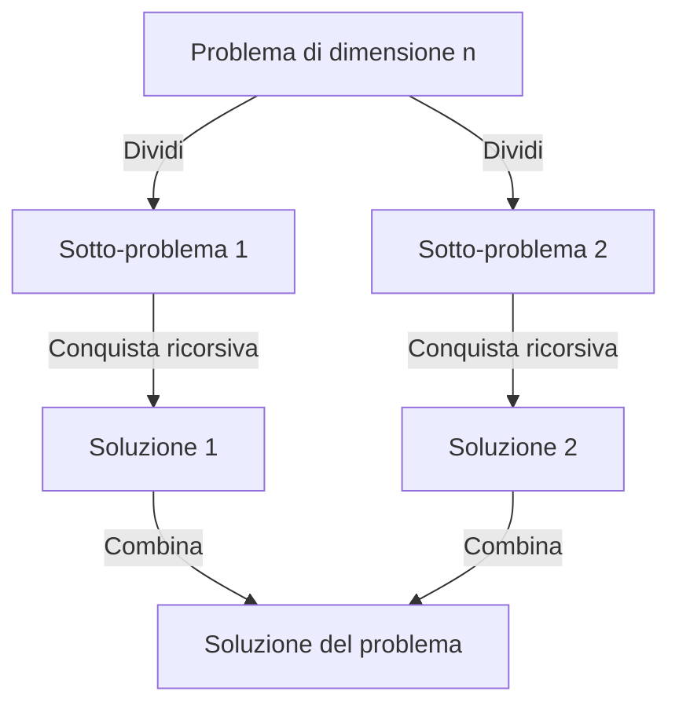

# Ordinamento e selezione

> [!abstract]
> Finora abbiamo visto insertion-sort ([[03 - ASD - Strutture dati fondamentali|cap. 3]]), selection-sort e heap-sort ([[09 - ASD - Code prioritarie|cap. 9]]). Questo capitolo completa il quadro:
> - **merge-sort** e **quick-sort**, basati sullo schema **dividi-e-conquista** e sulla [[05 - ASD - Ricorsione|ricorsione]];
> - il **limite inferiore** $\Omega(n \log n)$ per qualsiasi ordinamento basato su confronti;
> - **bucket-sort** e **radix-sort**, che lo "battono" sfruttando la forma delle chiavi;
> - un **confronto** pratico tra tutti gli algoritmi;
> - il problema della **selezione** ($k$-esimo elemento più piccolo) in tempo atteso $O(n)$ con **quick-select**.
>
> Le tecniche di analisi sono quelle del [[04 - ASD - Analisi di algoritmi|cap. 4]] (notazione asintotica) e del [[05 - ASD - Ricorsione|cap. 5]] (analisi della ricorsione), più le equazioni di ricorrenza introdotte qui.
>
> Indice dei concetti: [[MOC - Algoritmi e Strutture Dati]]

| Algoritmo | Tempo | Sul posto | Stabile | Idea |
|---|---|---|---|---|
| insertion-sort | $O(n + m)$, $m$ inversioni; $O(n^2)$ peggiore | sì | sì | inserisce ogni elemento al suo posto |
| heap-sort | $O(n\log n)$ | sì | no | coda prioritaria a heap |
| merge-sort | $O(n\log n)$ | no | sì | divide a metà, ordina, fonde |
| quick-sort | $O(n\log n)$ atteso, $O(n^2)$ peggiore | sì | no | partiziona col pivot, ordina le parti |
| bucket/radix-sort | $O(d(n + N))$ | no | sì | usa le chiavi come indici |

---

## Ordinamento per fusione (merge-sort)

Gli algoritmi di ordinamento visti finora erano insertion-sort, selection-sort, bubble-sort (Esercizio C-7.51) e heap-sort. Il capitolo aggiunge merge-sort, quick-sort, bucket-sort e radix-sort, e poi li confronta tutti.

> [!warning] Correzione
> Il paragrafo si apre con "Abbiamo già presentato diversi algoritmi di **ricerca**", ma l'elenco che segue (insertion-sort, selection-sort, bubble-sort, heap-sort) è di algoritmi di **ordinamento**.

_(libro, p. 528)_

### Dividi-e-conquista (divide-and-conquer)

Vedi [[Dividi-e-conquista]].

Merge-sort e quick-sort usano la ricorsione secondo lo schema **dividi-e-conquista** (*divide-and-conquer*), in tre fasi:

1. **Dividi**: se l'input è sotto una soglia (uno o due elementi), risolvi direttamente; altrimenti dividi i dati in due o più sottoinsiemi disgiunti.
2. **Conquista**: risolvi ricorsivamente i sotto-problemi.
3. **Combina**: fondi le soluzioni dei sotto-problemi nella soluzione del problema originale.



#### Ordinamento mediante la strategia dividi-e-conquista

Vedi [[Merge-sort]].

Per ordinare una sequenza $S$ di $n$ elementi (array o lista, non importa per ora):

1. **Dividi**: se $S$ ha 0 o 1 elementi è già ordinata. Altrimenti si spostano gli elementi in due sequenze $S_1$ (i primi $\lfloor n/2 \rfloor$) e $S_2$ (i restanti $\lceil n/2 \rceil$).
2. **Conquista**: ordina ricorsivamente $S_1$ e $S_2$.
3. **Combina**: rimetti gli elementi in $S$ **fondendo** (*merge*) le due sequenze ordinate.

($\lfloor x \rfloor$ è la funzione *floor*, il più grande intero $\le x$; $\lceil x \rceil$ è la *ceiling*, il più piccolo intero $\ge x$.)

L'esecuzione si visualizza con l'**albero merge-sort** $T$: ogni nodo è un'invocazione ricorsiva con la sua sequenza, i figli sono le invocazioni su $S_1$ e $S_2$, le foglie sono le invocazioni su un solo elemento.

![[ASD-p530-1.png]]

(a) Le sequenze ricevute da ogni nodo prima dell'elaborazione: la radice riceve (85 24 63 45 17 31 96 50), che viene spezzata fino ai singoli elementi. (b) Le sequenze dopo l'elaborazione: risalendo, ogni nodo restituisce la fusione ordinata dei figli, fino a (17 24 31 45 50 63 85 96).

**Proposizione 12.1.** L'albero merge-sort di una sequenza di dimensione $n$ ha altezza $\lceil \log n \rceil$ (ogni livello dimezza la dimensione).

Le figure seguenti mostrano l'evoluzione passo per passo. Nodi tratteggiati = invocazioni non ancora iniziate; nodo in grassetto = invocazione in corso; nodi vuoti sottili = invocazioni terminate; nodi sottili non vuoti = invocazioni in attesa che un figlio finisca.

![[ASD-p531-1.png]]

(a)–(f): la radice divide (85 24 63 45 | 17 31 96 50), poi si scende sempre a sinistra: (85 24 63 45) → (85 24) → (85), che è un caso base e termina; poi (24); in (f) i due figli di (85 24) hanno finito e il nodo li fonde in (24 85).

![[ASD-p532-1.png]]

(g)–(l): stesso procedimento su (63 45), che diventa (45 63); in (l) i due risultati (24 85) e (45 63) vengono fusi in (24 45 63 85).

![[ASD-p533-1.png]]

(m)–(p): dopo alcune invocazioni omesse anche la metà destra è ordinata (17 31 50 96); in (p) la fusione finale produce (17 24 31 45 50 63 85 96).

_(libro, pp. 528–533)_

### Implementazione di merge-sort basata su array

La fase difficile è la **fusione** di due sequenze ordinate. L'indice $i$ conta gli elementi di $S_1$ già copiati in $S$, $j$ quelli di $S_2$; il prossimo elemento va in $S[i+j]$. Finché entrambe hanno elementi si copia il più piccolo dei due; quando una finisce si copia il resto dell'altra.

![[ASD-p534-1.png]]

Un passo della fusione quando $S_2[j] < S_1[i]$. (a) Prima: $S_1 = (2, 5, 8, 11, 12, 14, 15)$ con $i = 3$ (2, 5, 8 già copiati), $S_2 = (3, 9, 10, 18, 19, 22, 25)$ con $j = 2$ (3, 9 già copiati), e $S$ contiene già $(2, 3, 5, 8, 9)$ nelle posizioni 0–4. Si confrontano $S_1[3] = 11$ e $S_2[2] = 10$: vince 10, che va in $S[i+j] = S[5]$. (b) Dopo la copia $j = 3$ e la prossima posizione libera è $S[6]$.

**Codice 12.1** — fusione di due array:

```java
/** Fonde il contenuto degli array S1 e S2 nell'array S di dimensione opportuna. */
public static <K> void merge(K[] S1, K[] S2, K[] S, Comparator<K> comp) {
  int i = 0, j = 0;
  while (i + j < S.length) {
    if (j == S2.length || (i < S1.length && comp.compare(S1[i], S2[j]) < 0))
      S[i+j] = S1[i++];      // copia l'i-esimo elemento di S1 e incrementa i
    else
      S[i+j] = S2[j++];      // copia il j-esimo elemento di S2 e incrementa j
  }
}
```

La condizione dell'`if` sceglie $S_1$ se $S_2$ è finito, oppure se $S_1$ non è finito e il suo elemento è più piccolo.

**Codice 12.2** — merge-sort ricorsivo:

```java
/** Ordinamento per fusione del contenuto dell'array S. */
public static <K> void mergeSort(K[] S, Comparator<K> comp) {
  int n = S.length;
  if (n < 2) return;                              // già ordinato
  // dividi
  int mid = n/2;
  K[] S1 = Arrays.copyOfRange(S, 0, mid);         // copia la prima metà
  K[] S2 = Arrays.copyOfRange(S, mid, n);         // copia la seconda metà
  // conquista (mediante ricorsione)
  mergeSort(S1, comp);
  mergeSort(S2, comp);
  // fondi i risultati
  merge(S1, S2, S, comp);                         // fondi le metà ordinate in S
}
```

Come per le code prioritarie e le mappe ordinate, i confronti passano per un [[Comparatore|`Comparator`]], così l'algoritmo funziona su qualunque tipo con un ordine totale.

> [!tip] Stabilità
> Nel `merge`, a parità di chiave (`compare` non è `< 0`) viene preso l'elemento di $S_2$. Quindi questa implementazione **non è stabile** (vedi [[#Ordinamento stabile]]): basterebbe usare `<= 0` per renderla stabile (è l'Esercizio R-12.4).

_(libro, pp. 532–534)_

### Il tempo d'esecuzione di merge-sort

**Fusione.** Ogni iterazione del `while` costa $O(1)$ e copia un elemento che non verrà più considerato: con $n_1$ e $n_2$ elementi le iterazioni sono $n_1 + n_2$, quindi `merge` costa $O(n_1 + n_2)$.

**Ordinamento** (per semplicità $n$ potenza di 2). Come nel [[05 - ASD - Ricorsione|cap. 5]] si somma il tempo speso **in ciascuna invocazione**, escludendo le chiamate ricorsive. Un nodo $v$ a profondità $i$ lavora su $n/2^i$ elementi e spende $O(n/2^i)$ (copia delle metà + fusione). A profondità $i$ ci sono $2^i$ nodi, quindi ogni livello costa $O(2^i \cdot n/2^i) = O(n)$. I livelli sono $\lceil \log n \rceil + 1$.

![[ASD-p535-1.png]]

Ogni nodo è etichettato con la dimensione del suo sotto-problema ($n$, $n/2$, $n/4$, …): ogni livello costa $O(n)$, i livelli sono $O(\log n)$, totale $O(n \log n)$.

**Proposizione 12.2.** Merge-sort ordina $n$ elementi in tempo $O(n \log n)$, se un confronto costa $O(1)$.

_(libro, pp. 534–536)_

### Merge-sort ed equazioni di ricorrenza

Vedi [[Equazione di ricorrenza]].

Una dimostrazione alternativa lavora direttamente sulla ricorsione. Sia $t(n)$ il tempo nel caso peggiore ($n$ potenza di 2):
$$t(n) = \begin{cases} b & \text{se } n \le 1 \\ 2\,t(n/2) + cn & \text{altrimenti} \end{cases}$$

È un'**equazione di ricorrenza**: $t$ compare a sinistra e a destra. Corretta, ma non ci dice l'ordine di grandezza: serve una **forma chiusa**. La si ottiene **sostituendo ripetutamente**:
$$t(n) = 2\big(2t(n/2^2) + c\,n/2\big) + cn = 2^2 t(n/2^2) + 2cn$$
$$t(n) = 2^3 t(n/2^3) + 3cn$$
$$\vdots$$
$$t(n) = 2^i\, t(n/2^i) + icn$$

Ci si ferma al caso base, quando $2^i = n$, cioè $i = \log n$:
$$t(n) = n\,t(1) + cn\log n = nb + cn\log n = O(n \log n)$$

> [!tip] Lo stesso metodo in generale
> "Srotolare" la ricorrenza, intuire lo schema dopo $i$ passi, scegliere $i$ per arrivare al caso base. È esattamente ciò che l'albero di ricorsione mostra graficamente: $i$ è il livello, $icn$ il costo dei primi $i$ livelli.

_(libro, pp. 536–537)_

### Implementazioni alternative di merge-sort

#### Ordinare liste concatenate

Merge-sort si adatta a qualunque contenitore simile a una coda, ad esempio la `LinkedQueue` del [[06 - ASD - Pile, code e code doppie|cap. 6]]: si usano solo `first`, `enqueue`, `dequeue`, tutte $O(1)$, quindi il limite $O(n \log n)$ resta valido.

**Codice 12.3:**

```java
/** Fonde il contenuto delle code ordinate S1 e S2 nella coda vuota S. */
public static <K> void merge(Queue<K> S1, Queue<K> S2, Queue<K> S,
                             Comparator<K> comp) {
  while (!S1.isEmpty() && !S2.isEmpty()) {
    if (comp.compare(S1.first(), S2.first()) < 0)
      S.enqueue(S1.dequeue());     // prendi il prossimo elemento da S1
    else
      S.enqueue(S2.dequeue());     // prendi il prossimo elemento da S2
  }
  while (!S1.isEmpty())
    S.enqueue(S1.dequeue());       // sposta gli elementi rimasti in S1
  while (!S2.isEmpty())
    S.enqueue(S2.dequeue());       // sposta gli elementi rimasti in S2
}

/** Ordinamento per fusione del contenuto della coda S. */
public static <K> void mergeSort(Queue<K> S, Comparator<K> comp) {
  int n = S.size();
  if (n < 2) return;
  // dividi
  Queue<K> S1 = new LinkedQueue<>();   // o qualsiasi altra implementazione di coda
  Queue<K> S2 = new LinkedQueue<>();
  while (S1.size() < n/2)
    S1.enqueue(S.dequeue());           // sposta in S1 i primi n/2 elementi
  while (!S.isEmpty())
    S2.enqueue(S.dequeue());           // sposta in S2 gli elementi rimasti
  // conquista
  mergeSort(S1, comp);
  mergeSort(S2, comp);
  // combina
  merge(S1, S2, S, comp);
}
```

![[ASD-p538-1.png]]

Esecuzione del `merge` con le code $S_1 = (24, 45, 63, 85)$ e $S_2 = (17, 31, 50, 96)$: a ogni passo (a)–(h) si confrontano i due elementi in testa e il più piccolo viene spostato in fondo a $S$; in (i) $S = (17, 24, 31, 45, 50, 63, 85, 96)$ e le code di input sono vuote.

#### Un'implementazione bottom-up (non ricorsiva) di merge-sort

Si può percorrere l'albero merge-sort **dal basso verso l'alto**: prima si fondono le coppie di elementi consecutivi (sequenze ordinate di lunghezza 2), poi queste in sequenze di lunghezza 4, poi 8, e così via. Ancora $O(n \log n)$, ma in pratica un po' più veloce: niente gestione delle chiamate ricorsive e niente array temporanei a ogni livello. Basta **un secondo array**, scambiando i ruoli di input e output a ogni passata.

**Codice 12.4:**

```java
/** Fonde in[start..start+inc-1] e in[start+inc..start+2*inc-1] scrivendo in out. */
public static <K> void merge(K[] in, K[] out, Comparator<K> comp,
                             int start, int inc) {
  int end1 = Math.min(start + inc, in.length);       // fine della porzione 1
  int end2 = Math.min(start + 2 * inc, in.length);   // fine della porzione 2
  int x = start;                                     // indice nella porzione 1
  int y = start + inc;                               // indice nella porzione 2
  int z = start;                                     // indice nell'array out
  while (x < end1 && y < end2)
    if (comp.compare(in[x], in[y]) < 0)
      out[z++] = in[x++];                            // prendi dalla porzione 1
    else
      out[z++] = in[y++];                            // prendi dalla porzione 2
  if (x < end1) System.arraycopy(in, x, out, z, end1 - x);      // copia il resto di 1
  else if (y < end2) System.arraycopy(in, y, out, z, end2 - y); // copia il resto di 2
}
/** Ordinamento per fusione del contenuto dell'array dato. */
public static <K> void mergeSortBottomUp(K[] orig, Comparator<K> comp) {
  int n = orig.length;
  K[] src = orig;                          // altro nome dell'array originario
  K[] dest = (K[]) new Object[n];          // nuovo array temporaneo
  K[] temp;                                // solo per gli scambi
  for (int i = 1; i < n; i *= 2) {         // ogni iterazione ordina sotto-array lunghi 2i
    for (int j = 0; j < n; j += 2*i)       // ogni passo fonde due sotto-array lunghi i
      merge(src, dest, comp, j, i);
    temp = src; src = dest; dest = temp;   // scambia i ruoli degli array
  }
  if (orig != src)
    System.arraycopy(src, 0, orig, 0, n);  // se serve, copia il risultato in orig
}
```

> [!warning] Correzione
> Nel Codice 12.4 del libro la riga 15 è `else if (x < end2) System.arraycopy(in, y, out, z, end2-x);`. Quando la prima porzione è esaurita ($x = end1$) bisogna copiare il resto della **seconda** porzione, cioè gli elementi da $y$ a $end2$: la condizione corretta è `y < end2` e la lunghezza è `end2 - y`. Con `end2 - x` si copierebbero `end2 - end1` elementi a partire da `y`, cioè la porzione 2 intera anche se una parte è già stata copiata, uscendo dai limiti. Inoltre la riga 29 chiama `System.arracopy`, refuso per `System.arraycopy`.

Lo stesso approccio bottom-up funziona per le liste concatenate (Esercizio C-12.30).

> [!example] Collegamento: ordinamento esterno
> Quando i dati non stanno in memoria si usa la stessa idea bottom-up con *run* ordinati su disco: vedi [[External Merge Sort]] (Data Management). È il motivo per cui merge-sort è preferito nelle gerarchie di memoria (vedi [[#Confronto tra algoritmi di ordinamento]]).

_(libro, pp. 537–539)_

---

## Ordinamento quick-sort

Vedi [[Quick-sort]].

Anche **quick-sort** è dividi-e-conquista, ma "al contrario" rispetto a merge-sort: il lavoro difficile si fa **prima** delle chiamate ricorsive (la divisione), mentre la combinazione è una semplice concatenazione.

### Descrizione ad alto livello di quick-sort

1. **Dividi**: se $S$ ha meno di 2 elementi, è ordinata. Altrimenti si sceglie un elemento $x$, il **pivot** (spesso l'ultimo), e si spostano gli elementi di $S$ in tre sequenze:
   - $L$ (*less*): elementi **minori** di $x$;
   - $E$ (*equal*): elementi **uguali** a $x$ (se gli elementi sono distinti, solo il pivot);
   - $G$ (*greater*): elementi **maggiori** di $x$.
2. **Conquista**: ordina ricorsivamente $L$ e $G$.
3. **Combina**: rimetti in $S$ prima $L$, poi $E$, poi $G$.

![[ASD-p540-1.png]]

Schema: la divisione usa il pivot $x$ per separare $L(< x)$, $E(= x)$ e $G(> x)$; $L$ e $G$ vengono ordinati ricorsivamente; i tre risultati si concatenano.

Anche qui si usa un **albero quick-sort** di ricorsione.

![[ASD-p541-1.png]]

(a) Sequenze ricevute da ogni nodo, con il pivot in grassetto: la radice (85 24 63 45 17 31 96 **50**) si divide in $L$ = (24 45 17 31) e $G$ = (85 63 96); a sinistra il pivot è 31, poi 17; a destra 96, poi 63. (b) Sequenze restituite: ordinate.

> [!warning] Caso peggiore
> A differenza di merge-sort, l'altezza dell'albero quick-sort può essere **lineare**. Se la sequenza è già ordinata e il pivot è sempre l'ultimo elemento, ogni divisione produce $L$ di dimensione $n-1$, $E$ di dimensione 1 e $G$ vuoto: l'albero ha altezza $n - 1$.

![[ASD-p542-1.png]]

(a)–(f): la radice sceglie il pivot 50 e divide (b); poi sul figlio sinistro (24 45 17 31) con pivot 31 (c)–(d); poi su (24 17) con pivot 17 (e)–(f). Le fasi di divisione si vedono in (b), (d), (f).

![[ASD-p543-1.png]]

(g)–(l): le invocazioni sui casi base terminano; in (k) il nodo (24 17) concatena $L$ = (), $E$ = (17), $G$ = (24) e restituisce (17 24); in (l) il risultato risale.

![[ASD-p544-1.png]]

(m)–(r): il nodo con pivot 31 concatena (17 24), (31), (45) in (17 24 31 45) (punto (o)); dopo alcune invocazioni omesse anche la metà destra è (63 85 96); in (r) la radice concatena tutto.

> [!warning] Correzione
> Le didascalie delle figure di esecuzione hanno rimandi sbagliati: la Figura 12.3 "continua dalla Figura 12.3" (va letto 12.2) e la Figura 12.4 "continua dalle Figure 12.3 e 12.4" (va letto 12.2 e 12.3).

_(libro, pp. 540–544)_

### Eseguire quick-sort per sequenze generiche

L'implementazione seguente funziona su code (`LinkedQueue`) e sceglie come pivot il **primo** elemento, il più comodo da leggere in una coda. Tutte le operazioni sulle code costano $O(1)$.

**Codice 12.5:**

```java
/** Quick-sort che ordina il contenuto della coda S. */
public static <K> void quickSort(Queue<K> S, Comparator<K> comp) {
  int n = S.size();
  if (n < 2) return;                       // già ordinata
  // dividi
  K pivot = S.first();                     // usa arbitrariamente il primo elemento come pivot
  Queue<K> L = new LinkedQueue<>();
  Queue<K> E = new LinkedQueue<>();
  Queue<K> G = new LinkedQueue<>();
  while (!S.isEmpty()) {                   // divide la coda originaria in L, E e G
    K element = S.dequeue();
    int c = comp.compare(element, pivot);
    if (c < 0)                             // minore del pivot
      L.enqueue(element);
    else if (c == 0)                       // uguale al pivot
      E.enqueue(element);
    else                                   // maggiore del pivot
      G.enqueue(element);
  }
  // conquista
  quickSort(L, comp);
  quickSort(G, comp);
  // concatena i risultati
  while (!L.isEmpty()) S.enqueue(L.dequeue());
  while (!E.isEmpty()) S.enqueue(E.dequeue());
  while (!G.isEmpty()) S.enqueue(G.dequeue());
}
```

#### Tempo d'esecuzione di quick-sort

Divisione e concatenazione sono lineari, quindi il tempo in un nodo $v$ è proporzionale a $s(v)$, la dimensione della sua sequenza. Poiché $E$ contiene almeno il pivot, la somma delle dimensioni dei figli è al più $s(v) - 1$.

Sia $s_i$ la somma delle dimensioni dei nodi a profondità $i$: $s_0 = n$, $s_1 \le n - 1$ e in generale $s_i < s_{i-1}$ (ogni sequenza al livello $i-1$ "perde" almeno il pivot). Quindi ogni livello costa $O(n)$ e il tempo totale è $O(n \cdot h)$.

- **Caso peggiore**: $h = n - 1$ → $O(n^2)$. Paradossalmente, con il pivot sempre all'ultimo posto, succede proprio quando la sequenza è **già ordinata**, il caso che dovrebbe essere più facile.
- **Caso migliore**: $L$ e $G$ hanno circa la stessa dimensione → $h = O(\log n)$ → $O(n \log n)$ (Esercizio R-12.12).
- Basta anche una divisione **non perfetta**: se ogni divisione desse $1/4$ e $3/4$, l'altezza resterebbe $O(\log n)$ e il tempo $O(n \log n)$.

_(libro, pp. 543–546)_

### Quick-sort con scelta casuale del pivot

Ipotizzare che i dati siano "ben distribuiti" non è realistico: sequenze quasi ordinate sono frequentissime. Invece di fare ipotesi sui dati si introduce **casualità nell'algoritmo**: il pivot si sceglie **a caso** tra gli elementi di $S$, senza cambiare nient'altro. È il **quick-sort probabilistico** (*randomized quick-sort*). Il tempo **atteso** è una media sulle scelte casuali dell'algoritmo, **non** sulla distribuzione dei dati: vale per *ogni* input.

**Proposizione 12.3.** Il tempo atteso del quick-sort probabilistico su $n$ elementi è $O(n \log n)$.

*Dimostrazione.* Il tempo è proporzionale al numero di confronti, e ogni confronto è tra il pivot e un altro elemento. Quindi il numero di confronti è $\sum_{x \in S} C(x)$, dove $C(x)$ è il numero di confronti in cui $x$ compare **come non-pivot**. Per la linearità del valore atteso basta mostrare che $E[C(x)] = O(\log n)$ per ogni $x$.

Si segue il cammino di nodi dell'albero in cui $x$ è presente: $C(x)$ è la lunghezza di questo cammino ($x$ viene confrontato una volta per livello finché non diventa pivot o resta solo). Sia $n_d$ la dimensione della sequenza al nodo di profondità $d$ del cammino: $n_0 = n$ e $n_{d+1} \le n_d - 1$, quindi nel caso peggiore $C(x) \le n - 1$.

Un pivot a profondità $d$ è **"buono"** se $n_{d+1} \le 3n_d/4$. Un pivot è buono con probabilità almeno $1/2$: ci sono almeno $n_d/2$ elementi "centrali" che, se scelti, mandano almeno $n_d/4$ elementi da ciascuna parte, lasciando $x$ in un gruppo di al più $3n_d/4$ elementi. Prima che $x$ resti da solo ci possono essere al più $\log_{4/3} n$ scelte buone (ognuna riduce la dimensione di un fattore $3/4$). Poiché una scelta è buona con probabilità $\ge 1/2$, il numero atteso di livelli per ottenere $\log_{4/3} n$ scelte buone è al più $2\log_{4/3} n$. Quindi $E[C(x)] = O(\log n)$. $\blacksquare$

Con un'analisi più fine si dimostra che il tempo è $O(n\log n)$ **con alta probabilità** (Esercizio C-12.55).

![[ASD-p548-1.png]]

Esempio con $x = 31$ (cerchiato): nella radice il pivot è 50, poi 45, poi 17, poi 31 diventa pivot. $x$ è confrontato con 50, 45 e 17, quindi $C(x) = 3$. Le dimensioni lungo il cammino sono $n_0 = 10$, $n_1 = 6$, $n_2 = 5$, $n_3 = 2$; i pivot 50 ($6 \le 7.5$) e 17 ($2 \le 3.75$) sono scelte buone, 45 no ($5 > 4.5$).

_(libro, pp. 546–548)_

### Ulteriori ottimizzazioni per quick-sort

#### Quick-sort sul posto

Un algoritmo è **sul posto** (*in-place*) se usa solo una quantità piccola di memoria oltre a input e output. Heap-sort lo è ([[Heap sort]]); il Codice 12.5 no, perché crea $L$, $E$, $G$ a ogni chiamata. Su un array, quick-sort si può fare sul posto ed è la versione usata quasi ovunque.

L'idea: una sotto-sequenza è rappresentata implicitamente da un intervallo di indici $[a, b]$. La divisione scandisce l'intervallo con due indici, `left` da sinistra verso destra e `right` da destra verso sinistra, **scambiando** le coppie fuori posto. Non c'è una fase di concatenazione: le due parti sono già adiacenti nell'array.

**Codice 12.6** (si chiama con `quickSortInPlace(S, comp, 0, S.length-1)`):

```java
/** Ordina la porzione di array S[a..b], estremi inclusi. */
public static <K> void quickSortInPlace(K[] S, Comparator<K> comp,
                                        int a, int b) {
  if (a >= b) return;                    // porzione banale, già ordinata
  int left = a;
  int right = b-1;
  K pivot = S[b];
  K temp;                                // variabile temporanea per gli scambi
  while (left <= right) {
    // avanza finché raggiunge right o un valore non minore del pivot
    while (left <= right && comp.compare(S[left], pivot) < 0) left++;
    // arretra finché raggiunge left o un valore non maggiore del pivot
    while (left <= right && comp.compare(S[right], pivot) > 0) right--;
    if (left <= right) {                 // gli indici non si sono incrociati
      // scambia i valori e restringi l'intervallo
      temp = S[left]; S[left] = S[right]; S[right] = temp;
      left++; right--;
    }
  }
  // metti il pivot nella sua posizione definitiva (indicata da left)
  temp = S[left]; S[left] = S[b]; S[b] = temp;
  // invocazioni ricorsive
  quickSortInPlace(S, comp, a, left - 1);
  quickSortInPlace(S, comp, left + 1, b);
}
```

![[ASD-p550-1.png]]

Divisione sul posto di (85 24 63 45 17 31 96 **50**), con $l$ = `left` e $r$ = `right`: (a) $l$ su 85 (non minore di 50), $r$ su 31 (non maggiore); (b) scambio di 85 e 31; (c) gli indici avanzano; (d) $l$ su 63, $r$ su 17: scambio; (e) gli indici si incontrano su 45/63; (f) $r$ e $l$ si sono incrociati, $l$ indica 63; (g) scambio finale di 63 con il pivot 50, che va nella posizione definitiva: a sinistra solo valori minori, a destra solo maggiori.

> [!note] Duplicati
> Questa versione non costruisce esplicitamente $L$, $E$, $G$: gli elementi uguali al pivot finiscono "dove capita" nelle due parti (Esercizio R-12.11; l'Esercizio C-12.34 mostra una versione sul posto a tre vie).

> [!tip] Spazio della pila di ricorsione
> Anche la versione sul posto usa la [[Stack Frame|pila delle chiamate]], profonda quanto l'albero di ricorsione: fino a $n - 1$ nel caso peggiore, $O(\log n)$ atteso. Per garantire $O(\log n)$ si usa una pila **esplicita** di sotto-problemi (coppie di indici) e si impila **prima il sotto-problema più grande**: così ogni elemento della pila è almeno il doppio di quello sopra, e la pila ha profondità $O(\log n)$ (Esercizio P-12.59).

#### Selezione del pivot

Prendere sempre l'ultimo elemento espone al caso $O(n^2)$ su input ordinati, ordinati al contrario o quasi ordinati. Rimedi:
- **pivot casuale** (Paragrafo 12.2.1);
- **mediana di tre valori** (*median-of-three*): il pivot è la mediana tra primo, centrale e ultimo elemento. Sceglie più spesso un pivot buono ed è più veloce che generare un numero casuale. Per grandi insiemi si può usare la mediana di più di tre valori.

#### Approcci ibridi

Su sequenze **piccole** quick-sort paga i suoi costi fissi (la gestione della ricorsione per 8 elementi è già pesante, come mostrano le figure). Insertion-sort è più veloce su input piccoli. Le implementazioni ottimizzate usano quindi un approccio **ibrido**: dividi-e-conquista finché la sotto-sequenza supera una soglia (ad esempio 50 elementi), poi [[Ordinamento per inserimento|insertion-sort]].

_(libro, pp. 548–551)_

---

## Approfondimento algoritmico per lo studio dell'ordinamento

Merge-sort, quick-sort (atteso) e heap-sort ordinano in $O(n \log n)$. Si può fare meglio?

### Limite inferiore asintotico per l'ordinamento

Vedi [[Limite inferiore per l'ordinamento basato su confronti]].

Se l'operazione di base è il **confronto tra due elementi**, no: ogni ordinamento basato su confronti ha un limite inferiore $\Omega(n \log n)$ nel caso peggiore (notazione $\Omega$, [[04 - ASD - Analisi di algoritmi|cap. 4]]). Si contano solo i confronti, e si assumono elementi distinti (non è restrittivo per un limite inferiore).

**Albero di decisione.** Ogni confronto "$x_i < x_j$?" ha due risposte. Un algoritmo basato su confronti si può rappresentare come un **albero di decisione** binario $T$ ([[08 - ASD - Alberi|cap. 8]]): ogni nodo interno è un confronto, ogni ramo è la prosecuzione dopo la risposta "sì" o "no". L'algoritmo non "conosce" $T$: l'albero rappresenta tutte le sequenze di confronti possibili.

Ogni permutazione dell'input porta l'algoritmo lungo un cammino fino a una foglia. **Ogni foglia corrisponde al più a una permutazione**: se due permutazioni diverse $P_1$ e $P_2$ arrivassero alla stessa foglia, esisterebbero $x_i$, $x_j$ in ordine diverso nelle due; ma alla stessa foglia l'algoritmo esegue le stesse operazioni e produce lo stesso riordinamento, quindi sbaglierebbe su una delle due. Un algoritmo corretto non può farlo.

**Proposizione 12.4.** Ogni algoritmo di ordinamento basato su confronti richiede tempo $\Omega(n \log n)$ nel caso peggiore.

*Dimostrazione.* Il tempo è almeno l'altezza di $T$. Le foglie devono essere almeno $n!$ (una per permutazione), quindi per la Proposizione 8.7 l'altezza è almeno $\log(n!)$. Nel prodotto $n! = n(n-1)\cdots 2 \cdot 1$ almeno $n/2$ fattori sono $\ge n/2$, quindi
$$\log(n!) \ge \log\Big(\big(\tfrac{n}{2}\big)^{n/2}\Big) = \frac{n}{2}\log\frac{n}{2} = \Omega(n \log n). \qquad \blacksquare$$

![[ASD-p553-1.png]]

L'albero di decisione ha $n!$ foglie (la base del triangolo); la sua altezza minima, cioè il numero di confronti nel caso peggiore, è almeno $\log(n!)$.

> [!important] Conseguenza
> Merge-sort e heap-sort sono **asintoticamente ottimi** tra gli ordinamenti per confronti. Per andare sotto $n \log n$ bisogna usare qualcosa di più dei confronti: ad esempio usare le chiavi come **indici**.

_(libro, pp. 551–553)_

### Ordinamento in tempo lineare: bucket-sort e radix-sort

Con ipotesi sulle chiavi (interi in un intervallo noto, stringhe, tuple) si può ordinare in tempo lineare. Si ordinano voci chiave-valore.

#### Bucket-sort

Vedi [[Bucket-sort]].

Siano le chiavi interi in $[0, N-1]$, $N \ge 2$. Si usa un array $B$ di $N$ **bucket** (secchi), ognuno una sequenza: la voce con chiave $k$ va in $B[k]$. Poi si svuotano i bucket in ordine $B[0], B[1], \dots, B[N-1]$. Nessun confronto: la chiave è usata come **indice**.

```text
Algoritmo bucketSort(S):
    Input:  una sequenza S di voci con chiavi intere nell'intervallo [0, N-1]
    Output: S con le voci ordinate per chiave non decrescente
    sia B un array di N sequenze (bucket), ciascuna inizialmente vuota
    for ogni voce e in S do
        sia k la chiave di e
        elimina e da S e inseriscila alla fine del bucket B[k]
    for i da 0 a N-1 do
        for ogni voce e nel bucket B[i] do
            elimina e da B[i] e inseriscila alla fine di S
```

> [!warning] Correzione
> Nel Codice 12.7 del libro l'array dei bucket ha "$n$ sequenze" e il secondo ciclo va "da 0 a $n - 1$", e il secondo ciclo è stampato rientrato dentro il primo. I bucket devono essere **$N$**, uno per ogni valore di chiave in $[0, N-1]$ (lo dice il testo stesso: "un array di bucket $B$ le cui celle abbiano indici che vanno da 0 a $N - 1$"), e il secondo ciclo, che va da 0 a $N - 1$, viene **dopo** il primo, non dentro.

**Costo**: $O(n + N)$ tempo e spazio. Efficiente se $N$ è piccolo rispetto a $n$ (ad esempio $N = O(n)$ o $O(n \log n)$); peggiora se $N \gg n$. Funziona anche con molte voci con la stessa chiave.

#### Ordinamento stabile

Vedi [[Ordinamento stabile]].

Un ordinamento è **stabile** se, per ogni coppia di voci con **chiavi uguali** $k_i = k_j$ e $(k_i, v_i)$ prima di $(k_j, v_j)$ nell'input ($i < j$), anche nell'output $(k_i, v_i)$ precede $(k_j, v_j)$. Serve quando si vuole preservare l'ordine iniziale tra voci con la stessa chiave (ad esempio ordinare per cognome una lista già ordinata per nome).

Bucket-sort è stabile se tutte le sequenze si comportano come **code**: si legge $S$ dall'inizio, si aggiunge in fondo ai bucket, e si svuotano i bucket dall'inizio aggiungendo in fondo a $S$.

#### Radix-sort

Vedi [[Radix-sort]].

La stabilità permette di estendere bucket-sort a chiavi **composte**. Si vogliono ordinare coppie $(k, l)$ con $k, l \in [0, N-1]$ in ordine **lessicografico** (come nel dizionario): $(k_1, l_1) < (k_2, l_2)$ se $k_1 < k_2$, oppure $k_1 = k_2$ e $l_1 < l_2$.

**Radix-sort** applica bucket-sort stabile **due volte**, una per componente. Ma in che ordine?

> [!example] Esempio 12.5
> $S = ((3,3), (1,5), (2,5), (1,2), (2,3), (1,7), (3,2), (2,2))$
>
> **Prima componente, poi seconda** (sbagliato):
> - per la prima: $S_1 = ((1,5), (1,2), (1,7), (2,5), (2,3), (2,2), (3,3), (3,2))$
> - poi per la seconda: $S_{1,2} = ((1,2), (2,2), (3,2), (2,3), (3,3), (1,5), (2,5), (1,7))$ → **non ordinata**.
>
> **Seconda componente, poi prima** (corretto):
> - per la seconda: $S_2 = ((1,2), (3,2), (2,2), (3,3), (2,3), (1,5), (2,5), (1,7))$
> - poi per la prima: $S_{2,1} = ((1,2), (1,5), (1,7), (2,2), (2,3), (2,5), (3,2), (3,3))$ → **ordinata**.

Si ordina **prima per la componente meno significativa**: l'ultimo ordinamento (per la prima componente) decide l'ordine principale, e quando due voci hanno la stessa prima componente la **stabilità** conserva l'ordine stabilito dal passo precedente (per la seconda).

**Proposizione 12.6.** Con radix-sort si ordinano lessicograficamente $n$ voci con chiavi $(k_1, \dots, k_d)$, $k_i \in [0, N-1]$, in tempo $O(d(n + N))$.

Si applica a tutto ciò che si può vedere come una tupla di componenti piccole, ad esempio **stringhe** di lunghezza limitata (ogni carattere è un intero), con attenzione alle stringhe di lunghezza diversa.

_(libro, pp. 553–556)_

---

## Confronto tra algoritmi di ordinamento

### Tempo d'esecuzione e altri fattori

- Insertion-sort e selection-sort: $O(n^2)$ nel caso medio e peggiore. **Selection-sort** è sempre una pessima scelta, perché è quadratico **anche nel caso migliore**.
- Heap-sort, merge-sort, quick-sort: $O(n \log n)$.
- Bucket-sort e radix-sort: lineari per chiavi particolari.

Non esiste un vincitore assoluto: si bilanciano efficienza, memoria e stabilità, e l'algoritmo "standard" dei linguaggi è cambiato più volte nel tempo.

#### Insertion-sort

Tempo $O(n + m)$, con $m$ il numero di **inversioni** (coppie fuori ordine). Eccellente per sequenze **piccole** (fino a circa 50 elementi: è semplice e ci sono poche inversioni) e per sequenze **quasi ordinate**. Pessimo altrove.

#### Heap-sort

$O(n \log n)$ anche nel caso peggiore, sul posto: scelta naturale per sequenze piccole e medie in memoria centrale. Su sequenze grandi tende a perdere contro quick-sort e merge-sort. **Non stabile** (per gli scambi).

#### Quick-sort

Caso peggiore $O(n^2)$, quindi poco adatto ad applicazioni **in tempo reale** (dove serve una garanzia sul tempo). Ma atteso $O(n \log n)$ e negli esperimenti spesso batte heap-sort e merge-sort. **Non stabile.** Per decenni è stato lo standard: `qsort` della libreria C, i sistemi Unix, e in Java l'ordinamento degli array di **tipi primitivi**.

#### Merge-sort

$O(n \log n)$ nel caso peggiore, ma difficile da fare sul posto: l'array temporaneo e le copie lo rendono meno conveniente in memoria centrale. È però eccellente quando i dati stanno su **più livelli della gerarchia di memoria** (cache, RAM, disco): elabora lunghi flussi sequenziali, sfruttando al meglio i trasferimenti a blocchi (vedi [[Località dei Riferimenti]]). Il sort di GNU e quelli di Linux usano un merge-sort **a più vie**.

**Tim-sort** (di Tim Peters) è un ibrido: un merge-sort bottom-up che sfrutta le sotto-sequenze già ordinate dell'input, usando insertion-sort per costruirne altre. È lo standard di Python dal 2003 e di Java SE 7 per gli array di **oggetti** (dove la stabilità conta).

#### Bucket-sort e radix-sort

Ideali per chiavi intere piccole, stringhe o $d$-tuple su un insieme discreto: tempo $O(d(n + N))$ ($d = 1$ per bucket-sort). Se $d(n + N)$ è significativamente inferiore a $n \log n$, sono più veloci degli altri.

_(libro, pp. 556–558)_

---

## Selezione

Vedi [[Quick-select probabilistico]].

Molte applicazioni non vogliono ordinare tutto ma trovare **un** elemento in base alla sua posizione nell'ordinamento: minimo, massimo, **mediano** (metà degli elementi sono minori e metà maggiori). Sono le **statistiche d'ordine**.

### Definizione del problema della selezione

**Selezione**: trovare il **$k$-esimo elemento più piccolo** in una collezione non ordinata di $n$ elementi confrontabili.

- Soluzione ovvia: ordinare e prendere l'indice $k - 1$ → $O(n \log n)$.
- È eccessivo per $k = 1$, $k = n$, o $k$ vicino agli estremi, che si risolvono in $O(n)$.
- Domanda: si può fare in $O(n)$ per **ogni** $k$, compreso il mediano $k = \lfloor n/2 \rfloor$? Sì.

### Prune-and-search (riduzione e ricerca)

Lo schema **prune-and-search** (o *decrease-and-conquer*): si risolve un problema su $n$ oggetti **scartandone una parte** e risolvendo ricorsivamente il problema più piccolo; quando la dimensione è costante si usa la forza bruta (*brute-force*). A volte la ricorsione si sostituisce con un semplice ciclo. La [[Ricerca binaria|ricerca binaria]] del [[05 - ASD - Ricorsione|cap. 5]] ne è un esempio: a ogni passo scarta metà dell'array.

Differenza con dividi-e-conquista: qui si ricorre su **un solo** sotto-problema, l'altro viene buttato.

### Quick-select probabilistico

**Quick-select probabilistico** (*randomized quick-select*): tempo atteso $O(n)$ su qualunque input (media sulle scelte casuali), caso peggiore $O(n^2)$ (Esercizio R-12.25). Esiste una variante deterministica $O(n)$ nel caso peggiore (Esercizio C-12.56), ma ha costanti nascoste così alte da essere soprattutto di interesse teorico.

L'idea è quella del quick-sort probabilistico: si sceglie un pivot a caso e si divide $S$ in $L$, $E$, $G$. Poi si **pota**: in base a $k$ e alle dimensioni dei tre gruppi si capisce in quale si trova l'elemento cercato, e si ricorre **solo** su quello, aggiustando il rango.

```text
Algoritmo quickSelect(S, k):
    Input:  una sequenza S di n elementi confrontabili e un intero k in [1, n]
    Output: il k-esimo elemento più piccolo di S
    if n == 1 then
        return il primo e unico elemento di S
    scegli a caso un elemento x di S (il pivot) e dividi S in:
        • L, elementi di S minori di x
        • E, elementi di S uguali a x
        • G, elementi di S maggiori di x
    if k <= |L| then
        return quickSelect(L, k)
    else if k <= |L| + |E| then
        return x                              { ogni elemento di E è uguale a x }
    else
        return quickSelect(G, k - |L| - |E|)  { nuovo parametro di selezione }
```

> [!example] Esempio
> $S = (7, 2, 9, 4, 3, 8, 6, 1)$, $k = 5$ (il quinto più piccolo, che è 6). Pivot casuale 4: $L = (2, 3, 1)$, $E = (4)$, $G = (7, 9, 8, 6)$. Poiché $k = 5 > |L| + |E| = 4$, si cerca in $G$ con $k' = 5 - 3 - 1 = 1$: il minimo di $G$, cioè 6. ✓

_(libro, pp. 558–560)_

### Analisi del quick-select probabilistico

Si usa la **linearità del valore atteso**: per variabili casuali $X$, $Y$ e un numero $c$,
$$E(X + Y) = E(X) + E(Y), \qquad E(cX) = c\,E(X).$$

> [!warning] Correzione
> Il libro scrive $E(cX) = cE(Y)$: è un refuso, la proprietà è $E(cX) = c\,E(X)$.

Sia $t(n)$ il tempo su $n$ elementi: dipende dalle scelte casuali, quindi è una variabile casuale. Un'invocazione è **buona** se $L$ e $G$ hanno entrambi al più $3n/4$ elementi; succede con probabilità almeno $1/2$. Sia $g(n)$ il numero di invocazioni consecutive (compresa la corrente) prima di ottenerne una buona. Allora, per una costante $b \ge 1$:
$$t(n) \le bn \cdot g(n) + t(3n/4)$$
e per la linearità
$$E(t(n)) \le bn \cdot E(g(n)) + E(t(3n/4)).$$

Le invocazioni sono buone indipendentemente l'una dall'altra con probabilità $\ge 1/2$, quindi $E(g(n))$ è al più il numero atteso di lanci di una moneta equa prima di ottenere testa: $E(g(n)) \le 2$. Con $T(n) = E(t(n))$:
$$T(n) \le T(3n/4) + 2bn$$

Srotolando:
$$T(n) \le T\big((3/4)^2 n\big) + 2b(3/4)n + 2bn \le \dots \le 2bn \sum_{i=0}^{\lceil \log_{4/3} n \rceil} (3/4)^i$$

È $2bn$ per una **serie geometrica** di ragione $3/4 < 1$, che è limitata da una costante (somma $\le 4$; Proposizione 4.5). Quindi $T(n) = O(n)$.

**Proposizione 12.7.** Il tempo atteso del quick-select probabilistico su $n$ elementi è $O(n)$, se un confronto costa $O(1)$.

> [!tip] Perché la selezione è lineare e l'ordinamento no
> Quick-sort ricorre su **entrambe** le parti: ogni livello costa $O(n)$ e i livelli sono $O(\log n)$. Quick-select ricorre su **una** parte, che si riduce geometricamente: i costi dei livelli sono $n, \frac34 n, (\frac34)^2 n, \dots$ e la somma è $O(n)$.

_(libro, pp. 560–561)_

> [!summary] Riepilogo del capitolo
> - **Dividi-e-conquista**: dividi, risolvi ricorsivamente, combina. Merge-sort mette il lavoro nella combinazione, quick-sort nella divisione.
> - **Merge-sort**: $O(n\log n)$ sempre, stabile se la fusione preferisce $S_1$ a parità; versioni su array, su code e bottom-up.
> - **Equazioni di ricorrenza**: $t(n) = 2t(n/2) + cn$ si risolve per sostituzione ripetuta → $O(n\log n)$.
> - **Quick-sort**: $O(n^2)$ nel caso peggiore, $O(n\log n)$ atteso con pivot casuale; versione sul posto con due indici; mediana di tre e ibridi con insertion-sort.
> - **Limite inferiore**: qualsiasi ordinamento per confronti richiede $\Omega(n\log n)$ (albero di decisione con $n!$ foglie).
> - **Bucket-sort** $O(n + N)$ e **radix-sort** $O(d(n+N))$ superano il limite usando le chiavi come indici; radix-sort richiede un bucket-sort **stabile** e parte dalla componente meno significativa.
> - **Quick-select**: prune-and-search, $O(n)$ atteso per il $k$-esimo elemento.
