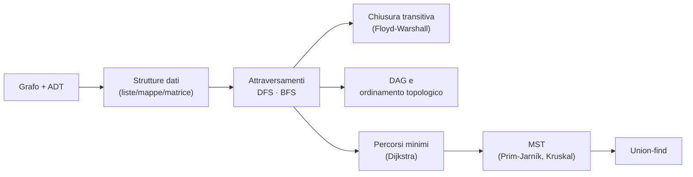

# Algoritmi per grafi

> [!abstract]
> Un **grafo** rappresenta relazioni tra coppie di oggetti: reti di trasporto, reti di calcolatori, mappe stradali, dipendenze tra compiti. Il capitolo:
> - definisce grafi, percorsi, cicli, connettività e l'ADT `Graph`;
> - confronta **quattro strutture dati** (lista di lati, lista di adiacenze, mappa di adiacenze, matrice di adiacenze);
> - presenta gli **attraversamenti** DFS e BFS e i problemi che risolvono (percorsi, connettività, cicli);
> - calcola la **chiusura transitiva** (Floyd-Warshall) e l'**ordinamento topologico** dei DAG;
> - risolve i **percorsi minimi** da una sorgente con **Dijkstra**;
> - costruisce l'**albero ricoprente minimo** con **Prim-Jarník** e **Kruskal**, introducendo la struttura **union-find**.
>
> Usa quasi tutto il libro: [[06 - ASD - Pile, code e code doppie|pile e code]], [[07 - ASD - Liste e iteratori|liste posizionali]], [[08 - ASD - Alberi|alberi]], [[09 - ASD - Code prioritarie|code prioritarie flessibili]], [[10 - ASD - Mappe, tabelle hash e skip list|mappe hash]], e i metodi greedy e di programmazione dinamica del [[13 - ASD - Elaborazione di testi|cap. 13]]. Sostituisce le vecchie note su grafi, BFS, DFS, Dijkstra, Prim, Kruskal (spostate in `Vecchie/`); le foto del libro annotate da Simone sono riportate nelle sezioni corrispondenti.
>
> Indice dei concetti: [[MOC - Algoritmi e Strutture Dati]]



---

## Grafi

Vedi [[Grafo (ADT)]].

Un **grafo** (*graph*) $G = (V, E)$ è un insieme $V$ di **vertici** (*vertex*) e una collezione $E$ di coppie di vertici dette **lati** (*edge*). Altri testi dicono *nodi* e *archi*; il libro usa "vertici" e "lati". (Un grafo non ha niente a che fare con i *grafici* di funzioni.)

Un lato $(u, v)$ è:
- **orientato** (*directed*) da $u$ a $v$ se la coppia è ordinata ($u$ precede $v$);
- **non orientato** (*undirected*) se la coppia non è ordinata: $(u, v)$ equivale a $(v, u)$ (a volte si scrive $\{u, v\}$).

> [!example] Esempi 14.1–14.4
> - **Coautori**: vertici = ricercatori, lato tra chi ha scritto qualcosa insieme. Non orientato: la relazione è simmetrica.
> - **Ereditarietà** in un programma OO: lato da $v$ a $u$ se la classe $v$ estende $u$. Orientato: la relazione è asimmetrica.
> - **Mappa stradale**: vertici = incroci, lati = tratti di strada; strade a doppio senso non orientate, sensi unici orientati → grafo **misto**.
> - **Reti elettriche e idrauliche** di un edificio: connettori e rubinetti come vertici, tratti di filo o tubo come lati.

![[ASD-p609-1.png]]

Il grafo dei coautori dell'Esempio 14.1: ad esempio Goodrich e Tamassia sono adiacenti perché hanno scritto insieme.

Un grafo è **non orientato** se tutti i lati lo sono, **orientato** (*directed graph*, *digraph*) se lo sono tutti, **misto** altrimenti. Un grafo non orientato o misto si può sempre trasformare in orientato sostituendo ogni lato $(u, v)$ con la coppia $(u, v)$, $(v, u)$.

### Terminologia

| Termine | Significato |
|---|---|
| vertici **terminali** (*endpoint*) | i due vertici di un lato; se orientato, **origine** e **destinazione** |
| vertici **adiacenti** | collegati da un lato |
| lato **incidente** in $v$ | $v$ è uno dei suoi terminali |
| lati **uscenti** / **entranti** | lati orientati con origine / destinazione in $v$ |
| **grado** $\deg(v)$ | numero di lati incidenti in $v$ |
| $\text{indeg}(v)$, $\text{outdeg}(v)$ | numero di lati entranti / uscenti |
| lati **paralleli** (multipli) | stessi terminali (stessa origine e destinazione) |
| **auto-anello** (*self-loop*) | lato con i due terminali coincidenti |
| grafo **semplice** | senza lati paralleli né auto-anelli (sempre assunto nel capitolo) |

> [!example] Esempio 14.5: rete di voli
> Vertici = aeroporti, lati orientati = voli. Gli aeroporti sono adiacenti se c'è un volo tra loro; il grado entrante di un aeroporto è il numero di voli in arrivo, quello uscente il numero di voli in partenza. Voli diversi sulla stessa rotta sono lati paralleli.

![[ASD-p610-1.png]]

La rete di voli: i terminali di UA 120 sono LAX e ORD, che quindi sono adiacenti. DFW ha grado entrante 3 (AA 1387, AA 523, UA 877) e grado uscente 2 (AA 49, DL 335).

#### Percorsi e cicli

- **Percorso** (*path*): sequenza alternata di vertici e lati, che inizia e finisce con un vertice, in cui ogni lato è incidente nel vertice prima e in quello dopo.
- **Ciclo** (*cycle*): percorso con almeno un lato che inizia e finisce nello stesso vertice.
- **Semplice**: vertici tutti distinti (nel ciclo, tranne primo e ultimo).
- **Orientato**: tutti i lati sono orientati e percorsi nel loro verso.
- Un grafo orientato è **aciclico** se non ha cicli orientati.

Nella rete di voli: (BOS, NW 35, JFK, AA 1387, DFW) è un percorso semplice orientato; (LAX, UA 120, ORD, UA 877, DFW, AA 49, LAX) un ciclo semplice orientato; (ORD, UA 877, DFW, DL 335, ORD) un ciclo di due lati opposti. Togliendo UA 877 il grafo diventerebbe aciclico. In un grafo semplice basta elencare i vertici: i lati sono determinati.

#### Raggiungibilità e connettività

- $u$ **raggiunge** $v$ ($v$ è **raggiungibile** da $u$) se esiste un percorso (orientato) da $u$ a $v$. Nei grafi non orientati è simmetrico; in quelli orientati no.
- Un grafo è **connesso** se c'è un percorso tra ogni coppia di vertici; un grafo orientato è **fortemente connesso** se per ogni coppia $u$, $v$ si ha che $u$ raggiunge $v$ **e** $v$ raggiunge $u$.

> [!warning] Correzione
> Il libro definisce: "$u$ raggiunge $v$ … se $G$ contiene un **lato** (orientato) che va da $u$ a $v$". La raggiungibilità richiede un **percorso** (orientato) da $u$ a $v$, non un singolo lato: con un lato si definirebbe l'adiacenza. Lo conferma la frase successiva del libro ("un percorso orientato deve essere attraversato seguendo le direzioni dei suoi lati").

- **Sotto-grafo** (*subgraph*): grafo con vertici e lati sottoinsiemi di quelli di $G$; **ricoprente** (*spanning*) se contiene tutti i vertici.
- **Componenti connessi**: i sotto-grafi connessi massimali di un grafo non connesso.
- **Foresta**: grafo senza cicli. **Albero**: foresta connessa (qui, a differenza del [[08 - ASD - Alberi|cap. 8]], **senza radice designata**). **Albero ricoprente** (*spanning tree*): sotto-grafo ricoprente che è un albero.

![[ASD-p612-1.png]]

(a) Un percorso orientato da BOS a LAX. (b) Il ciclo orientato (ORD, MIA, DFW, LAX, ORD): i suoi vertici formano un sotto-grafo fortemente connesso. (c) Il sotto-grafo dei vertici raggiungibili da ORD. (d) Togliendo i lati tratteggiati il grafo diventa aciclico.

> [!example] Esempio 14.7: Internet
> Vertici = computer, lati = collegamenti. I computer di un dominio formano un sotto-grafo; se è connesso, due utenti del dominio comunicano senza uscire dal dominio. Se i suoi lati formano un **albero** ricoprente, basta interrompere un solo collegamento per disconnetterlo.

#### Proprietà

**Proposizione 14.8.** In un grafo con $m$ lati: $\sum_{v \in V} \deg(v) = 2m$ (ogni lato è contato una volta per ciascun terminale).

**Proposizione 14.9.** In un grafo orientato con $m$ lati: $\sum_{v} \text{indeg}(v) = \sum_{v} \text{outdeg}(v) = m$.

**Proposizione 14.10.** Un grafo semplice con $n$ vertici e $m$ lati ha $m \le n(n-1)/2$ se non orientato, $m \le n(n-1)$ se orientato (ogni vertice ha grado al più $n - 1$). Quindi $m = O(n^2)$.

**Proposizione 14.11.** Per un grafo non orientato con $n$ vertici e $m$ lati:
- se è connesso, $m \ge n - 1$;
- se è un albero, $m = n - 1$;
- se è una foresta, $m \le n - 1$.

_(libro, pp. 608–614)_

### Il grafo come tipo di dato astratto

Tre tipi: `Vertex` (memorizza un elemento, letto con `getElement()`, ad esempio il codice di un aeroporto), `Edge` (memorizza un elemento, ad esempio numero di volo, distanza o costo) e `Graph`. Un grafo è orientato o non orientato, deciso alla costruzione; un grafo misto si rappresenta come orientato.

| Metodo | Descrizione |
|---|---|
| `numVertices()`, `numEdges()` | numero di vertici / lati |
| `vertices()`, `edges()` | contenitori iterabili dei vertici / lati |
| `getEdge(u, v)` | il lato da $u$ a $v$, o `null` (nei non orientati è simmetrico) |
| `endVertices(e)` | array dei due terminali (origine, destinazione se orientato) |
| `opposite(v, e)` | l'altro terminale di $e$ (errore se $e$ non è incidente in $v$) |
| `outDegree(v)`, `inDegree(v)` | grado uscente / entrante (uguali nei non orientati) |
| `outgoingEdges(v)`, `incomingEdges(v)` | lati uscenti / entranti (uguali nei non orientati) |
| `insertVertex(x)` | crea e restituisce un vertice con elemento $x$ |
| `insertEdge(u, v, x)` | crea e restituisce un lato da $u$ a $v$ con elemento $x$ (errore se esiste già) |
| `removeVertex(v)` | elimina $v$ e tutti i lati incidenti |
| `removeEdge(e)` | elimina il lato $e$ |

_(libro, pp. 614–615)_

---

## Strutture dati per grafi

Vedi [[Strutture dati per grafi]].

Tutte memorizzano i vertici in un contenitore; differiscono in come organizzano i lati.

- **Lista di lati** (*edge list*): una lista non ordinata di tutti i lati. Minimo indispensabile, ma non trova in fretta un lato $(u, v)$ né i lati incidenti in un vertice.
- **Lista di adiacenze** (*adjacency list*): in più, per ogni vertice, la lista dei lati incidenti.
- **Mappa di adiacenze** (*adjacency map*): come la precedente, ma il contenitore di ogni vertice è una **mappa** indicizzata dal vertice opposto → $(u, v)$ in $O(1)$ atteso con una tabella hash.
- **Matrice di adiacenze** (*adjacency matrix*): una matrice $n \times n$ con in $A[i][j]$ il lato tra i vertici $i$ e $j$ (o `null`) → $(u, v)$ in $O(1)$ nel caso peggiore.

| Metodo | Lista di lati | Lista di adiacenze | Mappa di adiacenze | Matrice di adiacenze |
|---|---|---|---|---|
| `numVertices()`, `numEdges()` | $O(1)$ | $O(1)$ | $O(1)$ | $O(1)$ |
| `vertices()` | $O(n)$ | $O(n)$ | $O(n)$ | $O(n)$ |
| `edges()` | $O(m)$ | $O(m)$ | $O(m)$ | $O(m)$ |
| `getEdge(u, v)` | $O(m)$ | $O(\min(d_u, d_v))$ | $O(1)$ atteso | $O(1)$ |
| `outDegree(v)`, `inDegree(v)` | $O(m)$ | $O(1)$ | $O(1)$ | $O(n)$ |
| `outgoingEdges(v)`, `incomingEdges(v)` | $O(m)$ | $O(d_v)$ | $O(d_v)$ | $O(n)$ |
| `insertVertex(x)` | $O(1)$ | $O(1)$ | $O(1)$ | $O(n^2)$ |
| `removeVertex(v)` | $O(m)$ | $O(d_v)$ | $O(d_v)$ | $O(n^2)$ |
| `insertEdge(u, v, x)` | $O(1)$ | $O(1)$ | $O(1)$ atteso | $O(1)$ |
| `removeEdge(e)` | $O(1)$ | $O(1)$ | $O(1)$ atteso | $O(1)$ |

(Tabella 14.1; $d_v$ = grado di $v$. Spazio $O(n^2)$ per la matrice, $O(n + m)$ per le altre.)

> [!warning] Correzione
> Nell'intestazione della Tabella 14.1 la prima colonna è "Lista di **dati**": è la "Lista di **lati**" (*edge list*).

### La struttura a lista di lati (edge list)

Vertici in una lista non ordinata $V$, lati in una lista non ordinata $E$, entrambe [[Lista posizionale|liste posizionali]] doppiamente concatenate (`LinkedPositionalList`, [[07 - ASD - Liste e iteratori|cap. 7]]).

![[ASD-p616-1.png]]

(a) Un grafo con vertici $u, v, w, z$ e lati $e, f, g, h$. (b) La lista di lati: ogni lato punta ai suoi due vertici, ma **i vertici non puntano ai lati**.

- **Vertice**: riferimento all'elemento; riferimento alla propria posizione in $V$ (per rimuoverlo in $O(1)$).
- **Lato**: riferimento all'elemento; riferimenti ai due vertici terminali (`endVertices` e `opposite` in $O(1)$); riferimento alla propria posizione in $E$.

**Prestazioni.** Spazio $O(n + m)$. `numVertices`/`numEdges` $O(1)$, `vertices` $O(n)$, `edges` $O(m)$, inserimenti e `removeEdge` $O(1)$. Il limite grave: `getEdge(u, v)`, `outDegree(v)`, `outgoingEdges(v)` (e le versioni "in") costano **$O(m)$**, perché bisogna scorrere tutti i lati. Anche `removeVertex(v)` costa $O(m)$: bisogna trovare e togliere tutti i lati incidenti, altrimenti resterebbero lati con terminali inesistenti.

### La struttura a lista di adiacenze (adjacency list)

Per ogni vertice $v$ si mantiene l'**insieme di incidenza** $I(v)$, i lati incidenti in $v$ (nei grafi orientati due insiemi: $I_{out}(v)$ e $I_{in}(v)$), di solito come lista. Il vertice ha un riferimento diretto al proprio $I(v)$; se i vertici sono numerati $0..n-1$ si può usare un array.

![[ASD-p618-1.png]]

(a) Lo stesso grafo. (b) La lista di adiacenze: $u \to (e, g)$, $v \to (e, f)$, $w \to (f, g, h)$, $z \to (h)$. (Resta anche la lista $E$ di tutti i lati, non disegnata.)

`outgoingEdges(v)` scorre $I(v)$ in $O(\deg(v))$, il **meglio possibile** (deve restituire $\deg(v)$ lati). Spazio ancora $O(n + m)$: la somma delle lunghezze delle liste è $O(m)$ (Proposizioni 14.8 e 14.9; un lato non orientato sta in due liste).

| Metodo | Tempo |
|---|---|
| `numVertices()`, `numEdges()` | $O(1)$ |
| `vertices()` / `edges()` | $O(n)$ / $O(m)$ |
| `getEdge(u, v)` | $O(\min(\deg(u), \deg(v)))$ (si cerca nella lista più corta) |
| `outDegree(v)`, `inDegree(v)` | $O(1)$ |
| `outgoingEdges(v)`, `incomingEdges(v)` | $O(\deg(v))$ |
| `insertVertex(x)`, `insertEdge(u, v, x)`, `removeEdge(e)` | $O(1)$ |
| `removeVertex(v)` | $O(\deg(v))$ |

(Tabella 14.3.) Per `removeEdge` in $O(1)$ ogni lato memorizza le proprie posizioni in $I(u)$ e $I(v)$.

### La struttura a mappa di adiacenze (adjacency map)

$I(v)$ diventa una **mappa** basata su [[Tabella hash|tabella hash]] con chiave = vertice opposto e valore = lato. Lo spazio resta $O(n + m)$; `getEdge(u, v)` si fa cercando $v$ in $I(u)$ in **$O(1)$ atteso** (caso peggiore ancora $O(\min(\deg(u), \deg(v)))$). Raggiunge prestazioni praticamente ottime per tutti i metodi: è la scelta migliore per un grafo di uso generale.

![[ASD-p620-1.png]]

(b) Ogni vertice ha una mappa vertice-adiacente → lato: ad esempio la mappa di $w$ contiene $u \to g$, $v \to f$, $z \to h$.

### La struttura a matrice di adiacenze (adjacency matrix)

I vertici sono numerati $0..n-1$ e una matrice $A$ $n \times n$ contiene in $A[i][j]$ il lato tra i vertici $i$ e $j$, o `null`. Nei grafi non orientati $A$ è **simmetrica**.

![[ASD-p621-1.png]]

(b) La matrice del grafo: $u = 0$, $v = 1$, $w = 2$, $z = 3$; ad esempio $A[0][1] = A[1][0] = e$ e $A[2][3] = A[3][2] = h$.

- **Pro**: accesso a $(u, v)$ in $O(1)$ nel **caso peggiore**.
- **Contro**: per trovare i lati incidenti in $v$ si scorre un'intera riga, $O(n)$ anziché $O(\deg(v))$; aggiungere o togliere vertici richiede di ridimensionare la matrice; lo spazio è $O(n^2)$.

La maggior parte dei grafi reali è **sparsa** ($m \ll n^2$): lì la matrice spreca spazio. Per grafi **densi** le costanti possono essere migliori delle liste, e se i lati non hanno dati basta una **matrice booleana** con un bit per cella.

_(libro, pp. 615–621)_

### Implementazione in Java

La classe `AdjacencyMapGraph` usa la mappa di adiacenze: liste posizionali per $V$ ed $E$, e per ogni vertice due mappe hash `outgoing` e `incoming`. Nei grafi **orientati** sono due mappe distinte; nei **non orientati** `incoming` è solo un **alias** di `outgoing`. Le classi annidate `InnerVertex` e `InnerEdge` implementano `Vertex` ed `Edge`; i metodi privati `validate` convertono i tipi pubblici in quelli interni (come in `LinkedPositionalList`).

**Codice 14.1** — vertici e lati:

```java
/** Un vertice nella rappresentazione di un grafo con mappa di adiacenze. */
private class InnerVertex<V> implements Vertex<V> {
  private V element;
  private Position<Vertex<V>> pos;
  private Map<Vertex<V>, Edge<E>> outgoing, incoming;
  /** Costruisce un nuovo InnerVertex che memorizza l'elemento dato. */
  public InnerVertex(V elem, boolean graphIsDirected) {
    element = elem;
    outgoing = new ProbeHashMap<>();
    if (graphIsDirected)
      incoming = new ProbeHashMap<>();
    else
      incoming = outgoing;        // se non orientato, è solo un alias per outgoing
  }
  public V getElement() { return element; }
  public void setPosition(Position<Vertex<V>> p) { pos = p; }
  public Position<Vertex<V>> getPosition() { return pos; }
  public Map<Vertex<V>, Edge<E>> getOutgoing() { return outgoing; }
  public Map<Vertex<V>, Edge<E>> getIncoming() { return incoming; }
} //------------ fine della classe interna InnerVertex ------------

/** Un lato tra due vertici. */
private class InnerEdge<E> implements Edge<E> {
  private E element;
  private Position<Edge<E>> pos;
  private Vertex<V>[] endpoints;
  /** Costruisce un InnerEdge tra i vertici u e v. */
  public InnerEdge(Vertex<V> u, Vertex<V> v, E elem) {
    element = elem;
    endpoints = (Vertex<V>[]) new Vertex[]{u, v};   // array di lunghezza 2
  }
  public E getElement() { return element; }
  public Vertex<V>[] getEndpoints() { return endpoints; }
  public void setPosition(Position<Edge<E>> p) { pos = p; }
  public Position<Edge<E>> getPosition() { return pos; }
} //------------ fine della classe interna InnerEdge ------------
```

**Codici 14.2 e 14.3** — la classe del grafo (omessi `validate` e `removeEdge`):

```java
public class AdjacencyMapGraph<V,E> implements Graph<V,E> {
  // le classi annidate InnerVertex e InnerEdge vanno inserite qui...
  private boolean isDirected;
  private PositionalList<Vertex<V>> vertices = new LinkedPositionalList<>();
  private PositionalList<Edge<E>> edges = new LinkedPositionalList<>();
  /** Costruisce un grafo vuoto (orientato oppure no). */
  public AdjacencyMapGraph(boolean directed) { isDirected = directed; }
  public int numVertices() { return vertices.size(); }
  public Iterable<Vertex<V>> vertices() { return vertices; }
  public int numEdges() { return edges.size(); }
  public Iterable<Edge<E>> edges() { return edges; }
  public int outDegree(Vertex<V> v) {
    InnerVertex<V> vert = validate(v);
    return vert.getOutgoing().size();
  }
  public Iterable<Edge<E>> outgoingEdges(Vertex<V> v) {
    InnerVertex<V> vert = validate(v);
    return vert.getOutgoing().values();      // i lati sono i valori della mappa
  }
  public int inDegree(Vertex<V> v) {
    InnerVertex<V> vert = validate(v);
    return vert.getIncoming().size();
  }
  public Iterable<Edge<E>> incomingEdges(Vertex<V> v) {
    InnerVertex<V> vert = validate(v);
    return vert.getIncoming().values();
  }
  /** Restituisce il lato da u a v, o null se non sono adiacenti. */
  public Edge<E> getEdge(Vertex<V> u, Vertex<V> v) {
    InnerVertex<V> origin = validate(u);
    return origin.getOutgoing().get(v);      // null se non c'è lato da u a v
  }
  public Vertex<V>[] endVertices(Edge<E> e) {
    InnerEdge<E> edge = validate(e);
    return edge.getEndpoints();
  }
  public Vertex<V> opposite(Vertex<V> v, Edge<E> e)
      throws IllegalArgumentException {
    InnerEdge<E> edge = validate(e);
    Vertex<V>[] endpoints = edge.getEndpoints();
    if (endpoints[0] == v)
      return endpoints[1];
    else if (endpoints[1] == v)
      return endpoints[0];
    else
      throw new IllegalArgumentException("v is not incident to this edge");
  }
  public Vertex<V> insertVertex(V element) {
    InnerVertex<V> v = new InnerVertex<>(element, isDirected);
    v.setPosition(vertices.addLast(v));
    return v;
  }
  public Edge<E> insertEdge(Vertex<V> u, Vertex<V> v, E element)
      throws IllegalArgumentException {
    if (getEdge(u, v) == null) {
      InnerEdge<E> e = new InnerEdge<>(u, v, element);
      e.setPosition(edges.addLast(e));
      InnerVertex<V> origin = validate(u);
      InnerVertex<V> dest = validate(v);
      origin.getOutgoing().put(v, e);
      dest.getIncoming().put(u, e);
      return e;
    } else
      throw new IllegalArgumentException("Edge from u to v exists");
  }
  /** Elimina il vertice v e tutti i lati incidenti. */
  public void removeVertex(Vertex<V> v) {
    InnerVertex<V> vert = validate(v);
    for (Edge<E> e : vert.getOutgoing().values())
      removeEdge(e);
    for (Edge<E> e : vert.getIncoming().values())
      removeEdge(e);
    vertices.remove(vert.getPosition());
  }
}
```

> [!tip] Grafo non orientato con un solo `put`
> In un grafo non orientato `outgoing` e `incoming` sono la stessa mappa: `insertEdge(u, v)` mette $v \to e$ nella mappa di $u$ e $u \to e$ nella mappa di $v$, quindi il lato è visibile da entrambi i lati.

_(libro, pp. 622–625)_

---

## Attraversamenti di un grafo

Teseo, con il filo di Arianna, usò un algoritmo di attraversamento per uscire dal labirinto del Minotauro. Un **attraversamento** (*traversal*) esplora sistematicamente tutti i vertici e i lati; è **efficiente** se lo fa in tempo lineare nella loro quantità.

Problemi di raggiungibilità risolti dagli attraversamenti:

| Grafo non orientato | Grafo orientato |
|---|---|
| percorso da $u$ a $v$ (o "non esiste") | percorso orientato da $u$ a $v$ |
| percorsi con il **minimo numero di lati** da $s$ | tutti i vertici raggiungibili da $s$ |
| $G$ è connesso? | $G$ è aciclico? |
| albero ricoprente | $G$ è fortemente connesso? |
| componenti connessi; un ciclo | |

### Attraversamento in profondità (depth-first search)

Vedi [[Attraversamento in profondità (DFS)]].

L'**attraversamento in profondità** (*depth-first search*, **DFS**) è come esplorare un labirinto con un **filo** e un barattolo di **vernice**:

1. si parte da $s$, ci si lega il filo e lo si colora ("visitato"); diventa il vertice corrente;
2. dal vertice corrente $u$ si prende un lato $(u, v)$ qualsiasi: se $v$ è già colorato si ignora, altrimenti si srotola il filo, si va in $v$, lo si colora e si ripete da $v$;
3. in un **vicolo cieco** (tutti i lati portano a vertici visitati) si riavvolge il filo tornando indietro (**backtracking**) al vertice da cui si era arrivati, e si continua con i suoi lati non ancora esaminati;
4. si termina quando, tornati a $s$, non ci sono più lati inesplorati.

Il filo è la **ricorsione** (la pila delle chiamate).

```text
Algoritmo DFS(G, u):
    Input:  un grafo G e un vertice u di G
    Output: i vertici raggiungibili da u, con i relativi lati "discovery"
    contrassegna il vertice u come visitato
    for ogni lato e = (u, v) uscente da u do
        if il vertice v non è stato visitato then
            contrassegna e come lato "discovery" per il vertice v
            invoca ricorsivamente DFS(G, v)
```

#### Catalogare i lati del grafo con DFS

I lati usati per scoprire un vertice nuovo sono **lati discovery** (o *tree edge*) e formano l'**albero DFS** con radice in $s$. Gli altri lati esaminati (*nontree edge*) portano a vertici già visitati:

- nei grafi **non orientati** sono tutti lati **back**: collegano un vertice a un suo **antenato** nell'albero DFS;
- nei grafi **orientati** possono essere:
  - **back**: verso un antenato;
  - **forward**: verso un discendente;
  - **cross**: verso un vertice né antenato né discendente.

![[ASD-p628-1.png]]

DFS sulla rete di voli partendo da BOS (i numeri indicano l'ordine di visita). (a) Il primo momento in cui un lato porta a un vertice già visitato (DFW). (b) A fine visita: lati dell'albero spessi, back tratteggiati, forward e cross punteggiati. (ORD, DFW) è back, (DFW, ORD) è forward, (BOS, SFO) è forward, (SFO, LAX) è cross.

![[ASD-p629-1.png]]

DFS su un grafo non orientato da A, adiacenze in ordine alfabetico; lati discovery continui, back tratteggiati. (a) Il grafo; (b) cammino discovery da A finché non si incontra il lato back (G, C); (c) si arriva in F, vicolo cieco; (d) backtracking fino a I, poi (I, M) fino a un altro vicolo cieco in O; (e) backtracking fino a G, poi (G, L) fino al vicolo cieco H; (f) risultato finale.

> [!note] Le vecchie note di Simone
> L'argomento era trattato nella nota `Vecchie/DFS.md`; questa sezione ne prende il posto.

#### Proprietà dell'attraversamento in profondità

**Proposizione 14.12.** In un grafo **non orientato**, DFS da $s$ visita tutti i vertici del componente connesso di $s$, e i lati discovery formano un **albero ricoprente** di quel componente.

*Dimostrazione.* Se un vertice $w$ del componente non fosse visitato, sia $v$ il primo vertice non visitato su un percorso da $s$ a $w$, e $u$ il vertice visitato che lo precede. Quando DFS ha visitato $u$ ha esaminato il lato $(u, v)$ e quindi avrebbe visitato $v$: contraddizione. I lati discovery portano sempre a vertici nuovi, quindi non formano cicli: sono un albero, e ricoprente perché tocca tutti i vertici del componente. $\blacksquare$

**Proposizione 14.13.** In un grafo **orientato**, DFS da $s$ visita tutti i vertici raggiungibili da $s$, e l'albero DFS contiene un percorso orientato da $s$ a ciascuno di essi. (Stessa idea: il primo lato $(u, v)$ di un percorso che esce dall'insieme dei visitati sarebbe stato esplorato; per i percorsi si procede per induzione: ogni lato discovery $(u, v)$ estende il percorso già esistente da $s$ a $u$.)

Ogni lato **back** $(u, v)$ chiude un **ciclo**: i lati discovery da $v$ a $u$ più il lato back.

#### Tempo d'esecuzione dell'attraversamento in profondità

DFS è invocato al più una volta per vertice; ogni lato è esaminato al più due volte (non orientato) o una (orientato). Se $n_s$ è il numero di vertici raggiungibili da $s$ e $m_s$ il numero di lati incidenti in essi, DFS costa **$O(n_s + m_s)$**, purché:
- la struttura permetta di scorrere `outgoingEdges(v)` in $O(\deg(v))$ e di fare `opposite` in $O(1)$ (lista o mappa di adiacenze);
- si possa marcare e controllare un vertice o lato come visitato in $O(1)$.

**Proposizione 14.14.** Per un grafo **non orientato** con $n$ vertici e $m$ lati, DFS in $O(n + m)$ risolve: percorso tra due vertici; verifica di connettività; albero ricoprente; componenti connessi; ricerca di un ciclo.

**Proposizione 14.15.** Per un grafo **orientato**, DFS in $O(n + m)$ risolve: percorso orientato tra due vertici; vertici raggiungibili da $s$; verifica di forte connettività; ricerca di un ciclo orientato.

_(libro, pp. 625–631)_

### Implementazione di DFS e sue estensioni

Servono due strutture ausiliarie: un insieme `known` dei vertici visitati e una mappa `forest` che associa a ogni vertice $v$ il lato che l'ha scoperto.

**Codice 14.5:**

```java
/** Effettua l'attraversamento in profondità del grafo g a partire dal vertice u. */
public static <V,E> void DFS(Graph<V,E> g, Vertex<V> u,
                Set<Vertex<V>> known, Map<Vertex<V>,Edge<E>> forest) {
  known.add(u);                              // il vertice u è stato scoperto
  for (Edge<E> e : g.outgoingEdges(u)) {     // per ogni lato uscente da u
    Vertex<V> v = g.opposite(u, e);
    if (!known.contains(v)) {
      forest.put(v, e);                      // e ha scoperto v: lato dell'albero
      DFS(g, v, known, forest);              // esplora ricorsivamente da v
    }
  }
}
```

Con insieme e mappa hash le operazioni costano $O(1)$ **atteso**, quindi $O(n + m)$ con altissima probabilità. Se i vertici sono numerati $0..n-1$ si usano array (*lookup table*) e il limite diventa nel caso peggiore; in alternativa si "decora" ogni vertice con un campo aggiuntivo.

#### Ricostruire un percorso da u a v

Dalla mappa `forest` si risale da $v$ a $u$: il lato che ha scoperto $v$, poi il vertice opposto, poi il lato che ha scoperto quello, e così via. Costo proporzionale alla lunghezza del percorso, $O(n)$.

**Codice 14.6:**

```java
/** Restituisce la lista ordinata dei lati di un percorso orientato da u a v. */
public static <V,E> PositionalList<Edge<E>>
constructPath(Graph<V,E> g, Vertex<V> u, Vertex<V> v,
              Map<Vertex<V>,Edge<E>> forest) {
  PositionalList<Edge<E>> path = new LinkedPositionalList<>();
  if (forest.get(v) != null) {         // v è stato visitato dall'attraversamento
    Vertex<V> walk = v;                // costruiamo il percorso a ritroso
    while (walk != u) {
      Edge<E> edge = forest.get(walk);
      path.addFirst(edge);             // aggiunge edge all'INIZIO del percorso
      walk = g.opposite(walk, edge);   // ripete dal vertice opposto
    }
  }
  return path;
}
```

#### Verifica di connettività

- **Non orientato**: un DFS da un vertice qualunque e poi `known.size() == n` (Proposizione 14.12).
- **Orientato, forte connettività**: $n$ DFS separati costerebbero $O(n(n + m))$. Bastano **due**: un DFS da $s$ (se non visita tutto, $G$ non è fortemente connesso), poi un DFS da $s$ sul grafo con i **lati invertiti** (in pratica un DFS che segue `incomingEdges`): visita i vertici da cui $s$ è raggiungibile. Totale $O(n + m)$.

#### Individuare tutti i componenti connessi

Si riavvia DFS da ogni vertice non ancora visitato, condividendo `known` e `forest`.

**Codice 14.7:**

```java
/** Esegue DFS per un intero grafo e restituisce come mappa la foresta DFS. */
public static <V,E> Map<Vertex<V>,Edge<E>> DFSComplete(Graph<V,E> g) {
  Set<Vertex<V>> known = new HashSet<>();
  Map<Vertex<V>,Edge<E>> forest = new ProbeHashMap<>();
  for (Vertex<V> u : g.vertices())
    if (!known.contains(u))
      DFS(g, u, known, forest);       // (ri)avvia DFS da u
  return forest;
}
```

Le radici non compaiono come chiavi in `forest`, quindi il numero di componenti è `g.numVertices() - forest.size()`. Il tempo totale resta $O(n + m)$: ogni chiamata esplora un componente diverso e la somma degli $n_s + m_s$ è $n + m$. Anche nei grafi orientati DFS è chiamato una volta per vertice (ad esempio, ripartendo da BOS dopo un DFS da ORD, i lati verso SFO e MIA non generano nuove chiamate), ma la foresta così ottenuta **non** dà i componenti fortemente connessi: per quelli esiste un algoritmo $O(n + m)$ con due `DFSComplete`, fuori dagli obiettivi del libro.

#### Individuare cicli con DFS

Un grafo ha un ciclo **se e solo se** DFS trova un **lato back**. Nei non orientati è facile: ogni lato non discovery è back. Nei grafi orientati bisogna distinguere back, forward e cross: ad esempio tenendo un insieme dei vertici con una chiamata ricorsiva **ancora attiva** (gli antenati del vertice corrente) (Esercizio C-14.42).

_(libro, pp. 631–635)_

### Attraversamento in ampiezza

Vedi [[Attraversamento in ampiezza (BFS)]].

DFS è l'esplorazione di una sola persona che avanza e torna indietro. L'**attraversamento in ampiezza** (*breadth-first search*, **BFS**) è come mandare molti esploratori in tutte le direzioni insieme. Procede per **livelli**: $s$ è al livello 0; i vertici adiacenti a $s$ sono al livello 1; i vertici adiacenti a quelli del livello 1 e non ancora visitati sono al livello 2; e così via, finché un livello non trova vertici nuovi.

**Codice 14.8:**

```java
/** Effettua l'attraversamento in ampiezza del grafo g a partire dal vertice s. */
public static <V,E> void BFS(Graph<V,E> g, Vertex<V> s,
                Set<Vertex<V>> known, Map<Vertex<V>,Edge<E>> forest) {
  PositionalList<Vertex<V>> level = new LinkedPositionalList<>();
  known.add(s);
  level.addLast(s);                          // il primo livello contiene solo s
  while (!level.isEmpty()) {
    PositionalList<Vertex<V>> nextLevel = new LinkedPositionalList<>();
    for (Vertex<V> u : level)
      for (Edge<E> e : g.outgoingEdges(u)) {
        Vertex<V> v = g.opposite(u, e);
        if (!known.contains(v)) {
          known.add(v);
          forest.put(v, e);                  // e ha scoperto v: lato dell'albero
          nextLevel.addLast(v);              // v sarà esaminato al prossimo passo
        }
      }
    level = nextLevel;                       // il prossimo livello diventa l'attuale
  }
}
```

![[ASD-p637-1.png]]

BFS da A sullo stesso grafo della figura DFS (adiacenze in ordine alfabetico): lati discovery continui, lati non dell'albero (cross) tratteggiati. (a) Si parte da A (livello 0); (b) livello 1: B, E, F; (c) livello 2; (d) livello 3; (e) livello 4; (f) livello 5.

Nei grafi **non orientati** tutti i lati non dell'albero BFS sono **cross** (Esercizio C-14.46); nei grafi **orientati** possono essere **back** o **cross** (C-14.47), mai forward.

**Proposizione 14.16.** Eseguendo BFS da $s$ su un grafo (orientato o no):
- vengono visitati tutti i vertici raggiungibili da $s$;
- per ogni vertice $v$ al livello $i$, il percorso nell'albero BFS da $s$ a $v$ ha $i$ lati, e **ogni altro percorso** da $s$ a $v$ in $G$ ne ha almeno $i$: i percorsi BFS hanno il **minimo numero di lati**;
- se $(u, v)$ non è nell'albero BFS, il livello di $v$ supera quello di $u$ al più di uno.

**Proposizione 14.17.** BFS su un grafo con $n$ vertici e $m$ lati, rappresentato con liste di adiacenze, costa $O(n + m)$ (più precisamente $O(n_s + m_s)$).

Si può implementare anche con un'unica **coda FIFO** ([[Coda (ADT)]]): si inserisce $s$, si estrae ripetutamente il primo vertice e si accodano i suoi vicini non visitati (Esercizio C-14.50). `constructPath` ricostruisce il **percorso più breve** (in numero di lati).

> [!summary] DFS o BFS?
> Entrambi trovano i vertici raggiungibili e i percorsi, verificano la connettività, trovano componenti e cicli nei grafi non orientati. **BFS** garantisce percorsi con il **minimo numero di lati**. **DFS** è più adatto ai grafi orientati per cicli orientati e componenti fortemente connessi.

> [!example] Collegamento con l'Intelligenza Artificiale
> Le stesse strategie, applicate allo spazio degli stati di un problema, sono la ricerca in ampiezza e in profondità di [[2 - Risoluzione di Problemi tramite Ricerca]] (Magistrale, AI).

_(libro, pp. 635–638)_

---

## Chiusura transitiva

Vedi [[Chiusura transitiva e Floyd-Warshall]].

Con DFS o BFS si sa se $v$ è raggiungibile da $u$ in $O(n + m)$. Se servono **molte** domande di raggiungibilità (un navigatore che controlla se la destinazione è raggiungibile, una rete elettrica) conviene pre-calcolarle.

La **chiusura transitiva** (*transitive closure*) di un grafo orientato $G$ è il grafo orientato $G^*$ con gli stessi vertici e un lato $(u, v)$ se e solo se $G$ ha un percorso orientato da $u$ a $v$.

- Con liste o mappe di adiacenze: $n$ DFS, uno per vertice, in $O(n(n + m))$.
- In alternativa, adatto quando `getEdge` è $O(1)$ (matrice di adiacenze), l'algoritmo di **Floyd-Warshall**.

**Idea.** Si numerano i vertici $v_1, \dots, v_n$ e si costruisce una sequenza di grafi: $G_0 = G$; nella fase $k$, $G_k$ parte da $G_{k-1}$ e aggiunge $(v_i, v_j)$ se $G_{k-1}$ contiene sia $(v_i, v_k)$ sia $(v_k, v_j)$.

**Proposizione 14.18.** $G_k$ contiene $(v_i, v_j)$ se e solo se $G$ ha un percorso orientato da $v_i$ a $v_j$ i cui vertici **intermedi** stanno tutti in $\{v_1, \dots, v_k\}$. In particolare $G_n = G^*$.

È un'idea di [[Programmazione dinamica|programmazione dinamica]]: il sotto-problema è "percorsi con intermedi tra i primi $k$ vertici", e si passa da $k - 1$ a $k$ decidendo se usare $v_k$.

```text
Algoritmo FloydWarshall(G):
    Input:  un grafo orientato G con n vertici
    Output: la chiusura transitiva G* di G
    sia v1, v2, ..., vn una qualsiasi numerazione dei vertici di G
    G0 = G
    for k da 1 a n do
        Gk = Gk-1
        for ogni coppia i, j in {1, ..., n} con i ≠ j, i ≠ k, j ≠ k do
            if i lati (vi, vk) e (vk, vj) sono in Gk-1 then
                aggiungi il lato (vi, vj) a Gk (se non c'è già)
    return Gn
```

![[ASD-p640-1.png]]

(a) Il grafo iniziale $G = G_0$ con la numerazione dei vertici; (b)–(f) i grafi $G_1, \dots, G_6$ (qui $G_4 = G_5 = G_6$). I lati tratteggiati sono le coppie $(v_i, v_k)$, $(v_k, v_j)$ che generano il nuovo lato spesso $(v_i, v_j)$: ad esempio in (b) da (MIA, LAX) e (LAX, ORD) nasce (MIA, ORD).

**Proposizione 14.19.** Con una struttura che fa ricerca e modifica di adiacenze in $O(1)$, Floyd-Warshall calcola $G^*$ in **$O(n^3)$** ($n$ fasi, $O(n^2)$ coppie per fase).

#### Prestazioni dell'algoritmo di Floyd-Warshall

$O(n^3)$ non batte i DFS ripetuti: su grafi densi, o sparsi ma rappresentati con matrice, i due approcci sono asintoticamente equivalenti (Esercizio R-14.13). Floyd-Warshall però è **molto più semplice** e in pratica **più veloce** (costanti piccole), e si presta a una matrice di **bit**. Su grafi **sparsi** con liste o mappe di adiacenze vincono i DFS ripetuti: $O(n^2 + nm)$.

#### Implementazione in Java

Il codice modifica direttamente $G$ (le fasi sono implicite) e usa i vertici anziché gli indici; in più salta il ciclo su $j$ se il lato $(i, k)$ non esiste.

**Codice 14.10:**

```java
/** Converte il grafo g nella sua chiusura transitiva. */
public static <V,E> void transitiveClosure(Graph<V,E> g) {
  for (Vertex<V> k : g.vertices())
    for (Vertex<V> i : g.vertices())
      // verifica se il lato (i,k) esiste nella chiusura parziale
      if (i != k && g.getEdge(i,k) != null)
        for (Vertex<V> j : g.vertices())
          // verifica se il lato (k,j) esiste nella chiusura parziale
          if (i != j && j != k && g.getEdge(k,j) != null)
            // se (i,j) non c'è ancora, aggiungilo
            if (g.getEdge(i,j) == null)
              g.insertEdge(i, j, null);
}
```

_(libro, pp. 638–642)_

---

## Grafi orientati aciclici

Vedi [[Grafo orientato aciclico e ordinamento topologico]].

I grafi orientati senza cicli orientati si chiamano **DAG** (*directed acyclic graph*). Esempi: prerequisiti tra esami, ereditarietà tra classi, vincoli di **pianificazione** (*scheduling*) tra le parti di un progetto.

> [!example] Esempio 14.20: pianificazione
> Un progetto si scompone in compiti con vincoli di precedenza (comprare i chiodi prima di inchiodare le tegole). I vincoli non possono essere circolari ("per trovare lavoro serve esperienza, per l'esperienza serve un lavoro"). Mettendo un lato da $u$ a $v$ quando $u$ deve precedere $v$ si ottiene un DAG.

> [!warning] Correzione
> Nel libro questo esempio è intestato "**Proposizione** 14.20", ma non enuncia né dimostra nulla: è un esempio, come gli Esempi 14.1–14.7.

### Ordinamento topologico

Un **ordinamento topologico** (*topological ordering*) di un grafo orientato $G$ con $n$ vertici è un ordinamento $v_1, \dots, v_n$ dei vertici tale che **per ogni lato $(v_i, v_j)$ si ha $i < j$**: ogni percorso orientato attraversa i vertici "da sinistra a destra". Può non essere unico.

![[ASD-p643-1.png]]

Due ordinamenti topologici diversi dello stesso DAG (numeri accanto ai vertici): ad esempio in (a) A è 1 e B è 4, in (b) B è 1 e A è 2. In entrambi ogni lato va da un numero minore a uno maggiore.

**Proposizione 14.21.** $G$ ha un ordinamento topologico **se e solo se** è aciclico.

*Dimostrazione.* (Solo se) Se $G$ avesse un ciclo $v_{i_0}, v_{i_1}, \dots, v_{i_{k-1}}, v_{i_0}$, l'ordinamento richiederebbe $i_0 < i_1 < \dots < i_{k-1} < i_0$: impossibile. (Se) Un DAG ha sempre un vertice con **grado entrante 0** (altrimenti, risalendo i lati entranti, prima o poi si ripeterebbe un vertice: un ciclo). Lo si mette primo ($v_1$), lo si toglie con i suoi lati uscenti (il grafo resta aciclico) e si ripete. Se $(v_i, v_j)$ è un lato, $v_i$ è stato tolto prima di $v_j$, quindi $i < j$. $\blacksquare$

La dimostrazione è già un algoritmo: l'**ordinamento topologico** (*topological sorting*). Invece di togliere fisicamente i vertici, si tiene in una mappa `inCount` il grado entrante **residuo** di ogni vertice, e in una pila `ready` i vertici con conteggio 0.

**Codice 14.11:**

```java
/** Restituisce una lista dei vertici del DAG g in ordine topologico. */
public static <V,E> PositionalList<Vertex<V>> topologicalSort(Graph<V,E> g) {
  // lista dei vertici in ordine topologico
  PositionalList<Vertex<V>> topo = new LinkedPositionalList<>();
  // vertici che non hanno più vincoli
  Stack<Vertex<V>> ready = new LinkedStack<>();
  // grado entrante residuo di ciascun vertice
  Map<Vertex<V>, Integer> inCount = new ProbeHashMap<>();
  for (Vertex<V> u : g.vertices()) {
    inCount.put(u, g.inDegree(u));       // inizializza con il grado entrante
    if (inCount.get(u) == 0)             // se u non ha lati entranti,
      ready.push(u);                     // è libero da vincoli
  }
  while (!ready.isEmpty()) {
    Vertex<V> u = ready.pop();
    topo.addLast(u);
    for (Edge<E> e : g.outgoingEdges(u)) {   // tutti i vicini uscenti da u
      Vertex<V> v = g.opposite(u, e);
      inCount.put(v, inCount.get(v) - 1);    // senza u, v ha un vincolo in meno
      if (inCount.get(v) == 0)
        ready.push(v);
    }
  }
  return topo;
}
```

![[ASD-p645-1.png]]

Esecuzione di `topologicalSort` (a)–(i): accanto a ogni vertice il valore di `inCount` e, se già assegnata, la posizione nell'ordinamento. Il vertice evidenziato ha conteggio 0 ed è il prossimo; i lati tratteggiati sono già stati considerati e non contano più.

> [!tip] Effetto collaterale: verifica di aciclicità
> Se l'algoritmo termina senza aver messo in `topo` tutti i vertici, i vertici rimasti contengono almeno un **ciclo orientato** (il loro conteggio non scende mai a 0).

**Proposizione 14.22.** Con liste di adiacenze, l'ordinamento topologico costa $O(n + m)$ tempo e $O(n)$ spazio ausiliario, e produce un ordinamento topologico oppure segnala un ciclo orientato. (Ogni vertice visitato una volta; si scorrono i suoi lati uscenti una volta; per la Proposizione 14.9 il totale è $O(n + m)$.)

_(libro, pp. 642–646)_

---

## Ricerca dei percorsi più brevi

BFS trova i percorsi con meno **lati**, ma spesso i lati non sono equivalenti: strade di lunghezza diversa, collegamenti di rete a banda diversa.

### Grafi pesati

Un **grafo pesato** (*weighted graph*) associa a ogni lato $e$ un'etichetta numerica $w(e)$, il **peso** (*weight*); si scrive anche $w(u, v)$.

![[ASD-p647-1.png]]

Aeroporti americani con le distanze in miglia: il percorso più breve da JFK a LAX passa per ORD e DFW e pesa $740 + 802 + 1235 = 2777$.

#### Definizione dei percorsi più brevi in un grafo pesato

La **lunghezza** (o peso) di un percorso $P = ((v_0, v_1), (v_1, v_2), \dots, (v_{k-1}, v_k))$ è
$$w(P) = \sum_{i=0}^{k-1} w(v_i, v_{i+1}).$$
La **distanza** $d(u, v)$ è la lunghezza del **percorso più breve** (*shortest path*) da $u$ a $v$; $d(u, v) = \infty$ se non c'è percorso.

> [!warning] Cicli di peso negativo
> Se esiste un ciclo di peso **negativo** raggiungibile, la distanza non è definita: lo si può percorrere quante volte si vuole abbassando il costo all'infinito (se qualcuno ci pagasse per andare da JFK a ORD e qualcun altro per tornare, potremmo arricchirci girando in tondo). Con i pesi come distanze bisogna evitarli.

Il problema dei **percorsi più brevi da una sola origine** (*single-source shortest paths*): da $s$ a tutti gli altri vertici. Con pesi tutti uguali a 1 basta BFS. Con pesi **non negativi** ($w(e) \ge 0$) si usa il [[Metodo greedy|metodo greedy]] del [[13 - ASD - Elaborazione di testi|cap. 13]].

_(libro, pp. 646–648)_

### L'algoritmo di Dijkstra

Vedi [[Algoritmo di Dijkstra]].

È un "BFS pesato": si fa crescere una **nuvola** (*cloud*) $C$ di vertici attorno a $s$, in cui i vertici entrano **in ordine crescente di distanza** da $s$. A ogni passo entra il vertice esterno **più vicino** a $s$. Alla fine si hanno le distanze di tutti i vertici raggiungibili.

#### Rilassamento dei lati

Ogni vertice $v$ ha un'etichetta $D[v]$, la lunghezza del miglior percorso da $s$ a $v$ **trovato finora**: inizialmente $D[s] = 0$ e $D[v] = \infty$ per gli altri. A ogni iterazione si sceglie il vertice $u \notin C$ con $D[u]$ minimo (con una [[Coda prioritaria (ADT)|coda prioritaria]]) e lo si mette in $C$; poi per ogni vicino $v$ esterno si fa il **rilassamento** (*relaxation*) del lato $(u, v)$: si controlla se passare per $u$ migliora la stima.

```text
Rilassamento del lato (u, v):
    if D[u] + w(u, v) < D[v] then
        D[v] = D[u] + w(u, v)
```

#### Descrizione dell'algoritmo e un esempio

```text
Algoritmo ShortestPath(G, s):
    Input:  un grafo G, orientato o no, con pesi non negativi, e un vertice s
    Output: la lunghezza del percorso più breve da s a ogni vertice v di G
    inizializza D[s] = 0 e D[v] = ∞ per ogni vertice v ≠ s
    crea una coda prioritaria Q con tutti i vertici di G, con le etichette D come chiavi
    while Q non è vuota do
        { inserisci un nuovo vertice nella nuvola }
        u = valore restituito da Q.removeMin()
        for ogni lato (u, v) tale che v sia in Q do
            { rilassamento del lato (u, v) }
            if D[u] + w(u, v) < D[v] then
                D[v] = D[u] + w(u, v)
                cambia in D[v] la chiave di v in Q
    return l'etichetta D[v] di ogni vertice v
```

Esempio con origine **BWI**: il rettangolo accanto a ogni vertice è $D[v]$; frecce spesse = lati dell'**albero dei percorsi più brevi**; per i vertici esterni è evidenziato il lato migliore finora.

![[ASD-p650-1.png]]

(a) Inizio: $D[\text{BWI}] = 0$, tutti gli altri $\infty$. (b) BWI entra nella nuvola e si rilassano i suoi lati: JFK = 184, ORD = 621, MIA = 946.

![[ASD-p651-1.png]]

(c)–(e) Entrano via via i vertici più vicini: JFK (184), che aggiorna PVD a $184 + 144 = 328$ e BOS a $184 + 187 = 371$; poi PVD e BOS. Le etichette scendono man mano che si trovano percorsi migliori.

![[ASD-p652-1.png]]

(f)–(h) Entrano ORD (621) e MIA (946); rilassando i lati di ORD, DFW scende a $621 + 802 = 1423$ e SFO a $621 + 1846 = 2467$ (il passaggio per MIA, $946 + 1121 = 2067$, non migliora DFW); la nuvola (in grigio) si allarga.

![[ASD-p653-1.png]]

(i)–(j) Ultimi passi: entrano DFW (1423), SFO (2467) e infine LAX ($1423 + 1235 = 2658$); alla fine ogni etichetta è la distanza da BWI.

> [!note] Foto annotate di Simone (Figure 14.15–14.17)
> In verde il vertice appena entrato nella nuvola, in rosa le etichette $D[v]$ aggiornate dal rilassamento.
>
> ![[Pasted image 20251125185950.png]]
> ![[Pasted image 20251125185956.png]]![[Pasted image 20251125190001.png]]![[Pasted image 20251125190004.png]]

#### Perché funziona

Il punto chiave: **quando $u$ entra nella nuvola, $D[u]$ è esattamente $d(s, u)$**. Questo dipende dall'assenza di pesi negativi.

**Proposizione 14.23.** Quando un vertice $v$ entra in $C$, $D[v] = d(s, v)$.

*Dimostrazione.* Per assurdo, sia $z$ il **primo** vertice inserito con $D[z] > d(s, z)$, e $P$ un percorso più breve da $s$ a $z$ (esiste, altrimenti $d = \infty = D[z]$). Al momento dell'inserimento di $z$, sia $y$ il primo vertice di $P$ non ancora in $C$ e $x$ il suo predecessore su $P$ ($x \in C$, forse $x = s$).

![[ASD-p654-1.png]]

- $x$ è entrato correttamente ($z$ è il primo sbagliato): $D[x] = d(s, x)$. Quando $x$ è entrato si è rilassato $(x, y)$: $D[y] \le d(s, x) + w(x, y) = d(s, y)$ (un sotto-percorso di un percorso minimo è minimo), quindi $D[y] = d(s, y)$.
- L'algoritmo sceglie $z$ e non $y$: $D[z] \le D[y]$.
- $d(y, z) \ge 0$ (pesi non negativi), quindi $d(s, y) \le d(s, y) + d(y, z) = d(s, z)$.

Mettendo insieme: $D[z] \le D[y] = d(s, y) \le d(s, z)$, contro l'ipotesi $D[z] > d(s, z)$. $\blacksquare$

> [!warning] Con pesi negativi
> L'ultimo passaggio usa $d(y, z) \ge 0$: con un lato negativo un vertice potrebbe essere migliorato **dopo** essere entrato nella nuvola, e Dijkstra darebbe risultati sbagliati.

#### Tempo d'esecuzione dell'algoritmo di Dijkstra

Con liste o mappe di adiacenze il ciclo interno fa in totale $\sum_u \text{outdeg}(u) = O(m)$ iterazioni; il ciclo esterno $O(n)$. Q deve permettere di **cambiare le chiavi**: serve una [[Coda prioritaria flessibile|coda prioritaria flessibile]] (*adaptable priority queue*, [[09 - ASD - Code prioritarie|cap. 9]]) con `replaceKey`. Le operazioni sono:
- $n$ inserimenti;
- $n$ `removeMin`;
- al più $m$ `replaceKey`.

| Realizzazione di Q | inserimento / `removeMin` / `replaceKey` | Totale |
|---|---|---|
| **heap** flessibile | $O(\log n)$ ciascuno | $O((n + m)\log n)$ |
| **sequenza non ordinata** con voci *location-aware* | $O(1)$ / $O(n)$ / $O(1)$ | $O(n^2 + m) = O(n^2)$ |

Lo heap conviene se $m < n^2/\log n$ (grafo sparso), la sequenza se $m > n^2/\log n$ (grafo denso).

**Proposizione 14.24.** Su un grafo pesato con pesi non negativi, Dijkstra calcola le distanze da $s$ in tempo $O(\min(n^2,\ (n + m)\log n))$.

Con uno **heap di Fibonacci** si arriva a $O(m + n\log n)$.

#### Implementazione dell'algoritmo di Dijkstra in Java

I pesi sono interi non negativi memorizzati nei lati; il metodo restituisce la mappa `cloud` con $d(s, v)$ per i vertici raggiungibili. Q è una `HeapAdaptablePriorityQueue` (cap. 9); $\infty$ è `Integer.MAX_VALUE` (i vertici a distanza "infinita" non finiscono in `cloud`; si potrebbe evitare di inserirli finché non vengono raggiunti, Esercizio C-14.62).

**Codice 14.13:**

```java
/** Calcola le distanze dal vertice src di tutti i vertici di g raggiungibili. */
public static <V> Map<Vertex<V>, Integer>
shortestPathLengths(Graph<V,Integer> g, Vertex<V> src) {
  // d.get(v) è il limite superiore per la distanza di v da src
  Map<Vertex<V>, Integer> d = new ProbeHashMap<>();
  // associa v al suo valore d definitivo
  Map<Vertex<V>, Integer> cloud = new ProbeHashMap<>();
  // pq avrà i vertici come valori, con d.get(v) come chiave
  AdaptablePriorityQueue<Integer, Vertex<V>> pq;
  pq = new HeapAdaptablePriorityQueue<>();
  // associa i vertici alla loro voce in pq
  Map<Vertex<V>, Entry<Integer,Vertex<V>>> pqTokens;
  pqTokens = new ProbeHashMap<>();

  // ogni vertice entra in pq: src con distanza 0, gli altri con distanza infinita
  for (Vertex<V> v : g.vertices()) {
    if (v == src)
      d.put(v, 0);
    else
      d.put(v, Integer.MAX_VALUE);
    pqTokens.put(v, pq.insert(d.get(v), v));   // memorizza la voce per aggiornarla
  }
  // inserimento dei vertici raggiungibili nella nuvola
  while (!pq.isEmpty()) {
    Entry<Integer, Vertex<V>> entry = pq.removeMin();
    int key = entry.getKey();
    Vertex<V> u = entry.getValue();
    cloud.put(u, key);                    // distanza effettiva di u da src
    pqTokens.remove(u);                   // u non è più in pq
    for (Edge<Integer> e : g.outgoingEdges(u)) {
      Vertex<V> v = g.opposite(u, e);
      if (cloud.get(v) == null) {
        // rilassamento del lato (u,v)
        int wgt = e.getElement();
        if (d.get(u) + wgt < d.get(v)) {               // percorso migliore per v?
          d.put(v, d.get(u) + wgt);                    // aggiorna la distanza
          pq.replaceKey(pqTokens.get(v), d.get(v));    // aggiorna la voce in pq
        }
      }
    }
  }
  return cloud;        // contiene soltanto i vertici raggiungibili
}
```

> [!note] Dettaglio
> Se $u$ ha distanza `Integer.MAX_VALUE` (non raggiungibile), `d.get(u) + wgt` va in overflow e diventa negativo. Il codice del libro inserisce comunque $u$ in `cloud` con chiave infinita: per un uso robusto conviene interrompere il ciclo quando la chiave estratta è `Integer.MAX_VALUE`, o seguire l'Esercizio C-14.62.

#### Ricostruzione dell'albero dei percorsi più brevi

Dijkstra calcola le distanze, non i percorsi. I percorsi più brevi da $s$ formano un **albero dei percorsi più brevi** (*shortest-path tree*), perché un prefisso di un percorso minimo è minimo. Il genitore di $v \ne s$ è un vertice $u$ con
$$D[u] + w(u, v) = D[v]$$
e viceversa ogni $u$ che soddisfa l'equazione è un buon predecessore. Si ricostruisce in $O(n + m)$ controllando i lati **entranti** di ogni vertice.

**Codice 14.14:**

```java
/** Ricostruisce un albero dei percorsi più brevi con radice s, data la mappa d
 *  delle distanze: mappa ogni vertice v raggiungibile (tranne s) al lato e = (u,v)
 *  usato per raggiungere v dal genitore u. */
public static <V> Map<Vertex<V>, Edge<Integer>>
spTree(Graph<V,Integer> g, Vertex<V> s, Map<Vertex<V>,Integer> d) {
  Map<Vertex<V>, Edge<Integer>> tree = new ProbeHashMap<>();
  for (Vertex<V> v : d.keySet())
    if (v != s)
      for (Edge<Integer> e : g.incomingEdges(v)) {   // solo i lati ENTRANTI
        Vertex<V> u = g.opposite(v, e);
        int wgt = e.getElement();
        if (d.get(v) == d.get(u) + wgt)
          tree.put(v, e);         // il lato e è usato per raggiungere v
      }
  return tree;
}
```

> [!example] Collegamento con le reti
> Dijkstra è l'algoritmo dell'[[Instradamento Link-State|instradamento link-state]] (OSPF) visto in Telecomunicazioni: ogni router conosce l'intero grafo e calcola l'albero dei percorsi minimi da sé verso gli altri. L'alternativa distribuita è l'[[Instradamento Distance-Vector|instradamento distance-vector]] (Bellman-Ford).

_(libro, pp. 648–658)_

---

## Alberi ricoprenti minimi

Vedi [[Albero ricoprente minimo (MST)]].

Si vogliono collegare tutti i computer di un edificio con la minima quantità di cavo: vertici = computer, lati = coppie collegabili, peso = cavo necessario. Non interessano i percorsi da un vertice, ma un albero che **tocchi tutti i vertici** con **peso totale minimo**.

### Definizione del problema

Dato un grafo $G$ non orientato, pesato e connesso, si cerca un **albero ricoprente** (*spanning tree*) $T$ che minimizzi
$$w(T) = \sum_{(u,v) \in T} w(u, v).$$
È il problema dell'**albero ricoprente minimo** (*minimum spanning tree*, **MST**). Due algoritmi classici, entrambi **greedy**:
- **Prim-Jarník**: fa crescere un unico albero da una radice, come Dijkstra;
- **Kruskal**: fa crescere molti **cluster** considerando i lati in ordine di peso non decrescente.

Si assume $G$ non orientato e semplice.

#### Una proprietà importante degli alberi ricoprenti minimi

![[ASD-p660-1.png]]

$V_1$ e $V_2$ partizionano i vertici; $e$ è il lato "di collegamento" di peso minimo tra le due parti: appartiene a un MST.

**Proposizione 14.25 (proprietà del taglio).** Sia $G$ pesato e connesso, $V_1$, $V_2$ una partizione dei vertici in due insiemi non vuoti, ed $e$ un lato di peso **minimo** tra quelli con un terminale in $V_1$ e l'altro in $V_2$. Allora esiste un MST che contiene $e$.

*Dimostrazione.* Sia $T$ un MST senza $e$. Aggiungere $e$ a $T$ crea un ciclo, che deve contenere un altro lato $f$ tra $V_1$ e $V_2$. Per la scelta di $e$, $w(e) \le w(f)$. Togliendo $f$ da $T \cup \{e\}$ si ottiene un albero ricoprente di peso non maggiore: è anch'esso un MST, e contiene $e$. $\blacksquare$

Se i pesi sono tutti **distinti** l'MST è **unico** (Esercizio C-14.64). La proprietà vale anche con pesi **negativi** (a differenza di Dijkstra).

> [!note] Foto annotata di Simone
> ![[Pasted image 20251125190348.png]]

_(libro, pp. 659–660)_

### L'algoritmo di Prim-Jarník

Vedi [[Algoritmo di Prim-Jarník]].

Si parte da un vertice qualsiasi $s$ come nuvola $C$; a ogni passo si sceglie il lato di **peso minimo** $(u, v)$ con $u \in C$ e $v \notin C$, e si porta $v$ nella nuvola. Per la proprietà del taglio (con $V_1 = C$) ogni lato aggiunto è "sicuro".

Si implementa come Dijkstra, ma l'etichetta $D[v]$ è il peso del **miglior singolo lato** che collega $v$ alla nuvola (non la lunghezza di un percorso da $s$).

```text
Algoritmo PrimJarnik(G):
    Input:  un grafo G non orientato, pesato e connesso, con n vertici e m lati
    Output: un albero ricoprente minimo T di G
    scegli un vertice s di G
    D[s] = 0
    for ogni vertice v ≠ s do
        D[v] = ∞
    inizializza T = ∅
    crea una coda prioritaria Q con una voce (D[v], v) per ogni vertice v
    per ogni vertice v mantieni connect(v): il lato che ha prodotto D[v] (se esiste)
    while Q non è vuota do
        u = valore della voce restituita da Q.removeMin()
        collega u a T usando il lato connect(u)
        for ogni lato e' = (u, v) tale che v sia in Q do
            { (u, v) collega v a T in modo migliore? }
            if w(u, v) < D[v] then
                D[v] = w(u, v)
                connect(v) = e'
                cambia in D[v] la chiave di v in Q
    return l'albero T
```

> [!tip] Dijkstra vs Prim-Jarník
> L'unica differenza è nel rilassamento: Dijkstra confronta $D[u] + w(u, v)$ con $D[v]$ (distanza da $s$), Prim confronta solo $w(u, v)$ con $D[v]$ (costo per attaccare $v$ all'albero).

#### Analisi dell'algoritmo di Prim-Jarník

Come Dijkstra: $n$ inserimenti, $n$ `removeMin`, al più $m$ cambi di chiave. Con heap: $O((n + m)\log n) = O(m\log n)$ (grafo connesso); con lista non ordinata: $O(n^2)$.

#### Visualizzazione del funzionamento dell'algoritmo di Prim-Jarník

Esempio sullo stesso grafo degli aeroporti, partendo da **PVD**.

![[ASD-p662-1.png]]

(a) Il grafo; (b) PVD è nella nuvola: il lato più leggero che esce è PVD–JFK (144).

![[ASD-p663-1.png]]

(c) Entra JFK; ora il lato più leggero verso l'esterno è JFK–BWI (184). (d) Entra BWI; il prossimo sarà BOS con JFK–BOS (187).

![[ASD-p664-1.png]]

(e)–(g) La nuvola cresce aggiungendo ogni volta il lato più leggero che la lascia: dopo BOS entrano ORD con BWI–ORD (621) e DFW con ORD–DFW (802), che è più leggero di BWI–MIA (946).

![[ASD-p665-1.png]]

(h)–(j) Si aggiungono MIA con BWI–MIA (946), LAX con DFW–LAX (1235) e infine SFO con LAX–SFO (337): l'albero ricopre tutti i vertici. Peso totale $144 + 184 + 187 + 621 + 802 + 946 + 1235 + 337 = 4456$.

> [!note] Foto annotate di Simone (Figure 14.20–14.21)
> Accanto alle figure, in verde il vertice appena aggiunto e in rosa il lato scelto.
>
> ![[Pasted image 20251125190602.png]]
> ![[Pasted image 20251125190613.png]]![[Pasted image 20251125190657.png]]![[Pasted image 20251125190705.png]]

_(libro, pp. 660–665)_

### L'algoritmo di Kruskal

Vedi [[Algoritmo di Kruskal]].

Invece di un solo albero, Kruskal gestisce una **foresta** di piccoli alberi (**cluster**): all'inizio ogni vertice è un cluster. Si considerano i lati in ordine di **peso crescente**:
- se $e$ collega due **cluster diversi**, lo si aggiunge all'MST e i due cluster si **fondono**;
- se collega due vertici dello **stesso** cluster (creerebbe un ciclo), lo si scarta.

Si termina quando l'albero ha $n - 1$ lati.

```text
Algoritmo Kruskal(G):
    Input:  un grafo G semplice, connesso e pesato, con n vertici e m lati
    Output: un albero ricoprente minimo T di G
    for ogni vertice v di G do
        definisci un cluster elementare C(v) = {v}
    crea una coda prioritaria Q con tutti i lati di G, con i pesi come chiavi
    T = ∅                                  { alla fine T conterrà i lati di un MST }
    while T ha meno di n - 1 lati do
        (u, v) = valore restituito da Q.removeMin()
        C(u) = cluster contenente u
        C(v) = cluster contenente v
        if C(u) ≠ C(v) then
            aggiungi il lato (u, v) a T
            fondi C(u) e C(v) in un unico cluster
    return l'albero T
```

**Correttezza**: quando si aggiunge $(u, v)$, si prende $V_1$ = il cluster di $u$ e $V_2$ = il resto. Poiché i lati sono estratti in ordine di peso, $(u, v)$ è il lato più leggero tra $V_1$ e $V_2$ non ancora scartato (quelli più leggeri erano interni a qualche cluster): per la proprietà del taglio è sicuro.

Esempio sul grafo degli aeroporti (cluster in grigio, lato in esame spesso, lati scartati tratteggiati):

![[ASD-p667-1.png]]

(a) Ogni vertice è un cluster. (b) Il lato più leggero, JFK–PVD (144), unisce due cluster. (c) BWI–JFK (184).

![[ASD-p668-1.png]]

(d) JFK–BOS (187). (e) LAX–SFO (337): nasce un secondo cluster non banale. (f) BWI–ORD (621).

![[ASD-p669-1.png]]

(g) JFK–ORD (740) collega due vertici dello stesso cluster: **scartato**. (h) ORD–DFW (802). (i) ORD–PVD (849): scartato.

![[ASD-p670-1.png]]

(j) BOS–ORD (867): scartato. (k) BWI–MIA (946). (l) JFK–MIA (1090): scartato.

![[ASD-p671-1.png]]

(m) DFW–MIA (1121): scartato. (n) DFW–LAX (1235) fonde gli ultimi due cluster: l'MST è completo (stesso peso 4456 trovato da Prim-Jarník, come deve essere visto che i pesi sono distinti).

> [!note] Foto annotate di Simone (Figure 14.22–14.24)
> Sulle foto Simone ha scritto "KRUSKAL" e segnato in rosa il lato preso in esame a ogni passo; nell'ultima, in blu, i due cluster che vengono fusi.
>
> ![[Pasted image 20251125190953.png]]![[Pasted image 20251125190958.png]]![[Pasted image 20251125191008.png]]![[Pasted image 20251125191013.png]]![[Pasted image 20251125191017.png]]![[Pasted image 20251125191021.png]]

#### Tempo d'esecuzione dell'algoritmo di Kruskal

- **Ordinare i lati**: $O(m\log m)$ con un ordinamento o con uno heap (costruibile in $O(m)$ bottom-up, [[Costruzione bottom-up di uno heap]]), più $O(\log m)$ per ogni `removeMin`. In un grafo semplice $m = O(n^2)$, quindi $\log m = O(\log n)$: totale $O(m\log n)$.
- **Gestire i cluster**: al più $2m$ operazioni *find* e $n - 1$ *union*; con la struttura union-find semplice costano $O(m + n\log n)$ (Proposizione 14.26).

In un grafo connesso $m \ge n - 1$, quindi domina l'ordinamento: Kruskal costa **$O(m\log n)$**.

#### Implementazione in Java

L'MST è restituito come lista di lati, in ordine di peso non decrescente; i cluster sono gestiti dalla classe `Partition` (sotto).

**Codice 14.17:**

```java
/** Calcola un MST del grafo g con l'algoritmo di Kruskal. */
public static <V> PositionalList<Edge<Integer>> MST(Graph<V,Integer> g) {
  // tree è l'albero in cui costruiamo il risultato, passo dopo passo
  PositionalList<Edge<Integer>> tree = new LinkedPositionalList<>();
  // le voci di pq sono lati del grafo, con i pesi come chiavi
  PriorityQueue<Integer, Edge<Integer>> pq = new HeapPriorityQueue<>();
  // foresta di componenti del grafo, per operazioni union-find
  Partition<Vertex<V>> forest = new Partition<>();
  // associa i vertici alle loro posizioni nella foresta
  Map<Vertex<V>, Position<Vertex<V>>> positions = new ProbeHashMap<>();

  for (Vertex<V> v : g.vertices())
    positions.put(v, forest.makeCluster(v));

  for (Edge<Integer> e : g.edges())
    pq.insert(e.getElement(), e);

  int size = g.numVertices();
  // finché l'albero non è ricoprente e restano lati da esaminare...
  while (tree.size() != size - 1 && !pq.isEmpty()) {
    Entry<Integer, Edge<Integer>> entry = pq.removeMin();
    Edge<Integer> edge = entry.getValue();
    Vertex<V>[] endpoints = g.endVertices(edge);
    Position<Vertex<V>> a = forest.find(positions.get(endpoints[0]));
    Position<Vertex<V>> b = forest.find(positions.get(endpoints[1]));
    if (a != b) {
      tree.addLast(edge);
      forest.union(a, b);
    }
  }
  return tree;
}
```

> [!warning] Correzione
> Nel Codice 14.17 del libro la partizione viene popolata con `forest.makeGroup(v)`, ma il metodo dell'ADT partizione e della classe `Partition` (Codice 14.18) si chiama `makeCluster`. Qui è scritto `makeCluster(v)`.

_(libro, pp. 663–673)_

### Partizioni disgiunte e strutture union-find

Vedi [[Partizione union-find]].

Kruskal ha bisogno di una struttura per una **partizione** di elementi in insiemi disgiunti (**cluster**), ognuno identificato da un elemento **leader**. Non serve scorrere i cluster né cercare elementi: servono tre operazioni (ADT **partition**):

| Metodo | Effetto |
|---|---|
| `makeCluster(x)` | crea un cluster con il solo $x$ e ne restituisce la posizione |
| `union(p, q)` | fonde i cluster che contengono le posizioni $p$ e $q$ |
| `find(p)` | restituisce la posizione del leader del cluster che contiene $p$ |

#### Implementazione mediante sequenze

Una sequenza per cluster; ogni posizione contiene l'elemento e un riferimento alla sequenza (cioè al cluster) che la contiene; il leader è il primo elemento.

![[ASD-p674-1.png]]

Tre cluster: $A = \{1, 4, 7\}$, $B = \{2, 3, 6, 9\}$, $C = \{5, 8, 10, 11, 12\}$; ogni elemento punta alla sequenza del suo cluster.

- `makeCluster` e `find`: $O(1)$.
- `union(p, q)`: si spostano le posizioni del cluster **più piccolo** in quello più grande, aggiornando il loro riferimento al cluster: $O(\min(n_p, n_q))$, cioè $O(n)$ nel caso peggiore.

> [!note] Foto annotata di Simone
> ![[Pasted image 20251125191555.png]]

**Proposizione 14.26.** Con le sequenze, $k$ operazioni `makeCluster`, `union` e `find` su una partizione inizialmente vuota con al più $n$ elementi costano $O(k + n\log n)$.

*Dimostrazione* ([[Analisi ammortizzata|analisi ammortizzata]] con i ciber-dollari). Un ciber-dollaro per ogni `find`, `makeCluster` e per il confronto delle dimensioni in `union`: $k$ in totale. Poi un ciber-dollaro per ogni posizione spostata. Ogni volta che una posizione viene spostata, finisce in un cluster **almeno doppio** di quello da cui veniva (era nel più piccolo). Quindi ogni posizione si sposta al più $\log n$ volte, e gli spostamenti costano in tutto $O(n\log n)$. $\blacksquare$

#### Un'implementazione di partizione basata su albero

Ogni cluster è un **albero** concatenato: ogni posizione ha `element` e un riferimento `parent` al genitore; la radice (il leader) ha `parent` che punta a sé stessa.

![[ASD-p675-1.png]]

Gli stessi cluster come alberi: le radici 1, 2, 5 sono i leader (con l'auto-riferimento).

> [!note] Foto annotata di Simone
> ![[Pasted image 20251125191608.png]]

- `find(p)`: si risale fino alla radice, $O(n)$ nel caso peggiore (alberi degeneri).
- `union(p, q)`: si trovano le due radici e una diventa figlia dell'altra in $O(1)$.

![[ASD-p676-1.png]]

(a) `union(p, q)`: la radice 5 diventa figlia della radice 2. (b) `find(p)` per l'elemento 12: si risale 12 → 11 → 8 → 5 → 2.

> [!note] Foto annotata di Simone ("UNION" / "FIND")
> ![[Pasted image 20251125191620.png]]

Così non sembra meglio delle sequenze, ma due euristiche cambiano tutto:

- **Unione per dimensione** (*union-by-size*): ogni posizione memorizza la dimensione del suo sottoalbero; in `union` la radice del cluster **più piccolo** diventa figlia dell'altra, e si aggiorna la dimensione. (L'altezza resta $O(\log n)$.)
- **Compressione del percorso** (*path compression*): durante `find`, ogni posizione visitata viene ricollegata **direttamente alla radice**.

![[ASD-p676-2.png]]

(a) Il percorso 12 → 11 → 8 → 5 → 2 visitato da `find(12)`; (b) dopo la compressione 12, 11, 8 e 5 sono figli diretti della radice 2: le prossime `find` su di loro costeranno $O(1)$.

> [!note] Foto annotata di Simone
> ![[Pasted image 20251125191629.png]]

Con entrambe le euristiche, $k$ operazioni su $n$ elementi costano $O(k\log^* n)$, dove $\log^* n$ (**log-asterisco**, inversa della "torre di due") è il numero di volte che si può applicare $\log_2$ a $n$ prima di scendere sotto 2:

| $n$ minimo | 2 | $2^2 = 4$ | $2^{2^2} = 16$ | $2^{2^{2^2}} = 65536$ | $2^{65536}$ |
|---|---|---|---|---|---|
| $\log^* n$ | 1 | 2 | 3 | 4 | 5 |

(Tabella 14.4.) Per ogni $n$ realistico $\log^* n \le 5$: in pratica è **costante**.

**Proposizione 14.27.** Con la partizione ad alberi, *union-by-size* e *path compression*, $k$ operazioni `makeCluster`, `union` e `find` su una partizione inizialmente vuota con al più $n$ elementi costano $O(k\log^* n)$.

**Codice 14.18** (omesso `validate`):

```java
/** Una struttura Union-Find per gestire una partizione. */
public class Partition<E> {
  //------------ classe Locator annidata ------------
  private class Locator<E> implements Position<E> {
    public E element;
    public int size;
    public Locator<E> parent;
    public Locator(E elem) {
      element = elem;
      size = 1;
      parent = this;            // convenzione per il leader del cluster
    }
    public E getElement() { return element; }
  } //------------ fine della classe Locator ------------
  /** Crea un nuovo cluster con l'elemento e e restituisce la sua posizione. */
  public Position<E> makeCluster(E e) {
    return new Locator<E>(e);
  }
  /** Cerca il cluster della posizione p e restituisce la posizione del leader. */
  public Position<E> find(Position<E> p) {
    Locator<E> loc = validate(p);
    if (loc.parent != loc)
      loc.parent = (Locator<E>) find(loc.parent);   // compressione del percorso
    return loc.parent;
  }
  /** Fonde i cluster delle posizioni p e q (se diversi). */
  public void union(Position<E> p, Position<E> q) {
    Locator<E> a = (Locator<E>) find(p);
    Locator<E> b = (Locator<E>) find(q);
    if (a != b)
      if (a.size > b.size) {      // unione per dimensione
        b.parent = a;
        a.size += b.size;
      } else {
        a.parent = b;
        b.size += a.size;
      }
  }
}
```

> [!tip] La compressione in una riga
> `loc.parent = find(loc.parent)` è ricorsivo: la chiamata risale fino alla radice e, tornando indietro, assegna la radice come genitore a ogni nodo del percorso.

_(libro, pp. 673–678)_

> [!summary] Riepilogo del capitolo
> - **Grafi**: vertici e lati, orientati o no; $\sum \deg = 2m$, $m = O(n^2)$; un albero ha $n - 1$ lati.
> - **Strutture**: la **mappa di adiacenze** è quasi ottima ovunque (spazio $O(n+m)$, `getEdge` $O(1)$ atteso, adiacenti in $O(\deg)$); la matrice è $O(1)$ nel caso peggiore ma $O(n^2)$ spazio.
> - **DFS** (ricorsione, lati discovery/back/forward/cross) e **BFS** (livelli, percorsi con meno lati): $O(n + m)$; risolvono connettività, componenti, cicli, percorsi.
> - **Chiusura transitiva**: Floyd-Warshall $O(n^3)$, programmazione dinamica sui vertici intermedi.
> - **DAG**: hanno un ordinamento topologico se e solo se aciclici; algoritmo con conteggi dei gradi entranti in $O(n + m)$.
> - **Dijkstra**: greedy con nuvola e rilassamento, solo pesi $\ge 0$; $O((n+m)\log n)$ con heap o $O(n^2)$.
> - **MST**: proprietà del taglio; **Prim-Jarník** (come Dijkstra) e **Kruskal** (lati in ordine + union-find), entrambi $O(m\log n)$.
> - **Union-find**: con union-by-size e path compression, $O(\log^* n)$ ammortizzato per operazione.
