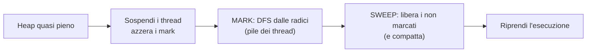

# Gestione della memoria e B-alberi

> [!abstract]
> In tutto il libro si è assunto che ogni accesso alla memoria costi lo stesso tempo. Questo capitolo guarda **come è fatta davvero la memoria** e cosa cambia per algoritmi e strutture dati:
> - come la **JVM** organizza la memoria: la **pila dei metodi** (che rende possibile la [[05 - ASD - Ricorsione|ricorsione]]), la **memoria heap**, gli algoritmi di allocazione e la **garbage collection** (che usa il [[14 - ASD - Algoritmi per grafi|DFS]]);
> - la **gerarchia di memoria**, la località dei riferimenti, il **caching** e le strategie di **sostituzione** (FIFO, LRU, casuale);
> - le strutture per la **memoria esterna**: gli **alberi (a,b)** e i **B-alberi**, generalizzazione degli [[11 - ASD - Alberi di ricerca#Alberi (2,4)|alberi (2,4)]];
> - l'**ordinamento esterno** con il merge-sort a più vie ([[12 - ASD - Ordinamento e selezione|cap. 12]]).
>
> Si collega a Sistemi Operativi ([[Memoria Virtuale]], [[Page Replacement]], [[Frammentazione]]), Sistemi di Calcolo ([[Gerarchia di Memoria]], [[Memoria Cache]]) e Data Management ([[B+-Tree]], [[External Merge Sort]]).
>
> Indice dei concetti: [[MOC - Algoritmi e Strutture Dati]]

---

## Gestione della memoria

La memoria è una sequenza di **parole** (*word*) di 4, 8 o 16 byte, numerate da $0$ a $N - 1$: il numero di una parola è il suo **indirizzo**. In pratica la memoria è un enorme array di parole.

![[ASD-p690-1.png]]

Una porzione della memoria con gli indirizzi delle parole (2144, 2145, …).

La memoria va **gestita**: decidere quali dati vanno in quali celle, e cosa succede quando una zona non serve più e può essere riutilizzata. Il paragrafo descrive le zone di memoria di un programma Java in esecuzione.

_(libro, p. 690)_

### Strutture di tipo stack nella Java Virtual Machine

Vedi [[Pila dei metodi di Java]].

Un programma Java compilato è una sequenza di **byte code**, le istruzioni "macchina" della **Java Virtual Machine** (JVM). Compilando per la JVM invece che per una CPU specifica, il programma gira su ogni computer che abbia un emulatore della JVM.

Ogni **thread** in esecuzione ha la propria **pila dei metodi di Java** (*Java stack*, *call stack*), una [[Pila (ADT)|pila]] ([[06 - ASD - Pile, code e code doppie|cap. 6]]) i cui elementi sono i **frame** (dati di attivazione) dei metodi attivi, cioè invocati e non ancora terminati. Un frame contiene parametri e variabili locali del metodo e le informazioni per tornare al chiamante.

![[ASD-p691-1.png]]

`main` (istruzione 14) ha invocato `cool(i)`, che (istruzione 216) ha invocato `fool(k)`. In cima alla pila c'è il frame di `fool` (PC = 320, $m = 7$), sotto quello di `cool` (PC = 216, $j = 5$, $k = 7$) e in fondo quello di `main` (PC = 14, $i = 5$). Quando `fool` termina, `cool` riprende dall'istruzione 217 (il PC salvato più uno).

#### Tenere traccia del program counter

Il **program counter** (PC) contiene l'indirizzo dell'istruzione in esecuzione. Quando `cool` invoca `fool`, il PC di `cool` viene salvato nel suo frame, così la JVM sa dove riprendere. In cima alla pila c'è sempre il metodo **in esecuzione**; sotto ci sono i metodi **sospesi**, in attesa che i metodi invocati restituiscano il controllo. Invocare un metodo = `push` del frame; terminarlo = `pop`.

#### Implementare la ricorsione

La pila delle invocazioni è ciò che rende possibile la [[Ricorsione|ricorsione]]: ogni invocazione ha il **proprio frame**, quindi più invocazioni dello stesso metodo possono coesistere con valori diversi dei parametri. (I primi Cobol e Fortran non usavano una pila e non permettevano la ricorsione; oggi tutti i linguaggi la usano.) Ogni riquadro di un diagramma di ricorsione del [[05 - ASD - Ricorsione|cap. 5]] è un frame.

> [!example] Fattoriale
> `factorial(n)` crea un frame con $n$; la chiamata `factorial(n-1)` ne aggiunge un altro, e così via fino a `factorial(0)`: la pila arriva a $n + 1$ frame, ognuno con il proprio $n$. Poi i frame vengono tolti uno a uno, moltiplicando i risultati.

> [!tip] Collegamento
> Lo stesso meccanismo a livello di processore (registri, indirizzo di ritorno, variabili locali) è descritto in [[Stack Frame]] e in [[05 - SO - Stack e Context Switch]].

#### La pila degli operandi

La JVM usa una seconda pila, la **pila degli operandi** (*operand stack*), per valutare le espressioni. Per $a + b$: `push a`, `push b`, poi un'istruzione che estrae due operandi, li somma e fa `push` del risultato. Anche letture e scritture in memoria passano per `push`/`pop` su questa pila. Ad esempio $((a + b) \cdot (c + d))/e$ si valuta interamente con push e pop.

_(libro, pp. 691–693)_

### Riservare spazio nella memoria heap

Vedi [[Allocazione nella memoria heap]].

Le variabili locali stanno nei frame, ma gli oggetti creati con `new` no:

```java
int[] items = new int[k];
```

La dimensione è nota solo a tempo di esecuzione e l'array può **sopravvivere** al metodo che l'ha creato: non può stare nella pila. Va nella **memoria heap** (da non confondere con lo [[Heap binario|heap]] del [[09 - ASD - Code prioritarie|cap. 9]]), divisa in **blocchi** (*chunk*) contigui. Per semplicità si assumono blocchi di dimensione fissa, ad esempio 1024 byte.

![[ASD-p694-1.png]]

La disposizione degli indirizzi nella JVM, da sinistra (indirizzi bassi) a destra: codice del programma (dimensione fissa), Java stack (cresce verso indirizzi maggiori), memoria libera, memoria heap (cresce verso indirizzi minori). Pila e heap crescono una verso l'altra, consumando la memoria libera in mezzo.

#### Algoritmi per l'assegnazione della memoria

La JVM deve assegnare memoria **velocemente**, ma non prescrive come. Un metodo diffuso: una lista concatenata, la **free list**, dei **buchi** (*hole*) di memoria libera, con i collegamenti memorizzati nei buchi stessi (tanto quella memoria è libera). Con le allocazioni e i rilasci la memoria libera si spezza in buchi separati da blocchi in uso: è la **frammentazione** (*fragmentation*), che rende difficile trovare zone libere grandi anche se in totale ce n'è abbastanza.

- **Frammentazione interna**: parte di un blocco assegnato resta inutilizzata (un array di 1000 celle di cui se ne usano 100). L'ambiente può farci poco.
- **Frammentazione esterna**: memoria libera significativa sparsa tra blocchi in uso. L'ambiente controlla le allocazioni (`new`), quindi deve usare una politica che la limiti.

| Strategia | Scelta del buco | Pro / contro |
|---|---|---|
| **best-fit** | il buco con dimensione più vicina alla richiesta (scansione completa) | sembra la migliore ma lascia avanzi **minuscoli**: la frammentazione esterna peggiore |
| **first-fit** | il primo buco abbastanza grande, dall'inizio della lista | veloce, ma frammenta l'inizio della lista e rallenta le ricerche successive |
| **next-fit** | come first-fit, ma ripartendo da dove si era arrivati (lista circolare) | distribuisce la frammentazione, ricerche veloci, ma rende difficile trovare blocchi grandi |
| **worst-fit** | il buco **più grande** (veloce con una [[Coda prioritaria (ADT)|coda prioritaria]]) | lascia avanzi il più grandi possibile |

In ogni caso la parte non usata del buco resta nella free list.

> [!example] Collegamento con Sistemi Operativi
> Le stesse strategie (first/best/worst-fit) e i due tipi di frammentazione sono in [[Allocazione Contigua]], [[Frammentazione]] e [[07 - SO - Allocatori di Memoria]].

_(libro, pp. 693–695)_

### Garbage collection

Vedi [[Garbage collection mark-sweep]].

In C e C++ la memoria degli oggetti va **liberata esplicitamente** dal programmatore: una fonte classica di errori. In Java se ne occupa l'ambiente di esecuzione.

- **Oggetti radice** (*root object*): le variabili e gli oggetti nella pila dei metodi di qualche thread.
- **Oggetti vivi** (*live object*): quelli raggiungibili seguendo riferimenti a partire da un oggetto radice. Sono in uso e non vanno liberati.

Ad esempio, se una variabile riferisce una lista doppiamente concatenata $S$, la variabile è una radice, e sono vivi $S$, tutti i suoi nodi e gli elementi a cui i nodi fanno riferimento.

Quando lo spazio nello heap scarseggia, la JVM può liberare la memoria degli oggetti **non più vivi** e restituirla alla free list: è la **garbage collection** ("raccolta della spazzatura").

#### L'algoritmo mark-sweep

Ogni oggetto ha un bit di **marcatura** (*mark*).

1. Si sospende tutto il resto e si azzerano i bit di tutti gli oggetti dello heap.
2. **Fase mark**: si marcano come vivi gli oggetti radice e poi tutti quelli raggiungibili. Lo heap è un **grafo orientato** (oggetti = vertici, riferimenti = lati): basta un [[Attraversamento in profondità (DFS)|DFS]] orientato da ogni radice ([[14 - ASD - Algoritmi per grafi#Attraversamento in profondità (depth-first search)|cap. 14]]).
3. **Fase sweep**: si scandisce lo heap e si libera ogni oggetto non marcato; opzionalmente si **compatta** lo spazio occupato in un unico blocco, eliminando (per ora) la frammentazione esterna.
4. Il programma riprende.

Tempo: proporzionale al numero di oggetti vivi e dei loro riferimenti, più la dimensione dello heap.



#### Eseguire DFS sul posto

Problema: la garbage collection parte **quando manca memoria**, ma un DFS ricorsivo usa una pila proporzionale al numero di vertici (oggetti), cioè proprio memoria che non c'è. Serve un **DFS sul posto**.

L'idea è **simulare la pila di ricorsione con i lati stessi**: quando si scende da $v$ a un nuovo vertice $w$, il riferimento $(v, w)$ dentro $v$ viene modificato per puntare al **genitore** di $v$ nell'albero DFS; quando si torna in $v$ lo si ripristina a $w$. Per sapere quale riferimento è stato modificato si può numerare i riferimenti uscenti e tenere un contatore oltre al bit di marcatura. Molte JVM evitano anche il contatore: il primo campo di ogni oggetto è un riferimento al suo **tipo**, e si può scambiarlo con il riferimento modificato; tornando in $v$, il riferimento al tipo dice quale campo ripristinare.

_(libro, pp. 695–697)_

---

## Gerarchie di memoria e caching

Con grandi quantità di dati (transazioni finanziarie, basi di dati, analisi dei clienti) le prestazioni possono dipendere più dal **tempo di accesso ai dati** che dalla velocità della CPU.

### Sistemi di memoria

Vedi [[Gerarchia di Memoria]].

I computer usano una gerarchia di memorie, ognuna più grande e più lenta della precedente:

1. **registri** della CPU (velocissimi, pochissimi);
2. una o più **memorie cache**;
3. **memoria interna** (principale);
4. **memoria esterna** (dischi, CD, DVD, nastri);
5. **rete** (archiviazione remota).

![[ASD-p698-1.png]]

La gerarchia: dalla CPU verso l'alto i livelli sono più grandi, verso il basso più veloci. I dati si spostano continuamente tra livelli adiacenti, e questi trasferimenti possono diventare il collo di bottiglia.

### Strategie di gestione della memoria cache

Il collo di bottiglia è di solito tra il livello che contiene tutti i dati e quello appena sotto:
- dati in memoria principale: conta l'interfaccia **cache ↔ memoria interna** (la memoria interna è 10–100 volte più lenta della cache);
- dati non in memoria principale: conta l'interfaccia **memoria interna ↔ disco**, con un divario di $10^5$–$10^6$ volte.

> [!example] Un'analogia
> Uno studente di Baltimora chiede soldi ai genitori a Chicago. Un'e-mail arriva in circa 5 secondi: è l'accesso alla memoria interna. Un accesso al disco 500 000 volte più lento equivale a portare il messaggio **a piedi**: $5 \text{ s} \times 500\,000 \approx 29$ giorni, circa un mese camminando 20 miglia al giorno. Quindi gli accessi alla memoria esterna vanno ridotti al minimo.

Perché allora quasi tutte le analisi assumono accessi a costo uniforme? Due ragioni:
1. spesso non si conoscono le dimensioni dei livelli (un programma Java gira su piattaforme diverse; ottimizzare per una specifica architettura lo renderebbe non portabile);
2. i sistemi operativi hanno meccanismi generali che rendono veloci la maggior parte degli accessi.

#### Strategie di caching e blocking

Questi meccanismi si basano sulla [[Località dei Riferimenti|località dei riferimenti]], osservata sperimentalmente nella maggior parte dei programmi:

- **Località temporale**: un indirizzo usato ora sarà probabilmente riusato presto (un contatore di ciclo; "un programma passa il 90% del tempo nel 10% del codice").
- **Località spaziale**: dopo un indirizzo, probabilmente si useranno quelli vicini (la scansione di un array).

Da qui due scelte progettuali, applicate tra cache e memoria interna e tra memoria interna ed esterna:

- **Memoria virtuale** e **caching** (dalla località temporale): ai programmi si offre uno spazio di indirizzamento grande come la memoria **secondaria**, e i dati vengono copiati nella **primaria** quando servono, sperando che vengano riusati presto. Vedi [[Memoria Virtuale]].
- **Blocking** (dalla località spaziale): quando si accede all'indirizzo $\ell$ della memoria secondaria, si porta nella primaria un intero **blocco** di parole contigue che lo contiene. Tra cache e memoria interna i blocchi si chiamano **righe di cache** (*cache line*), tra memoria interna ed esterna **pagine** (*page*).

![[ASD-p700-1.png]]

La memoria esterna è divisa in blocchi (0–1023, 1024–2047, …): ogni blocco dello spazio di indirizzamento corrisponde a un blocco del disco, che viene trasferito tutto insieme.

Resta un problema: la primaria è piccola. Quando è piena e serve un nuovo blocco, bisogna **espellerne** uno: quale?

#### Caching nei browser web

Un browser tiene in una cache di $m$ posizioni le pagine web visitate (cache **completamente associativa**: ogni pagina può andare in qualsiasi posizione; vedi [[Associatività delle Cache]]). Quando si richiede una pagina $p$: se è in cache (e non è cambiata) la si usa; altrimenti la si scarica e la si mette in cache, espellendone una se la cache è piena.

#### Algoritmi di sostituzione delle pagine

Vedi [[Algoritmi di sostituzione delle pagine]].

- **FIFO** (*first-in, first-out*): espelle la pagina in cache **da più tempo**.
- **LRU** (*least recently used*): espelle la pagina **usata meno recentemente**.
- **Random**: espelle una pagina **a caso**.

![[ASD-p702-1.png]]

Le tre strategie a confronto: la casuale sceglie a caso il blocco da sostituire; FIFO sceglie quello con l'**ora di inserimento** più vecchia (7:10); LRU quello con l'**ora di ultimo utilizzo** più vecchia (6:50).

| Strategia | Implementazione | Costo aggiuntivo | Sfrutta la località temporale |
|---|---|---|---|
| Random | un generatore di numeri casuali ([[PRNG (Pseudo-Random Number Generator)|pseudocasuali]]) | $O(1)$ per sostituzione, nulla per richiesta | no |
| FIFO | una [[Coda (ADT)|coda]]: accodare all'inserimento, estrarre per espellere | $O(1)$ per sostituzione, nulla per richiesta | poco |
| LRU | una coda prioritaria flessibile con chiave = istante dell'ultimo accesso; con una lista ordinata, ogni accesso porta la pagina in fondo | $O(1)$ per richiesta e per sostituzione, ma con costanti elevate (tempo e spazio) | al meglio |

**Caso peggiore**: con una cache di $m$ pagine e un ciclo che richiede **$m + 1$ pagine in modo circolare**, sia FIFO sia LRU espellono ogni volta proprio la pagina che servirà subito dopo: **ogni richiesta è un miss**. Ma l'analisi del caso peggiore è troppo pessimistica; le **simulazioni** su sequenze reali mostrano che **LRU è migliore di FIFO, che a sua volta è di solito migliore della strategia casuale**.

> [!example] Collegamenti
> Le stesse politiche (più OPT, Clock, …) sono studiate per la memoria virtuale in [[Page Replacement]] (Sistemi Operativi) e per il buffer dei DBMS in [[Clock Replacement Policy]] (Data Management).

_(libro, pp. 697–703)_

---

## Ricerche esterne e B-alberi

Con una grande collezione che non sta in memoria (una base di dati), la memoria secondaria è divisa in **blocchi del disco** (*disk block*) e ogni lettura o scrittura è un **trasferimento dal disco** (*disk transfer*). L'obiettivo è minimizzare i trasferimenti per ogni ricerca o aggiornamento: è la **complessità di I/O**.

#### Alcune rappresentazioni inefficienti nella memoria esterna

| Rappresentazione della mappa | Trasferimenti per una ricerca |
|---|---|
| lista concatenata non ordinata | $n$ (ogni nodo può stare in un blocco diverso) |
| array non ordinato (di tipi primitivi), ricerca sequenziale | $O(n/B)$, con $B$ elementi per blocco (con oggetti, l'array contiene riferimenti sparsi: ancora $n$) |
| array ordinato, ricerca binaria | $O(\log_2 n)$: ogni accesso cade probabilmente in un blocco diverso; aggiornamenti costosi |
| alberi bilanciati binari (AVL, rosso-nero), skip list, splay | $O(\log_2 n)$: ogni nodo in un blocco diverso |
| **B-albero** | $O(\log_B n) = O(\log n / \log B)$ |

Il fattore guadagnato è $\log_2 B$: con $B = 1000$, circa 10 volte meno accessi al disco.

### Alberi (a,b)

Vedi [[Albero (a,b)]].

Si usa un [[Albero di ricerca a più vie|albero di ricerca a più vie]] ([[11 - ASD - Alberi di ricerca#Alberi di ricerca a più vie|cap. 11]]) che generalizza gli alberi (2,4): l'**albero (a,b)**, in cui ogni nodo ha tra $a$ e $b$ figli (e tra $a - 1$ e $b - 1$ voci). Gli algoritmi sono quelli degli [[Albero (2,4)|alberi (2,4)]]; il vantaggio è che, scegliendo $a$ e $b$ in base alla dimensione dei blocchi, si ottiene una struttura efficiente su disco.

#### Definizione di albero (a,b)

Con interi $2 \le a \le (b+1)/2$, un albero (a,b) è un albero di ricerca a più vie con:

> **Proprietà della dimensione**: ogni nodo interno ha almeno $a$ figli (tranne la radice) e al più $b$ figli.
> **Proprietà della profondità**: tutti i nodi esterni hanno la stessa profondità.

**Proposizione 15.1.** L'altezza di un albero (a,b) con $n$ voci è $\Omega(\log n / \log b)$ e $O(\log n / \log a)$; più precisamente
$$\frac{1}{\log b}\log(n+1) \le h \le \frac{1}{\log a}\log\frac{n+1}{2} + 1.$$

*Dimostrazione.* Per le due proprietà il numero di nodi esterni $n'$ è almeno $2a^{h-1}$ (la radice ha almeno 2 figli, gli altri nodi almeno $a$) e al più $b^h$; per la Proposizione 11.6 $n' = n + 1$. Quindi $2a^{h-1} \le n + 1 \le b^h$, e passando ai logaritmi $(h - 1)\log a + 1 \le \log(n+1) \le h\log b$. $\blacksquare$

#### Operazioni di ricerca e aggiornamento

Ogni nodo $w$ ha una mappa secondaria $M(w)$ con al più $b$ voci; sia $f(b)$ il tempo di una ricerca in $M(w)$. La ricerca costa $O\big(\frac{f(b)}{\log a}\log n\big)$ (con $a$, $b$ costanti è $O(\log n)$).

Su disco si scelgono $a$ e $b$ in modo che **ogni nodo stia in un blocco**: contando solo i trasferimenti, $f(b) = 1$.

- **Inserimento**: come negli alberi (2,4). Un **overflow** si ha quando un $b$-nodo diventa un $(b+1)$-nodo: lo si **divide** spostando la voce mediana nel genitore e sostituendolo con un $\lceil (b+1)/2 \rceil$-nodo $w'$ e un $\lfloor (b+1)/2 \rfloor$-nodo $w''$ (vanno costruite le loro mappe secondarie). Perché entrambi siano validi serve $a \le (b+1)/2$.
- **Rimozione**: un **underflow** si ha quando un $a$-nodo non radice diventa un $(a-1)$-nodo. Si fa un **trasferimento** da un fratello che non sia un $a$-nodo, oppure una **fusione** con un fratello $a$-nodo: il risultato è un $(2a-1)$-nodo, valido proprio perché $a \le (b+1)/2$.

| Metodo | Tempo |
|---|---|
| `get` | $O\big(\frac{f(b)}{\log a}\log n\big)$ |
| `put` | $O\big(\frac{g(b)}{\log a}\log n\big)$ |
| `remove` | $O\big(\frac{g(b)}{\log a}\log n\big)$ |

(Tabella 15.1: $f(b)$ = ricerca in un nodo, $g(b)$ = divisione o fusione di un nodo; entrambe $O(1)$ se si contano solo i trasferimenti da disco.)

_(libro, pp. 703–706)_

### B-alberi

Vedi [[B-albero]].

Un **B-albero di ordine $d$** è un albero (a,b) con $a = \lceil d/2 \rceil$ e $b = d$. È il modo migliore noto per gestire una mappa in memoria esterna.

![[ASD-p707-1.png]]

Un B-albero di ordine 6: ogni nodo ha tra $\lceil 6/2 \rceil = 3$ e 6 figli (tra 2 e 5 chiavi), e tutte le foglie sono alla stessa profondità. Ad esempio la radice (42 65) ha 3 figli e il nodo (48 50 51 53 56) ha 5 chiavi e 6 figli.

Si sceglie $d$ in modo che i $d$ riferimenti ai figli e le $d - 1$ chiavi stiano **in un blocco**: $d$ è proporzionale a $B$, quindi anche $a$ e $b$, e $f(b)$, $g(b)$ diventano $O(1)$ (un trasferimento per nodo).

- Ogni operazione esamina $O(1)$ nodi per livello, quindi costa $O(\log_{\lceil d/2 \rceil} n) = O(\log n / \log B)$ trasferimenti.
- **Inserimento**: si scende fino al nodo giusto; se va in overflow ($d + 1$ figli) lo si **divide** (*split*) in nodi con $\lfloor (d+1)/2 \rfloor$ e $\lceil (d+1)/2 \rceil$ figli, e l'operazione può ripetersi verso l'alto per $O(\log_B n)$ livelli.
- **Rimozione**: se un nodo va in underflow ($\lceil d/2 \rceil - 1$ figli) si fa un **trasferimento** da un fratello con almeno $\lceil d/2 \rceil + 1$ figli o una **fusione**, ripetendo nel genitore.
- Poiché ogni nodo interno ha almeno $\lceil d/2 \rceil$ figli, ogni blocco è **pieno almeno per metà**.

**Proposizione 15.2.** Un B-albero con $n$ voci ha complessità di I/O $O(\log_B n)$ per ricerche e aggiornamenti e usa $O(n/B)$ blocchi.

> [!example] Collegamento con Data Management
> I DBMS usano la variante [[B+-Tree]], in cui le voci stanno solo nelle foglie (collegate tra loro per le ricerche per intervallo) e i nodi interni contengono solo chiavi di instradamento.

_(libro, pp. 706–707)_

---

## Ordinamento nella memoria esterna

Anche gli algoritmi possono dover elaborare dati che non stanno in memoria; il problema tradizionale è l'**ordinamento**, con l'obiettivo di minimizzare i trasferimenti di blocchi.

### Merge-sort a più vie

Vedi [[Merge-sort a più vie]].

Una variante del [[Merge-sort|merge-sort]] ([[12 - ASD - Ordinamento e selezione|cap. 12]]) che fonde **molte** liste insieme, riducendo il numero di livelli della ricorsione: si divide $S$ in $d$ sottoinsiemi $S_1, \dots, S_d$ di dimensione simile, li si ordina ricorsivamente e li si **fonde tutti insieme**. Se la fusione costa $O(n/B)$ trasferimenti, il numero totale di trasferimenti soddisfa
$$t(n) = d \cdot t(n/d) + cn/B, \qquad t(n) = 1 \text{ se } n/B \le 1$$
(quando $n \le B$ basta un trasferimento e si ordina in memoria). La soluzione ([[Equazione di ricorrenza|come per merge-sort]]: $\log_d(n/B)$ livelli, $O(n/B)$ per livello) è
$$t(n) = O\Big(\frac{n}{B}\log_d\frac{n}{B}\Big) = O\Big(\frac{n}{B}\cdot\frac{\log(n/B)}{\log d}\Big).$$
Conviene quindi $d$ grande: con $M$ la dimensione della memoria interna si sceglie $d = (M/B) - 1$.

### Fusione a più vie

Nella fusione a $d$ vie si prende ripetutamente il **minimo tra i primi elementi** delle $d$ sequenze. In memoria interna stanno $M/B$ blocchi: con $d = M/B - 1$ si tiene **un blocco per ciascuna** delle $d$ sequenze più **un blocco per l'output**.

![[ASD-p709-1.png]]

Una fusione a 5 vie con $B = 4$: i blocchi grigi sono in memoria interna (uno per sequenza), i minimi correnti delle sequenze alimentano la coda prioritaria $Q$ e il blocco di output (7 8 10 11) viene scritto su disco quando è pieno.

- Quando il blocco di una sequenza si svuota si legge il successivo; quando il blocco di output è pieno si scrive su disco. Ogni blocco è letto e scritto **una volta**: **$O(n/B)$ trasferimenti** per una fusione.
- Il minimo tra $d$ valori si trova in $O(d)$, oppure in $O(\log d)$ con una [[Coda prioritaria (ADT)|coda prioritaria]] dei minimi correnti (spazio $O(d)$): la fusione costa $O(n\log d)$ di calcolo interno.

**Proposizione 15.3.** Una sequenza di $n$ elementi in memoria esterna si ordina con $O\big((n/B)\log(n/B)/\log(M/B)\big)$ trasferimenti di blocchi e $O(n\log n)$ calcolo in memoria interna, dove $M$ è la dimensione della memoria interna e $B$ quella di un blocco.

> [!example] Collegamento con Data Management
> È l'algoritmo [[External Merge Sort]] dei DBMS: prima si creano *run* ordinati grandi quanto la memoria, poi li si fonde a $(M/B - 1)$ vie.

_(libro, pp. 707–709)_

> [!summary] Riepilogo del capitolo
> - La **JVM** usa una **pila dei metodi** (un frame per invocazione: rende possibile la ricorsione) e una **pila degli operandi**; gli oggetti creati con `new` vanno nella **memoria heap**.
> - L'allocazione nello heap usa una **free list**; la **frammentazione** esterna dipende dalla politica (best/first/next/worst-fit).
> - La **garbage collection mark-sweep** marca con un **DFS** gli oggetti raggiungibili dalle radici e libera gli altri; il DFS va fatto **sul posto**, invertendo temporaneamente i riferimenti.
> - **Gerarchia di memoria**: località temporale → caching e memoria virtuale; località spaziale → blocking. Sostituzione: **LRU** > **FIFO** > **random** in pratica, ma FIFO e LRU hanno un caso peggiore pessimo.
> - **Alberi (a,b)** e **B-alberi** ($a = \lceil d/2\rceil$, $b = d$, un nodo per blocco): $O(\log_B n)$ trasferimenti per operazione, blocchi pieni almeno a metà.
> - **Merge-sort a più vie** con $d = M/B - 1$: $O\big((n/B)\log_{M/B}(n/B)\big)$ trasferimenti.
