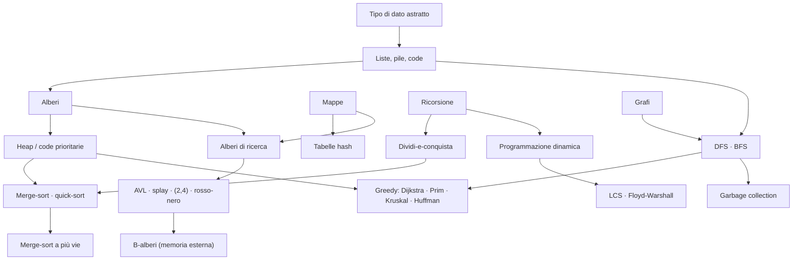

# MOC - Algoritmi e Strutture Dati

> [!abstract]
> Mappa del corso di Algoritmi e Strutture Dati, costruita sul libro di Goodrich e Tamassia (*Strutture dati e algoritmi in Java*, Zanichelli 2015). Una nota per capitolo (15 lezioni) e 109 note atomiche in `Concetti/` per il ripasso. Ogni nota atomica rimanda alla sezione esatta della lezione in cui il concetto è spiegato per esteso.

## Lezioni

| N. | Lezione | Argomenti |
|---|---|---|
| 1 | [[01 - ASD - Introduzione a Java]] | tipi, oggetti, riferimenti, costruttori, metodi, array, cast, controllo di flusso |
| 2 | [[02 - ASD - Progettazione orientata agli oggetti]] | ADT, ereditarietà, polimorfismo, interfacce, classi astratte, eccezioni, generici |
| 3 | [[03 - ASD - Strutture dati fondamentali]] | array, insertion-sort, liste semplicemente/doppiamente concatenate e circolari, equals, clone |
| 4 | [[04 - ASD - Analisi di algoritmi]] | analisi sperimentale, sette funzioni, notazione O/Ω/Θ, induzione, invarianti |
| 5 | [[05 - ASD - Ricorsione]] | fattoriale, ricerca binaria, ricorsione lineare/binaria/multipla, Fibonacci, ricorsione in coda |
| 6 | [[06 - ASD - Pile, code e code doppie]] | pila, coda, deque, array circolare, adattatore, parentesi, Josephus |
| 7 | [[07 - ASD - Liste e iteratori]] | liste con indice, array dinamici, analisi ammortizzata, liste posizionali, iteratori, move-to-front |
| 8 | [[08 - ASD - Alberi]] | alberi generici e binari, profondità e altezza, rappresentazioni, attraversamenti, percorso di Eulero |
| 9 | [[09 - ASD - Code prioritarie]] | coda prioritaria, comparatori, heap, costruzione bottom-up, heap-sort, code flessibili |
| 10 | [[10 - ASD - Mappe, tabelle hash e skip list]] | mappe, tabelle hash, funzioni hash, collisioni, mappe ordinate, skip list, insiemi |
| 11 | [[11 - ASD - Alberi di ricerca]] | BST, rotazioni, AVL, splay, alberi (2,4), rosso-nero |
| 12 | [[12 - ASD - Ordinamento e selezione]] | merge-sort, quick-sort, limite inferiore, bucket-sort, radix-sort, confronto, quick-select |
| 13 | [[13 - ASD - Elaborazione di testi]] | pattern matching (forza bruta, Boyer-Moore, KMP), trie, Huffman, greedy, programmazione dinamica, LCS |
| 14 | [[14 - ASD - Algoritmi per grafi]] | grafi, strutture dati, DFS, BFS, Floyd-Warshall, ordinamento topologico, Dijkstra, Prim, Kruskal, union-find |
| 15 | [[15 - ASD - Gestione della memoria e B-alberi]] | pila e heap della JVM, garbage collection, gerarchia di memoria, sostituzione pagine, B-alberi, ordinamento esterno |

## Concetti per tema

### Java e programmazione a oggetti
- [[Variabile riferimento]] · [[Modificatori di accesso in Java]] · [[Passaggio per valore in Java]] · [[Costruttore in Java]] · [[Classi involucro e auto-boxing]] · [[Cast in Java]]
- [[Tipo di dato astratto]] · [[Ereditarietà in Java]] · [[Polimorfismo e smistamento dinamico]] · [[Interfacce e classi astratte]] · [[Eccezioni in Java]] · [[Tipi generici in Java]]
- Schemi di progetto: [[Schema template method]] · [[Schema adattatore]]
- [[Metodo equals]] · [[Copia superficiale e copia profonda]] · [[Iteratore]] · [[Comparatore]]

### Analisi di algoritmi
- [[Analisi del caso peggiore]] · [[Funzioni di crescita]] · [[Notazione asintotica]]
- [[Dimostrazione per induzione]] · [[Invariante di ciclo]]
- [[Analisi ammortizzata]] · [[Equazione di ricorrenza]] · [[Limite inferiore per l'ordinamento basato su confronti]]

### Ricorsione e schemi di progettazione
- [[Ricorsione]] · [[Ricorsione lineare, binaria e multipla]] · [[Ricorsione in coda]]
- [[Ricerca binaria]] · [[Elevamento a potenza ricorsivo]] · [[Fibonacci ricorsivo]]
- [[Dividi-e-conquista]] · [[Metodo greedy]] · [[Programmazione dinamica]]

### Strutture lineari
- Liste: [[Lista semplicemente concatenata]] · [[Lista doppiamente concatenata]] · [[Lista concatenata circolare]] · [[Lista con indice]] · [[Lista posizionale]] · [[Array dinamico]]
- Pile e code: [[Pila (ADT)]] · [[Coda (ADT)]] · [[Coda doppia (deque)]] · [[Array circolare]]
- Applicazioni: [[Verifica di delimitatori con una pila]] · [[Problema di Josephus]] · [[Euristica move-to-front]]

### Alberi
- [[Albero (ADT)]] · [[Profondità e altezza di un albero]] · [[Albero binario]] · [[Proprietà degli alberi binari]] · [[Albero binario su array]]
- [[Attraversamenti di un albero]] · [[Percorso di Eulero]]

### Code prioritarie
- [[Coda prioritaria (ADT)]] · [[Heap binario]] · [[Costruzione bottom-up di uno heap]] · [[Coda prioritaria flessibile]]

### Mappe e ricerca
- [[Mappa (ADT)]] · [[Mappa ordinata]] · [[Insiemi, multi-insiemi e multi-mappe]]
- Hashing: [[Tabella hash]] · [[Funzione di hash]] · [[Concatenazione separata]] · [[Indirizzamento aperto]]
- [[Skip list]]
- Alberi di ricerca: [[Albero di ricerca binario]] · [[Rotazione e ristrutturazione di una terna]] · [[Albero AVL]] · [[Albero splay]] · [[Albero di ricerca a più vie]] · [[Albero (2,4)]] · [[Albero rosso-nero]]

### Ordinamento e selezione
- [[Ordinamento per inserimento]] · [[Ordinamento con coda prioritaria]] · [[Heap sort]] · [[Merge-sort]] · [[Quick-sort]]
- [[Bucket-sort]] · [[Radix-sort]] · [[Ordinamento stabile]]
- [[Quick-select probabilistico]]

### Elaborazione di testi
- [[Pattern matching su stringhe]] · [[Algoritmo di Boyer-Moore]] · [[Algoritmo di Knuth-Morris-Pratt]]
- [[Trie]] · [[Trie dei suffissi]] · [[Indice inverso]]
- [[Codifica di Huffman]] · [[Sotto-sequenza comune più lunga (LCS)]]

### Grafi
- [[Grafo (ADT)]] · [[Strutture dati per grafi]]
- [[Attraversamento in profondità (DFS)]] · [[Attraversamento in ampiezza (BFS)]]
- [[Chiusura transitiva e Floyd-Warshall]] · [[Grafo orientato aciclico e ordinamento topologico]]
- [[Algoritmo di Dijkstra]] · [[Albero ricoprente minimo (MST)]] · [[Algoritmo di Prim-Jarník]] · [[Algoritmo di Kruskal]] · [[Partizione union-find]]

### Memoria
- [[Pila dei metodi di Java]] · [[Allocazione nella memoria heap]] · [[Garbage collection mark-sweep]]
- [[Algoritmi di sostituzione delle pagine]] · [[Albero (a,b)]] · [[B-albero]] · [[Merge-sort a più vie]]

## Percorsi trasversali

**Catene di concetti da ripassare insieme**

- *Dalla lista all'analisi ammortizzata*: [[Lista con indice]] → [[Array dinamico]] → [[Analisi ammortizzata]] → [[Albero splay]] → [[Partizione union-find]].
- *Dalla pila alla ricorsione e alla memoria*: [[Pila (ADT)]] → [[Ricorsione]] → [[Pila dei metodi di Java]] → [[Ricorsione in coda]] → [[Attraversamento in profondità (DFS)]] → [[Garbage collection mark-sweep]].
- *Mappe sempre più veloci*: [[Mappa (ADT)]] → [[Tabella hash]] / [[Mappa ordinata]] → [[Skip list]] → [[Albero di ricerca binario]] → [[Albero AVL]] → [[Albero (2,4)]] → [[Albero rosso-nero]] → [[Albero (a,b)]] → [[B-albero]].
- *La famiglia delle code prioritarie*: [[Coda prioritaria (ADT)]] → [[Heap binario]] → [[Heap sort]] → [[Coda prioritaria flessibile]] → [[Algoritmo di Dijkstra]] → [[Algoritmo di Prim-Jarník]].
- *Schemi di progettazione*: [[Ricorsione]] → [[Dividi-e-conquista]] ([[Merge-sort]], [[Quick-sort]]) → prune-and-search ([[Ricerca binaria]], [[Quick-select probabilistico]]) → [[Metodo greedy]] ([[Codifica di Huffman]], [[Algoritmo di Kruskal]]) → [[Programmazione dinamica]] ([[Sotto-sequenza comune più lunga (LCS)]], [[Chiusura transitiva e Floyd-Warshall]]).
- *Limiti dell'ordinamento*: [[Proprietà degli alberi binari]] → [[Limite inferiore per l'ordinamento basato su confronti]] → [[Bucket-sort]] → [[Ordinamento stabile]] → [[Radix-sort]].
- *Località e memoria*: [[Euristica move-to-front]] → [[Albero splay]] → [[Algoritmi di sostituzione delle pagine]] → [[B-albero]] → [[Merge-sort a più vie]].

## Collegamenti con altri corsi

- **Sistemi Operativi**: [[Memoria Virtuale]] · [[Page Replacement]] · [[Frammentazione]] · [[05 - SO - Stack e Context Switch]] · [[Round Robin]] · [[Produttore-Consumatore]]
- **Sistemi di Calcolo**: [[Gerarchia di Memoria]] · [[Memoria Cache]] · [[Località dei Riferimenti]] · [[Stack Frame]] · [[Ereditarietà in C]] · [[Vtable]]
- **Data Management**: [[B+-Tree]] · [[External Merge Sort]] · [[Inverted List]] · [[Clock Replacement Policy]]
- **Telecomunicazioni**: [[Instradamento Link-State]] · [[Instradamento Distance-Vector]]
- **Crittografia / sicurezza**: [[Funzioni Hash Crittografiche]] · [[PRNG (Pseudo-Random Number Generator)]]
