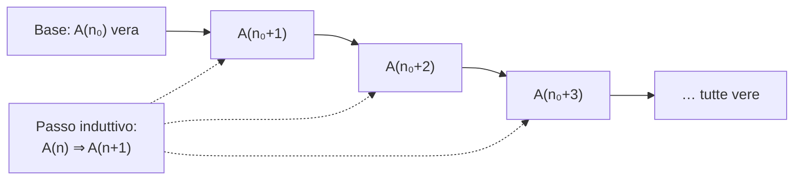

# Concetti Fondamentali

> [!abstract]
> Il capitolo introduttivo della dispensa di Camilli ed Engel raccoglie il "vocabolario" usato in tutto il corso: **insiemi** e loro operazioni, gli **insiemi numerici** $\mathbb{N} \subset \mathbb{Z} \subset \mathbb{Q} \subset \mathbb{R}$, le proprietà di $\mathbb{R}$ (campo ordinato e soprattutto **completo**), i concetti di **estremo superiore e inferiore**, la definizione di **funzione** (con l'esempio del **modulo**), **fattoriale**, **coefficienti binomiali**, **binomio di Newton** e il **principio di induzione**.
> Tutto ciò che segue si appoggia qui: la completezza di $\mathbb{R}$ garantisce l'esistenza dei limiti delle successioni monotone ([[01 - AN1 - Successioni Numeriche|cap. 1]]) e i teoremi sulle funzioni continue ([[04 - AN1 - Funzioni Continue|cap. 4]]); il modulo è lo strumento con cui misureremo le distanze nelle definizioni di limite.
> Mappa del corso: [[MOC - Analisi 1]].
>
> I riferimenti _(dispensa, p. N)_ usano la numerazione stampata sulle pagine; nel PDF la pagina è N + 6.

---

## Cos'è l'analisi matematica

L'**analisi matematica** è il ramo della matematica che studia, tra l'altro:

- i **numeri reali**;
- i **limiti** di **successioni**;
- le **serie numeriche**;
- le **funzioni reali** e la loro **continuità**;
- il **calcolo differenziale** e **integrale**.

Il filo conduttore di tutti questi argomenti è il concetto di **limite**: che cosa succede a una quantità quando una variabile si avvicina "indefinitamente" a un valore. Per renderlo rigoroso servono le proprietà dei numeri reali, ed è da queste che parte il corso.

_(dispensa, p. iii)_

---

## Insiemi

Vedi [[Insieme]].

Intuitivamente un **insieme** è una raccolta di oggetti, chiamati **elementi**, distinguibili tra loro e che formano una totalità. Per gli insiemi si usano di solito lettere maiuscole ($A, B, C, \dots, X, Y, Z$), per gli elementi lettere minuscole ($a, b, c, \dots, x, y, z$).

### Notazioni

| Simbolo | Significato |
|---|---|
| $\forall$ | "per ogni" (quantificatore universale) |
| $\exists$ | "esiste" (quantificatore esistenziale) |
| $A := B$ oppure $B =: A$ | $A$ è uguale a $B$ **per definizione** (i due punti stanno dalla parte di ciò che si sta definendo) |
| $\Rightarrow$ | implicazione |
| $\lightning$ | contraddizione |
| $\in$, $\notin$ | appartenenza, non appartenenza |
| $\subset$, $\subseteq$ | inclusione |

Un insieme si può definire in due modi:

- **per elencazione**, scrivendo tutti gli elementi tra graffe: $A := \{1, 2, 3\}$;
- **per proprietà caratteristica**, indicando una proprietà soddisfatta da tutti e soli gli elementi: $P := \{n : n \text{ è un numero primo}\} = \{n \mid n \text{ è un numero primo}\}$.

> [!example] Esempi
> - Siano $A := \{1,2,3\}$, $B := \{2,7,8\}$, $C := \{1,2,3,5,7,8\}$. Allora $2 \in A$, $5 \notin B$, $A \subseteq C$, $A \notin C$ (l'insieme $A$ è *contenuto* in $C$, ma non è un *elemento* di $C$), $A \notin A$.
> - L'insieme senza elementi si chiama **insieme vuoto**: $\emptyset := \{\}$.

> [!tip] Appartenenza e inclusione
> $\in$ mette in relazione un **elemento** con un insieme; $\subseteq$ mette in relazione due **insiemi**. $1 \in \{1,2\}$ e $\{1\} \subseteq \{1,2\}$, ma $\{1\} \notin \{1,2\}$.

_(dispensa, p. 1)_

### Paradosso di Russell

Questa visione "ingenua" (ogni proprietà definisce un insieme) basta per il corso, ma porta a contraddizioni. Si consideri

$$A := \{X : X \text{ è un insieme tale che } X \notin X\}.$$

Per $A$ stesso deve valere $A \in A$ oppure $A \notin A$, ma:

- se $A \in A$, allora $A$ soddisfa la proprietà che definisce i suoi elementi, cioè $A \notin A$ $\lightning$;
- se $A \notin A$, allora $A$ soddisfa la proprietà che caratterizza gli elementi di $A$, quindi $A \in A$ $\lightning$.

> [!note] Perché è importante
> Il paradosso mostra che non si può chiamare "insieme" qualunque collezione descritta da una proprietà. La teoria assiomatica degli insiemi (Zermelo–Fraenkel) risolve il problema limitando il modo in cui si costruiscono gli insiemi. Per l'analisi basta sapere che gli insiemi che useremo (sottoinsiemi di $\mathbb{R}$, $\mathbb{R}^N$, …) non danno problemi.

_(dispensa, p. 1)_

### Operazioni tra insiemi

Dati due insiemi $A$ e $B$:

| Operazione | Definizione | Nome |
|---|---|---|
| $A \cup B$ | $\{x : x \in A \text{ oppure } x \in B\}$ | unione |
| $A \cap B$ | $\{x : x \in A \text{ e } x \in B\}$ | intersezione |
| $A \setminus B$ | $\{x : x \in A \text{ e } x \notin B\}$ | differenza |
| $A \times B$ | $\{(a,b) : a \in A \text{ e } b \in B\}$ | prodotto cartesiano; gli elementi $(a,b)$ sono **coppie ordinate** |

Proprietà:

- unione e intersezione sono **commutative**: $A \cup B = B \cup A$, $A \cap B = B \cap A$;
- differenza e prodotto cartesiano in generale **no**: $A \setminus B \neq B \setminus A$, $A \times B \neq B \times A$ (in una coppia ordinata conta l'ordine: $(1,2) \neq (2,1)$);
- se $A$ ha $n$ elementi e $B$ ne ha $m$, allora $A \times B$ ne ha $n \cdot m$;
- si pone $A^2 := A \times A$ (ad esempio $\mathbb{R}^2$ è il piano cartesiano).

> [!example] Esempio
> Con $A := \{1,2,3\}$ e $B := \{2,7,8\}$:
> - $A \cup B = \{1,2,3,7,8\}$, $A \cap B = \{2\}$;
> - $A \setminus B = \{1,3\} =: C$;
> - $A \times C = \{(1,1),(1,3),(2,1),(2,3),(3,1),(3,3)\}$, con $3 \cdot 2 = 6$ elementi.

Le stesse operazioni compaiono nel calcolo delle probabilità, dove gli insiemi sono **eventi**: vedi [[01 - PS - Spazi di Probabilità e Calcolo Combinatorio#Operazioni insiemistiche tra eventi|Statistica — operazioni tra eventi]].

_(dispensa, pp. 1–2)_

### Insiemi numerici

$$
\begin{aligned}
\mathbb{N} &:= \{0, 1, 2, 3, 4, 5, \dots\} && \text{numeri naturali} \\
\mathbb{Z} &:= \{\dots, -2, -1, 0, 1, 2, \dots\} && \text{numeri interi} \\
\mathbb{Q} &:= \left\{ \tfrac{p}{q} : p, q \in \mathbb{Z},\ q \neq 0 \right\} && \text{numeri razionali} \\
\mathbb{R} &:= \{ p,\alpha_0\alpha_1\alpha_2\alpha_3\dots : p \in \mathbb{Z},\ \alpha_k \in \{0,1,\dots,9\}\ \forall k \in \mathbb{N} \} && \text{numeri reali}
\end{aligned}
$$

Valgono le inclusioni $\mathbb{N} \subset \mathbb{Z} \subset \mathbb{Q} \subset \mathbb{R}$. In questa dispensa **$0 \in \mathbb{N}$**.

I reali sono qui descritti come **allineamenti decimali** (anche infiniti e non periodici): una parte intera $p$ seguita da infinite cifre $\alpha_k$. I razionali sono esattamente quelli con allineamento finito o periodico; gli altri sono gli **irrazionali** $\mathbb{R} \setminus \mathbb{Q}$.

> [!example] Esempi di irrazionali
> - $\sqrt{2} \in \mathbb{R} \setminus \mathbb{Q}$ (la dimostrazione si vede nel corso di Algebra e Geometria): $\sqrt{2} = 1{,}414213\ldots$, cioè $p = 1$, $\alpha_0 = 4$, $\alpha_1 = 1$, $\alpha_2 = 4$, $\alpha_3 = 2$, $\alpha_4 = 1$, $\alpha_5 = 3$.
> - $\pi \in \mathbb{R} \setminus \mathbb{Q}$: $\pi = 3{,}1415926\ldots$, con $p = 3$, $\alpha_0 = 1$, $\alpha_1 = 4$, $\alpha_2 = 1$, $\alpha_3 = 5$, …

> [!note] Collegamento: quanti sono i reali?
> $\mathbb{N}$, $\mathbb{Z}$ e $\mathbb{Q}$ sono **numerabili** (si possono mettere in corrispondenza biunivoca con $\mathbb{N}$), mentre $\mathbb{R}$ non lo è: è proprio la rappresentazione con infinite cifre decimali che permette l'argomento diagonale. Vedi [[Insieme numerabile]] e [[Diagonalizzazione di Cantor]] (Modelli di Calcolo).

_(dispensa, p. 2)_

---

## Proprietà dei Numeri Reali

I numeri reali hanno tre proprietà fondamentali.

1. **Struttura algebrica.** Per somma $+$ e prodotto $\cdot$ valgono tutte le regole dell'algebra: per ogni $x, y, z \in \mathbb{R}$
   $$x + y = y + x, \qquad x \cdot (y \cdot z) = (x \cdot y) \cdot z, \qquad x \cdot (y + z) = x \cdot y + x \cdot z.$$
   Si dice che $(\mathbb{R}, +, \cdot)$ è un **campo** (vedi corso di Algebra e Geometria).
2. **Ordinamento totale** $<$: per ogni $x, y \in \mathbb{R}$ vale **una e una sola** delle relazioni
   $$x = y, \qquad x < y, \qquad y < x.$$
3. **Completezza**: "la retta reale non ha buchi". È la proprietà che distingue $\mathbb{R}$ da $\mathbb{Q}$ e verrà precisata con l'[[#L'assioma della completezza|assioma della completezza]].

### Disuguaglianze e intervalli

- $x > y$ significa $y < x$; $x \le y$ (o $y \ge x$) significa $x < y$ oppure $x = y$.
- Con l'ordinamento si definiscono gli **intervalli**, per $a, b \in \mathbb{R}$:

| Intervallo | Definizione | Tipo |
|---|---|---|
| $[a,b]$ | $\{x \in \mathbb{R} : a \le x \le b\}$ | chiuso |
| $(a,b)$ | $\{x \in \mathbb{R} : a < x < b\}$ | aperto |
| $[a,b)$ | $\{x \in \mathbb{R} : a \le x < b\}$ | né aperto né chiuso |
| $(a,b]$ | $\{x \in \mathbb{R} : a < x \le b\}$ | né aperto né chiuso |
| $(-\infty, b]$ | $\{x \in \mathbb{R} : x \le b\}$ | chiuso |
| $[a, +\infty)$ | $\{x \in \mathbb{R} : a \le x\}$ | chiuso |
| $(-\infty, b)$ | $\{x \in \mathbb{R} : x < b\}$ | aperto |
| $(a, +\infty)$ | $\{x \in \mathbb{R} : a < x\}$ | aperto |
| $(-\infty, +\infty)$ | $\mathbb{R}$ | |

> [!note] $\pm\infty$ non sono numeri reali
> I simboli $-\infty$ e $+\infty$ indicano solo che l'intervallo non è limitato da quella parte; per questo dal loro lato la parentesi è sempre tonda.

- Regole per le disuguaglianze:
  - se $a \le b$ e $x \le y$, allora $a + x \le b + y$;
  - se $a \le b$ e $x > 0$, allora $a \cdot x \le b \cdot x$;
  - **attenzione**: se $a \le b$ e $x < 0$, allora $a \cdot x \ge b \cdot x$ (moltiplicando per un negativo il verso si inverte);
  - se $0 < a \le b$, allora $0 < \frac{1}{b} \le \frac{1}{a}$.
- Le proprietà (1) e (2) valgono anche in $\mathbb{Q}$: anche $\mathbb{Q}$ è un **campo ordinato**. La differenza sta tutta nella (3).

_(dispensa, pp. 2–3)_

### Maggioranti ed estremo superiore

Vedi [[Estremo superiore ed estremo inferiore]].

Per precisare la completezza servono alcuni concetti. Sia $\emptyset \neq A \subseteq \mathbb{R}$.

- (a) Se $s \in \mathbb{R}$ è tale che $a \le s$ per ogni $a \in A$, allora $s$ si chiama **maggiorante** di $A$.
- (b) Se $s_0$ è un maggiorante di $A$ tale che $s_0 \le s$ per ogni maggiorante $s$ di $A$, allora $s_0$ si chiama **estremo superiore** di $A$: $\sup A := s_0$ è il **maggiorante più piccolo**.
- (c) Se $s_0 = \sup A$ appartiene ad $A$, si chiama anche **massimo**: $\max A := s_0$ è l'elemento più grande di $A$.

> [!important] Caratterizzazioni
> $$s_0 = \sup A \iff \begin{cases} a \le s_0 \quad \forall a \in A & \text{($s_0$ è un maggiorante)} \\ \forall \varepsilon > 0\ \exists a \in A : s_0 - \varepsilon < a & \text{($s_0 - \varepsilon$ non è più un maggiorante)} \end{cases}$$
> $$s_0 = \max A \iff \begin{cases} a \le s_0 \quad \forall a \in A \\ s_0 \in A \end{cases}$$

La seconda condizione del $\sup$ dice che, abbassandosi anche di pochissimo sotto $s_0$, si trova sempre un elemento di $A$: $s_0$ è "attaccato" all'insieme. È la forma che useremo nelle dimostrazioni (ad esempio per le [[01 - AN1 - Successioni Numeriche#Limiti e Ordinamento|successioni monotone]]).

> [!example] Esempi
> - $A = (0,1]$: $\sup A = \max A = 1$.
> - $A = (0,1)$: $\sup A = 1 \notin A$, quindi $\max A$ **non esiste**. Ogni $a < 1$ non è il massimo, perché $\frac{a+1}{2} \in A$ è più grande.

- Non tutti gli insiemi hanno maggioranti: $A = \mathbb{N}$ non ne ha, perché nessun $s \in \mathbb{R}$ soddisfa $n \le s$ per ogni $n$. In tal caso si scrive $\sup A = +\infty$.
- Se $A$ ha un maggiorante (e allora ne ha infiniti: ogni numero più grande), si dice **superiormente limitato**. Ad esempio $(0,1)$ è superiormente limitato, perché $s = 2$ è un maggiorante.

_(dispensa, p. 3)_

### L'assioma della completezza

Vedi [[Assioma di completezza]].

> [!important] Assioma della completezza
> $\mathbb{R}$ è **completo**: ogni insieme $\emptyset \neq A \subseteq \mathbb{R}$ superiormente limitato ammette **estremo superiore** in $\mathbb{R}$.
> In altre parole: se $A$ ha maggioranti, esiste sempre il maggiorante più piccolo.

> [!example] Esempi
> - $A := \{x \in \mathbb{R} : x^2 < 2\}$ è superiormente limitato: $s = 1{,}5$ è un maggiorante, perché se $x > 1{,}5$ allora $x^2 > 2{,}25 > 2$, cioè $x \notin A$. Per la completezza esiste $s_0 = \sup A$, e si verifica che $s_0^2 = 2$, cioè $s_0 = \sqrt{2}$.
> - $A := \left\{ \left(1 + \frac{1}{n}\right)^n : n \in \mathbb{N},\ n \ge 1 \right\} \subset \mathbb{Q}$. Con il [[#Formula del Binomio di Newton|binomio di Newton]] si dimostra che $s = 3$ è un maggiorante, quindi esiste $s_0 = \sup A =: e$.

> [!note] Osservazioni
> - $e = 2{,}7182818\ldots \notin \mathbb{Q}$ è il **numero di Nepero** (vedi [[Numero di Nepero]]).
> - Il secondo esempio mostra che in $\mathbb{Q}$ la proprietà (3) **non vale**: $A$ è fatto di razionali ed è limitato, ma il suo estremo superiore $e$ non è razionale. In parole povere, la retta razionale ha dei **buchi**, ad esempio in $\sqrt{2}$ e in $e$. Lo stesso vale per il primo esempio, ristretto ai razionali.

Questa proprietà, che sembra tecnica, è quella che fa funzionare l'analisi: senza di essa successioni crescenti e limitate potrebbero non avere limite, e una funzione continua che cambia segno potrebbe non avere zeri ([[04 - AN1 - Funzioni Continue|cap. 4]]).

_(dispensa, p. 3)_

### Minoranti ed estremo inferiore

In modo simmetrico, sia $\emptyset \neq A \subseteq \mathbb{R}$.

- (a) $r \in \mathbb{R}$ con $r \le a$ per ogni $a \in A$ si chiama **minorante** di $A$.
- (b) Il minorante $r_0$ tale che $r_0 \ge r$ per ogni minorante $r$ si chiama **estremo inferiore**: $\inf A := r_0$ è il **minorante più grande**.
- (c) Se $r_0 = \inf A \in A$, si chiama **minimo**: $\min A := r_0$.

> [!important] Caratterizzazioni
> $$r_0 = \inf A \iff \begin{cases} r_0 \le a \quad \forall a \in A & \text{($r_0$ è un minorante)} \\ \forall \varepsilon > 0\ \exists a \in A : r_0 + \varepsilon > a & \text{($r_0 + \varepsilon$ non è più un minorante)} \end{cases}$$
> $$r_0 = \min A \iff \begin{cases} r_0 \le a \quad \forall a \in A \\ r_0 \in A \end{cases}$$

> [!example] Esempi
> - $A = [0,1]$: $\inf A = \min A = 0$.
> - $A = (0,1]$: $\inf A = 0 \notin A$, quindi $\min A$ non esiste.

- $A = \mathbb{Z}$ non ha minoranti: si scrive $\inf A = -\infty$.
- Un insieme con almeno un minorante si dice **inferiormente limitato** (es. $(0, +\infty)$ ha il minorante $-1$).
- Un insieme superiormente **e** inferiormente limitato si dice **limitato**: $(0,1] \cup [3,5)$ è limitato, $\mathbb{N}$ no.

Dalla completezza segue anche che ogni insieme non vuoto e inferiormente limitato ha estremo inferiore (basta applicare l'assioma a $-A = \{-a : a \in A\}$, e $\inf A = -\sup(-A)$).

_(dispensa, p. 4)_

---

## Funzioni

> [!important] Definizione 0.1 — Funzione
> Se $A, B \neq \emptyset$ sono insiemi, una **funzione** $f$ da $A$ a $B$ è una legge (spesso una formula) che a **ogni** $a \in A$ associa un **unico** $b \in B$:
> $$f : A \to B, \qquad f(a) = b.$$

Terminologia:

- $A$ è il **dominio** di $f$;
- $B$ è il **codominio** di $f$;
- $f(A) := \{f(a) : a \in A\}$ è l'**immagine** di $f$ (in generale è solo un sottoinsieme di $B$);
- $G(f) := \{(a, f(a)) : a \in A\} \subset A \times B$ è il **grafico** di $f$.

Le due parole chiave sono "ogni" (la funzione è definita su tutto il dominio) e "unico" (a ogni ingresso corrisponde una sola uscita). Una circonferenza nel piano, ad esempio, non è il grafico di una funzione $y = f(x)$, perché a uno stesso $x$ corrispondono due valori di $y$. Le proprietà delle funzioni (iniettività, monotonia, inversa…) si studiano nel [[03 - AN1 - Funzioni Reali di una Variabile Reale|cap. 3]].

_(dispensa, p. 4)_

### Il modulo

Vedi [[Valore assoluto]].

Per $x \in \mathbb{R}$ il **modulo** (o **valore assoluto**) è
$$|x| := \begin{cases} x & \text{se } x \ge 0, \\ -x & \text{se } x < 0. \end{cases}$$

Ad esempio $|3| = 3$ e $|-4| = -(-4) = 4$: il modulo "toglie il segno". $f(x) := |x|$ definisce una funzione $f : \mathbb{R} \to \mathbb{R}$ con immagine $f(\mathbb{R}) = [0, +\infty)$.

![[AN1-p011-1.png]]

*Figura 1 — Il grafico del modulo.* È una "V" con vertice nell'origine: a destra coincide con la bisettrice $y = x$, a sinistra con la retta $y = -x$. Il grafico è simmetrico rispetto all'asse $y$, perché $|-x| = |x|$ (il modulo è una funzione **pari**, vedi [[03 - AN1 - Funzioni Reali di una Variabile Reale#Proprietà di Funzioni Reali|cap. 3]]). Nel vertice c'è uno "spigolo": sarà il primo esempio di funzione continua ma non derivabile ([[05 - AN1 - Calcolo Differenziale#Derivata, definizione e prime proprietà|cap. 5]]).

Proprietà importanti, per $x, y, l \in \mathbb{R}$:

- $|x| \ge 0$;
- $|x| = 0 \iff x = 0$;
- $|x| < l \iff -l < x < l \iff x \in (-l, l)$;
- $|-x| = |x|$ e $\big||x|\big| = |x|$;
- $|x \cdot y| = |x| \cdot |y|$ e $\left|\frac{x}{y}\right| = \frac{|x|}{|y|}$;
- $|x + y| \le |x| + |y|$ (**disuguaglianza triangolare**);
- $\big||x| - |y|\big| \le |x - y|$.

> [!tip] Come si usa $|x| < l$
> La terza proprietà trasforma una disequazione con il modulo in una doppia disequazione. Ad esempio $|x - 3| < 1 \iff -1 < x - 3 < 1 \iff 2 < x < 4$: sono i punti che distano da $3$ meno di $1$. Questa traduzione sarà usata continuamente nelle definizioni di limite.

> [!important] Il modulo misura distanze
> Per ogni $x, y \in \mathbb{R}$:
> $$|x - y| = \text{distanza tra } x \text{ e } y \text{ sulla retta reale.}$$

![[AN1-p011-2.png]]

*Figura 2 — Modulo e distanze sulla retta reale.* Sulla retta orientata sono segnati due punti $x$ e $y$; la graffa che li unisce rappresenta la lunghezza del segmento, cioè $|x - y|$ (non importa quale dei due sia più a destra, perché $|x - y| = |y - x|$).

È questa l'importanza del modulo: permette di dire quando due numeri sono "vicini", e quindi di dare un senso preciso a frasi come "$a_n$ si avvicina a $a$" ($|a_n - a|$ piccolo). In più dimensioni il suo ruolo verrà preso dalla **norma** ([[07 - AN1 - Funzioni di più Variabili - Limiti e Continuità#La Struttura di RN|cap. 7]]).

_(dispensa, pp. 4–5)_

---

## Fattoriale e Coefficienti Binomiali

Vedi [[Coefficiente binomiale]].

> [!important] Definizione 0.2 — Fattoriale
> Per $n \in \mathbb{N}$:
> $$n! := \begin{cases} 1 & \text{se } n = 0, \\ 1 \cdot 2 \cdot \ldots \cdot n & \text{se } n > 0. \end{cases}$$

Ad esempio $4! = 1 \cdot 2 \cdot 3 \cdot 4 = 24$.

- $n!$ è il numero di **permutazioni** di $n$ oggetti distinti: per $a, b, c$ ci sono $3! = 6$ permutazioni ($abc$, $acb$, $bac$, $bca$, $cab$, $cba$).
- Per $n \ge 1$ vale la relazione ricorsiva $n! = n \cdot (n-1)!$ (la stessa che si implementa in [[Ricorsione|ricorsione]], vedi ASD).

> [!important] Definizione 0.3 — Coefficiente binomiale
> Per $n, k \in \mathbb{N}$ con $0 \le k \le n$:
> $$\binom{n}{k} := \frac{n!}{k! \cdot (n-k)!}$$
> (si legge "$n$ su $k$").

Ad esempio $\binom{4}{2} = \frac{4!}{2! \cdot 2!} = \frac{24}{2 \cdot 2} = 6$.

Osservazioni, per $0 \le k \le n$:

- $\binom{n}{k} \in \mathbb{N}$: i coefficienti binomiali sono sempre numeri naturali (non è ovvio dalla frazione, ma segue dalla regola di Tartaglia qui sotto, per induzione).
- $\binom{n}{k}$ = numero di **sottoinsiemi con $k$ elementi** di $\{1, 2, \dots, n\}$. Ad esempio $\{1, 2, \dots, 90\}$ ha $\binom{90}{6} = 622.614.630$ sottoinsiemi di 6 elementi; quindi la probabilità di fare 6 al SuperEnalotto con una scheda è $\frac{1}{622.614.630} = 0{,}0000000016061\ldots$
- Formula comoda per il calcolo (si semplifica $(n-k)!$):
  $$\binom{n}{k} = \frac{n \cdot (n-1) \cdot (n-2) \cdot \ldots \cdot (n-k+1)}{1 \cdot 2 \cdot 3 \cdot \ldots \cdot (k-1) \cdot k}, \qquad \text{es. } \binom{4}{2} = \frac{4 \cdot 3}{1 \cdot 2} = 6.$$

Il significato combinatorio è lo stesso delle **combinazioni** del corso di Statistica: vedi [[01 - PS - Spazi di Probabilità e Calcolo Combinatorio#Combinazioni|PS — Combinazioni]].

### Proprietà e triangolo di Tartaglia

Per i coefficienti binomiali valgono:

1. $\binom{n}{0} = \binom{n}{n} = 1$ per ogni $n \in \mathbb{N}$;
2. $\binom{n}{k} = \binom{n-1}{k-1} + \binom{n-1}{k}$ (per $1 \le k \le n-1$);
3. $\binom{n}{k} = \binom{n}{n-k}$.

> [!tip] Perché vale la regola 2
> I sottoinsiemi di $k$ elementi di $\{1, \dots, n\}$ si dividono in quelli che **contengono** $n$ (si scelgono gli altri $k-1$ tra i primi $n-1$: $\binom{n-1}{k-1}$ modi) e quelli che **non** lo contengono (si scelgono tutti e $k$ tra i primi $n-1$: $\binom{n-1}{k}$ modi).

Le prime due regole permettono di calcolare i coefficienti con il **triangolo di Tartaglia**: ogni numero è la somma dei due sopra (quello sopra e quello sopra a sinistra). La terza regola dice che ogni riga è simmetrica.

| $\binom{n}{k}$ | $k=0$ | $k=1$ | $k=2$ | $k=3$ | $k=4$ |
|---|---|---|---|---|---|
| $n=0$ | 1 | | | | |
| $n=1$ | 1 | 1 | | | |
| $n=2$ | 1 | **2** | **1** | | |
| $n=3$ | 1 | 3 | **3** | 1 | |
| $n=4$ | 1 | 4 | 6 | 4 | 1 |

Ad esempio $\binom{2}{1} + \binom{2}{2} = 2 + 1 = 3 = \binom{3}{2}$ (in grassetto).

_(dispensa, pp. 5–6)_

---

## Formula del Binomio di Newton

Vedi [[Binomio di Newton]].

### Sommatorie

Per $m, n \in \mathbb{N}$ con $m \le n$ e numeri $a_m, a_{m+1}, \dots, a_n \in \mathbb{R}$ si pone
$$\sum_{k=m}^{n} a_k := a_m + a_{m+1} + \ldots + a_n.$$

Ad esempio $\sum_{k=1}^{n} k = 1 + 2 + 3 + \ldots + n$. Regole:

- l'indice è **muto**: $\sum_{k=m}^n a_k = \sum_{i=m}^n a_i = \sum_{l=m}^n a_l$;
- **traslazione dell'indice**: $\sum_{k=m}^n a_k = \sum_{k=m+1}^{n+1} a_{k-1}$;
- costanti fuori: $r \cdot \sum_{k=m}^n a_k = \sum_{k=m}^n r \cdot a_k$ per ogni $r \in \mathbb{R}$;
- **spezzare** la somma: $\sum_{k=m}^n a_k = \sum_{k=m}^l a_k + \sum_{k=l+1}^n a_k$ per ogni $m \le l < n$;
- **linearità**: $\sum_{k=m}^n a_k + \sum_{k=m}^n b_k = \sum_{k=m}^n (a_k + b_k)$.

Si pone inoltre $a^0 := 1$ per ogni $a \in \mathbb{R}$ (anche per $a = 0$, per comodità di notazione).

### La formula

> [!important] Proposizione 0.4 — Binomio di Newton
> Se $a, b \in \mathbb{R}$ e $n \in \mathbb{N}$:
> $$(a + b)^n = \sum_{k=0}^{n} \binom{n}{k} a^k b^{n-k}.$$

Il motivo: sviluppando il prodotto $(a+b)(a+b)\cdots(a+b)$ ($n$ fattori), il termine $a^k b^{n-k}$ si ottiene scegliendo $a$ da $k$ fattori e $b$ dagli altri; i modi di scegliere quei $k$ fattori sono $\binom{n}{k}$.

> [!example] Esempio: $n = 4$
> I coefficienti sono nella riga $n = 4$ del triangolo di Tartaglia ($1, 4, 6, 4, 1$):
> $$(a+b)^4 = 1 \cdot a^0 b^4 + 4 \cdot a^1 b^3 + 6 \cdot a^2 b^2 + 4 \cdot a^3 b^1 + 1 \cdot a^4 b^0 = b^4 + 4ab^3 + 6a^2b^2 + 4a^3b + a^4.$$

La formula serve, ad esempio, per stimare $\left(1 + \frac{1}{n}\right)^n$ e dimostrare che la successione che definisce $e$ è limitata ([[01 - AN1 - Successioni Numeriche|cap. 1]]).

_(dispensa, p. 6)_

---

## Principio di Induzione

Vedi [[Principio di induzione]].

Sia $n_0 \in \mathbb{N}$ fissato e supponiamo che per ogni $n \ge n_0$ sia data un'affermazione $A(n)$.

> [!question] Problema
> Verificare che $A(n)$ è vera per ogni $n \ge n_0$, cioè verificare **infinite** affermazioni.

Ad esempio, per $n \ge 1 =: n_0$ sia $A(n)$ l'affermazione
$$1 + 2 + 3 + \ldots + n = \frac{n \cdot (n+1)}{2}.$$
$A(3)$ dice $1 + 2 + 3 = \frac{3 \cdot 4}{2} = 6$, ed è vera. Ma le formule da verificare sono infinite, e non si può procedere una per una.

> [!important] Teorema 0.5 — Principio di induzione
> Se
> - (**base dell'induzione**) $A(n_0)$ è vera, e
> - (**passo induttivo**) per ogni $n \ge n_0$, l'ipotesi "$A(n)$ vera" (**ipotesi induttiva**) implica che anche $A(n+1)$ è vera,
>
> allora $A(n)$ è vera per ogni $n \ge n_0$.

Il principio formalizza l'**effetto domino**: la base fa cadere il primo pezzo, il passo induttivo garantisce che ogni pezzo che cade fa cadere il successivo; quindi cadono tutti.

> [!warning] Attenzione al passo induttivo
> Nel passo induttivo si suppone $A(n)$ vera **per un certo** $n \ge n_0$, non per tutti gli $n$: quello è proprio ciò che si vuole dimostrare.

La stessa tecnica si usa per dimostrare la correttezza degli algoritmi: vedi [[Dimostrazione per induzione]] (ASD).

_(dispensa, pp. 6–7)_

### Somma dei primi n naturali

> [!example] $1 + 2 + \ldots + n = \frac{n(n+1)}{2}$ per ogni $n \ge 1$
> - **Base** ($n = 1$): $1 = \frac{1 \cdot 2}{2}$, vero.
> - **Passo induttivo**: supponiamo che per un certo $n \ge 1$ valga $1 + 2 + \ldots + n = \frac{n(n+1)}{2}$. Allora
> $$(1 + 2 + \ldots + n) + (n+1) = \frac{n(n+1)}{2} + (n+1) = \frac{n(n+1) + 2(n+1)}{2} = \frac{(n+1)(n+2)}{2},$$
> che è esattamente $A(n+1)$, cioè la formula con $n$ sostituito da $n+1$.

_(dispensa, p. 7)_

### Disuguaglianza di Bernoulli

Vedi [[Disuguaglianza di Bernoulli]].

> [!important] Disuguaglianza di Bernoulli
> Se $x \ge -1$, allora
> $$(1 + x)^n \ge 1 + n \cdot x \qquad \text{per ogni } n \in \mathbb{N}.$$

**Dimostrazione** (per induzione).

- **Base** ($n = 0$): $(1+x)^0 = 1 = 1 + 0 \cdot x$, vero.
- **Passo induttivo**: supponiamo che per un certo $n$ valga $(\ast)$ $(1+x)^n \ge 1 + nx$. Moltiplichiamo $(\ast)$ per $1 + x \ge 0$ (qui serve l'ipotesi $x \ge -1$: moltiplicando per un numero non negativo la disuguaglianza non cambia verso):
$$(1+x)^{n+1} = (1+x)(1+x)^n \ge (1+x)(1+nx) = 1 + (n+1)x + \underbrace{n x^2}_{\ge 0} \ge 1 + (n+1)x. \qquad \square$$

Bernoulli dà una stima dal basso di una potenza con un'espressione **lineare**: ad esempio mostra che $(1 + x)^n \to +\infty$ se $x > 0$, e servirà per studiare le successioni $q^n$ e $\left(1+\frac1n\right)^n$.

_(dispensa, p. 7)_

### Progressione geometrica

Vedi [[Serie geometrica]].

> [!important] Somma geometrica
> Sia $q \in \mathbb{R}$, $q \neq 1$. Allora
> $$\sum_{k=0}^{n} q^k = \frac{1 - q^{n+1}}{1 - q} \qquad \text{per ogni } n \in \mathbb{N}.$$

**Dimostrazione** (per induzione).

- **Base** ($n = 0$): $\sum_{k=0}^0 q^k = q^0 = 1 = \frac{1 - q}{1 - q}$, vero.
- **Passo induttivo**: supponiamo $(\#)$ $\sum_{k=0}^n q^k = \frac{1 - q^{n+1}}{1-q}$. Sommando $q^{n+1}$ a entrambi i lati:
$$\sum_{k=0}^{n+1} q^k = \frac{1 - q^{n+1}}{1-q} + q^{n+1} = \frac{1 - q^{n+1} + q^{n+1} - q^{n+2}}{1 - q} = \frac{1 - q^{n+2}}{1-q}. \qquad \square$$

Facendo tendere $n \to +\infty$ questa formula darà la somma della **serie geometrica** ([[02 - AN1 - Serie Numeriche#Convergenza e prime Proprietà|cap. 2]]).

> [!example] Esercizio
> Verificare che per ogni $n \in \mathbb{N}$, $n \ge 1$, il numero $n + n^2$ è pari.
>
> *Soluzione.* Base: $1 + 1 = 2$ è pari. Passo: $(n+1) + (n+1)^2 = (n + n^2) + 2n + 2 = (n + n^2) + 2(n+1)$, somma di un pari (ipotesi induttiva) e di un pari. (In alternativa, senza induzione: $n + n^2 = n(n+1)$ è il prodotto di due interi consecutivi, uno dei quali è pari.)

_(dispensa, p. 8)_

### Dov'è l'errore? Tutti i cavalli sono bianchi

La dispensa chiude con una "dimostrazione" sbagliata. Sia $A(n)$: "in ogni insieme di $n$ cavalli tutti i cavalli hanno lo stesso colore".

- *Base*: per $n = 1$ è ovvio.
- *Passo induttivo*: dato un insieme di $n + 1$ cavalli, se ne toglie uno; gli $n$ rimasti hanno, per ipotesi, lo stesso colore. Si rimette il cavallo tolto e se ne toglie un altro: di nuovo gli $n$ rimasti hanno lo stesso colore. "Per transitività" tutti gli $n+1$ cavalli hanno lo stesso colore.

E siccome "l'altro ieri ho visto un cavallo bianco in televisione", tutti i cavalli sono bianchi.

> [!tip] Soluzione
> Il passo induttivo non funziona per **ogni** $n \ge 1$: fallisce nel passaggio da $n = 1$ a $n = 2$. Con due cavalli $\{C_1, C_2\}$, togliendo $C_2$ resta $\{C_1\}$ e togliendo $C_1$ resta $\{C_2\}$: i due gruppi di $n = 1$ cavalli **non hanno elementi in comune**, quindi non c'è nessun cavallo che faccia da "ponte" per la transitività. L'argomento funziona solo per $n \ge 2$, quando i due gruppi si sovrappongono; ma la catena del domino si è già interrotta al primo pezzo.

_(dispensa, p. 8)_
