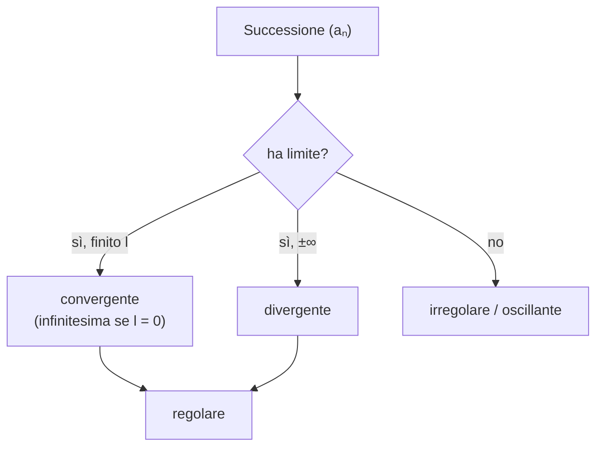

# Successioni Numeriche

> [!abstract]
> Il capitolo studia come si comporta una quantità $a_n$ che dipende da un parametro naturale $n$ quando $n$ diventa sempre più grande ("per $n$ tendente a $+\infty$"). È il primo incontro con il concetto di **limite**, definito in modo rigoroso con gli $\varepsilon$ e il [[00 - AN1 - Concetti Fondamentali#Il modulo|modulo]].
> Il percorso: definizione di **successione**; successioni **convergenti**, **divergenti** e **irregolari**; **regole di calcolo** dei limiti e **forme indeterminate**; teoremi del **confronto** e dei **carabinieri**; il teorema sulle **successioni monotone**, che sfrutta la [[00 - AN1 - Concetti Fondamentali#L'assioma della completezza|completezza di ℝ]] e permette di costruire le radici (metodo di Erone) e il **numero di Nepero** $e$; infine le successioni **asintotiche** e il **principio di sostituzione**.
> Le serie ([[02 - AN1 - Serie Numeriche|cap. 2]]) sono limiti di particolari successioni, e i limiti di funzione ([[03 - AN1 - Funzioni Reali di una Variabile Reale#Limiti delle Funzioni Reali|cap. 3]]) si definiranno proprio tramite le successioni.
> Mappa del corso: [[MOC - Analisi 1]].

---

## Definizione di successione

Vedi [[Successione]].

> [!important] Definizione 1.1 — Successione numerica
> Una **successione numerica** è una funzione $a : \mathbb{N} \to \mathbb{R}$, cioè una regola che a ogni $n \in \mathbb{N}$ associa un unico numero $a(n) \in \mathbb{R}$.

Si scrive di solito $a_n := a(n)$ (il **termine** $n$-esimo) e si rappresenta la successione elencando i valori in ordine oppure con la formula che li definisce:

$$a(n) := \frac{1}{n+1}: \qquad (a_n)_{n \in \mathbb{N}} = \left(1, \tfrac12, \tfrac13, \tfrac14, \dots\right) \quad \text{oppure} \quad (a_n)_{n\in\mathbb{N}} = \left(\frac{1}{n+1}\right)_{n \in \mathbb{N}}.$$

Può capitare che la formula non abbia senso per alcuni $n$: allora il dominio non è tutto $\mathbb{N}$ ma un insieme della forma $\{n_0, n_0 + 1, n_0 + 2, \dots\}$, e si parla comunque di successione.

> [!example] Esempio
> $a_n := \frac{1}{n(n-3)}$ non è definita per $n = 0$ e $n = 3$ (il denominatore si annulla). Si considera allora $a : \{4, 5, 6, \dots\} \to \mathbb{R}$ e si scrive $(a_n)_{n \ge 4} = \left(\frac{1}{n(n-3)}\right)_{n \ge 4}$.

Altri esempi:

- $(2, 3, 5, 7, 11, 13, \dots)$, la successione dei **numeri primi** (non ha una formula semplice, ma è ben definita);
- $\left(\left(1 + \frac1n\right)^n\right)_{n \ge 1}$, che definirà il numero $e$;
- $(q^n)_{n \in \mathbb{N}} = (q^0, q^1, q^2, \dots)$ per $q \in \mathbb{R}$ fisso, la **successione geometrica**.

> [!tip] Successioni e array
> Una successione è come un array infinito indicizzato da $n$; la domanda dell'analisi è: che cosa succede "in fondo" all'array, cioè per indici sempre più grandi?

_(dispensa, p. 9)_

---

## Convergenza, Divergenza e Irregolarità per Successioni

Vedi [[Limite di successione]].

> [!question] Problema
> Studiare il comportamento dei termini $a_n$ di una successione per $n$ sempre più grande.

Tre esempi mostrano i tre comportamenti possibili:

- $\left(\frac1n\right)_{n \ge 1} = \left(1, \frac12, \frac13, \frac14, \dots\right)$: i termini **si avvicinano** a $l = 0$;
- $(n)_{n \in \mathbb{N}} = (0, 1, 2, 3, \dots)$: i termini **superano qualsiasi valore** fissato;
- $((-1)^n)_{n \in \mathbb{N}} = (+1, -1, +1, -1, \dots)$: i termini **oscillano** tra $-1$ e $1$.

_(dispensa, p. 9)_

### Successioni convergenti

> [!important] Definizione 1.2 — Successione convergente
> (i) $(a_n)_{n\in\mathbb{N}}$ è **convergente al limite** $l \in \mathbb{R}$ se
> $$\forall \varepsilon > 0\ \exists n_0 \in \mathbb{N} : \quad |l - a_n| < \varepsilon \quad \forall n \ge n_0.$$
> Si scrive $\displaystyle\lim_{n \to +\infty} a_n = l$ oppure $a_n \to l$ per $n \to +\infty$.
>
> (ii) Se $\lim_{n\to+\infty} a_n = 0$, la successione si dice **infinitesima**.

Come leggere la definizione: si fissa una **tolleranza** $\varepsilon$, piccola a piacere; da un certo indice $n_0$ in poi (che dipende da $\varepsilon$: più la tolleranza è piccola, più $n_0$ sarà grande) **tutti** i termini distano da $l$ meno di $\varepsilon$, cioè stanno nella striscia $(l - \varepsilon, l + \varepsilon)$. Ricorda che $|l - a_n|$ è proprio la [[00 - AN1 - Concetti Fondamentali#Il modulo|distanza]] tra $a_n$ e $l$.

Osservazione: $a_n \to l \iff l - a_n \to 0$. Studiare la convergenza a $l$ equivale a studiare se l'**errore** $l - a_n$ è infinitesimo.

> [!example] Esempio: $\lim_{n\to+\infty} \frac1n = 0$
> Fissato $\varepsilon > 0$, si vuole $n_0$ tale che per $n \ge n_0$
> $$\left|0 - \tfrac1n\right| = \tfrac1n < \varepsilon \iff n > \tfrac{1}{\varepsilon}.$$
> Basta scegliere $n_0 \in \mathbb{N}$ con $n_0 > \frac1\varepsilon$: allora per ogni $n \ge n_0$ vale $\frac1n \le \frac{1}{n_0} < \varepsilon$. Quindi $\left(\frac1n\right)_{n \ge 1}$ è infinitesima. (Ad esempio con $\varepsilon = 0{,}01$ si può prendere $n_0 = 101$.)

> [!important] Proposizione 1.3 — Unicità del limite
> Il limite di una successione convergente è unico.

**Dimostrazione** (per assurdo; i tre modi di dimostrare sono riassunti nell'[[12 - AN1 - Appendice#Tre Principali Modi di Dimostrazioni|Appendice]]). Supponiamo $a_n \to l_1$ e $a_n \to l_2$ con $l_1 \neq l_2$. Sia $\varepsilon := \frac{|l_1 - l_2|}{4} > 0$: esistono $n_1, n_2$ con $|l_1 - a_n| < \varepsilon$ per $n \ge n_1$ e $|l_2 - a_n| < \varepsilon$ per $n \ge n_2$. Per $N := \max\{n_1, n_2\}$, con la disuguaglianza triangolare:
$$|l_1 - l_2| = |(l_1 - a_N) + (a_N - l_2)| \le |l_1 - a_N| + |a_N - l_2| < 2\varepsilon = \frac{|l_1 - l_2|}{2}.$$
Dividendo per $|l_1 - l_2| > 0$ si ottiene $1 < \frac12$ $\lightning$. $\square$

L'idea: un termine non può stare contemporaneamente "molto vicino" a due punti diversi. Si scelgono intorni di $l_1$ e $l_2$ abbastanza piccoli da essere disgiunti.

> [!example] Esercizio
> Verificare con la definizione che $\lim_{n\to+\infty} \frac{n}{2n+5} = \frac12$.
>
> *Traccia.* $\left|\frac12 - \frac{n}{2n+5}\right| = \frac{5}{2(2n+5)} < \varepsilon \iff 2n + 5 > \frac{5}{2\varepsilon} \iff n > \frac{5}{4\varepsilon} - \frac52$; basta prendere $n_0$ più grande di quest'ultimo numero.

_(dispensa, p. 10)_

### Successioni divergenti

> [!important] Definizione 1.4 — Successione divergente
> - $(a_n)$ **diverge a $+\infty$** se $\forall M > 0\ \exists n_0 : a_n > M\ \forall n \ge n_0$; si scrive $\lim_{n\to+\infty} a_n = +\infty$.
> - $(a_n)$ **diverge a $-\infty$** se $\forall M < 0\ \exists n_0 : a_n < M\ \forall n \ge n_0$; si scrive $\lim_{n\to+\infty} a_n = -\infty$.
> - $(a_n)$ **diverge** se diverge a $+\infty$ oppure a $-\infty$.

Qui il ruolo di $\varepsilon$ è preso da una "soglia" $M$ arbitrariamente grande: da un certo punto in poi la successione la supera e non torna più sotto. Ad esempio $\lim_{n\to+\infty} n = +\infty$.

Una successione con limite finito (convergente) o infinito (divergente) si dice **regolare**.

> [!important] Definizione 1.5 — Successione irregolare
> Se $(a_n)$ non è né convergente né divergente, si dice **irregolare** (o **oscillante**).

Ad esempio $((-1)^n)_{n\in\mathbb{N}}$ è irregolare.

_(dispensa, pp. 10–11)_

### Successione geometrica

Vedi [[Serie geometrica]].

> [!example] Successione geometrica $a_n := q^n$
> Per $q \in \mathbb{R}$ fisso, $(q^n)_{n\in\mathbb{N}}$:
> 1. **diverge a $+\infty$** se $q > 1$;
> 2. è **costante** se $q = 1$ ($a_n = 1$ per ogni $n$, quindi $\lim a_n = 1$);
> 3. è **infinitesima** se $|q| < 1$;
> 4. è **irregolare** se $q \le -1$.

**Dimostrazione di (1).** Poiché $q > 1$, si ha $q - 1 > 0$ e per la [[00 - AN1 - Concetti Fondamentali#Disuguaglianza di Bernoulli|disuguaglianza di Bernoulli]]
$$q^n = (1 + (q-1))^n \ge 1 + n(q-1) \qquad \forall n \in \mathbb{N}.$$
Dato $M > 0$, si sceglie $n_0 > \frac{M-1}{q-1}$; allora per ogni $n \ge n_0$
$$q^n \ge 1 + n(q-1) \ge 1 + n_0(q-1) > 1 + \frac{M-1}{q-1}(q-1) = M. \qquad \square$$

> [!tip] Intuizione per gli altri casi
> - $|q| < 1$: $|q^n| = |q|^n = \frac{1}{(1/|q|)^n}$ con $\frac{1}{|q|} > 1$, e il denominatore diverge per il punto (1).
> - $q = -1$: si ottiene $(+1, -1, +1, \dots)$. Per $q < -1$ il modulo $|q|^n$ diverge ma il segno alterna: i termini pari vanno a $+\infty$, i dispari a $-\infty$.

_(dispensa, p. 11)_

### Successione armonica

> [!example] Successione armonica $a_n := n^\alpha$
> Per $\alpha \in \mathbb{R}$ fisso, $(n^\alpha)_{n \ge 1}$:
> 1. **diverge a $+\infty$** se $\alpha > 0$ (es. $n$, $n^2$, $\sqrt{n}$);
> 2. è **costante** se $\alpha = 0$ ($a_n = 1$, quindi $\lim a_n = a_1 = 1$);
> 3. è **infinitesima** se $\alpha < 0$ (es. $\frac1n$, $\frac{1}{n^2}$, $\frac{1}{\sqrt n}$).

Queste due famiglie, $q^n$ e $n^\alpha$, sono i "mattoni" con cui si confrontano quasi tutte le successioni e, nel [[02 - AN1 - Serie Numeriche|cap. 2]], le serie.

_(dispensa, p. 11)_

### Successioni convergenti e limitatezza

> [!important] Proposizione 1.6
> Una successione convergente è **limitata**: esistono $m, M \in \mathbb{R}$ tali che $m \le a_n \le M$ per ogni $n \in \mathbb{N}$.

**Dimostrazione.** Se $l := \lim a_n$, con $\varepsilon = 1$ esiste $n_0$ tale che $|l - a_n| < 1$, cioè $l - 1 < a_n < l + 1$, per ogni $n \ge n_0$. I termini prima di $n_0$ sono un numero **finito**, quindi
$$m := \min\{l - 1, a_0, a_1, \dots, a_{n_0 - 1}\}, \qquad M := \max\{l + 1, a_0, a_1, \dots, a_{n_0-1}\}$$
funzionano. $\square$

> [!warning] Il viceversa è falso
> Limitata non implica convergente: $((-1)^n)$ è limitata (tra $-1$ e $1$) ma non converge. La limitatezza è una condizione **necessaria**, non sufficiente. Diventerà sufficiente aggiungendo la monotonia ([[#Successioni monotone|Teorema 1.10]]).

_(dispensa, p. 11)_

---

## Regole per il Calcolo dei Limiti

> [!question] Problema
> Data una successione "complicata", studiarne la convergenza senza usare ogni volta la definizione.

> [!important] Proposizione 1.7 — Regole per il calcolo dei limiti
> Se $a_n \to l_1$ e $b_n \to l_2$ (con $l_1, l_2 \in \mathbb{R}$), allora per $n \to +\infty$:
> 1. $a_n \pm b_n \to l_1 \pm l_2$;
> 2. $a_n \cdot b_n \to l_1 \cdot l_2$;
> 3. $\frac{a_n}{b_n} \to \frac{l_1}{l_2}$ se $l_2 \neq 0$;
> 4. $(a_n)^{b_n} \to l_1^{l_2}$ se $l_1 > 0$;
> 5. $|a_n| \to |l_1|$.

**Dimostrazione di (2).** Poiché $(a_n)$ converge, per la Proposizione 1.6 esiste $M > 0$ con $|a_n| \le M$ per ogni $n$. Dato $\varepsilon > 0$, esiste $n_0$ tale che per $n \ge n_0$
$$|l_1 - a_n| < \frac{\varepsilon/2}{M + |l_2|} \qquad \text{e} \qquad |l_2 - b_n| < \frac{\varepsilon/2}{M + |l_2|}.$$
Il trucco è aggiungere e togliere $a_n l_2$:
$$
\begin{aligned}
|l_1 l_2 - a_n b_n| &= |(l_1 l_2 - a_n l_2) + (a_n l_2 - a_n b_n)| \le |l_1 - a_n|\,|l_2| + |a_n|\,|l_2 - b_n| \\
&\le \frac{\varepsilon}{2} \cdot \underbrace{\frac{|l_2|}{M + |l_2|}}_{\le 1} + \frac{\varepsilon}{2} \cdot \underbrace{\frac{M}{M + |l_2|}}_{\le 1} \le \varepsilon \qquad \forall n \ge n_0. \qquad \square
\end{aligned}
$$

> [!example] Esempio 1: rapporto di polinomi
> $$\lim_{n\to+\infty} \frac{7n^2 - 2n + 3}{-3n^2 + n - 1}.$$
> Numeratore e denominatore divergono, quindi la regola (3) non si applica direttamente. Si **mette in evidenza la potenza che cresce più in fretta**, $n^2$:
> $$\frac{7n^2 - 2n + 3}{-3n^2 + n - 1} = \frac{n^2 \left(7 - \frac2n + \frac{3}{n^2}\right)}{n^2\left(-3 + \frac1n - \frac{1}{n^2}\right)} \to \frac{7 - 0 + 0}{-3 + 0 - 0} = -\frac73.$$
> In generale, per un rapporto di polinomi dello stesso grado il limite è il rapporto dei coefficienti direttivi.

> [!example] Esempio 2: differenza di radici
> $$\lim_{n\to+\infty} \sqrt{n+3} - \sqrt{n}.$$
> Entrambi i termini divergono, quindi la regola (1) non si applica. Si **razionalizza** con $(a - b)(a + b) = a^2 - b^2$:
> $$\sqrt{n+3} - \sqrt n = \left(\sqrt{n+3} - \sqrt n\right) \frac{\sqrt{n+3} + \sqrt n}{\sqrt{n+3} + \sqrt n} = \frac{n + 3 - n}{\sqrt{n+3} + \sqrt n} = \frac{3}{\sqrt{n+3} + \sqrt n} \to \frac{3}{+\infty} = 0.$$
> L'ultimo passaggio è giustificato dalle forme determinate qui sotto.

_(dispensa, pp. 12–13)_

### Forme determinate e indeterminate

Vedi [[Forme indeterminate]].

Le regole di calcolo si estendono alle successioni **divergenti** quando il risultato è una delle seguenti **forme determinate**. Per ogni $a \in \mathbb{R}$:

| Forma | Valore |
|---|---|
| $\pm\infty + a$ | $\pm\infty$ |
| $(\pm\infty) + (\pm\infty)$ | $\pm\infty$ |
| $\pm\infty \cdot a$ | $\pm\infty$ se $a > 0$; $\mp\infty$ se $a < 0$ |
| $(\pm\infty)\cdot(\pm\infty)$ | $+\infty$ |
| $(\pm\infty)\cdot(\mp\infty)$ | $-\infty$ |
| $\frac{a}{\pm\infty}$ | $0$ |
| $q^{+\infty}$ | $+\infty$ se $q > 1$; $0$ se $0 < q < 1$ |
| $q^{-\infty}$ | $0$ se $q > 1$; $+\infty$ se $0 < q < 1$ |
| $q^0$ | $1$ se $q > 0$ |

Ad esempio, se $a_n \to -3$ e $b_n \to +\infty$, allora $a_n b_n \to -3 \cdot (+\infty) = -\infty$ e $\frac{a_n}{b_n} \to \frac{-3}{+\infty} = 0$.

> [!note] Due forme determinate utilissime
> Sia $(a_n)$ **limitata** ($m \le a_n \le M$). Allora $\frac{a_n}{b_n} \to 0$ per ogni $(b_n)$ divergente e $a_n c_n \to 0$ per ogni $(c_n)$ infinitesima:
> $$\frac{\text{"limitata"}}{\pm\infty} = 0, \qquad \text{"limitata"} \cdot 0 = 0.$$
> Esempi: $\frac{\sin(n)}{\sqrt n} \to 0$ e $\cos(n^2) \cdot \left(\frac13\right)^n \to 0$, perché $-1 \le \sin(x), \cos(x) \le 1$, $\sqrt n \to +\infty$ e $\left(\frac13\right)^n \to 0$.
> Nota che $\sin(n)$ da sola **non** ha limite: la regola funziona proprio perché basta che sia limitata.

Con le forme determinate si estendono le operazioni ai **numeri reali estesi** $\overline{\mathbb{R}} := \mathbb{R} \cup \{-\infty, +\infty\}$. Non tutte le operazioni però si possono definire: queste sono **forme indeterminate**:

$$(\pm\infty) - (\pm\infty), \quad 0 \cdot (\pm\infty), \quad \frac00, \quad \frac{\pm\infty}{\pm\infty}, \quad \frac{a}{0}\ (a \in \mathbb{R}), \quad 1^{\pm\infty}, \quad (\pm\infty)^0, \quad 0^0.$$

Se al limite si ottiene una forma indeterminata, sapere solo i limiti di $(a_n)$ e $(b_n)$ **non basta** per dire nulla sul limite della loro combinazione: bisogna trasformare l'espressione (come negli esempi sopra).

> [!example] Esempio: $(+\infty) - (+\infty)$ è indeterminata
> Sia $b_n := n$. A seconda di $a_n \to +\infty$ si ottiene di tutto:
> - $a_n := n$: $a_n - b_n = 0 \to 0$ (converge);
> - $a_n := n^2$: $a_n - b_n = n^2\left(1 - \frac1n\right) \to +\infty \cdot 1 = +\infty$ (diverge);
> - $a_n := n + (-1)^n$: $a_n - b_n = (-1)^n$ (irregolare).

Le regole di calcolo dicono che il limite è **compatibile con le operazioni algebriche**.

> [!example] Esercizio
> Calcolare $\displaystyle\lim_{n\to+\infty} n \left(\sqrt5 - \sqrt{5 - \tfrac2n}\right)$ (risultato $l = \frac{\sqrt5}{5}$).
>
> *Traccia.* Razionalizzando: $n \cdot \dfrac{5 - \left(5 - \frac2n\right)}{\sqrt5 + \sqrt{5 - \frac2n}} = \dfrac{2}{\sqrt5 + \sqrt{5 - \frac2n}} \to \dfrac{2}{2\sqrt5} = \dfrac{1}{\sqrt5} = \dfrac{\sqrt5}{5}$.

_(dispensa, pp. 13–14)_

---

## Limiti e Ordinamento

### Teorema del confronto e dei carabinieri

Vedi [[Teorema dei carabinieri]].

> [!important] Teorema — Confronto e carabinieri
> Siano $a_n \to l_1$ e $b_n \to l_2$ con $l_1, l_2 \in \overline{\mathbb{R}}$ e $a_n \le b_n$ per ogni $n$. Allora:
> - $l_1 \le l_2$ (**teorema del confronto**);
> - se inoltre $a_n \le c_n \le b_n$ per ogni $n$ e $l_1 = l_2$, allora anche $c_n \to l_1$ (**teorema dei carabinieri**).

Il teorema dei carabinieri permette di studiare una successione complicata $(c_n)$ "incastrandola" tra due più semplici, i due carabinieri che la scortano verso lo stesso limite.

> [!example] Esempio 1
> $c_n := \left(\dfrac{1}{3 + \cos(n^2)}\right)^n$. Poiché $-1 \le \cos(n^2) \le 1$, si ha $2 \le 3 + \cos(n^2) \le 4$, quindi
> $$\underbrace{\left(\tfrac14\right)^n}_{=: a_n \to 0} \le c_n \le \underbrace{\left(\tfrac12\right)^n}_{=: b_n \to 0} \quad\Rightarrow\quad \lim_{n\to+\infty} c_n = 0.$$

> [!example] Esempio 2: $\lim_{n\to+\infty} \sqrt[n]{a} = 1$ per ogni $a > 0$
> - Caso $a > 1$: sia $d_n := \sqrt[n]{a} - 1 > 0$, cioè $\sqrt[n]a = 1 + d_n$. Per Bernoulli
> $$a = (1 + d_n)^n \ge 1 + n d_n \quad\Rightarrow\quad \underbrace{\frac{a-1}{n}}_{\to 0} \ge d_n \ge \underbrace{0}_{\to 0},$$
> quindi $d_n \to 0$ per i carabinieri e $\sqrt[n]a = 1 + d_n \to 1$.
> - Caso $0 < a < 1$: $\tilde a := \frac1a > 1$, quindi $\sqrt[n]{\tilde a} \to 1$ e $\sqrt[n]a = \frac{1}{\sqrt[n]{\tilde a}} \to \frac11 = 1$.
> - Caso $a = 1$: banale.

_(dispensa, p. 14)_

### Definitivamente e permanenza del segno

Il limite dipende solo dal comportamento di $a_n$ per $n$ grande: i primi termini (in numero finito) non influiscono né sull'esistenza né sul valore del limite. Si dice che una proprietà vale **definitivamente** se esiste $n_0$ tale che vale per ogni $n > n_0$.

Ad esempio $(n - 1000)_{n\in\mathbb{N}}$ è definitivamente positiva ($a_n > 0$ per $n > 1000 =: n_0$), mentre $((-1)^n)$ **non** lo è. Per questo i teoremi precedenti valgono anche se le ipotesi ($a_n \le b_n$, ecc.) sono vere solo definitivamente.

- Dal teorema del confronto (con successioni costanti): se $a_n \to l$ e $a_n \in [\alpha, \beta]$ definitivamente, allora $l \in [\alpha, \beta]$.
- In particolare vale il **teorema della permanenza del segno**: se $a_n \ge 0$ definitivamente e $a_n \to l$, allora $l \ge 0$.

> [!warning] Con le disuguaglianze strette non funziona
> Se $a_n > 0$ per ogni $n$ e $a_n \to l$, **non** segue $l > 0$! Controesempio: $a_n := \frac{1}{n+1} > 0$ per ogni $n$, ma $a_n \to 0$. Passando al limite le disuguaglianze strette diventano larghe (un intervallo aperto non contiene i suoi estremi, che possono comunque essere limiti).

> [!note] Perché $\frac{a}{0}$ è indeterminata anche per $a \neq 0$
> Si potrebbe pensare che $\frac a0 = \infty$, ma non si sa **quale** segno: ad esempio $a_n := \frac{(-1)^n}{n} \to 0$, ma $\frac{1}{a_n} = (-1)^n n$ oscilla tra valori sempre più grandi positivi e negativi. Le strade sono due: introdurre un infinito senza segno $\infty$, oppure (come nella dispensa) tenere solo $\pm\infty$ e lasciare $\frac a0$ indeterminata.

Il problema si risolve in parte con gli **infinitesimi con segno**.

> [!important] Definizione 1.8 — Infinitesimi con segno
> Sia $a_n \to 0$.
> - Se $a_n \ge 0$ definitivamente, si scrive $a_n \to 0^+$;
> - se $a_n \le 0$ definitivamente, si scrive $a_n \to 0^-$.

Si ottengono altre forme determinate:
$$\frac{a}{0^\pm} = \pm\infty \text{ se } a > 0, \qquad \frac{a}{0^\pm} = \mp\infty \text{ se } a < 0, \qquad \frac{a}{\pm\infty} = 0^\pm \text{ se } a > 0, \qquad \frac{a}{\pm\infty} = 0^\mp \text{ se } a < 0.$$

Esempi: se $a_n \to 2$ e $b_n \to 0^-$, allora $\frac{a_n}{b_n} \to \frac{2}{0^-} = -\infty$; se $a_n \to -1$ e $b_n \to +\infty$, allora $\frac{a_n}{b_n} \to \frac{-1}{+\infty} = 0^-$.

_(dispensa, pp. 14–15)_

### Successioni monotone

Vedi [[Teorema delle successioni monotone]].

> [!question] Problema
> Finora, per dimostrare che una successione converge, serviva un **candidato** per il limite. Ma ad esempio $\left(\left(1 + \frac1n\right)^n\right)$ converge, e questo non si può dimostrare né con la definizione né con le regole di calcolo, perché non si conosce il limite in anticipo. Servono criteri di convergenza che non facciano riferimento al limite.

> [!important] Definizione 1.9 — Successione monotona
> $(a_n)$ si dice
> - **crescente** se $a_{n+1} \ge a_n$ per ogni $n$;
> - **decrescente** se $a_{n+1} \le a_n$ per ogni $n$;
> - **monotona** se è crescente oppure decrescente.

> [!important] Teorema 1.10 — Regolarità delle successioni monotone
> Se $(a_n)$ è **monotona**, allora ammette limite. Il limite è **finito** (cioè $(a_n)$ converge) se e solo se $(a_n)$ è **limitata**. Inoltre
> $$\lim_{n\to+\infty} a_n = \begin{cases} \sup\{a_n : n \in \mathbb{N}\} & \text{se } (a_n) \text{ è crescente}, \\ \inf\{a_n : n \in \mathbb{N}\} & \text{se } (a_n) \text{ è decrescente}. \end{cases}$$

**Dimostrazione** (caso crescente e limitata). Per la [[00 - AN1 - Concetti Fondamentali#L'assioma della completezza|completezza di ℝ]] esiste $l := \sup\{a_n : n \in \mathbb{N}\} \in \mathbb{R}$. Sia $\varepsilon > 0$. Per la [[00 - AN1 - Concetti Fondamentali#Maggioranti ed estremo superiore|caratterizzazione del sup]]:
- $a_n \le l$, cioè $0 \le l - a_n$, per ogni $n$;
- esiste $a_{n_0}$ con $l - \varepsilon < a_{n_0}$, cioè $l - a_{n_0} < \varepsilon$.

Poiché la successione è crescente, per $n \ge n_0$ vale $a_n \ge a_{n_0}$ e quindi
$$0 \le l - a_n \le l - a_{n_0} < \varepsilon \qquad \forall n \ge n_0,$$
cioè $|l - a_n| < \varepsilon$: $a_n \to l$. $\square$

> [!tip] Perché serve la completezza
> In $\mathbb{Q}$ il teorema è falso: la successione crescente di razionali $1;\ 1{,}4;\ 1{,}41;\ 1{,}414;\ \dots$ è limitata ma "converge" a $\sqrt2 \notin \mathbb{Q}$, cioè non ha limite in $\mathbb{Q}$. È la completezza a garantire che il "punto d'arrivo" esista.

Il teorema servirà anche per dimostrare il [[04 - AN1 - Funzioni Continue#Funzioni Continue su Intervalli|teorema degli zeri]]. Due applicazioni importanti seguono.

_(dispensa, pp. 15–16)_

### Il metodo di Erone

Per $a > 0$ e $k \in \mathbb{N}$, $k \ge 2$, si definisce
$$x_0 := 1, \qquad x_{n+1} := \frac1k \left((k-1)x_n + \frac{a}{x_n^{k-1}}\right).$$

Qui non c'è una formula diretta per $x_n$, ma una regola per calcolare il termine successivo a partire dal precedente: si dice che la successione è definita **per ricorrenza** (concetto legato al principio di induzione, e analogo a un ciclo in un programma).

![[AN1-p022-1.png]]

*Figura 3 — Il metodo di Erone.* Il grafico mostra la funzione $f(x) = x^k - a$, che vale $-a$ in $0$ e taglia l'asse $x$ proprio in $\sqrt[k]a$. Da $x_n$ si traccia la **retta tangente** al grafico; il punto in cui la tangente interseca l'asse $x$ è $x_{n+1}$ (lo si verificherà nel [[05 - AN1 - Calcolo Differenziale#Approssimazione Lineare di Funzioni|cap. 5]]: è il **metodo di Newton** applicato a $f$). Poiché la curva è convessa, la tangente sta sotto il grafico e $x_{n+1}$ cade tra la radice e $x_n$: la successione scende verso la radice.

Dalla figura si vede che $(x_n)$ è
- **definitivamente decrescente** (per $n \ge 1$), e
- **limitata** ($x_n \ge 0$ per ogni $n$).

Per il Teorema 1.10 esiste il limite $\lim x_n =: r \in [0, +\infty)$. Per calcolarlo si nota che anche $x_{n+1} \to r$ e si passa al limite nella ricorrenza:
$$r \leftarrow x_{n+1} = \frac1k\left((k-1)\underbrace{x_n}_{\to r} + \frac{a}{\underbrace{x_n^{k-1}}_{\to r^{k-1}}}\right) \to \frac1k\left((k-1)r + \frac{a}{r^{k-1}}\right),$$
quindi
$$r = \frac1k\left((k-1)r + \frac{a}{r^{k-1}}\right) \;\Rightarrow\; kr = (k-1)r + \frac{a}{r^{k-1}} \;\Rightarrow\; r = \frac{a}{r^{k-1}} \;\Rightarrow\; r^k = a.$$

Abbiamo così **costruito** la radice $k$-esima: $r =: \sqrt[k]a$.

> [!example] Esempio numerico: $\sqrt2$ ($a = 2$, $k = 2$)
> La ricorrenza diventa $x_{n+1} = \frac12\left(x_n + \frac{2}{x_n}\right)$ (la media tra $x_n$ e $\frac{2}{x_n}$):
> $x_0 = 1$, $x_1 = 1{,}5$, $x_2 = 1{,}41\overline{6}$, $x_3 = 1{,}414215\ldots$ Già al terzo passo si hanno 5 cifre corrette di $\sqrt2 = 1{,}414213\ldots$

_(dispensa, pp. 16–17)_

### Interesse composto e il numero e di Nepero

Vedi [[Numero di Nepero]].

Un capitale di 1 € investito al 100% di interesse annuo diventa 2 € dopo un anno. Se però l'interesse viene pagato $n$ volte l'anno (ogni volta $\frac1n$ del 100%) e reinvestito, dopo un anno il capitale è
$$a_n := \left(1 + \frac1n\right)^n.$$

| Pagamento | $n$ | $a_n$ |
|---|---|---|
| ogni mese | 12 | 2,61303529… |
| ogni giorno | 365 | 2,71456748… |
| ogni ora | 8760 | 2,71812669… |
| ogni secondo | 31.536.000 | 2,71828178… |

Pagando più spesso si accumulano più interessi composti, quindi la successione è **crescente**; inoltre è **limitata**, con $a_n \in [2, 3]$ per ogni $n$ (si dimostra con il [[00 - AN1 - Concetti Fondamentali#Formula del Binomio di Newton|binomio di Newton]]). Per il Teorema 1.10 converge, e si pone

> [!important] Numero di Nepero
> $$e := \lim_{n\to+\infty} \left(1 + \frac1n\right)^n.$$

Per il teorema del confronto $e \in [2, 3]$; si dimostra che $e \notin \mathbb{Q}$ e $e = 2{,}718281828459045\ldots$ Diventerà la base "naturale" di esponenziali e logaritmi ([[03 - AN1 - Funzioni Reali di una Variabile Reale#Funzioni Elementari|cap. 3]]).

_(dispensa, p. 17)_

---

## Confronto tra Successioni

Vedi [[Successioni asintotiche]].

> [!important] Definizione 1.11 — Successioni asintotiche
> Se $\displaystyle\lim_{n\to+\infty} \frac{a_n}{b_n} = 1$, le successioni si dicono **asintotiche** e si scrive $a_n \sim b_n$ per $n \to +\infty$.

Intuitivamente $a_n$ e $b_n$ "si somigliano sempre di più" in senso **relativo**: il loro rapporto tende a 1, anche se la differenza può restare grande (ad esempio $n^2 + n \sim n^2$, ma la differenza $n$ diverge).

Osservazioni:

- se $a_n \sim b_n$, le due successioni hanno lo **stesso comportamento asintotico**:
  - $(a_n)$ converge $\iff$ $(b_n)$ converge, e in tal caso hanno lo stesso limite;
  - $(a_n)$ diverge $\iff$ $(b_n)$ diverge, con lo stesso limite;
  - $(a_n)$ è irregolare $\iff$ $(b_n)$ è irregolare;
- $\sim$ è una **relazione di equivalenza**: riflessiva ($a_n \sim a_n$), simmetrica ($a_n \sim b_n \Rightarrow b_n \sim a_n$) e transitiva ($a_n \sim b_n$ e $b_n \sim c_n \Rightarrow a_n \sim c_n$).

> [!important] Teorema 1.12 — Principio di sostituzione
> Se $a_n \sim a_n'$, $b_n \sim b_n'$ e $c_n \sim c_n'$, allora
> $$\frac{a_n b_n}{c_n} \sim \frac{a_n' b_n'}{c_n'}.$$
> In particolare $a_n b_n \sim a_n' b_n'$ e $\frac{a_n}{b_n} \sim \frac{a_n'}{b_n'}$.

Nei **prodotti** e nei **rapporti** si può quindi sostituire una successione con una asintotica più semplice senza cambiare il comportamento, e in particolare il limite.

> [!example] Esempi
> - $2n^3 - 5n^2 - 3n + 11 \sim 2n^3$, perché
> $$\frac{2n^3 - 5n^2 - 3n + 11}{2n^3} = 1 - \frac{5}{2n} - \frac{3}{2n^2} + \frac{11}{2n^3} \to 1.$$
> Un polinomio è asintotico al suo termine di grado massimo.
> - $n + 5 \sim n$, perché $\frac{n+5}{n} = 1 + \frac5n \to 1$. Per il principio di sostituzione $(n+5)^3 \sim n^3$ e quindi
> $$\frac{2n^3 - 5n^2 - 3n + 11}{(n+5)^3} \sim \frac{2n^3}{n^3} = 2 \to 2 = \lim_{n\to+\infty} \frac{2n^3 - 5n^2 - 3n + 11}{(n+5)^3}.$$

> [!warning] Il principio di sostituzione NON vale per somme, differenze e potenze
> Se $a_n \sim a_n'$ e $b_n \sim b_n'$, in generale
> - $a_n + b_n \not\sim a_n' + b_n'$,
> - $a_n - b_n \not\sim a_n' - b_n'$,
> - $(a_n)^{b_n} \not\sim (a_n')^{b_n'}$.
>
> **Controesempi.**
> - Somma: $a_n := n + 1 \sim n =: a_n'$ e $b_n := -n \sim -n =: b_n'$, ma $a_n + b_n = 1$ e $a_n' + b_n' = 0$ hanno limiti diversi.
> - Potenza: $a_n := 1 + \frac1n \sim 1 =: a_n'$ e $b_n := n \sim n =: b_n'$, ma $(a_n)^{b_n} = \left(1 + \frac1n\right)^n \to e$ mentre $(a_n')^{b_n'} = 1^n = 1$.
>
> È l'errore più comune negli esercizi: sostituire "a pezzi" dentro una somma.

_(dispensa, pp. 17–18)_

### Criterio del rapporto per le radici n-esime

> [!important] Proposizione 1.13
> Se $a_n > 0$ definitivamente ed esiste $\displaystyle\lim_{n\to+\infty} \frac{a_{n+1}}{a_n} =: q$, allora esiste anche
> $$\lim_{n\to+\infty} \sqrt[n]{a_n} = q.$$

È utile per i limiti con radici $n$-esime, perché il rapporto $\frac{a_{n+1}}{a_n}$ è spesso molto più facile da calcolare (soprattutto con fattoriali e potenze, che si semplificano).

> [!example] Esempio
> $a_n = n$: $\frac{a_{n+1}}{a_n} = \frac{n+1}{n} = 1 + \frac1n \to 1$, quindi $\displaystyle\lim_{n\to+\infty} \sqrt[n]{n} = 1$.

> [!example] Esercizio
> Calcolare, se esiste, $\displaystyle\lim_{n\to+\infty} \frac{\sqrt[n]{n!}}{n}$ (suggerimento: $n = \sqrt[n]{n^n}$).
>
> *Soluzione.* $\frac{\sqrt[n]{n!}}{n} = \sqrt[n]{a_n}$ con $a_n := \frac{n!}{n^n}$. Allora
> $$\frac{a_{n+1}}{a_n} = \frac{(n+1)!}{(n+1)^{n+1}} \cdot \frac{n^n}{n!} = \frac{(n+1)\, n^n}{(n+1)^{n+1}} = \left(\frac{n}{n+1}\right)^n = \frac{1}{\left(1 + \frac1n\right)^n} \to \frac1e,$$
> quindi il limite vale $\frac1e$. In altre parole $\sqrt[n]{n!} \approx \frac{n}{e}$ (è una forma debole della formula di Stirling).

Lo stesso confronto tra rapporto e radice tornerà nei [[02 - AN1 - Serie Numeriche#Serie a Termini Positivi|criteri del rapporto e della radice]] per le serie.

_(dispensa, p. 18)_
