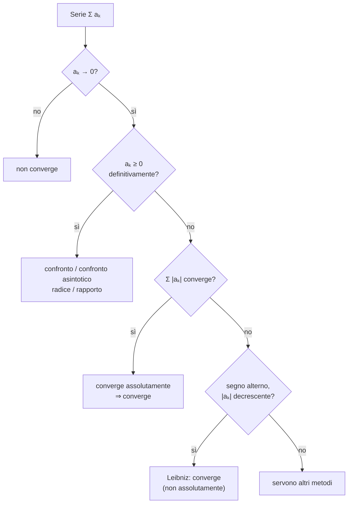

# Serie Numeriche

> [!abstract]
> Una **serie** è una "somma infinita" $a_0 + a_1 + a_2 + \ldots$. Il capitolo le dà senso come **limite delle somme parziali**, riducendo tutto alle [[01 - AN1 - Successioni Numeriche|successioni]] del capitolo precedente. Presenta le serie modello (**geometrica**, **armonica**, **di Mengoli**, **esponenziale**, **armonica generalizzata**), la **condizione necessaria** $a_k \to 0$, i criteri per le serie a **termini positivi** (**confronto**, **radice**, **rapporto**) e, per le serie a segno variabile, il **criterio di Leibniz** e la **convergenza assoluta**. Chiude con un fatto sorprendente: una somma infinita può dipendere dall'ordine degli addendi.
> Le serie torneranno con la [[05 - AN1 - Calcolo Differenziale#Serie di Taylor|serie di Taylor]] e con il [[06 - AN1 - Calcolo Integrale#Integrali Impropri|confronto serie–integrali impropri]], che dimostra il comportamento dell'armonica generalizzata.
> Mappa del corso: [[MOC - Analisi 1]].

---

## Il problema delle somme infinite

Vedi [[Serie numerica]].

> [!question] Problema
> Sommare **tutti** i termini di una successione $(a_n)_{n\in\mathbb{N}}$, cioè dare senso alla somma infinita
> $$a_0 + a_1 + a_2 + a_3 + \ldots = \sum_{k=0}^{+\infty} a_k.$$

Una somma di infiniti numeri non si può "fare" addendo dopo addendo. L'idea è considerare prima le **somme parziali** (o **ridotte**) $n$-esime
$$s_n := a_0 + a_1 + \ldots + a_n = \sum_{k=0}^n a_k, \qquad n \in \mathbb{N},$$
che sono somme finite, e poi mandare $n \to +\infty$. In questo modo la somma infinita diventa il **limite di una successione**, $(s_n)$, e possiamo usare tutto ciò che sappiamo sui limiti.

_(dispensa, p. 19)_

---

## Convergenza e prime Proprietà

> [!important] Definizione 2.1 — Serie numerica
> La serie $\sum_{k=0}^{+\infty} a_k$:
> - **converge** alla **somma** $s \in \mathbb{R}$ se $\lim_{n\to+\infty} s_n = s$; si scrive $\sum_{k=0}^{+\infty} a_k = s$;
> - **diverge** a $\pm\infty$ se $\lim_{n\to+\infty} s_n = \pm\infty$; si scrive $\sum_{k=0}^{+\infty} a_k = \pm\infty$;
> - è **irregolare** (o **oscillante**) se $(s_n)$ è irregolare.

Studiare una serie significa quindi studiare la **successione delle somme parziali** $(s_n)$. Attenzione a non confondere le due successioni in gioco: $(a_k)$, i termini che si sommano, e $(s_n)$, le somme accumulate.

_(dispensa, p. 19)_

### Serie geometrica

Vedi [[Serie geometrica]].

> [!important] Serie geometrica
> Per $q \in \mathbb{R}$:
> $$\sum_{k=0}^{+\infty} q^k = 1 + q + q^2 + q^3 + \ldots = \begin{cases} \dfrac{1}{1-q} & \text{se } |q| < 1, \\ +\infty & \text{se } q \ge 1, \\ \text{irregolare} & \text{se } q \le -1. \end{cases}$$

**Dimostrazione.**
- Caso $q = 1$: $q^k = 1$ per ogni $k$, quindi $s_n = 1 + 1 + \ldots + 1 = n + 1 \to +\infty$.
- Caso $q \neq 1$: per la [[00 - AN1 - Concetti Fondamentali#Progressione geometrica|somma geometrica]]
$$s_n = q^0 + q^1 + \ldots + q^n = \frac{1 - q^{n+1}}{1 - q} = \frac{1}{1-q} - \frac{q}{1-q} \cdot q^n,$$
e la tesi segue dal comportamento della [[01 - AN1 - Successioni Numeriche#Successione geometrica|successione geometrica]] $q^n$: tende a $0$ se $|q| < 1$ (e allora $s_n \to \frac{1}{1-q}$), diverge a $+\infty$ se $q > 1$ (e $-\frac{q}{1-q} > 0$, quindi $s_n \to +\infty$), è irregolare se $q \le -1$. $\square$

> [!example] Esempi
> - $\sum_{k=0}^{+\infty} \left(\frac12\right)^k = 1 + \frac12 + \frac14 + \ldots = \frac{1}{1 - \frac12} = 2$.
> - $0{,}\overline{9} = \frac{9}{10} \sum_{k=0}^{+\infty} \left(\frac{1}{10}\right)^k = \frac{9}{10} \cdot \frac{1}{1 - \frac{1}{10}} = 1$: un allineamento decimale periodico è una serie geometrica, ed è per questo che rappresenta un razionale.

_(dispensa, p. 19)_

### Serie armonica

Vedi [[Serie armonica]].

> [!important] Serie armonica
> $$\sum_{k=1}^{+\infty} \frac1k = 1 + \frac12 + \frac13 + \frac14 + \frac15 + \ldots = +\infty.$$

**Idea della dimostrazione.** Si raggruppano i termini in blocchi di lunghezza $2, 4, 8, \dots$ e si stima ogni blocco dal basso con il suo termine più piccolo:
$$\sum_{k=1}^{+\infty} \frac1k = 1 + \frac12 + \underbrace{\left(\frac13 + \frac14\right)}_{\ge 2 \cdot \frac14 = \frac12} + \underbrace{\left(\frac15 + \ldots + \frac18\right)}_{\ge 4 \cdot \frac18 = \frac12} + \underbrace{\left(\frac19 + \ldots + \frac{1}{16}\right)}_{\ge 8 \cdot \frac{1}{16} = \frac12} + \ldots \ge 1 + \frac12 + \frac12 + \frac12 + \ldots = +\infty. \quad \square$$

> [!note] Una divergenza lentissima
> I termini $\frac1k$ tendono a $0$, eppure la somma diverge. Diverge però molto lentamente: $s_n$ cresce circa come $\ln(n) + 0{,}5772\ldots$ (la costante è la costante di Eulero–Mascheroni $\gamma$). Servono circa $12.367$ termini per superare $10$.

_(dispensa, p. 20)_

### La scala autoportante

La divergenza della serie armonica ha una conseguenza sorprendente: si può costruire (in teoria) una **scala autoportante** che supera qualsiasi distanza. Si usano gradini di lunghezza $l = 2$ e peso $1$, appoggiati uno sull'altro senza colla, cercando di sporgere il più possibile.

![[AN1-p026-1.png]]

*Figura 4 — Scala autoportante: 2 gradini.* Il gradino superiore (lunghezza $l = 2$) è appoggiato su quello inferiore; il punto rosso è il suo **baricentro** (al centro, a distanza 1 dagli estremi). La freccia indica lo spigolo del gradino inferiore: la massima sporgenza si ottiene mettendo lo spigolo **esattamente sotto il baricentro** del gradino sopra. Con 2 gradini la sporgenza è quindi $1$.

Si aggiunge un terzo gradino **sotto** i primi due (sopra non si può aggiungere niente senza far crollare tutto).

![[AN1-p026-2.png]]

*Figura 5 — Scala autoportante: 3 gradini.* A sinistra la scala; a destra lo schema della **leva** sullo spigolo del 3° gradino: da un lato agisce il baricentro del 2° gradino (peso 1, a distanza $1 - x$ dallo spigolo), dall'altro il baricentro del 1° gradino (peso 1), che coincide con lo spigolo del 2° (a distanza $x$). Se $x$ è lo sbalzo tra 2° e 3° gradino, l'equilibrio della leva dà
$$1 \cdot (1 - x) = 1 \cdot x \quad\Rightarrow\quad x = \frac12.$$

Si continua così fino al gradino $n+1$, da sistemare sotto gli $n$ precedenti in modo che il suo spigolo cada sotto il baricentro del blocco formato dagli $n$ gradini sopra. Si sa che:
- lo spigolo dell'$n$-esimo gradino è esattamente sotto il baricentro dei primi $n - 1$ gradini (peso $n - 1$);
- la distanza tra lo spigolo dell'$n$-esimo gradino e il suo baricentro è $1$.

![[AN1-p027-1.png]]

*Figura 6 — Scala autoportante: $n+1$ gradini.* Lo schema della leva generale: sullo spigolo del gradino $n+1$ agiscono il baricentro dell'$n$-esimo gradino (peso 1, braccio $1 - x$) e il baricentro dei primi $n - 1$ gradini (peso $n - 1$, braccio $x$, punto rosso). L'equilibrio dà
$$1 \cdot (1 - x) = (n-1) \cdot x \quad\Rightarrow\quad x = \frac1n.$$

![[AN1-p027-2.png]]

*Figura 7 — Scala autoportante che supera (teoricamente) qualsiasi distanza.* A sinistra lo schema: gli sbalzi successivi, dall'alto in basso, valgono $1, \frac12, \frac13, \frac14, \dots, \frac1n$ (in rosso), e la sporgenza totale $s_n$ è la loro somma (graffa in basso). A destra una foto di una scala reale costruita con blocchetti di legno: il gradino più in alto sporge interamente oltre la base.

Con $n + 1$ gradini la scala supera quindi la distanza
$$s_n = 1 + \frac12 + \frac13 + \ldots + \frac1n \to +\infty \qquad (n \to +\infty).$$

La dispensa aggiunge che con 10.000 gradini di lunghezza $l = 2\,\text{m}$ si superano appena $9{,}21\,\text{m}$, e per superare $10\,\text{m}$ servono addirittura $22.028$ gradini.

> [!warning] Correzione
> I due numeri usano l'approssimazione $s_n \approx \ln(n)$, che trascura la costante di Eulero–Mascheroni $\gamma \approx 0{,}5772$: infatti $\ln(10.000) = 9{,}21$ e $e^{10} \approx 22.026$. Calcolando la somma esatta:
> - con $10.000$ gradini la sporgenza è $s_{9999} = \sum_{k=1}^{9999} \frac1k \approx 9{,}79\,\text{m}$;
> - per superare $10\,\text{m}$ serve $s_n \ge 10$, cioè $n = 12.367$, quindi $12.368$ gradini.
>
> La conclusione resta la stessa: la crescita è lentissima (logaritmica).

_(dispensa, pp. 20–21)_

### Serie di Mengoli

> [!important] Serie di Mengoli
> $$\frac{1}{1 \cdot 2} + \frac{1}{2 \cdot 3} + \frac{1}{3 \cdot 4} + \frac{1}{4 \cdot 5} + \ldots = \sum_{k=1}^{+\infty} \frac{1}{k(k+1)} = 1.$$

**Dimostrazione.** Per induzione (esercizio) si mostra che
$$s_n = \sum_{k=1}^n \frac{1}{k(k+1)} = 1 - \frac{1}{n+1} \to 1.$$
In alternativa, con il trucco della **somma telescopica**: siccome $\frac{1}{k(k+1)} = \frac{(k+1) - k}{k(k+1)} = \frac1k - \frac{1}{k+1}$,
$$s_n = \sum_{k=1}^n \left(\frac1k - \frac{1}{k+1}\right) = \sum_{k=1}^n \frac1k - \sum_{k=2}^{n+1} \frac1k = 1 - \frac{1}{n+1}.$$
Quasi tutti i termini si cancellano a coppie, come i pezzi di un cannocchiale che rientrano uno nell'altro. $\square$

_(dispensa, p. 21)_

### Condizione necessaria

Solo in rari casi (geometrica, Mengoli) si trova una formula esplicita per le somme parziali.

> [!question] Problema
> Come si studia la convergenza di una serie **senza** una formula per $s_n$? Si rinuncia a calcolare la somma e ci si accontenta di sapere che esiste ed è finita.

> [!important] Proposizione 2.2 — Condizione necessaria
> Se $\sum_{k=0}^{+\infty} a_k$ converge, allora $\lim_{k\to+\infty} a_k = 0$.

**Dimostrazione.** Se $s_n \to s$, anche $s_{n-1} \to s$, quindi $s_n - s_{n-1} \to s - s = 0$. Ma
$$s_n - s_{n-1} = (a_0 + \ldots + a_{n-1} + a_n) - (a_0 + \ldots + a_{n-1}) = a_n. \qquad \square$$

> [!warning] Necessaria, non sufficiente
> La serie armonica ha $\frac1k \to 0$ eppure diverge. La condizione si usa al contrario: se $a_k \not\to 0$, la serie **non** converge (ad esempio $\sum (-1)^k$ o $\sum \frac{k}{k+1}$).

L'**ordine** di $\mathbb{R}$ aiuta a risolvere il problema, come si vede nel paragrafo seguente.

_(dispensa, p. 22)_

---

## Serie a Termini Positivi

Se $a_k \ge 0$ per ogni $k$, allora $s_{n+1} = s_n + a_{n+1} \ge s_n$: le somme parziali sono **crescenti**. Si può quindi usare il [[01 - AN1 - Successioni Numeriche#Successioni monotone|teorema sulle successioni monotone]].

> [!important] Teorema 2.3
> Se $a_k \ge 0$ per ogni $k$ (basta definitivamente), allora la serie $\sum_{k=0}^{+\infty} a_k$
> - **converge** se e solo se $(s_n)$ è **limitata**;
> - **diverge a $+\infty$** se e solo se $(s_n)$ non è limitata.

Per una serie a termini positivi basta quindi verificare che le somme parziali siano limitate. In particolare **una serie a termini positivi non può essere irregolare**: o converge o diverge a $+\infty$.

### Serie esponenziale

> [!example] Esempio: $\sum_{k=0}^{+\infty} \frac{1}{k!}$ (serie esponenziale)
> Per $k \ge 2$:
> $$k! = 1 \cdot \underbrace{2 \cdot 3 \cdot \ldots \cdot k}_{\ge 2 \cdot 2 \cdots 2 = 2^{k-1}} \ge 2^{k-1} \quad\Rightarrow\quad \frac{1}{k!} \le \frac{1}{2^{k-1}} = 2\left(\frac12\right)^k.$$
> La disuguaglianza vale anche per $k = 0$ e $k = 1$, quindi
> $$s_n = \sum_{k=0}^n \frac{1}{k!} \le 2 \sum_{k=0}^n \left(\frac12\right)^k \le 2 \sum_{k=0}^{+\infty} \left(\frac12\right)^k = \frac{2}{1 - \frac12} = 4 \qquad \forall n.$$
> $(s_n)$ è limitata, quindi $s := \sum_{k=0}^{+\infty} \frac{1}{k!}$ converge e, per il confronto, $s \le 4$.

Si dimostrerà (con la [[05 - AN1 - Calcolo Differenziale#Serie di Taylor|serie di Taylor]]) che
$$\sum_{k=0}^{+\infty} \frac{1}{k!} = e.$$
È un modo molto più efficiente di calcolare $e$ rispetto a $\left(1 + \frac1n\right)^n$: con 10 termini si hanno già 7 cifre corrette.

_(dispensa, p. 22)_

### Criterio del confronto

Vedi [[Criterio del confronto per le serie]].

Nell'esempio precedente la serie esponenziale è stata confrontata con la serie geometrica di ragione $\frac12$. L'idea vale in generale.

> [!important] Proposizione 2.4 — Criterio del confronto
> Sia $0 \le a_k \le b_k$ definitivamente. Allora
> $$\underbrace{\sum b_k}_{\text{maggiorante}} \text{ converge} \;\Rightarrow\; \underbrace{\sum a_k}_{\text{minorante}} \text{ converge}, \qquad \underbrace{\sum a_k}_{\text{minorante}} \text{ diverge} \;\Rightarrow\; \underbrace{\sum b_k}_{\text{maggiorante}} \text{ diverge}.$$

Il perché: le somme parziali di $\sum a_k$ sono minori di quelle di $\sum b_k$; se queste ultime sono limitate, lo sono anche le prime (Teorema 2.3). La seconda implicazione è la contronominale della prima.

> [!example] Esempio
> $\sum_{k=1}^{+\infty} \frac{1}{\sqrt k}$: poiché $\frac{1}{\sqrt k} \ge \frac1k$ per $k \ge 1$, la serie armonica è un **minorante divergente**, quindi anche $\sum \frac{1}{\sqrt k}$ diverge.

> [!important] Proposizione 2.5 — Confronto asintotico
> Siano $a_k \ge 0$ e $b_k > 0$ definitivamente, e supponiamo che esista $\displaystyle\lim_{k\to+\infty} \frac{a_k}{b_k} =: l \in \mathbb{R}$. Allora
> $$\sum b_k \text{ converge} \Rightarrow \sum a_k \text{ converge}, \qquad \sum a_k \text{ diverge} \Rightarrow \sum b_k \text{ diverge}.$$
> Se inoltre $l \neq 0$ (in particolare se $a_k \sim b_k$), valgono anche le implicazioni opposte:
> $$\sum a_k \text{ converge} \iff \sum b_k \text{ converge}, \qquad \sum a_k \text{ diverge} \iff \sum b_k \text{ diverge}.$$

Il vantaggio: non serve una disuguaglianza termine a termine, basta sapere come si comportano i termini "alla lunga". Due serie con termini [[01 - AN1 - Successioni Numeriche#Confronto tra Successioni|asintotici]] hanno lo stesso carattere.

> [!example] Esempio: $\sum_{k=1}^{+\infty} \frac{1}{k^2}$
> Si confronta con la serie di Mengoli:
> $$\frac{1/k^2}{1/(k(k+1))} = \frac{k(k+1)}{k^2} = 1 + \frac1k \to 1 = l \neq 0.$$
> La serie di Mengoli converge, quindi converge anche $\sum \frac{1}{k^2}$.

> [!note] Il problema di Basilea
> Con metodi più sofisticati (Eulero, 1734) si dimostra che
> $$\sum_{k=1}^{+\infty} \frac{1}{k^2} = \frac{\pi^2}{6}.$$

_(dispensa, pp. 23–24)_

### Criteri della radice e del rapporto

Vedi [[Criterio del rapporto e della radice]].

> [!question] Problema
> Per usare il confronto bisogna **trovare** un minorante divergente o un maggiorante convergente. Come?

Un'idea è usare come termine di paragone la serie geometrica $\sum q^k$ con $q > 0$: si ottengono due criteri che "misurano" quanto la serie somiglia a una geometrica.

> [!important] Proposizione 2.6 — Criterio della radice
> Sia $a_k \ge 0$ definitivamente e supponiamo che esista $q := \displaystyle\lim_{k\to+\infty} \sqrt[k]{a_k}$. Allora la serie $\sum a_k$
> - **converge** se $q < 1$;
> - **diverge** se $q > 1$;
> - **non si può concludere nulla** se $q = 1$.

> [!example] Esempio
> $a_k := \frac{a^k}{k^k}$ con $a > 0$: $\sqrt[k]{a_k} = \frac{a}{k} \to 0 = q < 1$, quindi $\sum a_k$ converge.

> [!important] Proposizione 2.7 — Criterio del rapporto
> Sia $a_k > 0$ definitivamente e supponiamo che esista $q := \displaystyle\lim_{k\to+\infty} \frac{a_{k+1}}{a_k}$. Allora la serie $\sum a_k$
> - **converge** se $q < 1$;
> - **diverge** se $q > 1$;
> - **non si può concludere nulla** se $q = 1$.

> [!example] Esempio: serie esponenziale $\sum \frac{a^k}{k!}$, $a > 0$
> $$\frac{a_{k+1}}{a_k} = \frac{a^{k+1}/(k+1)!}{a^k/k!} = \frac{a^{k+1} \cdot k!}{(k+1)! \cdot a^k} = \frac{a}{k+1} \to 0 = q < 1,$$
> quindi la serie converge (per ogni $a > 0$).

> [!tip] Quale criterio usare
> - **Rapporto**: quando compaiono fattoriali o prodotti, che si semplificano nel rapporto ($\frac{(k+1)!}{k!} = k+1$).
> - **Radice**: quando compaiono potenze $k$-esime ($\sqrt[k]{x^k} = x$).
> - Se il criterio dà $q = 1$ (succede per tutte le serie del tipo $\sum \frac{1}{k^\alpha}$!) bisogna cambiare strada, di solito con il confronto. Per la [[01 - AN1 - Successioni Numeriche#Criterio del rapporto per le radici n-esime|Proposizione 1.13]], se il limite del rapporto esiste, quello della radice esiste ed è uguale: il criterio della radice è più generale.

_(dispensa, p. 24)_

### Serie armonica generalizzata

> [!example] Serie armonica generalizzata $\sum_{k=1}^{+\infty} \frac{1}{k^\alpha}$, $\alpha \in \mathbb{R}$
> Con il criterio del confronto:
> - per $\alpha \le 1$ diverge, perché $\frac1k \le \frac{1}{k^\alpha}$: la serie armonica è un **minorante divergente**;
> - per $\alpha \ge 2$ converge, perché $\frac{1}{k^2} \ge \frac{1}{k^\alpha}$: $\sum \frac{1}{k^2}$ è un **maggiorante convergente**.

Restano i parametri $\alpha \in (1, 2)$, che si sistemano con il [[06 - AN1 - Calcolo Integrale#Integrali impropri e serie|confronto con gli integrali impropri]]:

> [!important] Proposizione 2.8
> $$\sum_{k=1}^{+\infty} \frac{1}{k^\alpha} \text{ converge} \iff \alpha > 1.$$

È la serie di riferimento più usata nel criterio del confronto asintotico: si confronta $a_k$ con $\frac{1}{k^\alpha}$ per un $\alpha$ adatto.

> [!note] Ipotesi di Riemann
> Come funzione di $\alpha$ (anche complesso), la somma $\zeta(\alpha) := \sum_{k=1}^{+\infty} \frac{1}{k^\alpha}$ è la **funzione zeta di Riemann**. L'ipotesi di Riemann, sulla posizione dei suoi zeri, è considerata il più importante problema aperto della matematica ed è legata alla distribuzione dei numeri primi.

_(dispensa, pp. 24–25)_

---

## Serie a Termini di Segno Variabili

Abbiamo visto che la serie armonica diverge: con un numero sufficiente di passi di lunghezza $\frac1k$ in avanti si supera qualsiasi limite.

![[AN1-p031-1.png]]

*Figura 8 — Divergenza della serie armonica.* Sulla retta reale i passi successivi sono disegnati come archi: il primo da $0$ a $1$, poi $+\frac12$, $+\frac13$, $+\frac14$, … Gli archi diventano sempre più piccoli ma vanno sempre nella stessa direzione, e la posizione raggiunta tende a $+\infty$.

> [!question] Problema
> Che cosa succede se a ogni passo si **inverte la direzione**, cioè se i termini cambiano segno? Come si comporta la **serie di Leibniz**
> $$\sum_{k=1}^{+\infty} (-1)^k \frac1k = -1 + \frac12 - \frac13 + \frac14 - \frac15 \pm \ldots \;?$$

![[AN1-p031-2.png]]

*Figura 9 — Convergenza della serie di Leibniz.* Stessa rappresentazione, ma ora gli archi alternano verso: si parte da $0$, si va a $-1$ (grande arco inferiore), si torna indietro di $\frac12$ fino a $-1 + \frac12$, poi avanti di $\frac13$, indietro di $\frac14$, … Gli archi formano una spirale che si stringe: le posizioni oscillano con ampiezza sempre più piccola attorno a un punto, e si ha l'impressione che la serie converga.

_(dispensa, p. 25)_

### Criterio di Leibniz

Vedi [[Criterio di Leibniz]].

> [!important] Proposizione 2.9 — Criterio di Leibniz
> Se la successione $(a_k)_{k\in\mathbb{N}}$ è
> - **decrescente**, e
> - **infinitesima**,
>
> allora la serie $\sum_{k=0}^{+\infty} (-1)^k a_k =: s \in \mathbb{R}$ **converge**. Inoltre vale la stima dell'errore
> $$|s - s_n| \le a_{n+1} \qquad \forall n \in \mathbb{N}.$$

(Le due ipotesi implicano $a_k \ge 0$: una successione decrescente che tende a 0 non può scendere sotto 0.)

![[AN1-p032-1.png]]

*Figura 10 — Criterio di Leibniz: stima dell'errore.* Due casi. A sinistra ($n+1$ pari): il passo successivo è in avanti, $s_{n+1} = s_n + a_{n+1}$, e la somma $s$ sta tra $s_n$ e $s_{n+1}$; quindi la distanza $|s - s_n|$ è al massimo la lunghezza del passo, $a_{n+1}$. A destra ($n+1$ dispari): il passo è all'indietro, $s_{n+1} = s_n - a_{n+1}$, e di nuovo $s$ è compresa tra $s_{n+1}$ e $s_n$.

> [!tip] Perché funziona
> Le somme parziali di indice pari e quelle di indice dispari formano due successioni monotone (una sale, l'altra scende) che si "inseguono", e la distanza tra loro è $a_{n+1} \to 0$. Entrambe convergono per il [[01 - AN1 - Successioni Numeriche#Successioni monotone|teorema sulle successioni monotone]], allo stesso limite $s$, che resta sempre intrappolato tra due somme parziali consecutive. Da qui la stima dell'errore: troncando la serie, si sbaglia al più del **primo termine trascurato**.

> [!note] Somma della serie di Leibniz
> Si può verificare che
> $$\sum_{k=1}^{+\infty} (-1)^k \frac1k = -\ln(2).$$
> Per la stima dell'errore, per avere 3 cifre decimali corrette servono circa mille termini: una convergenza lenta.

> [!example] Esempio
> $a_k := \frac{1}{k^\alpha}$ con $\alpha > 0$ è decrescente e infinitesima, quindi
> $$\sum_{k=1}^{+\infty} (-1)^k \frac{1}{k^\alpha} \text{ converge per ogni } \alpha > 0,$$
> anche per $\alpha \le 1$, dove la serie dei moduli diverge.

_(dispensa, p. 26)_

### Convergenza assoluta

Vedi [[Convergenza assoluta]].

Confrontando la serie armonica con quella di Leibniz si ottiene un'osservazione importante:
$$\underbrace{\sum_{k=0}^{+\infty} a_k \text{ converge}}_{\text{convergenza (semplice)}} \quad\not\Rightarrow\quad \underbrace{\sum_{k=0}^{+\infty} |a_k| \text{ converge}}_{\text{convergenza assoluta}}.$$

Infatti per $a_k = (-1)^k \frac1k$ la serie $\sum a_k$ converge (Leibniz), mentre
$$\sum_{k=1}^{+\infty} |a_k| = \sum_{k=1}^{+\infty} \left|(-1)^k \frac1k\right| = \sum_{k=1}^{+\infty} \frac1k \quad \text{diverge.}$$

Vale invece il contrario:

> [!important] Proposizione 2.10
> Se $\sum_{k=0}^{+\infty} |a_k|$ converge, allora converge anche $\sum_{k=0}^{+\infty} a_k$: la **convergenza assoluta implica la convergenza semplice**.

È molto utile perché $\sum |a_k|$ è **sempre a termini positivi**, quindi si può studiare con i criteri del paragrafo precedente. Ad esempio, dai criteri del rapporto e della radice applicati a $\sum |a_k|$:

> [!important] Proposizione 2.11
> Se
> $$q := \lim_{k\to+\infty} \left|\frac{a_{k+1}}{a_k}\right| < 1 \qquad \text{oppure} \qquad q := \lim_{k\to+\infty} \sqrt[k]{|a_k|} < 1,$$
> allora $\sum_{k=0}^{+\infty} a_k$ converge assolutamente, e quindi anche semplicemente.

> [!example] Esempio: serie esponenziale $\sum \frac{a^k}{k!}$ con $a \in \mathbb{R}$
> $$\left|\frac{a_{k+1}}{a_k}\right| = \frac{|a|^{k+1}/(k+1)!}{|a|^k/k!} = \frac{|a|}{k+1} \to 0 = q < 1,$$
> quindi la serie converge per **ogni** $a \in \mathbb{R}$, anche negativo.

Si dimostrerà ([[05 - AN1 - Calcolo Differenziale#Serie di Taylor|serie di Taylor]]) che
$$\sum_{k=0}^{+\infty} \frac{a^k}{k!} = e^a \qquad \forall a \in \mathbb{R}.$$

_(dispensa, pp. 26–27)_

### Riordinamenti di una serie

Per una somma **finita** l'ordine degli addendi non conta:
$$1 + 2 + 3 + 4 = 10 = 4 + 1 + 3 + 2 = 3 + 1 + 2 + 4 = \ldots$$
Per le somme **infinite** in generale **no**. Si può verificare che per qualsiasi $s \in \overline{\mathbb{R}}$ esiste un **riordinamento** della serie di Leibniz $\sum (-1)^k \frac1k$ (un ordine diverso in cui sommare gli stessi termini) che converge esattamente a $s$. Sommando i termini nell'ordine giusto si ottiene qualunque somma: una somma infinita non è più commutativa.

> [!tip] Idea (teorema di Riemann–Dini)
> I termini positivi da soli formano una serie divergente a $+\infty$, quelli negativi una serie divergente a $-\infty$. Per arrivare a $s$, si prendono termini positivi finché si supera $s$, poi negativi finché si scende sotto $s$, e così via: poiché i termini tendono a 0, le oscillazioni attorno a $s$ si smorzano.

Il fenomeno capita **solo** per le serie che convergono ma non assolutamente, come quella di Leibniz. Per una serie **assolutamente convergente**, ogni riordinamento converge alla stessa somma: è un altro motivo per cui la convergenza assoluta è la nozione "buona".

_(dispensa, p. 27)_
