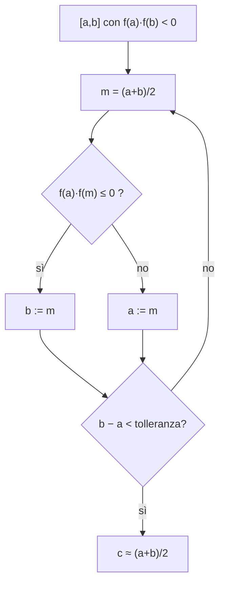

# Funzioni Continue di una Variabile Reale

> [!abstract]
> Una funzione è **continua** quando il suo limite in un punto coincide con il valore in quel punto: intuitivamente, il grafico "non ha salti". Il capitolo definisce la continuità con le successioni, mostra che somme, prodotti, rapporti e composizioni di funzioni continue sono continue e verifica la continuità delle [[03 - AN1 - Funzioni Reali di una Variabile Reale#Funzioni Elementari|funzioni elementari]].
> Poi arrivano i grandi teoremi sulle funzioni continue su **intervalli**, che si basano sulla [[00 - AN1 - Concetti Fondamentali#L'assioma della completezza|completezza di ℝ]]: il **teorema degli zeri** (con il metodo di **bisezione**), il **teorema dei valori intermedi**, la **continuità dell'inversa** e il **teorema di Weierstrass**. Con questi si costruiscono **logaritmi**, **radici**, **potenze reali** e le **inverse** delle funzioni circolari e iperboliche.
> Il problema di *trovare* massimi e minimi, lasciato aperto da Weierstrass, sarà risolto con le derivate nel [[05 - AN1 - Calcolo Differenziale|cap. 5]].
> Mappa del corso: [[MOC - Analisi 1]].

---

## Funzioni Continue

Vedi [[Funzione continua]].

Per l'esistenza e il valore di $\lim_{x\to c} f(x) = l$ ([[03 - AN1 - Funzioni Reali di una Variabile Reale#Definizione di limite|cap. 3]])
- **non** importa che $c \in X$, e
- se $c \in X$, **non** importa che $f(c) = l$.

Proprio queste due condizioni, invece, caratterizzano le funzioni continue.

> [!important] Definizione 4.1 — Continuità
> $f : X \subseteq \mathbb{R} \to \mathbb{R}$ si dice
> - **continua in $x_0 \in X$** se per ogni successione $(x_n) \subset X$ con $x_n \to x_0$ si ha $f(x_n) \to f(x_0)$;
> - **continua** se è continua in ogni $x \in X$.

In parole: $f$ è continua se "commuta con i limiti", $f\left(\lim x_n\right) = \lim f(x_n)$. Piccole variazioni di $x$ producono piccole variazioni di $f(x)$.

Osservazioni:
- definizione equivalente senza successioni ($\varepsilon$–$\delta$): $f$ è continua in $x_0$ se e solo se
$$\forall \varepsilon > 0\ \exists \delta > 0 : \quad |f(x) - f(x_0)| \le \varepsilon \quad \forall x \in X \text{ con } |x - x_0| < \delta;$$
- se $x_0 \in X$ è un punto di accumulazione di $X$: $f$ è continua in $x_0$ $\iff$ $\lim_{x\to x_0} f(x) = f(x_0)$;
- se $x_0 \in X$ **non** è di accumulazione per $X$ (si dice **punto isolato**), $f$ è sempre continua in $x_0$: le uniche successioni in $X$ che tendono a $x_0$ sono definitivamente uguali a $x_0$. Ad esempio ogni successione $a : \mathbb{N} \to \mathbb{R}$ è continua.

> [!important] Proposizione 4.2
> Se $f, g : X \to \mathbb{R}$ sono continue (in $x_0$), allora sono continue (in $x_0$) anche
> - $f \pm g$;
> - $f \cdot g$;
> - $\frac fg : X_0 \to \mathbb{R}$, dove $X_0 := \{x \in X : g(x) \neq 0\}$ (in $x_0$ se $g(x_0) \neq 0$);
> - $|f|$.

Segue subito dalle regole di calcolo dei limiti. Di conseguenza l'insieme
$$C(X) := \{f : X \to \mathbb{R} \mid f \text{ è continua}\}$$
è uno **spazio vettoriale** (anzi un'**algebra**: è chiuso anche rispetto al prodotto). Dal [[03 - AN1 - Funzioni Reali di una Variabile Reale#Limiti per le funzioni composte|limite delle funzioni composte]]:

> [!important] Proposizione 4.3
> Se $f : X \to Y$ è continua in $x_0$ e $g : Y \to \mathbb{R}$ è continua in $y_0 := f(x_0)$, allora $g \circ f$ è continua in $x_0$. La composizione di funzioni continue è continua.

_(dispensa, p. 40)_

### Continuità delle funzioni elementari

Con le due proposizioni e i [[03 - AN1 - Funzioni Reali di una Variabile Reale#Tre limiti notevoli|limiti notevoli]] si verifica la continuità delle funzioni elementari.

- **Polinomi**: $f(x) = 1$ e $g(x) = x$ sono continue, quindi anche $x^k$ (prodotto) e ogni $p(x) = a_0 + \ldots + a_n x^n$ (combinazione lineare).
- **Funzioni razionali**: continue **nel loro dominio**, come rapporto di polinomi.
- **Modulo**: $|x|$ è continua, perché $\big||x| - |x_0|\big| \le |x - x_0|$ ([[00 - AN1 - Concetti Fondamentali#Il modulo|cap. 0]]).
- **Funzioni circolari**: per la prostaferesi, per ogni $x, x_0$
$$\sin(x) - \sin(x_0) = 2 \cdot \underbrace{\sin\left(\tfrac{x - x_0}{2}\right)}_{\to 0} \cdot \underbrace{\cos\left(\tfrac{x + x_0}{2}\right)}_{\text{limitata}} \to 0 \qquad (x \to x_0),$$
quindi $\sin$ è continua; analogamente $\cos$, e quindi $\tan = \frac{\sin}{\cos}$.
- **Funzione esponenziale**: per $x \neq x_0$ sia $h := x - x_0$ (allora $x \to x_0 \iff h \to 0$):
$$e^x - e^{x_0} = (x - x_0)\, e^{x_0}\, \frac{e^{x - x_0} - 1}{x - x_0} = h \cdot e^{x_0} \cdot \frac{e^h - 1}{h} \to 0 \cdot e^{x_0} \cdot 1 = 0,$$
grazie al limite notevole $\frac{e^h - 1}{h} \to 1$. Quindi $e^x \to e^{x_0}$.
- **Funzioni iperboliche**: $\sinh$, $\cosh$ (combinazioni di esponenziali) e $\tanh = \frac{\sinh}{\cosh}$ sono continue.

### Discontinuità

> [!example] Discontinuità eliminabile
> Per $l \in \mathbb{R}$ sia
> $$f(x) := \begin{cases} \frac{\sin(x)}{x} & x \neq 0, \\ l & x = 0. \end{cases}$$
> $f$ è continua in ogni $x_0 \neq 0$; in $x_0 = 0$ è continua $\iff$ $\lim_{x\to0} \frac{\sin x}{x} = 1 = f(0) = l$, cioè $\iff l = 1$. Si dice che $\frac{\sin x}{x}$ ha una **discontinuità rimovibile** (eliminabile) in $0$: basta definire bene il valore mancante.

> [!example] Discontinuità di salto
> Con $f(x) := \frac{|x|}{x}$ per $x \neq 0$ e $f(0) := l$, $f$ è discontinua in $0$ **per ogni** scelta di $l$: i limiti laterali $\pm1$ sono diversi, quindi nessun valore può "riempire" il buco.

> [!example] Funzione di Dirichlet
> $$f(x) := \begin{cases} 1 & x \in \mathbb{Q}, \\ 0 & x \in \mathbb{R} \setminus \mathbb{Q} \end{cases}$$
> è discontinua **in ogni** $x \in \mathbb{R}$: vicino a qualsiasi punto ci sono sia razionali sia irrazionali, quindi si trovano successioni $x_n \to x_0$ con $f(x_n) = 1$ e altre con $f(x_n) = 0$.

_(dispensa, pp. 40–41)_

---

## Funzioni Continue su Intervalli

> [!question] Problema
> Data $f : X \to \mathbb{R}$,
> - verificare che $f$ ammette uno **zero**, cioè un $c \in X$ con $f(c) = 0$;
> - calcolare (un valore approssimato di) $c$.

È il problema di risolvere un'equazione $f(x) = 0$, che spesso non si sa fare "a mano" (es. $x^5 + x - 1 = 0$, oppure $\cos(x) = x$). Nel seguito per un intervallo $[a, b]$ si suppone sempre $a < b$.

### Teorema degli zeri

Vedi [[Teorema degli zeri]].

> [!important] Teorema 4.4 — Teorema degli zeri
> Sia $f : [a, b] \to \mathbb{R}$ continua con $f(a)$ e $f(b)$ di **segno opposto** ($f(a) \cdot f(b) < 0$). Allora esiste $c \in (a, b)$ tale che $f(c) = 0$.

L'intuizione: se il grafico parte sotto l'asse $x$ e arriva sopra (o viceversa) senza "staccare la penna", deve attraversare l'asse.

### Metodo di bisezione

Vedi [[Metodo di bisezione]].

**Dimostrazione** (con il **metodo di bisezione**). Si costruisce una successione di intervalli $I_n = [a_n, b_n]$ tale che
1. $[a, b] = I_0 \supset I_1 \supset I_2 \supset \ldots \supset I_n \supset I_{n+1} \supset \ldots$ (intervalli **incapsulati**);
2. la lunghezza di $I_n$ è $b_n - a_n = \frac{b - a}{2^n}$;
3. $f(a_n) \cdot f(b_n) \le 0$ (agli estremi $f$ ha segno opposto, o si annulla).

Costruzione: si parte da $I_0 = [a, b]$. Dato $I_n$, si prende il punto medio $m = \frac{a_n + b_n}{2}$: se $f(a_n) f(m) \le 0$ si pone $I_{n+1} = [a_n, m]$, altrimenti $I_{n+1} = [m, b_n]$ (e allora $f(m) f(b_n) \le 0$). Si tiene sempre la metà in cui c'è un cambio di segno.

![[AN1-p048-1.png]]

*Figura 24 — Il metodo di bisezione.* La curva blu parte positiva in $a = a_0$ (croce verde "+") e arriva negativa in $b = b_0$ (segno rosso "−"). Il punto medio $\frac{a_0 + b_0}{2}$ ha $f > 0$, quindi la metà sinistra (con la grande X viola) viene scartata e diventa $a_1$. Si ripete: $b_2 = \frac{a_1 + b_1}{2}$ ha $f < 0$ e si scarta la parte destra, poi $b_3$, … Le X viola segnano le metà eliminate; gli intervalli rimasti si stringono attorno al punto in cui la curva taglia l'asse $x$.

Dalla proprietà 1:
$$a = a_0 \le a_1 \le a_2 \le \ldots \le a_n \le \ldots \le b_n \le \ldots \le b_2 \le b_1 \le b_0 = b,$$
quindi $(a_n)$ è crescente e limitata, $(b_n)$ decrescente e limitata: per il [[01 - AN1 - Successioni Numeriche#Successioni monotone|teorema sulle successioni monotone]] convergono, $a_n \to c_1$ e $b_n \to c_2$. Dalla proprietà 2:
$$\underbrace{b_n}_{\to c_2} = \underbrace{a_n}_{\to c_1} + \underbrace{\frac{b-a}{2^n}}_{\to 0},$$
quindi $c_1 = c_2 =: c$. Infine dalla proprietà 3, per la continuità di $f$ e il teorema del confronto:
$$0 \ge \underbrace{f(a_n)}_{\to f(c)} \cdot \underbrace{f(b_n)}_{\to f(c)} \to f^2(c).$$
Quindi $f^2(c) \le 0$, possibile solo se $f(c) = 0$. Poiché $f(a), f(b) \neq 0$, $c \in (a, b)$. $\square$

> [!note] Una dimostrazione costruttiva
> La dimostrazione non solo stabilisce che uno zero **esiste**, ma dà anche un **algoritmo** per approssimarlo: dopo $n$ passi lo zero sta in un intervallo di lunghezza $\frac{b-a}{2^n}$, quindi ogni passo guadagna circa una cifra binaria. Si dice che la dimostrazione è **costruttiva**. È lo stesso schema della [[Ricerca binaria|ricerca binaria]] (ASD): dimezzare a ogni passo lo spazio di ricerca.

> [!example] Esempio
> $f(x) = x^2 - 2$ su $[1, 2]$: $f(1) = -1 < 0$, $f(2) = 2 > 0$. Punto medio $1{,}5$: $f = 0{,}25 > 0$ → $[1; 1{,}5]$. Punto medio $1{,}25$: $f < 0$ → $[1{,}25; 1{,}5]$. Poi $[1{,}375; 1{,}5]$, $[1{,}375; 1{,}4375]$, … lo zero è $\sqrt2 = 1{,}4142\ldots$ Rispetto al [[01 - AN1 - Successioni Numeriche#Il metodo di Erone|metodo di Erone]] la convergenza è molto più lenta, ma funziona per **qualsiasi** funzione continua.

_(dispensa, pp. 41–42)_

### Teorema dei valori intermedi

Vedi [[Teorema dei valori intermedi]].

> [!important] Teorema 4.5 — Teorema dei valori intermedi
> Sia $I \subseteq \mathbb{R}$ un intervallo qualsiasi (non necessariamente chiuso), $f : I \to \mathbb{R}$ continua, e siano
> $$m := \inf f = \inf\{f(x) : x \in I\}, \qquad M := \sup f = \sup\{f(x) : x \in I\}.$$
> Allora per ogni $y \in (m, M)$ esiste $x \in I$ con $f(x) = y$: $f$ assume **tutti i valori** compresi tra $\inf f$ e $\sup f$.

**Dimostrazione.** Dato $y \in (m, M)$, esistono $x_1, x_2 \in I$ con $f(x_1) < y < f(x_2)$ (caratterizzazione di inf e sup). Si applica il teorema degli zeri alla funzione $\tilde f(x) := f(x) - y$ sull'intervallo di estremi $x_1, x_2$ (contenuto in $I$ perché $I$ è un intervallo): $\tilde f$ cambia segno, quindi si annulla. $\square$

> [!warning] Serve un intervallo
> Su $[0, 1] \cup [2, 3]$ la funzione che vale $0$ sul primo pezzo e $1$ sul secondo è continua ma non assume il valore $\frac12$: il "buco" nel dominio permette di saltare.

_(dispensa, p. 42)_

### Logaritmi

Vedi [[Logaritmo]].

Come applicazione si dimostra l'esistenza dei logaritmi.

> [!important] Logaritmi
> Sia $0 < a \neq 1$. Allora per ogni $y > 0$ esiste un unico $x \in \mathbb{R}$ con $a^x = y$. Questo $x$ si chiama **logaritmo di $y$ in base $a$**: $x =: \log_a(y)$. Per la base $a = e$ si scrive $\ln(y) := \log_e(y)$ (**logaritmo naturale**).

**Dimostrazione** (in due passi).

*1° caso: $a = e$.* Si è visto ([[03 - AN1 - Funzioni Reali di una Variabile Reale#Tre limiti notevoli|cap. 3]]) che $e^x \ge 1 + x$, quindi
$$\sup\{e^x : x \in \mathbb{R}\} \ge \sup\{1 + x : x \in \mathbb{R}\} = +\infty \quad\Rightarrow\quad M := \sup e^x = +\infty.$$
Inoltre $0 < e^x = \frac{1}{e^{-x}} \to \frac{1}{+\infty} = 0$ per $x \to -\infty$, quindi $m := \inf e^x = 0$. Poiché $I = \mathbb{R}$ è un intervallo ed $e^x$ è continua, per i valori intermedi ogni $y \in (0, +\infty)$ è della forma $e^x$. Questo $x$ è **unico** perché $e^x$ è strettamente crescente.

*2° caso: $0 < a \neq 1$.* Si cerca $x$ con $a^x = y$. Ma
$$e^{x \ln(a)} = \left(e^{\ln(a)}\right)^x = a^x = y = e^{\ln(y)} \iff x \ln(a) = \ln(y),$$
quindi
$$x = \log_a(y) = \frac{\ln(y)}{\ln(a)}. \qquad \square$$

> [!important] Regole per i logaritmi
> Per $0 < a, b \neq 1$, $x, y > 0$, $r \in \mathbb{R}$:
> - $\log_a(1) = 0$, $\log_a(a) = 1$;
> - $\log_a(x \cdot y) = \log_a(x) + \log_a(y)$;
> - $\log_a\left(\frac xy\right) = \log_a(x) - \log_a(y)$, in particolare $\log_a\left(\frac1y\right) = -\log_a(y)$;
> - $\log_a(x^r) = r \cdot \log_a(x)$;
> - $\log_a(x) = \log_a(b) \cdot \log_b(x)$ (**cambio di base**), in particolare $\log_a(x) = \log_a(e) \cdot \ln(x)$.

I logaritmi trasformano prodotti in somme e potenze in prodotti: è per questo che la complessità degli algoritmi "divide et impera" contiene $\log n$ (vedi [[Funzioni di crescita]], ASD).

Con l'esistenza dei logaritmi si è dimostrato che per $0 < a \neq 1$ la funzione $f : \mathbb{R} \to (0, +\infty)$, $f(x) = a^x$ è **invertibile**, con $f^{-1} : (0, +\infty) \to \mathbb{R}$, $f^{-1}(x) = \log_a(x)$. I grafici di $a^x$ e $\log_a(x)$ sono simmetrici rispetto alla bisettrice.

![[AN1-p049-1.png]]

*Figura 25 — I logaritmi.* A sinistra $\log_a(x)$ per $0 < a < 1$ (blu): decrescente, passa per $(1, 0)$; in grigio $a^x$ e la bisettrice, rispetto a cui le due curve sono simmetriche. Al centro il caso $a > 1$: $\log_a(x)$ è crescente, tende a $-\infty$ per $x \to 0^+$ (asintoto verticale $x = 0$) e cresce lentamente. A destra il grafico di $\ln(x)$ tra $0$ e $7$: vale $0$ in $1$ e circa $1{,}95$ in $7$, una crescita molto lenta.

> [!question] Problema
> $\log_a : (0, +\infty) \to \mathbb{R}$ è continua?

La risposta è sì, per il teorema seguente.

_(dispensa, p. 43)_

### Continuità della funzione inversa

> [!important] Teorema 4.6
> Sia $I \subseteq \mathbb{R}$ un intervallo e $f \in C(I)$. Allora anche $J := f(I) = \{f(x) : x \in I\}$ è un intervallo e
> - $f : I \to J$ è invertibile $\iff$ $f$ è strettamente crescente oppure strettamente decrescente;
> - se $f$ è invertibile, $f^{-1} : J \to I$ è **continua**.

Per le funzioni continue su un intervallo, quindi, invertibile = strettamente monotona, e l'inversa è automaticamente continua.

> [!example] Senza intervallo il teorema non vale
> $f : [-1, 0] \cup (1, 2] \to [0, 2]$, $f(x) = |x|$. Sul primo pezzo $f$ scende da $1$ a $0$, sul secondo sale da (quasi) $1$ a $2$: è continua e biiettiva, ma **non** strettamente monotona, e $f^{-1} : [0, 2] \to [-1, 0] \cup (1, 2]$ è **discontinua** in $x = 1$.

![[AN1-p050-1.png]]

*Figura 26 — Funzione continua con inversa discontinua.* A sinistra il grafico di $f$: un segmento discendente da $(-1, 1)$ a $(0, 0)$ e un segmento ascendente da $(1, 1)$ (pallino vuoto, escluso) a $(2, 2)$. A destra $f^{-1}$: sul tratto $[0, 1]$ va da $0$ a $-1$ (ramo discendente in basso), poi per $y > 1$ salta su a valori vicini a $1$ (ramo ascendente). In $y = 1$ vale $f^{-1}(1) = -1$, ma subito a destra vale circa $1$: c'è un salto.

_(dispensa, p. 44)_

---

## Altre Funzioni Invertibili

Lo schema usato per invertire $a^x$ funziona per molte altre funzioni:
- il **teorema dei valori intermedi** per verificare la **suriettività** di $f$;
- la **stretta monotonia** per ottenere l'**iniettività**;
- il **Teorema 4.6** per la **continuità** di $f^{-1}$.

### Radici

$f : [0, +\infty) \to [0, +\infty)$, $f(x) = x^n$ ($n \ge 1$) è continua, strettamente crescente, il dominio è un intervallo, $\inf f = \min f = 0$ e $\sup f = +\infty$. Quindi $f$ è invertibile con inversa continua
$$f^{-1}(x) = \sqrt[n]{x} = x^{\frac1n}.$$

![[AN1-p050-2.png]]

*Figura 27 — La radice $n$-esima.* A sinistra il caso $n$ pari: $\sqrt[n]x$ (blu) è definita solo per $x \ge 0$ ed è lo specchio di $x^n$ (grigio, solo il ramo destro) rispetto alla bisettrice; le curve si incontrano in $(1,1)$. A destra il caso $n$ dispari: $x^n$ è invertibile su tutto $\mathbb{R}$ e $\sqrt[n]x$ è definita anche per $x < 0$, con una tangente verticale nell'origine.

Se $n$ è **dispari**, $f$ si può considerare su tutto $\mathbb{R}$: resta continua e strettamente crescente con $\inf f = -\infty$ e $\sup f = +\infty$, quindi è invertibile con $f^{-1} : \mathbb{R} \to \mathbb{R}$, $f^{-1}(x) = \sqrt[n]x$. Ad esempio $\sqrt[3]{-8} = -2$. Per $n$ **pari** e $x < 0$, invece, $\sqrt[n]x$ non ha senso nei reali ($\sqrt{-1}$ è un numero **complesso**, [[11 - AN1 - Numeri Complessi|cap. 11]]): infatti $x^n$ su $\mathbb{R}$ per $n$ pari non è né suriettiva né iniettiva.

### Potenze

Per ogni $n = 1, 2, 3, \dots$, $x^{\frac1n} = \sqrt[n]x$ ($x \ge 0$) è continua. Più in generale, per $r \in \mathbb{R}$,
$$x^r = \left(e^{\ln(x)}\right)^r = e^{r \ln(x)}, \qquad x > 0,$$
è continua come composizione di funzioni continue. Questa formula è anche il modo pratico per trattare potenze con esponente variabile (es. $x^x = e^{x \ln x}$).

### Inverse delle funzioni circolari

Vedi [[Funzioni circolari inverse]].

$\sin : \mathbb{R} \to \mathbb{R}$ non è invertibile: non è né suriettiva né iniettiva. Si rimedia
- prendendo come codominio l'immagine $[\min \sin, \max \sin] = [-1, 1]$ (suriettività);
- restringendo il dominio a un intervallo su cui $\sin$ è strettamente monotona (iniettività). Le scelte possibili sono infinite; di solito si sceglie $\left[-\frac\pi2, \frac\pi2\right]$.

Così $\sin : \left[-\frac\pi2, \frac\pi2\right] \to [-1, 1]$ diventa invertibile. Allo stesso modo $\cos : [0, \pi] \to [-1, 1]$ e $\tan : \left(-\frac\pi2, \frac\pi2\right) \to \mathbb{R}$. Le inverse
$$\arcsin := \sin^{-1} : [-1, 1] \to \left[-\tfrac\pi2, \tfrac\pi2\right], \quad \arccos := \cos^{-1} : [-1, 1] \to [0, \pi], \quad \arctan := \tan^{-1} : \mathbb{R} \to \left(-\tfrac\pi2, \tfrac\pi2\right)$$
(**arcoseno**, **arcocoseno**, **arcotangente**) sono continue.

![[AN1-p051-1.png]]

*Figura 28 — Inverse delle funzioni circolari.* A sinistra $\arcsin(x)$ (blu) su $[-1, 1]$, con valori in $\left[-\frac\pi2, \frac\pi2\right]$, simmetrica alla porzione di $\sin$ (grigio) rispetto alla bisettrice. Al centro $\arccos(x)$: decrescente da $\pi$ (in $x = -1$) a $0$ (in $x = 1$). A destra $\arctan(x)$: definita su tutto $\mathbb{R}$, crescente, con asintoti orizzontali $y = \pm\frac\pi2$ (che corrispondono agli asintoti verticali della tangente).

> [!warning] $\arcsin(\sin x) \neq x$ in generale
> Vale $\arcsin(\sin x) = x$ solo per $x \in \left[-\frac\pi2, \frac\pi2\right]$: ad esempio $\arcsin(\sin \pi) = \arcsin(0) = 0 \neq \pi$. L'inversa è l'inversa della funzione **ristretta**.

### Inverse delle funzioni iperboliche

Allo stesso modo $\sinh : \mathbb{R} \to \mathbb{R}$, $\cosh : [0, +\infty) \to [1, +\infty)$ e $\tanh : \mathbb{R} \to (-1, 1)$ sono invertibili, e le inverse (**area seno iperbolico**, **area coseno iperbolico**, **area tangente iperbolica**)
$$\operatorname{arsinh} := \sinh^{-1} : \mathbb{R} \to \mathbb{R}, \quad \operatorname{arcosh} := \cosh^{-1} : [1, +\infty) \to [0, +\infty), \quad \operatorname{artanh} := \tanh^{-1} : (-1, 1) \to \mathbb{R}$$
sono continue.

![[AN1-p052-1.png]]

*Figura 29 — Inverse delle funzioni iperboliche.* A sinistra $\operatorname{arsinh}$ (blu), crescente su tutto $\mathbb{R}$ e simile a un logaritmo per $x$ grande. Al centro $\operatorname{arcosh}$, definita da $x = 1$ in poi, simmetrica del ramo destro di $\cosh$ (grigio). A destra $\operatorname{artanh}$, definita solo su $(-1, 1)$, con asintoti verticali in $x = \pm1$ (corrispondenti agli asintoti orizzontali di $\tanh$).

Risolvendo l'equazione $\sinh(x) = \frac{e^x - e^{-x}}{2} = y$ rispetto a $x$ (con la sostituzione $t = e^x$ diventa $t^2 - 2yt - 1 = 0$, e si prende la soluzione positiva $t = y + \sqrt{y^2 + 1}$) si ottiene
$$\operatorname{arsinh}(y) = \ln\left(y + \sqrt{y^2 + 1}\right), \qquad y \in \mathbb{R}.$$
Analogamente
$$\operatorname{arcosh}(y) = \ln\left(y + \sqrt{y^2 - 1}\right), \quad y \ge 1, \qquad \operatorname{artanh}(y) = \frac12 \ln\left(\frac{1 + y}{1 - y}\right), \quad y \in (-1, 1).$$

_(dispensa, pp. 44–46)_

---

## Funzioni Continue su Intervalli Chiusi e Limitati

Vedi [[Teorema di Weierstrass]].

> [!question] Problema
> Data $f : X \to \mathbb{R}$, determinare, se esistono, il **minimo** e il **massimo** di $f$:
> $$m := \min f := \min\{f(x) : x \in X\}, \qquad M := \max f := \max\{f(x) : x \in X\}.$$

Il problema si risolve in due passi:
1. verificare che minimo e massimo **esistono**;
2. **trovare** $x_0, x_1$ con $\min f = f(x_0)$ e $\max f = f(x_1)$.

Il primo passo si risolve con il teorema seguente; il secondo con il calcolo differenziale ([[05 - AN1 - Calcolo Differenziale#Estremi Locali e il Teorema di Fermat|cap. 5]]).

> [!important] Teorema 4.7 — Teorema di Weierstrass
> Se $f \in C[a, b]$, allora esistono $m := \min f$ e $M := \max f$. Inoltre l'immagine è $f([a, b]) = [m, M]$; in particolare
> - $f$ è **limitata**;
> - esistono $x_0, x_1 \in [a, b]$ con $f(x_0) \le f(x) \le f(x_1)$ per ogni $x \in [a, b]$;
> - per ogni $y \in [m, M]$ esiste $x \in [a, b]$ con $f(x) = y$.

> [!warning] Le ipotesi servono tutte
> Il teorema vale **solo** su intervalli **chiusi e limitati** $[a, b]$, e per funzioni **continue**:
> - $f(x) = x$ su $(0, 1)$ (aperto): $\sup = 1$ e $\inf = 0$ non sono assunti, niente max né min;
> - $f(x) = x$ su $[0, +\infty)$ (non limitato): niente massimo;
> - $f(x) = \frac1x$ su $(0, 1]$ con $f(0) := 0$, cioè su $[0,1]$ ma discontinua: non è limitata.

> [!note] Un teorema di esistenza
> La funzione $f : [0, 1] \to \mathbb{R}$,
> $$f(x) := \sqrt[3]{\ln\left(\frac{1 + e^{-\sin\sqrt{x+2}}}{2 + \cos\left|9x - \frac12\right| + \arctan\left((e + x^2)^\pi\right)}\right)},$$
> è una composizione di funzioni continue, quindi è continua e per Weierstrass ha minimo e massimo. Trovarli però è quasi impossibile. Weierstrass garantisce **che** esistono, non dice **dove** sono.

_(dispensa, p. 46)_
