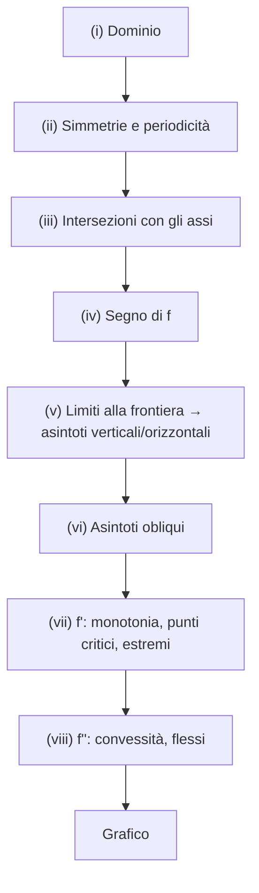

# Calcolo Differenziale di Funzioni di una Variabile

> [!abstract]
> È il capitolo centrale del corso. Parte da due problemi, trovare la **retta tangente** a un grafico e trovare la migliore **approssimazione lineare** di una funzione, e mostra che hanno la stessa soluzione: la **derivata**, definita come limite del rapporto incrementale.
> Il percorso: definizione e derivate delle funzioni elementari; **regole di derivazione** (somma, prodotto, quoziente, **catena**, **inversa**); **estremi locali** e **teorema di Fermat**, che risolve il problema lasciato aperto da [[04 - AN1 - Funzioni Continue#Funzioni Continue su Intervalli Chiusi e Limitati|Weierstrass]]; i **teoremi di Rolle e Lagrange** e le loro conseguenze (test di monotonia, funzioni costanti, lipschitzianità); le **regole di de l'Hospital**; il simbolo **o-piccolo**; la **formula di Taylor** con le sue applicazioni (estremi, limiti, calcolo numerico) e la **serie di Taylor**; infine lo **studio di funzione**, con **convessità** e **flessi**.
> La derivata si inverte con l'integrale nel [[06 - AN1 - Calcolo Integrale|cap. 6]] e si generalizza a più variabili nel [[08 - AN1 - Calcolo Differenziale in più Variabili|cap. 8]].
> Mappa del corso: [[MOC - Analisi 1]].

---

## Il problema della tangente

> [!question] Problemi
> Data $f : (a, b) \to \mathbb{R}$ e un punto $x_0 \in (a, b)$:
> 1. trovare la **retta tangente** $t$ al grafico di $f$ nel punto $P_0 = (x_0, f(x_0))$ (problema **geometrico**);
> 2. trovare un'**approssimazione lineare** $g(x) = \alpha x + \beta$ di $f(x)$ per $x$ vicino a $x_0$ (problema **analitico**).

Si parte dal problema (1); si vedrà che la sua soluzione risolve anche il (2). Per la tangente si considera prima la **retta secante** $s_h$ passante per i punti
$$P_0 = (x_0, f(x_0)) \qquad \text{e} \qquad P_h := (x_0 + h, f(x_0 + h)), \qquad h \neq 0.$$

![[AN1-p053-1.png]]

*Figura 30 — Retta secante e tangente.* Il grafico di $f$ (nero) con i punti $P_0$ e $P_h$. La retta rossa $s_h$ è la secante per i due punti: la sua pendenza è il rapporto tra il cateto verticale $f(x_0+h) - f(x_0)$ e quello orizzontale $h$ del triangolo rosso, cioè $\tan(\psi)$. La retta blu $t$ è la tangente in $P_0$, con pendenza $\tan(\varphi)$. Facendo tendere $h \to 0$, il punto $P_h$ scivola lungo il grafico verso $P_0$ e la secante ruota fino a diventare la tangente.

L'equazione della secante è
$$s_h(x) = f(x_0) + \underbrace{\frac{f(x_0 + h) - f(x_0)}{h}}_{\substack{=\text{ pendenza di } s_h \\ =:\ \text{rapporto incrementale}}} \cdot (x - x_0).$$
Solo il **rapporto incrementale** dipende da $h$: nel passo successivo lo si manda a $0$.

_(dispensa, p. 47)_

---

## Derivata, definizione e prime proprietà

Vedi [[Derivata]].

> [!important] Definizione 5.1 — Derivata
> Se per $f : (a, b) \to \mathbb{R}$ e $x_0 \in (a, b)$ converge
> $$\lim_{h\to0} \frac{f(x_0 + h) - f(x_0)}{h} \;\underset{x = x_0 + h}{=}\; \lim_{x\to x_0} \frac{f(x) - f(x_0)}{x - x_0} =: f'(x_0) \in \mathbb{R},$$
> allora $f$ si dice **derivabile** in $x_0$ con **derivata** $f'(x_0)$. Se $f$ è derivabile in ogni $x_0 \in (a, b)$ si dice **derivabile**, e $f' : (a, b) \to \mathbb{R}$ è la **(funzione) derivata** di $f$. Altre notazioni: $f' = \frac{df}{dx} = Df$.

Sostituendo nella secante il rapporto incrementale con la derivata si ottiene la **retta tangente**:

> [!important] Retta tangente
> $$t(x) = f(x_0) + f'(x_0) \cdot (x - x_0).$$

Dalla Figura 30:
$$f'(x_0) = \tan(\varphi) = \text{pendenza della tangente } t, \qquad \frac{f(x_0 + h) - f(x_0)}{h} = \tan(\psi) = \text{pendenza della secante } s_h.$$
In particolare $f'(x_0) = 0$ significa che la tangente è **orizzontale**.

> [!tip] Interpretazione fisica
> Se $f(t)$ è la posizione di un oggetto al tempo $t$, il rapporto incrementale è la **velocità media** nell'intervallo $[t, t+h]$ e la derivata è la **velocità istantanea**. La derivata misura il **tasso di variazione** di una grandezza.

_(dispensa, pp. 47–48)_

### Derivate delle funzioni elementari

> [!example] Funzioni costanti
> Se $f(x) = c$ per ogni $x$, il rapporto incrementale è sempre $0$: $f$ è derivabile con $f' = 0$.

> [!example] Potenze $x^n$, $n = 1, 2, 3, \dots$
> Con il [[00 - AN1 - Concetti Fondamentali#Formula del Binomio di Newton|binomio di Newton]] (usando $\binom n0 = \binom nn = 1$, $x_0^0 = h^0 = 1$, $\binom{n}{n-1} = n$):
> $$\frac{(x_0 + h)^n - x_0^n}{h} = \frac{\binom n0 h^n + \binom n1 x_0 h^{n-1} + \ldots + \binom{n}{n-2} x_0^{n-2} h^2 + n x_0^{n-1} h + x_0^n - x_0^n}{h}$$
> $$= \binom n0 h^{n-1} + \binom n1 x_0 h^{n-2} + \ldots + \binom{n}{n-2} x_0^{n-2} h + n x_0^{n-1} \to n x_0^{n-1} \quad (h \to 0).$$
> Tutti i termini tranne l'ultimo contengono almeno un fattore $h$. Quindi
> $$(x^n)' = n \cdot x^{n-1}, \qquad \text{es. } (x^5)' = 5x^4.$$

> [!example] Esponenziale
> $$\frac{e^{x_0 + h} - e^{x_0}}{h} = e^{x_0} \cdot \underbrace{\frac{e^h - 1}{h}}_{\to 1} \to e^{x_0},$$
> per il [[03 - AN1 - Funzioni Reali di una Variabile Reale#Tre limiti notevoli|limite notevole]]. Quindi
> $$(e^x)' = e^x:$$
> $f = f'$ è una proprietà molto particolare, che (a meno di una costante moltiplicativa) **caratterizza** la funzione esponenziale.

> [!example] Seno e coseno
> Con la prostaferesi, il limite notevole $\frac{\sin x}{x} \to 1$ e la continuità di $\cos$:
> $$\frac{\sin(x_0 + h) - \sin(x_0)}{h} = \frac{2\sin\left(\frac h2\right)\cos\left(x_0 + \frac h2\right)}{h} = \underbrace{\frac{\sin\left(\frac h2\right)}{\frac h2}}_{\to 1} \cdot \underbrace{\cos\left(x_0 + \tfrac h2\right)}_{\to \cos(x_0)} \to \cos(x_0).$$
> Quindi $\sin'(x) = \cos(x)$ e, analogamente, $\cos'(x) = -\sin(x)$.

> [!note] Derivata e simmetria
> $\sin$ è dispari e la sua derivata $\cos$ è pari; $\cos$ è pari e la sua derivata $-\sin$ è dispari. Vale sempre: se $f$ è derivabile,
> - $f$ dispari $\Rightarrow$ $f'$ pari;
> - $f$ pari $\Rightarrow$ $f'$ dispari.
>
> (Derivando $f(-x) = \pm f(x)$ con la regola della catena: $-f'(-x) = \pm f'(x)$.)

> [!example] Il modulo non è derivabile in 0
> $$\frac{f(h) - f(0)}{h} = \frac{|h|}{h} = \begin{cases} +1 & h > 0, \\ -1 & h < 0, \end{cases}$$
> quindi il limite del rapporto incrementale in $0$ non esiste. Esistono però il limite destro e sinistro.

_(dispensa, pp. 48–49)_

### Derivata destra e sinistra

> [!important] Definizione 5.2
> Se convergono
> $$f'_+(x_0) := \lim_{h\to0^+} \frac{f(x_0+h) - f(x_0)}{h} \quad (\textbf{derivata destra}), \qquad f'_-(x_0) := \lim_{h\to0^-} \frac{f(x_0+h) - f(x_0)}{h} \quad (\textbf{derivata sinistra}),$$
> $f$ si dice **derivabile da destra** oppure **da sinistra** in $x_0$.

Ad esempio $|x|$ ha $f'_+(0) = +1$ e $f'_-(0) = -1$: il grafico ha uno **spigolo** (punto angoloso). Vale:
$$f \text{ derivabile in } x_0 \iff f \text{ derivabile da destra e da sinistra con } f'_+(x_0) = f'_-(x_0).$$

### Derivabilità e continuità

> [!important] Proposizione 5.3
> Se $f$ è derivabile in $x_0$, allora è anche **continua** in $x_0$.

**Dimostrazione.**
$$f(x) - f(x_0) = \underbrace{\frac{f(x) - f(x_0)}{x - x_0}}_{\to f'(x_0)} \cdot \underbrace{(x - x_0)}_{\to 0} \to f'(x_0) \cdot 0 = 0 \qquad (x \to x_0). \qquad \square$$

> [!warning] Il viceversa è falso
> Continua $\not\Rightarrow$ derivabile: $|x|$ è continua ma non derivabile in $0$. La derivabilità è una richiesta più forte: il grafico non deve avere né salti né spigoli.

> [!example] Esercizio (metodo di Erone)
> Sia $f(x) := x^k - a$ con $a > 0$, $k \ge 2$.
> - Calcolare la retta tangente al grafico in $x_0 > 0$.
> - Verificare che l'intersezione tra la tangente e l'asse $x$ è $x_1 := \frac1k\left((k-1)x_0 + \frac{a}{x_0^{k-1}}\right)$.
>
> *Soluzione.* $f'(x_0) = k x_0^{k-1}$, quindi $t(x) = x_0^k - a + k x_0^{k-1}(x - x_0)$. Ponendo $t(x_1) = 0$:
> $$x_1 = x_0 - \frac{x_0^k - a}{k x_0^{k-1}} = \frac{k x_0^k - x_0^k + a}{k x_0^{k-1}} = \frac1k\left((k-1)x_0 + \frac{a}{x_0^{k-1}}\right).$$
> È proprio la ricorrenza del [[01 - AN1 - Successioni Numeriche#Il metodo di Erone|metodo di Erone]]: Erone è il **metodo di Newton** $x_{n+1} = x_n - \frac{f(x_n)}{f'(x_n)}$ applicato a $x^k - a$.

_(dispensa, pp. 49–50)_

---

## Regole per la Derivazione

Vedi [[Regole di derivazione]].

### Somme, prodotti e rapporti

> [!important] Regole di derivazione
> Se $f, g$ sono derivabili in $x_0$:
> 1. per ogni $\alpha, \beta \in \mathbb{R}$: $(\alpha f + \beta g)'(x_0) = \alpha f'(x_0) + \beta g'(x_0)$ (**linearità**);
> 2. $(f \cdot g)'(x_0) = f'(x_0) g(x_0) + f(x_0) g'(x_0)$ (**regola del prodotto**, o di Leibniz);
> 3. se $g(x_0) \neq 0$: $\left(\dfrac fg\right)'(x_0) = \dfrac{g(x_0) f'(x_0) - g'(x_0) f(x_0)}{g^2(x_0)}$ (**regola del quoziente**); in particolare $\left(\dfrac1g\right)'(x_0) = -\dfrac{g'(x_0)}{g^2(x_0)}$.

**Dimostrazione di (2).** Si aggiunge e toglie $f(x_0) g(x)$ e si usa la continuità di $g$ in $x_0$ (Prop. 5.3):
$$\frac{(fg)(x) - (fg)(x_0)}{x - x_0} = \underbrace{\frac{f(x) - f(x_0)}{x - x_0}}_{\to f'(x_0)} \cdot \underbrace{g(x)}_{\to g(x_0)} + f(x_0) \cdot \underbrace{\frac{g(x) - g(x_0)}{x - x_0}}_{\to g'(x_0)} \to f'(x_0) g(x_0) + f(x_0) g'(x_0). \quad \square$$

La regola (1) dice che la derivazione è un'**operazione lineare**. Ne segue che
$$C^1(a, b) := \{f : (a, b) \to \mathbb{R} \mid f \text{ è derivabile e } f' \text{ è continua}\}$$
è uno spazio vettoriale. Se $f \in C^1(a, b)$ si dice **derivabile con continuità** (la continuità riguarda $f'$: $f$ è continua comunque, essendo derivabile).

> [!example] Polinomi e funzioni razionali
> - Ogni **polinomio** è derivabile: $(a_n x^n + \ldots + a_1 x + a_0)' = n a_n x^{n-1} + (n-1) a_{n-1} x^{n-2} + \ldots + 2a_2 x + a_1$. Ad esempio $(3x^4 - 7x^3 + 2x^2 - 11)' = 12x^3 - 21x^2 + 4x$.
> - Ogni **funzione razionale** è derivabile. Per $n = 1, 2, 3, \dots$:
> $$(x^{-n})' = \left(\frac{1}{x^n}\right)' = -\frac{n x^{n-1}}{x^{2n}} = -\frac{n}{x^{n+1}} = -n x^{-n-1}.$$
> Quindi $(x^n)' = n x^{n-1}$ per ogni $n \in \mathbb{Z}$ (per $n = 0$ è la derivata di una costante).

> [!example] Tangente
> $$\tan'(x) = \frac{\cos(x) \sin'(x) - \cos'(x) \sin(x)}{\cos^2(x)} = \frac{\cos^2(x) + \sin^2(x)}{\cos^2(x)} = \begin{cases} \dfrac{1}{\cos^2(x)} \\[2mm] 1 + \tan^2(x) \end{cases}$$

_(dispensa, pp. 50–51)_

### Derivazione delle funzioni composte

> [!important] Regola della catena
> Se $f : (a, b) \to (c, d)$ è derivabile in $x_0$ e $g : (c, d) \to \mathbb{R}$ è derivabile in $y_0 := f(x_0)$, allora $g \circ f$ è derivabile in $x_0$ con
> $$(g \circ f)'(x_0) = g'(f(x_0)) \cdot f'(x_0).$$

Si deriva la funzione "esterna" calcolata nella funzione "interna", e si moltiplica per la derivata della funzione interna. Le velocità di variazione si moltiplicano: se $f$ raddoppia le variazioni e $g$ le triplica, la composizione le sestuplica.

> [!example] Esempi
> - Se $g$ è derivabile, $h(x) := g(-x)$ lo è con $h'(x) = g'(-x) \cdot (-x)' = -g'(-x)$.
> - Funzioni iperboliche: $\sinh'(x) = \frac{(e^x)' - (e^{-x})'}{2} = \frac{e^x + e^{-x}}{2} = \cosh(x)$, analogamente $\cosh'(x) = \sinh(x)$, e con la regola del quoziente
> $$\tanh'(x) = \frac{\cosh^2(x) - \sinh^2(x)}{\cosh^2(x)} = \begin{cases} \frac{1}{\cosh^2(x)} \\ 1 - \tanh^2(x). \end{cases}$$
> - Esponenziale in base $a > 0$: $a^x = e^{x \ln(a)}$ è la composizione di $f(x) = x\ln(a)$ e $g(y) = e^y$, quindi
> $$(a^x)' = e^{x\ln(a)} \cdot \ln(a) = \ln(a) \cdot a^x.$$
> - Composizioni di più funzioni: si itera la regola partendo dall'esterno:
> $$\left(e^{\cos(3x^2 - 2x + 1)}\right)' = e^{\cos(3x^2-2x+1)} \cdot \left(\cos(3x^2 - 2x + 1)\right)' = -e^{\cos(3x^2-2x+1)} \cdot \sin(3x^2 - 2x + 1) \cdot (6x - 2).$$

_(dispensa, pp. 51–52)_

### Derivazione delle funzioni inverse

> [!important] Derivata della funzione inversa
> Sia $f : (a, b) \to (c, d)$ continua, biiettiva e derivabile in $x_0$. Se $f'(x_0) \neq 0$, allora $f^{-1} : (c, d) \to (a, b)$ è derivabile in $y_0 := f(x_0)$ con
> $$(f^{-1})'(y_0) = \frac{1}{f'(x_0)}.$$
> (Conviene usare sempre $x$ come variabile di $f$ e $y$ come variabile di $f^{-1}$, per non confondersi.)

Attenzione: $f$ si deriva in $x_0$, mentre $f^{-1}$ si deriva in $y_0 = f(x_0)$.

![[AN1-p058-1.png]]

*Figura 31 — Derivata della funzione inversa.* Il grafico di $f$ e quello di $f^{-1}$, simmetrici rispetto alla bisettrice tratteggiata. In blu la tangente $t$ a $f$ in $x_0$: il triangolino azzurro ha base $1$ e altezza $f'(x_0)$, quindi pendenza $f'(x_0)$. In rosso la tangente $r$ a $f^{-1}$ in $y_0$: la simmetria scambia i cateti, quindi il triangolino rosso ha base $f'(x_0)$ e altezza $1$, cioè pendenza $\frac{1}{f'(x_0)} = (f^{-1})'(y_0)$.

Osservazioni:
- a una tangente **orizzontale** di $f$ in $x_0$ ($f'(x_0) = 0$) corrisponde una tangente **verticale** di $f^{-1}$ in $y_0$: $f^{-1}$ non è derivabile in $y_0$ (es. $\sqrt[3]{y}$ in $0$, inversa di $x^3$);
- per ricordare la formula (non è una dimostrazione) si usa la regola della catena: da $x = f^{-1}(f(x))$, derivando entrambi i lati,
$$1 = (f^{-1})'(f(x)) \cdot f'(x) \quad\Rightarrow\quad (f^{-1})'(y) = \frac{1}{f'(x)}, \qquad y = f(x).$$

> [!example] Logaritmo
> $f(x) = a^x$ ($0 < a \neq 1$) ha $f'(x) = \ln(a) a^x \neq 0$ ed è invertibile con $f^{-1}(y) = \log_a(y)$. Quindi, con $y = a^x$:
> $$\log_a'(y) = \frac{1}{(a^x)'} = \frac{1}{\ln(a) \cdot a^x} = \frac{1}{\ln(a) \cdot y}.$$
> Rinominando la variabile: $\log_a'(x) = \frac{1}{\ln(a) x}$ per $x > 0$, e in particolare $\ln'(x) = \frac1x$.

> [!example] Potenze reali
> Per $r \in \mathbb{R}$ e $x > 0$, $x^r = e^{r\ln(x)}$ e per la catena
> $$(x^r)' = e^{r \ln(x)} \cdot \frac rx = x^r \cdot \frac rx = r x^{r-1}.$$
> La regola $(x^r)' = r x^{r-1}$ vale quindi per ogni esponente reale.

> [!example] Esponenziali di funzioni: $f(x)^{g(x)}$
> Se $f(x) > 0$, $h(x) := f(x)^{g(x)} = e^{g(x)\ln(f(x))}$, e se $f, g$ sono derivabili
> $$h'(x) = f(x)^{g(x)} \cdot \left(g'(x) \ln(f(x)) + g(x) \frac{f'(x)}{f(x)}\right).$$
> Ad esempio $(x^x)' = x^x(\ln(x) + 1)$.

> [!example] Arcoseno
> $\sin : \left[-\frac\pi2, \frac\pi2\right] \to [-1, 1]$ è invertibile, ma $\sin' = \cos$ si annulla negli estremi $\pm\frac\pi2$: per avere un'inversa **derivabile** si tolgono quei punti e si considera $\sin : \left(-\frac\pi2, \frac\pi2\right) \to (-1, 1)$, con $\cos(x) \neq 0$. Allora per $y = \sin(x)$
> $$\arcsin'(y) = \frac{1}{\sin'(x)} = \frac{1}{\cos(x)}.$$
> Per scrivere il risultato in funzione di $y$: $\cos(x) = \pm\sqrt{1 - \sin^2(x)} = \pm\sqrt{1 - y^2}$, e poiché $x \in \left(-\frac\pi2, \frac\pi2\right)$, $\cos(x) > 0$: si sceglie il segno $+$. Quindi
> $$\arcsin'(x) = \frac{1}{\sqrt{1 - x^2}} \qquad \forall x \in (-1, 1).$$

Con lo stesso ragionamento:

| Funzione | Derivata | Dominio |
|---|---|---|
| $\arccos(x)$ | $\dfrac{-1}{\sqrt{1 - x^2}}$ | $(-1, 1)$ |
| $\arctan(x)$ | $\dfrac{1}{1 + x^2}$ | $\mathbb{R}$ |
| $\operatorname{arsinh}(x)$ | $\dfrac{1}{\sqrt{1 + x^2}}$ | $\mathbb{R}$ |
| $\operatorname{arcosh}(x)$ | $\dfrac{1}{\sqrt{x^2 - 1}}$ | $(1, +\infty)$ |
| $\operatorname{artanh}(x)$ | $\dfrac{1}{1 - x^2}$ | $(-1, 1)$ |

> [!summary] Tabella delle derivate fondamentali
> | $f(x)$ | $f'(x)$ |
> |---|---|
> | $c$ | $0$ |
> | $x^r$ | $r x^{r-1}$ |
> | $e^x$ | $e^x$ |
> | $a^x$ | $\ln(a)\, a^x$ |
> | $\ln(x)$ | $\frac1x$ |
> | $\log_a(x)$ | $\frac{1}{\ln(a)\, x}$ |
> | $\sin(x)$ | $\cos(x)$ |
> | $\cos(x)$ | $-\sin(x)$ |
> | $\tan(x)$ | $\frac{1}{\cos^2(x)} = 1 + \tan^2(x)$ |
> | $\sinh(x)$ | $\cosh(x)$ |
> | $\cosh(x)$ | $\sinh(x)$ |
> | $\tanh(x)$ | $\frac{1}{\cosh^2(x)} = 1 - \tanh^2(x)$ |

_(dispensa, pp. 52–54)_

---

## Estremi Locali e il Teorema di Fermat

Vedi [[Teorema di Fermat]].

Torniamo al problema del [[04 - AN1 - Funzioni Continue#Funzioni Continue su Intervalli Chiusi e Limitati|cap. 4]]: per Weierstrass ogni $f \in C[a, b]$ ha massimo e minimo, ma resta da **trovarli**.

> [!example] Esempio: il contenitore
> Da un cartoncino $a \times b$ (con $0 < a \le b$) si vuole costruire un contenitore senza coperchio di volume massimo, tagliando quattro quadrati di lato $x$ agli angoli e ripiegando i bordi.

![[AN1-p060-1.png]]

*Figura 32 — Contenitore.* A sinistra il cartoncino $a \times b$ con i quattro quadratini di lato $x$ da ritagliare agli angoli (bianchi); le strisce grigie chiare sono i bordi da piegare verso l'alto. A destra la scatola ottenuta: altezza $x$, base $(b - 2x) \times (a - 2x)$, quindi volume $V(x) = x(a - 2x)(b - 2x)$.

Si cerca $x_0 \in \left[0, \frac a2\right]$ con $V_{\max} := V(x_0) \ge V(x)$ per ogni $x \in \left[0, \frac a2\right]$. Il problema verrà risolto [[#Esempio del contenitore risolto|più avanti]]. Prima si generalizzano i concetti di minimo e massimo.

> [!important] Definizione 5.4 — Estremi locali
> Sia $f : X \to \mathbb{R}$.
> - $x_0 \in X$ è un **punto di minimo locale** se esiste $\delta > 0$ con $f(x_0) \le f(x)$ per ogni $x \in X$ con $|x - x_0| < \delta$; $f(x_0)$ si dice **minimo locale**.
> - $x_0 \in X$ è un **punto di massimo locale** se esiste $\delta > 0$ con $f(x_0) \ge f(x)$ per ogni $x \in X$ con $|x - x_0| < \delta$; $f(x_0)$ si dice **massimo locale**.
> - Un punto di minimo o massimo locale è un **punto di estremo locale**, e $f(x_0)$ un **estremo locale**.

"Locale" significa che il confronto si fa solo con i punti **vicini** (entro $\delta$); il massimo/minimo **assoluto** (o globale) è il confronto con tutto il dominio.

![[AN1-p061-1.png]]

*Figura 33 — Esempi di estremi locali.* Una funzione su $[a, b]$ con salti in $x_1$ e $x_3$ e spigoli. In questo esempio:
- $a$, $x_2$, $x_3$ e $b$ sono punti di **massimo locale** ($a$ e $b$ perché la funzione scende allontanandosi da essi; $x_3$ perché il valore $f(x_3)$ è quello in alto, sopra la parte che precede il salto);
- $x_0$ e $x_4$ sono punti di **minimo locale** ($x_4$ è uno spigolo);
- $x_1$ **non** è un punto di estremo locale (a sinistra la funzione è più bassa, a destra più alta);
- $x_2$ è il punto di **massimo assoluto**, e $M = f(x_2)$ è il massimo assoluto;
- il **minimo assoluto non esiste**: la funzione scende verso un valore (vicino a $x_3$, da sinistra) che non viene assunto, quindi c'è solo l'estremo inferiore. Weierstrass non si applica perché $f$ non è continua.

> [!important] Teorema 5.5 — Teorema di Fermat
> Sia $x_0 \in (a, b)$ un punto di estremo locale di $f : [a, b] \to \mathbb{R}$. Se $f$ è derivabile in $x_0$, allora $f'(x_0) = 0$.

**Dimostrazione.** Sia $x_0$ un punto di minimo locale. Per $h$ piccolo $f(x_0 + h) - f(x_0) \ge 0$, quindi
$$f'(x_0) = \begin{cases} f'_+(x_0) = \lim_{h\to0^+} \dfrac{\overbrace{f(x_0+h) - f(x_0)}^{\ge 0}}{\underbrace{h}_{>0}} \ge 0, \\[4mm] f'_-(x_0) = \lim_{h\to0^-} \dfrac{\overbrace{f(x_0+h) - f(x_0)}^{\ge 0}}{\underbrace{h}_{<0}} \le 0. \end{cases}$$
Quindi $0 \le f'(x_0) \le 0$, cioè $f'(x_0) = 0$. $\square$

![[AN1-p061-2.png]]

*Figura 34 — Estremi locali e tangenti orizzontali.* La stessa funzione della Figura 33, con le tangenti orizzontali disegnate nei punti $x_0$ (minimo) e $x_2$ (massimo), che sono **interni** e in cui la funzione è **derivabile**: lì $f' = 0$. Negli altri estremi ($a$, $b$, lo spigolo $x_4$, il salto $x_3$) non c'è tangente orizzontale.

Osservazioni:
- Fermat **non** vale negli estremi dell'intervallo: se $x_0 = a$ o $x_0 = b$ è un estremo locale, non segue $f'(x_0) = 0$ (nel grafico la funzione in $a$ ha pendenza negativa).
- Se $f'(x_0) = 0$, $x_0$ si dice **punto critico** (o **stazionario**).
- Fermat dà una condizione **necessaria ma non sufficiente**: non ogni punto critico è un estremo. Ad esempio $f(x) = x^3$ ha $f'(x) = 3x^2$, quindi $x_0 = 0$ è critico, ma $x^3$ è strettamente crescente.

> [!important] Candidati per i punti di estremo locale
> - i punti in cui $f$ **non è derivabile**;
> - i punti sul **"bordo"** del dominio;
> - i **punti critici** all'**interno** del dominio.
>
> Nei primi due casi Fermat non si applica; i terzi sono quelli che Fermat individua.

> [!example] Esempio: $f(x) = x^x$
> Sia $f : [0, 1] \to \mathbb{R}$ con $f(0) := 1$ e $f(x) := x^x$ per $x \in (0, 1]$. Si scrive $x^x = e^{x\ln(x)}$.
>
> *Continuità in 0.* Con la sostituzione $t = -\ln(x) \to +\infty$ per $x \to 0^+$, e poiché $e^t = 1 + t + \frac{t^2}{2} + \ldots \ge \frac{t^2}{2}$ per $t > 0$:
> $$0 \le \lim_{x\to0^+} |x \ln(x)| = \lim_{t\to+\infty} \left|\frac{-t}{e^t}\right| \le \lim_{t\to+\infty} \frac{t}{t^2/2} = 0 \quad\Rightarrow\quad \lim_{x\to0^+} x\ln(x) = 0.$$
> Per la continuità dell'esponenziale $\lim_{x\to0^+} e^{x\ln(x)} = e^0 = 1 = f(0)$, quindi $f \in C[0, 1]$ e per Weierstrass ha minimo e massimo.
>
> *Punti critici.* Per $x \in (0, 1)$:
> $$f'(x) = \left(e^{x\ln(x)}\right)' = \left(x \cdot \tfrac1x + \ln(x)\right) e^{x\ln(x)} = (1 + \ln(x))\, x^x = 0 \iff x = \tfrac1e.$$
> *Confronto dei candidati:* gli estremi $0$ e $1$ e il punto critico $\frac1e$:
> $$f(0) = f(1) = 1, \qquad f\left(\tfrac1e\right) = \left(\tfrac1e\right)^{\frac1e} = e^{-\frac1e} \approx 0{,}692 < 1.$$
> Quindi $M = \max f = f(0) = f(1) = 1$ e $m = \min f = f\left(\frac1e\right) = e^{-\frac1e}$.

![[AN1-p063-1.png]]

*Figura 35 — Grafico di $f(x) = x^x$.* Su $[0, 1]$ la curva parte da $1$, scende fino al minimo in $x = \frac1e \approx 0{,}37$ (dove vale circa $0{,}69$) e risale a $1$ in $x = 1$. Il rettangolo tratteggiato in alto mostra che il massimo $1$ è assunto in entrambi gli estremi.

### Esempio del contenitore risolto

$V(x) = x(a - 2x)(b - 2x)$ è continua e $\left[0, \frac a2\right]$ è chiuso e limitato: per Weierstrass esiste il massimo; $V$ è derivabile, quindi si cerca il punto di massimo tra i punti critici. Da
$$V'(x) = 12x^2 - 4(a + b)x + ab = 0 \quad\Rightarrow\quad x_{1,2} = \frac16\left(a + b \pm \sqrt{a^2 - ab + b^2}\right).$$
Poiché $0 < a \le b$, si ha $a^2 - ab \le 0$ e quindi $a^2 - ab \ge 4a^2 - 4ab$ (equivale a $3ab \ge 3a^2$). Allora
$$x_1 \ge \frac16\left(a + b + \sqrt{4a^2 - 4ab + b^2}\right) = \frac16\left(a + b + |2a - b|\right) \ge \frac16\left(a + b + (2a - b)\right) = \frac a2,$$
cioè $x_1$ cade fuori dall'intervallo (o sul bordo). Poiché $V(0) = V\left(\frac a2\right) = 0$, il massimo è in
$$x_0 = x_2 = \frac16\left(a + b - \sqrt{a^2 - ab + b^2}\right).$$

> [!example] Cartoncino A4
> Con $a = 21\,\text{cm}$ e $b = 29{,}7\,\text{cm}$: $x_0 = \frac{50{,}7 - \sqrt{699{,}39}}{6} \approx 4{,}04\,\text{cm}$ e $V_{\max} = V(x_0) \approx 1128{,}5\,\text{cm}^3$. Si può costruire un contenitore di più di un litro!

![[AN1-p063-2.png]]

*Figura 36 — Volume contenitore da cartoncino formato A4.* Il grafico di $V(x) = x(21 - 2x)(29{,}7 - 2x)$: parte da $0$, raggiunge il massimo $V_{\max} \approx 1128$ in $x_0 \approx 4$, torna a $0$ in $x = \frac a2 = 10{,}5$. La parte tratteggiata oltre $10{,}5$ (dove la funzione diventa negativa e ha il minimo locale $x_1$) non ha significato fisico: è fuori dall'intervallo ammesso.

_(dispensa, pp. 54–57)_

---

## I Teoremi di Rolle e Lagrange

### Teorema di Rolle

Vedi [[Teorema di Rolle]].

> [!important] Teorema 5.6 — Teorema di Rolle
> Sia $f \in C[a, b]$ derivabile in $(a, b)$. Se $f(a) = f(b)$, allora esiste $c \in (a, b)$ con $f'(c) = 0$.

**Dimostrazione.** Per Weierstrass $f$ ha minimo $m = f(x_0)$ e massimo $M = f(x_1)$ con $x_0, x_1 \in [a, b]$.
- Se $m = M$, $f$ è costante e $f'(x) = 0$ per ogni $x \in (a, b)$.
- Se $m < M$, poiché $f(a) = f(b)$ almeno uno tra $x_0$ e $x_1$ è diverso da $a$ e da $b$, cioè è **interno**; lì $f'$ si annulla per Fermat. $\square$

![[AN1-p064-1.png]]

*Figura 37 — Teorema di Rolle: tre punti con $f'(c_1) = 0 = f'(c_2) = f'(c_3)$, cioè retta tangente orizzontale.* Una funzione con $f(a) = f(b)$ (linea tratteggiata): tra $a$ e $b$ sale, scende, risale e torna al livello iniziale. Nei due massimi $c_1, c_3$ e nel minimo $c_2$ la tangente è orizzontale. Rolle garantisce che **almeno uno** di questi punti esiste.

### Teorema di Lagrange

Vedi [[Teorema di Lagrange]].

Rolle si generalizza togliendo la condizione $f(a) = f(b)$; il risultato è uno dei più importanti del corso.

> [!important] Teorema 5.7 — Teorema di Lagrange (o del valor medio)
> Sia $f \in C[a, b]$ derivabile in $(a, b)$. Allora esiste $c \in (a, b)$ (**punto di Lagrange**) tale che
> $$\underbrace{f'(c)}_{\substack{\text{pendenza della tangente} \\ \text{in } (c, f(c))}} = \underbrace{\frac{f(b) - f(a)}{b - a}}_{\substack{\text{pendenza della secante per} \\ (a, f(a)) \text{ e } (b, f(b))}}.$$

![[AN1-p064-2.png]]

*Figura 38 — Teorema di Lagrange: due punti di Lagrange $c_1$ e $c_2$.* La secante blu $s$ unisce gli estremi del grafico. Le rette rosse $t_1$ e $t_2$ sono le tangenti in $c_1$ e $c_2$: sono **parallele** alla secante (i segni "//" lo indicano). Il teorema garantisce che almeno una tangente parallela alla secante esiste.

> [!tip] Interpretazione
> Se in un viaggio di 2 ore si percorrono 200 km, la velocità media è 100 km/h: Lagrange garantisce che in almeno un istante il tachimetro ha segnato esattamente 100 km/h.

**Dimostrazione.** Si applica Rolle alla funzione
$$\tilde f(x) := f(x) - \frac{f(b) - f(a)}{b - a}(x - a),$$
che è $f$ meno la secante (traslata): $\tilde f(a) = f(a) = \tilde f(b)$, quindi esiste $c$ con $0 = \tilde f'(c) = f'(c) - \frac{f(b) - f(a)}{b-a}$. $\square$

Rolle è il caso particolare di Lagrange con secante orizzontale.

_(dispensa, pp. 57–58)_

---

## Conseguenze del Teorema di Lagrange

Lagrange si usa quasi sempre in questa forma: se $f \in C[a, b]$ è derivabile in $(a, b)$, per ogni $x_1, x_2 \in [a, b]$ esiste $c$ tra $x_1$ e $x_2$ con
$$f(x_2) = f(x_1) + f'(c)(x_2 - x_1).$$
(Basta sostituire $a, b$ con $x_1, x_2$ e risolvere per $f(x_2)$.) Collega i **valori** di $f$ alla sua **derivata**.

### Test di monotonia

> [!important] Test di monotonia
> Se $f \in C[a, b]$ è derivabile in $(a, b)$:
> 1. $f$ è crescente $\iff$ $f'(x) \ge 0$ per ogni $x \in (a, b)$;
> 2. $f$ è decrescente $\iff$ $f'(x) \le 0$ per ogni $x \in (a, b)$;
> 3. $f'(x) > 0$ per ogni $x \in (a, b)$ $\Rightarrow$ $f$ strettamente crescente;
> 4. $f'(x) < 0$ per ogni $x \in (a, b)$ $\Rightarrow$ $f$ strettamente decrescente.

Nei punti 3 e 4 **non** vale l'equivalenza: $f(x) = x^3$ è strettamente crescente ma $f'(0) = 0$.

**Dimostrazione di (1).** "$\Rightarrow$": se $f$ è crescente, $f'(x) = f'_+(x) = \lim_{h\to0^+} \frac{f(x+h) - f(x)}{h} \ge 0$ (numeratore $\ge 0$, denominatore $> 0$). "$\Leftarrow$": per $x_1 < x_2$, per Lagrange esiste $c$ con
$$f(x_2) = f(x_1) + \underbrace{f'(c)}_{\ge 0} \underbrace{(x_2 - x_1)}_{> 0} \ge f(x_1). \qquad \square$$

> [!example] Esempio
> $f(x) := x^3 - 3x^2 + 6x - 3$: $f'(x) = 3x^2 - 6x + 6 = 3(x-1)^2 + 3 > 0$, quindi $f$ è strettamente crescente e iniettiva. Inoltre $\lim_{x\to\pm\infty} f(x) = \pm\infty$, quindi è suriettiva e invertibile. Poiché $f' \neq 0$, $f^{-1}$ è derivabile con $(f^{-1})'(y_0) = \frac{1}{f'(x_0)}$. Ad esempio per $y_0 = -3 = f(0)$:
> $$(f^{-1})'(-3) = \frac{1}{f'(0)} = \frac16.$$
> Si calcola la derivata dell'inversa senza conoscere una formula per $f^{-1}$.

> [!important] Proposizione 5.8
> Se $f, g \in C[a, b]$ sono derivabili in $(a, b)$ con $f(a) \ge g(a)$ e $f'(x) \ge g'(x)$ per ogni $x \in (a, b)$, allora $f(x) \ge g(x)$ per ogni $x \in [a, b]$.

**Dimostrazione.** $h := f - g$ ha $h' \ge 0$, quindi è crescente, e $h(a) \ge 0$: allora $h(x) \ge h(a) \ge 0$. $\square$ (Chi parte avanti e va sempre più veloce resta avanti.)

### Criterio per estremi locali

> [!important] Criterio per estremi locali (segno di f')
> Sia $f$ derivabile e $x_0$ un punto critico ($f'(x_0) = 0$). Allora $x_0$ è un punto di
> - **massimo locale** se $f'$ cambia segno in $x_0$ da "$+$" a "$-$";
> - **minimo locale** se $f'$ cambia segno in $x_0$ da "$-$" a "$+$".

Segue dal test di monotonia: nel primo caso $f$ cresce prima di $x_0$ e decresce dopo.

![[AN1-p066-1.png]]

*Figura 39 — Criterio per estremi locali.* A sinistra un massimo locale: prima di $x_0$ $f' > 0$ ($f$ crescente, freccia in salita, segno $+$), dopo $f' < 0$ ($f$ decrescente, segno $-$). A destra un minimo locale, con i segni scambiati.

> [!example] Esempio: $f(x) = \frac{\ln(x)}{x}$, $x > 0$
> $$f'(x) = \frac{x \cdot \frac1x - 1 \cdot \ln(x)}{x^2} = \frac{1 - \ln(x)}{x^2} = 0 \iff \ln(x) = 1 \iff x = e.$$
> Per $x \in (0, e)$ $\ln(x) < 1$ e $f' > 0$; per $x > e$ $f' < 0$. Il segno cambia da $+$ a $-$: $x_0 = e$ è un punto di massimo locale (in realtà assoluto), con $f(e) = \frac1e$.

![[AN1-p066-2.png]]

*Figura 40 — Grafico di $f(x) = \frac{\ln(x)}{x}$.* La curva arriva da $-\infty$ per $x \to 0^+$, attraversa l'asse in $x = 1$, ha il massimo in $x = e$ (dove vale $\frac1e \approx 0{,}37$) e poi decresce lentamente verso $0$.

> [!tip] Una conseguenza curiosa
> Poiché $\frac{\ln x}{x}$ ha massimo in $e$: $\frac{\ln 3}{3} < \frac{\ln e}{e}$, e confrontando $\frac{\ln 3}{3}$ con $\frac{\ln \pi}{\pi}$ (con $e < 3 < \pi$, la funzione è decrescente) si ottiene $\frac{\ln \pi}{\pi} < \frac{\ln 3}{3}$, cioè $\pi^3 < 3^\pi$.

### Caratterizzazione delle funzioni costanti

> [!important] Funzioni costanti
> Se $f : (a, b) \to \mathbb{R}$ è derivabile:
> $$f \text{ è costante} \iff f'(x) = 0 \text{ per ogni } x \in (a, b).$$

**Dimostrazione.** "$\Rightarrow$" è ovvio. "$\Leftarrow$": $f' = 0$ implica $f' \ge 0$ ($f$ crescente) e $f' \le 0$ ($f$ decrescente), quindi $f$ è costante. $\square$

Sembra banale, ma serve a dimostrare risultati tutt'altro che ovvi.

> [!example] Esempio: $\arctan(x) + \arctan\left(\frac1x\right)$
> $f : \mathbb{R} \setminus \{0\} \to \mathbb{R}$, $f(x) := \arctan(x) + \arctan\left(\frac1x\right)$ è derivabile con
> $$f'(x) = \frac{1}{1 + x^2} + \frac{1}{1 + \frac{1}{x^2}} \cdot \frac{-1}{x^2} = \frac{1}{1 + x^2} - \frac{1}{x^2 + 1} = 0.$$
> **Non** si può concludere che $f$ è costante: il dominio $\mathbb{R} \setminus \{0\}$ non è un intervallo. È però unione dei due intervalli $(-\infty, 0)$ e $(0, +\infty)$, su ciascuno dei quali $f$ è costante: $f = c_1$ per $x > 0$ e $f = c_2$ per $x < 0$. Valutando in $x = 1$ e $x = -1$:
> $$\arctan(x) + \arctan\left(\tfrac1x\right) = \begin{cases} \arctan(1) + \arctan(1) = 2 \cdot \frac\pi4 = \frac\pi2 & x > 0, \\ \arctan(-1) + \arctan(-1) = -\frac\pi2 & x < 0. \end{cases}$$

### Funzioni lipschitziane

> [!important] Definizione 5.9 — Funzione lipschitziana
> $f : X \to \mathbb{R}$ si dice **lipschitziana** con costante $L \ge 0$ (**costante di Lipschitz**) se
> $$|f(x_2) - f(x_1)| \le L |x_2 - x_1| \qquad \forall x_1, x_2 \in X.$$

Ogni funzione lipschitziana è continua (se $x_2 \to x_1$, anche $f(x_2) \to f(x_1)$), ma non viceversa. Riscrivendo la condizione come
$$\left|\frac{f(x_2) - f(x_1)}{x_2 - x_1}\right| \le L \qquad \forall x_1 \neq x_2,$$
si vede che tutte le **secanti** hanno pendenza al massimo $L$ in modulo. Ad esempio $\sqrt x$ su $[0, 1]$ non è lipschitziana: con $x_1 = 0$ e $x_2 \to 0^+$ la pendenza della secante $\frac{\sqrt{x_2}}{x_2} = \frac{1}{\sqrt{x_2}} \to +\infty$ (tangente verticale in $0$).

> [!important] Proposizione 5.10
> Sia $f : [a, b] \to \mathbb{R}$ derivabile con $|f'(x)| \le L$ per ogni $x \in (a, b)$. Allora $f$ è lipschitziana con costante $L$. In particolare ogni $f \in C^1[a, b]$ è lipschitziana.

**Dimostrazione.** Per Lagrange $\left|\frac{f(x_2) - f(x_1)}{x_2 - x_1}\right| = |f'(c)| \le L$. Se $f \in C^1[a, b]$, $f'$ è continua su $[a, b]$ e quindi limitata per Weierstrass. $\square$

_(dispensa, pp. 58–61)_

---

## Le Regole di de l'Hospital

Vedi [[Regola di de l'Hospital]].

> [!question] Problema
> Calcolare $\displaystyle\lim_{x\to x_0} \frac{f(x)}{g(x)}$ quando è una forma indeterminata $\frac00$ oppure $\frac{\pm\infty}{\pm\infty}$, ad esempio $\lim_{x\to0} \frac{\sin x}{x}$ o $\lim_{x\to+\infty} \frac{\ln x}{x}$.

> [!important] Teorema 5.11 — Regole di de l'Hospital
> Siano $-\infty \le a < b \le +\infty$ e $f, g : (a, b) \to \mathbb{R}$ con
> - $\lim_{x\to a^+} f(x) = \lim_{x\to a^+} g(x) = 0$ oppure $= \pm\infty$;
> - $f, g$ derivabili con $g'(x) \neq 0$ per $x$ vicino ad $a$;
> - esiste $\lim_{x\to a^+} \frac{f'(x)}{g'(x)} =: l \in \overline{\mathbb{R}}$.
>
> Allora anche $\displaystyle\lim_{x\to a^+} \frac{f(x)}{g(x)} = l$. Lo stesso vale per limiti $x \to b^-$ e $x \to x_0 \in (a, b)$.

(La dimostrazione si basa su una variante del teorema di Lagrange, il teorema di Cauchy.)

> [!warning] Due errori da evitare
> - Se $\lim \frac{f'}{g'}$ **non esiste**, non si può dedurre che $\lim \frac fg$ non esiste: l'Hospital è una condizione sufficiente, non necessaria. Esempio:
> $$\lim_{x\to+\infty} \frac{x + \sin x}{x} = \lim_{x\to+\infty} \left(1 + \underbrace{\frac{\sin x}{x}}_{\frac{\text{limitata}}{+\infty} \to 0}\right) = 1, \qquad \text{ma } \lim_{x\to+\infty} \frac{(x + \sin x)'}{(x)'} = \lim_{x\to+\infty} (1 + \cos x) \text{ non esiste.}$$
> - L'Hospital **non** si applica alle forme **determinate**:
> $$\lim_{x\to0} \frac{1 + x}{2 + x} = \frac12 \neq \lim_{x\to0} \frac{(1+x)'}{(2+x)'} = 1.$$

Negli esempi il simbolo $\overset{H}{=}$ indica che si è applicato l'Hospital.

> [!example] Esempi
> - Per $\alpha > 0$: $\displaystyle\lim_{x\to+\infty} \frac{\ln(x)}{x^\alpha} \;\left(= \tfrac{+\infty}{+\infty}\right) \overset{H}{=} \lim_{x\to+\infty} \frac{1/x}{\alpha x^{\alpha-1}} = \lim_{x\to+\infty} \frac{1}{\alpha x^\alpha} = 0$: il logaritmo cresce più lentamente di **qualsiasi** potenza positiva.
> - Forme $0 \cdot \infty$ si riportano a un rapporto. Per $\alpha > 0$:
> $$\lim_{x\to0^+} x^\alpha \ln(x) \;(= 0 \cdot (-\infty)) = \lim_{x\to0^+} \frac{\ln(x)}{x^{-\alpha}} \;\left(= \tfrac{-\infty}{+\infty}\right) \overset{H}{=} \lim_{x\to0^+} \frac{1/x}{-\alpha x^{-\alpha-1}} = \lim_{x\to0^+} \frac{x^\alpha}{-\alpha} = 0.$$
> (È il limite $x \ln x \to 0$ dell'esempio $x^x$, ora in modo molto più semplice.)
> - L'Hospital si può applicare più volte:
> $$\lim_{x\to0} \frac{x - \sin(x)}{x^3} \left(= \tfrac00\right) \overset{H}{=} \lim_{x\to0} \frac{1 - \cos(x)}{3x^2} \left(= \tfrac00\right) \overset{H}{=} \lim_{x\to0} \frac{\sin(x)}{6x} \left(= \tfrac00\right) \overset{H}{=} \lim_{x\to0} \frac{\cos(x)}{6} = \frac16.$$
> Il secondo e terzo passaggio si potevano evitare con i limiti notevoli, ma l'Hospital semplifica molto.
> - Limiti della forma $f(x)^{g(x)}$: per la continuità dell'esponenziale
> $$\lim_{x\to x_0} f(x)^{g(x)} = \lim_{x\to x_0} e^{g(x)\ln(f(x))} = e^{\lim_{x\to x_0} g(x)\ln(f(x))}.$$
> Ad esempio $\lim_{x\to0} (x + e^x)^{\frac{1}{\sin x}} = e^{\lim_{x\to0} \frac{\ln(x + e^x)}{\sin(x)}}$, e
> $$\lim_{x\to0} \frac{\ln(x + e^x)}{\sin(x)} \left(= \tfrac{\ln 1}{0} = \tfrac00\right) \overset{H}{=} \lim_{x\to0} \frac{\frac{1}{x + e^x}(1 + e^x)}{\cos(x)} = 2, \qquad \text{quindi} \quad \lim_{x\to0}(x + e^x)^{\frac{1}{\sin x}} = e^2.$$

_(dispensa, pp. 61–63)_

---

## Approssimazione Lineare di Funzioni

Si torna al problema (2): approssimare $f(x)$ vicino a $x_0$ con un polinomio di grado $\le 1$, $g(x) = \alpha x + \beta$. Il problema (1) è risolto: se $f$ è derivabile in $x_0$, la tangente $t(x) = f(x_0) + f'(x_0)(x - x_0)$ è un polinomio di grado $\le 1$, quindi la scelta naturale è $g := t$. Si scrive
$$f(x) = t(x) + r(x) = \underbrace{f(x_0) + f'(x_0)(x - x_0)}_{\text{approssimazione lineare}} + \underbrace{r(x)}_{\text{resto (o errore)}},$$
cioè $r(x) = f(x) - t(x)$.

![[AN1-p069-1.png]]

*Figura 41 — Il resto $r(x)$.* Il grafico di $f$ (nero) e la tangente $t$ (blu) in $x_0$. In un punto $x$ vicino, il segmento rosso verticale tra $t(x)$ e $f(x)$ è il resto $r(x)$: l'errore che si commette usando la tangente al posto della funzione. Più $x$ è vicino a $x_0$, più il segmento è piccolo.

Proprietà del resto:
- $r(x_0) = 0$: in $x_0$ l'approssimazione è esatta;
- $\dfrac{r(x)}{x - x_0} = \underbrace{\dfrac{f(x) - f(x_0)}{x - x_0}}_{\to f'(x_0)} - f'(x_0) \to 0$ per $x \to x_0$: $r(x)$ tende a $0$ **più rapidamente** di $x - x_0$.

### Il simbolo o-piccolo

Vedi [[Simbolo o-piccolo]].

> [!important] Definizione 5.12 — o-piccolo
> Se $\displaystyle\lim_{x\to x_0} \frac{f(x)}{g(x)} = 0$, si dice che $f$ è **o-piccolo** di $g$ per $x \to x_0$ e si scrive $f(x) = o(g(x))$, o brevemente $f = o(g)$ per $x \to x_0$.

$o(\cdot)$ è un **simbolo di Landau**. $f = o(g)$ significa, per
- **infinitesimi**: $f(x) \to 0$ più rapidamente di $g(x) \to 0$;
- **infiniti**: $f(x) \to \pm\infty$ più lentamente di $g(x) \to \pm\infty$.

È lo stesso spirito della notazione asintotica usata per la complessità degli algoritmi: vedi [[Notazione asintotica]] (ASD).

> [!example] Esempi
> - $\ln(x) = o(x)$ per $x \to +\infty$, perché $\frac{\ln x}{x} \to 0$.
> - $1 - \cos(x) = o(x)$ per $x \to 0$: $\frac{1 - \cos x}{x} = \underbrace{\frac{1 - \cos x}{x^2}}_{\to \frac12} \cdot \underbrace{x}_{\to 0} \to 0$.
> - $x = o(x^2)$ per $x \to \pm\infty$, mentre $x^2 = o(x)$ per $x \to 0$: dipende da dove si fa il limite!
> - $f(x) \to 0$ per $x \to x_0$ $\iff$ $f(x) = o(1)$.
> - Per l'approssimazione lineare: $r(x) = o(x - x_0)$ per $x \to x_0$.

Con gli o-piccoli si caratterizzano le funzioni derivabili:

> [!important] Proposizione 5.13
> Per $f : (a, b) \to \mathbb{R}$ e $x_0 \in (a, b)$ sono equivalenti:
> 1. $f$ è derivabile in $x_0$;
> 2. esiste $A \in \mathbb{R}$ con $f(x) = f(x_0) + A(x - x_0) + o(x - x_0)$ per $x \to x_0$.
>
> In tal caso $A = f'(x_0)$.

La tangente è quindi l'**unica** retta che lascia un resto che tende a $0$ più rapidamente della distanza $x - x_0$: con qualsiasi altro polinomio di grado $\le 1$ il resto tende a zero più lentamente. In questo senso $t(x)$ è la **migliore approssimazione lineare** possibile di $f$ vicino a $x_0$.

> [!example] Esempi (con $x_0 = 0$)
> - $e^x = e^0 + e^0 x + o(x)$, cioè $e^x = 1 + x + o(x)$ per $x \to 0$;
> - $\sin(x) = \sin(0) + \cos(0) x + o(x)$, cioè $\sin(x) = x + o(x)$;
> - $\ln(1 + x) = \ln(1) + \frac{1}{1+0} x + o(x)$, cioè $\ln(1 + x) = x + o(x)$.

_(dispensa, pp. 63–64)_

---

## La Formula di Taylor

Vedi [[Formula di Taylor]].

L'approssimazione lineare approssima $f$ vicino a $x_0$ con un polinomio di grado $\le 1$. Viene naturale chiedere di più:

> [!question] Problema
> Data $f : (a, b) \to \mathbb{R}$, $x_0 \in (a, b)$ e $n \in \mathbb{N}$, approssimare $f(x)$ per $x$ vicino a $x_0$ con un polinomio $T_n(x)$ di grado $\le n$.

Per $n = 1$ la scelta migliore è $T_1 = t$. Per $n$ qualsiasi servono le derivate successive.

### Derivate successive

> [!important] Definizione 5.14 — Derivate successive
> Se $f$ è derivabile e $f'$ è a sua volta derivabile, si definisce la **derivata seconda** $(f')' =: f'' =: D^2 f =: \frac{d^2 f}{dx^2}$. Continuando $n$ volte si ottiene la **derivata $n$-esima** $f^{(n)} =: D^n f =: \frac{d^n f}{dx^n}$.
>
> Per un intervallo $I$ si pone $C^0(I) := C(I)$ ($f^{(0)} := f$) e per $n \ge 1$
> $$C^n(I) := \{f : I \to \mathbb{R} \mid f \text{ è derivabile } n \text{ volte e } f^{(n)} \text{ è continua}\}.$$
> Se $f \in C^n(I)$, $f$ si dice **derivabile $n$ volte con continuità**.

> [!example] Esempio
> $f = \sin$: $f' = \cos$, $f'' = -\sin$, $f''' = -\cos$, $f^{(4)} = \sin = f$. Dopo 4 derivazioni si torna alla funzione originale.

### Polinomio di Taylor

Per avere un'idea, si guardano i casi $n = 0$ e $n = 1$:
- per $n = 0$ la migliore costante è $T_0(x) := f(x_0)$: $T_0$ e $f$ hanno in comune il **valore** in $x_0$;
- per $n = 1$, $T_1(x) = f(x_0) + f'(x_0)(x - x_0)$: $T_1$ e $f$ hanno in comune **valore e derivata prima** in $x_0$.

Per $n \ge 2$ si cerca quindi un polinomio $T_n$ che abbia in comune con $f$ il valore e tutte le derivate fino all'$n$-esima:
$$T_n(x_0) = f(x_0), \quad T_n'(x_0) = f'(x_0), \quad \dots, \quad T_n^{(n)}(x_0) = f^{(n)}(x_0).$$
Si dice allora che $f$ e $T_n$ hanno un **contatto di ordine $n$** in $x_0$.
Sono $n + 1$ equazioni per gli $n + 1$ coefficienti di $T_n$: è plausibile che la soluzione esista e sia unica.

> [!important] Proposizione 5.15 — Polinomio di Taylor
> Se $f \in C^n(a, b)$ e $x_0 \in (a, b)$, esiste un unico polinomio $T_n$ di grado $\le n$ con contatto di ordine $n$ in $x_0$ con $f$: il **polinomio di Taylor** di ordine $n$ e centro $x_0$ generato da $f$,
> $$T_n(x) = f(x_0) + f'(x_0)(x - x_0) + \frac{f''(x_0)}{2!}(x - x_0)^2 + \ldots + \frac{f^{(n)}(x_0)}{n!}(x - x_0)^n = \sum_{k=0}^n \frac{f^{(k)}(x_0)}{k!}(x - x_0)^k.$$
> Se $x_0 = 0$, $T_n$ si chiama anche **polinomio di Maclaurin**.

**Verifica per $n = 3$.** Derivando $T_3$ ogni volta un termine sparisce e gli altri perdono un grado:
$$
\begin{aligned}
T_3(x) &= f(x_0) + f'(x_0)(x - x_0) + \tfrac{f''(x_0)}{2}(x - x_0)^2 + \tfrac{f'''(x_0)}{3!}(x - x_0)^3 &&\Rightarrow T_3(x_0) = f(x_0), \\
T_3'(x) &= f'(x_0) + f''(x_0)(x - x_0) + \tfrac{f'''(x_0)}{2}(x - x_0)^2 &&\Rightarrow T_3'(x_0) = f'(x_0), \\
T_3''(x) &= f''(x_0) + f'''(x_0)(x - x_0) &&\Rightarrow T_3''(x_0) = f''(x_0), \\
T_3'''(x) &= f'''(x_0) &&\Rightarrow T_3'''(x_0) = f'''(x_0). \quad \square
\end{aligned}
$$
Il fattoriale $k!$ al denominatore serve proprio a compensare i fattori che escono derivando $k$ volte $(x - x_0)^k$.

> [!example] Esempio: $f(x) = e^x$, $x_0 = 0$
> $f^{(k)}(x) = e^x$ per ogni $k$, quindi $f^{(k)}(0) = 1$ e
> $$T_n(x) = 1 + x + \frac{x^2}{2} + \frac{x^3}{3!} + \ldots + \frac{x^n}{n!} = \sum_{k=0}^n \frac{x^k}{k!}.$$

![[AN1-p072-1.png]]

*Figura 42 — I primi polinomi di Maclaurin di $f(x) = e^x$ e $f(x) = \sin(x)$.* A sinistra $e^x$ (blu) insieme a $T_0$ (costante $1$), $T_1$ (retta $1 + x$), $T_2$, $T_3$, $T_4$: all'aumentare del grado i polinomi "aderiscono" a $e^x$ su un tratto sempre più lungo attorno a $0$. A destra $\sin(x)$ (blu spesso) con $T_1, T_3, T_5, \dots, T_{19}$: ogni polinomio segue la sinusoide per un tratto più lungo del precedente e poi se ne stacca, andando a $\pm\infty$.

> [!question] Problema
> Quanto vale il **resto** (o **errore**) $R_n(x) := f(x) - T_n(x)$?

Per i casi già visti:
- $n = 0$: per Lagrange esiste $c$ tra $x$ e $x_0$ con $R_0(x) = f(x) - f(x_0) = f'(c)(x - x_0) = o(1) = o((x - x_0)^0)$;
- $n = 1$: $R_1(x) = r(x) = o((x - x_0)^1)$.

> [!important] Teorema 5.16 — Formula di Taylor
> Sia $f \in C^{n+1}(a, b)$ e $x_0 \in (a, b)$. Allora per $R_n(x) := f(x) - T_n(x)$:
> - $R_n(x) = o\left((x - x_0)^n\right)$ per $x \to x_0$ (**resto di Peano**);
> - esiste $c$ tra $x$ e $x_0$ con
> $$R_n(x) = \frac{f^{(n+1)}(c)}{(n+1)!}(x - x_0)^{n+1} \qquad (\textbf{resto di Lagrange}).$$

Osservazioni:
- per il resto di Peano basta $f \in C^n(a, b)$;
- il resto di **Peano** è un'affermazione **qualitativa**: dice solo con che velocità $R_n \to 0$; il resto di **Lagrange** è **quantitativo**: permette di stimare quanto è grande l'errore (anche se $c$ non è noto). Per $n = 0$ il resto di Lagrange è proprio il teorema di Lagrange;
- **unicità**: se un polinomio $p$ di grado $\le n$ soddisfa $f(x) - p(x) = o((x - x_0)^n)$, allora $p = T_n$. $T_n$ è l'unico polinomio di grado $\le n$ con un resto più piccolo di $(x - x_0)^n$: è la scelta ottima. Questo permetterà di calcolare $T_n$ **senza calcolare derivate**;
- una scrittura $f(x) = T_n(x) + o((x - x_0)^n)$ si chiama **sviluppo di Taylor** di $f$ di ordine $n$ e centro $x_0$.

_(dispensa, pp. 65–67)_

### Sviluppi di Taylor notevoli

> [!example] Esponenziale
> $$e^x = 1 + x + \frac{x^2}{2} + \frac{x^3}{3!} + \ldots + \frac{x^n}{n!} + o(x^n) = \sum_{k=0}^n \frac{x^k}{k!} + o(x^n), \qquad x \to 0.$$
> Ad esempio $e^x = 1 + x + \frac{x^2}{2} + \frac{x^3}{6} + o(x^3)$.

> [!example] Seno
> $f^{(2k)}(0) = \pm\sin(0) = 0$ e $f^{(2k+1)}(0) = (-1)^k \cos(0) = (-1)^k$, quindi
> $$T_{2n+1}(x) = x - \frac{x^3}{3!} + \frac{x^5}{5!} \mp \ldots + (-1)^n \frac{x^{2n+1}}{(2n+1)!} = \sum_{k=0}^n (-1)^k \frac{x^{2k+1}}{(2k+1)!}.$$
> Poiché anche $f^{(2n+2)}(0) = 0$, si ha $T_{2n+2} = T_{2n+1}$, e quindi si guadagna un ordine nel resto:
> $$\sin(x) = \sum_{k=0}^n (-1)^k \frac{x^{2k+1}}{(2k+1)!} + o(x^{2n+2}), \qquad x \to 0.$$
> Ad esempio per $n = 1$: $T_4(x) = x - \frac{x^3}{3!} + \underbrace{\frac{f^{(4)}(0)}{4!}}_{=0} x^4 = T_3(x)$, quindi $\sin(x) = x - \frac{x^3}{6} + o(x^4)$, che è migliore di $\sin(x) = x - \frac{x^3}{6} + o(x^3)$ perché $x^4 \to 0$ più rapidamente di $x^3$.

> [!tip] Il guadagno di un ordine per funzioni pari e dispari
> In $x_0 = 0$ tutte le derivate di ordine **pari** di una funzione **dispari** si annullano (come per il seno), e tutte quelle di ordine **dispari** di una funzione **pari** si annullano (come per il coseno). Quindi nello sviluppo di Maclaurin di una funzione **pari** compaiono solo potenze $x^k$ con $k$ pari, in quello di una funzione **dispari** solo potenze dispari.

> [!summary] Sviluppi di Maclaurin fondamentali ($x \to 0$)
> | Funzione | Sviluppo | Esempio |
> |---|---|---|
> | $e^x$ | $\sum_{k=0}^n \frac{x^k}{k!} + o(x^n)$ | $1 + x + \frac{x^2}{2} + \frac{x^3}{6} + o(x^3)$ |
> | $\sin(x)$ | $\sum_{k=0}^n (-1)^k \frac{x^{2k+1}}{(2k+1)!} + o(x^{2n+2})$ | $x - \frac{x^3}{6} + o(x^4)$ |
> | $\cos(x)$ | $\sum_{k=0}^n (-1)^k \frac{x^{2k}}{(2k)!} + o(x^{2n+1})$ | $1 - \frac{x^2}{2} + \frac{x^4}{24} + o(x^5)$ |
> | $\sinh(x)$ | $\sum_{k=0}^n \frac{x^{2k+1}}{(2k+1)!} + o(x^{2n+2})$ | $x + \frac{x^3}{6} + o(x^4)$ |
> | $\cosh(x)$ | $\sum_{k=0}^n \frac{x^{2k}}{(2k)!} + o(x^{2n+1})$ | $1 + \frac{x^2}{2} + \frac{x^4}{24} + o(x^5)$ |
> | $\arctan(x)$ | $\sum_{k=0}^n (-1)^k \frac{x^{2k+1}}{2k+1} + o(x^{2n+2})$ | $x - \frac{x^3}{3} + \frac{x^5}{5} + o(x^6)$ |
> | $\operatorname{artanh}(x)$ | $\sum_{k=0}^n \frac{x^{2k+1}}{2k+1} + o(x^{2n+2})$ | $x + \frac{x^3}{3} + \frac{x^5}{5} + o(x^6)$ |
> | $\ln(1 + x)$ | $\sum_{k=1}^n (-1)^{k+1} \frac{x^k}{k} + o(x^n)$ | $x - \frac{x^2}{2} + \frac{x^3}{3} + o(x^3)$ |
> | $(1 + x)^\alpha$ | $\sum_{k=0}^n \binom{\alpha}{k} x^k + o(x^n)$ | $\sqrt{1+x} = 1 + \frac x2 - \frac{x^2}{8} + o(x^2)$ |

Nell'ultima riga compare il **coefficiente binomiale generalizzato**, per $\alpha \in \mathbb{R}$ e $k \in \mathbb{N}$:
$$\binom{\alpha}{k} := \begin{cases} 1 & k = 0, \\ \dfrac{\alpha(\alpha - 1)(\alpha - 2)\cdots(\alpha - k + 1)}{1 \cdot 2 \cdot 3 \cdots k} & \text{altrimenti}, \end{cases} \qquad \text{es. } \binom{\frac12}{2} = \frac{\frac12\left(\frac12 - 1\right)}{1 \cdot 2} = -\frac18.$$
Lo sviluppo di $(1 + x)^\alpha$ generalizza il [[00 - AN1 - Concetti Fondamentali#Formula del Binomio di Newton|binomio di Newton]] a esponenti reali: con $\alpha = \frac12$, $n = 2$
$$\sqrt{1 + x} = \binom{\frac12}{0} + \binom{\frac12}{1} x + \binom{\frac12}{2} x^2 + o(x^2) = 1 + \frac x2 - \frac{x^2}{8} + o(x^2).$$

_(dispensa, pp. 67–69)_

---

## Applicazioni della Formula di Taylor

### Criterio per estremi locali con le derivate successive

> [!important] Criterio per estremi locali
> Sia $f \in C^n(a, b)$ con $n \ge 2$ e $x_0 \in (a, b)$ tale che
> $$f'(x_0) = f''(x_0) = \ldots = f^{(n-1)}(x_0) = 0 \qquad \text{e} \qquad f^{(n)}(x_0) \neq 0.$$
> - Se $n$ è **pari**, $x_0$ è un punto di **minimo locale** se $f^{(n)}(x_0) > 0$, di **massimo locale** se $f^{(n)}(x_0) < 0$.
> - Se $n$ è **dispari**, $x_0$ **non** è un punto di estremo locale.

Il caso più importante è $n = 2$: se $f'(x_0) = 0$ e
- $f''(x_0) > 0$ $\Rightarrow$ $x_0$ è un punto di minimo locale;
- $f''(x_0) < 0$ $\Rightarrow$ $x_0$ è un punto di massimo locale.

**Cenno della dimostrazione.** Per Taylor con resto di Peano tutti i termini fino all'ordine $n - 1$ si annullano:
$$f(x) = f(x_0) + \underbrace{f'(x_0)(x - x_0) + \ldots + \tfrac{f^{(n-1)}(x_0)}{(n-1)!}(x - x_0)^{n-1}}_{=0} + \tfrac{f^{(n)}(x_0)}{n!}(x - x_0)^n + \underbrace{o((x - x_0)^n)}_{\text{"piccolo errore" trascurabile}} \approx f(x_0) + c(x - x_0)^n$$
con $c = \frac{f^{(n)}(x_0)}{n!}$. Basta quindi studiare il polinomio $p(x) = f(x_0) + c(x - x_0)^n$.

![[AN1-p076-1.png]]

*Figura 43 — Criterio per estremi locali.* I tre casi per $p(x) = f(x_0) + c(x - x_0)^n$: (1) $n$ pari e $c > 0$, una "U" con minimo in $x_0$; (2) $n$ pari e $c < 0$, una "U" rovesciata con massimo; (3) $n$ dispari, una curva tipo $x^3$ (blu per $c > 0$, rossa per $c < 0$) che attraversa il livello $f(x_0)$: valori più grandi da una parte e più piccoli dall'altra, quindi nessun estremo.

> [!example] Esempi
> - $f(x) = x^2$: $f'(0) = 0$, $f''(0) = 2 > 0$ ($n = 2$ pari) $\Rightarrow$ $0$ è punto di minimo.
> - $f(x) = x^3$: $f'(0) = f''(0) = 0$, $f'''(0) = 6 \neq 0$ ($n = 3$ dispari) $\Rightarrow$ $0$ non è un estremo.
> - $f(x) = x\sin(x) - \cos(2x)$: $f'(x) = x\cos(x) + \sin(x) + 2\sin(2x)$, quindi $f'(0) = 0$. Poi
> $$f''(x) = -x\sin(x) + \cos(x) + \cos(x) + 4\cos(2x) \Rightarrow f''(0) = 0 + 1 + 1 + 4 = 6 > 0,$$
> quindi $x_0 = 0$ è un punto di minimo locale.

_(dispensa, pp. 69–70)_

### Calcolo dei limiti con Taylor

Si generalizza alle funzioni il concetto di [[01 - AN1 - Successioni Numeriche#Confronto tra Successioni|asintoticità]].

> [!important] Definizione 5.17 — Funzioni asintotiche
> Se $\lim_{x\to x_0} \frac{f(x)}{g(x)} = 1$, $f$ e $g$ si dicono **asintotiche**: $f(x) \sim g(x)$ per $x \to x_0$. In tal caso hanno lo stesso comportamento: $f(x) \to l \iff g(x) \to l$.

> [!important] Teorema 5.18 — Principio di sostituzione
> Se $f_1 \sim f_2$ e $g_1 \sim g_2$ per $x \to x_0$, allora
> $$f_1 g_1 \sim f_2 g_2 \qquad \text{e} \qquad \frac{f_1}{g_1} \sim \frac{f_2}{g_2},$$
> in particolare $\lim f_1 g_1 = l \iff \lim f_2 g_2 = l$ e $\lim \frac{f_1}{g_1} = l \iff \lim \frac{f_2}{g_2} = l$.

> [!example] Esempi
> - $\sin(x) \sim x$ per $x \to 0$ (limite notevole);
> - $1 - \cos(x) \sim \frac{x^2}{2}$ per $x \to 0$, perché $\frac{1 - \cos x}{x^2/2} = 2 \cdot \frac{1 - \cos x}{x^2} \to 2 \cdot \frac12 = 1$;
> - quindi $\dfrac{\sin(x) \sin(x)}{1 - \cos(x)} \sim \dfrac{x^2}{x^2/2} = 2$.

> [!warning] Non per somme, differenze e potenze
> Come per le successioni, se $f_1 \sim f_2$ e $g_1 \sim g_2$, in generale $f_1 \pm g_1 \not\sim f_2 \pm g_2$ e $f_1^{g_1} \not\sim f_2^{g_2}$.

> [!question] Problema
> Come si trova, per una funzione complicata $f_1$, una funzione semplice $f_2$ con $f_1 \sim f_2$?

> [!important] Proposizione 5.19
> $f_1(x) \sim f_2(x)$ per $x \to x_0$ $\iff$ $f_1(x) = f_2(x) + o(f_2(x))$ per $x \to x_0$.

Ad esempio $\ln(1 + x) = x + o(x) \iff \ln(1 + x) \sim x$; e se $a_n \neq 0$, $f(x) = a_n(x - x_0)^n + o((x - x_0)^n) \iff f(x) \sim a_n(x - x_0)^n$. L'idea è rappresentare numeratore e denominatore con Taylor (resto di Peano) in modo che diventino asintotici a **monomi**:
$$\left.\begin{aligned} f_1(x) &= a_n(x - x_0)^n + o((x - x_0)^n) \\ g_1(x) &= b_m(x - x_0)^m + o((x - x_0)^m) \end{aligned}\right\} \Rightarrow \frac{f_1(x)}{g_1(x)} \sim \frac{a_n}{b_m}(x - x_0)^{n-m} \to \begin{cases} 0 & n > m, \\ \frac{a_n}{b_n} & n = m, \\ \pm\infty & n < m. \end{cases}$$

> [!tip] Procedura per $\lim_{x\to x_0} \frac{f(x)}{g(x)}$ con Taylor
> 1. Si sviluppa il **denominatore** fino al primo termine non nullo: $g(x) = b(x - x_0)^m + o((x - x_0)^m)$, $b \neq 0$.
> 2. Si sviluppa il **numeratore** fino allo **stesso ordine** $m$. Non serve andare oltre: se $f(x) = 0 + o((x - x_0)^m)$ il limite è comunque $0$.

> [!example] Esempio 1
> $$\lim_{x\to0} \frac{\sin(x) - x}{x^2 \sin(x)}.$$
> Denominatore: per il principio di sostituzione $\sin(x) \sim x$, quindi $\frac{\sin(x) - x}{x^2\sin(x)} \sim \frac{\sin(x) - x}{x^3}$: ordine 3. Numeratore fino al 3° ordine: $\sin(x) = x - \frac{x^3}{6} + o(x^3) \Rightarrow \sin(x) - x = -\frac{x^3}{6} + o(x^3) \sim -\frac{x^3}{6}$. Quindi il limite vale $-\frac16$.

> [!example] Esempio 2
> $$\lim_{x\to0} \frac{\sin(2x) - \ln\left((1 + x)^2\right)}{\cos\left(\frac x2\right) - 1}.$$
> Denominatore: da $\cos(t) = 1 - \frac{t^2}{2} + o(t^2)$ con $t = \frac x2$: $\cos\left(\frac x2\right) - 1 = -\frac{x^2}{8} + o(x^2) \sim -\frac{x^2}{8}$ (ordine 2).
> Numeratore fino al 2° ordine, con $\ln((1 + x)^2) = 2\ln(1 + x)$:
> $$\sin(2x) = 2x + o(x^2), \qquad 2\ln(1 + x) = 2\left(x - \tfrac{x^2}{2} + o(x^2)\right) = 2x - x^2 + o(x^2),$$
> $$\sin(2x) - \ln((1+x)^2) = 2x + o(x^2) - (2x - x^2 + o(x^2)) = x^2 + o(x^2) \sim x^2.$$
> Quindi il limite è $\frac{x^2}{-x^2/8} = -8$.

> [!important] Regole per il calcolo con gli o-piccoli ($x \to x_0 \in \mathbb{R}$)
> - $\alpha \cdot o(f) = o(f)$ per ogni $\alpha \in \mathbb{R}$ (es. $2\,o(x^n) = o(x^n)$);
> - $o(\alpha f) = o(f)$ per ogni $\alpha \neq 0$ (es. $o(4x^n) = o(x^n)$);
> - $o(f) \pm o(f) = o(f)$ (es. $o(x^n) + o(x^n) = o(x^n)$);
> - $f \cdot o(g) = o(f g)$ (es. $x^m o(x^n) = o(x^{m+n})$);
> - $o(f) \cdot o(g) = o(f g)$ (es. $o(x^m) o(x^n) = o(x^{m+n})$);
> - $o(o(f)) = o(f)$;
> - $o((x - x_0)^m) = o((x - x_0)^n)$ se $m \ge n$ (es. $o(x^4) = o(x^2)$ per $x \to 0$);
> - $(x - x_0)^m = o((x - x_0)^n)$ se $m > n$ (es. $x^5 = o(x^4)$ per $x \to 0$);
> - se $f \sim g$ allora $o(f) = o(g)$ (es. $o(\sin(x)) = o(x)$ per $x \to 0$);
> - se $f(x) \sim g(x)$ per $x \to x_0$ e $\varphi(t) \to x_0$ per $t \to t_0$, allora $f(\varphi(t)) \sim g(\varphi(t))$ (es. $\ln(1 + \sin(t)) \sim \sin(t) \sim t$ per $t \to 0$).

> [!warning] o(f) è una qualità, non una quantità
> $o(f)$ indica "un qualsiasi resto che tende a 0 più rapidamente di $f$", non un numero preciso. Per questo le "uguaglianze" con gli o-piccoli si leggono **da sinistra a destra** e non sono simmetriche:
> - $o(f) = o(g) \not\Rightarrow o(g) = o(f)$ (es. $o(x^4) = o(x^2)$, ma non viceversa);
> - $f + o(h) = g + o(h) \not\Rightarrow f = g$;
> - $o(f) - o(f) \neq 0$ (sono due resti in generale diversi).

> [!example] Esempio 3
> $$\lim_{x\to0} \frac{e^{\frac x2} - \sqrt{1 + \sin(x)}}{\ln(\cos(x))}.$$
> *Denominatore.* Con il trucco $\ln(\cos x) = \ln(1 + \underbrace{(\cos(x) - 1)}_{=: t \to 0}) \sim t = \cos(x) - 1 \sim -\frac{x^2}{2}$ (ultima regola e principio di sostituzione): ordine 2.
>
> *Numeratore fino al 2° ordine.* Con $t = \frac x2$: $e^{\frac x2} = 1 + \frac x2 + \frac{x^2}{8} + o(x^2)$. Con $t := \sin(x)$ nello sviluppo $\sqrt{1 + t} = 1 + \frac t2 - \frac{t^2}{8} + o(t^2)$, usando $o(\sin^2 x) = o(x^2)$ e $\sin(x) = x + o(x^2)$:
> $$\sqrt{1 + \sin(x)} = 1 + \frac{x + o(x^2)}{2} - \frac{(x + o(x^2))^2}{8} + o(x^2) = 1 + \frac x2 - \frac{x^2}{8} + o(x^2),$$
> perché $(x + o(x^2))^2 = x^2 + \underbrace{2x\,o(x^2)}_{= o(x^3) = o(x^2)} + \underbrace{o(x^2)^2}_{= o(x^4) = o(x^2)}$. Quindi
> $$e^{\frac x2} - \sqrt{1 + \sin(x)} = 1 + \tfrac x2 + \tfrac{x^2}{8} - \left(1 + \tfrac x2 - \tfrac{x^2}{8}\right) + o(x^2) = \frac{x^2}{4} + o(x^2) \sim \frac{x^2}{4}.$$
> **Solo dopo** aver sviluppato tutto il numeratore si usa l'asintoticità: farlo prima significherebbe applicare il principio di sostituzione a una differenza (gravemente sbagliato!). Il limite vale $\frac{x^2/4}{-x^2/2} = -\frac12$.

> [!example] Esempio 4
> $$\lim_{x\to0} \frac{1 - \cos(x) + \ln(\cos(x))}{x^4 + x^5}.$$
> *Denominatore:* $x^5 = o(x^4)$, quindi $x^4 + x^5 = x^4 + o(x^4) \sim x^4$: il numeratore va sviluppato fino al **4° ordine**.
>
> $1 - \cos(x) = \frac{x^2}{2} - \frac{x^4}{24} + o(x^4)$. Qui **non** basta $\ln(\cos x) \sim -\frac{x^2}{2}$ (si applicherebbe la sostituzione a una somma): serve lo sviluppo al 4° ordine. Con $t := \cos(x) - 1 = -\frac{x^2}{2} + \frac{x^4}{24} + o(x^4) \to 0$ e $\ln(1 + t) = t - \frac{t^2}{2} + o(t^2)$ (basta fino a $t^2$: $t$ è di ordine 2, quindi $t^2$ è già di ordine 4):
> $$\ln(\cos x) = (\cos x - 1) - \frac{(\cos x - 1)^2}{2} + \underbrace{o\big((\cos x - 1)^2\big)}_{= o(x^4)} = \left(-\tfrac{x^2}{2} + \tfrac{x^4}{24}\right) - \frac{\left(-\frac{x^2}{2} + o(x^2)\right)^2}{2} + o(x^4)$$
> $$= -\frac{x^2}{2} + \frac{x^4}{24} - \frac{x^4}{8} + o(x^4) = -\frac{x^2}{2} - \frac{x^4}{12} + o(x^4).$$
> Nel termine $\frac{t^2}{2}$ basta lo sviluppo di $t$ al 2° ordine; l'importante è che alla fine non restino resti $o(x^k)$ con $k < 4$. Il numeratore è
> $$\left(\tfrac{x^2}{2} - \tfrac{x^4}{24}\right) + \left(-\tfrac{x^2}{2} - \tfrac{x^4}{12}\right) + o(x^4) = -\frac{x^4}{8} + o(x^4) \sim -\frac18 x^4,$$
> e il limite vale $-\frac18$.

> [!example] Esempio 5
> $$\lim_{x\to0} \frac{e^{\sin(x)} - \frac{\sin(x)}{x} - x}{\tan^2(3x)}.$$
> *Denominatore:* $\tan(t) = \frac{\sin t}{\cos t} \sim \frac t1 = t$, quindi con $t = 3x$: $\tan^2(3x) \sim 9x^2$ (ordine 2).
>
> *Numeratore al 2° ordine.* Con $t := \sin(x)$ e $\sin(x) = x + o(x^2)$:
> $$e^{\sin x} = 1 + \sin x + \frac{\sin^2 x}{2} + o(\sin^2 x) = 1 + x + \frac{x^2}{2} + o(x^2).$$
> Per $\frac{\sin x}{x}$ serve $\sin x$ al **3°** ordine, perché la divisione per $x$ abbassa l'ordine di 1:
> $$\frac{\sin x}{x} = \frac{x - \frac{x^3}{6} + o(x^3)}{x} = 1 - \frac{x^2}{6} + \underbrace{\tfrac1x o(x^3)}_{= o(x^2)}.$$
> Quindi $e^{\sin x} - \frac{\sin x}{x} - x = 1 + x + \frac{x^2}{2} - 1 + \frac{x^2}{6} - x + o(x^2) = \frac23 x^2 + o(x^2) \sim \frac23 x^2$, e il limite vale $\frac{2/3}{9} = \frac{2}{27}$.

> [!note] Polinomi di Taylor senza derivate
> Negli esempi gli sviluppi sono stati ottenuti da quelli noti con le regole degli o-piccoli, **senza** calcolare derivate. Per l'unicità del polinomio di Taylor, questi sono proprio i polinomi di Taylor (centro $x_0 = 0$):
> - $\sqrt{1 + \sin(x)} = 1 + \frac x2 - \frac{x^2}{8} + o(x^2) \Rightarrow T_2(x) = 1 + \frac x2 - \frac{x^2}{8}$;
> - $\ln(\cos(x)) = -\frac{x^2}{2} - \frac{x^4}{12} + o(x^4) \Rightarrow T_4(x) = -\frac{x^2}{2} - \frac{x^4}{12}$;
> - $e^{\sin(x)} = 1 + x + \frac{x^2}{2} + o(x^2) \Rightarrow T_2(x) = 1 + x + \frac{x^2}{2}$.

Le prime due applicazioni usano il resto di **Peano**; la terza usa quello di **Lagrange**.

_(dispensa, pp. 70–76)_

### Calcolo numerico

> [!question] Problema
> Data $f$ (anche complicata) e $x \in (a, b)$, trovare un valore approssimato di $f(x)$ con errore controllato, ad esempio $\cos\left(\frac12\right)$ con errore $< 10^{-3}$.

Si usa Taylor con resto di Lagrange: esiste $c$ tra $x$ e $x_0$ con
$$f(x) = \underbrace{\sum_{k=0}^n \frac{f^{(k)}(x_0)}{k!}(x - x_0)^k}_{= T_n(x)} + \underbrace{\frac{f^{(n+1)}(c)}{(n+1)!}(x - x_0)^{n+1}}_{= R_n(x)}.$$
Se $|f^{(n+1)}(s)| \le M$ per ogni $s \in (a, b)$, l'errore si stima con
$$|R_n(x)| \le \frac{M}{(n+1)!}|x - x_0|^{n+1}.$$
Il centro $x_0$ va scelto così:
1. in $x_0$ si devono conoscere il valore e tutte le derivate di $f$ fino all'ordine $n$ (altrimenti non si può calcolare $T_n$);
2. tra questi punti si sceglie quello più vicino a $x$, perché il fattore $|x - x_0|^{n+1}$ sia il più piccolo possibile.

Se $|x - x_0| < 1$, le potenze $|x - x_0|^{n+1} \to 0$ e contribuiscono, insieme al fattoriale, a ridurre l'errore.

> [!example] Esempio: $\cos\left(\frac12\right)$ con errore $< 10^{-3}$
> Ogni derivata di $\cos$ è $\pm\sin$ o $\pm\cos$, quindi $|f^{(k)}(s)| \le 1 =: M$. Il punto più vicino a $\frac12$ in cui si conoscono tutte le derivate è $x_0 = 0$. Si vuole
> $$|R_n(x)| \le \frac{1}{(n+1)!}\left|\tfrac12\right|^{n+1} = \frac{1}{(n+1)!\, 2^{n+1}} \overset{!}{<} 10^{-3} \iff (n+1)!\, 2^{n+1} > 1000.$$
>
> | $n$ | $(n+1)! \cdot 2^{n+1}$ |
> |---|---|
> | 1 | $2 \cdot 4 = 8$ |
> | 2 | $6 \cdot 8 = 48$ |
> | 3 | $24 \cdot 16 = 384$ |
> | 4 | $120 \cdot 32 = 3840 > 1000$ ✓ |
>
> Con $n = 4$, $T_4(x) = 1 - \frac{x^2}{2} + \frac{x^4}{24}$, quindi
> $$T_4\left(\tfrac12\right) = 1 - \frac{1/4}{2} + \frac{1/16}{24} = \frac{337}{384}, \qquad \left|\cos\left(\tfrac12\right) - \frac{337}{384}\right| \le \frac{1}{3840} < 10^{-3}.$$
> (Infatti $\frac{337}{384} = 0{,}877604\ldots$ e $\cos\frac12 = 0{,}877582\ldots$)

> [!example] Esempio: $\sqrt{30}$ con uno sviluppo di secondo ordine
> Il quadrato più vicino a $30$ è $25 = 5^2$: si sceglie $x_0 = 25$ (le derivate di $\sqrt x$ contengono ancora $\sqrt x$, e $\sqrt{25} = 5$ semplifica i conti). Per Lagrange esiste $c \in [25, 30]$ con
> $$\sqrt x = \underbrace{f(25) + f'(25)(x - 25) + \frac{f''(25)}{2!}(x - 25)^2}_{T_2(x)} + \underbrace{\frac{f'''(c)}{3!}(x - 25)^3}_{R_2(x)},$$
> dove
>
> | Derivata | In $25$ |
> |---|---|
> | $f(x) = x^{\frac12}$ | $f(25) = 5$ |
> | $f'(x) = \frac12 x^{-\frac12}$ | $f'(25) = \frac{1}{10}$ |
> | $f''(x) = -\frac14 x^{-\frac32}$ | $\frac{f''(25)}{2!} = -\frac{1}{4 \cdot 125 \cdot 2} = -\frac{1}{1000}$ |
> | $f'''(x) = \frac38 x^{-\frac52}$ | $\frac{f'''(c)}{3!} = \frac{1}{16} c^{-\frac52}$ |
>
> Con $x = 30$:
> $$\sqrt{30} = 5 + \frac{5}{10} - \frac{25}{1000} + \frac{c^{-\frac52}}{16} \cdot 125 = \underbrace{\frac{219}{40}}_{\text{valore approssimato}} + \underbrace{\frac{c^{-\frac52}}{16} \cdot 5^3}_{\text{errore } R_2(30)}.$$
> Poiché $c^{-\frac52}$ è decrescente in $c$:
> $$R_2(30) \le \frac{25^{-\frac52}}{16} \cdot 125 = \frac{125}{3125 \cdot 16} = \frac{1}{400} = 0{,}0025.$$
> Quindi $\sqrt{30} \approx \frac{219}{40} = 5{,}475$ con errore $\le 0{,}0025$ (il valore vero è $5{,}4772\ldots$; il resto è positivo, quindi l'approssimazione è per difetto).

> [!example] Esercizio
> Calcolare $\sqrt e$ con errore $< \frac{1}{1000}$ (suggerimento: $\sqrt e = e^{\frac12}$).
>
> *Traccia.* Con $f = e^x$, $x_0 = 0$, $x = \frac12$ e $|f^{(n+1)}(c)| \le e^{1/2} < 2$: $|R_n| \le \frac{2}{(n+1)!\,2^{n+1}} < 10^{-3}$ già per $n = 4$ ($\frac{2}{3840}$). Quindi $\sqrt e \approx 1 + \frac12 + \frac18 + \frac{1}{48} + \frac{1}{384} = \frac{633}{384} \approx 1{,}6484$ (valore vero $1{,}6487\ldots$).

_(dispensa, pp. 77–78)_

---

## Serie di Taylor

Vedi [[Serie di Taylor]].

In entrambi gli esempi $f$ aveva derivate di qualsiasi ordine. Che succede a $T_n(x)$ per $n \to +\infty$? Per un intervallo $I$ si pone
$$C^\infty(I) := \bigcap_{n\in\mathbb{N}} C^n(I):$$
$f \in C^\infty(I)$ significa che $f$ ha derivate di qualsiasi ordine.

Se per $f \in C^\infty(a, b)$ esiste $M \ge 0$ con
$$|f^{(k)}(x)| \le M^k \qquad \forall x \in (a, b),\ \forall k \in \mathbb{N},$$
il resto si stima come
$$|R_n(x)| = \left|\frac{f^{(n+1)}(c)}{(n+1)!}\right| |x - x_0|^{n+1} \le \underbrace{\frac{M^{n+1}}{(n+1)!}|x - x_0|^{n+1}}_{=: r_n}.$$
Per vedere che $r_n \to 0$ si usa un trucco: il rapporto
$$\frac{r_{n+1}}{r_n} = \frac{M^{n+2}}{(n+2)!} \cdot \frac{|x - x_0|^{n+2}}{|x - x_0|^{n+1}} \cdot \frac{(n+1)!}{M^{n+1}} = \frac{M|x - x_0|}{n + 2} \to 0 =: q < 1,$$
quindi per il [[02 - AN1 - Serie Numeriche#Criteri della radice e del rapporto|criterio del rapporto]] la serie $\sum r_n$ converge, e per la [[02 - AN1 - Serie Numeriche#Condizione necessaria|condizione necessaria]] $r_n \to 0$. Di conseguenza $R_n(x) \to 0$ e
$$f(x) = \lim_{n\to+\infty}\big(T_n(x) + \underbrace{R_n(x)}_{\to 0}\big) = \lim_{n\to+\infty} T_n(x) \qquad \forall x \in (a, b).$$

> [!important] Proposizione 5.20 — Serie di Taylor
> Sia $f \in C^\infty(a, b)$ e $x_0 \in (a, b)$. Se esiste $M \ge 0$ con $|f^{(k)}(x)| \le M^k$ per ogni $x \in (a, b)$ e $k \in \mathbb{N}$, allora
> $$f(x) = \lim_{n\to+\infty} \underbrace{\sum_{k=0}^n \frac{f^{(k)}(x_0)}{k!}(x - x_0)^k}_{= T_n(x)} = \underbrace{\sum_{k=0}^{+\infty} \frac{f^{(k)}(x_0)}{k!}(x - x_0)^k}_{=: \text{serie di Taylor}} \qquad \forall x \in (a, b).$$

Se $f$ è $C^\infty$ e le derivate non crescono troppo rapidamente con $k$, $f$ si rappresenta come **serie di Taylor**: un "polinomio di grado infinito".

> [!example] Serie di Taylor notevoli
> $\sin \in C^\infty(\mathbb{R})$ con $|\sin^{(k)}(x)| \le 1 = 1^k$, quindi (con $x_0 = 0$):
> $$\sin(x) = \sum_{k=0}^{+\infty} (-1)^k \frac{x^{2k+1}}{(2k+1)!} \qquad \forall x \in \mathbb{R}.$$
> Analogamente:
>
> | Serie | Validità |
> |---|---|
> | $\cos(x) = \sum_{k=0}^{+\infty} (-1)^k \frac{x^{2k}}{(2k)!}$ | $x \in \mathbb{R}$ |
> | $e^x = \sum_{k=0}^{+\infty} \frac{x^k}{k!}$ | $x \in \mathbb{R}$ |
> | $\sinh(x) = \sum_{k=0}^{+\infty} \frac{x^{2k+1}}{(2k+1)!}$ | $x \in \mathbb{R}$ |
> | $\cosh(x) = \sum_{k=0}^{+\infty} \frac{x^{2k}}{(2k)!}$ | $x \in \mathbb{R}$ |
> | $\ln(1 + x) = \sum_{k=1}^{+\infty} (-1)^{k+1} \frac{x^k}{k}$ | $x \in (-1, 1)$ |
> | $(1 + x)^\alpha = \sum_{k=0}^{+\infty} \binom{\alpha}{k} x^k$ | $\alpha \in \mathbb{R}$, $x \in (-1, 1)$ |
> | $\arctan(x) = \sum_{k=0}^{+\infty} (-1)^k \frac{x^{2k+1}}{2k+1}$ | $x \in (-1, 1)$ |
> | $\operatorname{artanh}(x) = \sum_{k=0}^{+\infty} \frac{x^{2k+1}}{2k+1}$ | $x \in (-1, 1)$ |

In particolare con $x = 1$ si ottiene $e = \sum_{k=0}^{+\infty} \frac{1}{k!}$ e, più in generale, $e^a = \sum \frac{a^k}{k!}$: sono le somme della [[02 - AN1 - Serie Numeriche#Serie esponenziale|serie esponenziale]] promesse nel cap. 2. Con $x$ complesso, la serie di $e^x$ porterà alla formula di Eulero ([[11 - AN1 - Numeri Complessi|cap. 11]]).

_(dispensa, pp. 78–80)_

---

## Studio di Funzione

Vedi [[Studio di funzione]].

> [!question] Problema
> Data $f : X \to \mathbb{R}$, tracciarne un grafico approssimativo.

Conviene seguire il più possibile lo schema seguente. Spesso non tutti i punti si possono eseguire (es. gli zeri non si calcolano esplicitamente): le informazioni mancanti si deducono alla fine dalle altre.

**(i) Dominio $X$.** I punti in cui $f(x)$ è ben definita:
- argomenti di radici di ordine pari $\ge 0$;
- argomenti di logaritmi $> 0$;
- basi di esponenziali $> 0$;
- denominatori $\neq 0$, ecc.

In generale si risolve un sistema di disequazioni.

> [!example] Esempio di dominio
> $f(x) := \dfrac{\sin(x^2)}{\sqrt{2 - \ln(x^2 - 2)}}$. Il numeratore è definito ovunque; per il denominatore serve
> $$x^2 - 2 > 0 \text{ e } 2 - \ln(x^2 - 2) > 0 \iff |x| > \sqrt2 \text{ e } e^2 > x^2 - 2 \iff |x| > \sqrt2 \text{ e } |x| < \sqrt{e^2 + 2},$$
> cioè $X = \left(-\sqrt{e^2 + 2}, -\sqrt2\right) \cup \left(\sqrt2, \sqrt{e^2 + 2}\right)$.

**(ii) Simmetrie e periodicità** (funzioni [[03 - AN1 - Funzioni Reali di una Variabile Reale#Funzioni simmetriche|pari/dispari]], [[03 - AN1 - Funzioni Reali di una Variabile Reale#Funzioni periodiche|periodiche]]).

**(iii) Intersezioni con gli assi.** Con l'asse $x$: si risolve $f(x) = 0$. Con l'asse $y$: se $0 \in X$, si calcola $f(0)$.

**(iv) Segno di $f$.** Si risolve $f(x) > 0$ (o $f(x) < 0$).

**(v) Limiti alla frontiera di $X$.** Si calcolano i limiti (da destra/sinistra) negli estremi finiti del dominio, trovando gli [[03 - AN1 - Funzioni Reali di una Variabile Reale#Limiti ed asintoti|asintoti verticali]]. Se $X$ è illimitato, si calcolano $\lim_{x\to\pm\infty} f(x) =: l$: se $l \in \mathbb{R}$ c'è un **asintoto orizzontale** $y = l$; se $l = \pm\infty$ si passa al punto (vi).

### Asintoti obliqui

Vedi [[Asintoti]].

**(vi) Asintoti obliqui.** Se esistono $m \neq 0$ e $q \in \mathbb{R}$ con
$$\lim_{x\to+\infty}\big(f(x) - [mx + q]\big) = 0 \quad \text{e/o} \quad \lim_{x\to-\infty}\big(f(x) - [mx + q]\big) = 0,$$
la retta $y = mx + q$ è **asintoto obliquo** per $f$ a $+\infty$ e/o $-\infty$: la distanza tra il grafico e la retta tende a 0. Per trovarlo:
$$m := \lim_{x\to\pm\infty} \frac{f(x)}{x} \neq 0 \ \ (\text{pendenza}), \qquad q := \lim_{x\to\pm\infty}\big(f(x) - mx\big) \ \ (\text{ordinata all'origine}).$$
Se entrambi esistono finiti con $m \neq 0$, $y = mx + q$ è asintoto obliquo.

> [!example] Esempio: $f(x) := \ln(e^{3x+2} + 5)$
> $\lim_{x\to-\infty} f(x) = \ln(5)$: asintoto orizzontale $y = \ln 5$ per $x \to -\infty$. Invece $\lim_{x\to+\infty} f(x) = +\infty$, quindi si cerca un asintoto obliquo:
> $$m = \lim_{x\to+\infty} \frac{\ln(e^{3x+2} + 5)}{x} \overset{H}{=} \lim_{x\to+\infty} \frac{3e^{3x+2}}{e^{3x+2} + 5} \overset{H}{=} \lim_{x\to+\infty} \frac{9e^{3x+2}}{3e^{3x+2}} = 3,$$
> $$q = \lim_{x\to+\infty}\big(\ln(e^{3x+2} + 5) - \ln(e^{3x})\big) = \ln\left(\lim_{x\to+\infty} \frac{e^{3x+2} + 5}{e^{3x}}\right) = \ln(e^2) = 2$$
> (usando la continuità del logaritmo; l'ultimo limite si calcola anche senza l'Hospital: $\frac{e^{3x+2} + 5}{e^{3x}} = e^2 + 5e^{-3x} \to e^2$). Quindi $y = 3x + 2$ è asintoto obliquo per $x \to +\infty$.

![[AN1-p087-1.png]]

*Figura 44 — Asintoto obliquo.* Il grafico di $\ln(e^{3x+2} + 5)$ (rosso): a sinistra è quasi piatto e si avvicina alla retta orizzontale tratteggiata $y = \ln(5) \approx 1{,}6$; a destra si incolla alla retta verde $y = 3x + 2$. Per $x$ grande $e^{3x+2}$ domina il $5$ e $\ln(e^{3x+2}) = 3x + 2$.

### Convessità e flessi

Vedi [[Convessità e flessi]].

**(vii) Studio di $f'$.** Si calcolano $f'$ e il suo dominio, i punti critici ($f'(x) = 0$), eventualmente la loro natura con il [[#Criterio per estremi locali|cambio di segno di $f'$]], e il segno di $f'$ per la monotonia.

**(viii) Studio di $f''$.** Si calcola (se non troppo complessa) la derivata seconda; i punti critici non ancora classificati si classificano con il [[#Criterio per estremi locali con le derivate successive|criterio della derivata seconda]].

> [!important] Definizione — Convessità
> Sia $f$ derivabile in $(a, b) \subset X$. Se in $(a, b)$ la derivata $f'$ è
> - **crescente**, $f$ si dice **convessa** (o concava verso l'alto) in $(a, b)$;
> - **decrescente**, $f$ si dice **concava** (o concava verso il basso) in $(a, b)$.

![[AN1-p088-1.png]]

*Figura 45 — Funzioni convesse e concave.* A sinistra una funzione convessa (a "U"): la pendenza aumenta da sinistra a destra, e il grafico sta sopra le sue tangenti. A destra una funzione concava (a "∩"): la pendenza diminuisce, e il grafico sta sotto le tangenti.

Dal test di monotonia applicato a $f'$, se $f \in C^2(a, b)$:
$$f \text{ convessa in } (a, b) \iff f' \text{ crescente} \iff f''(x) \ge 0\ \forall x \in (a, b),$$
$$f \text{ concava in } (a, b) \iff f' \text{ decrescente} \iff f''(x) \le 0\ \forall x \in (a, b).$$

La convessità è centrale nell'ottimizzazione: una funzione convessa ha al più un "fondo", quindi un minimo locale è anche globale. Vedi [[Convex Function]] e [[Concave Function]] (Geometria) e la discesa del gradiente in [[Gradient Descent]] (Machine Learning).

$f$ **ammette retta tangente** in $x_0$ se il rapporto incrementale ha limite (finito o infinito): $\lim_{x\to x_0} \frac{f(x) - f(x_0)}{x - x_0} \in \overline{\mathbb{R}}$ (il limite infinito corrisponde a una tangente verticale).

> [!important] Definizione — Punto di flesso
> $(x_0, f(x_0))$ è un **(punto di) flesso** di $f$ se $f$ è continua in $(a, b)$, derivabile in $(a, b) \setminus \{x_0\}$ e
> - $f$ ammette retta tangente in $x_0$, e
> - la concavità di $f$ è opposta dalle due parti di $x_0$.

Se $f \in C^2(a, b)$, in un flesso vale necessariamente $f''(x_0) = 0$ (per il teorema degli zeri applicato a $f''$, che cambia segno).

> [!example] Esempi
> - $f(x) = x^3$: $f''(x) = 6x < 0$ per $x < 0$ e $> 0$ per $x > 0$: l'origine è un flesso.
> - $f(x) = \sqrt[3]x$: tangente **verticale** in $0$; $f'(x) = \frac{x^{-\frac23}}{3}$ e $f''(x) = -\frac29 x^{-\frac53}$, che è $> 0$ per $x < 0$ e $< 0$ per $x > 0$: l'origine è un flesso (a tangente verticale).
> - $f(x) = |x| + x^3$: il rapporto incrementale in $0$ è $\frac{|h| + h^3}{h} = \frac{|h|}{h} + h^2 \to \pm1$ per $h \to 0^\pm$: non c'è tangente in $0$, quindi $(0, 0)$ **non** è un flesso, anche se la concavità cambia.

![[AN1-p089-1.png]]

*Figura 46 — Punti di flesso e no.* A sinistra $x^3$: la curva passa da concava a convessa nell'origine, con tangente orizzontale. Al centro $\sqrt[3]x$: cambia concavità nell'origine con tangente verticale. A destra $|x| + x^3$: nell'origine c'è uno spigolo (le pendenze da destra e da sinistra sono $+1$ e $-1$), quindi niente tangente e niente flesso.

Seguendo lo schema conviene tracciare il grafico **gradualmente**, inserendo le informazioni man mano: aiuta a controllare la coerenza del procedimento e a capire quali informazioni servono ancora.

_(dispensa, pp. 80–83)_

### Esempio completo di studio di funzione

> [!example] Studiare $f(x) = e^{\frac{1}{x-3}} \cdot |x + 3|$
> **(i) Dominio:** $x \neq 3$, quindi $X = (-\infty, 3) \cup (3, +\infty)$.
>
> **(ii) Simmetrie:** nessuna.
>
> **(iii) Intersezioni con gli assi:** l'esponenziale è sempre $> 0$, quindi $f(x) = 0 \iff |x + 3| = 0 \iff x = -3$. Inoltre $0 \in X$ e $f(0) = e^{-\frac13} \cdot 3 = \frac{3}{\sqrt[3]e}$.
>
> **(iv) Segno:** il modulo è $\ge 0$, quindi $f(x) \ge 0$ per ogni $x \in X$.
>
> **(v) Limiti alla frontiera** ($-\infty$, $3$, $+\infty$):
> $$\lim_{x\to\pm\infty} f(x) = e^{0} \cdot (+\infty) = +\infty, \qquad \lim_{x\to3^-} f(x) = e^{\frac{1}{0^-}} \cdot 6 = e^{-\infty} \cdot 6 = 0, \qquad \lim_{x\to3^+} f(x) = e^{+\infty} \cdot 6 = +\infty.$$
> $x = 3$ è asintoto verticale per $x \to 3^+$ (da sinistra la funzione tende a $0$!). Poiché $f \to +\infty$ a $\pm\infty$, possono esserci asintoti obliqui.
>
> **(vi) Asintoti obliqui:**
> $$m_\pm := \lim_{x\to\pm\infty} \frac{f(x)}{x} = \lim_{x\to\pm\infty} \underbrace{e^{\frac{1}{x-3}}}_{\to 1} \frac{|x + 3|}{x} = \pm1,$$
> $$q_\pm := \lim_{x\to\pm\infty}\big(f(x) \mp x\big) = \begin{cases} \lim_{x\to+\infty} \left( \left(e^{\frac{1}{x-3}} - 1\right) x + \underbrace{3e^{\frac{1}{x-3}}}_{\to 3} \right) & \text{caso } +, \\ \lim_{x\to-\infty} \left( \left(1 - e^{\frac{1}{x-3}}\right) x - \underbrace{3e^{\frac{1}{x-3}}}_{\to 3} \right) & \text{caso } -. \end{cases}$$
> Con $t := \frac{1}{x-3} \to 0$ e il limite notevole:
> $$\lim_{x\to\pm\infty}\left(e^{\frac{1}{x-3}} - 1\right) x = \lim_{t\to0} \frac{e^t - 1}{t} \cdot \lim_{x\to\pm\infty} \frac{x}{x - 3} = 1 \cdot 1 = 1.$$
> Quindi $q_\pm = \pm1 \pm 3 = \pm4$: $y = x + 4$ è asintoto obliquo per $x \to +\infty$ e $y = -x - 4$ per $x \to -\infty$.
>
> **(vii) Studio di $f'$.** $|x + 3|$ è derivabile per $x \neq -3$. In $x_0 = -3$:
> $$f'_\pm(-3) = \lim_{x\to-3^\pm} e^{\frac{1}{x-3}} \frac{|x + 3|}{x + 3} = e^{-\frac16} \cdot (\pm1) = \pm e^{-\frac16},$$
> quindi $f'_-(-3) \neq f'_+(-3)$: $f$ non è derivabile in $-3$ (punto angoloso). Per $x > -3$, $x \neq 3$:
> $$f'(x) = \left(e^{\frac{1}{x-3}}(x + 3)\right)' = e^{\frac{1}{x-3}} \cdot \frac{-1}{(x-3)^2}(x + 3) + e^{\frac{1}{x-3}} = e^{\frac{1}{x-3}} \cdot \frac{(x-3)^2 - (x+3)}{(x-3)^2} = e^{\frac{1}{x-3}} \cdot \frac{x^2 - 7x + 6}{(x-3)^2},$$
> e per $x < -3$ lo stesso con il segno opposto. Punti critici: $x^2 - 7x + 6 = 0 \iff x = \frac{7 \pm 5}{2}$, cioè $x_1 = 6$ e $x_2 = 1$. Poiché $\frac{e^{1/(x-3)}}{(x-3)^2} > 0$ e $x^2 - 7x + 6 = (x - 6)(x - 1)$:
>
> | Intervallo | Segno di $f'$ | $f$ |
> |---|---|---|
> | $x < -3$ | $-$ | decrescente |
> | $-3 < x < 1$ | $+$ | crescente |
> | $1 < x < 6$, $x \neq 3$ | $-$ | decrescente |
> | $x > 6$ | $+$ | crescente |
>
> **(viii) Studio di $f''$.** Per $x > -3$, $x \neq 3$:
> $$f''(x) = \frac{e^{\frac{1}{x-3}}}{(x-3)^4}\Big((x-3)^2(2x - 7) - 2(x - 3)(x^2 - 7x + 6) - (x^2 - 7x + 6)\Big) = \frac{e^{\frac{1}{x-3}}}{(x-3)^4}(13x - 33),$$
> e per $x < -3$ lo stesso con il segno opposto: $f''(x) = -\frac{e^{\frac{1}{x-3}}}{(x-3)^4}(13x - 33)$.
>
> Classificazione dei punti critici: $f''(6)$ ha il segno di $13 \cdot 6 - 33 > 0$, quindi $x_1 = 6$ è un **minimo locale**; $f''(1)$ ha il segno di $13 - 33 < 0$, quindi $x_2 = 1$ è un **massimo locale**. I valori: $f(6) = 9e^{\frac13} = 9\sqrt[3]e \approx 12{,}56$ e $f(1) = 4e^{-\frac12} = \frac{4}{\sqrt e} \approx 2{,}43$.
>
> Flessi: $f''(x) = 0 \iff 13x - 33 = 0 \iff x_0 = \frac{33}{13} \approx 2{,}54$. Per $x > -3$, $x \neq 3$: $f'' \ge 0 \iff x \ge \frac{33}{13}$, quindi $f$ è convessa in $\left(\frac{33}{13}, 3\right)$ e in $(3, +\infty)$, concava in $\left(-3, \frac{33}{13}\right)$; $x_0 = \frac{33}{13}$ è un punto di flesso.

> [!warning] Correzione
> La dispensa conclude che $f$ è **concava** in $(-\infty, -3)$. Ma per $x < -3$ la sua stessa formula dà $f''(x) = -\frac{e^{1/(x-3)}}{(x-3)^4}(13x - 33)$, e per $x < -3$ il fattore $13x - 33$ è negativo: quindi $f''(x) > 0$ e $f$ è **convessa** in $(-\infty, -3)$ (verificato anche numericamente: ad esempio $f''(-4) \approx 0{,}031 > 0$). È coerente con il grafico: a sinistra di $-3$ la curva sta sopra l'asintoto $y = -x - 4$ e vi si avvicina "curvando verso l'alto". In $x = -3$ non c'è un flesso, perché lì $f$ non ammette tangente (punto angoloso).

![[AN1-p092-1.png]]

*Figura 47 — Studio di $f(x) = e^{\frac{1}{x-3}} \cdot |x + 3|$.* Il grafico che riassume lo studio: a sinistra la curva scende lungo l'asintoto verde $y = -x - 4$ fino allo zero (spigolo) in $x = -3$; risale fino al massimo locale in $x = 1$, poi scende con il flesso in $\frac{33}{13}$ e arriva a $0$ avvicinandosi a $x = 3$ da sinistra. A destra dell'asintoto verticale $x = 3$ (rosso) la curva scende da $+\infty$ fino al minimo locale in $x = 6$ e poi risale seguendo l'asintoto obliquo viola $y = x + 4$.

_(dispensa, pp. 83–86)_
