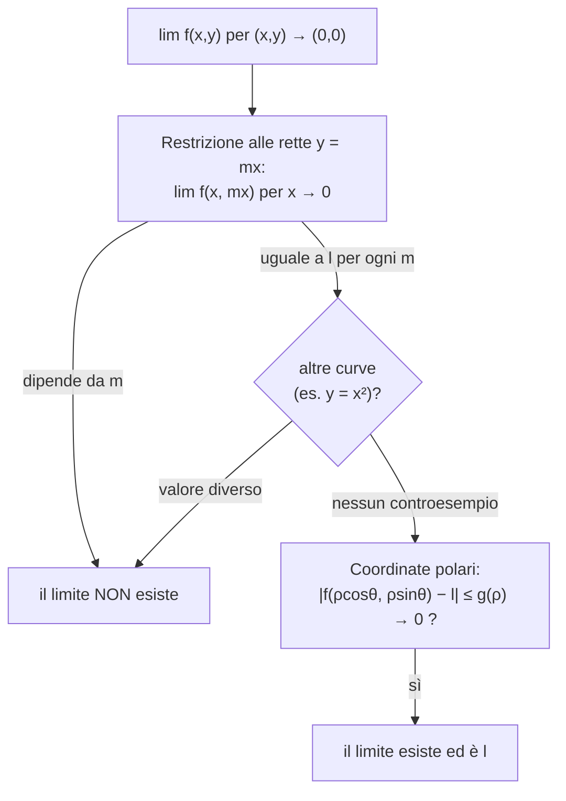

# Funzioni Reali di Più Variabili: limiti e continuità

> [!abstract]
> Il capitolo apre la seconda parte del corso: funzioni reali definite su sottoinsiemi di $\mathbb{R}^N$, $N \ge 2$. Prima si guarda l'ambiente, $\mathbb{R}^N$, con la sua struttura di spazio vettoriale e la **norma**, che generalizza il [[00 - AN1 - Concetti Fondamentali#Il modulo|modulo]] e permette di misurare distanze. Poi i modi di visualizzare una funzione di più variabili (**grafico** e **curve di livello**), la definizione di **limite** (di nuovo tramite le successioni, come nel [[03 - AN1 - Funzioni Reali di una Variabile Reale#Limiti delle Funzioni Reali|cap. 3]]) e le tecniche per il calcolo: restrizioni a **rette e curve** per mostrare che un limite **non** esiste, **coordinate polari** per mostrare che **esiste**. Chiude la **continuità**.
> Il capitolo prepara le derivate parziali e il gradiente del [[08 - AN1 - Calcolo Differenziale in più Variabili|cap. 8]].
> Mappa del corso: [[MOC - Analisi 1]].

---

## La Struttura di RN

Vedi [[Norma euclidea]].

Dal corso di Geometria, l'insieme delle $N$-uple ordinate di numeri reali
$$\mathbb{R}^N := \{(x_1, \dots, x_N) : x_i \in \mathbb{R},\ i = 1, \dots, N\}$$
è uno **spazio vettoriale** su $\mathbb{R}$, con
- **somma tra vettori**: $(x_1, \dots, x_N) + (y_1, \dots, y_N) = (x_1 + y_1, \dots, x_N + y_N)$;
- **moltiplicazione per uno scalare**: $\alpha(x_1, \dots, x_N) = (\alpha x_1, \dots, \alpha x_N)$ per $\alpha \in \mathbb{R}$.

Si identifica il vettore $(x_1, \dots, x_N)$ con il punto dello spazio euclideo $N$-dimensionale con quelle coordinate. Su $\mathbb{R}^N$ si introduce una **norma**, cioè un modo di misurare la lunghezza dei vettori:
$$\|(x_1, \dots, x_N)\| := \sqrt{\sum_{i=1}^N x_i^2}.$$
Per il teorema di Pitagora è la lunghezza del vettore che va dall'origine al punto $(x_1, \dots, x_N)$ (ad esempio $\|(3, 4)\| = 5$).

Proprietà, per ogni $x, y \in \mathbb{R}^N$ e $\alpha \in \mathbb{R}$:
- $\|x\| \ge 0$ e $\|x\| = 0 \iff x = (0, \dots, 0)$;
- $\|\alpha x\| = |\alpha| \cdot \|x\|$;
- $\|x + y\| \le \|x\| + \|y\|$ (**disuguaglianza triangolare**).

> [!note] La norma generalizza il modulo
> Per $N = 1$ la norma è il modulo: $\|x\| = (x^2)^{1/2} = |x|$. Le tre proprietà sono le stesse del [[00 - AN1 - Concetti Fondamentali#Il modulo|modulo]]. Il quadrato della norma, $\|x\|^2 = \sum x_i^2$, compare spesso in ottimizzazione: vedi [[Squared Euclidean Norm]] (Geometria).

Dalla norma si ottiene la **distanza** tra due punti, come la lunghezza del vettore che li congiunge:
$$\|(x_1, \dots, x_N) - (y_1, \dots, y_N)\| = \sqrt{\sum_{i=1}^N (x_i - y_i)^2}.$$

Per $N = 2$ o $N = 3$ si usano le notazioni senza indici $(x, y)$ e $(x, y, z)$.

_(dispensa, p. 115)_

---

## Funzioni Reali di più Variabili, prime proprietà

> [!important] Definizione 7.1
> Una funzione $f : X \subseteq \mathbb{R}^N \to Y \subseteq \mathbb{R}$ si dice **funzione reale di più variabili reali**.

> [!example] Esempi
> - $f : \mathbb{R}^3 \to \mathbb{R}$, $f(x, y, z) = x^2 + xyz + zy + z^2x^2$ (polinomio nelle variabili $x, y, z$, di grado 4).
> - $f(x, y) = \sqrt{1 - x^2 - y^2}$: il dominio è $X = \{(x, y) \in \mathbb{R}^2 : x^2 + y^2 \le 1\}$, il **cerchio** di centro l'origine e raggio 1 (il grafico è una semisfera).
> - $f(x, y) = \sqrt{(1 - x^2)(1 - y^2)}$. *Esercizio: disegnare il dominio.* Serve $(1 - x^2)(1 - y^2) \ge 0$, cioè i due fattori dello stesso segno: $|x| \le 1$ e $|y| \le 1$ (il quadrato $[-1, 1]^2$), oppure $|x| \ge 1$ e $|y| \ge 1$ (le quattro regioni "d'angolo" fuori dal quadrato). Si vede bene nella Figura 74.

### Grafici

Il grafico di $f : X \subseteq \mathbb{R}^N \to \mathbb{R}$ è
$$G(f) = \{(x_1, \dots, x_N, f(x_1, \dots, x_N)) : (x_1, \dots, x_N) \in X\} \subset \mathbb{R}^{N+1}.$$
Si può quindi visualizzare solo se $f$ è definita in $\mathbb{R}$ (grafico nel piano) o in $\mathbb{R}^2$ (grafico nello spazio, una **superficie**).

![[AN1-p122-1.png]]

*Figura 72 — Grafici di $f_1(x, y) = x^2 + y^2$ e $f_2(x, y) = x^2 - y^2$ per $(x, y) \in [-1, 1] \times [-1, 1]$.* A sinistra il **paraboloide** $z = x^2 + y^2$, una "coppa" con il minimo nell'origine. A destra la **sella** (paraboloide iperbolico) $z = x^2 - y^2$: lungo l'asse $x$ sale come una parabola rivolta verso l'alto, lungo l'asse $y$ scende come una parabola rivolta verso il basso.

### Curve di livello

Vedi [[Curve di livello]].

Un altro modo per visualizzare una funzione di più variabili:

> [!important] Curva di livello
> Per $f : X \subset \mathbb{R}^N \to \mathbb{R}$ e $c \in \mathbb{R}$, la **curva (o linea) di livello** $c$ di $f$ è
> $$\Gamma_c := \{x \in X : f(x) = c\} \subset \mathbb{R}^N.$$

Esempi concreti sono le **isobare** di una mappa meteorologica e le **curve di livello** di una carta topografica. Per alcuni valori di $c$ la curva di livello può essere vuota.

![[AN1-p122-2.png]]

*Figura 73 — Linee di livello $\Gamma_c$ di $f_1(x, y) = x^2 + y^2$ per $c = 0, \frac1{16}, \frac14, \frac12, 1$ e di $f_2(x, y) = x^2 - y^2$ per $c = -1, -\frac12, -\frac14, 0, \frac14, \frac12, 1$, con $(x, y) \in [-1, 1]^2$.* A sinistra le curve di livello del paraboloide sono **circonferenze** concentriche $x^2 + y^2 = c$ di raggio $\sqrt c$ (per $c = 0$ solo l'origine; per $c < 0$ l'insieme è vuoto). A destra quelle della sella sono **iperboli** $x^2 - y^2 = c$: con asse orizzontale per $c > 0$, verticale per $c < 0$, e per $c = 0$ le due bisettrici $y = \pm x$, che si incrociano nel punto di sella.

Il vantaggio delle curve di livello è che stanno nello **stesso spazio** $\mathbb{R}^N$ in cui è definita la funzione: si "guadagna" una dimensione. Il grafico di $f : \mathbb{R}^3 \to \mathbb{R}$ non si può disegnare (sta in $\mathbb{R}^4$), ma le sue **superfici** di livello sì (stanno in $\mathbb{R}^3$).

> [!example] Esempio: $f(x, y) = \sqrt{(1 - x^2)(1 - y^2)}$

![[AN1-p123-1.png]]

*Figura 74 — Grafico di $f(x, y) = \sqrt{(1 - x^2)(1 - y^2)}$ e linee di livello $\Gamma_c$ per $(x, y) \in [-2, 2]^2$ e $c = 0, 0.2, 0.4, \dots, 2.6, 2.8, 3$.* In alto il grafico: al centro, sopra il quadrato $[-1, 1]^2$, una "cupola" con massimo $1$ nell'origine; nelle quattro regioni d'angolo ($|x|, |y| \ge 1$) quattro "petali" che salgono rapidamente; tra di loro la funzione non è definita. In basso le curve di livello: al centro curve chiuse attorno all'origine (sempre più quadrate avvicinandosi al bordo del quadrato, dove $f = 0$), negli angoli famiglie di curve simili a iperboli. Dalle sole curve di livello si ricostruisce la forma della superficie, come da una carta topografica.

_(dispensa, pp. 116–117)_

---

## Limiti di Funzioni Reali di più Variabili Reali

Vedi [[Limite in più variabili]].

L'idea è la stessa che in $\mathbb{R}$, sostituendo il modulo con la norma, e si basa sulle successioni che approssimano il punto in cui si calcola il limite.

> [!important] Definizione 7.2 — Limiti per i vettori
> Una successione di vettori $(x_n) \subset \mathbb{R}^N$ **converge** a $x_0 \in \mathbb{R}^N$ se $\|x_n - x_0\| \to 0$ per $n \to +\infty$; si scrive $\lim_{n\to+\infty} x_n = x_0$ oppure $x_n \to x_0$.

Se $x_n = (x_1^n, \dots, x_N^n)$, si verifica facilmente che
$$\lim_{n\to+\infty} x_n = x_0 \text{ in } \mathbb{R}^N \iff \lim_{n\to+\infty} x_i^n = x_i^0 \text{ in } \mathbb{R} \text{ per ogni } i = 1, \dots, N:$$
una successione di vettori converge se e solo se converge **componente per componente**. (Ad esempio $\left(\frac1n, 1 + \frac{1}{n^2}\right) \to (0, 1)$.)

Con questa nozione le definizioni date in $\mathbb{R}$ si estendono facilmente.

> [!important] Definizione 7.3 — Punto di accumulazione
> $c \in \mathbb{R}^N$ è un **punto di accumulazione** di $X \subseteq \mathbb{R}^N$ se esiste $(x_n) \subset \mathbb{R}^N$ con $x_n \in X$, $x_n \neq c$ per ogni $n$ e $x_n \to c$.

> [!important] Definizione 7.4 — Limite per le funzioni
> Sia $f : X \subseteq \mathbb{R}^N \to \mathbb{R}$ e $c \in \mathbb{R}^N$ un punto di accumulazione di $X$. $f$ **tende a $l \in \mathbb{R}$ per $x$ tendente a $c$** se per ogni successione $(x_n) \subset X \setminus \{c\}$ con $x_n \to c$ si ha $f(x_n) \to l$. Si scrive $\lim_{x\to c} f(x) = l$ o $f(x) \to l$ per $x \to c$.

Osservazioni:
- il limite si definisce solo per $c \in \mathbb{R}^N$, cioè **al finito**: a differenza di $\mathbb{R}$, in $\mathbb{R}^N$ non c'è un ordinamento naturale, quindi non c'è una direzione privilegiata per "andare all'infinito";
- come in una variabile, c'è una definizione equivalente senza successioni:
$$\lim_{x\to c} f(x) = l \iff \forall \varepsilon > 0\ \exists \delta > 0 : |f(x) - l| < \varepsilon \quad \forall x \in X \text{ con } \|x - c\| < \delta;$$
- valgono molte proprietà del caso reale, in particolare l'**unicità del limite** e le [[03 - AN1 - Funzioni Reali di una Variabile Reale#Regole di calcolo e ordinamento|regole di calcolo]] per somma, differenza, prodotto e quoziente.

_(dispensa, p. 118)_

---

## Calcolo dei Limiti in RN

La definizione non presenta difficoltà nuove, ma il **calcolo** sì: in $\mathbb{R}$ ci si avvicina a un punto solo da due direzioni (destra e sinistra), in $\mathbb{R}^N$ da **infinite direzioni e in infiniti modi** (lungo rette, parabole, spirali…). Per semplicità ci si limita a $\mathbb{R}^2$ e al punto $(0, 0)$.

### Una condizione per la non esistenza del limite

> [!example] Esempio: $\displaystyle\lim_{(x,y)\to(0,0)} \frac{xy}{x^2 + y^2}$
> $(0, 0)$ è di accumulazione per il dominio $\mathbb{R}^2 \setminus \{(0, 0)\}$. Si restringe $f$ alle rette per l'origine $y = mx$, $m \in \mathbb{R}$, e si calcola il limite per $x \to 0$:
> $$\lim_{x\to0} f(x, mx) = \lim_{x\to0} \frac{mx^2}{x^2 + m^2x^2} = \frac{m}{1 + m^2}.$$
> Il risultato **dipende dalla direzione** $m$ (ad esempio $0$ lungo l'asse $x$, $\frac12$ lungo la bisettrice): il limite **non esiste**. Successioni che tendono all'origine da direzioni diverse danno limiti diversi, in contraddizione con la definizione.

> [!important] Proposizione 7.5 — Condizione necessaria
> Perché esista $\lim_{(x,y)\to(0,0)} f(x, y)$ è **necessario** (ma **non sufficiente**) che esistano e siano uguali i limiti $\lim_{x\to0} f(x, mx)$ al variare di $m \in \mathbb{R}$.

La proposizione fornisce anche un **candidato** $l$: se il limite esiste, deve coincidere con il limite lungo le rette.

> [!example] Esempio: le rette non bastano
> $$\lim_{(x,y)\to(0,0)} \frac{x^2 y}{x^4 + y^2}.$$
> Lungo le rette: $\lim_{x\to0} f(x, mx) = \lim_{x\to0} \frac{mx^3}{x^4 + m^2x^2} = \lim_{x\to0} \frac{mx}{x^2 + m^2} = 0$ per ogni $m$ (anche lungo l'asse $y$, dove $f = 0$). Se il limite esiste, vale $0$.
>
> Ma lungo la **parabola** $y = x^2$, che passa anch'essa per l'origine:
> $$\lim_{x\to0} f(x, x^2) = \lim_{x\to0} \frac{x^4}{x^4 + x^4} = \frac12 \neq 0\ !!$$
> C'è una curva lungo la quale il limite è diverso: il limite **non esiste**.

> [!tip] Come scegliere la curva
> La scelta $y = x^2$ serve a ristabilire il **rapporto omogeneo** tra le variabili: sia al numeratore ($x^2 y$) sia al denominatore ($x^4 + y^2$) il "peso" di $y$ è il doppio di quello di $x$, cioè $y$ si comporta come $x^2$. Con $y = x^2$ tutti i termini diventano dello stesso ordine ($x^4$).

> [!important] Procedimento per la non esistenza
> Per dimostrare che un limite **non esiste** basta trovare **due curve** passanti per il punto di accumulazione lungo le quali i limiti (in una variabile) della funzione ristretta sono diversi (o non esistono).

_(dispensa, p. 119)_

### Coordinate polari e esistenza del limite

Vedi [[Coordinate polari]].

Per dimostrare che un limite **esiste** non basta controllare (infinite) curve: serve una stima uniforme. Un punto $P$ del piano, oltre che con le coordinate cartesiane $(x, y)$, si può rappresentare con le **coordinate polari** $(\rho, \vartheta) \in [0, \infty) \times [0, 2\pi)$.

![[AN1-p126-1.png]]

*Figura 75 — Coordinate polari.* Il punto $P$ ha coordinate cartesiane $(x, y)$ (in rosso, le proiezioni sugli assi) e coordinate polari $(\rho, \vartheta)$ (in blu): $\rho$ è la distanza dall'origine, cioè la lunghezza del segmento $OP$, e $\vartheta$ l'angolo che il segmento forma con il semiasse positivo delle $x$.

Le formule di passaggio sono
$$\begin{cases} x = \rho\cos(\vartheta) \\ y = \rho\sin(\vartheta) \end{cases} \qquad\qquad \begin{cases} \rho = \sqrt{x^2 + y^2} \\ \tan\vartheta = \frac yx \end{cases}$$
La relazione $\tan\vartheta = \frac yx$ non si può esplicitare, perché $\tan$ non è invertibile su $[0, 2\pi)$ (bisogna guardare il quadrante).

Il punto chiave: $\rho = \|(x, y)\|$, quindi
$$\rho \to 0 \iff (x, y) \to (0, 0),$$
**indipendentemente** da $\vartheta$, cioè dalla direzione di avvicinamento.

> [!example] Esempio: $\displaystyle\lim_{(x,y)\to(0,0)} \frac{2x^2 y}{x^2 + y^2}$
> Lungo le rette $\lim_{x\to0} f(x, mx) = 0$ per ogni $m$: il candidato è $l = 0$. In coordinate polari
> $$f(\rho\cos\vartheta, \rho\sin\vartheta) = \frac{2\rho^2\cos^2(\vartheta) \cdot \rho\sin(\vartheta)}{\rho^2} = 2\rho\cos^2(\vartheta)\sin(\vartheta),$$
> e con $|\sin\vartheta|, |\cos\vartheta| \le 1$:
> $$|f(\rho, \vartheta) - l| = \left|2\rho\cos^2(\vartheta)\sin(\vartheta) - 0\right| = 2\rho\left|\cos^2(\vartheta)\sin(\vartheta)\right| \le 2\rho \to 0 \qquad (\rho \to 0).$$
> $|f - l|$ è stato maggiorato da una quantità che dipende **solo** dalla distanza $\rho$ dall'origine e non dalla direzione $\vartheta$: il limite esiste e vale $l = 0$.

> [!important] Procedimento per l'esistenza
> Per dimostrare che $\lim_{(x,y)\to(0,0)} f(x, y) = l$ basta, scritta $f$ in coordinate polari, ottenere una disuguaglianza
> $$\left|f(\rho\cos\vartheta, \rho\sin\vartheta) - l\right| \le g(\rho)$$
> con $g(\rho) \to 0$ per $\rho \to 0$ (e $g$ **non dipendente da $\vartheta$**).

> [!warning] Perché serve l'indipendenza da θ
> Nell'esempio $\frac{x^2 y}{x^4 + y^2}$, in polari si ottiene $\frac{\rho\cos^2\vartheta\sin\vartheta}{\rho^2\cos^4\vartheta + \sin^2\vartheta}$: per ogni $\vartheta$ fissato tende a $0$, ma non si riesce a maggiorarlo con una $g(\rho)$ indipendente da $\vartheta$, perché quando $\sin\vartheta \approx \rho\cos^2\vartheta$ (cioè lungo la parabola) il denominatore diventa piccolo. Tendere a 0 "per ogni direzione fissata" non basta.

> [!example] Esempio: $\displaystyle\lim_{(x,y)\to(0,0)} \frac{\sin(x^2 y) + x^2 + y^2}{x^2 + y^2}$
> Lungo le rette $\lim_{x\to0} f(x, mx) = 1$ per ogni $m$: il candidato è $l = 1$. Poiché $x^2 y = \rho^3\cos^2(\vartheta)\sin(\vartheta)$:
> $$f(\rho, \vartheta) = \frac{\sin(\rho^3\cos^2(\vartheta)\sin(\vartheta)) + \rho^2}{\rho^2} \quad\Rightarrow\quad |f(\rho, \vartheta) - l| = \left|\frac{\sin(\rho^3\cos^2(\vartheta)\sin(\vartheta))}{\rho^2}\right|.$$
> Con la stima grossolana $|\sin t| \le 1$ si ottiene solo $|f - l| \le \frac{1}{\rho^2} \not\to 0$: non si conclude nulla. Con la stima più fine $|\sin t| \le |t|$ (Figura 23 del [[03 - AN1 - Funzioni Reali di una Variabile Reale#Tre limiti notevoli|cap. 3]]):
> $$|f(\rho, \vartheta) - l| \le \frac{\rho^3\overbrace{|\cos^2(\vartheta)\sin(\vartheta)|}^{\le 1}}{\rho^2} \le \rho \to 0.$$
> Quindi il limite esiste e vale $1$.

> [!warning] Correzione
> La dispensa scrive l'argomento del seno come $\rho^3\cos(\vartheta)\sin(\vartheta)$, ma $x^2 y = (\rho\cos\vartheta)^2 \cdot \rho\sin\vartheta = \rho^3\cos^2(\vartheta)\sin(\vartheta)$: manca il quadrato sul coseno. Non cambia la conclusione, perché in entrambi i casi il fattore trigonometrico è limitato da 1.

_(dispensa, pp. 120–121)_

---

## Continuità

Come conseguenza della definizione di limite:

> [!important] Definizione 7.6 — Continuità
> $f : X \subseteq \mathbb{R}^N \to \mathbb{R}$ si chiama
> - **continua in $x_0 \in X$** se per ogni successione $(x_n) \subset X$ con $x_n \to x_0$ si ha $f(x_n) \to f(x_0)$;
> - **continua** se è continua in ogni $x \in X$.
>
> $C(X) := \{f : X \to \mathbb{R} : f \text{ è continua}\}$ indica l'insieme delle funzioni continue su $X$.

Valgono molte osservazioni del caso reale ([[04 - AN1 - Funzioni Continue#Funzioni Continue|cap. 4]]):
- definizione equivalente senza successioni: $f$ è continua in $x_0$ $\iff$ per ogni $\varepsilon > 0$ esiste $\delta > 0$ con $|f(x) - f(x_0)| \le \varepsilon$ per ogni $x \in X$ con $\|x - x_0\| < \delta$;
- se $x_0 \in X$ è di accumulazione per $X$: $f$ continua in $x_0$ $\iff$ $\lim_{x\to x_0} f(x) = f(x_0)$;
- se $x_0$ è un **punto isolato** di $X$, $f$ è sempre continua in $x_0$;
- somme, differenze, prodotti, rapporti e **composizioni** di funzioni continue sono continue.

> [!example] Esempio
> $f : \mathbb{R}^2 \to \mathbb{R}$, $f(x, y) = \sin(xy + x^2)$ è continua, come composizione delle funzioni continue $p(x, y) = xy + x^2$ (polinomio in due variabili) e $g(t) = \sin(t)$.

> [!example] Esempio: una funzione non continua
> $f(x, y) := \frac{xy}{x^2 + y^2}$ per $(x, y) \neq (0, 0)$ e $f(0, 0) := 0$ non è continua nell'origine, perché il limite non esiste. Eppure le sue restrizioni agli assi ($f(x, 0) = 0$ e $f(0, y) = 0$) sono continue: la continuità in più variabili è più forte della continuità "lungo ogni asse". Lo stesso esempio tornerà con le [[08 - AN1 - Calcolo Differenziale in più Variabili#I Concetti di Derivabilità in RN|derivate parziali]].

_(dispensa, p. 121)_
