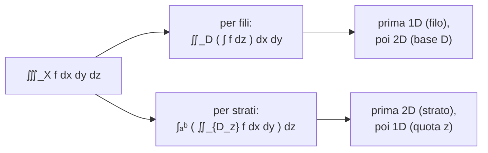

# Calcolo Integrale per Funzioni di più Variabili

> [!abstract]
> Il capitolo estende l'[[06 - AN1 - Calcolo Integrale|integrale di Riemann]] alle funzioni di due e tre variabili. Il problema geometrico diventa calcolare un **volume** sotto un grafico. La costruzione è la stessa (somme inferiori e superiori su partizioni in rettangoli), ma la geometria del dominio può essere complicata: si parte dai **rettangoli**, si passa ai **domini generali** e si definisce la **misura** (area) di un insieme.
> Per **calcolare** gli integrali doppi si usa il **teorema di Fubini–Tonelli**, che li riduce a due integrali in una variabile sui **domini semplici**, e il **cambiamento di variabili**, che usa il determinante della [[09 - AN1 - Funzioni a Valori Vettoriali#Matrice jacobiana|jacobiana]] (in particolare le **coordinate polari**, con cui si calcola finalmente $\int e^{-x^2} = \sqrt\pi$). Infine gli **integrali tripli**, con l'integrazione **per fili** e **per strati** e le coordinate cilindriche e sferiche.
> Mappa del corso: [[MOC - Analisi 1]].

---

## Integrali Doppi, definizione e prime proprietà

Vedi [[Integrale doppio]].

Per semplicità si considera solo il caso di funzioni da $\mathbb{R}^2$ in $\mathbb{R}$; la costruzione si ripete (con le opportune notazioni) in $\mathbb{R}^N$.

> [!question] Problema
> Data $f : X \subset \mathbb{R}^2 \to \mathbb{R}$ limitata, calcolare il **volume** $V$ compreso tra il grafico di $f$ e il piano $xy$.

Come in una variabile, si approssima $V$ dal basso e dall'alto. Ma il dominio $X$ può avere una geometria complicata, difficile da scomporre: si comincia dai rettangoli.

### Domini rettangolari

Sia $X = [a, b] \times [c, d]$. Si crea una partizione di $X$ in rettangoli a partire da partizioni dei due lati:
- data $P_x = \{a = x_0 < x_1 < \ldots < x_n = b\}$ di $[a, b]$ e $P_y = \{c = y_0 < y_1 < \ldots < y_m = d\}$ di $[c, d]$, la partizione $P_{xy} = P_x \times P_y$ divide $X$ nei rettangoli
$$R_{ij} = [x_{i-1}, x_i] \times [y_{j-1}, y_j], \qquad i = 1, \dots, n,\ j = 1, \dots, m;$$
- per $i, j$ si pongono
$$m_{ij} := \inf\{f(x, y) : (x, y) \in R_{ij}\}, \quad M_{ij} := \sup\{f(x, y) : (x, y) \in R_{ij}\}, \quad |R_{ij}| := (x_i - x_{i-1})(y_j - y_{j-1}),$$
$$s(f, P_{xy}) := \sum_{i=1}^n \sum_{j=1}^m m_{ij}|R_{ij}| \ \ (\textbf{somma inferiore}), \qquad S(f, P_{xy}) := \sum_{i=1}^n \sum_{j=1}^m M_{ij}|R_{ij}| \ \ (\textbf{somma superiore}).$$

Ora i "rettangoli" delle somme sono **parallelepipedi** di base $R_{ij}$ e altezza $m_{ij}$ o $M_{ij}$. Per ogni partizione vale $s(f, P_{xy}) \le V \le S(f, P_{xy})$: più grande è $s$, più piccolo è $S$, migliore è l'approssimazione. Se la migliore approssimazione dal basso coincide con la migliore dall'alto, $f$ è integrabile.

> [!important] Definizione 10.1 — Integrale doppio
> Sia $f : X := [a, b] \times [c, d] \to \mathbb{R}$ limitata. Se
> $$\sup\{s(f, P_{xy}) : P_{xy} \text{ partizione di } X\} = \inf\{S(f, P_{xy}) : P_{xy} \text{ partizione di } X\} =: I,$$
> $f$ si dice **integrabile** (secondo Riemann). Si pone $V = I$ e
> $$I =: \iint_X f(x, y)\,dx\,dy$$
> si dice **integrale doppio** di $f$ su $X$.

> [!example] Esempi
> - Se $f(x, y) = c$ è costante su $[a, b] \times [c, d]$, dalla definizione $\iint_X f\,dx\,dy = c(b - a)(d - c)$ (volume di un parallelepipedo).
> - Estendendo la funzione di Dirichlet a $\mathbb{R}^2$:
> $$f(x, y) := \begin{cases} 1 & (x, y) \in ([a, b] \setminus \mathbb{Q}) \times [c, d], \\ 0 & (x, y) \in ([a, b] \cap \mathbb{Q}) \times [c, d] \end{cases}$$
> non è integrabile: ogni $[x_{i-1}, x_i]$ contiene razionali e irrazionali, quindi $m_{ij} = 0$ e $M_{ij} = 1$, e $s(f, P_{xy}) = 0 \neq (b - a)(d - c) = S(f, P_{xy})$.

### Domini generali e misura

Per $X \subset \mathbb{R}^2$ **limitato** e $f : X \to \mathbb{R}$, dato un rettangolo $\mathcal{R}$ che contiene $X$ si estende $f$ ponendola $0$ fuori da $X$:
$$\bar f(x, y) = \begin{cases} f(x, y) & (x, y) \in X, \\ 0 & (x, y) \in \mathcal{R} \setminus X. \end{cases}$$
$\bar f$ è definita su un rettangolo, dove l'integrale è già definito.

> [!important] Definizione 10.2
> Sia $f : X \to \mathbb{R}$ limitata con $X \subset \mathbb{R}^2$ limitato. Se, dato $\mathcal{R} \supseteq X$, $\bar f$ è integrabile in $\mathcal{R}$, $f$ si dice **integrabile** in $X$ e
> $$\iint_X f(x, y)\,dx\,dy := \iint_{\mathcal{R}} \bar f(x, y)\,dx\,dy.$$

La definizione non dipende dalla scelta di $\mathcal{R}$: i rettangoli contenuti in $\mathcal{R} \setminus X$ contribuiscono $0$.

Integrando la funzione $1$ su $X$ si ottiene il volume di un "cilindro" di base $X$ e altezza $1$, cioè $1 \cdot \text{area}(X)$:

![[AN1-p146-1.png]]

*Figura 84 — La misura di un insieme.* Un solido di base $X$ (una regione dal bordo irregolare, in grigio scuro sul piano $xy$) e altezza costante $1$. Il suo volume coincide numericamente con l'area $|X|$ della base.

> [!important] Definizione 10.3 — Misura
> Se $X$ è limitato e la sua funzione caratteristica $\mathbb{1}_X$ è integrabile, $X$ si dice **misurabile** e
> $$|X| := \iint_X 1\,dx\,dy \qquad (\text{misura, o area, di } X).$$

### Proprietà dell'integrale doppio

Siano $f, g : X \to \mathbb{R}$ integrabili.
- **Linearità**: $\alpha f + \beta g$ è integrabile (le funzioni integrabili su $X$ formano uno spazio vettoriale) e
$$\iint_X (\alpha f + \beta g)\,dx\,dy = \alpha\iint_X f\,dx\,dy + \beta\iint_X g\,dx\,dy.$$
- **Monotonia**: se $f \le g$ su $X$, allora $\iint_X f \le \iint_X g$.
- **Disuguaglianza triangolare**: $|f|$ è integrabile e $\left|\iint_X f\right| \le \iint_X |f|$.
- Se $|X| = 0$, allora $\iint_X f\,dx\,dy = 0$ (ad esempio su un segmento o una curva).
- **Additività** rispetto agli insiemi: se $X = X_1 \cup X_2$ e $|X_1 \cap X_2| = 0$,
$$\iint_X f = \iint_{X_1} f + \iint_{X_2} f.$$

> [!question] Problemi
> 1. Quali $f : X \subset \mathbb{R}^2 \to \mathbb{R}$ sono integrabili?
> 2. Se $f$ è integrabile, come si calcola $\iint_X f(x, y)\,dx\,dy$?
>
> Poiché la geometria di $X$ può essere molto complicata, la risposta non è semplice come in $\mathbb{R}$.

_(dispensa, pp. 138–140)_

---

## Teorema di Fubini–Tonelli

Vedi [[Teorema di Fubini-Tonelli]].

Una prima risposta si ha quando $X$ ha due lati paralleli agli assi.

### Domini semplici

Vedi [[Domini normali]].

> [!important] Definizione 10.4 — Domini semplici
> Un insieme limitato $X \subset \mathbb{R}^2$ si dice
> 1. **$y$-semplice** se esistono $g_1, g_2 : [a, b] \to \mathbb{R}$ continue con
> $$X = \{(x, y) \in \mathbb{R}^2 : x \in [a, b],\ g_1(x) \le y \le g_2(x)\};$$
> 2. **$x$-semplice** se esistono $h_1, h_2 : [c, d] \to \mathbb{R}$ continue con
> $$X = \{(x, y) \in \mathbb{R}^2 : y \in [c, d],\ h_1(y) \le x \le h_2(y)\};$$
> 3. **semplice** se è $y$-semplice o $x$-semplice;
> 4. **regolare** se è unione di un numero finito di domini semplici.

(Altrove si chiamano anche **domini normali** rispetto a un asse.)

![[AN1-p147-1.png]]

*Figura 85 — Domini $y$- e $x$-semplici.* In alto un dominio $y$-semplice (giallo): è delimitato a sinistra e a destra da due segmenti verticali ($x = a$, $x = b$), in basso dal grafico di $g_1$ e in alto da quello di $g_2$; ogni retta verticale per $x \in [a, b]$ lo taglia in un unico segmento da $g_1(x)$ a $g_2(x)$. In basso un dominio $x$-semplice (azzurro): delimitato da due segmenti orizzontali ($y = c$, $y = d$) e dai grafici di $h_1(y)$ a sinistra e $h_2(y)$ a destra; ogni retta orizzontale lo taglia in un segmento.

Un dominio $y$-semplice è un "quadrangolo" con due lati paralleli all'asse $y$ e gli altri due dati dai grafici di $g_1$ e $g_2$ (analogamente per gli $x$-semplici).

### Il teorema

L'idea di Fubini–Tonelli è ridurre l'integrale doppio a **due integrali in una variabile in successione**.

> [!important] Teorema 10.5 — Fubini–Tonelli
> Sia $f : X \subset \mathbb{R}^2 \to \mathbb{R}$ continua e $X$ semplice. Allora $f$ è integrabile su $X$ e
> 1. se $X$ è $y$-semplice:
> $$\iint_X f(x, y)\,dx\,dy = \int_a^b \left(\int_{g_1(x)}^{g_2(x)} f(x, y)\,dy\right) dx;$$
> 2. se $X$ è $x$-semplice:
> $$\iint_X f(x, y)\,dx\,dy = \int_c^d \left(\int_{h_1(y)}^{h_2(y)} f(x, y)\,dx\right) dy.$$

Nell'integrale interno si integra rispetto a una variabile e **l'altra si considera costante**; i suoi estremi dipendono dalla variabile esterna.

> [!note] Interpretazione geometrica
> Sia $X$ $y$-semplice. Per $x \in [a, b]$ fissato
> $$A(x) = \int_{g_1(x)}^{g_2(x)} f(x, y)\,dy$$
> è l'area della sezione del solido con il piano verticale a $x$ fissato, cioè l'area sotto il grafico di $F(y) := f(x, y)$ per $y \in [g_1(x), g_2(x)]$. $A(x)\,dx = dV$ è il volume di una "fetta" di spessore infinitesimo $dx$; integrando per $x \in [a, b]$ si ottiene il volume totale. È lo stesso principio del [[06 - AN1 - Calcolo Integrale#Calcolo di Volumi di Corpi di Rotazione|volume dei corpi di rotazione]] (principio di Cavalieri).

![[AN1-p148-1.png]]

*Figura 86 — Il teorema di Fubini–Tonelli per $X$ $y$-semplice.* Il solido sopra il dominio $X$ (grigio sul piano $xy$, tra $g_1$ e $g_2$) tagliato dal piano verticale in $x$: la sezione blu ha area $A(x)$ ed è delimitata in alto dalla curva rossa $F(y) = f(x, y)$. La fetta di spessore $dx$ ha volume $A(x)\,dx$; sommando tutte le fette da $a$ a $b$ si ottiene $\iint_X f$.

> [!example] Esempio
> $$\iint_X 2x^2 y\,dx\,dy, \qquad X = \{(x, y) : x \in [0, 1],\ x + 1 \le y \le 2\}.$$
> $X$ è già scritto come $y$-semplice (è anche $x$-semplice: $X = \{y \in [1, 2],\ 0 \le x \le y - 1\}$). Quindi, considerando $x$ costante nell'integrale in $y$:
> $$\int_0^1 \left(\int_{x+1}^2 2x^2 y\,dy\right) dx = \int_0^1 2x^2\left[\frac{y^2}{2}\right]_{y=x+1}^{2} dx = \int_0^1 (3x^2 - 2x^3 - x^4)\,dx = 1 - \frac12 - \frac15 = \frac{3}{10}.$$

> [!example] Esempio: scegliere l'ordine giusto
> $$\iint_X \sin(y^3)\,dx\,dy, \qquad X = \{(x, y) : x \in [0, 1],\ \sqrt x \le y \le 1\}.$$
> Come $y$-semplice si otterrebbe $\int_0^1 \left(\int_{\sqrt x}^1 \sin(y^3)\,dy\right) dx$, ma $\sin(y^3)$ **non ha primitiva elementare** rispetto a $y$. Il dominio però è anche $x$-semplice: $X = \{y \in [0, 1],\ 0 \le x \le y^2\}$.

![[AN1-p149-1.png]]

*Figura 87 — Dominio $y$- e $x$-semplice.* Lo stesso dominio giallo, tra la curva $y = \sqrt x$ (cioè $x = y^2$) e la retta $y = 1$. A sinistra visto come $y$-semplice: per ogni $x$ il segmento verticale va da $g_1(x) = \sqrt x$ a $g_2(x) = 1$. A destra come $x$-semplice: per ogni $y$ il segmento orizzontale va da $h_1(y) = 0$ a $h_2(y) = y^2$.

> Quindi
> $$\iint_X \sin(y^3)\,dx\,dy = \int_0^1 \left(\int_0^{y^2} \sin(y^3)\,dx\right) dy = \int_0^1 y^2\sin(y^3)\,dy = \left[-\frac13\cos(y^3)\right]_0^1 = \frac13(1 - \cos(1)).$$
> Integrando prima in $x$ compare il fattore $y^2$, che è proprio la derivata (a meno di costanti) di $y^3$: l'integrale diventa immediato. A volte conviene vedere il dominio come semplice rispetto a una variabile piuttosto che all'altra.

> [!tip] Funzioni a variabili separate
> Se $X = [a, b] \times [c, d]$ e $f(x, y) = f_1(x) \cdot f_2(y)$, da Fubini–Tonelli
> $$\iint_X f(x, y)\,dx\,dy = \int_a^b f_1(x)\,dx \cdot \int_c^d f_2(y)\,dy.$$

_(dispensa, pp. 140–143)_

---

## Cambiamento di Variabili negli Integrali Doppi

Vedi [[Cambiamento di variabili negli integrali multipli]].

Il risultato seguente estende agli integrali doppi l'[[06 - AN1 - Calcolo Integrale#Integrazione per sostituzione|integrazione per sostituzione]].

> [!important] Teorema 10.6 — Cambiamento di variabili
> Sia $f : X \subset \mathbb{R}^2 \to \mathbb{R}$ integrabile e $\varphi : X' \subset \mathbb{R}^2 \to \mathbb{R}^2$, $(u, v) \mapsto \varphi(u, v) = (x, y)$, una [[09 - AN1 - Funzioni a Valori Vettoriali#Trasformazioni Regolari di Coordinate|trasformazione regolare di coordinate]] con $\varphi(X') = X$. Allora
> $$\iint_X f(x, y)\,dx\,dy = \iint_{X'} f(\varphi(u, v))\,\left|\det J_\varphi(u, v)\right|\,du\,dv,$$
> dove $J_\varphi$ è la jacobiana di $\varphi$.

Per il teorema di invertibilità locale, con $\varphi(u, v) = (x, y)$:
$$\det J_\varphi(u, v) = \det\left(J_{\varphi^{-1}}^{-1}(x, y)\right) = \frac{1}{\det J_{\varphi^{-1}}(x, y)},$$
utile quando è più facile scrivere le nuove variabili in funzione delle vecchie.

> [!note] Giustificazione geometrica
> In prima approssimazione
> $$\varphi(u + du, v) \approx \varphi(u, v) + \varphi_u(u, v)\,du, \qquad \varphi(u, v + dv) \approx \varphi(u, v) + \varphi_v(u, v)\,dv,$$
> $$\varphi(u + du, v + dv) \approx \varphi(u, v) + \varphi_u(u, v)\,du + \varphi_v(u, v)\,dv.$$
> Con $\varphi = \binom{\varphi_1}{\varphi_2}$, il quadratino $[u, u + du] \times [v, v + dv]$ viene mandato (approssimativamente) nel parallelogramma generato da
> $$w_1 := \varphi_u\,du = \begin{pmatrix} \frac{\partial\varphi_1}{\partial u}du \\ \frac{\partial\varphi_2}{\partial u}du \end{pmatrix}, \qquad w_2 := \varphi_v\,dv = \begin{pmatrix} \frac{\partial\varphi_1}{\partial v}dv \\ \frac{\partial\varphi_2}{\partial v}dv \end{pmatrix}.$$
> L'area del parallelogramma è $|\det(w_1, w_2)|$ (corso di Geometria), e per la linearità del determinante in ogni colonna
> $$dA' = |\det(w_1, w_2)| = |\det J_\varphi(u, v)|\,du\,dv.$$
> Il determinante jacobiano è il **fattore di scala delle aree**.

![[AN1-p150-1.png]]

*Figura 88 — Cambiamento di variabili.* A destra, nel piano $(u, v)$, un quadratino giallo di lati $du$ e $dv$ (area $dA = du\,dv$). La trasformazione $\varphi$ (freccia in alto) lo manda nel piano $(x, y)$, a sinistra, in un parallelogramma (quasi) giallo con lati $w_1 \approx \varphi_u\,du$ e $w_2 \approx \varphi_v\,dv$ (in blu), di area $dA' \approx |\det(w_1, w_2)|$.

Per le **coordinate polari** $\det J_\varphi = \rho$ ([[09 - AN1 - Funzioni a Valori Vettoriali#Coordinate polari|cap. 9]]), quindi
$$dA' = \rho\,d\rho\,d\vartheta.$$

![[AN1-p150-2.png]]

*Figura 89 — Cambiamento di variabili per coordinate polari.* Il "rettangolino polare" giallo tra i raggi $\rho$ e $\rho + d\rho$ e gli angoli $\vartheta$ e $\vartheta + d\vartheta$: un lato è lungo $d\rho$ (radiale), l'altro è un arco lungo $\rho\,d\vartheta$. L'area è quindi circa $\rho\,d\rho\,d\vartheta$: più ci si allontana dall'origine, più il rettangolino è grande. Da qui il fattore $\rho$.

> [!warning] Non dimenticare il fattore ρ
> È l'errore più comune: in coordinate polari $dx\,dy$ diventa $\rho\,d\rho\,d\vartheta$, **non** $d\rho\,d\vartheta$.

> [!example] Esempio: un settore circolare
> $$\iint_X xy\,dx\,dy, \qquad X = \{(x, y) : x^2 + y^2 \le 1,\ 0 \le y \le x\}.$$
> Conviene prima disegnare il dominio.

![[AN1-p151-1.png]]

*Figura 90 — Dominio in coordinate cartesiane e polari.* A sinistra $X$ (grigio scuro) è l'intersezione del cerchio unitario (giallo) con il semipiano $y \ge 0$ (verde) e il semipiano $y \le x$ (rosso): un settore circolare di ampiezza $\frac\pi4$ tra l'asse $x$ e la bisettrice. A destra lo stesso dominio in coordinate polari: un rettangolo $X' = [0, 1] \times \left[0, \frac\pi4\right]$ nel piano $(\rho, \vartheta)$.

> Il dominio è semplice, ma essendo un settore circolare è molto più facile in polari: $X' = \{0 \le \rho \le 1,\ \vartheta \in [0, \frac\pi4]\} = [0, 1] \times [0, \frac\pi4]$. Con $|\det J_\varphi| = \rho$:
> $$\iint_X xy\,dx\,dy = \iint_{[0,1]\times[0,\frac\pi4]} \rho\cos\vartheta \cdot \rho\sin\vartheta \cdot \rho\,d\rho\,d\vartheta.$$
> $X'$ è un rettangolo e l'integranda è a variabili separate:
> $$\int_0^1 \rho^3\,d\rho \cdot \int_0^{\frac\pi4} \cos\vartheta\sin\vartheta\,d\vartheta = \left[\frac{\rho^4}{4}\right]_0^1 \cdot \left[\frac{\sin^2\vartheta}{2}\right]_0^{\frac\pi4} = \frac14 \cdot \frac14 = \frac{1}{16}.$$

> [!example] Esempio: un cambio di variabili su misura
> $$\iint_X (x + y)\,dx\,dy, \qquad X = \left\{(x, y) : x > 0,\ y \ge 0,\ 1 \le xy \le 2,\ 1 \le \tfrac yx \le 2\right\}.$$
> Non è facile scrivere $X$ come dominio semplice. Con le variabili $u = xy$, $v = \frac yx$ il dominio diventa il quadrato $X' = [1, 2] \times [1, 2]$.

![[AN1-p152-1.png]]

*Figura 91 — Dominio in coordinate cartesiane e $(u, v)$.* A sinistra $X$ (giallo): la regione "curvilinea" delimitata dalle iperboli $xy = 1$, $xy = 2$ e dalle rette per l'origine $\frac yx = 1$, $\frac yx = 2$. A destra la sua immagine nel piano $(u, v)$: il quadrato $[1, 2]^2$. La trasformazione $\varphi$ va dal quadrato al dominio curvo.

> È data $\varphi^{-1} : (x, y) \mapsto (u, v) = \left(xy, \frac yx\right)$; bisogna trovare $\varphi$. Da $u = xy$ e $v = \frac yx$: $uv = y^2$ e $\frac uv = x^2$, quindi
> $$\varphi(u, v) = (x, y) = \left(\sqrt{\tfrac uv},\ \sqrt{uv}\right), \qquad J_\varphi(u, v) = \begin{pmatrix} \frac{1}{2\sqrt{uv}} & -\frac12\sqrt{\frac{u}{v^3}} \\ \frac12\sqrt{\frac vu} & \frac12\sqrt{\frac uv} \end{pmatrix}, \qquad \det J_\varphi(u, v) = \frac{1}{4v} + \frac{1}{4v} = \frac{1}{2v}.$$
> Quindi
> $$\iint_X (x + y)\,dx\,dy = \int_1^2 \frac{1}{2v}\left(\int_1^2 \left(\sqrt{\tfrac uv} + \sqrt{uv}\right) du\right) dv = \int_1^2 \frac{1}{2v}\left[\frac23\frac{u^{3/2}}{\sqrt v} + \frac23 u^{3/2}\sqrt v\right]_1^2 dv$$
> $$= \frac23\left(\sqrt8 - 1\right)\int_1^2 \frac12\left(v^{-\frac32} + v^{-\frac12}\right) dv = \frac13\left(\sqrt8 - 1\right)\left[-2v^{-\frac12} + 2v^{\frac12}\right]_1^2 = \ldots = \frac13\left(4 - \sqrt2\right).$$

> [!warning] Correzione
> Nel passaggio intermedio la dispensa scrive $\frac23(\sqrt8 - 1)\int_1^2 \left(\frac{1}{v^{3/2}} + \frac{1}{v^{1/2}}\right) dv$, dimenticando il fattore $\frac12$ che viene da $\frac{1}{2v}$; con quella scrittura il risultato sarebbe il doppio. Il risultato finale $\frac13(4 - \sqrt2) \approx 0{,}862$ è corretto (verificato numericamente): il fattore $\frac12$ va tenuto, come nella formula sopra.

_(dispensa, pp. 143–146)_

### Altri esempi: aree in polari e l'integrale di Gauss

> [!example] Area di un dominio dato in coordinate polari
> Sia $X$ il dominio che in coordinate polari è
> $$X' = \{(\rho, \vartheta) : \vartheta \in [\vartheta_0, \vartheta_1],\ 0 \le \rho \le R(\vartheta)\}$$
> con $R : [\vartheta_0, \vartheta_1] \to [0, +\infty)$ continua.

![[AN1-p152-2.png]]

*Figura 92 — Dominio in coordinate cartesiane e polari.* A destra, nel piano $(\vartheta, \rho)$, $X'$ è un dominio "$\rho$-semplice": tra $\vartheta_0$ e $\vartheta_1$, sotto il grafico di $R(\vartheta)$. A sinistra la sua immagine $X$ nel piano $(x, y)$: una regione a "ventaglio" tra i raggi di angolo $\vartheta_0$ e $\vartheta_1$, in cui il raggio in direzione $\vartheta$ arriva fino alla distanza $R(\vartheta)$.

> Poiché $X'$ è $\rho$-semplice, in coordinate polari
> $$|X| = \iint_X 1\,dx\,dy = \iint_{X'} \rho\,d\rho\,d\vartheta = \int_{\vartheta_0}^{\vartheta_1} \int_0^{R(\vartheta)} \rho\,d\rho\,d\vartheta = \int_{\vartheta_0}^{\vartheta_1} \left[\frac{\rho^2}{2}\right]_0^{R(\vartheta)} d\vartheta = \frac12\int_{\vartheta_0}^{\vartheta_1} R^2(\vartheta)\,d\vartheta.$$

> [!example] La spirale di Archimede
> $X' := \{(\rho, \vartheta) : \vartheta \in [0, 2\pi],\ 0 \le \rho \le \vartheta\}$, cioè $R(\vartheta) = \vartheta$:
> $$|X| = \frac12\int_0^{2\pi} \vartheta^2\,d\vartheta = \frac12 \cdot \frac{\vartheta^3}{3}\Big|_0^{2\pi} = \frac43\pi^3.$$

![[AN1-p153-1.png]]

*Figura 93 — La spirale di Archimede.* A sinistra la regione $X$ (gialla) racchiusa dalla spirale $\rho = \vartheta$: partendo dall'origine il raggio cresce con l'angolo, passa per $\frac\pi2$, $\pi$, $\frac{3\pi}{2}$ e arriva a $2\pi$ sull'asse $x$ dopo un giro completo. A destra, in coordinate polari, la stessa regione è il triangolo sotto la bisettrice $\rho = \vartheta$ per $\vartheta \in [0, 2\pi]$.

> [!example] L'integrale di Gauss: $\int_{-\infty}^{+\infty} e^{-x^2}\,dx = \sqrt\pi$
> Si calcola
> $$I_R := \iint_{X_R} e^{-(x^2 + y^2)}\,dx\,dy, \qquad X_R := \{(x, y) : x^2 + y^2 \le R^2\}.$$
> In coordinate polari il cerchio $X_R$ diventa il rettangolo $X_R' = [0, R] \times [0, 2\pi]$, e con variabili separate:
> $$I_R = \int_0^R\int_0^{2\pi} e^{-\rho^2}\rho\,d\vartheta\,d\rho = \int_0^R e^{-\rho^2}\rho\,d\rho \cdot \int_0^{2\pi} d\vartheta = \left[-\frac{e^{-\rho^2}}{2}\right]_0^R \cdot 2\pi = \pi\left(1 - e^{-R^2}\right).$$
> Quindi $\lim_{R\to+\infty} I_R = \pi$. Poiché per $R \to +\infty$ (in un certo senso) $X_R \to \mathbb{R}^2 = (-\infty, +\infty) \times (-\infty, +\infty)$, "segue" (con le variabili separate)
> $$\pi = \iint_{\mathbb{R}^2} e^{-(x^2+y^2)}\,dx\,dy = \int_{-\infty}^{+\infty}\int_{-\infty}^{+\infty} e^{-x^2}e^{-y^2}\,dx\,dy = \int_{-\infty}^{+\infty} e^{-x^2}\,dx \cdot \int_{-\infty}^{+\infty} e^{-y^2}\,dy = \left(\int_{-\infty}^{+\infty} e^{-x^2}\,dx\right)^2.$$
> Quindi
> $$\int_{-\infty}^{+\infty} e^{-x^2}\,dx = \sqrt\pi.$$
> Non si poteva calcolare con una primitiva di $e^{-x^2}$ (che [[06 - AN1 - Calcolo Integrale#Integrazione per sostituzione|non è elementare]]). In coordinate polari, invece, grazie al fattore $\rho = \det J_\varphi$, si passa da $e^{-x^2}$ a $\rho e^{-\rho^2}$, che si integra immediatamente. È il valore che fa funzionare la [[Gaussian|distribuzione normale]] in probabilità.

_(dispensa, pp. 146–148)_

---

## Integrali Tripli

Vedi [[Integrale triplo]].

Si considerano gli integrali tripli
$$\iiint_X f(x, y, z)\,dx\,dy\,dz$$
per $f : X \subset \mathbb{R}^3 \to \mathbb{R}$. Se $f(x, y, z)$ è la **densità** di un corpo $X$ nel punto $(x, y, z)$, l'integrale è la **massa totale** del corpo.

La definizione di integrabilità e di integrale ripete la costruzione per gli integrali doppi: prima su un **parallelepipedo** (facile da suddividere in parallelepipedi più piccoli), poi su un insieme generale, contenuto in un parallelepipedo, estendendo la funzione a $0$ fuori da $X$. Valgono le stesse proprietà degli integrali doppi. La **misura** (volume) di $X \subset \mathbb{R}^3$ è
$$|X| := \iiint_X 1\,dx\,dy\,dz.$$

### Integrazione per fili

Anche in $\mathbb{R}^3$ le formule di Fubini–Tonelli riconducono il calcolo a integrali in dimensione più bassa.

> [!important] Definizione 10.7
> Un insieme limitato $X \subset \mathbb{R}^3$ si dice
> 1. **$z$-semplice** se esistono $g_1, g_2 : D \subset \mathbb{R}^2 \to \mathbb{R}$ continue con
> $$X = \{(x, y, z) \in \mathbb{R}^3 : (x, y) \in D,\ g_1(x, y) \le z \le g_2(x, y)\}$$
> (analogamente $y$-semplice e $x$-semplice);
> 2. **semplice** se è $z$-, $y$- o $x$-semplice.

Un dominio $z$-semplice è un "cilindro" con superficie laterale parallela all'asse $z$ e basi date dai grafici di $g_1$ e $g_2$.

> [!important] Teorema 10.8 — Integrazione per fili
> Sia $f : X \subset \mathbb{R}^3 \to \mathbb{R}$ continua e $X$ semplice. Allora $f$ è integrabile e, se $X$ è $z$-semplice,
> $$\iiint_X f(x, y, z)\,dx\,dy\,dz = \iint_D \left(\int_{g_1(x,y)}^{g_2(x,y)} f(x, y, z)\,dz\right) dx\,dy$$
> (formule analoghe per $y$- e $x$-semplice).

Si integra prima in $z$ tra parentesi (l'integrale **sul filo** verticale sopra $(x, y)$), poi si fa un integrale doppio in $x, y$ (sommando i contributi di tutti i fili).

![[AN1-p155-1.png]]

*Figura 94 — Integrazione per fili.* Il solido $X$ compreso tra la superficie inferiore gialla $g_1(x, y)$ e quella superiore azzurra $g_2(x, y)$, sopra la regione $D$ del piano $xy$. Sopra ogni punto $(x, y) \in D$ c'è un "filo" verticale (tratteggiato rosso) che va da $g_1(x, y)$ a $g_2(x, y)$: si integra $f$ lungo il filo e poi si sommano tutti i fili su $D$.

> [!example] Esempio
> $$\iiint_X z\,dx\,dy\,dz, \qquad X = \left\{(x, y, z) : x^2 + y^2 \le 1,\ 0 \le z \le 1 - \sqrt{x^2 + y^2}\right\}$$
> ($X$ è un cono con vertice in $(0, 0, 1)$ e base il cerchio unitario). Per fili:
> $$\iiint_X z = \iint_{\{x^2+y^2\le1\}} \left(\int_0^{1 - \sqrt{x^2+y^2}} z\,dz\right) dx\,dy = \iint_{\{x^2+y^2\le1\}} \frac12\left(1 - \sqrt{x^2 + y^2}\right)^2 dx\,dy.$$
> In coordinate polari il cerchio diventa $\{0 \le \rho \le 1,\ 0 \le \vartheta \le 2\pi\}$:
> $$\int_0^1 \frac12(1 - \rho)^2\rho\,d\rho\int_0^{2\pi} d\vartheta = \pi\int_0^1 (\rho^3 - 2\rho^2 + \rho)\,d\rho = \pi\left(\frac14 - \frac23 + \frac12\right) = \frac{\pi}{12}.$$

> [!warning] Correzione
> La dispensa scrive come risultato finale $\frac{1}{12}$, ma dopo aver integrato in $\vartheta$ resta il fattore $\pi$: $\pi\int_0^1(\rho^3 - 2\rho^2 + \rho)\,d\rho = \pi \cdot \frac{1}{12} = \frac{\pi}{12}$.

### Integrazione per strati

Un'altra tecnica di riduzione: si suppone che $X$ si possa scrivere come
$$X = \{(x, y, z) \in \mathbb{R}^3 : z \in [a, b],\ (x, y) \in D_z\},$$
dove per ogni $z$ fissato $D_z$ (lo **strato**) è un insieme del piano su cui $f$ è integrabile in $(x, y)$. $X$ è l'unione degli strati $D_z$ al variare di $z \in [a, b]$.

> [!important] Teorema 10.9 — Integrazione per strati
> Sia $f : X \subset \mathbb{R}^3 \to \mathbb{R}$ continua e $X = \{(x, y, z) : z \in [a, b],\ (x, y) \in D_z\}$. Allora
> $$\iiint_X f(x, y, z)\,dx\,dy\,dz = \int_a^b \left(\iint_{D_z} f(x, y, z)\,dx\,dy\right) dz.$$

Si calcola prima un integrale doppio (su ogni strato), poi un integrale in $z$ (sommando i contributi di tutti gli strati). Formule analoghe valgono con gli strati rispetto a $x$ o $y$.

![[AN1-p156-1.png]]

*Figura 95 — Integrazione per strati.* Il solido $X$ compreso tra i piani $z = a$ e $z = b$, tagliato da un piano orizzontale (rosa) a quota $z$: la sezione rossa è lo strato $D_z$. In basso e in alto le sezioni $D_a$ e $D_b$. Si integra su ogni "fetta" orizzontale e poi si sommano le fette.

> [!example] Esempio
> $$\iiint_X (x^2 + y^2)\,dx\,dy\,dz, \qquad X = \{(x, y, z) : z \in [0, 1],\ x^2 + y^2 \le z^2\}.$$
> Gli strati $D_z = \{x^2 + y^2 \le z^2\}$ sono cerchi di centro l'origine e raggio $z$ ($X$ è un cono con vertice nell'origine). L'integrale sullo strato si risolve in coordinate polari ($x^2 + y^2 = \rho^2$, con il fattore $\rho$):
> $$\iiint_X (x^2 + y^2) = \int_0^1 \left(\int_0^{2\pi} d\vartheta\int_0^z \rho^3\,d\rho\right) dz = \int_0^1 2\pi\frac{z^4}{4}\,dz = \pi\left[\frac{z^5}{10}\right]_0^1 = \frac{\pi}{10}.$$

> [!example] Esempio: massa di un tetraedro (fili e strati)
> Calcolare la massa $m$ del tetraedro di vertici $(0,0,0)$, $(1,0,0)$, $(0,1,0)$, $(0,0,1)$ con densità $f(x, y, z) = 1 - z$. I punti del tetraedro sono
> $$X = \{(x, y, z) : x, y, z \ge 0,\ x + y + z \le 1\}, \qquad m = \iiint_X (1 - z)\,dx\,dy\,dz.$$
>
> **Per fili.** $X$ è $z$-semplice: $X = \{(x, y) \in D,\ 0 \le z \le 1 - x - y\}$ con $D = \{y \in [0, 1],\ 0 \le x \le 1 - y\}$ (il triangolo alla base).

![[AN1-p157-1.png]]

*Figura 96 — Esempio integrazione per fili.* Il tetraedro grigio con la base triangolare gialla $D$ nel piano $xy$, delimitata dagli assi e dalla retta $x = 1 - y$. Sopra un punto $(x, y)$ della base, il filo rosso va da $z = 0$ fino alla faccia obliqua $z = 1 - x - y$.

> $$m = \iint_D \left(\int_0^{1-x-y} (1 - z)\,dz\right) dx\,dy = \int_0^1\int_0^{1-y}\left(1 - x - y - \frac{(1 - x - y)^2}{2}\right) dx\,dy$$
> $$= \int_0^1 \left[-\frac{(1 - x - y)^2}{2} + \frac{(1 - x - y)^3}{6}\right]_{x=0}^{x=1-y} dy = \int_0^1 \left(\frac{(1 - y)^2}{2} - \frac{(1 - y)^3}{6}\right) dy = \left[-\frac{(1 - y)^3}{6} + \frac{(1 - y)^4}{24}\right]_0^1 = \frac16 - \frac{1}{24} = \frac18.$$
>
> **Per strati.** $X$ si scompone negli strati $D_z = \{y \in [0, 1 - z],\ 0 \le x \le 1 - y - z\}$, $z \in [0, 1]$ (triangoli sempre più piccoli salendo).

![[AN1-p157-2.png]]

*Figura 97 — Esempio integrazione per strati.* Lo stesso tetraedro tagliato dal piano orizzontale a quota $z$: lo strato rosa $D_z$ è un triangolo rettangolo di cateti $1 - z$, delimitato dalla retta $x = 1 - y - z$.

> $$m = \int_0^1 \left(\iint_{D_z} (1 - z)\,dx\,dy\right) dz = \int_0^1 \int_0^{1-z} (1 - y - z)(1 - z)\,dy\,dz = \int_0^1 (1 - z)\left[-\frac{(1 - y - z)^2}{2}\right]_{y=0}^{y=1-z} dz$$
> $$= \int_0^1 (1 - z)\frac{(1 - z)^2}{2}\,dz = \left[-\frac{(1 - z)^4}{8}\right]_0^1 = \frac18.$$
> Per strati è più veloce: l'integranda dipende solo da $z$, quindi l'integrale sullo strato è $(1 - z) \cdot |D_z| = (1 - z) \cdot \frac{(1 - z)^2}{2}$.

_(dispensa, pp. 148–152)_

### Cambiamento di variabili negli integrali tripli

> [!important] Teorema 10.10
> Sia $f : X \subset \mathbb{R}^3 \to \mathbb{R}$ integrabile e $\varphi : X' \subset \mathbb{R}^3 \to \mathbb{R}^3$, $(u, v, w) \mapsto (x, y, z) = \varphi(u, v, w)$, una trasformazione regolare con $\varphi(X') = X$. Allora
> $$\iiint_X f(x, y, z)\,dx\,dy\,dz = \iiint_{X'} f(\varphi(u, v, w))\,|\det J_\varphi(u, v, w)|\,du\,dv\,dw.$$

> [!example] Volume della sfera
> $X = \{x^2 + y^2 + z^2 \le R^2\}$ in [[09 - AN1 - Funzioni a Valori Vettoriali#Coordinate sferiche|coordinate sferiche]] è $X' = \{\rho \le R,\ \vartheta \in [0, 2\pi),\ \varphi \in [0, \pi]\}$, con $\det J = \rho^2\sin\varphi$:
> $$\iiint_X 1 = \int_0^{2\pi} d\vartheta\int_0^R \rho^2\,d\rho\int_0^\pi \sin\varphi\,d\varphi = 2\pi\left[\frac{\rho^3}{3}\right]_0^R\big[-\cos\varphi\big]_0^\pi = 2\pi \cdot \frac{R^3}{3} \cdot 2 = \frac43\pi R^3.$$
> Lo stesso risultato ottenuto con i [[06 - AN1 - Calcolo Integrale#Calcolo di Volumi di Corpi di Rotazione|corpi di rotazione]].

> [!example] Esempio con le coordinate cilindriche
> La dispensa considera $X = \{y \ge 0,\ x^2 + y^2 \le r^2,\ z \le \frac hr(x^2 + y^2)^{1/2}\}$ e, in [[09 - AN1 - Funzioni a Valori Vettoriali#Coordinate cilindriche|coordinate cilindriche]] ($\det J = \rho$), $X' = \{\rho \in [0, r],\ \vartheta \in [0, \pi),\ 0 \le t \le \frac hr\rho\}$:
> $$\iiint_X 1 = \int_0^\pi d\vartheta\int_0^r \left(\int_0^{\frac hr\rho} \rho\,dt\right) d\rho = \pi\int_0^r \frac hr\rho^2\,d\rho = \pi\frac hr\cdot\frac{r^3}{3} = \frac{\pi h r^2}{3}.$$

> [!warning] Correzione
> Due problemi in questo esempio della dispensa:
> - il conto finale è scritto come "$2\pi\left[\frac hr\frac{\rho^3}{3}\right]_0^r 2\pi\frac{hr^3}{3}$", ma dall'integrale precedente ($\pi\int_0^r \frac hr\rho^2\,d\rho$) segue $\frac{\pi h r^2}{3}$ (che ha anche le dimensioni giuste di un volume: $h \cdot r^2$);
> - il dominio descritto **non** è "il cono di altezza $h$ e raggio $r$": la condizione $0 \le z \le \frac hr\rho$ prende i punti **sotto** la superficie conica, cioè il cilindro meno il cono, e $y \ge 0$ ne prende metà. Il suo volume è $\frac12\left(\pi r^2 h - \frac{\pi r^2 h}{3}\right) = \frac{\pi r^2 h}{3}$, che **per coincidenza** è uguale al volume del cono intero. Il cono vero (con il vertice in alto, come nella formula del [[06 - AN1 - Calcolo Integrale#Calcolo di Volumi di Corpi di Rotazione|cap. 6]]) è $\{\rho \le r,\ \vartheta \in [0, 2\pi),\ 0 \le t \le h - \frac hr\rho\}$, e dà $2\pi\int_0^r \left(h - \frac hr\rho\right)\rho\,d\rho = 2\pi\left(\frac{hr^2}{2} - \frac{hr^2}{3}\right) = \frac{\pi r^2 h}{3}$.

_(dispensa, p. 152)_
