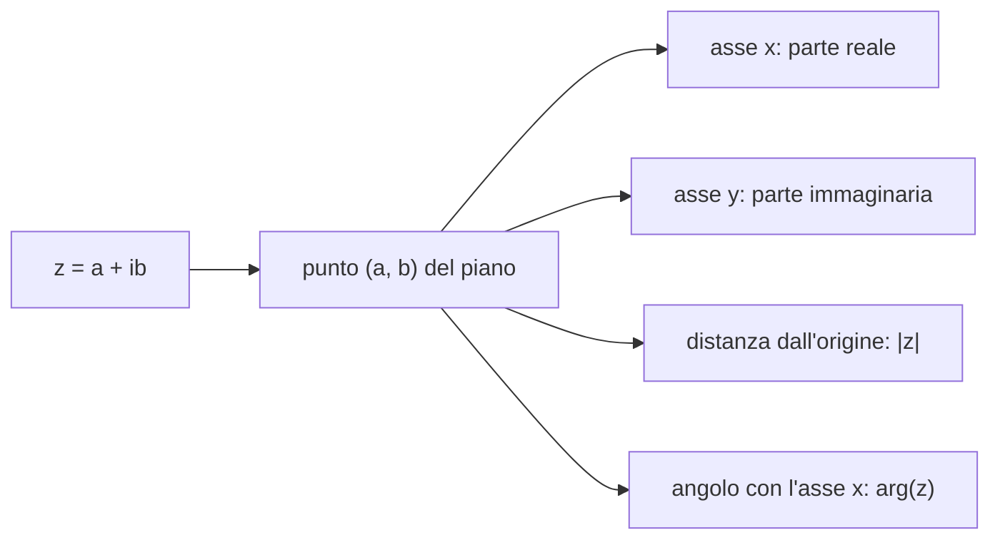

# I Numeri Complessi

> [!abstract]
> In $\mathbb{R}$ l'equazione $x^2 = -1$ non ha soluzioni: abbiamo visto nel [[04 - AN1 - Funzioni Continue#Radici|cap. 4]] che $\sqrt{-1}$ "non è un numero reale ma complesso". Questo capitolo costruisce il **campo dei numeri complessi** $\mathbb{C}$ come $\mathbb{R}^2$ dotato di una nuova moltiplicazione, in cui $\mathbb{R}$ è un sottocampo e l'**unità immaginaria** $i$ soddisfa $i^2 = -1$.
> Il percorso: **forma algebrica** $a + ib$, **piano di Gauss**, **coniugato** e **modulo**; **forma trigonometrica**, con cui prodotti e potenze diventano semplici (**formula di De Moivre**) e la **formula di Eulero** che lega esponenziale e funzioni circolari; infine le **radici $n$-esime** e il **teorema fondamentale dell'algebra**.
> Mappa del corso: [[MOC - Analisi 1]].

---

## Definizione del campo complesso

Vedi [[Numeri complessi]].

Nell'insieme $\mathbb{R}^2 := \{(a, b) : a, b \in \mathbb{R}\}$ si definiscono somma e prodotto:
$$(0.1) \qquad (a, b) + (c, d) := (a + c,\ b + d),$$
$$(0.2) \qquad (a, b) \cdot (c, d) := (ac - bd,\ ad + bc).$$

La somma è quella solita tra vettori; il prodotto è nuovo, ed è costruito apposta perché funzioni tutto. La terna $(\mathbb{R}^2, +, \cdot)$ è un **campo**, detto **campo dei numeri complessi** e indicato con $\mathbb{C}$.

> [!note] Verifica delle proprietà di campo
> - $(0, 0)$ è l'elemento neutro della somma: $(a, b) + (0, 0) = (a, b)$.
> - $(1, 0)$ è l'elemento neutro del prodotto: $(a, b) \cdot (1, 0) = (a \cdot 1 - b \cdot 0,\ a \cdot 0 + b \cdot 1) = (a, b)$.
> - L'**opposto** di $(a, b)$ è $(-a, -b)$: $(a, b) + (-a, -b) = (0, 0)$ per ogni $(a, b)$.
> - L'**inverso** di $(a, b) \neq (0, 0)$ è $\left(\frac{a}{a^2 + b^2}, \frac{-b}{a^2 + b^2}\right)$:
> $$(a, b) \cdot \left(\frac{a}{a^2+b^2}, \frac{-b}{a^2+b^2}\right) = \left(\frac{a^2 + b^2}{a^2 + b^2}, \frac{-ab + ab}{a^2 + b^2}\right) = (1, 0).$$
> - Le altre proprietà (commutativa, associativa, distributiva) si verificano facilmente.

> [!warning] Correzione
> La dispensa scrive "la terna $(\mathbb{R}, +, \cdot)$ è un campo": l'insieme di partenza è $\mathbb{R}^2$ (con le operazioni (0.1)–(0.2)), non $\mathbb{R}$.

_(dispensa, p. 153)_

### I reali come sottoinsieme di C

Nel campo $\mathbb{C}$ si considera il sottoinsieme
$$\mathbb{C}_0 = \{(a, 0) : a \in \mathbb{R}\}.$$
Associando alla coppia $(a, 0)$ il numero reale $a$, $\mathbb{C}_0$ si mette in corrispondenza con $\mathbb{R}$, e le operazioni (0.1)–(0.2) si riducono a quelle di $\mathbb{R}$:
$$(a, 0) + (b, 0) = (a + b, 0), \qquad (a, 0) \cdot (b, 0) = (ab, 0).$$
Quindi $(\mathbb{C}_0, +, \cdot)$ si identifica con il campo dei numeri reali, che risulta un **sottocampo** di $\mathbb{C}$: i complessi **estendono** i reali.

_(dispensa, p. 153)_

### Unità immaginaria e forma algebrica

Si consideri la coppia $(0, 1) \in \mathbb{C}$. Si osserva che
$$(a, b) = (a, 0) + (0, 1) \cdot (b, 0) =: a + ib, \qquad a, b \in \mathbb{R},$$
identificando $(a, 0)$, $(b, 0)$ con i reali $a$, $b$ e indicando la coppia $(0, 1)$ con il simbolo $i$.

> [!important] Forma algebrica
> La scrittura $z = a + ib$, $a, b \in \mathbb{R}$, si dice **forma algebrica** del numero complesso. $a$ si dice **parte reale** di $z$, $\operatorname{Re}(z)$; $b$ si dice **parte immaginaria**, $\operatorname{Im}(z)$.

Il fatto fondamentale è
$$i^2 = i \cdot i = (0, 1) \cdot (0, 1) = (0 \cdot 0 - 1 \cdot 1,\ 0 \cdot 1 + 1 \cdot 0) = (-1, 0) = -1.$$
Con questa regola somma e prodotto si calcolano come con i polinomi in $i$: per $z = a + ib$, $w = c + id$,
$$z + w = (a + c) + i(b + d), \qquad z \cdot w = ac + iad + ibc + i^2 bd = (ac - bd) + i(ad + bc),$$
cioè, equivalentemente,
$$\operatorname{Re}(z + w) = \operatorname{Re}(z) + \operatorname{Re}(w), \quad \operatorname{Im}(z + w) = \operatorname{Im}(z) + \operatorname{Im}(w),$$
$$\operatorname{Re}(zw) = \operatorname{Re}(z)\operatorname{Re}(w) - \operatorname{Im}(z)\operatorname{Im}(w), \quad \operatorname{Im}(zw) = \operatorname{Re}(z)\operatorname{Im}(w) + \operatorname{Im}(z)\operatorname{Re}(w).$$
È esattamente la definizione (0.2): non serve ricordarla, basta usare $i^2 = -1$.

> [!example] Esempio
> $$(3 + 4i) + (7 + 8i) = 10 + 12i, \qquad (3 + 4i)(7 + 8i) = 21 + 24i + 28i + 32i^2 = -11 + 52i.$$

_(dispensa, pp. 153–154)_

---

## Piano di Gauss

Si identifica il numero complesso $z = a + ib$ con il punto del piano di coordinate $(a, b)$:
- l'asse delle **ascisse** corrisponde ai numeri **reali** ($b = 0$);
- l'asse delle **ordinate** agli **immaginari puri** ($a = 0$).

Questa rappresentazione geometrica si chiama **piano di Gauss** (o piano complesso). L'addizione di due complessi corrisponde alla **somma dei vettori** che li rappresentano, con la regola del parallelogramma.

_(dispensa, p. 154)_

---

## Coniugato e modulo

> [!important] Definizione 11.1 — Coniugato
> Dato $z = a + ib$, il **coniugato** di $z$ è $\bar z = a - ib$.

Geometricamente, $\bar z$ è il simmetrico di $z$ rispetto all'asse reale. Esempi: se $z = 4 + 3i$, $\bar z = 4 - 3i$; se $z = -i$, $\bar z = i$; se $z = -4$, $\bar z = -4$ (i reali coincidono con il loro coniugato).

Proprietà, per $z, w \in \mathbb{C}$:
- $\overline{z + w} = \bar z + \bar w$;
- $\overline{z \cdot w} = \bar z \cdot \bar w$;
- $\overline{\left(\frac1z\right)} = \frac{1}{\bar z}$;
- se $z = a + ib$, allora $z \cdot \bar z = a^2 + b^2$ (un numero **reale** non negativo).

(Per esercizio, si verificano dalla definizione; ad esempio $z\bar z = (a + ib)(a - ib) = a^2 - i^2b^2 = a^2 + b^2$.)

> [!important] Definizione 11.2 — Modulo
> Dato $z = a + ib$, il **modulo** di $z$ è il numero reale
> $$|z| = \sqrt{a^2 + b^2}.$$

Per i reali si ritrova il [[00 - AN1 - Concetti Fondamentali#Il modulo|modulo]] di $\mathbb{R}$: se $z = a$, $|z| = \sqrt{a^2} = |a|$. Nel piano di Gauss $|z|$ è la **distanza** di $z$ dall'origine, cioè la [[Norma euclidea|norma]] del vettore $(a, b)$. Esempi: $|4 + 3i| = \sqrt{16 + 9} = 5$, $|-i| = 1$, $|-4| = 4$.

Proprietà, per $z, w \in \mathbb{C}$:
- $|z| \ge 0$ e $|z| = 0 \iff z = 0$;
- $|z| = |\bar z|$;
- $|-z| = |z|$ e $\big||z|\big| = |z|$;
- $|z + w| \le |z| + |w|$ (**disuguaglianza triangolare**);
- $\big||z| - |w|\big| \le |z - w|$.

> [!tip] Dividere per un complesso
> Da $z\bar z = |z|^2$ segue $\frac1z = \frac{\bar z}{|z|^2}$ (è la formula dell'inverso vista sopra). In pratica, per calcolare $\frac zw$ si moltiplicano numeratore e denominatore per $\bar w$, così il denominatore diventa reale.

> [!example] Esercizio
> Scrivere in forma algebrica, trovare modulo e coniugato e riportare nel piano di Gauss
> $$(3 + 2i)(6 + i), \qquad \frac{1 + i}{1 - i}, \qquad \frac{3 + 2i}{3 - 2i}.$$
> *Soluzione.*
> - $(3 + 2i)(6 + i) = 18 + 3i + 12i + 2i^2 = 16 + 15i$; modulo $\sqrt{256 + 225} = \sqrt{481}$, coniugato $16 - 15i$.
> - $\frac{1 + i}{1 - i} = \frac{(1 + i)(1 + i)}{(1 - i)(1 + i)} = \frac{1 + 2i + i^2}{2} = \frac{2i}{2} = i$; modulo $1$, coniugato $-i$.
> - $\frac{3 + 2i}{3 - 2i} = \frac{(3 + 2i)^2}{9 + 4} = \frac{9 + 12i - 4}{13} = \frac{5}{13} + \frac{12}{13}i$; modulo $\frac{\sqrt{25 + 144}}{13} = 1$, coniugato $\frac{5}{13} - \frac{12}{13}i$. (Il modulo è $1$ perché $|3 + 2i| = |3 - 2i|$.)

_(dispensa, pp. 154–155)_

---

## Rappresentazione trigonometrica di un numero complesso

Un punto del piano si rappresenta sia con le coordinate cartesiane sia con le [[Coordinate polari|coordinate polari]] $(\rho, \vartheta)$, dove
- $\rho \in [0, +\infty)$ è la distanza del punto dall'origine;
- $\vartheta \in [0, 2\pi)$ è l'angolo (in radianti) tra il vettore posizione e l'asse delle ascisse.

Le formule di passaggio sono
$$\begin{cases} \rho = \sqrt{a^2 + b^2} \\ \tan(\vartheta) = \frac ba \end{cases} \qquad\qquad \begin{cases} a = \rho\cos(\vartheta) \\ b = \rho\sin(\vartheta) \end{cases}$$
(la tangente non è invertibile in $[0, 2\pi)$: per trovare $\vartheta$ bisogna guardare il quadrante).

> [!important] Forma trigonometrica
> Dato $z = a + ib$, dalle formule precedenti si ottiene la **forma trigonometrica**
> $$z = \rho\big(\cos(\vartheta) + i\sin(\vartheta)\big).$$
> $\vartheta$ si dice **argomento** di $z$, $\arg(z)$; $\rho$ coincide con il **modulo** $|z|$.

> [!example] Esempi
> - $z = \frac{1}{\sqrt2} + i\frac{1}{\sqrt2}$: $\rho = \sqrt{\frac12 + \frac12} = 1$ e $\tan\vartheta = 1 \Rightarrow \vartheta = \frac\pi4$ (primo quadrante), quindi $z = \cos\frac\pi4 + i\sin\frac\pi4$.
> - $i = \cos\frac\pi2 + i\sin\frac\pi2$, $\quad 1 = \cos(0) + i\sin(0)$.

### Prodotto e quoziente in forma trigonometrica

Con le formule di addizione delle funzioni trigonometriche si dimostra che, se $z_1 = \rho_1(\cos\vartheta_1 + i\sin\vartheta_1)$ e $z_2 = \rho_2(\cos\vartheta_2 + i\sin\vartheta_2)$:
$$z_1 z_2 = \rho_1\rho_2\big(\cos(\vartheta_1 + \vartheta_2) + i\sin(\vartheta_1 + \vartheta_2)\big), \qquad \frac{z_1}{z_2} = \frac{\rho_1}{\rho_2}\big(\cos(\vartheta_1 - \vartheta_2) + i\sin(\vartheta_1 - \vartheta_2)\big),$$
cioè
$$|z_1 z_2| = |z_1||z_2|, \quad \arg(z_1 z_2) = \arg(z_1) + \arg(z_2), \qquad \left|\frac{z_1}{z_2}\right| = \frac{|z_1|}{|z_2|}, \quad \arg\left(\frac{z_1}{z_2}\right) = \arg(z_1) - \arg(z_2).$$

> [!tip] Interpretazione geometrica
> Moltiplicare per $z_2$ significa **dilatare** di un fattore $|z_2|$ e **ruotare** di un angolo $\arg(z_2)$. Ad esempio moltiplicare per $i$ ruota di $90°$ in senso antiorario: $i \cdot (a + ib) = -b + ia$.

### Formula di De Moivre

Vedi [[Formula di De Moivre]].

Applicando ripetutamente la formula del prodotto:

> [!important] Formula di De Moivre
> $$z^n = \rho^n\big(\cos(n\vartheta) + i\sin(n\vartheta)\big) \qquad \forall n \in \mathbb{N}.$$

> [!example] Esempio: $(1 + i)^7$
> In forma trigonometrica $1 + i = \sqrt2\left(\cos\frac\pi4 + i\sin\frac\pi4\right)$. Per De Moivre
> $$(1 + i)^7 = 2^{\frac72}\left(\cos\frac{7\pi}{4} + i\sin\frac{7\pi}{4}\right) = 2^{\frac72}\left(\frac{1}{\sqrt2} - i\frac{1}{\sqrt2}\right) = 8 - 8i.$$
> (Senza De Moivre servirebbe il [[00 - AN1 - Concetti Fondamentali#Formula del Binomio di Newton|binomio di Newton]] con 8 termini.)

### Formula di Eulero

> [!important] Formula di Eulero
> $$(0.3) \qquad e^{i\vartheta} = \cos(\vartheta) + i\sin(\vartheta) \qquad \forall \vartheta \in \mathbb{R}.$$

Lega le funzioni trigonometriche e la funzione **esponenziale complessa**. Una giustificazione viene dalle [[05 - AN1 - Calcolo Differenziale#Serie di Taylor|serie di Taylor]]: sostituendo $x = i\vartheta$ nella serie di $e^x$ e separando i termini pari (dove $i^{2k} = (-1)^k$) da quelli dispari (dove $i^{2k+1} = (-1)^k i$):
$$e^{i\vartheta} = \sum_{k=0}^{+\infty} \frac{(i\vartheta)^k}{k!} = \underbrace{\sum_{k=0}^{+\infty} (-1)^k\frac{\vartheta^{2k}}{(2k)!}}_{\cos\vartheta} + i\underbrace{\sum_{k=0}^{+\infty} (-1)^k\frac{\vartheta^{2k+1}}{(2k+1)!}}_{\sin\vartheta}.$$

Con la formula di Eulero la forma trigonometrica diventa la **forma esponenziale** $z = \rho e^{i\vartheta}$, e le regole del prodotto e di De Moivre diventano le solite regole delle potenze: $\rho_1 e^{i\vartheta_1} \cdot \rho_2 e^{i\vartheta_2} = \rho_1\rho_2 e^{i(\vartheta_1 + \vartheta_2)}$ e $(\rho e^{i\vartheta})^n = \rho^n e^{in\vartheta}$. Con $\vartheta = \pi$ si ottiene l'**identità di Eulero** $e^{i\pi} + 1 = 0$.

Dalla formula di Eulero (scritta per $\vartheta$ e $-\vartheta$, sommando e sottraendo) seguono
$$\cos(\vartheta) = \frac{e^{i\vartheta} + e^{-i\vartheta}}{2}, \qquad \sin(\vartheta) = \frac{e^{i\vartheta} - e^{-i\vartheta}}{2i}.$$
Si confrontino con le [[03 - AN1 - Funzioni Reali di una Variabile Reale#Funzioni iperboliche|funzioni iperboliche]] $\cosh x = \frac{e^x + e^{-x}}{2}$ e $\sinh x = \frac{e^x - e^{-x}}{2}$: funzioni circolari e iperboliche sono "la stessa cosa" vista sull'asse immaginario e su quello reale. Questo spiega perché i loro [[05 - AN1 - Calcolo Differenziale#Sviluppi di Taylor notevoli|sviluppi di Taylor]] differiscono solo per i segni.

_(dispensa, pp. 155–156)_

---

## Radici di un numero complesso

Vedi [[Radici n-esime complesse]].

> [!important] Definizione 11.3
> Dato $n \in \mathbb{N}$, $z$ è una **radice $n$-esima** di $w \in \mathbb{C}$ se $w = z^n$.

> [!important] Proposizione 11.4
> Sia $w \in \mathbb{C}$, $w \neq 0$. Allora esistono sempre **$n$ radici $n$-esime** di $w$. Se $w = r(\cos\vartheta + i\sin\vartheta)$, sono
> $$z_k = \rho\big(\cos(\vartheta_k) + i\sin(\vartheta_k)\big), \qquad k = 0, \dots, n - 1,$$
> dove
> $$(0.4) \qquad \begin{cases} \rho = r^{\frac1n} \\ \vartheta_k = \dfrac{\vartheta + 2k\pi}{n}, \quad k = 0, \dots, n - 1. \end{cases}$$

**Dimostrazione.** Sia $z = \rho(\cos\varphi + i\sin\varphi)$. Per De Moivre $z^n = \rho^n(\cos(n\varphi) + i\sin(n\varphi))$. Quindi $z^n = w$ se e solo se
$$\begin{cases} \rho^n = r, \\ n\varphi = \vartheta + 2k\pi, \quad k \in \mathbb{Z} \end{cases}$$
(due numeri complessi in forma trigonometrica sono uguali se hanno lo stesso modulo e argomenti che differiscono per un multiplo di $2\pi$). Per la periodicità delle funzioni trigonometriche, la seconda identità dà valori distinti solo per $k = 0, \dots, n - 1$: da $k = n$ in poi gli angoli si ripetono. Si ottengono le formule (0.4). $\square$

> [!warning] Differenza con i reali
> In $\mathbb{R}$, $\sqrt[n]{a}$ è un solo numero (o nessuno, per $n$ pari e $a < 0$). In $\mathbb{C}$ ogni numero non nullo ha **esattamente $n$** radici $n$-esime distinte. Ad esempio le radici quadrate di $-1$ sono $i$ e $-i$, e le radici quarte di $1$ sono $1, i, -1, -i$.

> [!example] Esempio: $\sqrt[3]{i}$
> In forma trigonometrica $i = \cos\frac\pi2 + i\sin\frac\pi2$, cioè $r = 1$, $\vartheta = \frac\pi2$. Le radici cubiche sono
> $$z_k = \cos\left(\frac{\pi/2 + 2k\pi}{3}\right) + i\sin\left(\frac{\pi/2 + 2k\pi}{3}\right), \qquad k = 0, 1, 2,$$
> cioè
> $$z_0 = \cos\frac\pi6 + i\sin\frac\pi6 = \frac{\sqrt3}{2} + \frac12 i, \qquad z_1 = \cos\frac{5\pi}{6} + i\sin\frac{5\pi}{6} = -\frac{\sqrt3}{2} + \frac12 i, \qquad z_2 = \cos\frac{9\pi}{6} + i\sin\frac{9\pi}{6} = -i.$$

> [!warning] Correzione
> La dispensa scrive $z_2 = -1$. Ma $\frac{9\pi}{6} = \frac{3\pi}{2}$, e $\cos\frac{3\pi}{2} + i\sin\frac{3\pi}{2} = 0 + i \cdot (-1) = -i$. Verifica: $(-i)^3 = -i^3 = -(i^2 \cdot i) = -(-i) = i$ ✓, mentre $(-1)^3 = -1 \neq i$.

> [!note] Le radici formano un poligono regolare
> Nel piano di Gauss le radici $n$-esime di $w$ sono i **vertici di un poligono regolare di $n$ lati** inscritto nella circonferenza di centro $0$ e raggio $|w|^{1/n}$: hanno tutte lo stesso modulo e argomenti equidistanziati di $\frac{2\pi}{n}$. Le tre radici cubiche di $i$ sono i vertici di un triangolo equilatero sulla circonferenza unitaria, a $30°$, $150°$ e $270°$.

_(dispensa, pp. 156–157)_

---

## Teorema fondamentale dell'algebra

> [!important] Teorema 11.5 — Teorema fondamentale dell'algebra
> L'equazione algebrica
> $$a_n z^n + \cdots + a_1 z + a_0 = 0, \qquad a_i \in \mathbb{C},\ a_n \neq 0,$$
> ammette **$n$ radici in $\mathbb{C}$**, contate con la loro molteplicità.

In $\mathbb{R}$ un polinomio di grado $n$ può avere meno di $n$ radici (anche nessuna, come $x^2 + 1$); in $\mathbb{C}$ ne ha sempre esattamente $n$. Si dice che $\mathbb{C}$ è **algebricamente chiuso**: introdotta una sola radice "mancante" ($i$, la radice di $x^2 + 1$), tutte le equazioni polinomiali diventano risolubili.

> [!example] Collegamento: funzioni razionali
> Il teorema spiega i tre casi dell'[[06 - AN1 - Calcolo Integrale#Integrazione di Funzioni Razionali|integrazione delle funzioni razionali]]: un denominatore di grado 2 ha sempre due radici in $\mathbb{C}$; nel caso (iii) ($\Delta < 0$) sono complesse coniugate $\alpha \pm i\beta$, ed è proprio la loro parte immaginaria a produrre l'arcotangente.

_(dispensa, p. 157)_
