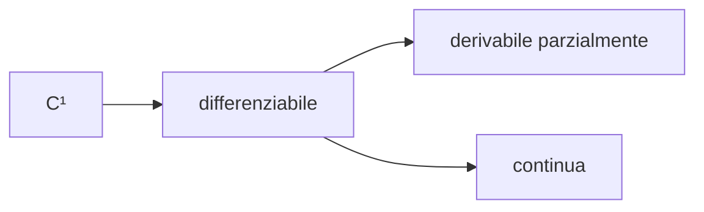

# Differenziabilità

> [!summary] In breve
> f è differenziabile in x₀ se f(x) = f(x₀) + ∇f(x₀)·(x − x₀) + o(‖x − x₀‖): è approssimabile da un piano tangente in tutte le direzioni. È la vera generalizzazione della derivabilità.

$$\lim_{x\to x_0} \frac{f(x) - f(x_0) - \nabla f(x_0) \cdot (x - x_0)}{\|x - x_0\|} = 0$$

- **Piano tangente**: $z = f(x_0, y_0) + f_x(x - x_0) + f_y(y - y_0)$.
- Relazioni ($N > 1$):

  (nessuna freccia si inverte; derivabile e continua sono indipendenti).
- Condizione sufficiente: derivate parziali continue in un intorno.

## Collegamenti

- **Concetti correlati**: [[Derivate parziali]] · [[Gradiente]] · [[Derivata]] · [[Matrice jacobiana]]
- **Mappa**: [[MOC - Analisi 1]]

> [!info] Approfondimento
> - [[08 - AN1 - Calcolo Differenziale in più Variabili#Differenziabilità|Lezione 8 — Differenziabilità]]
> - [[08 - AN1 - Calcolo Differenziale in più Variabili#Piano tangente|Lezione 8 — Piano tangente]]
