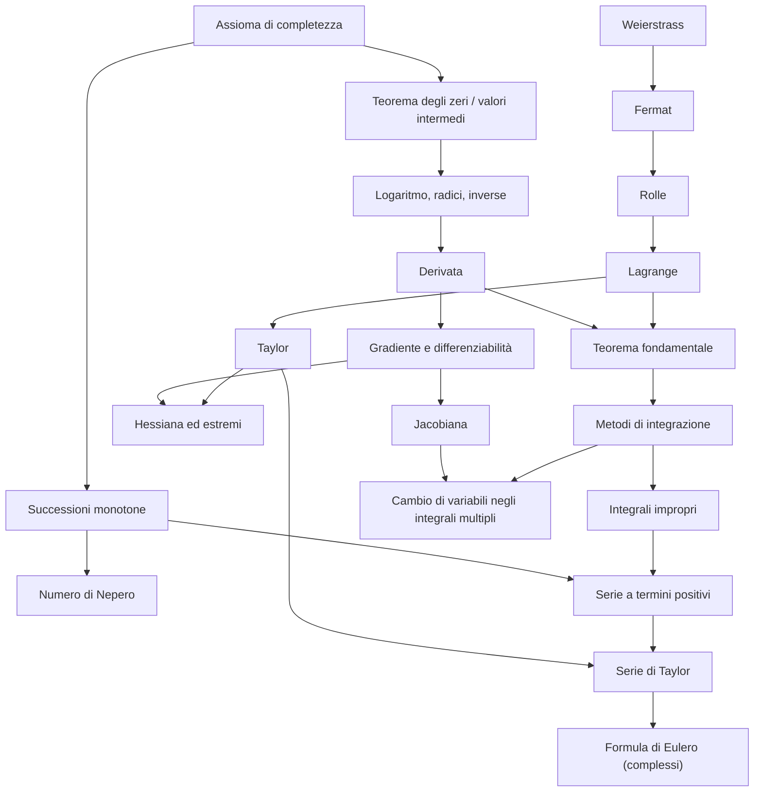

# MOC - Analisi 1

> [!abstract]
> Mappa del corso di **Analisi Matematica 1**, costruita sulla dispensa di F. Camilli e K. Engel (*Appunti di Analisi Matematica 1*, versione del 17 luglio 2018). Una nota per capitolo (da 0 a 11, più l'appendice) e le note atomiche di ripasso raggruppate per tema. I capitoli 7–10 (più variabili, funzioni vettoriali, integrali multipli) sono gli argomenti di solito trattati in Analisi 2.

---

## Lezioni

| N. | Lezione | Argomenti |
|---|---|---|
| 0 | [[00 - AN1 - Concetti Fondamentali]] | insiemi, numeri reali, sup e inf, completezza, modulo, coefficienti binomiali, induzione |
| 1 | [[01 - AN1 - Successioni Numeriche]] | limiti di successioni, forme indeterminate, carabinieri, successioni monotone, $e$, asintoticità |
| 2 | [[02 - AN1 - Serie Numeriche]] | serie geometrica e armonica, criteri di convergenza, Leibniz, convergenza assoluta |
| 3 | [[03 - AN1 - Funzioni Reali di una Variabile Reale]] | proprietà delle funzioni, funzioni elementari, limiti di funzioni, limiti notevoli |
| 4 | [[04 - AN1 - Funzioni Continue]] | continuità, teorema degli zeri, valori intermedi, logaritmi, inverse, Weierstrass |
| 5 | [[05 - AN1 - Calcolo Differenziale]] | derivate, Fermat, Rolle, Lagrange, de l'Hospital, Taylor, studio di funzione |
| 6 | [[06 - AN1 - Calcolo Integrale]] | integrale di Riemann, teorema fondamentale, metodi di integrazione, aree, integrali impropri |
| 7 | [[07 - AN1 - Funzioni di più Variabili - Limiti e Continuità]] | norma, curve di livello, limiti in $\mathbb{R}^N$, coordinate polari |
| 8 | [[08 - AN1 - Calcolo Differenziale in più Variabili]] | derivate parziali, gradiente, differenziabilità, hessiana, estremi |
| 9 | [[09 - AN1 - Funzioni a Valori Vettoriali]] | jacobiana, regola della catena, trasformazioni di coordinate |
| 10 | [[10 - AN1 - Integrali Multipli]] | integrali doppi e tripli, Fubini–Tonelli, cambiamento di variabili |
| 11 | [[11 - AN1 - Numeri Complessi]] | forma algebrica e trigonometrica, De Moivre, Eulero, radici |
| — | [[12 - AN1 - Appendice]] | modi di dimostrare, elenco di limiti notevoli, definizione $\varepsilon$–$\delta$ |

---

## Concetti per tema

### Fondamenti e numeri reali
[[Insieme]] · [[Estremo superiore ed estremo inferiore]] · [[Assioma di completezza]] · [[Valore assoluto]] · [[Coefficiente binomiale]] · [[Binomio di Newton]] · [[Principio di induzione]] · [[Disuguaglianza di Bernoulli]]

### Successioni e limiti
[[Successione]] · [[Limite di successione]] · [[Forme indeterminate]] · [[Teorema dei carabinieri]] · [[Teorema delle successioni monotone]] · [[Numero di Nepero]] · [[Successioni asintotiche]] · [[Gerarchia degli infiniti]]

### Serie numeriche
[[Serie numerica]] · [[Serie geometrica]] · [[Serie armonica]] · [[Criterio del confronto per le serie]] · [[Criterio del rapporto e della radice]] · [[Criterio di Leibniz]] · [[Convergenza assoluta]] · [[Criterio integrale per le serie]]

### Funzioni e funzioni elementari
[[Funzione iniettiva, suriettiva e biettiva]] · [[Funzione inversa]] · [[Funzioni pari e dispari]] · [[Funzione esponenziale]] · [[Logaritmo]] · [[Funzioni iperboliche]] · [[Funzioni circolari]] · [[Funzioni circolari inverse]]

### Limiti di funzioni e continuità
[[Limite di funzione]] · [[Limiti notevoli]] · [[Asintoti]] · [[Funzione continua]] · [[Teorema degli zeri]] · [[Metodo di bisezione]] · [[Teorema dei valori intermedi]] · [[Teorema di Weierstrass]]

### Calcolo differenziale
[[Derivata]] · [[Regole di derivazione]] · [[Teorema di Fermat]] · [[Teorema di Rolle]] · [[Teorema di Lagrange]] · [[Regola di de l'Hospital]] · [[Simbolo o-piccolo]] · [[Formula di Taylor]] · [[Serie di Taylor]] · [[Studio di funzione]] · [[Convessità e flessi]]

### Calcolo integrale
[[Integrale di Riemann]] · [[Teorema della media integrale]] · [[Teorema fondamentale del calcolo integrale]] · [[Primitiva]] · [[Integrazione per parti]] · [[Integrazione per sostituzione]] · [[Integrazione di funzioni razionali]] · [[Integrale improprio]]

### Più variabili: limiti e derivate
[[Norma euclidea]] · [[Insiemi aperti e chiusi]] · [[Curve di livello]] · [[Limite in più variabili]] · [[Coordinate polari]] · [[Derivate parziali]] · [[Gradiente]] · [[Differenziabilità]] · [[Derivata direzionale]] · [[Teorema di Schwarz]] · [[Matrice hessiana]] · [[Estremi in più variabili]]

### Funzioni vettoriali e coordinate
[[Matrice jacobiana]] · [[Trasformazione regolare di coordinate]] · [[Coordinate cilindriche e sferiche]]

### Integrali multipli
[[Integrale doppio]] · [[Teorema di Fubini-Tonelli]] · [[Domini normali]] · [[Cambiamento di variabili negli integrali multipli]] · [[Integrale triplo]]

### Numeri complessi
[[Numeri complessi]] · [[Formula di De Moivre]] · [[Radici n-esime complesse]]

---

## Percorsi trasversali

### Catene di concetti

- **Dalla completezza ai teoremi sulle funzioni continue**: [[Assioma di completezza]] → [[Teorema delle successioni monotone]] → [[Metodo di bisezione]] → [[Teorema degli zeri]] → [[Teorema dei valori intermedi]] → [[Logaritmo]].
- **Dalla derivata a Taylor**: [[Derivata]] → [[Simbolo o-piccolo]] → [[Teorema di Lagrange]] → [[Formula di Taylor]] → [[Serie di Taylor]] → [[Numeri complessi]] (formula di Eulero).
- **Trovare massimi e minimi**: [[Teorema di Weierstrass]] (esistono) → [[Teorema di Fermat]] (candidati) → [[Convessità e flessi]] (derivata seconda) → [[Estremi in più variabili]] → [[Matrice hessiana]].
- **Calcolare limiti**: [[Limite di successione]] → [[Forme indeterminate]] → [[Limiti notevoli]] → [[Successioni asintotiche]] → [[Regola di de l'Hospital]] → [[Formula di Taylor]].
- **Serie e integrali**: [[Serie numerica]] → [[Criterio del confronto per le serie]] ↔ [[Integrale improprio]] → [[Criterio integrale per le serie]] → [[Serie armonica]].
- **Sostituzione in una e più variabili**: [[Regole di derivazione]] (catena) → [[Integrazione per sostituzione]] → [[Matrice jacobiana]] → [[Cambiamento di variabili negli integrali multipli]] → [[Coordinate polari]] (integrale di Gauss).

### Collegamenti con altri corsi

- **Statistica**: [[Gaussian]] (l'integrale $\int e^{-x^2} = \sqrt\pi$), [[Expected Value]] (valor medio di una funzione), calcolo combinatorio ([[Coefficiente binomiale]]).
- **Algoritmi e Strutture Dati**: [[Dimostrazione per induzione]], [[Notazione asintotica]] e [[Funzioni di crescita]] (o-piccolo, gerarchia degli infiniti), [[Ricerca binaria]] (bisezione).
- **Modelli di Calcolo**: [[Insieme numerabile]] e [[Diagonalizzazione di Cantor]] (cardinalità di $\mathbb{R}$).
- **Geometria**: [[Convex Function]], [[Concave Function]], [[Invertible Matrix]], [[Squared Euclidean Norm]].
- **Machine Learning**: [[Gradient Descent]] (il gradiente come direzione di massima crescita).
