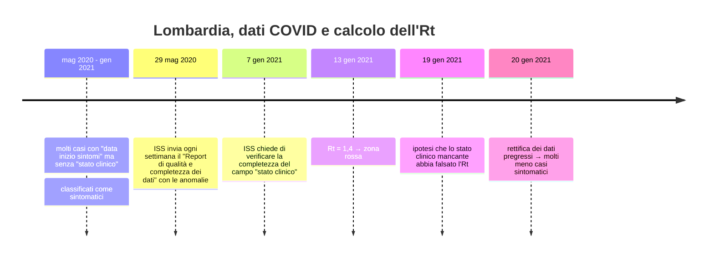
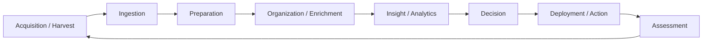

# Introduzione alle Basi di Dati

> [!abstract]
> Prima parte del corso (prof. Maurizio Lenzerini, Sapienza, A.A. 2023/24). Si divide in due blocchi: **1.1** l'organizzazione del corso e perché i dati sono così importanti oggi; **1.2** i concetti di base: **sistema informativo**, **base di dati**, **DBMS** e la sua posizione nell'**architettura a tre livelli**. Tutto il resto del corso si appoggia su queste definizioni: il [[02 - BD - Modello Relazionale|modello relazionale]] è il modello dei dati del DBMS, [[03 - BD - SQL|SQL]] è il suo linguaggio, [[04 - BD - Accesso ai Dati da Software|JDBC]] è il modo in cui il livello applicativo parla con il DBMS, e la progettazione ([[05 - BD - Progettazione Concettuale|concettuale]] e [[06 - BD - Progettazione Logica|logica]]) serve a costruire una base di dati corretta.
>
> Indice dei concetti: [[MOC - Basi di Dati]].

---

## 1.1 Il corso

### Informazioni generali

| Voce | Dettaglio |
|---|---|
| Crediti | 6 CFU, terzo anno di Ingegneria Informatica e Automatica |
| Docente | Maurizio Lenzerini |
| Prosecuzione | *Data Management* (laurea magistrale: MSc in Engineering in Computer Science, Data Science, AI and Robotics) |
| Lezioni | lunedì 9–11, mercoledì 16–18, giovedì 10–12 (Marco Polo, aula 204 + online) |
| Esercitazioni | in laboratorio il venerdì 8–11 (aula 16) e durante le lezioni |
| Ricevimento | martedì ore 17 online |

> [!important] Come si supera l'esame
> 1. **Test di idoneità su SQL**: è il prerequisito. Senza averlo superato non si accede alla prova d'esame.
> 2. **Prova d'esame**: prova **scritta** e, solo se necessaria, prova **orale**.
>
> Esercizi d'esame svolti: [[08 - BD - Esami Svolti]].

**Materiale didattico**: le slide (pubblicate su Moodle qualche giorno prima di ogni parte) e, facoltativi, due libri:
- Elmasri, Navathe — *Sistemi di basi di dati. Fondamenti e complementi*, Pearson 2017;
- Atzeni, Ceri, Paraboschi, Torlone — *Database Systems: Concepts, Languages and Architectures*, McGraw-Hill.

Sul sito del corso ci sono anche il calendario delle lezioni, testi e soluzioni delle esercitazioni, la documentazione del DBMS usato e gli esercizi d'esame degli anni passati.

### I dati sono il nuovo petrolio

La frase *"Data is the new oil"* (Clive Humby, 2006) dice due cose:
- come il petrolio ha alimentato la rivoluzione industriale passata, i dati sono la **risorsa** della nuova;
- come il petrolio, i dati **grezzi non servono a nulla**: vanno *raffinati*, cioè preparati, scomposti e analizzati, prima di produrre valore.

L'analogia però ha dei limiti, e le **differenze** sono istruttive:

| | Petrolio | Dati |
|---|---|---|
| Disponibilità | risorsa finita | generati a ritmo impressionante (~40 zettabyte in due anni, pari a 4 milioni di anni di video HD) |
| Produzione | costosa | facilissima (il 25% delle auto di San Francisco produrrebbe in un anno tanti dati quanti Twitter in tutta la sua storia fino a quel momento) |
| Uso | *single-use*: si consuma | si **riusano, condividono, collegano** per nuove esigenze e nuove analisi |
| Organizzazione | — | vanno **organizzati e governati** in forme usabili; si stima che solo il **10%** dei dati sia organizzato in modo corretto e utile alle analisi |

L'ultimo punto è il motivo per cui esiste questo corso: avere tanti dati non basta, bisogna **gestirli bene**.

### Un esempio, i dati COVID della Regione Lombardia

Il caso è un esempio concreto di cosa succede quando la **qualità dei dati** non è curata.

Il meccanismo:
1. L'Rt dell'ISS si calcola sulla **data di inizio sintomi dei soli casi sintomatici**.
2. Un caso veniva considerato sintomatico guardando la *combinazione* di due campi: "data inizio sintomi" valorizzata e "stato clinico".
3. La Lombardia inviava moltissimi casi con la data di inizio sintomi ma **senza stato clinico**: questi finivano tutti tra i sintomatici.
4. Più casi sintomatici → Rt più alto (1,4) → **zona rossa**.
5. Il 20 gennaio la Regione rettifica i dati pregressi: cambia il numero di casi con data inizio sintomi e compila lo stato clinico. I casi che soddisfano i criteri per essere sintomatici calano in modo significativo.

> [!tip] Morale
> Un campo **incompleto** (valore mancante) e un'**interpretazione** non condivisa della combinazione di campi hanno prodotto una decisione politica sbagliata. La responsabilità della correttezza era delle Regioni, e l'ISS l'aveva segnalato ogni settimana per mesi. Nel corso ritroveremo il problema dei valori mancanti nei [[02 - BD - Modello Relazionale#Informazione incompleta e valori nulli|valori nulli]] e quello di garantire la correttezza nei [[02 - BD - Modello Relazionale#2.3 Vincoli di integrità|vincoli di integrità]].

### Obiettivi e programma

Obiettivi del corso:
- conoscere le basi di dati, i principi della gestione dei dati e i **DBMS relazionali**, dal punto di vista di **utenti** e **sviluppatori di applicazioni**;
- conoscere il **modello relazionale** e **SQL**;
- conoscere il modello **Entità-Relazione** e saper applicare una **metodologia di progettazione** di basi di dati relazionali basata su di esso;
- un'introduzione ai modelli e ai sistemi **NoSQL**.

Il corso magistrale *Data Management* sposta invece il punto di vista su quello dell'**amministratore** di basi di dati e del **progettista di strumenti** per la gestione dei dati.

| # | Parte | Contenuti | Nota |
|---|---|---|---|
| 1 | Introduzione | concetto di base di dati, sistemi di gestione | questa nota |
| 2 | Modello relazionale | basi di dati relazionali, algebra relazionale | [[02 - BD - Modello Relazionale]] |
| 3 | SQL | definizione e uso di una base di dati | [[03 - BD - SQL]] |
| 4 | Accesso da software | principi, JDBC | [[04 - BD - Accesso ai Dati da Software]] |
| 5 | Progettazione concettuale | modello ER, metodologia | [[05 - BD - Progettazione Concettuale]] |
| 6 | Progettazione logica e fisica | metodologia logica, cenni di fisica | [[06 - BD - Progettazione Logica]] |
| 7 | NoSQL | modelli NoSQL, MongoDB | [[07 - BD - NoSQL]] |

---

## 1.2 Introduzione alle basi di dati

### Il sistema informativo

Vedi [[Sistema Informativo]].

Un'organizzazione (un'azienda, un ente, un'università) dispone di diverse **risorse**: persone, denaro, materiali e **dati e informazioni**. L'insieme dei dati e delle informazioni, con le attività che li gestiscono, è il **sistema informativo**.

Le sue funzioni sono:
1. **raccolta** e acquisizione delle informazioni;
2. **archiviazione** e conservazione;
3. **elaborazione**;
4. **distribuzione** e scambio.

> [!note] Sistema informativo ≠ sistema informatico
> Il concetto di sistema informativo è **indipendente dall'automazione**: l'archivio cartaceo di un'anagrafe dell'Ottocento era già un sistema informativo. La parte automatizzata, gestita con calcolatori, si chiama **sistema informatico**, ed è lì che entrano in gioco le basi di dati.

### Base di dati

Vedi [[Base di Dati]].

Il termine "base di dati" (*database*) ha due accezioni:
1. in senso generico, una **collezione di dati in memoria secondaria** (disco);
2. in senso stretto, quello usato nel corso: una collezione di dati in memoria secondaria **gestita da un apposito sistema software**, il **DBMS** (*Data Base Management System*, sistema di gestione di basi di dati).

La differenza è sostanziale: un insieme di file scritti e letti direttamente dai programmi è una base di dati nel primo senso, ma non nel secondo. Senza un DBMS ogni programma deve sapere com'è fatto il file, gestire da solo gli accessi concorrenti, i guasti e i permessi.

### Architettura a tre livelli del software

Il **DBMS** è il sistema (più precisamente un **modulo software**, come annotato a penna sulla slide) **responsabile della gestione dei dati**: dall'esterno ai dati si accede **solo tramite il DBMS**.

![[BD-L01-p016.png]]

La figura mostra la classica architettura **three-tier**:

| Livello | Componenti | Ruolo |
|---|---|---|
| **Presentazione** | $\text{Client}_1, \dots, \text{Client}_n$ | interfaccia con l'utente (browser, app) |
| **Logica delle applicazioni** | $\text{Applicazione}_1, \dots, \text{Applicazione}_n$ dentro un **Application Server** | implementano le funzionalità (*business logic*) |
| **Dati** | DBMS + base di dati, eventuali **sorgenti esterne** | memorizzano e gestiscono i dati |

Le frecce dicono chi parla con chi: i client parlano con le applicazioni, le applicazioni parlano con il DBMS, e solo il DBMS tocca la base di dati. Le applicazioni non leggono mai direttamente i file del database. Questo isolamento è ciò che permette al DBMS di garantire affidabilità, controllo degli accessi e concorrenza. Come un'applicazione Java dialoghi concretamente con il DBMS lo vedremo in [[04 - BD - Accesso ai Dati da Software]].

> [!example] Un esempio concreto
> Il sito di prenotazione esami dell'università: il **browser** (presentazione) invia la richiesta all'**applicazione web** sull'application server (logica), che esegue una query SQL sul **DBMS** (dati) per inserire la prenotazione.

### Il DBMS

Vedi [[DBMS]].

Un **DBMS** è un sistema (prodotto software) in grado di gestire collezioni di dati che siano (anche):

| Proprietà dei dati | Significato | Perché è un problema |
|---|---|---|
| **grandi** | molto più grandi della memoria centrale | i dati stanno su disco: serve gestire il trasferimento disco↔RAM in modo efficiente |
| **persistenti** | la loro vita è indipendente dalle singole esecuzioni dei programmi | i dati sopravvivono ai programmi che li creano |
| **condivise** | usate da applicazioni diverse | accessi concorrenti, viste diverse sugli stessi dati |

garantendo:

| Garanzia | Significato |
|---|---|
| **affidabilità** | resistenza a malfunzionamenti hardware e software (i dati non si perdono se il sistema crasha) |
| **privatezza** | disciplina e controllo degli accessi (chi può leggere/modificare cosa) |
| **efficienza** | uso ottimale delle risorse di spazio e tempo |
| **efficacia** | rendere produttive le attività degli utenti |

> [!important] Modello dei dati
> Ogni DBMS si basa su un **modello dei dati**: un insieme di **costrutti** per organizzare i dati di interesse e descriverne le operazioni. Nel corso ci occupiamo soprattutto di DBMS basati sul **modello relazionale**, a sua volta basato sulla nozione matematica di **relazione** (vedi [[02 - BD - Modello Relazionale]]).

Il fatto che i dati siano *condivisi* e *persistenti* ricorda la gestione dei file da parte del sistema operativo (vedi [[12 - SO - File System]]): la differenza è che il DBMS ragiona in termini di dati strutturati (tabelle, vincoli, transazioni) e non di sequenze di byte.

### Un po' di storia

| Periodo | Evento |
|---|---|
| inizio anni '60 | Charles **Bachman** (General Electric) progetta il primo DBMS, *Integrated Data Store*, basato sul **modello reticolare**. Turing Award 1973 |
| fine anni '60 | IBM sviluppa **IMS** (*Information Management System*), basato sul **modello gerarchico**, usato ancora oggi |
| 1970 | Edgar F. **Codd** (IBM) propone il **modello relazionale**. Turing Award 1981 |
| anni '80 | il modello relazionale si impone; **SQL** viene standardizzato come linguaggio dei DBMS relazionali |
| anni '90 | i DBMS relazionali diventano sofisticati e diffusi (DB2, Oracle, Informix…). nel 1999 Jim **Gray** vince il Turing Award per il suo contributo alla gestione delle **transazioni** |
| anni 2000 | i DBMS si integrano con lo sviluppo software e il Web |
| anni 2010 | **Big Data**: il Web visto come un'enorme base di dati che richiede tecniche nuove (vedi [[07 - BD - NoSQL]]) |
| 2014 | Michael **Stonebraker** vince il Turing Award per i contributi ai sistemi di basi di dati moderni |

> [!warning] Correzione
> La slide dice "nel 1999 James Gray vince l'ACM Turing Award". Il premio è quello **del 1998**, annunciato e consegnato nel 1999: le due date si trovano entrambe, ma nell'elenco ufficiale ACM compare come Turing Award 1998.

> [!note] Modelli pre-relazionali
> Nei modelli **gerarchico** (alberi) e **reticolare** (grafi) i collegamenti tra i dati sono **puntatori** fisici: per interrogare i dati bisogna "navigare" la struttura. Il modello relazionale di Codd li sostituisce con **valori** (vedi [[02 - BD - Modello Relazionale#Modello basato su valori|modello basato su valori]]): è questa la sua idea chiave.

### Il ciclo di gestione dei dati

![[BD-L01-p020.png]]

Il diagramma rappresenta il **ciclo di vita dei dati** come una sequenza di fasi:

Le ellissi sovrapposte indicano quali fasi competono a ciascuna figura professionale:
- **Data Manager**: acquisizione, *ingestion*, preparazione e organizzazione dei dati;
- **Data Analyst**: arricchimento e analisi (*insight*, *analytics*);
- **Data Scientist**: dalle analisi alle decisioni e alle azioni.

Il termine che le riassume tutte è **Data Engineer**. La nota a penna sulla slide precisa la posizione di questo corso: **dà le basi per il Data Engineer**, concentrandosi sulla parte di gestione e organizzazione dei dati.
