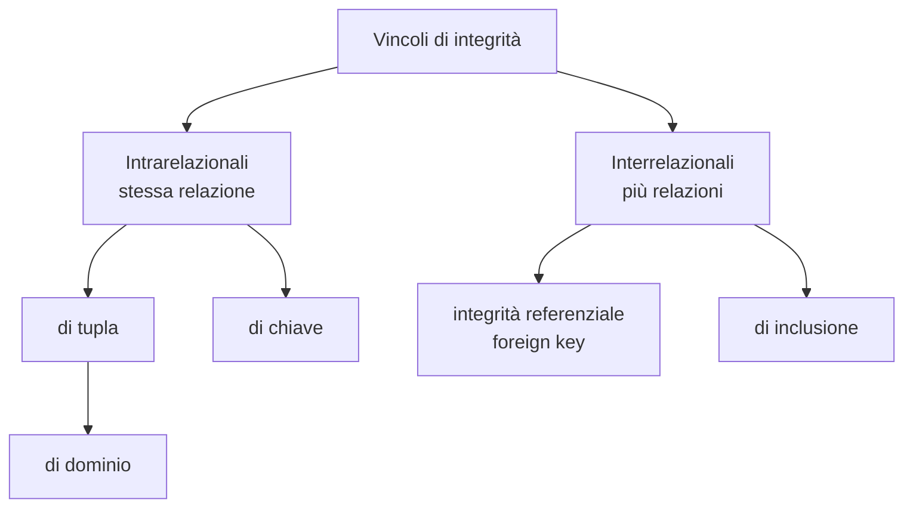

# Il Modello Relazionale

> [!abstract]
> Il modello relazionale è il **modello dei dati** su cui si basano i DBMS studiati nel corso (vedi [[01 - BD - Introduzione#Il DBMS|Introduzione]]). La lezione ha tre parti:
> - **2.1 Struttura dei dati relazionali**: cos'è una relazione, la differenza con la relazione matematica, schemi e istanze;
> - **2.2 Algebra relazionale**: il linguaggio formale di interrogazione (unione, differenza, ridenominazione, selezione, proiezione, join), il problema della negazione, i valori nulli e il join esterno;
> - **2.3 Vincoli di integrità**: vincoli di tupla, di chiave, di chiave primaria, di integrità referenziale e di inclusione.
>
> L'algebra è la base teorica di [[03 - BD - SQL|SQL]]: quasi ogni costrutto SQL corrisponde a un operatore visto qui, e i vincoli diventano clausole `PRIMARY KEY`, `FOREIGN KEY`, `CHECK`. Il modello relazionale sarà anche il punto d'arrivo della [[06 - BD - Progettazione Logica|progettazione logica]].
>
> Indice dei concetti: [[MOC - Basi di Dati]].

---

## 2.1 Struttura dei dati relazionali

### Il modello relazionale

Vedi [[Modello Relazionale]].

- Proposto da **E. F. Codd nel 1970** per favorire l'**indipendenza fisica dei dati**: il modo in cui si usano i dati a livello logico deve essere indipendente da come sono memorizzati fisicamente. Nei modelli gerarchico e reticolare (vedi [[01 - BD - Introduzione#Un po' di storia|storia]]) per interrogare i dati bisognava conoscere i puntatori e la struttura fisica; con il modello relazionale si ragiona solo su tabelle e valori.
- Disponibile come modello logico in DBMS reali dal **1981**: dieci anni di "incubazione", perché bisognava capire come implementarlo in modo efficiente.
- Si basa sul concetto matematico di **relazione**, con alcune varianti importanti.
- Le relazioni hanno una rappresentazione naturale come **tabelle**.

### Relazione matematica

Siano $D_1, D_2, \dots, D_n$ $n$ insiemi, non necessariamente distinti.

- Il **prodotto cartesiano** $D_1 \times D_2 \times \dots \times D_n$ è l'insieme di tutte le $n$-uple ordinate $(d_1, d_2, \dots, d_n)$ con $d_1 \in D_1, \dots, d_n \in D_n$.
- Una **relazione matematica** su $D_1, \dots, D_n$ è un **sottoinsieme** del prodotto cartesiano.
- Gli insiemi $D_i$ sono i **domini** della relazione; il numero $n$ di domini è il **grado** (o **arità**).
- Il numero di $n$-uple contenute nella relazione è la sua **cardinalità**.

> [!example] Esempio
> $D_1 = \{\text{Conti}, \text{Totti}, \text{Mancini}\}$, $D_2 = \{\text{Genoa}, \text{Roma}\}$.
>
> Il prodotto cartesiano $D_1 \times D_2$ ha $3 \cdot 2 = 6$ coppie:
>
> | | |
> |---|---|
> | Conti | Genoa |
> | Conti | Roma |
> | Totti | Genoa |
> | Totti | Roma |
> | Mancini | Genoa |
> | Mancini | Roma |
>
> La relazione $\text{HaGiocato} \subseteq D_1 \times D_2$ (annotazione a penna: "tabella di chi ha giocato") ne contiene solo tre: (Conti, Roma), (Conti, Genoa), (Totti, Roma). Ha grado 2 e cardinalità 3.

**Proprietà** della relazione matematica: è un **insieme** di $n$-uple (dette anche *tuple*), scritte anche $\langle d_1, \dots, d_n \rangle$. Quindi:
- non c'è alcun **ordinamento** fra le tuple;
- le tuple sono tutte **distinte** (niente duplicati);
- ciascuna tupla è però **ordinata**: il primo valore viene dal primo dominio, il secondo dal secondo, ecc. Il significato di un valore dipende dalla sua **posizione**.

### Relazione nel modello relazionale

Vedi [[Modello Relazionale]].

La relazione del modello relazionale è simile a quella matematica, con queste differenze:
- le **posizioni** delle componenti delle tuple diventano **attributi**, ciascuno con un **nome**;
- ogni attributo ha un **dominio**, cioè un insieme di **valori atomici**: valori semplici (un intero, una stringa), non strutture complesse come array o record;
- due attributi della stessa relazione **non possono avere lo stesso nome**.

Da qui in poi "relazione" significa relazione del modello relazionale; per l'altra si dice esplicitamente "relazione matematica".

Una relazione si rappresenta quindi come una **tabella**:
- gli **attributi** sono le colonne e i loro nomi (tutti diversi) ne sono le intestazioni;
- siccome ogni colonna si identifica per nome, **l'ordine delle colonne è irrilevante**: la struttura è **non posizionale** (al contrario della relazione matematica);
- ogni **riga** è una tupla e, poiché la relazione è un insieme, **non ci possono essere due righe uguali**.

![[BD-L02-p009.png]]

Nella figura la relazione ha 4 attributi (`Casa`, `Fuori`, `RetiCasa`, `RetiFuori`), cioè le colonne, e 4 tuple, cioè le righe. I domini sono `string` per Casa e Fuori e `integer` per RetiCasa e RetiFuori: per non appesantire la notazione non vengono mostrati nella tabella.

> [!warning] Cosa non è una relazione
> 1. Una tabella in cui una cella contiene un **array** di interi (es. `[2, 3, 5]` nell'attributo Casa): il valore **non è atomico**.
> 2. Una tabella con due colonne chiamate `A`: lo schema ha **due attributi con lo stesso nome**.

### Notazioni

Sia $X$ l'insieme degli attributi di una relazione $R$, $t$ una tupla di $R$ e $A \in X$:
- $t[A]$ (oppure $t.A$) è la **restrizione** di $t$ su $A$: il valore che $t$ ha nell'attributo $A$;
- la notazione si estende agli insiemi di attributi: $t[A, B]$ è una tupla sui soli attributi $A$ e $B$;
- per completezza $t[\,]$, restrizione sull'insieme vuoto, è la **tupla vuota** (senza componenti). Servirà per spiegare il [[#Prodotto cartesiano|prodotto cartesiano]].

> [!example] Restrizioni
>
> | | Casa | Fuori | RetiCasa | RetiFuori |
> |---|---|---|---|---|
> | $t_1$ | Juve | Lazio | 3 | 1 |
> | $t_2$ | Lazio | Milan | 2 | 0 |
> | $t_3$ | Juve | Roma | 1 | 2 |
> | | Roma | Milan | 0 | 1 |
>
> - $t_1[\text{Fuori}] = \text{Lazio}$
> - $t_2[\text{RetiCasa}] = 2$
> - $t_3[\text{Casa}, \text{RetiCasa}] = \langle \text{Juve}, 1 \rangle$
> - $t_1[\text{RetiFuori}, \text{Fuori}] = \langle 1, \text{Lazio} \rangle$
> - $t_3[\text{Fuori}, \text{Casa}, \text{RetiFuori}] = \langle \text{Roma}, \text{Juve}, 2 \rangle$
> - $t_3[\text{Fuori}, \text{RetiFuori}, \text{RetiFuori}] = \langle \text{Roma}, 2, 2 \rangle$
>
> Annotazione a penna sulla slide: la restrizione di $t$ su un insieme di attributi è a sua volta una tupla.

**Schema di relazione**: il nome $R$ con gli attributi e i loro domini, $R(A_1 : D_1, \dots, A_n : D_n)$, o semplicemente $R(A_1, \dots, A_n)$ se i domini non interessano. Una tupla si può allora scrivere come **tupla etichettata** $\langle A_1 : a, A_2 : b, \dots, A_n : c \rangle$, dove le etichette sono gli attributi.

> [!summary] Relazioni: riassunto
> In una relazione del modello relazionale:
> - i valori di ogni colonna sono **omogenei** (stesso dominio);
> - le righe sono **tutte diverse** (insieme, non multiinsieme);
> - le intestazioni delle colonne sono **tutte diverse**;
> - l'ordine delle righe e quello delle colonne sono **irrilevanti**.
>
> Il modello è **basato sui valori**: i riferimenti fra relazioni diverse sono espressi tramite **valori** che compaiono nelle tuple di entrambe.

### Modello basato su valori

![[BD-L02-p016.png]]

Lo schema `Studente(Matricola, Cognome, Nome, Data di nascita)`, `Esame(Studente, Voto, Corso)`, `Corso(Codice, Titolo, Docente)`. Il collegamento fra un esame e lo studente che l'ha sostenuto è dato dallo **stesso valore** (es. `3456`) presente in `Esame.Studente` e in `Studente.Matricola`; allo stesso modo `Esame.Corso = 04` rimanda a `Corso.Codice = 04`. Non ci sono puntatori: per ricostruire l'informazione "Maria Rossi ha preso 30 in Chimica con Verdi" si confrontano i valori. Le note a penna sulla slide evidenziano proprio questo: i dati di più tabelle sono "collegati" tramite valori uguali. Lo strumento che garantisce che questi riferimenti siano validi è il [[#Integrità referenziale|vincolo di integrità referenziale]].

### Schemi e istanze

Vedi [[Schema e Istanza]].

| Termine | Definizione |
|---|---|
| **Schema di relazione** | nome $R$ + insieme **non vuoto** di attributi (ed eventualmente domini): $R(A_1, \dots, A_n)$ |
| **Istanza di relazione** su $R(X)$ | insieme $r$ di tuple su $X$ |
| **Relazione** | schema + istanza su quello schema |
| **Schema di base di dati** | insieme non vuoto di schemi di relazione con nomi diversi: $\mathbf{R} = \{R_1(X_1), \dots, R_m(X_m)\}$ |
| **Istanza di base di dati** su $\mathbf{R}$ | insieme di relazioni $\mathbf{r} = \{r_1, \dots, r_m\}$ con $r_i$ istanza di $R_i(X_i)$ |
| **Base di dati** | schema di base di dati + istanza su quello schema |

Lo **schema** è la parte stabile, l'**intensione** (descrive *com'è fatta* l'informazione); l'**istanza** è la parte che cambia nel tempo, l'**estensione** (i dati veri e propri).

![[BD-L02-p018.png]]

Nell'esempio la base di dati $B$ ha lo schema $S = \{\text{StudenteLavoratore}(\text{Matricola}), \text{Studente}(\text{Matricola}, \text{Cognome}, \text{Nome}, \text{DataDiNascita})\}$. L'istanza contiene due relazioni: `StudenteLavoratore` con le matricole 6554 e 3456, e `Studente` con quattro tuple. I fumetti indicano nome di relazione, nome di attributo, schema della relazione Studente e istanza della relazione Studente.

---

## 2.2 Algebra relazionale

### Linguaggi per basi di dati

- Operazioni sullo **schema**: **DDL** (*Data Definition Language*).
- Operazioni sui **dati**: **DML** (*Data Manipulation Language*), che comprende le **interrogazioni** (*query language*) e gli **aggiornamenti**.

I linguaggi di interrogazione possono essere:
- **dichiarativi**: specificano le proprietà del risultato (*che cosa* si vuole);
- **procedurali**: specificano come generare il risultato (*come* ottenerlo).

| Linguaggio | Tipo |
|---|---|
| **Algebra relazionale** | procedurale |
| **Calcolo relazionale** | dichiarativo |
| **SQL** | parzialmente dichiarativo, standard *de facto* usato in pratica |
| **QBE** (*Query by Example*) | dichiarativo |

Nel corso si studiano l'**algebra relazionale**, base teorica di tutti i linguaggi di query, e **SQL** ([[03 - BD - SQL]]).

### Gli operatori

Vedi [[Algebra Relazionale]].

Gli operatori dell'algebra relazionale:
- sono definiti **su relazioni**;
- **producono relazioni**;
- possono quindi essere **composti** (proprietà di **chiusura**).

Come nell'algebra degli interi, dove $+$ prende due interi e restituisce un intero, qui gli operandi e i risultati sono relazioni. Gli operatori sono: **insiemistici** (unione, intersezione, differenza), **ridenominazione**, **selezione**, **proiezione**, **join** (naturale, prodotto cartesiano, theta-join).

> [!note] Notazione
> Le slide usano i nomi `SEL`, `PROJ`, `JOIN`, `REN`. Nei libri si trovano spesso le lettere greche: $\sigma$ (selezione), $\pi$ (proiezione), $\bowtie$ (join), $\rho$ (ridenominazione).

### Operatori insiemistici

A livello **estensionale** (delle istanze) le relazioni sono insiemi di tuple, quindi ha senso usare gli operatori insiemistici. Sono binari, e il risultato è ancora una relazione. Si possono applicare **solo a relazioni con gli stessi attributi** (stessa definizione intensionale). La semantica è quella classica.

Esempio con $\text{Laureato}(\text{Matricola}, \text{Nome}, \text{Età})$ e $\text{Dirigente}(\text{Matricola}, \text{Nome}, \text{Età})$:

| Laureato | | | | Dirigente | | |
|---|---|---|---|---|---|---|
| 7274 | Rossi | 42 | | 9297 | Neri | 33 |
| 7432 | Neri | 54 | | 7432 | Neri | 54 |
| 9824 | Verdi | 45 | | 9824 | Verdi | 45 |

| Operazione | Risultato |
|---|---|
| $\text{Laureato} \cup \text{Dirigente}$ | 7274 Rossi 42 · 7432 Neri 54 · 9824 Verdi 45 · 9297 Neri 33 |
| $\text{Laureato} \cap \text{Dirigente}$ | 7432 Neri 54 · 9824 Verdi 45 |
| $\text{Laureato} - \text{Dirigente}$ | 7274 Rossi 42 |

Nell'unione la tupla `7432 Neri 54`, presente in entrambe, compare **una sola volta**: annotazione a penna "insieme, non lista!".

> [!important] Il nome del risultato non conta
> L'algebra è un impianto matematico: le relazioni sono i "valori" su cui lavorano gli operatori. Del risultato di un'espressione contano **gli attributi e le tuple**, non il **nome**: il risultato non fa parte della base di dati, è solo un valore calcolato. Nei DBMS reali (che sono sistemi software, non solo formalismi) si vedrà come i risultati vengono memorizzati in nuove relazioni o trasferiti all'esterno.

### Ridenominazione

Vedi [[Algebra Relazionale]].

**Problema**: vogliamo l'insieme dei genitori con i loro figli, avendo $\text{Paternità}(\text{Padre}, \text{Figlio})$ e $\text{Maternità}(\text{Madre}, \text{Figlio})$. L'unione è sensata ma **impossibile**: le due relazioni hanno attributi diversi.

La **ridenominazione** è un operatore **monadico** (un solo argomento) che "modifica lo schema" cambiando il nome di uno o più attributi e lasciando **inalterata l'istanza**.

$$\text{REN}_{A_1 \leftarrow B_1, \dots, A_n \leftarrow B_n}(\text{Operando}) \quad\text{oppure}\quad \text{REN}_{A_1, \dots, A_n \leftarrow B_1, \dots, B_n}(\text{Operando})$$

Il nome $B_i$ viene sostituito da $A_i$. I nuovi nomi $A_1, \dots, A_n$ devono essere **tutti diversi** (nessun duplicato nello schema risultante).

$$\text{REN}_{\text{Genitore} \leftarrow \text{Padre}}(\text{Paternità}) \;\cup\; \text{REN}_{\text{Genitore} \leftarrow \text{Madre}}(\text{Maternità})$$

| Genitore | Figlio |
|---|---|
| Adamo | Abele |
| Adamo | Caino |
| Abramo | Isacco |
| Eva | Abele |
| Eva | Set |
| Sara | Isacco |

Dopo la ridenominazione i due operandi hanno gli stessi attributi (Genitore, Figlio) e l'unione diventa possibile (nota a penna: "e ora posso fare l'unione").

> [!example] Più attributi insieme
> $\text{Impiegati}(\text{Cognome}, \text{Ufficio}, \text{Stipendio})$ e $\text{Operai}(\text{Cognome}, \text{Fabbrica}, \text{Salario})$:
> $$\text{REN}_{\text{Sede}, \text{Retribuzione} \leftarrow \text{Ufficio}, \text{Stipendio}}(\text{Impiegati}) \cup \text{REN}_{\text{Sede}, \text{Retribuzione} \leftarrow \text{Fabbrica}, \text{Salario}}(\text{Operai})$$
>
> | Cognome | Sede | Retribuzione |
> |---|---|---|
> | Rossi | Roma | 55 |
> | Neri | Milano | 64 |
> | Bruni | Monza | 45 |
> | Verdi | Latina | 55 |

### Selezione

Vedi [[Selezione e Proiezione]].

Operatore **monadico** con una **condizione** (espressione booleana). Il risultato:
- ha **lo stesso schema** dell'operando;
- contiene il **sottoinsieme delle tuple** che soddisfano la condizione.

$$\text{SEL}_{\text{Condizione}}(\text{Operando})$$

La condizione è un'espressione booleana come nei linguaggi di programmazione, i cui operandi sono gli attributi della relazione (annotazione a penna: "stessa sintassi di ogni linguaggio di programmazione"; l'operando è la relazione).

Esempio su `Impiegato(Matricola, Cognome, Filiale, Stipendio)`:

| Matricola | Cognome | Filiale | Stipendio |
|---|---|---|---|
| 7309 | Rossi | Roma | 55 |
| 5998 | Neri | Milano | 64 |
| 9553 | Milano | Milano | 44 |
| 5698 | Neri | Napoli | 64 |

| Richiesta | Espressione | Risultato |
|---|---|---|
| guadagnano più di 50 | $\text{SEL}_{\text{Stipendio} > 50}(\text{Impiegato})$ | 7309, 5998, 5698 |
| più di 50 **e** a Milano | $\text{SEL}_{\text{Stipendio} > 50 \text{ AND } \text{Filiale} = \text{'Milano'}}(\text{Impiegato})$ | 5998 |
| cognome uguale alla filiale | $\text{SEL}_{\text{Cognome} = \text{Filiale}}(\text{Impiegato})$ | 9553 |

L'ultima mostra che la condizione può confrontare **due attributi** tra loro, non solo un attributo con una costante. Nota a penna: SQL ha una sintassi diversa, ma qui la condizione si scrive come in un linguaggio di programmazione.

### Proiezione

Vedi [[Selezione e Proiezione]].

Selezione e proiezione sono operatori **ortogonali**:
- la **selezione** è una decomposizione **orizzontale** (sceglie righe);
- la **proiezione** è una decomposizione **verticale** (sceglie colonne).

![[BD-L02-p040.png]]

La figura lo rappresenta graficamente: dalla tabella originale la selezione tiene alcune righe intere, la proiezione alcune colonne intere. L'annotazione a lato si chiede se i due operatori commutano (applicarli in ordine inverso dà lo stesso risultato?). In generale **no**: se la proiezione elimina una colonna usata nella condizione della selezione, la selezione non si può più applicare dopo.

La **proiezione** è monadica e produce un risultato che:
- ha **solo una parte degli attributi** dell'operando;
- contiene una tupla per ogni tupla dell'operando, ristretta agli attributi indicati.

$$\text{PROJ}_{\text{ListaAttributi}}(\text{Operando})$$

Con `Impiegato`: 7309 Neri Napoli 55 · 5998 Neri Milano 64 · 9553 Rossi Roma 44 · 5698 Rossi Roma 64.

- $\text{PROJ}_{\text{Matricola}, \text{Cognome}}(\text{Impiegato})$ restituisce **4** tuple: 7309 Neri, 5998 Neri, 9553 Rossi, 5698 Rossi.
- $\text{PROJ}_{\text{Cognome}, \text{Filiale}}(\text{Impiegato})$ restituisce **3** tuple: Neri Napoli, Neri Milano, Rossi Roma. Le due tuple "Rossi Roma" sono diventate uguali e, essendo il risultato un insieme, ne resta una.

> [!important] Cardinalità delle proiezioni
> Una proiezione contiene **al più** tante tuple quante l'operando, e può contenerne di meno per l'**eliminazione dei duplicati**. Se $X$ è una [[#Condizioni di superchiave e chiave|superchiave]] di $R$, allora $\text{PROJ}_X(R)$ ha **esattamente** tante tuple quante $R$: due tuple diverse differiscono per forza su $X$.

Combinando selezione e proiezione si estraggono informazioni interessanti da **una** relazione:

$$\text{PROJ}_{\text{Matricola}, \text{Cognome}}(\text{SEL}_{\text{Stipendio} > 50}(\text{Impiegato}))$$

restituisce 7309 Rossi, 5998 Neri, 5698 Neri. Annotazione a penna: non ci sono operazioni di assegnazione, è "una sorta di linguaggio funzionale": si compongono funzioni.

### Esercizio 4 - selezione, proiezione e operatori insiemistici

Schema usato in tutti gli esercizi 4:
- $\text{Concerto}(\text{idconc}, \text{idart}, \text{anno}, \text{città})$
- $\text{Artista}(\text{idart}, \text{nome}, \text{tipo})$
- $\text{Evento}(\text{ideve}, \text{idconc}, \text{voto})$

| Concerto: idconc | idart | anno | città |
|---|---|---|---|
| 209 | 73 | 1999 | Roma |
| 298 | 73 | 2001 | Napoli |
| 253 | 59 | 2020 | Milano |
| 299 | 95 | 2020 | Roma |
| 276 | 59 | 2018 | Firenze |
| 223 | 56 | 1995 | Firenze |

| Artista: idart | nome | tipo |
|---|---|---|
| 73 | S&G | duo |
| 59 | Neil | solo |
| 95 | Bruce | solo |
| 56 | RolSto | band |
| 40 | Beatles | band |

| Evento: ideve | idconc | voto |
|---|---|---|
| 2 | 209 | 9 |
| 4 | 253 | 4 |
| 8 | 276 | 6 |
| 2 | 223 | 10 |
| 8 | 299 | 9 |

**Query 1** — id del concerto e dell'artista dei concerti tenuti a Roma:
$$\text{PROJ}_{\text{idconc}, \text{idart}}(\text{SEL}_{\text{città} = \text{'Roma'}}(\text{Concerto}))$$
Risultato: (209, 73), (299, 95). Annotazione a penna: PROJ e SEL qui **non** sono commutabili, perché la proiezione cancellerebbe la colonna `città` necessaria alla selezione.

**Query 2** — l'idconc di **tutti** i concerti presenti nella base di dati. Un concerto può comparire in `Concerto` ma anche, come riferimento, in `Evento`; per prenderli tutti si fa l'unione:
$$\text{PROJ}_{\text{idconc}}(\text{Concerto}) \cup \text{PROJ}_{\text{idconc}}(\text{Evento})$$
Risultato: 209, 298, 253, 299, 276, 223.

**Query 3** — id degli artisti che non hanno mai tenuto concerti a Napoli. Assumendo che ogni idart di Concerto sia presente in Artista:
$$\text{PROJ}_{\text{idart}}(\text{Artista}) - \text{PROJ}_{\text{idart}}(\text{SEL}_{\text{città} = \text{'Napoli'}}(\text{Concerto}))$$

> [!warning] Correzione
> La slide riporta come risultato **56, 95, 59**. Manca **40** (Beatles): l'artista 40 non ha alcun concerto, quindi in particolare nessun concerto a Napoli, e sta nel primo operando ma non nel secondo. Il risultato corretto è **73 escluso**, cioè {59, 95, 56, 40}.

Nel **caso generale** (Concerto può contenere idart assenti da Artista) bisogna prendere gli artisti da entrambe le relazioni (annotazione a penna: "novità"):
$$(\text{PROJ}_{\text{idart}}(\text{Artista}) \cup \text{PROJ}_{\text{idart}}(\text{Concerto})) - \text{PROJ}_{\text{idart}}(\text{SEL}_{\text{città} = \text{'Napoli'}}(\text{Concerto}))$$

### Il problema del mondo chiuso

Vedi [[Assunzione di Mondo Chiuso]].

Il testo delle query dice "secondo quanto riportato nella base di dati". Una base di dati rappresenta infatti un **mondo chiuso** (*closed world assumption*):

> se una tupla **non è presente** nella base di dati, il fatto che rappresenterebbe è **falso** nel mondo corrispondente.

Da qui in poi questa precisazione è implicita. Per l'esercizio 4 significa che non esistono altri concerti oltre a quelli con un idconc presente nella base di dati (e lo stesso per gli artisti). Esistono sistemi che lavorano con l'**assunzione di mondo aperto** (un fatto assente è solo *sconosciuto*), ma sono fuori dal corso.

> [!note] Nota
> Le slide "mondo chiuso" e "negazione" si riferiscono alla "query 2", ma parlano della query che chiede gli artisti che **non** hanno tenuto concerti a Napoli, cioè la **query 3**.

### Il problema della negazione

Vedi [[Negazione in Algebra Relazionale]].

In algebra relazionale l'**unico modo** per esprimere una negazione che non sia una semplice selezione (un `NOT` dentro la condizione su una singola tupla) è l'operatore di **differenza**:

$$\{ x \mid x \in A \land \lnot B(x) \} = A - \{ x \mid B(x) \}$$

La parte sinistra ("gli elementi di A che non soddisfano B") **non** si può scrivere direttamente; la parte destra ("da A tolgo quelli che soddisfano B") sì. È esattamente il ragionamento della query 3: prima si trovano gli artisti che **hanno** suonato a Napoli, poi li si toglie da tutti gli artisti.

![[BD-L02-p061.png]]

Pagina di appunti a mano di Simone sulla negazione e sui quantificatori:
- **Esempio**: Mario ha 2 Ferrari e 1 Fiat, Paola 2 Renault, Gianni 1 Ferrari, Carla nessuna auto. La query "le persone che, come automobili, hanno *solo* Ferrari" si riformula come "*tutte* le macchine che possiedono sono Ferrari", e il risultato è {Gianni, **Carla**}.
- **Perché Carla?** In logica $\forall x\, \alpha(x) \equiv \lnot \exists x\, \lnot \alpha(x)$: "ogni macchina è una Ferrari" equivale a "non esiste una macchina che non è una Ferrari". Per dire che Carla non sta nell'insieme dovremmo poter dire "Carla ha un'auto che non è una Ferrari", ma Carla non ha auto. **Quando un insieme è vuoto, soddisfa tutte le condizioni di questo tipo** (verità a vuoto).
- **Esercizio per casa**: gli artisti i cui concerti dopo il 2010 si sono svolti tutti a Roma, cioè (altra formulazione) che dopo il 2010 hanno suonato *solo* a Roma:
  $$(\text{PROJ}_{\text{idart}}(\text{Concerto}) \cup \text{PROJ}_{\text{idart}}(\text{Artista})) - \text{PROJ}_{\text{idart}}(\text{SEL}_{\text{città} \neq \text{'Roma'} \text{ AND } \text{anno} > 2010}(\text{Concerto}))$$
  Con la nota: "saranno presenti anche quelli che non hanno tenuto concerti dopo il 2010" (proprio come Carla). Sui dati dell'esercizio: l'unico artista con concerti fuori Roma dopo il 2010 è 59 (Milano 2020, Firenze 2018), quindi il risultato è {73, 95, 56, 40}; 95 ha suonato a Roma nel 2020, gli altri tre a vuoto.
- In fondo: $\forall\, \text{birra}\, (\text{birra}_1 > \text{birra}) \equiv \nexists\, \text{birra}$ t.c. $\lnot(\text{birra}_1 > \text{birra})$, cioè $\text{birra}_1 \le \text{birra}$: un altro esempio dello stesso schema, che tornerà nella ricerca del massimo.

### Join

Vedi [[Join]].

**Motivazione**: ogni docente insegna uno o più corsi e nei corsi si insegnano linguaggi di programmazione. Con `Insegna(Docente, Corso)` e `Tratta(Corso, Ling)`, la domanda "quali docenti insegnano quali linguaggi?" **non ha risposta** con gli operatori visti finora: selezione e proiezione lavorano su **una** relazione, mentre qui bisogna **correlare** dati di relazioni diverse. Il **join** è l'operatore che lo permette ed è il più interessante dell'algebra. Ne esistono diverse versioni: join naturale, theta-join, equi-join, join esterno.

### Join naturale

Operatore binario (generalizzabile a più operandi) che produce un risultato:
- il cui schema è l'**unione** degli attributi degli operandi (senza duplicati);
- le cui tuple sono costruite **combinando** una tupla del primo operando con una del secondo.

Con $X_1 X_2$ si indica l'unione degli insiemi $X_1$ e $X_2$. Dati $R_1(X_1)$ e $R_2(X_2)$:

$$R_1 \text{ JOIN } R_2 = \{ t \text{ su } X_1 X_2 \mid \exists\, t_1 \in R_1, t_2 \in R_2 \text{ tali che } t[X_1] = t_1 \text{ e } t[X_2] = t_2 \}$$

Due tuple $t_1 \in R_1$ e $t_2 \in R_2$ sono **combinabili** se coincidono sugli attributi comuni, $t_1[X_1 \cap X_2] = t_2[X_1 \cap X_2]$; in tal caso producono la tupla $t$ con $t[X_1] = t_1$ e $t[X_2] = t_2$. Ogni tupla del join viene da una coppia di tuple combinabili.

> [!example] Insegna JOIN Tratta
>
> | Insegna: Docente | Corso | | Tratta: Corso | Ling |
> |---|---|---|---|---|
> | 1 | BD | | BD | SQL |
> | 2 | PS | | BD | Java |
> | 3 | Reti | | PS | Java |
> | 1 | PS | | PS | UML |
>
> Gli attributi del risultato sono $\{\text{Docente}, \text{Corso}\} \cup \{\text{Corso}, \text{Ling}\} = \{\text{Docente}, \text{Corso}, \text{Ling}\}$; l'attributo comune è `Corso`.
>
> | Docente | Corso | Ling |
> |---|---|---|
> | 1 | BD | SQL |
> | 1 | BD | Java |
> | 1 | PS | Java |
> | 1 | PS | UML |
> | 2 | PS | Java |
> | 2 | PS | UML |
>
> Ad esempio $t_1 = \langle 1, \text{BD} \rangle$ e $t_2 = \langle \text{BD}, \text{SQL} \rangle$ hanno lo stesso Corso e producono $\langle 1, \text{BD}, \text{SQL} \rangle$; la stessa $t_1$ con $\langle \text{BD}, \text{Java} \rangle$ produce $\langle 1, \text{BD}, \text{Java} \rangle$. Il docente 3 (Reti) non compare: nessuna tupla di Tratta ha Corso = Reti.

### Join completi, non completi, vuoti

Un **join completo** è un join in cui **ogni tupla** di entrambi gli operandi contribuisce ad almeno una tupla del risultato (annotazione a penna: "nessuno rimane solo").

| Caso | Impiegato(Impiegato, Reparto) | Reparto(Reparto, Capo) | Risultato |
|---|---|---|---|
| completo | Rossi A, Neri B, Bianchi B | A Mori, B Bruni | Rossi A Mori, Neri B Bruni, Bianchi B Bruni |
| non completo | Rossi A, Neri B, Bianchi B | B Mori, C Bruni | Neri B Mori, Bianchi B Mori (Rossi e il reparto C restano fuori) |
| vuoto | Rossi A, Neri B, Bianchi B | D Mori, C Bruni | nessuna tupla |
| completo con $n \times m$ tuple | Rossi B, Neri B | B Mori, B Bruni | 4 tuple: ogni impiegato con ogni capo |

**Cardinalità** con $R_1(A, B)$ e $R_2(B, C)$:
$$0 \le |R_1 \text{ JOIN } R_2| \le |R_1| \times |R_2|$$

L'estremo superiore si raggiunge quando tutte le tuple sono combinabili tra loro (ultimo caso della tabella). Annotazione: è un'operazione potenzialmente costosa, perché il numero di tuple può crescere moltissimo.

### Prodotto cartesiano

Riprendendo la definizione: se $X_1 \cap X_2 = \emptyset$, la condizione di combinabilità confronta due **tuple vuote** $t_1[\,] = t_2[\,]$, che sono sempre uguali. Quindi:

> il **join naturale fra relazioni senza attributi in comune** si riduce al **prodotto cartesiano**, e il risultato ha sempre $|R_1| \times |R_2|$ tuple.

| Impiegato JOIN Reparto (con Reparto(Codice, Capo)) | | | |
|---|---|---|---|
| Rossi | A | A | Mori |
| Rossi | A | B | Bruni |
| Neri | B | A | Mori |
| Neri | B | B | Bruni |
| Bianchi | B | A | Mori |
| Bianchi | B | B | Bruni |

### Theta-join ed equi-join

Vedi [[Theta-Join]].

Il prodotto cartesiano ha senso (quasi) solo **combinato con una selezione**: nella tabella sopra la maggior parte delle righe accoppia un impiegato con un reparto che non è il suo. La combinazione si chiama **theta-join**, richiede che $R_1$ e $R_2$ **non abbiano attributi in comune**, e si scrive in forma compatta:

$$R_1 \text{ JOIN}_{\text{condizione}}\, R_2 \;=\; \text{SEL}_{\text{condizione}}(R_1 \text{ JOIN } R_2)$$

La condizione è spesso una congiunzione (AND) di atomi $A_1 \,\vartheta\, A_2$, dove $\vartheta$ è un operatore di confronto ($=, >, <, \dots$): da qui il nome. Se l'unico operatore usato è l'uguaglianza si parla di **equi-join**.

$$\text{Impiegato JOIN}_{\text{Reparto} = \text{Codice}}\, \text{Reparto}$$

| Impiegato | Reparto | Codice | Capo |
|---|---|---|---|
| Rossi | A | A | Mori |
| Neri | B | B | Bruni |
| Bianchi | B | B | Bruni |

Annotazione a penna: è una "selezione su prodotto cartesiano".

**Join naturale ↔ equi-join** (servono ridenominazioni):

- da join naturale a equi-join, con `Impiegato(Impiegato, Reparto)` e `Reparto(Reparto, Capo)`:
  $$\text{Impiegato JOIN Reparto} \;=\; \text{PROJ}_{\text{Impiegato}, \text{Reparto}, \text{Capo}}(\text{Impiegato JOIN}_{\text{Reparto} = \text{Codice}}\, \text{REN}_{\text{Codice} \leftarrow \text{Reparto}}(\text{Reparto}))$$
  la ridenominazione serve perché il theta-join vuole operandi senza attributi comuni, la proiezione per togliere la colonna doppia `Codice`;
- da equi-join a join naturale, con `Reparto(Codice, Capo)`:
  $$\text{Impiegato JOIN Reparto}_{\text{Reparto} = \text{Codice}} \;\to\; \text{Impiegato JOIN REN}_{\text{Reparto} \leftarrow \text{Codice}}(\text{Reparto})$$

### Esercizio 4 - query con join

**Query 4** — nome e tipo degli artisti che hanno tenuto almeno un concerto prima del 2000:
$$\text{PROJ}_{\text{nome}, \text{tipo}}(\text{Artista JOIN SEL}_{\text{anno} < 2000}(\text{Concerto}))$$
Join naturale sull'attributo comune `idart`; il risultato del join ha attributi idart, nome, tipo, idconc, anno, città. Risultato: RolSto band, S&G duo.

Annotazioni sulla slide: si poteva anche selezionare dopo il join, $\text{PROJ}_{\text{nome}, \text{tipo}}(\text{SEL}_{\text{anno} < 2000}(\text{Artista JOIN Concerto}))$: **join e selezione commutano** se la condizione riguarda attributi che restano nel risultato. Le due forme sono [[#Equivalenza di espressioni|equivalenti]], ma la prima è più efficiente. Nota digitata: "Se avessi voluto usare il theta-join, avrei dovuto rinominare attributi in modo tale da dover sfruttare un prodotto cartesiano".

![[BD-L02-p087.png]]

Pagina di appunti di Simone con le due versioni della query 4 scritte con il **theta-join**, dopo aver ridenominato `idart` di Concerto in `a` (così gli operandi non hanno attributi comuni):
$$\text{PROJ}_{\text{nome}, \text{tipo}}(\text{Artista JOIN}_{\text{anno} < 2000 \text{ AND } a = \text{idart}}\, \text{REN}_{a \leftarrow \text{idart}}(\text{Concerto}))$$
$$\text{PROJ}_{\text{nome}, \text{tipo}}(\text{SEL}_{\text{anno} < 2000}(\text{Artista JOIN}_{a = \text{idart}}\, \text{REN}_{a \leftarrow \text{idart}}(\text{Concerto})))$$

**Query 5** — id e nome degli artisti che hanno tenuto almeno un concerto in una città diversa da Roma nell'ambito di un evento in cui hanno ottenuto un voto minore di 6. Due join naturali in cascata, il primo su `idart`, il secondo su `idconc`:
$$\text{PROJ}_{\text{idart}, \text{nome}}((\text{Artista JOIN SEL}_{\text{città} \neq \text{'Roma'}}(\text{Concerto})) \text{ JOIN SEL}_{\text{voto} > 4}(\text{Evento}))$$
Gli attributi intermedi sono idart, nome, tipo, idconc, anno, città, ideve, voto. Risultato dato dalla slide: **59 Neil**.

> [!warning] Correzione
> Testo e soluzione non sono coerenti. Il testo chiede "voto **minore di 6**" (sulla slide corretto a penna in "maggiore di 4"), la soluzione usa $\text{SEL}_{\text{voto} > 4}$ e il risultato è solo **59 Neil**. Facendo i conti: i concerti fuori Roma sono 298, 253, 276, 223, con voti 4 (253, artista 59), 6 (276, artista 59) e 10 (223, artista 56).
> - con **voto < 6** resta solo 253 → **{59 Neil}**, che è il risultato della slide: la condizione giusta è $\text{SEL}_{\text{voto} < 6}$;
> - con **voto > 4** restano 276 e 223 → **{59 Neil, 56 RolSto}**, quindi con la formula della slide il risultato sarebbe diverso.

**Query 6** — id degli artisti che hanno tenuto almeno due concerti nella stessa città in anni diversi (annotazione: "più difficile"). Guardando la tabella si capisce che servono **due tuple della stessa relazione** da confrontare, quindi bisogna fare il **join di Concerto con se stesso**:
$$\text{PROJ}_{\text{idart}}(\text{REN}_{i1 \leftarrow \text{idconc}, t1 \leftarrow \text{idart}, a1 \leftarrow \text{anno}, c1 \leftarrow \text{città}}(\text{Concerto}) \text{ JOIN}_{\text{idart} = t1 \text{ AND città} = c1 \text{ AND anno} \neq a1}\, \text{Concerto})$$
Gli attributi del risultato del theta-join sono i1, t1, a1, c1, idconc, idart, anno, città. Sui dati dell'esempio il risultato è **vuoto**: nessun artista ha due concerti nella stessa città (73 ha Roma e Napoli, 59 Milano e Firenze).

### Self-join

Vedi [[Theta-Join]].

Quando un join coinvolge **la stessa relazione due volte** (come Concerto nella query 6) si parla di **self-join**. Siccome il theta-join richiede operandi senza attributi in comune, in uno dei due operandi bisogna **ridenominare tutti gli attributi**.

![[BD-L02-p094.png]]

Esercizio per casa annotato da Simone: "sapere gli eventi i cui concerti sono stati tenuti tutti nello stesso anno". Il tentativo scritto a mano fa il self-join di $(\text{Concerto JOIN Evento})$ con una sua copia ridenominata ($e \leftarrow \text{ideve}$, $ca \leftarrow \text{idconc}$, $v \leftarrow \text{voto}$, $a \leftarrow \text{idart}$, $an \leftarrow \text{anno}$, $ci \leftarrow \text{città}$) con condizione $\text{ideve} = e \text{ AND anno} = an$. La nota in fondo alla pagina invita a usare il resto degli esercizi come autovalutazione.

> [!warning] Correzione
> Con la condizione $\text{anno} = an$ ogni tupla si combina **con se stessa**, quindi la query restituisce **tutti** gli eventi. "Tutti i concerti nello stesso anno" è un *per ogni*, che in algebra si esprime con la [[#Il problema della negazione|differenza]]: si tolgono gli eventi che hanno due concerti in anni **diversi**.
> $$CE = \text{Concerto JOIN Evento}$$
> $$\text{PROJ}_{\text{ideve}}(\text{Evento}) - \text{PROJ}_{\text{ideve}}(CE \text{ JOIN}_{\text{ideve} = e \text{ AND anno} \neq an}\, \text{REN}_{e, ca, v, a, an, ci \leftarrow \text{ideve}, \text{idconc}, \text{voto}, \text{idart}, \text{anno}, \text{città}}(CE))$$
> Sui dati: l'evento 2 ha concerti nel 1999 e nel 1995, l'evento 8 nel 2018 e nel 2020, l'evento 4 un solo concerto (2020). Risultato: **{4}**.

### Esercizio 5

Schema: $\text{Impiegato}(\text{Matricola}, \text{Nome}, \text{Età}, \text{Stipendio})$, $\text{Supervisione}(\text{Impiegato}, \text{Capo})$.

| Matricola | Nome | Età | Stipendio | | Impiegato | Capo |
|---|---|---|---|---|---|---|
| 7309 | Rossi | 34 | 45 | | 7309 | 5698 |
| 5998 | Bianchi | 37 | 38 | | 5998 | 5698 |
| 9553 | Neri | 42 | 35 | | 9553 | 4076 |
| 5698 | Bruni | 43 | 42 | | 5698 | 4076 |
| 4076 | Mori | 45 | 50 | | 4076 | 8123 |
| 8123 | Lupi | 46 | 60 | | | |

1. **Matricola, nome, età e stipendio di chi guadagna più di 40**: $\text{SEL}_{\text{Stipendio} > 40}(\text{Impiegato})$ → 7309 Rossi, 5698 Bruni, 4076 Mori, 8123 Lupi.
2. **Matricola, nome ed età di chi guadagna più di 40**: $\text{PROJ}_{\text{Matricola}, \text{Nome}, \text{Età}}(\text{SEL}_{\text{Stipendio} > 40}(\text{Impiegato}))$.
3. **Matricole dei capi di chi guadagna più di 40**:
   $$\text{PROJ}_{\text{Capo}}(\text{Supervisione JOIN}_{\text{Impiegato} = \text{Matricola}}(\text{SEL}_{\text{Stipendio} > 40}(\text{Impiegato})))$$
   Risultato: 5698, 4076, 8123. Accanto, a penna, la variante con join naturale dopo $\text{REN}_{\text{Matricola} \leftarrow \text{Impiegato}}(\text{Supervisione})$, segnata come "oppure".
4. **Nome e stipendio di quei capi**: si fa un secondo join con Impiegato, questa volta sulla matricola del capo:
   $$\text{PROJ}_{\text{Nome}, \text{Stipendio}}(\text{Impiegato JOIN}_{\text{Matricola} = \text{Capo}}\, \text{PROJ}_{\text{Capo}}(\text{Supervisione JOIN}_{\text{Impiegato} = \text{Matricola}}(\text{SEL}_{\text{Stipendio} > 40}(\text{Impiegato}))))$$
   Risultato: Bruni 42, Mori 50, Lupi 60.
5. **Impiegati che guadagnano più del proprio capo**, con matricola, nome e stipendio di entrambi. Impiegato serve **due volte** (come dipendente e come capo), quindi una copia va ridenominata (Matr, Stip sono abbreviazioni di Matricola, Stipendio):
   $$\text{PROJ}_{\text{Matr}, \text{Nome}, \text{Stip}, \text{MatrC}, \text{NomeC}, \text{StipC}}(\text{SEL}_{\text{Stipendio} > \text{StipC}}(\text{REN}_{\text{MatrC}, \text{NomeC}, \text{StipC}, \text{EtàC} \leftarrow \text{Matr}, \text{Nome}, \text{Stip}, \text{Età}}(\text{Impiegato}) \text{ JOIN}_{\text{MatrC} = \text{Capo}}(\text{Supervisione JOIN}_{\text{Impiegato} = \text{Matricola}}\, \text{Impiegato})))$$
   Sui dati: 7309 Rossi (45) guadagna più del suo capo 5698 Bruni (42); nessun altro.
6. **Matricole degli impiegati che non hanno un capo**. È una negazione: si tolgono da tutti gli impiegati quelli che compaiono come dipendenti in Supervisione.
   $$\text{PROJ}_{\text{Matricola}}(\text{Impiegato}) - \text{REN}_{\text{Matricola} \leftarrow \text{Impiegato}}(\text{PROJ}_{\text{Impiegato}}(\text{Supervisione}))$$
   Risultato: 8123. La ridenominazione serve perché la differenza vuole gli stessi attributi.
7. **Matricola ed età di chi non ha un capo**: la differenza dà solo le matricole, per recuperare l'età si fa il join con Impiegato:
   $$\text{PROJ}_{\text{Matricola}, \text{Età}}(\text{Impiegato JOIN}(\text{PROJ}_{\text{Matricola}}(\text{Impiegato}) - \text{REN}_{\text{Matricola} \leftarrow \text{Impiegato}}(\text{PROJ}_{\text{Impiegato}}(\text{Supervisione}))))$$
   Risultato: 8123, 46.
8. **Matricole dei capi i cui impiegati guadagnano *tutti* più di 40**. Idea: dall'insieme dei capi si tolgono quelli che hanno **almeno un** impiegato che **non** soddisfa la condizione:
   $$\{ x \mid x \in S \land \forall y\,(R(x, y) \to A(y)) \} = S - \{ x \mid \exists y\, R(x, y) \land \lnot A(y) \}$$
   $$\text{PROJ}_{\text{Capo}}(\text{Supervisione}) - \text{PROJ}_{\text{Capo}}(\text{Supervisione JOIN}_{\text{Impiegato} = \text{Matricola}}(\text{SEL}_{\text{Stipendio} \le 40}(\text{Impiegato})))$$
   Capi: 5698, 4076, 8123. Hanno un dipendente con stipendio ≤ 40: 5698 (5998, 38) e 4076 (9553, 35). Risultato: **8123**.

> [!warning] Correzione
> Nella formula della slide il lato sinistro è scritto $\forall y\,(R(x, y) \to A(x))$: la condizione va verificata sugli impiegati $y$, quindi è $A(y)$, coerentemente con il lato destro $\lnot A(y)$.

> [!tip] Schema generale per il "per ogni"
> L'algebra non ha il quantificatore universale. "Tutti gli $y$ collegati a $x$ soddisfano $A$" si traduce sempre in: **tutti gli $x$ meno quelli che hanno almeno un $y$ che non soddisfa $A$**. Gli $x$ senza nessun $y$ restano nel risultato (verità a vuoto, come Carla negli appunti sopra).

### Informazione incompleta e valori nulli

Vedi [[Valore Nullo]].

Il modello relazionale impone una struttura **rigida**: l'informazione è fatta di tuple, e le tuple ammesse sono dettate dagli schemi. Nella pratica i dati possono non corrispondere al formato previsto.

> [!example] Prefettura(città, indirizzo)
>
> | città | indirizzo |
> |---|---|
> | Roma | Via IV Novembre |
> | Firenze | ? |
> | Tivoli | ? |
> | Prato | ? |
>
> - di **Firenze** non conosciamo l'indirizzo della prefettura;
> - **Tivoli** non è provincia: non ha prefettura;
> - **Prato** è una provincia "nuova": ha la prefettura?

**Soluzione sbagliata**: usare valori ordinari del dominio (0, stringa vuota, "999") per indicare l'assenza di valore. Problemi:
- potrebbero non esistere valori "non utilizzati" (annotazione: "è una cazzata da evitare");
- valori inutilizzati oggi potrebbero diventare significativi domani;
- chi usa i dati (programmi) deve conoscere il significato convenzionale di questi valori, e far mettere d'accordo progettisti e programmatori diversi è difficile o impossibile.

**Soluzione del modello relazionale**: il **valore nullo** `NULL`, un valore speciale che il sistema riconosce e che denota l'**assenza di un valore** del dominio. Non è un valore del dominio, ma può comparire in qualunque attributo. Formalmente basta estendere la tupla: $t[A]$ è un valore di $\text{dom}(A)$ **oppure** `NULL`. Nello schema si possono poi imporre restrizioni (alcuni attributi non ammettono nulli).

Il valore nullo ha (almeno) tre interpretazioni:

| Interpretazione | Significato | Esempio |
|---|---|---|
| **sconosciuto** | il valore esiste ma non è noto | Firenze |
| **inesistente** | il valore non esiste | Tivoli |
| **senza informazione** | non si sa se esista | Prato |

I DBMS **non distinguono** i tipi di nullo: adottano implicitamente l'interpretazione **"senza informazione"**, la più debole.

### Il valore nullo nell'algebra

Una condizione in un'espressione algebrica è **vera solo per valori non nulli** (annotazione: "ogni singola condizione su NULL è falsa").

| Matricola | Cognome | Filiale | Età |
|---|---|---|---|
| 7309 | Rossi | Roma | 32 |
| 5998 | Neri | Milano | 45 |
| 9553 | Bruni | Milano | NULL |

$\text{SEL}_{\text{Età} > 40}(\text{Impiegato})$ restituisce solo 5998: per Bruni il confronto $\text{NULL} > 40$ non è vero.

Per riferirsi ai nulli ci sono condizioni apposite, **`IS NULL`** e **`IS NOT NULL`** (le uniche utilizzabili su attributi nulli). $\text{SEL}_{(\text{Età} > 40) \text{ OR } (\text{Età IS NULL})}(\text{Impiegato})$ restituisce 5998 e 9553.

> [!warning] Attenzione (annotazione a penna)
> $\text{SEL}_{(\text{Età} > 40) \text{ OR } (\text{Età} \le 40)}(\text{Impiegato})$ **non** restituisce tutte le tuple: le tuple con Età nulla non soddisfano nessuna delle due condizioni e vengono perse. Una condizione che sembra una tautologia non lo è in presenza di nulli.

### Join esterno

Vedi [[Join Esterno]].

Nel join (interno) alcune tuple possono **non contribuire** al risultato e vengono "tagliate fuori": nell'esempio non completo Rossi (reparto A) e il reparto C (capo Bruni) spariscono. Se vogliamo sapere di ogni impiegato in quale reparto lavora e chi è il capo, perdiamo informazione su Rossi.

Il **join naturale esterno** estende con **valori nulli** le tuple che verrebbero tagliate fuori. Tre versioni:

| Versione | Notazione | Cosa mantiene | Risultato su Impiegato(Rossi A, Neri B, Bianchi B) e Reparto(B Mori, C Bruni) |
|---|---|---|---|
| **sinistro** | $\text{JOIN}_{\text{LEFT}}$ | tutte le tuple del primo operando | Neri B Mori, Bianchi B Mori, **Rossi A NULL** |
| **destro** | $\text{JOIN}_{\text{RIGHT}}$ | tutte le tuple del secondo operando | Neri B Mori, Bianchi B Mori, **NULL C Bruni** |
| **completo** | $\text{JOIN}_{\text{FULL}}$ | le tuple di entrambi | Neri B Mori, Bianchi B Mori, **Rossi A NULL**, **NULL C Bruni** |

Annotazione: "sinistro" e "destro" si riferiscono alla posizione degli operandi, $(\text{Operando}_1) \text{ JOIN } (\text{Operando}_2)$.

### Equivalenza di espressioni

Due espressioni sono **equivalenti** se producono lo stesso risultato **qualunque sia l'istanza** della base di dati. È importante perché i DBMS cercano di eseguire espressioni equivalenti a quelle scritte dall'utente, ma meno **costose**: è il compito dell'ottimizzatore di query.

Un'equivalenza fondamentale è **anticipare le selezioni** (*push selections*). Se $A$ è attributo di $R_2$:
$$\text{SEL}_{A = 10}(R_1 \text{ JOIN } R_2) = R_1 \text{ JOIN SEL}_{A = 10}(R_2)$$
Le selezioni riducono molto la dimensione dei risultati intermedi, e quindi il costo del join (che nel caso peggiore produce $|R_1| \times |R_2|$ tuple).

---

## 2.3 Vincoli di integrità

### Introduzione

Vedi [[Vincolo di Integrità]].

Esistono istanze sintatticamente corrette che **non rappresentano situazioni possibili** nell'applicazione.

![[BD-L02-p129.png]]

Le anomalie cerchiate a penna nella figura:
- due studenti diversi (Rossi Maria e Neri Anna) hanno la **stessa matricola** 276545 ("altro problema di semantica");
- un esame ha **voto 32**, fuori dalla scala dei voti;
- un esame ha voto **28 "e lode"**: la lode è ammessa solo con 30;
- un esame è dello studente **200768**, che non esiste in Studente;
- il corso 03 ha **titolo e docente nulli** ("3 corsi ma non c'è docente e titolo").

Lo schema da solo non basta a escludere queste situazioni: servono i **vincoli**.

**Definizione**: un **vincolo di integrità** è una condizione espressa **a livello di schema** che deve essere soddisfatta da **tutte le istanze** della base di dati, perché individua una condizione **necessaria** per le istanze che rappresentano situazioni corrette. Ogni vincolo è un **predicato** che associa a ogni istanza il valore vero (soddisfatto) o falso. A ogni schema si associa un insieme di vincoli, e si considerano **corrette** (lecite, legali, valide, ammissibili) solo le istanze che li soddisfano tutti. Annotazione: "da imparare a memoria".

**Motivazioni**:
- descrivere la realtà in modo più accurato di quanto permettano le sole strutture;
- contribuire alla **qualità dei dati** (ricordate il [[01 - BD - Introduzione#Un esempio, i dati COVID della Regione Lombardia|caso COVID]]);
- aiutare la **progettazione**;
- aiutare il sistema a scegliere la **strategia di esecuzione** delle interrogazioni.

Non tutte le proprietà di interesse si possono esprimere direttamente come vincoli.

**Classificazione**:

### Vincoli di tupla e di dominio

Un **vincolo di tupla** esprime condizioni sui valori di **ciascuna tupla, indipendentemente dalle altre**. Si scrive come espressione booleana (AND, OR, NOT) di atomi che confrontano valori di attributi o espressioni aritmetiche su di essi. Un vincolo di tupla che coinvolge **un solo attributo** è un **vincolo di dominio**.

> [!example] Esempio
> In una tabella degli stipendi con attributi Lordo, Ritenute e Netto: $\text{Lordo} = \text{Ritenute} + \text{Netto}$.

**Esercizio 6** — su $\text{Esame}(\text{Studente}, \text{Voto}, \text{Lode}, \text{Corso})$:
1. ogni voto è compreso tra 18 e 30;
2. in ogni tupla, Lode contiene "e lode" **solo se** il voto è 30;
3. in ogni tupla, Lode contiene la stringa vuota se il voto è diverso da 30.

Ragionamento: la (2) equivale a "se il voto non è 30, allora Lode non è 'e lode'", cioè "il voto è 30 **oppure** Lode non è 'e lode'". La (3) equivale a "il voto è 30 oppure Lode è vuota".

| # | Tipo | Vincolo |
|---|---|---|
| 1 | dominio | $\text{Voto} \ge 18 \text{ AND } \text{Voto} \le 30$ |
| 2 | tupla | $(\text{NOT Lode} = \text{"e lode"}) \text{ OR } \text{Voto} = 30$ |
| 3 | tupla | $\text{Voto} = 30 \text{ OR } \text{Lode} = \text{""}$ |

> [!warning] Correzione
> Nella slide della soluzione la terza condizione è spiegata come "se il voto è diverso da 30, allora il valore dell'attributo **Voto** è ''". Si intende l'attributo **Lode**, come nella formula.

![[BD-L02-p135.png]]

Pagina di appunti di Simone sull'**implicazione logica**, che serve a tradurre i "solo se" in vincoli:
- $\alpha \Rightarrow \beta$ è falsa **solo** quando $\alpha$ è vera e $\beta$ è falsa: se $\alpha$ è falsa l'implicazione è vera, perché "non dice nulla" su quel caso. Quindi $\alpha \Rightarrow \beta \equiv \lnot\alpha \lor \beta$.
- **"$\alpha$ solo se $\beta$"** significa $\alpha \Rightarrow \beta$ (equivale alla contronominale $\lnot\beta \Rightarrow \lnot\alpha$); **"se e solo se"** è $(\alpha \Rightarrow \beta) \land (\beta \Rightarrow \alpha) \equiv (\lnot\alpha \lor \beta) \land (\lnot\beta \lor \alpha)$.
- Tabelle di verità di AND, OR, XOR, $\Rightarrow$ e $\Leftrightarrow$.
- Esempio: "se non piove allora gioco" equivale a "piove OR gioco", ma **non** a "se piove allora non gioco". C'è una discrepanza tra la logica e il linguaggio comune, e in basi di dati conta la logica.
- In fondo, la soluzione dell'esercizio 6 scritta a mano: (2) "Lode = 'e lode' solo se Voto = 30" $\equiv \lnot(\text{Lode} = \text{"e lode"}) \lor \text{Voto} = 30$; (3) "$\lnot(\text{Voto} = 30)$ solo se Lode = ''" $\equiv \text{Voto} = 30 \lor \text{Lode} = \text{""}$.

### Vincoli di chiave

Vedi [[Superchiave e Chiave]].

In `Studente(Matricola, Cognome, Nome, Corso, Nascita)` il numero di matricola **identifica** gli studenti: in nessuna istanza ci possono essere due tuple con la stessa matricola. Questa condizione si impone con un **vincolo di chiave**.

### Condizioni di superchiave e chiave

Sia $R$ uno schema con attributi $X$, $K = \{A_1, \dots, A_n\} \subseteq X$ non vuoto e $r$ un'istanza di $R$.
- $K$ soddisfa la **condizione di superchiave** in $r$ (è una **superchiave in $r$**) se $r$ non contiene due tuple distinte $t_1, t_2$ con $t_1[A_1] = t_2[A_1], \dots, t_1[A_n] = t_2[A_n]$.
- $K$ soddisfa la **condizione di chiave** in $r$ (è una **chiave in $r$**) se è una superchiave **minimale**: nessun suo sottoinsieme proprio è superchiave in $r$.

> [!example] Esempi su un'istanza
>
> | Matricola | Cognome | Nome | Corso | Nascita |
> |---|---|---|---|---|
> | 27655 | Rossi | Mario | Ing Inf | 5/12/78 |
> | 78763 | Rossi | Mario | Ing Inf | 3/11/76 |
> | 65432 | Neri | Piero | Ing Mecc | 10/7/79 |
> | 87654 | Neri | Mario | Ing Inf | 3/11/76 |
> | 67653 | Rossi | Piero | Ing Mecc | 5/12/78 |
>
> - **Matricola** è superchiave (valori tutti diversi) e, avendo un solo attributo, è minimale: è **chiave**.
> - **Cognome**, **Nome**, **Nascita** da soli non sono superchiavi (ci sono valori ripetuti).
> - **{Cognome, Nome, Nascita}** è superchiave (nessuna terna ripetuta) e nessun suo sottoinsieme lo è: è **chiave** (annotazione: "anche minima").
> - **{Cognome, Nome, Nascita, Corso}** è superchiave ma **non** chiave: non è minimale.
>
> Annotazione a penna: "superchiave = tutte tuple diverse; chiave = superchiave minimale, non si può togliere nessun attributo".

**Esistenza**: poiché una relazione non contiene tuple uguali, **l'insieme di tutti gli attributi è sempre una superchiave**; quindi ogni relazione ha almeno una superchiave, e togliendo attributi finché si può se ne ricava almeno una **chiave**.

### Vincolo di superchiave e vincolo di chiave

La differenza con quanto sopra è che ora si parla di **schema**, cioè di **tutte** le istanze.
- **Vincolo di superchiave** per $K$ su $R$: in **ogni istanza** di $R$, $K$ è superchiave. Es. su $R(A, B, C, D)$ il vincolo per $\{A, B\}$ dice che in nessuna istanza esistono due tuple uguali su $A$ e $B$. Annotazione: "la cosa importante è il vincolo".
- **Vincolo di chiave** per $K$ su $R$: (1) $K$ è superchiave in ogni istanza, e (2) nessun sottoinsieme proprio non vuoto di $K$ soddisfa la (1). Es. per $\{A, B\}$: né $\{A\}$ né $\{B\}$ sono superchiavi in ogni istanza.

Su uno schema si possono dichiarare **più** vincoli di chiave.

**Come si individuano le chiavi?** Non guardando un'istanza (che potrebbe soddisfare una condizione "per caso"), ma considerando le **proprietà del frammento di mondo reale** di interesse: si cercano gli insiemi di attributi per cui, in ogni istanza possibile, non possono esistere due tuple con gli stessi valori, e se ne prendono i sottoinsiemi minimali. Su `Studenti(Matricola, Cognome, Nome, Corso, Nascita)` va definito il vincolo che Matricola è chiave.

### Chiavi e valori nulli

Un vincolo di chiave può riguardare attributi con valori nulli. Con il vincolo di chiave su $\{A, B\}$:

| A | B | C |
|---|---|---|
| a1 | b1 | c1 |
| a1 | NULL | c1 |
| a2 | b2 | d |
| a3 | NULL | d |

l'istanza **soddisfa** il vincolo: NULL non soddisfa mai alcuna condizione, nemmeno l'uguaglianza, quindi non esistono due tuple con gli stessi valori su A e B.

Però, con valori nulli, i valori della chiave:
- **non permettono di identificare** le tuple;
- **non permettono di realizzare** facilmente i **riferimenti** da altre relazioni.

> [!example] Esempio
> In `Studente` la prima e l'ultima tupla hanno Matricola `NULL`: il vincolo di chiave su Matricola è soddisfatto, ma quelle due tuple non si possono identificare tramite la matricola, né un esame potrebbe riferirsi a loro.

### Chiave primaria

Vedi [[Chiave Primaria]].

**Soluzione pratica**: per ogni schema di relazione si sceglie una chiave particolare, la **chiave primaria**, su cui **non si ammettono valori nulli**. Notazione: gli attributi della chiave primaria sono **sottolineati**.

Un **vincolo di chiave primaria** su $S$ asserisce che $K$:
- è una chiave per $S$;
- non ammette valori nulli in nessuna istanza.

Per una relazione si può dichiarare **un solo** vincolo di chiave primaria.

> [!important] Proprietà ($\alpha$)
> Se $K$ è chiave primaria di $R$, per ogni istanza $r$ e ogni coppia di tuple distinte $t_1, t_2$ vale $t_1[K] \neq t_2[K]$: $K$ **identifica** tutte le tuple. Per una chiave **non primaria** ($\alpha$) non vale necessariamente, per via dei nulli: la condizione è solo che non esistano $t_1, t_2$ con $t_1[K] = t_2[K]$ (con un NULL le due tuple non sono né uguali né diverse).

**Esercizio 7** — $\text{Partita}(\text{Codice}, \text{SqCasa}, \text{SqTrasferta}, \text{GoalCasa}, \text{GoalTrasf}, \text{Schedina})$: non ci sono due partite con lo stesso codice; SqCasa e SqTrasferta sono le squadre; GoalCasa e GoalTrasf i goal segnati; Schedina il risultato (1, 2, X). Codice, SqCasa, SqTrasferta sono stringhe, i goal interi, Schedina un carattere. Vincoli intrarelazionali:

| Vincolo | Tipo |
|---|---|
| Codice è chiave primaria | chiave primaria |
| $\text{SqCasa} \neq \text{SqTrasferta}$ | tupla |
| $\text{GoalCasa} \ge 0$ | dominio |
| $\text{GoalTrasf} \ge 0$ | dominio |
| $\text{Schedina} = \text{'1'} \text{ OR } \text{Schedina} = \text{'2'} \text{ OR } \text{Schedina} = \text{'X'}$ | dominio |
| $(\text{NOT Schedina} = \text{'1'}) \text{ OR } (\text{GoalCasa} > \text{GoalTrasf})$ | tupla |
| $(\text{NOT Schedina} = \text{'2'}) \text{ OR } (\text{GoalCasa} < \text{GoalTrasf})$ | tupla |
| $(\text{NOT Schedina} = \text{'X'}) \text{ OR } (\text{GoalCasa} = \text{GoalTrasf})$ | tupla |

Gli ultimi tre sono implicazioni "se Schedina = 1 allora ha vinto la squadra di casa", scritte come $\lnot\alpha \lor \beta$.

### Integrità referenziale

Vedi [[Foreign Key]].

Le informazioni in relazioni diverse sono correlate tramite **valori comuni**, in particolare valori delle **chiavi** (di solito primarie, ma non necessariamente). Il meccanismo che lo garantisce è il **vincolo di integrità referenziale** (*foreign key*).

**Definizione**: un vincolo di integrità referenziale fra una sequenza non vuota $X$ di $n$ attributi di $R_1$ e una sequenza $Y$ di $n$ attributi che formano una **chiave** di $R_2$ impone che, in ogni istanza, ogni combinazione di valori su $X$ **senza NULL** presente in $R_1$ compaia come combinazione di valori su $Y$ in $R_2$. Se $Y$ è la chiave primaria di $R_2$, si dice anche che il vincolo sussiste fra $X$ di $R_1$ e $R_2$.

![[BD-L02-p152.png]]

`Infrazioni(Codice, Comune, Data, Vigile, Targa)` e `Vigili(Matricola, Cognome, Nome)`: ogni valore non nullo di `Vigile` in Infrazioni (3987, 3295, 9345) deve comparire in `Matricola` di Vigili. È un vincolo di integrità referenziale fra Vigile di Infrazioni e Matricola di Vigili (o, equivalentemente, fra Vigile di Infrazioni e Vigili). Il vigile 7543 (Mori) non ha infrazioni: va bene, il vincolo va in **una sola direzione**. Annotazione a penna: "ci torna utilissimo!!".

Il vincolo può coinvolgere **più attributi**. `Pagamenti(Transazione, Codice, Comune)`: ogni coppia ⟨Codice, Comune⟩ non nulla di Pagamenti deve comparire come ⟨Codice, Comune⟩ in Infrazioni, la cui chiave è appunto la coppia (lo stesso codice può ripetersi in comuni diversi). La tupla `300 NULL NULL` non viola nulla.

![[BD-L02-p154.png]]

**Violazioni**: le tuple in rosso di Pagamenti, ⟨34321, Napoli⟩ e ⟨53524, Roma⟩, non compaiono in Infrazioni (lì 34321 è di Roma e 53524 di Milano). Con un vincolo multi-attributo non basta che ciascun valore esista da solo: deve esistere **la combinazione**.

**Integrità referenziale e valori nulli**: i nulli negli attributi coinvolti **non costituiscono una violazione**. Con `Impiegati(Matricola, Cognome, Progetto)` e `Progetti(Codice, Inizio, Durata, Costo)`, il vincolo da Progetto di Impiegati a Codice di Progetti è soddisfatto anche se Verdi ha Progetto `NULL` (un impiegato senza progetto).

**Esercizio 8** — `Partita(Codice, SqCasa, SqTrasferta, GoalCasa, GoalTrasf, Schedina)` e `Squadra(Nome, AnnoFondazione, Città)`, con Nome chiave primaria di Squadra. Vincoli interrelazionali:
1. integrità referenziale fra **SqCasa** e Squadra;
2. integrità referenziale fra **SqTrasferta** e Squadra.

> [!note] Nota
> La slide della soluzione si intitola "Esercizio 9: soluzione" ma risolve l'esercizio 8.

### Vincoli di inclusione

Un **vincolo di inclusione** fra una sequenza $X$ di $n$ attributi di $R_1$ e una sequenza $Y$ di $n$ attributi di $R_2$ impone che ogni combinazione di valori non nulli su $X$ presente in $R_1$ compaia come combinazione su $Y$ in $R_2$.

È la stessa definizione della foreign key, **senza** richiedere che $Y$ sia una chiave di $R_2$. Quindi l'**integrità referenziale è un caso particolare del vincolo di inclusione**, quello in cui $Y$ è una chiave. Il vincolo di inclusione serve quando $Y$ è solo una superchiave, o nemmeno quella.

| | Integrità referenziale (foreign key) | Inclusione |
|---|---|---|
| $Y$ in $R_2$ | deve essere una **chiave** | qualsiasi insieme di attributi |
| NULL in $X$ | ignorati | ignorati |
| Relazione | caso particolare | caso generale |

In SQL questi vincoli diventano `PRIMARY KEY`, `UNIQUE`, `FOREIGN KEY ... REFERENCES` e `CHECK`: vedi [[03 - BD - SQL]].
