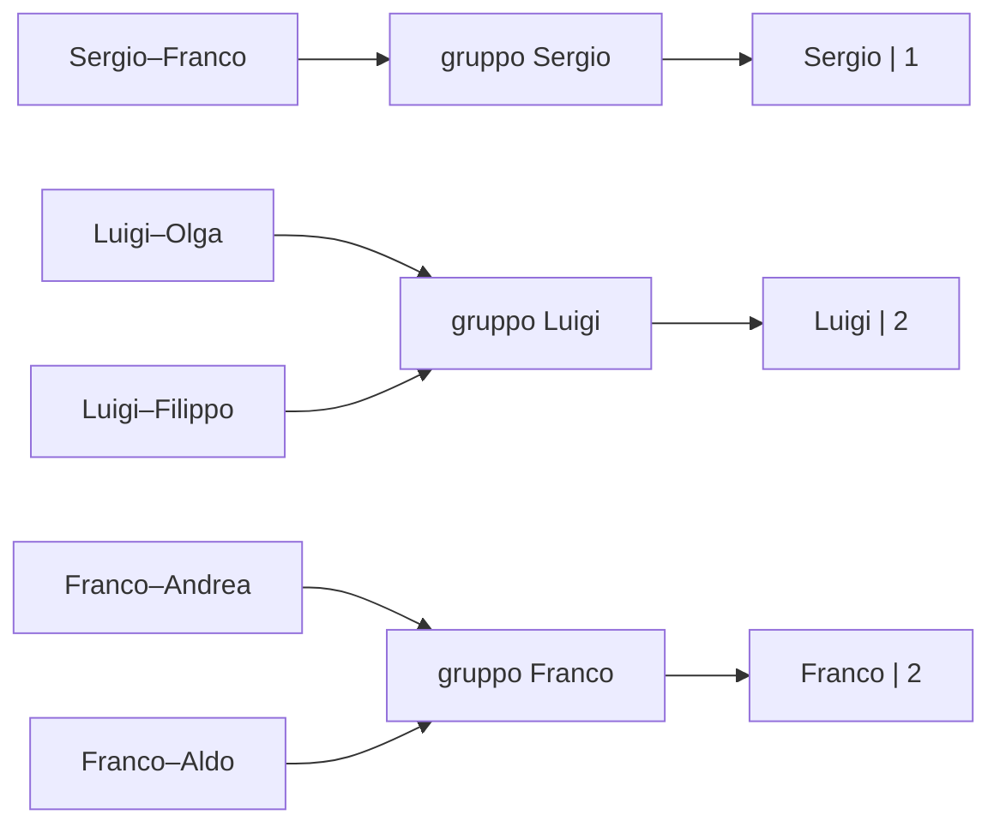
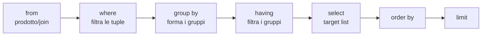

# Il Linguaggio SQL

> [!abstract]
> SQL è il linguaggio con cui si usano davvero i DBMS relazionali: contiene sia il **DDL** (definizione dello schema) sia il **DML** (interrogazioni e aggiornamenti). Questa lezione traduce in pratica il [[02 - BD - Modello Relazionale|modello relazionale]]: ogni `select` è "analoga" a un'espressione dell'[[02 - BD - Modello Relazionale#2.2 Algebra relazionale|algebra relazionale]], e i [[02 - BD - Modello Relazionale#2.3 Vincoli di integrità|vincoli di integrità]] diventano clausole della `create table`. Le parti:
> 1. **interrogazioni semplici**: `select-from-where`, join, outer join, ordinamento, aggregati, `group by`/`having`, operatori insiemistici;
> 2. **definizione dei dati**: `create table`, domini, vincoli, `alter`/`drop`, indici, catalogo;
> 3. **manipolazione dei dati**: `insert`, `delete`, `update`;
> 4. **interrogazioni complesse**: query annidate, correlate, viste inline;
> 5. **ulteriori aspetti**: `case`, `check` e asserzioni, viste, privilegi, transazioni, politiche di reazione sulle foreign key, vincoli *deferred*.
>
> Il DBMS di riferimento è **PostgreSQL**. Per superare l'esame serve prima il **test SQL** (vedi [[01 - BD - Introduzione#Informazioni generali|Introduzione]]). Come si usa SQL da un programma è l'argomento di [[04 - BD - Accesso ai Dati da Software]]. Il corso magistrale [[Data Managment - 1 - Introduction|Data Management]] riprende e approfondisce molti di questi argomenti.
>
> Indice dei concetti: [[MOC - Basi di Dati]].

> [!note] Numerazione delle sezioni
> Nelle slide i divisori dicono "3.1 Definizione dei dati" sia per le interrogazioni semplici sia per la definizione dei dati, e "3.2 Manipolazione dei dati" anche per le interrogazioni complesse. Qui si segue l'elenco numerato che compare in tutti i divisori (1–5).

---

## Introduzione a SQL

Vedi [[SQL]].

- In origine *Structured Query Language*, oggi un nome proprio.
- Contiene il **DDL** (*Data Definition Language*) e il **DML** (*Data Manipulation Language*), visti in [[02 - BD - Modello Relazionale#Linguaggi per basi di dati|Linguaggi per basi di dati]].
- Ne esistono varie versioni; nel corso si vedono gli aspetti essenziali, non tutti i dettagli.
- **Storia**: prima proposta **SEQUEL** (IBM Research, 1974); prime implementazioni in SQL/DS (IBM) e Oracle (1981); dal 1983 circa "standard di fatto"; standard ufficiali nel 1986, 1989, **1992**, 1999 e 2003, recepiti solo in parte.

### SQL-92 e gli standard successivi

SQL-92 è ricco e complesso, e nessun sistema ne offre tutte le funzionalità. Ha 3 livelli di aderenza:

| Livello | Contenuto |
|---|---|
| **Entry SQL** | simile a SQL-89 |
| **Intermediate SQL** | le caratteristiche più importanti per il mercato, supportate dai DBMS commerciali |
| **Full SQL** | funzioni avanzate, in via di inclusione |

I sistemi offrono anche funzionalità **non standard**, con incompatibilità fra sistemi e con i nuovi standard (es. i trigger di SQL:1999). Gli standard successivi conservano la base di SQL-92: **SQL:1999** aggiunge funzionalità a oggetti, **SQL:2003** il supporto ai dati XML.

### Utilizzo di un DBMS basato su SQL

- Un DBMS SQL gestisce (diverse) basi di dati relazionali; dal punto di vista sistemistico è un **server**.
- Quando ci si connette bisogna indicare, implicitamente o esplicitamente, **su quale base di dati** operare; per crearne una nuova si usa un meccanismo del server.
- Come nel modello relazionale, una base di dati SQL ha uno **schema** (livello intensionale) e un'**istanza** corrente (livello estensionale), più un insieme di **meta-dati** ("dati sui dati"): il [[#Catalogo o dizionario dei dati|catalogo]].

### SQL e modello relazionale

> [!warning] Una tabella SQL è un multiinsieme
> In SQL una tabella è un **multiinsieme** (*bag*) di tuple: annotazione a penna, "ci possono essere duplicati!!".
> - Se una tabella **non ha** una `primary key` né attributi `unique`, possono comparire **due tuple uguali**: non è una relazione in senso stretto.
> - Se ha una primary key (o una superchiave), due tuple uguali non possono esistere: è una relazione. Per questo conviene **definire sempre una primary key**.
> - Anche partendo da tabelle senza duplicati, le **query** possono produrre risultati **con duplicati**.
>
> Approfondimento nel corso magistrale: [[Set Semantics vs Bag Semantics]].

### Basi di dati, schemi e tabelle in PostgreSQL

![[BD-L03-p008.png]]

Un'installazione del **server PostgreSQL** contiene più **database** (Database 1 … Database n); ogni database contiene più **schemi** (Schema 1 … Schema p), e ogni schema contiene **tabelle**. I fumetti spiegano:
- ogni utente si **collega con un database**;
- una tabella si denota con `Schema1.Table1`, o solo `Table1` se lo schema è implicito;
- un utente connesso con Database1 "vede" tutti gli schemi di Database1 e **nessuno schema di un altro database**.

Nella slide successiva si precisa che la nozione di "database" di PostgreSQL è un po' diversa da quella vista nel corso: in pratica un database PostgreSQL è una **collezione di basi di dati**, ognuna (uno schema) con il proprio schema e la propria istanza.

> [!tip] Come imparare SQL
> Le slide spiegano i concetti, **non tutti i dettagli**. Per i dettagli si consulta il **manuale** del DBMS in uso (es. la documentazione di PostgreSQL, gratuita online): "anche imparare a consultare i manuali fa parte della preparazione di un buon ingegnere informatico".

---

## 3.1 Interrogazioni semplici

### Convenzioni sui nomi

- Una tabella si denota con `NomeSchema.NomeTabella`; se lo schema è implicito, basta `NomeTabella`.
- Un attributo si denota con `NomeSchema.NomeTabella.Attributo`, oppure `NomeTabella.Attributo` se lo schema è implicito, oppure solo `Attributo` se non c'è ambiguità sulla tabella (es. una query con una sola tabella con quel nome).

### L'istruzione select

Vedi [[Select SQL]].

L'istruzione di interrogazione è **`select`**: definisce una query e ne restituisce il risultato **in forma di tabella**. Forma elementare:

```sql
select Attributo, ..., Attributo   -- target list
from   Tabella                     -- clausola from
where  Condizione                  -- clausola where
```

**Semantica**: si analizza ogni tupla $t$ della tabella nella `from`. Se $t$ non soddisfa la condizione della `where` viene ignorata; altrimenti da $t$ si costruisce la tupla della **target list** e la si inserisce nel risultato. Il risultato va sul canale di output (all'utente); più avanti si vedrà come memorizzarlo.

L'istruzione è **analoga** all'espressione algebrica

$$\text{PROJ}_{\text{Attributo}, \dots, \text{Attributo}}(\text{SEL}_{\text{Condizione}}(\text{Tabella}))$$

"Analoga" e non "equivalente" perché in SQL tabella e risultato possono contenere **duplicati**, mentre in algebra il risultato è sempre un insieme. Per ogni base di dati, la `select` fornisce lo stesso risultato dell'espressione algebrica **a meno dei duplicati**.

### La base di dati di esempio

Schema $S$, con l'ipotesi che persone diverse abbiano nomi diversi:

| maternita: madre | figlio | | paternita: padre | figlio | | persone: nome | eta | reddito |
|---|---|---|---|---|---|---|---|---|
| Luisa | Maria | | Sergio | Franco | | Andrea | 27 | 21 |
| Luisa | Luigi | | Luigi | Olga | | Aldo | 25 | 15 |
| Anna | Olga | | Luigi | Filippo | | Maria | 55 | 42 |
| Anna | Filippo | | Franco | Andrea | | Anna | 50 | 35 |
| Maria | Andrea | | Franco | Aldo | | Filippo | 26 | 30 |
| Maria | Aldo | | | | | Luigi | 50 | 40 |
| | | | | | | Franco | 60 | 20 |
| | | | | | | Olga | 30 | 41 |
| | | | | | | Sergio | 85 | 35 |
| | | | | | | Luisa | 75 | 87 |

### Selezione e proiezione

**Nome e reddito delle persone con meno di 30 anni** ($\text{PROJ}_{\text{nome}, \text{reddito}}(\text{SEL}_{\text{eta} < 30}(\text{persone}))$):

```sql
select S.persone.nome, S.persone.reddito
from   S.persone
where  S.persone.eta < 30
```

Risultato: Andrea 21, Aldo 15, Filippo 30. Assumendo lo schema $S$ implicito e sfruttando le convenzioni sui nomi, la stessa query si scrive:

```sql
select nome, reddito
from   persone
where  eta < 30
```

### Ridenominazione e alias con "as"

- Nella **target list**, `as` **ridenomina** un attributo del risultato: `select nome as name, reddito as salary ...` restituisce una tabella con attributi `name` e `salary`. Senza `as`, l'attributo del risultato ha il nome che ha nella tabella della `from`.
- Nella **from**, `as` assegna un **alias** a una tabella:

```sql
select p.nome as name, p.reddito as salary
from   persone as p
where  p.eta < 30
```

La parola `as` si può anche omettere: `select p.nome name, p.reddito salary from persone p where p.eta < 30`.

### Proiezione e duplicati

Cognome e filiale di tutti gli impiegati ($\text{PROJ}_{\text{cognome}, \text{filiale}}(\text{impiegati})$), con impiegati = 7309 Neri Napoli 55, 5998 Neri Milano 64, 9553 Rossi Roma 44, 5698 Rossi Roma 64:

| `select cognome, filiale from impiegati` | `select distinct cognome, filiale from impiegati` |
|---|---|
| Neri Napoli · Neri Milano · Rossi Roma · **Rossi Roma** | Neri Napoli · Neri Milano · Rossi Roma |
| **con** duplicati | **senza** duplicati |

> [!important] distinct
> SQL **non** elimina i duplicati da solo: bisogna chiederlo con **`select distinct`**. Solo così la `select` diventa davvero equivalente alla proiezione algebrica.

### Asterisco, where true e condizioni complesse

- **Selezione senza proiezione**: `select * from persone where eta < 30` ("dammi tutti gli attributi") è un'abbreviazione di `select nome, eta, reddito ...`. In generale, su $R(A_1, \dots, A_n)$, `select *` equivale a `select A1, ..., An`.
- **Proiezione senza selezione**: `select nome, reddito from persone` è un'abbreviazione di `select p.nome, p.reddito from persone p where true`.
- Nella `where` può comparire qualunque espressione booleana, con parentesi:

```sql
select *
from   persone
where  reddito > 25 and (eta < 30 or eta > 60)
```

### L'operatore like

SQL ha molti operatori per le condizioni (vedi manuale). **`like`** verifica che una stringa appartenga al linguaggio di un'espressione regolare semplificata: `_` vale un carattere qualsiasi, `%` una sequenza qualsiasi (anche vuota).

```sql
select *
from   persone
where  nome like 'A_d%'   -- inizia per A, terza lettera d, poi qualsiasi cosa
```

### Valori nulli, is null e is not null

Come in algebra ([[02 - BD - Modello Relazionale#Il valore nullo nell'algebra|valore nullo nell'algebra]]), per gestire i nulli si usano `is null` e `is not null`. Le persone la cui età **è o potrebbe essere** maggiore di 40 ($\text{SEL}_{\text{eta} > 40 \text{ OR eta IS NULL}}$):

```sql
select *
from   persone
where  eta > 40 or eta is null
```

Approfondimento: [[NULL and Three-Valued Logic]].

### Espressioni nella target list

Ogni elemento della target list può essere un'**espressione** sui valori degli attributi, anche con costanti:

```sql
select eta, reddito/2          -- senza ridenominazione l'attributo si chiama "reddito/2"
from   persone
where  nome = 'Luigi'          -- risultato: 50, 20

select 'Luigi' as nomePersona, eta, reddito/2 as redditoSemestrale
from   persone
where  nome = 'Luigi'          -- risultato: Luigi, 50, 20
```

**Esercizio 1** — dalla tabella persone: ignorare l'età, tenere solo chi ha reddito tra 20 e 30, aggiungere un attributo booleano che dice se la persona ha meno di 50 anni e uno con il reddito mensile.

![[BD-L03-p037.png]]

Pagina di appunti di Simone con le soluzioni scritte prima di vedere quelle della slide: Esercizio 1 `select nome, eta < 50 [as sotto50], reddito/12 [as redditoMensile] from persone where reddito >= 20 and reddito <= 30`, Esercizio 2 `select nome, reddito, 2022 [as annoInCorso] from persone where eta < 30 or eta > 60`. Coincidono con quelle ufficiali.

```sql
select nome, reddito, eta < 50 as sotto50,     -- espressione booleana
       reddito/12 as redditoMensile
from   persone
where  reddito >= 20 and reddito <= 30
```

| nome | reddito | sotto50 | redditoMensile |
|---|---|---|---|
| Andrea | 21 | true | 1.75 |
| Filippo | 30 | true | 2.50 |
| Franco | 20 | false | 1.67 |

**Esercizio 2** — persone con meno di 30 o più di 60 anni, proiettate su nome e reddito, con un attributo che vale l'anno in corso (2022):

```sql
select nome, reddito, 2022 as annoInCorso     -- espressione costante
from   persone
where  eta < 30 or eta > 60
```

Risultato: Andrea 21, Aldo 15, Filippo 30, Sergio 35, Luisa 87 (tutti con 2022).

> [!warning] Correzione
> Nella tabella della soluzione Aldo ha reddito **21**, ma nella tabella persone Aldo ha reddito **15**.

### Selezione, proiezione e join

Con una sola tabella nella `from` si realizzano selezioni, proiezioni e ridenominazioni. I **join** (e i prodotti cartesiani) si ottengono mettendo **più tabelle nella `from`**, separate da virgola.

```sql
select <target list>       -- lista di attributi
from   R1, R2, ..., Rn     -- lista di relazioni
where  <condizione>
```

è analoga a

$$\text{PROJ}_{\langle\text{target list}\rangle}(\text{SEL}_{\langle\text{condizione}\rangle}(R_1 \times R_2 \times \dots \times R_n))$$

Ogni tupla del prodotto cartesiano viene analizzata: se non verifica la `where` è ignorata, altrimenti se ne produce la target list.

> [!warning] Il DBMS non calcola davvero il prodotto cartesiano
> La formula descrive il **risultato**, non l'**algoritmo**. Il DBMS usa algoritmi interni che fanno di tutto per evitare il costoso prodotto cartesiano (con `distinct`, in più, elimina i duplicati).

### SQL e algebra relazionale

Con $R_1(A_1, A_2)$ e $R_2(A_3, A_4)$:

```sql
select R1.A1, R2.A4
from   R1, R2
where  R1.A2 = R2.A3
```

è analoga a $\text{PROJ}_{A_1, A_4}(\text{SEL}_{A_2 = A_3}(R_1 \times R_2))$, equivalente (siccome $R_1$ e $R_2$ non hanno attributi in comune, il join naturale è il prodotto cartesiano) a $\text{PROJ}_{A_1, A_4}(\text{SEL}_{A_2 = A_3}(R_1 \text{ JOIN } R_2))$, a sua volta equivalente al theta-join $\text{PROJ}_{A_1, A_4}(R_1 \text{ JOIN}_{A_2 = A_3}\, R_2)$.

Possono servire **ridenominazioni**: nella target list (nomi significativi nel risultato) e nel prodotto cartesiano, dove gli **alias** permettono di riferirsi **più volte alla stessa tabella**:

```sql
select distinct X.A1 as B1, Y.A4 as B2
from   R1 as X, R2 as Y, R1 as Z
where  X.A2 = Y.A3 and Y.A4 = Z.A1
```

è equivalente (grazie a `distinct`) a

$$\text{REN}_{B_1, B_2 \leftarrow A_1, A_4}(\text{PROJ}_{A_1, A_4}(\text{SEL}_{A_2 = A_3 \text{ and } A_4 = C_1}(R_1 \text{ JOIN } R_2 \text{ JOIN REN}_{C_1, C_2 \leftarrow A_1, A_2}(R_1))))$$

Approfondimento: [[SQL and Relational Algebra Correspondence]].

### Il self-join in SQL

Il [[02 - BD - Modello Relazionale#Self-join|self-join]] serve a combinare **due tuple della stessa relazione**. Esempio: le **coppie di persone con lo stesso reddito**, su persone = Andrea 27 21, Aldo 25 15, Maria 55 42, Anna 50 35, Filippo 26 21. Andrea e Filippo hanno entrambi reddito 21, ma stanno in due righe diverse: come combinarle? Si usano due **"copie virtuali"** della tabella, `persone as p1` e `persone as p2`, e le si mette in join sulla condizione di uguale reddito:

```sql
select p1.nome, p1.eta, p1.reddito, p2.nome, p2.eta
from   persone p1, persone as p2
where  p1.reddito = p2.reddito
```

| p1.nome | p1.eta | p1.reddito | p2.nome | p2.eta |
|---|---|---|---|---|
| Andrea | 27 | 21 | Filippo | 26 |
| Andrea | 27 | 21 | Andrea | 27 |
| Filippo | 26 | 21 | Andrea | 27 |
| Filippo | 26 | 21 | Filippo | 26 |
| Aldo | 25 | 15 | Aldo | 25 |
| Maria | 55 | 42 | Maria | 55 |
| Anna | 50 | 35 | Anna | 50 |

> [!warning] Correzione
> La slide riporta l'ultima riga come "Anna 26 21 Anna 26": Anna ha età **50** e reddito **35**.

Tutte le righe tranne la prima sono **non significative**: ogni persona fa coppia con se stessa, e (Filippo, Andrea) ripete (Andrea, Filippo). Si eliminano chiedendo che `p1.nome` venga prima di `p2.nome` in ordine alfabetico:

```sql
select p1.nome, p1.eta, p1.reddito, p2.nome, p2.eta
from   persone p1, persone as p2
where  p1.reddito = p2.reddito and p1.nome < p2.nome
```

Risultato: solo Andrea 27 21 Filippo 26. Annotazione a penna: con `p1.nome <> p2.nome` resterebbe anche la riga (Filippo, …, Andrea); per questo è importante usare `<` e non `≠`.

**Altro esempio** — con `Volo(partenza, arrivo)`, le **città raggiungibili da Roma con due voli**: servono due tuple $t_1, t_2$ di Volo con $t_1.\text{partenza} = \text{'Roma'}$ e $t_1.\text{arrivo} = t_2.\text{partenza}$.

$$\text{PROJ}_a(\text{SEL}_{\text{partenza} = \text{'Roma'}}(\text{Volo}) \text{ JOIN}_{\text{arrivo} = p}\, \text{REN}_{p \leftarrow \text{partenza}, a \leftarrow \text{arrivo}}(\text{Volo}))$$

```sql
select distinct V2.arrivo          -- distinct se non vogliamo duplicati
from   Volo as V1, Volo as V2
where  V1.partenza = 'Roma' and
       V1.arrivo = V2.partenza
```

### Esecuzione delle interrogazioni

Le espressioni SQL sono **dichiarative**: ne stiamo descrivendo la semantica. In pratica i DBMS le eseguono in modo efficiente: anticipano le selezioni (vedi [[02 - BD - Modello Relazionale#Equivalenza di espressioni|push selections]]), usano join invece di prodotti cartesiani quando possono, sfruttano strutture ausiliarie come gli **indici**. Grazie all'**ottimizzatore** di solito non bisogna preoccuparsi dell'efficienza quando si scrive una query: conta di più la **chiarezza** ("anche perché così è più difficile sbagliare").

### Esercizi su join

**Assunzioni** per le slide seguenti:
- persone diverse hanno nomi diversi e non nulli: `nome` è chiave primaria di persone;
- ogni figlio ha un solo padre e una sola madre: `figlio` è chiave primaria di paternita e di maternita;
- i nomi in paternita e maternita compaiono in persone (integrità referenziale);
- se non detto esplicitamente non si eliminano i duplicati, quindi le espressioni algebriche sono **analoghe** (non necessariamente equivalenti) alle query SQL.

**Esercizio 3** — i padri di persone che guadagnano più di 20 milioni, senza ripetizioni:

$$\text{PROJ}_{\text{padre}}(\text{paternita JOIN}_{\text{figlio} = \text{nome}}\, \text{SEL}_{\text{reddito} > 20}(\text{persone}))$$

```sql
select distinct paternita.padre
from   persone, paternita
where  paternita.figlio = persone.nome
       and persone.reddito > 20
```

Risultato: Franco (per Andrea, 21) e Luigi (per Olga e Filippo). Sulla slide Simone aveva scritto a mano sia la versione algebrica (con il theta-join e una ridenominazione) sia la stessa query SQL.

**Esercizio 4** — padre e madre di ogni persona di cui entrambi i genitori sono noti. In algebra basta il **join naturale** $\text{paternita JOIN maternita}$ (l'attributo comune è figlio):

```sql
select paternita.figlio, padre, madre
from   maternita, paternita
where  paternita.figlio = maternita.figlio
```

Se la domanda si intende come "di ogni persona **che compare nella tabella persone**", serve un join in più: $\text{PROJ}_{\text{figlio}, \text{padre}, \text{madre}}((\text{paternita JOIN maternita}) \text{ JOIN}_{\text{figlio} = \text{nome}}\, \text{persone})$, cioè in SQL si aggiunge `persone` alla `from` e `and paternita.figlio = persone.nome` alla `where`.

**Esercizio 5** — le persone che guadagnano più dei rispettivi padri, con nome, reddito e reddito del padre:

$$\text{PROJ}_{\text{nome}, \text{reddito}, RP}(\text{SEL}_{\text{reddito} > RP}(\text{REN}_{NP, EP, RP \leftarrow \text{nome}, \text{eta}, \text{reddito}}(\text{persone}) \text{ JOIN}_{NP = \text{padre}}(\text{paternita JOIN}_{\text{figlio} = \text{nome}}\, \text{persone})))$$

```sql
select figlio, f.reddito as reddito,
       p.reddito as redditoPadre
from   persone p, paternita t, persone f
where  p.nome = t.padre and
       t.figlio = f.nome and
       f.reddito > p.reddito
```

Persone serve **due volte** (padre `p` e figlio `f`). Risultato: Olga 41 (padre Luigi 40) e Andrea 21 (padre Franco 20).

### Join esplicito

Vedi [[Join]].

SQL ha un operatore da usare nella `from` che corrisponde al **theta-join** (le graffe indicano parti ripetibili):

```sql
select ...
from   Tabella { join Tabella on CondJoin }, ...
[ where AltraCondizione ]
```

```sql
-- join implicito                         -- join esplicito
select paternita.figlio, padre, madre     select madre, paternita.figlio, padre
from   maternita, paternita               from   maternita join paternita on
where  paternita.figlio =                        paternita.figlio = maternita.figlio
       maternita.figlio
```

Annotazione a penna: si possono mettere anche altre condizioni nella `on`, ma per leggibilità le condizioni di join vanno nella `on` e le altre nella `where`.

**Esercizio 6** — l'esercizio 5 con il join esplicito (due applicazioni dell'operatore):

```sql
select f.nome, f.reddito, p.reddito
from   persone p join paternita t on p.nome = t.padre
                 join persone f on t.figlio = f.nome
where  f.reddito > p.reddito
```

Il primo join produce una tabella con attributi p.nome, p.eta, p.reddito, t.padre, t.figlio; questa entra nel secondo join, il cui risultato ha in più f.nome, f.eta, f.reddito. Il risultato di un join si può usare come una tabella nella lista della `from`, racchiudendolo tra **parentesi tonde** (eventualmente con un alias):

```sql
select f.nome, f.reddito, p.reddito
from   (persone p join paternita t on p.nome = t.padre), persone f
where  f.reddito > p.reddito and t.figlio = f.nome
```

### Join naturale e prodotto cartesiano

Il **natural join** (meno diffuso) fa l'equi-join sugli attributi con lo **stesso nome semplice** (il nome senza schema e relazione):

```sql
select paternita.figlio, padre, madre
from   maternita natural join paternita
```

In algebra corrisponde a $\text{paternita JOIN maternita}$; con il join esplicito a `maternita join paternita on paternita.figlio = maternita.figlio`.

Il **prodotto cartesiano** in SQL si ottiene:
- con un `natural join` fra tabelle senza attributi in comune (come in algebra);
- in modo **implicito**, mettendo le tabelle nella `from` separate da virgola;
- in modo **esplicito**, con l'operatore **`cross join`**.

### Join esterno

Vedi [[Join Esterno]].

Il [[02 - BD - Modello Relazionale#Join esterno|join esterno]] estende con valori nulli le tuple che in un join normale verrebbero tagliate fuori. Tre versioni:
- **sinistro** (`left [outer] join`): mantiene tutte le tuple del primo operando;
- **destro** (`right [outer] join`): mantiene tutte le tuple del secondo operando;
- **completo** (`full [outer] join`): mantiene le tuple di entrambi.

> [!warning] Correzione
> La slide "Join esterno (outer join)" dice che il join esterno destro "mantiene tutte le tuple del **primo** operando": è il **secondo** (l'operando destro), come nella lezione sul modello relazionale.

**Padre di ogni persona e, se nota, anche la madre** (`outer` si può omettere):

```sql
select paternita.figlio, padre, madre
from   paternita left join maternita
       on paternita.figlio = maternita.figlio
```

| figlio | padre | madre |
|---|---|---|
| Franco | Sergio | **NULL** |
| Olga | Luigi | Anna |
| Filippo | Luigi | Anna |
| Andrea | Franco | Maria |
| Aldo | Franco | Maria |

La tupla (Sergio, Franco) dell'operando sinistro non si combina con nessuna tupla di maternita, quindi compare con `NULL` negli attributi dell'operando destro.

```sql
select maternita.figlio, madre, padre
from   paternita right outer join maternita
       on paternita.figlio = maternita.figlio
-- tutti i figli di maternita: Maria e Luigi compaiono con padre NULL

select paternita.figlio, padre, madre, maternita.figlio
from   paternita full outer join maternita
       on paternita.figlio = maternita.figlio
-- "con questo full join non perdo alcun figlio"
```

### Ordinamento, order by

```sql
select nome, reddito
from   persone
where  eta < 30
order by nome          -- ordine ascendente (default); "order by nome desc" per discendente
```

| senza `order by` | con `order by nome` |
|---|---|
| Andrea 21 · Aldo 15 · Filippo 30 | Aldo 15 · Andrea 21 · Filippo 30 |

Senza `order by` l'ordine del risultato **non è garantito** (una relazione è un insieme). `order by reddito, nome` ordina per reddito e, a parità di reddito, per nome.

> [!warning] Correzione
> Nelle tabelle della slide Filippo ha reddito **20**: nella tabella persone ha reddito **30** (come nella slide "Selezione e proiezione").

### Limite al risultato, limit

`limit n` restituisce al massimo $n$ tuple (in altri sistemi ci sono clausole diverse). Ha senso soprattutto insieme a `order by`, per prendere "i primi $n$".

```sql
select nome, reddito
from   persone
where  eta < 30
order by nome desc
limit 2
```

> [!warning] Correzione
> La slide mostra come risultato **Andrea 21, Aldo 15**. Le persone con meno di 30 anni sono Andrea, Aldo e Filippo; in ordine **discendente** di nome vengono Filippo, Andrea, Aldo, quindi `limit 2` restituisce **Filippo 30, Andrea 21**. (Con `order by nome` ascendente il risultato sarebbe Aldo 15, Andrea 21.)

### Operatori aggregati

Vedi [[Operatori Aggregati]].

Nella target list possono comparire espressioni che calcolano un valore a partire da un **insieme di tuple**: conteggio, minimo, massimo, media, totale. Sintassi: `Funzione([distinct] EspressioneSuAttributi)`.

**count**:
- `count(*)`: numero di tuple;
- `count(Attributo)`: numero di valori dell'attributo, duplicati inclusi;
- `count(distinct Attributo)`: numero di valori distinti.

```sql
select count(*) as NumFigliDiFranco
from   paternita
where  padre = 'Franco'       -- risultato: 2
```

**Semantica**: l'aggregato si applica al risultato della query `select * from paternita where padre = 'Franco'` (le tuple Franco–Andrea e Franco–Aldo).

**count e valori nulli**, su persone = Andrea 21, Aldo NULL, Maria 21, Anna 35:

| Query | Risultato | Perché |
|---|---|---|
| `count(*)` | 4 | conta le tuple |
| `count(reddito)` | 3 | conta i valori diversi da NULL |
| `count(distinct reddito)` | 2 | valori distinti (21, 35), NULL escluso |

**sum, avg, max, min**: accettano un attributo o un'espressione (non `*`); `sum` e `avg` vogliono argomenti numerici o di tempo, `max` e `min` argomenti su cui è definito un ordinamento.

```sql
-- media dei redditi dei figli di Franco
select avg(reddito)
from   persone join paternita on nome = figlio
where  padre = 'Franco'       -- (21 + 15) / 2 = 18
```

**Aggregati e nulli**: i valori nulli vengono **ignorati**. Con redditi 30, NULL, 36, 36, `avg(reddito)` vale $(30 + 36 + 36)/3 = 34$, non $102/4$.

> [!important] Target list omogenea
> `select nome, max(reddito) from persone` è **irragionevole** (annotazione: "importante"): di chi sarebbe il nome? `nome` ha un valore per ogni tupla, `max(reddito)` uno solo per tutta la tabella. La target list deve essere **omogenea**, ad esempio `select min(eta), avg(reddito) from persone`. Approfondimento: [[Homogeneous Target List]].

### Raggruppamenti, group by

Vedi [[Group By e Having]].

![[BD-L03-p091.png]]

Pagina di appunti di Simone sull'esempio del professore, con la tabella `Esame(mat, corso, voto)` alla lavagna:
- `select count(*) from Esame` restituisce 6, il numero di esami superati da tutti: poco utile;
- più interessante: **per ogni studente**, quanti esami ha superato? Con quanto visto finora non si sa scrivere, e in algebra relazionale non si può proprio esprimere; SQL invece sì. Bisogna dire a SQL che non si vuole il `count` su tutte le tuple ma sui **gruppi** di tuple con la stessa matricola (cerchiati nella foto): output `100 → 3`, `200 → 2`, `300 → 2`;
- "una tupla per ogni gruppo di tuple" → `select mat, count(*) as Conteggio from Esame group by mat` (la `group by` si mette dopo la `where`);
- per ogni corso la media dei voti: `select corso, avg(voto) from Esame group by corso` va bene, perché dividendo in gruppi per corso ho valori omogenei; aggiungendo `mat` alla target list avrei invece una **target list disomogenea**.

Negli esempi visti finora gli aggregati si applicano a **tutte** le tuple del risultato. Spesso si vogliono applicare a **gruppi** di tuple: si usa **`group by listaAttributi`**.

**Semantica** di `select <target list> from R group by Ai` (annotazione: Ai è un "attributo qualunque"):
1. si esegue la query **ignorando** la `group by` e la target list (`select * from R`);
2. sulle tuple risultanti si formano i **gruppi**: tuple con lo **stesso valore** negli attributi della `group by` finiscono nello stesso gruppo;
3. si produce **una tupla per ogni gruppo**, applicando la target list (con gli aggregati calcolati sul gruppo).

```sql
select padre, count(*) as NumFigli
from   paternita
group by padre
```



**Esercizio 7** — massimo dei redditi per ogni gruppo di persone maggiorenni con la stessa età (indicando l'età):

```sql
select eta, max(reddito)
from   persone
where  eta > 17
group by eta
```

Sui dati: tutte le persone sono maggiorenni; l'unica età con più persone è 50 (Anna 35, Luigi 40), che dà 40.

### Raggruppamenti e target list

Con `group by`, la target list deve essere **omogenea**: oltre agli aggregati, può contenere **solo attributi che compaiono nella `group by`**.
- `select eta, reddito from persone group by eta` **non** è ragionevole: nello stesso gruppo di età possono esserci più redditi.
- `select eta, avg(reddito) from persone group by eta` è ragionevole: per ogni gruppo c'è una sola media.

La regola vale **anche** quando, semanticamente, ci sarebbe un solo valore per gruppo. Esempio: i padri con il loro reddito e il reddito medio dei figli.

```sql
-- target list disomogenea: sembra corretta (ogni padre ha un solo reddito),
-- ma SQL non lo sa e la considera disomogenea
select padre, avg(f.reddito), p.reddito
from   persone f join paternita on figlio = nome
                 join persone p on padre = p.nome
group by padre

-- corretta: si aggiunge p.reddito alla group by
select padre, avg(f.reddito), p.reddito
from   persone f join paternita on figlio = nome
                 join persone p on padre = p.nome
group by padre, p.reddito
```

> [!note] Cosa fanno i sistemi con una target list disomogenea
> Dipende dal sistema. **PostgreSQL** la accetta se sa che ogni elemento ha un unico valore per gruppo (ad esempio grazie a una chiave) e dà **errore** altrimenti: per `select eta, reddito from persone group by eta` dà errore. **MySQL** invece non segnala nulla e sceglie per ciascun gruppo **uno qualunque** dei valori: un comportamento pericoloso, perché il risultato sembra sensato ma non lo è.

### Condizioni sui gruppi, having

La **`having`** impone condizioni sui **gruppi**: va dopo la `group by` e "taglia" le tuple del risultato della `group by` (una per gruppo). È diversa dalla `where`, che seleziona le **tuple** che formeranno i gruppi.

```sql
-- i padri i cui figli hanno un reddito medio maggiore di 25
select padre, avg(f.reddito)
from   persone f join paternita on figlio = f.nome
group by padre
having avg(f.reddito) > 25     -- risultato: Luigi, 35.5
```

**Esercizio 8** (where o having?) — i padri i cui figli **sotto i 30 anni** hanno un reddito medio maggiore di 20:

```sql
select t.padre, avg(f.reddito)
from   persone f join paternita t on f.nome = t.figlio
where  f.eta < 30              -- condizione sulle tuple che vanno a formare i gruppi
group by t.padre
having avg(f.reddito) > 20     -- condizione sulle tuple che rappresentano i gruppi
```

Sui dati i figli sotto i 30 sono Andrea (21) e Aldo (15), figli di Franco (media 18), e Filippo (30), figlio di Luigi: risultato **Luigi, 30**. Approfondimento: [[WHERE vs HAVING]].

### Sintassi riassuntiva della select

```
SelectSQL ::=
    select     ListaAttributiOEspressioni
    from       ListaTabelle
    [ where    CondizioniSemplici ]
    [ group by ListaAttributiDiRaggruppamento ]
    [ having   CondizioniAggregate ]
    [ order by ListaAttributiDiOrdinamento ]
    [ limit    numero ]
```

Le clausole tra parentesi quadre possono mancare.



Il diagramma mostra l'**ordine logico** di valutazione, diverso dall'ordine in cui le clausole si scrivono (approfondimento: [[Logical Order of SQL Query Evaluation]]).

### Unione, intersezione e differenza

La `select` da sola **non** permette l'unione: serve un costrutto esplicito.

```sql
select ...
union [all]
select ...
```

- Le target list delle due `select` devono avere **lo stesso numero di elementi**.
- Con `union` i duplicati vengono **eliminati** (anche in presenza di proiezioni); con `union all` vengono mantenuti.
- **Notazione posizionale**: gli attributi si accoppiano per **posizione**, non per nome. In `select padre, figlio from paternita union select madre, figlio from maternita` i nomi del risultato dipendono dal sistema (nuovi nomi, quelli del primo operando, …); il risultato contiene le 5 coppie di paternita e le 6 di maternita.

```sql
select nome from impiegato
except                         -- except elimina i duplicati, except all no
select cognome as nome from impiegato

select nome from impiegato
intersect                      -- intersect elimina i duplicati, intersect all no
select cognome as nome from impiegato
```

L'intersezione equivale a un self-join:

```sql
select distinct i.nome
from   impiegato i, impiegato j
where  i.nome = j.cognome
```

La differenza si può esprimere anche con le [[#Differenza e intersezione mediante annidamento|query annidate]].

---

## 3.2 Definizione dei dati

### create schema in PostgreSQL

La gestione di schemi e database varia da sistema a sistema. In **PostgreSQL**:
- si possono gestire più **database** (`create database`);
- **`create schema`**, nonostante il nome, non dichiara lo schema del database nel senso del corso, ma un **namespace** all'interno di un database. Lo schema totale del database $D$ si ottiene giustapponendo tutti gli schemi definiti in $D$;
- a un namespace si associano relazioni, vincoli, privilegi…; gli oggetti si denotano con `<nomeschema>.<nomeoggetto>`;
- in un database si possono fare operazioni su tabelle di più schemi (con il nome esteso), ma **database diversi non si "parlano"**: non si possono fare operazioni che coinvolgono tabelle di più database.

### create table

Vedi [[Create Table]].

L'istruzione più importante del DDL: **`create table`** definisce uno schema di relazione (attributi e vincoli) e crea un'**istanza vuota**.

```sql
create table NomeTabella (
    NomeAttributo Dominio [ Vincoli ],
    ...
    NomeAttributo Dominio [ Vincoli ],
    [ AltriVincoli ]
)
```

```sql
create table Impiegato (
  Matricola  character(6) primary key,
  Nome       character(20) not null,
  Cognome    character(20) not null,
  Dipart     character(15),
  Stipendio  numeric(9) default 0,
  Citta      character(15),
  foreign key(Dipart) references Dipartimento(NomeDip),
  unique (Cognome, Nome)
)
```

Nella slide i fumetti indicano il nome della tabella, i nomi degli attributi, i domini (tipi) e i vincoli.

### Domini

**Domini predefiniti**:

| Categoria | Domini |
|---|---|
| Carattere | `char(n)`/`character(n)` (lunghezza fissa), `varchar(n)`/`char varying(n)` (variabile), `nchar(n)`, `nvarchar(n)` (Unicode) |
| Numerici esatti | `int`/`integer`, `smallint`; `numeric`, `numeric(p)`, `numeric(p,s)` (esatti non negativi, secondo la slide); `decimal`, `decimal(p)`, `decimal(p,s)` (esatti anche negativi) |
| Numerici approssimati | `float`, `float(p)`, `real`, `double precision` |
| Tempo | `date`, `time`, `timestamp`, `time with timezone`, `timestamp with timezone` |
| Bit | `bit(n)`, `bit varying(n)` |
| SQL:1999 | `boolean`; `BLOB`, `CLOB`, `NCLOB` (*binary/character large object*, per grandi immagini e testi) |

**Domini definiti dall'utente** con **`create domain`**: un dominio semplice con vincoli e valore di default, riutilizzabile nelle definizioni di tabelle.

```sql
create domain Voto
as smallint default null
check ( value >= 18 and value <= 30 )
```

Il nuovo dominio è **compatibile** con quello di partenza (dopo `as`), e i suoi valori devono rispettare i vincoli indicati. È il modo SQL di scrivere un [[02 - BD - Modello Relazionale#Vincoli di tupla e di dominio|vincolo di dominio]] una volta sola.

### Vincoli in SQL

Ogni vincolo si può dichiarare con un **nome esplicito**, facendolo precedere da `constraint <nome>`, oppure senza (il nome lo sceglie il sistema). Dare un nome è importante in pratica: permette di riferirsi al vincolo senza ambiguità, ad esempio nel messaggio d'errore quando viene violato (annotazione: "provando a inserire una tupla che viola il vincolo, ricevo il messaggio d'errore con il nome del vincolo violato").

**Vincoli intrarelazionali**:
- **`not null`** su singoli attributi;
- **`unique`**: definisce una **superchiave** (anche più per tabella). Singolo attributo: `unique` dopo il dominio; più attributi: `unique (A, ..., B)`;
- **`primary key`**: la chiave primaria, al massimo una per tabella, su uno o più attributi. Implica `not null`. **È cura di chi definisce il vincolo assicurarsi che $K$ sia minimale**: SQL non controlla che nessuna parte di $K$ sia già superchiave;
- **`check`**: vincoli di tupla o più complessi ([[#Vincoli di integrità generici, check e asserzioni|vedi dopo]]).

```sql
create table Impiegato (
  Matricola character(6) constraint pk1 primary key,
  Nome      character(20) not null,
  Cognome   character(20) not null,
  Dipart    character(15),
  Stipendio numeric(9) default 0,
  Citta     character(15),
  foreign key(Dipart) references Dipartimento(NomeDip),
  constraint un1 unique (Cognome, Nome)
)
```

La primary key si può anche dichiarare in fondo: `constraint pk1 primary key (Matricola)`.

> [!warning] Chiavi su più attributi
> `unique (Cognome, Nome)` dice che **la coppia** non si ripete: possono esistere due Rossi, purché con nomi diversi. Scrivere `Nome ... unique` e `Cognome ... unique` dichiara invece **due** superchiavi separate: non possono esistere due persone con lo stesso nome **né** due con lo stesso cognome. È un vincolo molto più forte.

**Vincoli interrelazionali**:
- `check`, per vincoli complessi;
- **`references`** e **`foreign key`** per l'[[02 - BD - Modello Relazionale#Integrità referenziale|integrità referenziale]]: `references` dopo il dominio per un singolo attributo, `foreign key(A, ..., B) references ...` per più attributi. Gli attributi referenziati devono formare una chiave (`primary key` o `unique`); se non sono indicati, il riferimento è alla **chiave primaria**. **Semantica**: ogni combinazione di valori senza NULL della tabella di partenza deve comparire nella tabella di arrivo;
- si possono associare **politiche di reazione** alle violazioni causate da modifiche sulla tabella riferita ([[#Politiche di reazione sulle foreign key|vedi dopo]]).

> [!example] Infrazioni, Vigili e Auto
>
> | Infrazioni: Codice | Data | Vigile | Prov | Numero |
> |---|---|---|---|---|
> | 34321 | 1/2/95 | 3987 | MI | 39548K |
> | 53524 | 4/3/95 | 3295 | TO | E39548 |
> | 64521 | 5/4/96 | 3295 | PR | 839548 |
> | 73321 | 5/2/98 | 9345 | PR | 839548 |
>
> Vigili(Matricola, Cognome, Nome): 3987 Rossi Luca, 3295 Neri Piero, 9345 Neri Mario, 7543 Mori Gino. Auto(Prov, Numero, Cognome, Nome): MI 39548K Rossi Mario, TO E39548 Rossi Mario, PR 839548 Neri Luca. La targa è identificata dalla **coppia** (Prov, Numero).
>
> ```sql
> create table Infrazioni (
>   Codice    character(6) not null primary key,
>   Data      date not null,
>   Vigile    integer not null references Vigili(Matricola),
>   Provincia character(2),
>   Numero    character(6),
>   foreign key(Provincia, Numero) references Auto(Provincia, Numero)
> )
> ```

### Modifiche degli schemi, alter table

**`alter table`** modifica una tabella: si possono cambiare (`change`, `modify`), eliminare (`drop`) o aggiungere (`add`) elementi.

```sql
alter table Infrazioni
add constraint MioVincolo foreign key(Provincia, Numero)
    references Auto(Provincia, Numero)
```

**Applicazione importante** (annotazione: "importantissimo"): i vincoli di integrità referenziale **incrociati**. Se $R_1$ ha una foreign key verso $R_2$ e $R_2$ verso $R_1$, per definire $R_1$ deve già esistere $R_2$ e viceversa. Soluzione:
1. si definisce $R_1$ **senza** il vincolo verso $R_2$;
2. si definisce $R_2$ completa, con il vincolo verso $R_1$ (ora esiste);
3. con `alter table` si aggiunge a $R_1$ il vincolo verso $R_2$.

> [!example] Persona e Citta
> `Persona(cf, cittaNascita)` e `Citta(nome, sindaco)`, con foreign key da cittaNascita a Citta[nome] e da sindaco a Persona[cf]. Il tentativo diretto fallisce:
> ```sql
> create table persona(
>   cf varchar(30) primary key,
>   cittaNascita varchar(30)) references citta;   -- errore: la tabella citta non è definita
> ```
> La procedura corretta:
> ```sql
> create table persona(
>   cf varchar(30) primary key,
>   cittaNascita varchar(30));                    -- vincolo su cittaNascita non definito
>
> create table citta(
>   nome varchar(30) primary key,
>   sindaco varchar(100),
>   constraint vincolo1 foreign key (sindaco) references persona);
>
> alter table persona
> add constraint vincolo2 foreign key(cittaNascita) references citta;
> ```

![[BD-L03-p131.png]]

"Esempio professore": le foto della lavagna con lo stesso esempio. Lo schema Persona(nome, cittàNascita) e Città(nome, sindaco) con le due frecce dei riferimenti incrociati; poi il codice: `create table Persona(...)` (con il vincolo verso città barrato, perché la tabella città non è ancora definita), `create table città(... sindaco ... references Persona)` ("possiamo perché è definita Persona") e infine `alter table Persona add constraint fk foreign key (cittàNascita) references città` ("ora implemento il vincolo che volevo").

### drop table

```sql
drop table NomeTabella restrict | cascade
```

- `drop table Infrazioni restrict` (o semplicemente `drop table Infrazioni`, perché è il default) elimina la tabella **solo se non ci sono riferimenti** ad essa tramite vincoli di integrità referenziale (annotazione: "safe");
- `drop table Infrazioni cascade` elimina la tabella **e tutti gli oggetti** del database che si riferiscono ad essa (annotazione: "distrugge tutto").

### Indici

- Rilevanti per le **prestazioni**: riguardano il livello **fisico**, non quello logico.
- In passato erano importanti perché in alcuni sistemi erano l'unico modo per definire le chiavi.

```sql
create [unique] index NomeIndice on NomeTabella(Attributo, ..., Attributo)

create index IndiceIP on Infrazioni(Provincia)
```

Gli indici torneranno nella [[06 - BD - Progettazione Logica|progettazione fisica]].

### Catalogo o dizionario dei dati

Ogni sistema relazionale ha delle **tabelle predefinite** con i **meta-dati**: tabelle, attributi, altri elementi della base di dati e del suo schema. Ad esempio una tabella `Columns` con i campi `Column_Name`, `Table_name`, `Ordinal_Position`, `Column_Default`, … Un esempio (ipotetico) di uso:

```sql
select Column_Name from Columns where Table_Name = 'impiegato'
```

Il catalogo si interroga con SQL come qualsiasi tabella: lo schema è descritto con lo stesso modello dei dati. In PostgreSQL si usano `information_schema` e le tabelle `pg_catalog` (vedi manuale).

---

## 3.3 Manipolazione dei dati

Vedi [[DDL e DML]].

Le operazioni di aggiornamento sono **inserimento** (`insert`), **eliminazione** (`delete`) e **modifica** (`update`) di una o più tuple, sulla base di una condizione che può coinvolgere anche altre tabelle.

### Inserimento

```sql
insert into Tabella [ ( Attributi ) ] values ( Valori )   -- tuple con i valori specificati
insert into Tabella [ ( Attributi ) ] select ...           -- le tuple risultato di una select
```

```sql
insert into persone values ('Mario', 25, 52)
insert into persone values ('Mario', 25, 52), ('Anna', 30, 40)
insert into persone(eta, reddito, nome) values (25, 52, 'Pino')
insert into persone(nome, reddito) values ('Lino', 55)
insert into persone (nome)
   select padre
   from   paternita
   where  padre != 'Giovanni'
```

- L'ordine degli attributi (se presente) e dei valori è **significativo**; le due liste devono avere lo stesso numero di elementi.
- Se la lista degli attributi è **omessa**, si intendono tutti gli attributi, nell'ordine della `create table` (annotazione: "automaticamente lo mette al primo attributo che ho definito nella create table").
- Gli attributi non elencati ricevono il **default** o, se manca, **NULL** (che deve essere permesso). Annotazione: se esiste un default per età lo usa, altrimenti mette NULL; se non può essere NULL, errore.
- Annotazione: prima di ogni inserimento SQL controlla i vincoli di integrità.

### Eliminazione

```sql
delete from Tabella [ where Condizione ]

delete from persone   where eta < 35
delete from paternita where figlio != 'Paolo'
```

Elimina le tuple che soddisfano la `where`. Può causare eliminazioni in **altre** tabelle se le foreign key hanno la politica `cascade`. **Se la `where` è omessa si intende `where true`**: si cancella tutta la tabella.

### Modifica

```sql
update NomeTabella
set Attributo = < Espressione | select ... | null | default >
[ where Condizione ]

update persone set reddito = 45 where nome = 'Piero'
update persone set reddito = reddito * 1.1 where eta < 30
```

Vengono modificate le tuple che soddisfano la `where` secondo la clausola `set`. Nella seconda il nuovo valore è calcolato a partire dal vecchio (aumento del 10%).

---

## 3.4 Interrogazioni complesse

### Interrogazioni annidate

Vedi [[Interrogazioni Annidate]].

![[BD-L03-p148.png]]

Appunti di Simone sulla lezione in cui il professore introduce le sottoquery. Alla lavagna: `Persona(nome, cittàNascita)` e `Lavora(nome, sede)`, e la query "le persone nate nella città in cui lavora Paolo":
```sql
select p.nome
from Persona p join Lavora v on p.cittàNascita = v.sede
where v.nome = 'Paolo'
```
Riformulandola come "le persone la cui città di nascita è **la sede in cui lavora Paolo**" si vede che dentro c'è un'altra interrogazione: si può scrivere **senza join**, con una select dentro la select:
```sql
select p.nome
from Persona p
where p.cittàNascita = (select v.sede from Lavora v where v.nome = 'Paolo')
```
Note: le due query non hanno differenze di semantica (in entrambi i casi concettualmente si fa il prodotto cartesiano). Ma quante tuple restituisce la sottoquery? Una sola se c'è un solo Paolo; se non c'è Paolo la sottoquery è vuota e la condizione è sempre falsa; se Paolo **non** fosse chiave primaria la sottoquery potrebbe restituire più tuple e **SQL darebbe errore**: non si può confrontare con `=` una tupla con un insieme di tuple. In fondo, "confrontare tuple": con `Persona(nome, cittàNascita, età)` e `Lavora(nome, sede, e)` si può scrivere `where (cittàNascita, età) = (select v.sede, v.e from Lavora v where v.nome = 'Paolo')`; il confronto è valido se le tuple hanno la stessa cardinalità.

In una `select` può comparire un'altra `select` (**query annidata**, **sottoquery** o **sottointerrogazione**), tra parentesi. Nella `where` le condizioni atomiche con sottoquery permettono:
- il **confronto** fra un attributo (o più) e il risultato della sottoquery;
- le **quantificazioni esistenziali**.

```sql
-- nome e reddito del padre di Franco: con join...
select nome, reddito
from   persone, paternita
where  nome = padre and figlio = 'Franco'

-- ...e con query annidata ("chi è il padre di Franco?")
select nome, reddito
from   persone
where  nome = (select padre
               from   paternita
               where  figlio = 'Franco')
```

**Semantica**: non cambia. Si analizzano le tuple del prodotto cartesiano della `from` e per ognuna si valuta la `where`; per farlo bisogna valutare la `select` annidata. Concettualmente la sottoquery viene eseguita **per ogni tupla** della query esterna (il motore SQL poi ottimizza).

### Operatori per le sottoquery

Se la sottoquery è confrontata con `=`, `<>`, `<`, … deve restituire **al massimo un elemento**; se è vuota la condizione è falsa. Se non si è sicuri, si fa precedere la sottoquery da:
- **`any`**: la condizione è vera se il confronto è vero per **almeno una** tupla della sottoquery;
- **`all`**: vera se il confronto è vero per **tutte** le tuple.

Inoltre:
- **`in`** equivale a `= any`;
- **`not in`** equivale a `<> all`;
- **`exists`** è vera se la sottoquery **non è vuota**.

![[BD-L03-p149.png]]

Altri esempi annotati da Simone sulle tabelle Persona e Lavora:
- con `=` la sottoquery che restituisce un **insieme** di valori fa fallire il confronto; si usa `= any` (o `in`) per verificare che la tupla sia presente nell'insieme di tuple della sottoquery;
- `= all` verifica che la tupla sia uguale **a tutte**;
- `(p.cittàNascita, p.età) < all (select v.sede, v.e from Lavora v)` fa il confronto `<` con ogni tupla dell'insieme (se il primo attributo è uguale confronta il secondo);
- `<> all` corrisponde a `not in`, con la nota "attenzione: not in produce NULL se nella sottoquery c'è NULL (non è possibile determinare se l'espressione è uguale a NULL)";
- `exists (select ...)` verifica se esiste almeno una tupla nella sottoquery; le sottoquery si possono inserire anche nella `from`;
- la query principale e la sottoquery sono due moduli separati, ma un compilatore intelligente mette in cache il risultato della sottoquery per i confronti successivi;
- l'immagine in basso a sinistra mostra la **visibilità** delle variabili nei blocchi di codice dei linguaggi imperativi, regola che vale anche per SQL ([[#Visibilità|vedi sotto]]).

> [!warning] Correzione
> Negli appunti c'è anche la nota "≠ all ignora i NULL", come se `<> all` e `not in` si comportassero diversamente con i nulli. Non è così: come dice la slide, `not in` **equivale** a `<> all`, e **entrambi** danno un risultato "sconosciuto" (quindi la tupla non viene selezionata) se la sottoquery contiene un NULL e nessun valore è uguale. La nota a margine in verde ("nulla differenza … se la base di dati non accetta NULL allora non cambia niente") va nella stessa direzione.

**Esempi** — nome e reddito dei padri di persone che guadagnano più di 20 milioni:

```sql
-- con join
select p.nome, p.reddito
from   persone p, paternita, persone f
where  p.nome = padre and figlio = f.nome and f.reddito > 20

-- con = any
select nome, reddito
from   persone
where  nome = any (select padre
                   from   paternita, persone
                   where  figlio = nome and reddito > 20)

-- con in
select nome, reddito
from   persone
where  nome in (select padre
                from   paternita, persone
                where  figlio = nome and reddito > 20)

-- con due livelli di annidamento
select nome, reddito
from   persone
where  nome in (select padre
                from   paternita
                where  figlio in (select nome
                                  from   persone
                                  where  reddito > 20))
```

**all** — persone con un reddito maggiore di quello di **tutte** le persone con meno di 30 anni (cioè maggiore di 30):

```sql
select nome
from   persone
where  reddito > all (select reddito
                      from   persone
                      where  eta < 30)
```

**exists** — le persone che hanno almeno un figlio:

```sql
select *
from   persone p
where  exists (select * from paternita where padre = p.nome)
       or
       exists (select * from maternita where madre = p.nome)
```

`p.nome` si riferisce alla tabella della `from` **esterna** (annotazione: "attenzione: si può fare! importante utilizzo degli alias").

### Esercizio 9

Nome ed età delle madri che hanno almeno un figlio minorenne, in tre modi.

![[BD-L03-p161.png]]

Le tre soluzioni scritte da Simone: (1) join `persone p, maternita m, persone p2` con `p.nome = m.genitore AND m.figlio = p2.nome AND p2.eta < 18`; (2) un join per la madre e `m.figlio = any (select p2.nome from persone p2 where p2.eta < 18)`; (3) nessun join, `p.nome = any (select m.genitore from maternita m where m.figlio = any (select p2.nome from persone p2 where p2.eta < 18))`. Usano `= any` dove le soluzioni ufficiali usano `in`: è equivalente.

```sql
-- Soluzione 1: solo join
select p1.nome, p1.eta
from   persone p1, maternita, persone p2
where  p1.nome = madre and figlio = p2.nome and p2.eta < 18

-- Soluzione 2: join + sottoquery per i figli minorenni
select nome, eta
from   persone, maternita
where  nome = madre and
       figlio in (select nome from persone where eta < 18)

-- Soluzione 3: due sottoquery, nessun join
select nome, eta
from   persone
where  nome in (select madre
                from   maternita
                where  figlio in (select nome
                                  from   persone
                                  where  eta < 18))
```

> [!note] Nota
> Nella slide la soluzione 1 termina con `p2. eta < 18)`: la parentesi chiusa finale è un refuso. Sui dati di esempio nessuno ha meno di 18 anni, quindi il risultato è vuoto.

### Visibilità

Ogni sottoquery nella `where` viene eseguita una volta **per ciascuna tupla** della query esterna. Per decidere cosa è visibile vale la regola classica dei linguaggi di programmazione:

> un oggetto di nome $X$ è visibile in una `select` $B$ se $X$ è definito in $B$, oppure se è (ricorsivamente) visibile nella `select` in cui $B$ è definita, a meno che non sia **mascherato** da un oggetto con lo stesso nome definito in $B$.

Si può quindi fare riferimento a variabili dello stesso blocco o di blocchi più esterni; se il nome della tabella è omesso, si assume la tabella **più vicina**.

```sql
select *
from   persone
where  exists (select * from paternita where padre = nome)   -- nome si riferisce a persone
       or
       exists (select * from maternita where madre = nome)
```

`nome` non esiste in paternita né in maternita, quindi si riferisce alla tabella `persone` della `from` più vicina che lo contiene.

> [!warning] Query scorretta
> ```sql
> select *
> from   impiegato
> where  dipart in (select nome from dipartimento D1 where nome = 'Produzione')
>        or
>        dipart in (select nome from dipartimento D2 where D2.citta = D1.citta)
> ```
> `D1` è definito nella **prima** sottoquery e **non è visibile** nella seconda, che è un blocco fratello, non interno.

Allo stesso modo **non si possono usare in un blocco esterno variabili definite in un blocco interno**. "Nome e reddito dei padri di persone che guadagnano più di 20 milioni, con il reddito del figlio" si scrive con i join:

```sql
select distinct p.nome, p.reddito, f.reddito
from   persone p, paternita, persone f
where  p.nome = padre and figlio = f.nome and f.reddito > 20
```

mentre la versione annidata "intuitiva" **non è corretta**, perché `f` è definito nella sottoquery più interna e la target list esterna non lo vede:

```sql
select nome, reddito, f.reddito      -- f non è visibile qui
from   persone
where  nome in (select padre from paternita
                where figlio in (select nome from persone f where f.reddito > 20))
```

### Interrogazioni annidate e correlate

Quando in un blocco interno si usano variabili (alias) definite in un blocco esterno, si parla di query **annidate e correlate**: la sottoquery dipende dalla tupla corrente della query esterna.

**I padri i cui figli guadagnano tutti più di venti milioni**:

```sql
select distinct padre
from   paternita z
where  not exists
       (select *
        from   paternita p join persone f on p.figlio = f.nome
        where  z.padre = p.padre and f.reddito <= 20)
```

È lo schema del "per ogni" visto in algebra ([[02 - BD - Modello Relazionale#Esercizio 5|esercizio 5]]): un padre va bene se **non esiste** un suo figlio che guadagna 20 o meno. Approfondimento: [[Universal Quantification in Databases]].

> [!note] Nota
> Nella slide la tabella del join è scritta `persona f`: lo schema dell'esempio usa `persone`.

**Esercizio 10** — nome ed età delle madri con almeno un figlio la cui età differisce meno di 20 anni dalla loro, con query annidata e correlata:

```sql
select p.nome, p.eta
from   persone p, maternita m
where  p.nome = m.madre and
       m.figlio in (select nome
                    from   persone
                    where  p.eta - eta < 20)
```

La sottoquery usa `p.eta` della query esterna (correlazione) ed `eta` della propria `persone` (la più vicina).

### Differenza e intersezione mediante annidamento

```sql
-- differenza
select nome from impiegato                  select nome
except                                ≡     from   impiegato
select cognome as nome from impiegato       where  nome not in (select cognome from impiegato)

-- intersezione
select nome from impiegato                  select nome
intersect                             ≡     from   impiegato
select cognome from impiegato               where  nome in (select cognome from impiegato)
```

> [!warning] Correzione
> Nella slide "Intersezione mediante annidamento" l'operatore è scritto `intersection`: in SQL la parola chiave è **`intersect`**.

### Esercizio 11, annidamento e funzioni

La persona (o le persone) con il **reddito massimo**:

```sql
select *
from   persone
where  reddito = (select max(reddito) from persone)

-- oppure
select *
from   persone
where  reddito >= all (select reddito from persone)
```

Sui dati: Luisa (87).

> [!important] Gli aggregati non vanno nella where
> `select * from persone where reddito = max(reddito)` è **sbagliata**. Le funzioni aggregate possono comparire nella `select` (e nella `having`), non nella `where`: la `where` è valutata **per ogni singola tupla** della `from`, e applicare un aggregato a una sola tupla non ha senso.

### Condizioni su più attributi

Le persone che hanno la coppia (età, reddito) diversa da tutte le altre:

```sql
select *
from   persone p
where  (eta, reddito) not in
       (select eta, reddito
        from   persone
        where  nome <> p.nome)
```

Per denotare una tupla si scrive la lista dei suoi elementi separati da virgola, **tra parentesi tonde**. La sottoquery è correlata: `p.nome` è l'alias della query esterna.

### Query annidate nella from, viste inline

Anche nella `from` può comparire una query tra parentesi (**query derivata** o **vista inline**):

```sql
select p.padre
from   paternita p, (select nome
                     from   persone
                     where  eta > 30) f
where  f.nome = p.figlio
```

Una **vista** è una tabella le cui tuple sono derivate da altre tabelle mediante un'interrogazione. La semantica è la solita, ma la tabella con alias `f` è calcolata dalla query tra parentesi invece di essere una tabella della base di dati. Annotazione a penna: rispetto alla `where`, qui si "dà vita a un'altra tabella", quindi l'alias è importante; si dice "inline" perché la si usa direttamente dentro la query.

**Perché sono importanti** — con `EsamiTriennale(matricola, corso, voto)` e `EsamiMagistrale(matricola, corso, voto)`, la media dei voti di tutti gli esami di ciascuno studente:

```sql
select v.matricola, avg(v.voto)
from   (select matricola, corso, voto from EsamiTriennale
        union
        select matricola, corso, voto from EsamiMagistrale) v
group by v.matricola
```

Senza la vista inline non si potrebbe fare la `group by` sull'unione. Lo stesso con **`with`**, che definisce localmente una "tabella" da usare con un alias:

```sql
with miavista as
       (select matricola, corso, voto from EsamiTriennale
        union
        select matricola, corso, voto from EsamiMagistrale)
select miavista.matricola, avg(miavista.voto)
from   miavista
group by miavista.matricola
```

> [!warning] Correzione
> Nella slide il secondo ramo della `with` è scritto `select matricola, corso voto`, senza la virgola tra `corso` e `voto`. Così SQL interpreterebbe `voto` come **alias** di `corso`, e l'unione avrebbe due colonne invece di tre: serve `corso, voto`.

> [!question]- Unione e duplicati
> Con `union` due esami identici (stessa matricola, corso e voto) in triennale e magistrale contano una volta sola nella media. Se si vogliono contare entrambi bisogna usare `union all`.

### Query annidate nella target list

```sql
select p.nome, (select count(*) from persone where eta = p.eta)
from   persone p
where  p.reddito > 10
```

Per ogni persona con reddito maggiore di 10 mostra il nome e il **numero di persone con la sua stessa età** (annotazione: "metà select"). Durante il calcolo della target list vengono valutate le viste inline che contiene.

### Annidamento nella having

L'**età delle persone cui corrisponde il massimo reddito** (inteso come somma dei redditi delle persone con quell'età), assumendo nessun nullo in reddito:

```sql
select eta
from   persone
group by eta
having sum(reddito) >= all (select sum(reddito)
                            from   persone
                            group by eta)
```

Sui dati la somma massima è 87 (età 75, Luisa); l'età 50 arriva a 75 (Anna 35 + Luigi 40).

![[BD-L03-p181.png]]

Appunti di Simone sul **test SQL**: è corretto automaticamente, quindi bisogna stare attenti. In ogni esercizio si deve scrivere **una sola query**, non una lista di istruzioni SQL. Se serve una vista si usa una vista **inline** oppure la `with miavista as (...)`, che fa parte della stessa query: niente `create view` separata.

---

## 3.5 Ulteriori aspetti

Gli argomenti: clausola `case`, clausola `check` nel caso generale, viste, privatezza dei dati, transazioni, politiche di reazione sulle foreign key.

### La clausola case

Serve a produrre nella target list un valore che dipende da una serie di condizioni:

```sql
case
   when <condizione> then <espressione>
   ...
   when <condizione> then <espressione>
   [ else <espressione> ]
end
```

Il valore è quello della **prima** condizione `when` vera (annotazione: "la prima condizione che è vera, svolge l'espressione e salta tutto il resto"); altrimenti quello dell'`else`, se c'è; altrimenti `null`.

```sql
-- per le persone con più di 10 anni, aggiungere la fascia d'età
select nome,
       case
         when eta <= 20 then 'ragazzo'
         when eta > 20 and eta <= 50 then 'adulto'
         else 'anziano'
       end as fasciaeta,
       reddito
from   persona
where  eta > 10
```

![[BD-L03-p186.png]]

Altro esempio sviluppato da Simone: **la media del reddito per fascia d'età**, per le persone con più di 10 anni.
- Il suo primo svolgimento mette il `case` nella target list insieme ad `avg(reddito)` e fa `group by FasciaEtà`.
- Spiegazione del professore: prima si costruisce la tabella delle persone con la loro fascia d'età (la query di prima, con il `case`), poi su quella si fa la `group by`. Con la `with`:
  ```sql
  with FasceReddito as (
    select (case when p.eta <= 20 then 'Ragazzo'
                 when p.eta > 20 and p.eta < 50 then 'Adulto'
                 else 'Anziano' end) as FasciaEtà, reddito
    from Persona p
    where p.eta > 10)
  select FasciaEtà, avg(reddito)
  from FasceReddito
  group by FasciaEtà
  ```
- oppure con la vista inline: `select FasciaEtà, avg(reddito) from (select (case ... end) as FasciaEtà, reddito from Persona p where p.eta > 10) as FasceReddito group by FasciaEtà`.

Nella versione a mano la seconda condizione è `p.eta < 50`, mentre nell'esempio delle slide è `eta <= 50`: con `< 50` le persone di 50 anni finiscono tra gli "anziani".

### Vincoli di integrità generici, check e asserzioni

Per vincoli di tupla o più complessi su una sola tabella si usa **`check (Condizione)`**:

```sql
create table impiegato
( matricola  character(6),
  cognome    character(20),
  nome       character(20),
  sesso      character not null check (sesso in ('M','F')),
  stipendio  integer,
  superiore  character(6),
  check (stipendio <= (select stipendio
                       from   impiegato j
                       where  superiore = j.matricola))
)
```

Il primo `check` è un vincolo di dominio; il secondo dice che un impiegato non guadagna più del suo superiore (annotazione: "per esprimere vincoli intra-relazionali", "ora vediamo con query annidate per vincoli interrelazionali").

> [!warning] Limiti dei DBMS reali
> Gli attuali DBMS, **PostgreSQL compreso**, accettano `check` nella `create table` **solo senza query annidate**: il secondo `check` non viene accettato. Altri, come **MySQL**, accettano il `check` con query annidata ma lo **ignorano**! (Annotazioni: "non si può fare", "errore oppure ignorato".)

> [!note] Nota
> Nella slide manca la virgola dopo `check (sesso in ('M','F'))`, prima di `stipendio integer`.

Le **asserzioni** specificano vincoli a livello di **schema**, non di singola tabella:

```sql
create assertion NomeAss check ( Condizione )

create assertion AlmenoUnImpiegato
check (1 <= (select count(*) from impiegato))
```

Anche queste **non** sono accettate dagli attuali DBMS, PostgreSQL compreso (annotazione: "carina idea ma non si può fare"). Nella pratica vincoli di questo tipo si implementano nelle applicazioni o con i trigger.

### Viste

Vedi [[Vista]].

Una **vista** è una tabella la cui istanza è **derivata** da altre tabelle mediante un'interrogazione (annotazione: "creare viste dentro la base di dati").

```sql
create view NomeVista [ (ListaAttributi) ] as SelectSQL

create view ImpAmmin(Mat, Nome, Cognome, Stip) as
  select Matricola, Nome, Cognome, Stipendio
  from   Impiegato
  where  Dipart = 'Amministrazione' and Stipendio > 10
```

Le viste sono **tabelle virtuali**: la loro istanza viene calcolata **solo quando vengono utilizzate** (ad esempio in altre query), non è memorizzata.

L'esempio dell'[[#Annidamento nella having|età con il massimo reddito]] si può risolvere con una vista invece che con l'annidamento nella having:

```sql
create view etaReddito(eta, totaleReddito) as
   select eta, sum(reddito)
   from   persone
   group by eta

select eta
from   etaReddito
where  totaleReddito = (select max(totaleReddito) from etaReddito)
```

**Tabelle e viste temporanee**: `create temporary table MiaTabella ...` o `create temporary view MiaVista ...` creano oggetti che **spariscono alla fine della sessione** di connessione (annotazione: "creare una tabella temporanea che vale fino alla fine"; "al test scordatevi sta roba"). Si possono cancellare prima con `drop table`/`drop view`. Servono a salvare temporaneamente i risultati di una query.

### Privilegi

Un **privilegio** è caratterizzato da: la **risorsa**, l'utente che lo **concede**, l'utente che lo **riceve**, l'**azione** permessa, la **trasmissibilità**.

| Privilegio | Permette di |
|---|---|
| `insert` | inserire nuovi oggetti (tuple) |
| `update` | modificare il contenuto |
| `delete` | eliminare oggetti |
| `select` | leggere la risorsa |
| `references` | definire vincoli di integrità referenziale verso la risorsa (può limitarne le modifiche) |
| `usage` | usare la risorsa in una definizione (es. un dominio) |

```sql
grant < Privileges | all privileges > on Resource to Users [ with grant option ]
grant select on Dipartimento to Giuseppe

revoke Privileges on Resource from Users [ restrict | cascade ]
```

`with grant option` permette a chi riceve il privilegio di trasmetterlo ad altri. È la **privatezza** promessa dal DBMS nella [[01 - BD - Introduzione#Il DBMS|definizione iniziale]].

### Transazioni

Vedi [[Transazione]].

Una **transazione** è un insieme di operazioni da considerare **indivisibile** ("atomico"), corretto anche in presenza di concorrenza e con effetti definitivi. Annotazione di Simone: possono esistere più client collegati alla stessa base di dati, quindi più persone che modificano gli stessi dati; questo può avere *side effect*, a meno che le operazioni non siano isolate e protette da accessi concorrenti. Una transazione è una sequenza di operazioni considerata indivisibile, che rispetta le proprietà ACID.

| Proprietà | Significato | Esempio |
|---|---|---|
| **A**tomicità | la sequenza di operazioni viene eseguita **per intero o per niente** | bonifico da A a B: o si fanno sia il prelievo da A sia il versamento su B, o nessuno dei due |
| **C**onsistenza | al termine i **vincoli di integrità** sono soddisfatti; durante si possono accettare violazioni temporanee (vincoli *deferred*), ma se ne resta anche una alla fine la transazione viene **annullata** ("abortita") | |
| **I**solamento | l'effetto di transazioni concorrenti è coerente, ad esempio **equivalente all'esecuzione separata** | due assegni sullo stesso conto incassati insieme: nessuno dei due va perso |
| **D**urabilità | la conclusione positiva (**commit**) è un impegno a mantenere il risultato **in modo definitivo**, anche con guasti e concorrenza | |

Approfondimento: [[ACID]] (Data Management).

**Transazioni in SQL**: ogni istruzione SQL eseguita fuori da una transazione esplicita è una transazione a sé. Le istruzioni:
- **`begin`** (o `begin transaction`): inizio della transazione (le operazioni non vengono ancora rese effettive sulla base di dati);
- **`commit`** (o `commit work`, `end`, `end transaction`): le operazioni dal `begin` diventano **permanenti**;
- **`rollback`** (o `rollback work`): si **disfano** gli effetti delle operazioni dall'ultimo `begin`.

> [!example] Trasferimento senza e con transazione
> Si vuole trasferire la cifra contenuta in `(select A from R where B = 1)` dal conto 12345 al conto 55555.
> ```sql
> -- senza transazione
> update R set A = 100 where B = 1;
> update ContoCorrente set Saldo = Saldo - (select A from R where B = 1)
> where NumeroConto = 12345;
> -- qui un altro utente può diminuire A in R (where B = 1):
> -- nel conto 55555 arrivano meno soldi di quanti ne sono usciti da 12345
> update ContoCorrente set Saldo = Saldo + (select A from R where B = 1)
> where NumeroConto = 55555;
>
> -- con transazione
> begin transaction;
>   set transaction isolation level serializable;
>   update R set A = 100 where B = 1;
>   update ContoCorrente set Saldo = Saldo - (select A from R where B = 1)
>   where NumeroConto = 12345;
>   update ContoCorrente set Saldo = Saldo + (select A from R where B = 1)
>   where NumeroConto = 55555;
> end;
> -- nessun altro utente può cambiare A in R (where B = 1) nel frattempo
> ```
> Il livello di isolamento `serializable` garantisce che l'esecuzione sia equivalente a una esecuzione seriale (annotazione: "garantisce l'ACID → anche il tempo viene messo in pausa"). È lo stesso problema delle **corse critiche** sui dati condivisi studiato in Sistemi Operativi.

### Politiche di reazione sulle foreign key

Vedi [[Politiche di Reazione]].

SQL permette di definire le **politiche di reazione** alla violazione dei vincoli di integrità referenziale, cioè le azioni da eseguire quando un aggiornamento violerebbe una foreign key.

**Terminologia**: se nella tabella $T_1$ c'è un vincolo $V$ verso $T_2$, $T_1$ è la tabella **figlia** e $T_2$ la tabella **padre** (ha tutti i valori della figlia). Con
```sql
create table persona(cf varchar(100) primary key, cittanascita varchar(30));
create table citta(nome varchar(30) primary key, sindaco varchar(100)
                   constraint vincolo1 references persona(cf));
```
`persona` è la tabella padre e `citta` la figlia per `vincolo1`. La tupla ('2000', 'Genova') di persona è la tupla **padre** della tupla ('Savona', '2000') di citta, che è la sua tupla **figlia**.

```sql
FOREIGN KEY (Attributi) REFERENCES Tabella [(Attributo)]
[ ON DELETE (NO ACTION | CASCADE | RESTRICT | SET DEFAULT | SET NULL) ]
[ ON UPDATE (NO ACTION | CASCADE | RESTRICT | SET DEFAULT | SET NULL) ]
```

| Politica | Cosa succede se si cancella/aggiorna la tupla padre |
|---|---|
| **no action** (default) | errore al momento della **verifica** del vincolo, cioè dopo l'azione e quelle collegate; se il vincolo è *deferred*, alla **fine della transazione** |
| **restrict** | errore **immediato**, prima dell'azione, anche dentro una transazione e anche se il vincolo è *deferred* |
| **cascade** | si cancellano/aggiornano anche tutte le tuple figlie che la referenziano |
| **set default** | nelle tuple figlie la foreign key prende il valore di default |
| **set null** | nelle tuple figlie la foreign key diventa NULL |

![[BD-L03-p204.png]]

Appunti di Simone sulla **differenza fra NO ACTION e RESTRICT**:
- *restrict*: "non ci sono cazzi": appena c'è una violazione mi blocca;
- *no action*: simile, ma c'è la possibilità che non venga dato un errore: si può dichiarare il vincolo `DEFERRABLE` e prima della cancellazione/modifica fare `set constraint <nome vincolo> deferred`, così il vincolo viene verificato a fine transazione.
- Esempio: `Persona(CF, cittàNascita)` con (5000, Genova) e `Città(nome, sindaco)` con (Savona, 5000), con `constraint pkcittà foreign key (sindaco) references persona(CF) on delete no action on update restrict`. La transazione `begin; delete from Persona where CF = 5000; (1) insert into Persona values (5000, Milano); (2) end` sembra in ordine, ma (1) elimina la tupla e dà errore perché con NO ACTION si verifica la foreign key: questo blocca (2) e impedisce lo scambio di valori.
- Con il vincolo dichiarato `DEFERRABLE` e `set constraint pkcittà deferred` dopo il `begin`, il vincolo di (1) viene verificato dopo (2), cioè a fine transazione: a quel punto Persona contiene (5000, Milano), `Persona.CF = Città.sindaco = 5000` e la transazione si conclude con successo.

### Vincoli deferred

Un vincolo **deferrable** è un vincolo che, dentro una transazione, si può rendere **deferred** (l'opposto di *immediate*): viene controllato **alla fine della transazione** invece che subito.
- Si dichiara aggiungendo `DEFERRABLE` (eventualmente con `INITIALLY DEFERRED` o `INITIALLY IMMEDIATE`, il default). `NOT DEFERRABLE` è il default.
- Dentro una transazione: `SET CONSTRAINTS <nome> DEFERRED` (o `ALL` per tutti i vincoli deferrable).
- `SET CONSTRAINTS <nome> IMMEDIATE` riporta il vincolo a immediato, ma **in quel momento** il sistema lo controlla, senza aspettare la fine della transazione.
- Ogni DBMS ha i suoi tipi di vincoli deferrable. In **PostgreSQL**: `unique`, `primary key`, **`foreign key`** (il più importante) ed `exclude` (non trattato). **Non** `not null` né `check`.

> [!example] Cancellare Roma
> Due relazioni con foreign key mutue (entrambe con il default *no action*, e né cittanascita né sindaco `not null`):
> ```sql
> create table persona(cf varchar(100) primary key, cittanascita varchar(30));
> create table citta(nome varchar(30) primary key, sindaco varchar(100)
>                    constraint vincolo1 references persona(cf));
> alter table persona add constraint vincolo2 foreign key(cittanascita)
>                    references citta(nome);
> insert into citta values ('Roma', null), ('Milano', null);  -- NULL per non violare i vincoli
> insert into persona values ('100', 'Roma');
> ```
> `delete from citta where nome = 'Roma'` dà errore:
> ```
> ERROR: update or delete on table "citta" violates foreign key constraint "vincolo2" on table "persona"
> DETAIL: Key (nome)=(Roma) is still referenced from table "persona".
> ```
> Tre modi per risolvere:
> 1. **update a NULL** delle tuple figlie, poi la delete (presuppone che NULL sia accettabile in cittanascita):
>    ```sql
>    update persona set cittanascita = null where cittanascita = 'Roma';
>    delete from citta where nome = 'Roma';
>    ```
> 2. definire `vincolo2` con **`on delete cascade`**: la delete di Roma cancella automaticamente le persone nate a Roma, senza errore;
> 3. definire i vincoli **`deferrable`** e usare una transazione:
>    ```sql
>    begin transaction;
>    SET CONSTRAINTS vincolo2 DEFERRED;
>    delete from citta where nome = 'Roma';
>    -- << mettiamo a posto le tuple di persona che referenziano Roma >>
>    end;
>    ```
>    Prima della fine bisogna eliminare le violazioni, altrimenti la transazione viene annullata.

![[BD-L03-p212.png]]

**Esercizio in classe** (appunti di Simone): un'agenzia matrimoniale vuole gestire i dati di qualsiasi divorzio/morte. Due tabelle: `Marito(ID, consorte)` e `Moglie(ID, consorte)`, dove ogni marito ha un codice unico e un riferimento alla moglie, e viceversa; in entrambe `consorte` è **NOT NULL**. Bisogna creare le tabelle e inserire il fatto che "10 è il marito di 100 e 100 è la moglie di 10". Lo svolgimento di Simone crea le due tabelle con le foreign key (`on delete cascade`, `on update no action deferrable`), aggiunge con `alter table Marito add constraint ... references Moglie`, e dentro `begin ... end` imposta i vincoli `deferred`, inserisce `Marito(10, NULL)` e `Moglie(100, NULL)` e poi fa due `update` per sistemare i consorti. A fondo pagina il rimando alla correzione.

![[BD-L03-p213.png]]

**Correzione del professore**:
```sql
create table Marito (
  ID       numeric constraint pkMarito primary key,
  Consorte numeric not null      -- vincolo verso Moglie aggiunto dopo, deferrable
);
create table Moglie (
  ID       numeric constraint pkMoglie primary key,
  Consorte numeric not null constraint fkMoglie references Marito deferrable
);
alter table Marito add constraint fkMarito foreign key (Consorte) references Moglie deferrable;
begin;
  set constraint fkMarito deferred;
  set constraint fkMoglie deferred;
  insert into Marito values (10, 100);
  insert into Moglie values (100, 10);
end;
```
Annotazioni: se si omette la politica è automaticamente *no action*; la NB del professore dice che mettere i nomi ai vincoli associati agli attributi è indispensabile per poterli rendere deferred, e che il caso del delete non è stato considerato.

> [!warning] Correzione
> Lo svolgimento di Simone inserisce `consorte = NULL` e poi aggiorna, ma `consorte` è `NOT NULL`: gli insert verrebbero rifiutati subito, perché in PostgreSQL i vincoli `not null` **non sono deferrable** (lo sono solo unique, primary key, foreign key ed exclude). Per questo la correzione inserisce direttamente i valori definitivi (10, 100) e (100, 10) e rende *deferred* solo le **foreign key**: dopo il primo insert la foreign key di Marito è violata (la moglie 100 non esiste ancora), ma il controllo avviene alla fine, quando entrambe le tuple ci sono.
