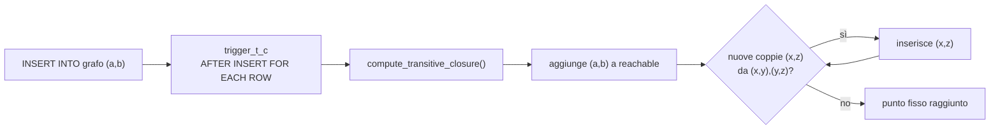
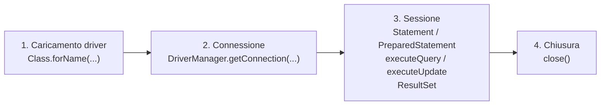
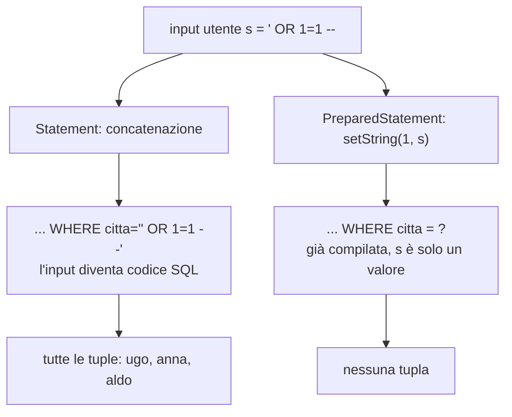

# Accesso ai Dati da Software

> [!abstract]
> Finora alla base di dati accedeva un utente umano scrivendo [[03 - BD - SQL|SQL]]. In pratica ai dati accedono spesso dei **programmi**. Le slide (G. Cima, M. Lenzerini) presentano le due possibilità offerte dai DBMS moderni:
> 1. **accesso da software interno**: moduli software (stored procedure e trigger) definiti **dentro il DBMS**, nel livello dei dati; in PostgreSQL si scrivono in **PL/pgSQL**;
> 2. **accesso da software esterno**: programmi del livello applicativo che si connettono al DBMS tramite un'API; si studia **JDBC** per Java, con le sue quattro fasi, e il problema della **SQL injection**.
>
> Il riferimento è l'[[01 - BD - Introduzione#Architettura a tre livelli del software|architettura a tre livelli]] vista nell'introduzione.
>
> Indice dei concetti: [[MOC - Basi di Dati]].

---

## Introduzione

### Dove si colloca l'accesso da software

![[BD-L04-p002.png]]

Appunti di Simone che riprendono l'architettura a tre livelli:
- **livello della presentazione**: la GUI (il browser) con cui interagisce l'utente;
- **livello dell'applicazione**: tutti i moduli software che governano la logica del programma, cioè "cosa deve fare il software";
- **livello dei dati**: quali dati deve usare il software; contiene **tabelle, viste** e "altre cose".

La freccia verde rappresenta quello che si è fatto finora con le query: l'utente che **salta il livello applicativo** e parla direttamente al DBMS, cosa che non tutti gli utenti hanno il permesso di fare. Nel 90% dei casi non c'è un utente che parla direttamente al DBMS: si accede ai dati **da software**, passando dal livello applicativo. Si userà Java, ma andrebbe bene qualsiasi linguaggio.

La parte successiva degli appunti introduce l'idea che ci siano anche dei **"servizi" dentro il DBMS**, le **stored procedure**: pezzi di software dentro il DBMS che possono essere invocati sia dentro una query sia in altri casi. Perché è utile? Per mettere a fattor comune servizi che possono essere usati da tutte le applicazioni. Esempio: "come si calcola il prezzo di un prodotto in una certa data per una certa classe di clienti" è un algoritmo che conviene mettere nel DBMS e non a livello applicativo ("software close to data"). Due ragioni:
1. progettare servizi riusabili da chiunque e **corretti**;
2. il DBMS ha già gli strumenti per **ottimizzare** l'accesso ai dati, cosa che a livello applicativo non si fa altrettanto bene.

### Due modi di accedere ai dati da software

Vedi [[Accesso da Software Interno ed Esterno]].

| | Accesso da software **interno** | Accesso da software **esterno** |
|---|---|---|
| Dove sta il codice | dentro il DBMS (livello dei dati) | nel livello applicativo |
| Come si scrive | un linguaggio qualunque o uno proprietario del DBMS (PostgreSQL: **PL/pgSQL**) | qualunque linguaggio (Python, Java, C, C++…) tramite un'API |
| Chi lo invoca | utenti umani o altri moduli, interni o esterni | è il programma stesso che si connette |
| Nel corso | stored procedure e trigger | **JDBC** (Java) |

![[BD-L04-p003.png]]

Riassunto di Simone: si accede ai dati da software in 2 modi, **interno** (con le stored procedure realizzate dentro il DBMS) ed **esterno** (a livello applicativo, tramite un protocollo come JDBC, cioè librerie Java che consentono di accedere a un DBMS). Ogni DBMS ha il suo linguaggio, simili tra loro; PostgreSQL ha **PL/pgSQL**, che è **Turing completo** (stessa potenza computazionale di una macchina di Turing), mentre **SQL in generale non lo è**.

---

## Accesso da software interno

### PL/pgSQL

Vedi [[Stored Procedure]].

**PL/pgSQL** è un linguaggio di programmazione **procedurale** supportato da PostgreSQL (altri DBMS hanno linguaggi analoghi). Ha cicli e strutture di controllo avanzate, ed è pensato per operazioni complesse che non sono in linea con la filosofia e le potenzialità di SQL.

I moduli scritti in PL/pgSQL si chiamano **function** (o **stored procedure**). Una volta compilata dal DBMS, la function è **memorizzata** nel contesto del database in cui è definita e può essere chiamata in qualsiasi momento **dentro un'istruzione SQL**, oppure attivata da un **trigger**. Il compilatore PL/pgSQL è installato di default su PostgreSQL.

### Sintassi di una stored procedure

```sql
CREATE [OR REPLACE] FUNCTION nome_funzione (arg1 tipo, ..., argn tipo)
RETURNS { tipo_ritorno | TABLE (col1 tipo, ...) | TRIGGER } AS
$$
  DECLARE
    <dichiarazioni di variabili>
  BEGIN
    <istruzioni>
  END;
$$ LANGUAGE plpgsql;
```

Se il tipo di ritorno è `VOID`, la function è in realtà una **procedura**. Il corpo è racchiuso tra `$$`, che delimitano una stringa senza bisogno di fare l'escape degli apici.

### Esempio, il totale delle fatture

```sql
-- fattura(soggetto: VARCHAR(100), imponibile: REAL, aliquota: INTEGER)
CREATE TABLE fattura (soggetto VARCHAR(100), imponibile REAL, aliquota INTEGER);
INSERT INTO fattura VALUES ('a', 1000.00, 22), ('a', 30.00, 4), ('b', 10.000, 10);
```

Dato un soggetto, si vuole una tabella con una riga che indichi il soggetto e il **totale** da versare (imponibile più tasse):

```sql
CREATE OR REPLACE FUNCTION totale_fattura(sogg VARCHAR)
RETURNS TABLE (sgt VARCHAR, tot REAL) AS
$$ DECLARE r record; totale REAL;
  BEGIN
    totale := 0;
    FOR r IN SELECT * FROM fattura WHERE soggetto = sogg LOOP   -- ciclo sulle tuple della query
      totale := totale + r.imponibile * (100 + r.aliquota) / 100;
    END LOOP;
    DROP TABLE IF EXISTS return_table;
    CREATE TEMPORARY TABLE return_table (sgt VARCHAR, tot REAL);
    INSERT INTO return_table VALUES (sogg, totale);
    RETURN QUERY SELECT * FROM return_table;                     -- restituisce il risultato di una query
  END;
$$ LANGUAGE plpgsql;
```

- `r record` è una variabile che contiene una tupla; il `FOR ... IN SELECT ... LOOP` scorre le tuple del risultato della query, una per volta, con la variabile `r`.
- Per ogni fattura si somma l'imponibile più l'IVA: $\text{imponibile} \cdot \frac{100 + \text{aliquota}}{100}$.
- Il risultato viene messo in una tabella temporanea e restituito con `RETURN QUERY`.

**Chiamata**: `SELECT * FROM totale_fattura('a');`. Il conto: $1000 \cdot 1{,}22 + 30 \cdot 1{,}04 = 1220 + 31{,}2 = 1251{,}2$, quindi il risultato è (a, 1251.2). Se il tipo di ritorno è `VOID` la chiamata è `SELECT f(...);`.

> [!note] Nota
> Nella slide i nomi `totale fattura` e `return table` compaiono con lo spazio al posto del trattino basso (un effetto dell'impaginazione LaTeX): i nomi corretti sono `totale_fattura` e `return_table`. Lo stesso vale per `assegna_progetto`, `compute_transitive_closure`, `COF_NAME` ecc. più avanti.

### Benefici delle stored procedure

Molto di quello che fa una stored procedure si potrebbe fare direttamente con delle query. Il vantaggio (oltre all'uso con i trigger) è **evitare che gli utilizzatori** della base di dati (umani o moduli software) **scrivano direttamente le query**. Forzarli a usare le stored procedure:
- **protegge** meglio la base di dati da usi maligni o errati;
- impone comportamenti **coerenti con la semantica** dei dati, che chi usa la base di dati non può aggirare.

È lo stesso principio dell'incapsulamento nella programmazione a oggetti: i dati si toccano solo tramite un'interfaccia controllata.

### Trigger

Vedi [[Trigger]].

![[BD-L04-p013.png]]

Appunti di Simone che motivano i trigger. Con la tabella `Fatture(soggetto, imponibile, aliquota)` si vuole contare, ogni volta che qualcuno accede alle tuple delle fatture, una tabella `Controllo(sogg, totale)` con il totale per soggetto. Cioè si vuole registrare per ogni soggetto in un'altra tabella quante volte è stata toccata una sua tupla delle fatture. Farlo a livello applicativo significherebbe che **ogni** applicazione deve ricordarsi di modificare la tabella Controllo: non si può garantire. La soluzione è che l'aggiornamento di Controllo avvenga **a livello dei dati**, più vicino al DBMS: il DBMS deve saper rilevare l'accesso alla tupla delle fatture e aggiornare la tupla di Controllo, cioè calcolare il totale ogni volta che si aggiunge una tupla delle fatture. Ogni volta che succede qualcosa il DBMS invoca un servizio: è il **concetto di trigger**, "quando succede un certo evento su una tabella, chiamo una stored procedure/funzione".

Un **trigger** specifica che una stored procedure va eseguita **automaticamente** quando avviene un certo **evento**: l'inserimento, la cancellazione o l'aggiornamento di una tupla. È associato a una **tabella** e si attiva da solo quando l'evento riguarda quella tabella.

```sql
CREATE TRIGGER nome_trigger { BEFORE | AFTER | INSTEAD OF }
{ INSERT | DELETE | UPDATE } ON nome_tabella
[ FOR EACH ROW | FOR EACH STATEMENT ]
EXECUTE PROCEDURE nome_procedura();
```

La procedura deve avere tipo di ritorno **`TRIGGER`**.

### Semantica dei trigger

| Elemento | Significato |
|---|---|
| `BEFORE` | il trigger si attiva **prima** dell'operazione di modifica |
| `AFTER` | si attiva **dopo** che l'operazione è stata eseguita |
| `INSTEAD OF` | si attiva **al posto** dell'operazione (solo sulle **viste**) |
| `INSERT` / `DELETE` / `UPDATE` | l'evento che attiva il trigger |
| `FOR EACH ROW` | attivato **per ogni tupla** coinvolta nell'operazione |
| `FOR EACH STATEMENT` (default) | attivato **una sola volta** per operazione, qualunque sia il numero di tuple |

![[BD-L04-p017.png]]

Approfondimento sui trigger **`INSTEAD OF`** che Simone ha incollato (risposta di un assistente AI). Si usano soprattutto per intercettare `INSERT`, `UPDATE` o `DELETE` su una **vista** invece che su una tabella, in particolare quando la vista **non è aggiornabile** direttamente (es. contiene join o aggregati). Casi d'uso: viste non aggiornabili, logica complessa (aggiornare più tabelle), controllo degli accessi. Nell'esempio una vista `EmployeeDepartmentView` è il join tra `Employees` e `Departments`; il trigger `trgInsteadOfInsert` traduce un inserimento sulla vista in un inserimento in `Employees`, cercando il `DepartmentID` corrispondente al nome del dipartimento.

![[BD-L04-p018.png]]

Seguito dell'esempio: il trigger `INSTEAD OF UPDATE` aggiorna `Employees` con i nuovi nome, cognome e dipartimento, quello `INSTEAD OF DELETE` cancella da `Employees` gli impiegati rimossi dalla vista.

> [!warning] Attenzione: il codice non è PostgreSQL
> L'esempio incollato usa la sintassi di **SQL Server** (T-SQL): `NVARCHAR`, il trigger con il corpo diretto `AS BEGIN ... END`, le pseudo-tabelle `inserted` e `deleted`. In **PostgreSQL** un trigger `INSTEAD OF` si scrive come gli altri: una function `RETURNS TRIGGER` in PL/pgSQL, che usa `NEW`/`OLD`, e `CREATE TRIGGER ... INSTEAD OF INSERT ON vista FOR EACH ROW EXECUTE PROCEDURE f();` (in PostgreSQL gli `INSTEAD OF` devono essere `FOR EACH ROW`). Il concetto è lo stesso, la sintassi no.

![[BD-L04-p019.png]]

"Viste vs tabelle": altro approfondimento incollato sui motivi per usare una [[03 - BD - SQL#Viste|vista]] al posto di una tabella:
1. **semplificare le query**: nascondere join e aggregazioni complesse, riusare lo stesso codice SQL;
2. **sicurezza e controllo degli accessi**: mostrare solo alcune colonne, dare a utenti diversi porzioni diverse dei dati;
3. **astrarre la complessità**: nascondere la struttura interna, mantenere la compatibilità quando lo schema cambia (es. una colonna rinominata);
4. **prestazioni**: indici sulle viste, **viste materializzate** che memorizzano il risultato;
5. **reporting e analisi**;
6. **dati storici**: mantenere versioni diverse dei dati.

Il punto 4 sulle viste materializzate è un'estensione: nel corso le viste sono **virtuali**, cioè calcolate al momento dell'uso.

### Variabili NEW e OLD

Nel corpo di una function di tipo `TRIGGER` sono disponibili delle variabili speciali di tipo record:

| Variabile | Contiene | Valorizzata per | NULL per |
|---|---|---|---|
| **`NEW`** | la **nuova** tupla | `INSERT`/`UPDATE` nei trigger `FOR EACH ROW` | trigger `FOR EACH STATEMENT` e `DELETE` |
| **`OLD`** | la **vecchia** tupla | `UPDATE`/`DELETE` nei trigger `FOR EACH ROW` | trigger `FOR EACH STATEMENT` e `INSERT` |

### Trigger e transazioni, valore di ritorno

- Se il trigger è attivato da un'istruzione che è a sua volta una [[03 - BD - SQL#Transazioni|transazione]] (un `INSERT`, `DELETE`, `UPDATE`) o che sta dentro una transazione, le operazioni del trigger **appartengono a quella transazione**: se la transazione abortisce, si annullano anche gli effetti del trigger.
- Se il trigger è **`BEFORE` e `FOR EACH ROW`**, conta il valore $v$ restituito dalla procedura sulla tupla $t$:
  - se $v$ è **`NULL`**, l'operazione che ha scatenato il trigger **non viene eseguita** su $t$;
  - altrimenti $v$ è un record (spesso semplicemente `NEW`) e l'operazione viene eseguita **usando $v$** come tupla. Il trigger può quindi anche **modificare** la tupla prima che venga scritta.
- Se il trigger è `AFTER` o `FOR EACH STATEMENT`, il valore di ritorno è **ignorato**.

![[BD-L04-p021.png]]

Esempio particolare annotato da Simone: quando si inserisce una nuova tupla nella tabella Fatture, allora se esiste già il soggetto nella tabella Controllo si fa `UPDATE`, se non esiste si inserisce una tupla dentro Controllo; se si cancella si deve fare `UPDATE`, se si aggiorna l'aliquota si deve fare `UPDATE`.

### Esempio, lavoratori e progetti

```
lavoratore(codice: numeric, nome: varchar(20), cognome: varchar, inprogetto: numeric, salario: int)
progetto(codice: numeric, usura: numeric, responsabile: numeric)
```

**Regola 1** — quando si inserisce un nuovo progetto, lo si assegna a tutti i lavoratori con `inprogetto` **NULL** (senza progetto, o di cui non si conosce il progetto):

```sql
CREATE OR REPLACE FUNCTION assegna_progetto() RETURNS TRIGGER AS
$$
  BEGIN
    UPDATE lavoratore
    SET inprogetto = NEW.codice WHERE inprogetto IS NULL;
    RETURN NEW;
  END;
$$ language plpgsql;

CREATE TRIGGER trigger_progetto AFTER INSERT ON progetto
  FOR EACH ROW EXECUTE PROCEDURE assegna_progetto();
```

`NEW.codice` è il codice del progetto appena inserito. Annotazione: `RETURN NEW` qui è inutile, perché il trigger è `AFTER` e il valore è ignorato.

**Regola 2** — quando aumenta l'**usura** di un progetto, si aumenta del 10% il salario dei lavoratori coinvolti:

```sql
CREATE OR REPLACE FUNCTION usura_progetto() RETURNS TRIGGER AS
$$
  BEGIN
    IF (NEW.usura > OLD.usura) THEN                 -- confronto tra la tupla nuova e quella vecchia
      UPDATE lavoratore
      SET salario = salario * 1.1 WHERE inprogetto = NEW.codice;
    END IF;
    RETURN NEW;
  END;
$$ language plpgsql;

CREATE TRIGGER trigger_piu_usura_progetto AFTER UPDATE ON progetto
  FOR EACH ROW EXECUTE PROCEDURE usura_progetto();
```

### Esempio, chiusura transitiva di un grafo

```sql
CREATE TABLE grafo     (f varchar, t varchar, PRIMARY KEY (f, t));   -- archi di G (from, to)
CREATE TABLE reachable (f varchar, t varchar, PRIMARY KEY (f, t));
```

Si vuole che, a ogni inserimento di un arco in `grafo`, la tabella `reachable` contenga **tutte e sole** le coppie $\langle x, y \rangle$ tali che $y$ è raggiungibile da $x$ con un cammino: la **chiusura transitiva** del grafo.

> [!important] Perché non basta SQL
> È stato dimostrato che il potere espressivo dell'**algebra relazionale** (e del frammento di SQL studiato) **non basta** a calcolare la chiusura transitiva di una relazione binaria: non esiste una query $Q$ che, per ogni base di dati con relazione binaria $R$, restituisca la chiusura transitiva di $R$. Intuitivamente, ogni query fissa ha un numero fissato di join, quindi segue cammini di lunghezza limitata, mentre i cammini nel grafo possono essere lunghi quanto si vuole. **PL/pgSQL** invece è **Turing completo**, quindi la chiusura transitiva si può calcolare con una stored procedure e un trigger.

```sql
CREATE OR REPLACE FUNCTION compute_transitive_closure() RETURNS TRIGGER AS
$$ DECLARE edgeobject record; leastfixpoint bool; r record;
  BEGIN
    IF (NEW.f, NEW.t) not in (SELECT f, t FROM reachable)
    THEN INSERT INTO reachable VALUES (NEW.f, NEW.t);
         leastfixpoint := false;
         WHILE NOT leastfixpoint LOOP                  -- ripeti finché non si aggiunge più nulla
           leastfixpoint := true;
           FOR r IN SELECT * FROM reachable LOOP
             FOR edgeobject IN SELECT * FROM reachable LOOP
               IF (r.t = edgeobject.f)                 -- r = (x,y), edgeobject = (y,z)
               THEN IF NOT EXISTS (SELECT * FROM reachable
                                   WHERE reachable.f = r.f AND reachable.t = edgeobject.t)
                    THEN leastfixpoint := false;
                         INSERT INTO reachable VALUES (r.f, edgeobject.t);   -- aggiungi (x,z)
                    END IF;
               END IF;
             END LOOP;
           END LOOP;
         END LOOP;
    END IF;
    RETURN NULL;
  END;
$$ LANGUAGE plpgsql;

CREATE TRIGGER trigger_t_c AFTER INSERT ON grafo
  FOR EACH ROW
  EXECUTE PROCEDURE compute_transitive_closure();
```

L'algoritmo calcola il **minimo punto fisso**: aggiunge il nuovo arco, poi per ogni coppia di cammini $(x, y)$ e $(y, z)$ già noti aggiunge $(x, z)$ se manca, e ripete finché un intero giro non aggiunge più nulla (`leastfixpoint` resta `true`).



> [!example] Esempio
> Archi inseriti uno alla volta: (a,b), (b,c), (c,d). Dopo (a,b): reachable = {(a,b)}. Dopo (b,c): si aggiunge (b,c), poi (a,c). Dopo (c,d): (c,d), poi (b,d) e (a,d) (la seconda nel giro successivo, o nello stesso a seconda dell'ordine di scansione). Alla fine reachable = {(a,b), (b,c), (c,d), (a,c), (b,d), (a,d)}.

![[BD-L04-p029.png]]

**Esempio in classe (lezioni 29–30)**, incollato da Simone. La base di dati ha `corso(codice, tipo)` con tipo 'informatica' o 'altro', `studente(matricola, eta)`, `esame(codcorso, matricola, voto)` con gli esami superati, e `ministero(matricola, informatica, altro)` che deve comunicare al Ministero, per ogni studente, il numero di esami di informatica e di altre materie superati. Non ci sono cancellazioni né aggiornamenti di `esame`, né inserimenti o aggiornamenti diretti di `ministero`. Per tenerla aggiornata servono due trigger:

```sql
create or replace function aggiungiAministero() returns trigger as
$$
begin
   insert into ministero(matricola) values (new.matricola);   -- informatica e altro partono dal default 0
   return new;
end
$$ LANGUAGE plpgsql;

create or replace trigger triggerInsertStudente after insert on studente
for each row execute procedure aggiungiAministero();

create or replace function aggiornaMinistero() returns trigger as
$$
begin
   if (new.codcorso in (select codice from corso where tipo = 'informatica'))
   then update ministero set informatica = informatica + 1 where matricola = new.matricola;
   else update ministero set altro = altro + 1 where matricola = new.matricola;
   end if;
   return new;
end
$$ LANGUAGE plpgsql;

create or replace trigger triggerInsertEsame after insert on esame
for each row execute procedure aggiornaMinistero();
```

La foto della lavagna mostra le quattro tabelle con le frecce dei riferimenti.

![[BD-L04-p030.png]]

Seguito degli appunti: per impedire che si **cancellino** tuple dal ministero:

```sql
create or replace function dontTouchMinistero() returns trigger as
$$
begin
   return NULL;
end
$$ LANGUAGE plpgsql;

create or replace trigger triggerDontTouchMinistero before delete on ministero
for each row execute procedure dontTouchMinistero();
```

Annotazione: quando qualcuno fa la delete, il trigger `before` si esegue prima; l'operazione ha il valore di ritorno della function, che è `NULL` e non `NEW`, quindi la cancellazione **non avviene**. "Con un trigger posso eliminare ogni idea di DELETE o UPDATE su una tabella."

### Esercizi sulla chiusura transitiva

La soluzione usa un trigger `FOR EACH ROW`: la procedura viene invocata per ogni tupla inserita, e ricalcola **da zero** tutta la chiusura, non solo la parte che dipende dagli archi nuovi.
1. Mantenendo il ricalcolo da zero, trasformare il trigger in `FOR EACH STATEMENT` (una chiamata per istruzione), modificando sia la procedura sia il trigger.
2. Mantenendo `FOR EACH ROW`, cambiare la procedura in modo che calcoli **solo la porzione** della chiusura rilevante per le tuple inserite.

> [!tip] Spunto per l'esercizio 2
> Se si inserisce l'arco $(a, b)$, le nuove coppie raggiungibili sono esattamente $(x, z)$ con $x \in \{a\} \cup \{x \mid (x, a) \in \text{reachable}\}$ e $z \in \{b\} \cup \{z \mid (b, z) \in \text{reachable}\}$: basta un solo `INSERT ... SELECT` con un prodotto fra "chi raggiunge $a$" e "chi è raggiunto da $b$", senza ciclo di punto fisso.

---

## Accesso da software esterno

### Il framework JDBC

Vedi [[JDBC]].

Dal livello applicativo si accede a una base di dati relazionale tramite **API standard** come **ODBC** o **JDBC** (*Java DataBase Connectivity*). JDBC è un'API Java per eseguire comandi SQL su un DBMS: un insieme di classi e interfacce che standardizzano l'interazione fra applicazioni Java e DBMS.

Ogni DBMS fornisce un **driver** specifico che:
- va **caricato a run-time** dal programma;
- **traduce** le chiamate JDBC in chiamate alle funzioni del DBMS.

Così il programma è scritto una volta sola contro l'interfaccia JDBC, e cambiando driver può parlare con DBMS diversi.

**Cosa permette JDBC**:
- eseguire comandi SQL, sia **DDL** sia **DML**;
- manipolare i risultati tramite i **result set** (una forma di cursore);
- reperire **metadati**;
- gestire **transazioni**;
- gestire **errori ed eccezioni**;
- definire stored procedure in Java (in alcuni DBMS; non trattato, perché per l'accesso interno si usa PL/pgSQL).

**Cosa serve**:
1. la **piattaforma Java** (Java SE): il package `java.sql` con le funzionalità di base (`import java.sql.*;`) e `javax.sql` per quelle avanzate (es. *connection pooling*, programmazione a componenti);
2. il **driver JDBC** del DBMS;
3. il **DBMS**.

Il driver è distribuito di solito dal produttore del DBMS: è una libreria Java (un file `.jar`) da collegare in esecuzione, impostando le variabili d'ambiente (il *classpath*), indicandola da riga di comando al lancio, oppure configurando l'ambiente di sviluppo.

### Elementi di JDBC

Gli elementi principali del package `java.sql`:

| Elemento | Tipo | Ruolo |
|---|---|---|
| `Driver` | classe | il driver specifico del DBMS |
| `DriverManager` | classe | gestisce i driver e crea le connessioni |
| `Connection` | interfaccia | una connessione aperta con il DBMS |
| `DatabaseMetaData` | classe | informazioni sul DBMS e sul catalogo |
| `Statement` | interfaccia | un'istruzione SQL nota a tempo di compilazione |
| `ResultSet` | interfaccia | il risultato di una query, da scorrere come un cursore |
| `ResultSetMetaData` | interfaccia | informazioni sulle colonne di un result set |
| `PreparedStatement` | interfaccia | istruzione con struttura fissa e parametri `?` |
| `CallableStatement` | interfaccia | chiamata di stored procedure |

### Le fasi dell'interazione



1. **Caricamento dinamico** della classe del driver e sua registrazione presso il `DriverManager`.
2. **Connessione** con la sorgente di dati, tramite il `DriverManager`.
3. **Sessione di interazione**: si definiscono ed eseguono gli statement.
4. **Chiusura** della connessione.

### Prima fase, caricamento del driver

I driver sono gestiti dal **Driver Manager**, una classe che sta fra il programma e i driver. Il driver si carica con il meccanismo di caricamento dinamico delle classi di Java, `Class.forName(String s)`: il metodo statico carica la classe con il nome completamente qualificato (package incluso). La classe del driver, una volta caricata, **si registra da sola** presso il `DriverManager`.

```java
Class.forName("oracle.lite.poljdbc.POLJDBCDriver");
Class.forName("com.mysql.jdbc.Driver");
Class.forName("org.postgresql.Driver");
```

> [!note] Nelle versioni recenti di Java
> Da JDBC 4.0 (Java 6) i driver presenti nel classpath vengono registrati automaticamente, quindi `Class.forName` non è più strettamente necessario. Resta però il modo in cui il corso descrive la prima fase.

### Seconda fase, connessione

Si parla con un DBMS **attraverso una connessione**, ottenuta con il metodo statico `DriverManager.getConnection`, che restituisce un oggetto di una classe che implementa `Connection` in modo specifico per il DBMS del driver caricato. I parametri sono un **URL JDBC** della forma `jdbc:<sub-protocollo>:<altri-parametri>`, lo username e la password.

```java
Class.forName("org.postgresql.Driver");
String url = "jdbc:postgresql:test";     // sottoprotocollo postgresql, database "test" (può mancare)
String username = "root";
String password = "";
Connection conn = DriverManager.getConnection(url, username, password);
```

**DatabaseMetaData** dà informazioni sul sistema relativo a una connessione (ad esempio sul catalogo):

```java
DatabaseMetaData md = conn.getMetaData();      // invocato su un oggetto Connection
System.out.println("Informazioni sul driver:");
System.out.println("Nome: " + md.getDriverName() + "; versione: " + md.getDriverVersion());
```

Altri metodi: `getConnection()` (la connessione a cui si riferisce), `getURL()`, `getUserName()`, `getMaxConnections()`.

### Terza fase, Statement

L'interazione avviene tramite oggetti che implementano:
- **`Statement`**: istruzione SQL nota a tempo di compilazione;
- **`PreparedStatement`**: istruzione con struttura fissata a tempo di compilazione ma con **parametri** il cui valore cambia a run-time;
- **`CallableStatement`**: per accedere alle stored procedure;
- **`ResultSet`**: struttura dati simile a un cursore.

Uno statement è sempre **relativo a una connessione**: serve una connessione attiva per crearlo.

```java
Statement stmt = conn.createStatement();
```

Metodi principali, entrambi con la stringa del comando SQL **senza il punto e virgola finale**:
- **`executeUpdate`** per comandi di creazione, eliminazione, aggiornamento (DDL, `insert`, `update`, `delete`); restituisce un `int` con il **numero di tuple modificate** (0 per un comando DDL come la creazione di una tabella);
- **`executeQuery`** per le interrogazioni; restituisce un `ResultSet`.

> [!warning] Stringhe Java e SQL
> - Java è **case-sensitive**, SQL lo è solo nei valori di tipo stringa.
> - In Java le stringhe sono delimitate da apici **doppi**, in SQL da apici **singoli**: dentro una stringa Java si scrive `"... VALUES ('Colombian', ...)"`.

```java
String createTableCoffees = "CREATE TABLE COFFEES " +
    "(COF_NAME VARCHAR(32), SUP_ID INTEGER, PRICE FLOAT, " +
    "SALES INTEGER, TOTAL INTEGER)";              // concatenata con + : una stringa per riga
stmt.executeUpdate(createTableCoffees);

// lo stesso Statement si riusa per più operazioni
stmt.executeUpdate("INSERT INTO COFFEES " + "VALUES ('Colombian', 101, 7.99, 0, 0)");
stmt.executeUpdate("INSERT INTO COFFEES " + "VALUES ('Espresso', 150, 9.99, 0, 0)");

ResultSet rs = stmt.executeQuery("SELECT * FROM COFFEES");
```

> [!note] Nota
> La slide dice che la concatenazione con `+` serve "perché Java non ammette definizioni di stringhe su più righe". Era vero fino a Java 14: da **Java 15** esistono i *text block* (`"""` … `"""`), che permettono stringhe su più righe.

### ResultSet e metodi getXXX

Vedi [[ResultSet]].

Un `ResultSet` permette di analizzare, come un **cursore** o un iteratore, la sequenza di tuple del risultato. All'inizio è posizionato **prima della prima riga**; il metodo **`next()`** lo sposta avanti di una tupla e restituisce `false` se non ci sono più tuple, `true` altrimenti.

I metodi **`getXXX(y)`** (con XXX un tipo) restituiscono il valore della colonna `y` nella riga corrente. `y` può essere il **nome** della colonna o il suo **numero d'ordine** nella tabella dei risultati (a partire da 1). Il tipo XXX deve essere compatibile con il tipo del dato nella base di dati.

```java
String query = "SELECT COF_NAME, PRICE FROM COFFEES";
ResultSet rs = stmt.executeQuery(query);
while (rs.next()) {
    String s = rs.getString("COF_NAME");   // equivalente: rs.getString(1)
    float n = rs.getFloat("PRICE");        // equivalente: rs.getFloat(2)
    System.out.println(s + " " + n);
}
```

"Cosa stampa?": una riga per caffè con nome e prezzo, es. `Colombian 7.99`, `Espresso 9.99` dopo i due insert visti sopra. Esistono anche `getInt()`, `getDate()`, `getBoolean()`, `getTimestamp()`, …

Questo meccanismo esiste perché SQL lavora su **insiemi** di tuple mentre Java lavora su **una variabile alla volta**: il cursore fa da ponte fra i due modelli (il cosiddetto *impedance mismatch*).

**Corrispondenza fra tipi SQL e Java**:

| Tipo SQL | Tipo Java | Metodo |
|---|---|---|
| `BIT` | `boolean` | `getBoolean()` |
| `CHAR(..)`, `VARCHAR(..)` | `String` | `getString()` |
| `DOUBLE`, `FLOAT` | `double` | `getDouble()` |
| `INTEGER`, `NUMERIC` | `int` | `getInt()` |
| `REAL` | `float` | `getFloat()` |
| `DATE` | `java.sql.Date` | `getDate()` |
| `TIME` | `java.sql.Time` | `getTime()` |
| `TIMESTAMP` | `java.sql.Timestamp` | `getTimestamp()` |

La corrispondenza è "elastica": per il prezzo (SQL `FLOAT`) si è usato `getFloat()` invece di `getDouble()`.

**java.sql.Date**: `getDate()` restituisce un `java.sql.Date` (che estende `java.util.Date`) nel formato `yyyy-MM-dd`, con pochi metodi di confronto (es. `compareTo`); molti altri sono deprecati. Per operazioni più complesse la slide suggerisce di passare a un `GregorianCalendar`:

```java
String s = data.toString();                          // data è un java.sql.Date
int year  = Integer.parseInt(s.substring(0, 4));
int month = Integer.parseInt(s.substring(5, 7));
int day   = Integer.parseInt(s.substring(8, 10));
GregorianCalendar g = new GregorianCalendar(year, month, day);

System.out.print(g.get(Calendar.DAY_OF_MONTH));
System.out.print("-");
System.out.print(g.get(Calendar.MONTH));
System.out.print("-");
System.out.println(g.get(Calendar.YEAR));
```

> [!warning] Correzione
> In `GregorianCalendar` i mesi partono da **0** (gennaio = 0). Passando direttamente il mese letto dalla stringa (1–12) la data risulta **spostata di un mese** in avanti (il 12 gennaio diventa il 12 febbraio); va passato `month - 1`. Al contrario, `g.get(Calendar.MONTH)` restituisce 0–11, quindi per la stampa va aggiunto 1. Nel codice della slide i due errori si compensano solo nella stampa, ma il calendario contiene la data sbagliata. Oggi si usa `data.toLocalDate()`, che restituisce un `java.time.LocalDate` senza questi problemi.

### Metadati di un ResultSet

Un oggetto `ResultSetMetaData`, ottenuto con `rs.getMetaData()`, dà informazioni sulle colonne:
- `int getColumnCount()`: numero di colonne;
- `String getColumnLabel(int i)`: nome della colonna $i$;
- `int getColumnType(int i)` e `String getColumnTypeName(int i)`: tipo della colonna (ogni tipo del DBMS ha un **codice** intero e un **nome**, es. 4 e `INTEGER`);
- `getTableName(int i)`, `getSchemaName(int i)`: tabella e schema della colonna (stringa vuota se non applicabile);
- `isReadOnly(int i)`, `isWritable(int i)`, `isSearchable(int i)` (se la colonna si può usare in una `where`).

Con la tabella:

| COF_NAME | SUP_ID | PRICE | SALES | TOTAL |
|---|---|---|---|---|
| Colombian | 101 | 7.99 | 0 | 0 |
| French Roast | 49 | 8.99 | 0 | 0 |
| Espresso | 150 | 9.99 | 0 | 0 |
| Colombian Decaf | 101 | 8.99 | 0 | 0 |
| French Roast Decaf | 49 | 10.75 | 0 | 0 |

```java
Statement stmt = conn.createStatement();
ResultSet rs = stmt.executeQuery("SELECT * FROM COFFEES");
ResultSetMetaData rsmd = rs.getMetaData();
int numeroColonne = rsmd.getColumnCount();
for (int i = 1; i <= numeroColonne; i++) {          // intestazione
    if (i > 1) System.out.print(", ");
    System.out.print(rsmd.getColumnLabel(i));
}
System.out.println("");
while (rs.next()) {                                   // una riga per tupla
    for (int i = 1; i <= numeroColonne; i++) {
        if (i > 1) System.out.print(", ");
        System.out.print(rs.getString(i));
    }
    System.out.println("");
}
stmt.close();
```

"Cosa fa?": stampa **tutta la tabella**, senza conoscerne lo schema in anticipo, perché legge numero e nomi delle colonne dai metadati:

```
COF_NAME, SUP_ID, PRICE, SALES, TOTAL
Colombian, 101, 7.99, 0, 0
French Roast, 49, 8.99, 0, 0
Espresso, 150, 9.99, 0, 0
Colombian Decaf, 101, 8.99, 0, 0
French Roast Decaf, 49, 10.75, 0, 0
```

### PreparedStatement

Vedi [[PreparedStatement]].

Il **prepared statement** è una caratteristica dei DBMS SQL: si fornisce la definizione di un **comando parametrico**, con dei `?` al posto dei dati, che verranno istanziati al momento dell'esecuzione. Quando il DBMS riceve un prepared statement **non lo esegue** ma lo **compila**, scegliendo il **piano di esecuzione**; quando lo si invoca ha già l'algoritmo pronto.

In JDBC un `PreparedStatement` è una **specializzazione** di `Statement` con struttura fissa e parametri istanziati a run-time: si può usare più volte con effetti diversi.

```java
PreparedStatement updateSales = conn.prepareStatement(
    "UPDATE COFFEES SET SALES = ? WHERE COF_NAME = ?");
updateSales.setInt(1, 75);                 // parametro 1 = 75
updateSales.setString(2, "Colombian");     // parametro 2 = 'Colombian'
updateSales.executeUpdate();               // (o executeQuery()), senza argomenti
```

I parametri si passano con i metodi **`setXXX(posizione, valore)`**, analoghi ai `getXXX`. Un valore resta impostato fino a una nuova assegnazione o a `clearParameters()`.

**Esempio** — aggiornare le vendite settimanali di tutti i caffè con lo stesso statement:

```java
PreparedStatement updateSales;
String updateString = "UPDATE COFFEES SET SALES = ? " + "WHERE COF_NAME = ?";
updateSales = conn.prepareStatement(updateString);
int[] salesForWeek = {175, 150, 60, 115, 90};
String[] coffees = {"Colombian", "French Roast", "Espresso",
                    "Colombian Decaf", "French Roast Decaf"};
for (int i = 0; i < coffees.length; i++) {
    updateSales.setInt(1, salesForWeek[i]);
    updateSales.setString(2, coffees[i]);
    updateSales.executeUpdate();
}
```

Dopo l'esecuzione la colonna SALES vale 175, 150, 60, 115, 90.

**Note sui setXXX**: valgono le stesse corrispondenze (ed "elasticità") dei `getXXX`; per i decimali SQL `FLOAT`, `DOUBLE`, `REAL` conviene `setDouble()`; `setDate` vuole un `java.sql.Date`, che si crea con `java.sql.Date.valueOf("2000-01-12")` (formato `yyyy-MM-dd`).

### Esercizio, la tabella persona

Con una connessione `conn` già attiva: creare `persona(cf INT PRIMARY KEY, nomepers VARCHAR(20), professione VARCHAR(20), citta VARCHAR(20))`, popolarla con un prepared statement con (11, aldo, fornaio, firenze), (12, ugo, fabbro, napoli), (15, anna, ingegnere, napoli), e stampare con uno statement il nome delle persone di Napoli.

```java
String crea = "CREATE TABLE persona (" + "cf INT PRIMARY KEY," +
              "nomepers VARCHAR(20)," + "professione VARCHAR(20)," +
              "citta VARCHAR(20))";
Statement st = conn.createStatement();
st.executeUpdate(crea);

PreparedStatement pst = conn.prepareStatement("INSERT INTO persona " + "VALUES (?,?,?,?)");
int[] codici = {11, 12, 15};
String[] nomi = {"aldo", "ugo", "anna"};
String[] professioni = {"fornaio", "fabbro", "ingegnere"};
String[] citta = {"firenze", "napoli", "napoli"};
for (int i = 0; i < 3; i++) {
    pst.setInt(1, codici[i]);
    pst.setString(2, nomi[i]);
    pst.setString(3, professioni[i]);
    pst.setString(4, citta[i]);
    pst.executeUpdate();
}

ResultSet rs;
rs = st.executeQuery("SELECT nomepers FROM persona " + "WHERE citta='napoli'");
while (rs.next()) {
    String n = rs.getString(1);
    System.out.println(n);
}
// output: ugo, anna
```

> [!warning] Correzione
> Nella slide c'è `"INSERT INTO persona" + "VALUES (?,?,?,?)"`: la concatenazione produce `INSERT INTO personaVALUES (...)`, senza spazio, e la query fallisce. Serve uno spazio (`"INSERT INTO persona "`), come nella versione sopra. Lo stesso errore c'è più avanti in `"SELECT nomepers" + "FROM persona" + "WHERE citta = ?"`. Inoltre nella stampa la variabile `n` non è dichiarata: serve `String n`.

### Statement e PreparedStatement, la SQL injection

Vedi [[SQL Injection (Basi di Dati)]].

La differenza fondamentale:
- con uno **statement** si confeziona una **stringa** che è un'istruzione SQL completa e la si manda al DBMS, che la esegue;
- con un **prepared statement** la stringa è un'istruzione **parametrica** con dei `?`. Il DBMS non può eseguirla (è incompleta): la **compila** e ne deriva il piano di esecuzione. I valori concreti vengono sostituiti ai `?` solo al momento dell'esecuzione.

Supponiamo che la città venga da una **pagina web**, inserita dall'utente nella stringa `s`:

```java
ResultSet rs;
rs = st.executeQuery("SELECT nomepers FROM persona " + "WHERE citta='" + s + "'");
```

Se l'utente scrive `napoli`, il comando è `SELECT nomepers FROM persona WHERE citta='napoli'` e l'output è ancora ugo, anna. Ma se scrive:

```
' OR 1=1 --
```

il comando diventa

```sql
SELECT nomepers FROM persona WHERE citta='' OR 1=1 --'
```

`--` apre un **commento**, quindi l'apice finale viene ignorato; `1=1` è sempre vero e la query restituisce **tutte** le persone: ugo, anna, **aldo**. Si è ottenuta un'informazione che non era lecito rivelare. È un attacco di **SQL injection**, molto comune, che mira a "rubare" dati privati sfruttando gli statement SQL costruiti dal software concatenando l'input.

Con il prepared statement:

```java
PreparedStatement pst = conn.prepareStatement("SELECT nomepers " +
                                              "FROM persona " +
                                              "WHERE citta = ?");
pst.setString(1, s);
pst.executeQuery();
```

la query eseguita è `SELECT nomepers FROM persona WHERE citta = α` con α istanziato **come valore** alla stringa `' OR 1=1 --`. Nessuna città ha quel nome, quindi la query **non restituisce nulla**: il pericolo è sventato, perché l'input non può più cambiare la **struttura** della query, che è stata compilata prima.



L'argomento è approfondito nei corsi di sicurezza: [[SQL Injection]] (Ethical Hacking) e [[A03 2021-Injection]].

### CallableStatement

`CallableStatement`, sottoclasse di `PreparedStatement`, serve a **chiamare stored procedure**; anche qui si usano i `?` per i parametri.

```sql
CREATE FUNCTION PersoneNateInCitta(c VARCHAR(25)) ...
  SELECT nomepers FROM persona WHERE citta = c;
  ...
  RETURN QUERY ...
```

```java
CallableStatement cstmt = conn.prepareCall("call PersoneNateInCitta(?)");
ResultSet rs;
for (int i = 0; i < 3; i++) {
    cstmt.setString(1, citta[i]);
    rs = cstmt.executeQuery();
    while (rs.next()) ...
}
```

È il punto d'incontro fra i due tipi di accesso: il programma **esterno** invoca un modulo software **interno** al DBMS.

> [!note] Sintassi della chiamata
> La sintassi portabile JDBC è con le graffe, `"{call PersoneNateInCitta(?)}"`. In PostgreSQL, poi, una function che restituisce una tabella si interroga di solito come `SELECT * FROM PersoneNateInCitta(?)`, mentre `CALL` (da PostgreSQL 11) è per le `PROCEDURE`.

### Quarta fase, chiusura della connessione

Quando l'accesso alla base di dati non serve più si chiude la connessione: gli oggetti `Connection`, `Statement` e `ResultSet` che non si usano più vanno chiusi con **`close()`**, per liberare le risorse sul client e sul server.

> [!tip] In Java moderno
> Le risorse JDBC implementano `AutoCloseable`, quindi si usa il *try-with-resources*, che le chiude automaticamente anche in caso di eccezione:
> ```java
> try (Connection conn = DriverManager.getConnection(url, user, pwd);
>      PreparedStatement pst = conn.prepareStatement("SELECT nomepers FROM persona WHERE citta = ?")) {
>     pst.setString(1, s);
>     try (ResultSet rs = pst.executeQuery()) {
>         while (rs.next()) System.out.println(rs.getString(1));
>     }
> }
> ```
