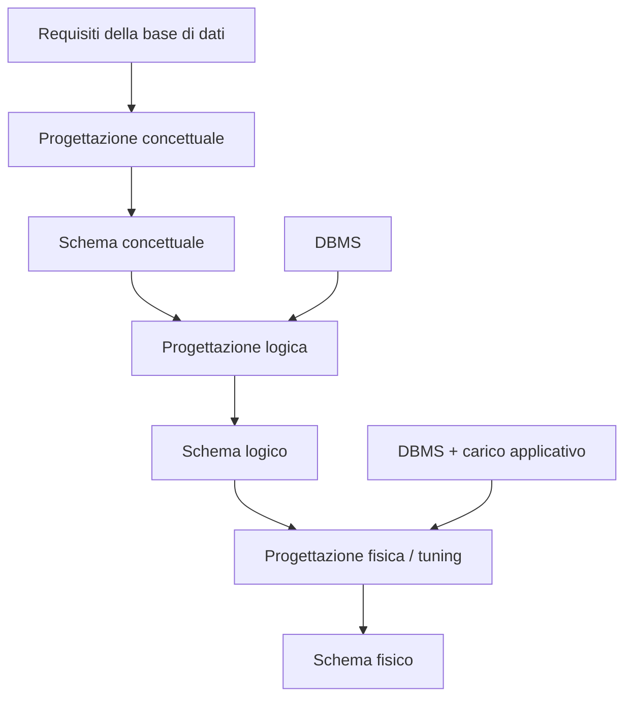

# La Progettazione Concettuale

> [!abstract]
> Finora si è visto come **usare** una base di dati ([[02 - BD - Modello Relazionale|modello relazionale]], [[03 - BD - SQL|SQL]], [[04 - BD - Accesso ai Dati da Software|accesso da software]]). Qui si comincia a vedere come **progettarla**. La lezione ha quattro parti:
> 1. **introduzione alla progettazione**: dove si colloca nel ciclo di vita del software, le fasi concettuale, logica e fisica;
> 2. **il modello Entità-Relazione (ER)**: entità, attributi, relazioni, ruoli, ISA e generalizzazioni, vincoli di cardinalità e di identificazione, vincoli esterni, dizionario dei dati. Per ogni costrutto si danno **sintassi** (come si disegna), **semantica** (cosa significa sulle istanze) e **pragmatica** (quando usarlo);
> 3. **la metodologia**: organizzazione dei requisiti, glossario, costruzione dello schema (scelta dei costrutti, pattern per eventi e storicizzazione, trasformazioni), controllo di qualità;
> 4. **un esempio completo** (il corso di istruzione) con le sue varianti.
>
> Lo schema ER prodotto qui è l'input della [[06 - BD - Progettazione Logica|progettazione logica]], che lo traduce in tabelle.
>
> Indice dei concetti: [[MOC - Basi di Dati]].

---

## 5.1 Introduzione alla progettazione di basi di dati

![[BD-L05-p003.png]]

Appunti di Simone all'inizio della parte. In alto un esempio di specifica (uno stabilimento balneare: stabilimenti con codice, regione, categoria, attrezzature di proprietà come ombrelloni e lettini, postazioni identificate da riga e colonna, attrezzature aggiuntive per giorno e il loro costo): è il tipo di testo da cui si parte. Sotto: tra un mese si saprà fare lo schema di una base di dati **seguendo una metodologia**. Bisogna sapere:
1. come si sviluppa il **metodo di progettazione** (da seguire sempre);
2. qual è il **linguaggio** usato nelle varie fasi: la **progettazione concettuale** vale per qualunque DBMS, la **progettazione logica** è la realizzazione della concettuale in un DBMS.

### Inquadramento

- Il progetto di basi di dati produce lo **schema logico** e lo **schema fisico**, secondo i requisiti raccolti.
- Si svolge **nell'ambito** del più ampio progetto del sistema informatico.

### Il ciclo di vita del software

| Fase | Contenuto |
|---|---|
| 1. Studio di fattibilità e raccolta dei requisiti | costi e benefici, pianificazione di attività e risorse, raccolta dei **requisiti** |
| 2. Analisi | si occupa del **cosa**: descrive il dominio e le funzioni dei componenti, cioè lo **schema concettuale** |
| 3. Progetto e realizzazione | si occupa del **come**: architettura, codice, documentazione |
| 4. Verifica | il programma svolge il suo compito correttamente, completamente, efficientemente? |
| 5. Manutenzione | correzione e aggiornamento |

![[BD-L05-p006.png]]

Il **modello a spirale**: le fasi (raccolta requisiti → analisi → progetto e realizzazione → verifica e manutenzione) non si fanno una volta sola, ma si ripetono in cicli sempre più ampi, ognuno dei quali produce una **versione** del programma (1, 2, 3…).

La progettazione della base di dati è una parte dell'analisi e una parte del progetto del sistema informatico complessivo.

![[BD-L05-p008.png]]

**Il progetto della base di dati** si articola in tre fasi:

- la progettazione **concettuale** riguarda il **cosa** (analisi) ed è indipendente dal DBMS;
- quelle **logica** e **fisica** riguardano il **come** (progetto e realizzazione): la logica dipende dal tipo di DBMS, la fisica anche dal **carico applicativo** (quali operazioni, con che frequenza).

| Schema | Modello | Linguaggio |
|---|---|---|
| concettuale | **Entità-Relazione (ER)** | diagramma ER |
| logico | modello relazionale | DDL SQL standard |
| fisico | modello relazionale + strutture fisiche | DDL SQL del DBMS scelto |

---

## 5.2 Il modello ER

Vedi [[Modello Entità-Relazione]].

Annotazione di Simone sul divisore: è la fase mediante la quale, prendendo la descrizione di prima come input, si produce in output uno schema Entità-Relazione. Primo problema: i requisiti li danno gli **"esperti di dominio"**, che sono dei committenti che non sanno scrivere ciò che vogliono. All'esame l'esperto di dominio è il professore, che è perfetto; in pratica però bisogna saperle tutte.

### Un modello di dati

Un **modello (concettuale) di dati** è un linguaggio con cui si esprimono schemi concettuali. È caratterizzato dai **costrutti** ammessi, e ogni costrutto ha un impatto sia a livello **intensionale** (lo schema) sia a livello **estensionale** (le istanze). Per definire un costrutto bisogna specificare:
- il suo **significato intuitivo**, che determina come si usa (**pragmatica**);
- la forma a livello intensionale (**sintassi**: annotazione "schema grafico");
- l'impatto a livello estensionale (**semantica**: annotazione "tuple prodotte").

Nel modello ER lo schema si descrive in forma **grafica** (il diagramma).

![[BD-L05-p012.png]]

Appunti sul livello intensionale ed estensionale. "Ogni cane abbaia alla persona che ne è il padrone": la frase si riferisce al livello **intensionale** (è generale, non specifica), perché non si sta parlando di un cane specifico ma in generale. La parte estensionale sono i singoli dati da inserire; mentre l'intensione è la stessa, l'estensione può cambiare. Esempio: stesso livello intensionale ma estensionali diversi sono 2 database separati (es. database con lo stesso schema ma per quartieri diversi di Roma, e quindi dati diversi). **Ogni modello (concettuale) ha il suo schema intensionale differente.**

**Schemi e istanze**: lo schema descrive la **struttura** (aspetto intensionale, es. l'intestazione delle tabelle nel modello relazionale); a ogni schema corrispondono più **istanze** (aspetto estensionale), anche se istante per istante solo una è significativa. Se $S$ descrive un universo di interesse, un'istanza di $S$ è la **fotografia** di quell'universo in un certo istante.

### I costrutti

Entità, attributi di entità, relazioni, ruoli, attributi di relazione, ISA e generalizzazioni, vincoli di identificazione, vincoli di cardinalità, altri vincoli. Annotazione di Simone sulla slide: "da questa slide in poi dimenticare il modello relazionale": il modello relazionale è una proprietà della progettazione logica, che riguarda solo quella parte. La parte sopra sono i "diagrammi del modello concettuale", la parte sotto i "vincoli di integrità". Il modello ER va imparato bene ("tutto chiaro").

**ER e UML**: i costrutti sono analoghi a quelli dei diagrammi delle classi UML, ma il modello ER è **specializzato nella rappresentazione dei dati**.

| ER | UML |
|---|---|
| Entità | Classi |
| Relazioni | Associazioni/aggregazioni |
| Attributi | Attributi |
| Cardinalità | Cardinalità |
| IS-A e generalizzazioni | IS-A e generalizzazioni |
| Identificatori | — (non ci sono) |
| — (non ci sono) | Operazioni |

### Entità

Vedi [[Entità ER]].

Un'**entità** è una **classe di oggetti** (fatti, persone, cose) di interesse per l'applicazione, con **esistenza autonoma** e **proprietà comuni**. Esempi: impiegato, dipartimento, città, vendita, ordine, studente. (Annotazione: "come è un astrazione di tutti i cani possibili" — Aristotele.)

- **Sintassi**: un **rettangolo** con il nome dell'entità, unico nello schema.
- **Semantica**: in ogni istanza $I$ dello schema, all'entità $E$ è associato un insieme di oggetti $\text{istanze}(I, E) = \{e_1, e_2, \dots\}$, detto **estensione** di $E$ in $I$. Le **istanze** dell'entità (o esemplari, occorrenze) sono **oggetti**, non valori: l'istanza è l'oggetto stesso, spesso rappresentato da un surrogato, l'**object identifier** (annotazione: "sono gli oggetti del mondo reale").
- Nello schema si rappresentano le entità, non le singole istanze (**astrazione**).

### Attributi di entità

Un **attributo di entità** è una **proprietà locale** di un'entità: associa a ogni istanza un valore di un **dominio** (interi, stringhe…). Una proprietà è **locale** quando il suo valore dipende **solo dall'oggetto stesso** e non ha rapporto con altri elementi dell'istanza dello schema.

- **Sintassi**: un **cerchio** collegato all'entità, con un nome unico nell'ambito dell'entità. Il dominio si omette di solito (sta nel [[#Documentazione, il dizionario dei dati|dizionario dei dati]]) o si scrive `Cognome/stringa`.
- **Semantica**: $\text{istanze}(I, A)$ è un insieme di coppie $(x, y)$ con $x \in \text{istanze}(I, E)$, $y \in D$, ed **esattamente una** coppia per ogni $x$. Quindi l'attributo è una **funzione totale**:
  $$A : \text{istanze}(I, E) \to D$$

![[BD-L05-p027.png]]

Esercizio 2a: con lo schema `Impiegato` con attributo `Età/intero`, l'istanza in cui S3 è collegato sia a 29 sia a 34 **non** è un'istanza valida: l'attributo associa **due valori** a S3, ma un attributo è una **funzione**. (Nell'esercizio 1, dove ogni impiegato ha un solo valore, la risposta è sì: più impiegati possono avere la stessa età.)

![[BD-L05-p029.png]]

Esercizio 2b: neanche questa è un'istanza: manca il valore di Età per S2, e un attributo è una funzione **totale**.

![[BD-L05-p030.png]]

**Attributi composti**: un attributo può avere un dominio complesso, in particolare di tipo **record**. `Indirizzo` è composto: il suo dominio è un record con campi `Via`, `Numero` e `CAP`. Si disegna come un ovale da cui partono i cerchi dei campi.

### Relazioni

Vedi [[Relazione ER]].

Una **relazione** (o **associazione**) si definisce su due o più entità e rappresenta un **legame** fra esse. Il numero di entità coinvolte è il **grado**. Esempi: Residenza (Persona–Città), Afferenza (Impiegato–Dipartimento).

> [!warning] Relazione ER ≠ relazione del modello relazionale
> Nel modello ER "relazione" significa **legame fra entità** (un rombo). Nel [[02 - BD - Modello Relazionale|modello relazionale]] significa **tabella**. Sono due concetti diversi con lo stesso nome.

![[BD-L05-p032.png]]

**Sintassi**: un **rombo** con un nome unico nello schema, collegato alle entità. Qui `EsameSuperato` è una relazione binaria tra `Studente` (Cognome, Età) e `Corso` (Nome, Crediti). Annotazione: dal punto di vista estensionale è un sottoinsieme di un prodotto cartesiano tra Studente e Corso, quindi un insieme di coppie (studente, corso).

**Semantica**: in ogni istanza $I$, una relazione binaria $R$ fra $E$ ed $F$ ha come istanze **coppie etichettate** $(E{:}x, F{:}y)$ con $x \in \text{istanze}(I, E)$ e $y \in \text{istanze}(I, F)$:
$$\text{istanze}(I, R) \subseteq \text{istanze}(I, E) \times \text{istanze}(I, F)$$
Dal punto di vista semantico una relazione ER è quindi una **relazione matematica**, con le componenti etichettate.

![[BD-L05-p034.png]]

A livello estensionale: le istanze S1…S4 di Studente e C1…C4 di Corso, e le coppie della relazione EsameSuperato (S1,C1), (S2,C2), (S2,C3), (S3,C3). Uno studente può partecipare a più coppie (S2), un corso anche (C3), e alcuni a nessuna (S4, C4).

![[BD-L05-p035.png]]

> [!important] Osservazione importante
> Poiché una relazione è un **insieme**, non possono esistere **due istanze della stessa relazione che coinvolgono le stesse istanze di entità**. La seconda coppia (Studente:S2, Corso:C3), disegnata in rosso, non può esistere. Conseguenza pratica: con `EsameSuperato` così modellata uno studente non può superare due volte lo stesso corso.

![[BD-L05-p036.png]]

**Relazioni n-arie**: grado maggiore di 2. `Fornitura` lega `Fornitore`, `Dipartimento` e `Prodotto`. Semantica (prima versione): con entità $E_1, \dots, E_n$ tutte diverse, $\text{istanze}(I, R) \subseteq \text{istanze}(I, E_1) \times \dots \times \text{istanze}(I, E_n)$, fatto di $n$-ple etichettate $(E_1{:}x_1, \dots, E_n{:}x_n)$.

![[BD-L05-p038.png]]

A livello estensionale ogni istanza di Fornitura è una **terna** (F:F1, D:D1, P:P1), (F:F3, D:D2, P:P3), (F:F3, D:D4, P:P3): ogni linea collega un fornitore, un dipartimento e un prodotto.

Lo stesso insieme di entità può essere coinvolto in **più relazioni**: `Sede di lavoro` e `Residenza` sono due legami diversi tra `Impiegato` e `Città`.

### Attributi di relazione

Un **attributo di relazione** modella una proprietà **del legame**, non delle singole entità: associa a ogni istanza della relazione un valore. È di nuovo una funzione totale $A : \text{istanze}(I, R) \to D$.

> [!warning] Attenzione
> L'attributo **non fa parte della natura intrinseca** della relazione: **non può distinguere** due istanze diverse della stessa relazione.

![[BD-L05-p043.png]]

`Voto` è un attributo di `EsameSuperato`: a ogni coppia (studente, corso) associa un intero (25 per (S2,C2), 19 per altre coppie…). Il voto non è dello studente né del corso, ma dell'esame.

![[BD-L05-p045.png]]

Anche le relazioni n-arie possono avere attributi: `Quantità` di `Fornitura` associa un intero a ogni terna.

![[BD-L05-p047.png]]

**Esercizio 3**: se diverse forniture possono riguardare la stessa terna ⟨fornitore, prodotto, dipartimento⟩ in **date diverse**, lo schema con `Data` come attributo di `Fornitura` è **scorretto**. Due forniture con date $d_1$ e $d_2$ sarebbero la **stessa** terna $\langle t, p, m \rangle$ comparsa due volte in $\text{istanze}(I, \text{Fornitura})$, che però è un insieme; e l'attributo `Data` non può distinguerle. Annotazione: "si risolve lo vedremo in futuro" — con la [[#Trasformazioni, caso c (relazione in entità)|reificazione]] della relazione in entità.

![[BD-L05-p079.png]]

Appunti di Simone sullo stesso esempio: un'istanza di Fornitura è una tupla di 3 oggetti. "Supponiamo che diverse forniture possano capitare tra la stessa terna": tentazione, aggiungere l'attributo `DATA` alla relazione. **Sbagliato**, perché la tupla è la stessa e in un insieme non ci possono essere tuple uguali. Anche mettere `DATA` come entità separata collegata non va bene: in futuro vedremo una soluzione.

### Esercizio 4 — Docenti e corsi di laurea

I docenti hanno codice fiscale ed età e afferiscono ai corsi di laurea (interessa la data di afferenza); i corsi di laurea hanno codice e nome e appartengono alle facoltà; ogni facoltà ha un nome.

![[BD-L05-p049.png]]

Lo schizzo di Simone: Docente – Afferenza – Corso di laurea – Appartenenza – Facoltà, con gli attributi.

![[BD-L05-p050.png]]

Soluzione ufficiale: `Docente` (CodiceFiscale, Età) – `Afferenza` (con attributo `Data`, perché la data è del legame) – `CorsoDiLaurea` (Nome, Codice) – `Appartenenza` – `Facoltà` (Nome). Coincide con lo schizzo.

### Ruoli

Vedi [[Ruolo ER]].

Una relazione può coinvolgere **più volte la stessa entità**: `Successione` tra `Sovrano` e `Sovrano`. Problema: data una coppia, non si sa chi è il predecessore e chi il successore.

![[BD-L05-p052.png]]

Soluzione: si specifica il **ruolo** di ciascun collegamento: `Successore` e `Predecessore`.

- Se il ruolo giocato da $E$ in $R$ è $U$, in ogni istanza, per ogni tupla di $R$ che coinvolge un'istanza $e$ di $E$, $e$ gioca il ruolo $U$.
- **Sintassi**: per uniformità si specifica il ruolo per **ogni** collegamento entità–relazione, scrivendone il nome vicino al collegamento. Se manca, il ruolo ha il **nome dell'entità**. I collegamenti di una relazione devono avere ruoli **distinti**. (Annotazione: quando il ruolo non è specificato, il valore di default coincide con quello dell'entità; in alcuni casi è obbligatorio per disambiguare.)
- **Semantica (versione finale)**: le etichette delle tuple sono i **ruoli**, non le entità. Con ruoli distinti $U_1, \dots, U_n$ su entità $E_1, \dots, E_n$ (non necessariamente distinte), ogni istanza di $R$ è una $n$-pla etichettata $(U_1{:}x_1, \dots, U_n{:}x_n)$ con $x_i \in \text{istanze}(I, E_i)$.

> [!example] Semantica dei ruoli
> $\text{istanze}(I, \text{Sovrano}) = \{\text{romolo}, \text{numa}, \text{tullo}, \text{anco}\}$
> $\text{istanze}(I, \text{Successione}) = \{(\text{Predecessore:romolo}, \text{Successore:numa}), (\text{Predecessore:numa}, \text{Successore:tullo}), (\text{Predecessore:tullo}, \text{Successore:anco})\}$

### Esercizi 5 e 6 — Il confronto tra docenti

I docenti (codice fiscale, età) e i corsi (codice, nome, crediti); dai moduli di valutazione si vuole sapere se un docente è **migliore** di un altro nell'insegnare un corso.

![[BD-L05-p058.png]]

Lo schizzo di Simone: `Docente` collegato due volte alla relazione `Confronto`, con i ruoli Migliore e Peggiore, e `Corso`.

![[BD-L05-p060.png]]

Soluzione 1: **sbagliata**, perché nella relazione Confronto, che coinvolge Docente due volte, i due collegamenti non hanno un ruolo esplicito, quindi hanno **due ruoli uguali** (entrambi "Docente").

![[BD-L05-p062.png]]

Soluzione 2: **giusta**, con i ruoli `Migliore` e `Peggiore`. I ruoli nello schema sono **3**: Corso, Migliore, Peggiore.

**Esercizio 6** — l'istanza corrispondente a docenti Paolo, Mario, Grazia; corsi Basi di Dati, Logica, Algebra; graduatorie Basi di dati (1. Mario, 2. Grazia, 3. Paolo), Logica (1. Grazia, 2. Mario, 3. Paolo), Algebra (1. Grazia, 2. Paolo).

![[BD-L05-p064.png]]

La soluzione a mano di Simone, che coincide con quella ufficiale:
- $\text{istanze}(I, \text{Docente}) = \{\text{Paolo}, \text{Mario}, \text{Grazia}\}$
- $\text{istanze}(I, \text{Corso}) = \{\text{BasiDiDati}, \text{Logica}, \text{Algebra}\}$
- $\text{istanze}(I, \text{Confronto})$: per ogni corso, una terna per **ogni coppia** (migliore, peggiore) nella graduatoria: (BasiDiDati, Mario, Grazia), (BasiDiDati, Mario, Paolo), (BasiDiDati, Grazia, Paolo), (Logica, Grazia, Mario), (Logica, Grazia, Paolo), (Logica, Mario, Paolo), (Algebra, Grazia, Paolo). In tutto $3 + 3 + 1 = 7$ terne.

### Esercizi 7, 8 e 9 — Impiegati, dipartimenti, progetti

Impiegati (codice fiscale, nome, cognome) che afferiscono ai dipartimenti (con data) e partecipano ai progetti; progetti (nome, budget, città in cui hanno luogo), alcuni sottoprogetti di altri; dipartimenti (nome, telefono, impiegati che li dirigono, città della sede); città (nome, regione).

![[BD-L05-p067.png]]

Lo schizzo di Simone.

![[BD-L05-p068.png]]

Soluzione: `Impiegato` – `Direzione`/`Afferenza` (con `Data`) – `Dipartimento`; `Impiegato` – `Partecipazione` – `Progetto`; `Progetto` collegato a se stesso con `Parte` (ruoli Progetto e **Sottoprogetto**); `Progetto` – `Luogo` – `Città`; `Dipartimento` – `Sede` – `Città` (Nome, Regione).

![[BD-L05-p069.png]]

**Esercizio 8**: l'errore è aver rappresentato il luogo del progetto come un **attributo** `Città` di Progetto. Il luogo è una **città**, cioè un'istanza dell'entità Città; con l'attributo questo legame si perde. Il **nome** dell'attributo ("Città") non ha nulla a che vedere con la semantica dello schema: il luogo diventa una proprietà locale di Progetto. (Annotazione di Simone: questo potrebbe essere un errore oppure no, dipende da cosa vogliamo.)

**Esercizio 9**: se la regione delle città non interessa e `Città` è attributo sia di Dipartimento sia di Progetto, lo schema è corretto? Dipende da quanto il concetto di città è **importante** nell'applicazione; deve essere chiaro che in questo schema il concetto di città **non è rappresentato**.

![[BD-L05-p073.png]]

Appunti con la foto della lavagna: una tabella che riassume la semantica dei costrutti, per ogni costrutto cosa sono le sue istanze. **Entità** → oggetti; **attributo** → coppie ⟨oggetto, valore⟩ (una funzione); **relazione** → tuple etichettate da oggetti; **ruolo** → funzione che a una tupla associa l'oggetto in quella posizione; **dominio** → valori. Questo aiuta a capire l'ambiguità tra città come attributo e città come classe. Esempio di relazione: si può pensare ad un'istanza di Matrimonio senza pensare ai due che si sono sposati? Allora il matrimonio è un legame di 2 oggetti. Se avessimo detto "Nome di città di nascita" allora sarebbe stato una stringa, ed allora un attributo, ma non sta modellando città.

### Scelta tra entità e attributo

Vedi [[Entità vs Attributo vs Relazione]].

| Modellare come **entità** se | Modellare come **attributo** se |
|---|---|
| le istanze sono significative **indipendentemente** dalle altre | le istanze non sono significative da sole |
| ha o potrà avere **proprietà indipendenti** | non ha senso considerare un'istanza indipendentemente dalle altre |
| il concetto è **importante** nell'applicazione | serve solo a rappresentare una **proprietà locale** di un altro concetto |

![[BD-L05-p075.png]]

Le scelte possono cambiare durante l'analisi: `Persona` con attributo `CittàNascita`; se interessa anche la **regione**, Città diventa un'**entità** collegata a Persona da `Nascita`.

![[BD-L05-p076.png]]

Altro esempio: Persona (CittàNascita) e Dipartimento; se interessa anche la città in cui ha sede un dipartimento, Città diventa un'entità condivisa, collegata a Persona da `Nascita` e a Dipartimento da `Sede`. Così si esplicita che si tratta delle **stesse** città.

### Scelta tra entità e relazione

| Modellare come **entità** se | Modellare come **relazione** se |
|---|---|
| le istanze sono significative indipendentemente dalle altre | le istanze **non** sono significative da sole: sono **n-ple** di altre istanze |
| ha o potrà avere proprietà indipendenti | |
| ha o potrà avere **relazioni** con altri concetti | non ha senso pensare alla partecipazione delle sue istanze ad altre relazioni |

![[BD-L05-p078.png]]

**Esercizio 10**: per rappresentare le persone e le loro proprietà, questo schema (una relazione `Persona` tra le entità `Cognome`, `Età`, `Città`) è chiaramente sbagliato. Annotazioni: "non ha senso che un cognome sia un'entità", "l'età è un attributo". Il motivo:
- la classe delle persone **non è modellata**: non esistono oggetti autonomi che siano persone;
- ogni persona è una **tupla**, che esiste solo perché esistono le sue componenti: una persona esisterebbe solo perché ha un cognome, un'età e una città;
- modellare `Cognome` ed `Età` come entità afferma che sono oggetti con esistenza autonoma, il che è assurdo;
- per la semantica delle relazioni, lo schema afferma che **non esistono due persone** con stesso cognome, età e città di nascita: assurdo.

### La relazione ISA tra entità

Vedi [[ISA e Generalizzazione]].

![[BD-L05-p081.png]]

Appunti sullo schema Prodotto – Fornitura – Fornitore – Dipartimento. Può esistere un oggetto che sia istanza sia di Prodotto sia di Dipartimento? Sì, finora non abbiamo detto nulla per impedirlo. Poi il problema: `Prodotto di cancelleria` è un sottoinsieme di Prodotto, e si usa l'**IS-A** (uguale a UML): ogni istanza di Prodotto di cancelleria è anche istanza di Prodotto. Altro esempio, `Prodotto costoso`. Altro esempio: i prodotti elettronici sono **disgiunti** da quelli di cancelleria ma possono essere anche costosi: serve una **generalizzazione** (Prodotto di cancelleria / Prodotti elettronici). In questo schema esiste un'istanza che sia un prodotto elettronico e anche un prodotto costoso? Sì, perché la generalizzazione afferma solo che Prodotto di cancelleria è disgiunto da Prodotto elettronico. Esistono prodotti che non sono né di cancelleria né elettronici? Sì, perché non abbiamo detto che è **completa** (disjoint-complete): se lo fosse, "ho annerito la freccia".

![[BD-L05-p082.png]]

Seguito: un'entità figlia non può avere più padri (un'entità `Nonno` sopra `Prodotto costoso` e `Prodotto` è barrata): non c'è **ereditarietà multipla**. Meglio avere la forma Persona ← Studente (freccia dal figlio al padre), non al contrario. **Ereditarietà**: ogni cosa del padre viene passata al figlio. Per gli **attributi**: Persona ha nome ed età, Studente ha matricola, e non si ripetono gli attributi del padre. Per le **relazioni**: Persona – Pratica – Sport, e "anche uno studente ha la possibilità di praticare uno sport".

Finora era implicito che entità diverse non avessero istanze in comune. In molti contesti però tra due classi vale la relazione **ISA** (di **sottoinsieme**): ogni istanza di una è anche istanza dell'altra. Si definisce tra un'**entità padre** e un'**entità figlia** (sottoentità).

![[BD-L05-p084.png]]

**Sintassi**: una **freccia** dalla sottoentità all'entità padre. "Studente ISA Persona".

![[BD-L05-p085.png]]

> [!warning] Niente ereditarietà multipla
> Un'entità può avere **al massimo un'entità padre**. Lo schema in cui `StudenteLavoratore` ha due padri, `Studente` e `Lavoratore`, è **scorretto**.

**Semantica**: se $E_1$ ISA $E_2$, in ogni istanza $I$:
$$\text{istanze}(I, E_1) \subseteq \text{istanze}(I, E_2)$$
Ne segue che ISA è **riflessiva** e **transitiva**.

![[BD-L05-p087.png]]

Con Studente ISA Persona: $I_1$ (Persona = {a,b,c,d}, Studente = {b,d}), $I_2$ (Studente = Persona) e $I_3$ (Studente vuoto) sono istanze valide; $J$ con Persona = {a} e Studente = {a,b} **non** lo è, perché b è uno studente ma non una persona.

### Ereditarietà

![[BD-L05-p088.png]]

**Principio di ereditarietà**: ogni proprietà dell'entità padre è anche proprietà della sottoentità, e **non si riporta** nel diagramma. La figlia può avere proprietà ulteriori (Studente ha `Matricola`, eredita `Cognome` ed `Età` da Persona). È un **ragionamento sillogistico** (Aristotele): ogni persona ha un'età, ogni studente è una persona, quindi ogni studente ha un'età.

![[BD-L05-p090.png]]

**Ereditarietà delle relazioni**: ogni persona può partecipare a un numero qualunque di istanze di `Pratica` (con `Sport`); ogni studente è una persona; quindi ogni studente **può** partecipare a un numero qualunque di istanze di Pratica. (Annotazione: "vincolo di integrità" per l'ultima frase.)

Anche la **relazione ISA si eredita**: se FuoriCorso ISA Studente e Studente ISA Persona, ogni fuoricorso è una persona. Conferma la transitività.

![[BD-L05-p093.png]]

**Esercizio 11**: lo schema Persona (Cognome) ← Studente (Matricola) ← FuoriCorso (AnnoFC) e l'istanza $I_1$ con Persona = {a,b,d}, Studente = FuoriCorso = {b,d}, Matricola = {(b,'12'), (d,'34'), (a,'89')}, AnnoFC = {(b,2)}. **Non** è un'istanza: (a,'89') dà una matricola ad a, che non è uno studente (Matricola è definita solo sugli studenti), e manca AnnoFC per d, che è un fuoricorso (l'attributo è una funzione totale).

### Esercizio 12 — Voli aerei

Dei voli interessano codice, durata, compagnia, aeroporto di partenza e di arrivo. Degli aeroporti codice, nome, città (nome, abitanti) e nazione. Delle compagnie nome, anno di fondazione e città della direzione. I voli charter sono voli particolari che possono avere tappe intermedie in aeroporti, di cui interessa l'ordine; dei charter interessa anche il tipo di aeromobile.

![[BD-L05-p095.png]]

Lo svolgimento di Simone, con le annotazioni: la nazione dell'aeroporto è barrata ("sbagliato: il testo mi dice questo, non è possibile che un aeroporto abbia città: Roma e nazione: Francia" — la nazione va attribuita alla città); sotto, la variante con un'unica relazione **ArrPart** con due ruoli.

![[BD-L05-p096.png]]

Soluzione: `Volo` (Codice, Durata) collegato ad `Aeroporto` (Nome, Codice) da due relazioni `Arrivo` e `Partenza`, e a `Compagnia` (Anno, Nome) da `Della`; `Compagnia` – `Sede` – `Città`; `Aeroporto` – `Luogo` – `Città` (Nazione, Nome, NumAbit); `VoloCharter` ISA Volo con `TipoAereo`, e la relazione `Tappa` (con attributo `Ordine`) tra VoloCharter e Aeroporto.

![[BD-L05-p097.png]]

Altra soluzione: un'unica relazione **ternaria** `ArrPart` tra Volo e Aeroporto (due volte, con ruoli **Arrivo** e **Partenza**). Rende esplicito che arrivo e partenza fanno parte dello stesso fatto.

### Generalizzazioni

![[BD-L05-p098.png]]

Un'entità può avere **più figlie**, e le istanze di due figlie possono **avere istanze in comune**: al contrario di UML, nel modello ER uno stesso oggetto può essere istanza di più classi specifiche (uno studente lavoratore è sia in `Studente` sia in `Lavoratore`, come mostrano gli insiemi sovrapposti).

Una **generalizzazione** è il caso in cui l'entità padre generalizza più sottoentità **secondo un unico criterio**. Nella generalizzazione le sottoentità sono **disgiunte a coppie**. Può essere:
- **completa**: l'unione delle sottoentità è uguale all'entità padre;
- **non completa**.

![[BD-L05-p100.png]]

**Sintassi**: un arco che unisce le sottoentità, collegato con una freccia all'entità padre; la freccia è **annerita** se la generalizzazione è **completa**. `Persona` → `Uomo`, `Donna` (completa).

![[BD-L05-p101.png]]

Freccia **non annerita** se **non completa**: `Persona` → `Studente`, `Docente` (esistono persone che non sono né l'uno né l'altro).

**Semantica**: con padre $F$ e sottoentità $E_1, \dots, E_n$, in ogni istanza $I$:
- $\text{istanze}(I, E_i) \subseteq \text{istanze}(I, F)$ per ogni $i$;
- $\text{istanze}(I, E_i) \cap \text{istanze}(I, E_k) = \emptyset$ per ogni $i \neq k$;
- se completa, anche $\text{istanze}(I, E_1) \cup \dots \cup \text{istanze}(I, E_n) = \text{istanze}(I, F)$.

Ogni $E_i$ è quindi in ISA con $F$, e in una generalizzazione completa le sottoentità formano una **partizione** del padre.

![[BD-L05-p103.png]]

A livello estensionale: in una generalizzazione non completa A e B sono insiemi disgiunti dentro C ma non lo coprono; in una completa A e B si dividono esattamente C.

![[BD-L05-p104.png]]

L'**ereditarietà** vale anche per le generalizzazioni: `Studente` e `Docente` ereditano Cognome, Età e la relazione `Sede` con Città da Persona; Docente partecipa inoltre a `Insegna` con Corso; Studente ha in più `Matricola`.

Continua a valere la regola del **padre unico**, considerando insieme ISA e generalizzazioni: un'entità B figlia di C in una generalizzazione e di D con una ISA è uno schema scorretto.

### Esercizio 13 — Ristrutturare l'ereditarietà multipla

![[BD-L05-p106.png]]

Lo schema con `StudenteLavoratore` (Esenzione) figlio sia di `Studente` (CodFisc, Matricola) sia di `Lavoratore` (CodFisc, Salario) è scorretto. Si può ristrutturare mantenendo sostanzialmente la stessa semantica?

![[BD-L05-p107.png]]

Soluzione 1: un'entità `StudenteOLavoratore` (CodFisc) con una generalizzazione **completa** in `StudenteNonLav` (Matricola), `StudenteLavoratore` (Matricola, Esenzione, Salario) e `LavoratoreNonSt` (Salario). Gli attributi vanno ripetuti dove servono; ogni eventuale sottoentità di Studente andrebbe spezzata in una di StudenteNonLav e una di StudenteLavoratore, e analogamente per Lavoratore.

![[BD-L05-p108.png]]

Soluzione 2: generalizzazione completa di `StudenteOLavoratore` in `Studente` (Matricola) e `LavoratoreNonSt` (Salario); `StudenteLavoratore` (Esenzione, Salario) ISA Studente. Si spezzano solo le sottoentità di Lavoratore.

![[BD-L05-p109.png]]

Soluzione 3: simmetrica, con `Lavoratore` (Salario) e `StudenteNonLav` (Matricola), e `LavoratoreStudente` (Esenzione, Matricola) ISA Lavoratore.

### Più generalizzazioni della stessa entità

La stessa entità può essere padre in **più generalizzazioni** (Persona → Uomo/Donna e Persona → Impiegato/Studente). Non c'è correlazione tra generalizzazioni diverse: rispondono a **criteri diversi** di classificazione.

![[BD-L05-p111.png]]

**Due ISA vs una generalizzazione**: Uomo e Donna derivano da uno **stesso criterio** di classificazione (generalizzazione, quindi disgiunte); Impiegato e Sportivo sono indipendenti, il loro significato non deriva dallo stesso criterio (due ISA, quindi possono sovrapporsi).

### Esercizio 14

Le persone hanno codice fiscale ed età; gli uomini la posizione militare, le donne il numero di maternità. Gli impiegati hanno lo stipendio e sono o segretari, o direttori, o progettisti; alcuni progettisti sono responsabili di progetto. Gli studenti (che non possono essere impiegati) hanno una matricola. Esistono persone che non sono né impiegati né studenti.

![[BD-L05-p113.png]]

Soluzione: `Persona` (CodiceFiscale, Età) con una generalizzazione **completa** in `Uomo` (Militare) e `Donna` (Maternità), e una **non completa** in `Impiegato` (Stipendio) e `Studente` (Matricola) (disgiunti, ma esistono persone che non sono né l'uno né l'altro). `Impiegato` ha una generalizzazione **completa** in `Progettista`, `Direttore`, `Segretario` ("o … o … o"); `Responsabile` ISA Progettista.

### Grafo delle gerarchie ed entità disgiunte

![[BD-L05-p114.png]]

Appunti di Simone: domanda, Ufficio e donna sono disgiunte? No, ma allora Donna potrebbe essere anche un Ufficio… Non ha senso, ma nulla ci dice che è sbagliato, ma serve una nuova regola. Bastano categorie universali che sono al nodo del grafo: Persona e Ufficio sono categorie differenti e le categorie universali devono essere disgiunte. Da qui il **grafo delle gerarchie**, che è un **DAG** (grafo orientato aciclico).

Il **grafo delle gerarchie** di uno schema $S$:
1. un nodo per ogni entità e ogni relazione;
2. un arco da $E$ a $F$ se $F$ è padre di $E$ (per ISA o generalizzazione);
3. lo stesso per le relazioni (ISA e generalizzazioni tra relazioni, [[#ISA e generalizzazioni tra relazioni|vedi dopo]]);
4. i nodi di ogni **ciclo** si collassano in uno solo.

$G$ è **antenata** di $E$ se c'è un cammino da $E$ a $G$ (ogni entità è antenata di se stessa).

**Entità disgiunte** (quando non hanno istanze comuni in nessuna istanza dello schema):
1. si assume che le entità **senza successori** nel grafo (le radici) siano sottoentità di una **generalizzazione completa** con padre un'entità speciale **TOP**. Quindi le radici sono **disgiunte a coppie**, e TOP rappresenta tutti gli oggetti;
2. due entità $E$ ed $F$ sono **disgiunte** se e solo se esistono $G$ ed $H$ tali che $G$ ed $H$ sono sottoentità diverse dello stesso padre in una generalizzazione (anche TOP), $G$ è antenata di $E$ e $H$ è antenata di $F$.

![[BD-L05-p117.png]]

**Esercizio 15**: lo schema dell'esercizio 14 con in più `Ufficio`, legato a `Responsabile` dalla relazione `Opera`. Le coppie disgiunte:
- **Ufficio** e ognuna delle altre (è una radice diversa da Persona, quindi figlie diverse di TOP);
- Uomo e Donna;
- Impiegato e Studente, e quindi Studente con ogni discendente di Impiegato: Progettista, Segretario, Direttore, Responsabile;
- Progettista, Direttore e Segretario a coppie, e Responsabile con Direttore e con Segretario.

Non sono disgiunte, ad esempio, Uomo e Impiegato (generalizzazioni diverse).

### ISA e generalizzazioni tra relazioni

La ISA si può definire anche tra relazioni: $R$ (figlia) ISA $Q$ (padre) solo se
- hanno lo **stesso insieme di ruoli** (e quindi lo stesso grado);
- per ogni ruolo $U$, l'entità di $U$ in $R$ è in ISA (anche transitivamente) con quella di $U$ in $Q$.

La semantica è la stessa: $\text{istanze}(I, R) \subseteq \text{istanze}(I, Q)$. Allo stesso modo si definiscono generalizzazioni tra relazioni.

![[BD-L05-p120.png]]

"Il direttore di un dipartimento deve lavorare in quel dipartimento": `Dirige` ISA `Lavora`, entrambe tra Persona e Dipartimento. Ogni coppia (persona, dipartimento) in Dirige è anche in Lavora.

![[BD-L05-p121.png]]

Se il direttore ha proprietà aggiuntive (l'età), si introduce `Direttore` ISA Persona; Dirige collega Direttore e Dipartimento con il ruolo **Impiegato**, lo stesso che Persona ha in Lavora (annotazione: "stessi nomi", evidenziati). Così la regola è rispettata: stessi ruoli, e Direttore ISA Persona.

![[BD-L05-p122.png]]

**Generalizzazione di relazioni**: ogni impiegato lavora a un progetto o con modalità `Tradizionale` o `Distanza`, figlie di `Lavora` tra Impiegato e Progetto.

![[BD-L05-p123.png]]

Schemi **non corretti**: in alto Dirige (tra Direttore e Dipartimento) ISA Lavora (tra Persona e Dipartimento) ma con **ruoli diversi** (Persona/Direttore); in basso ruoli uguali (Impiegato) ma Direttore **non** è in ISA con Persona (annotazione: "ma manca l'IS-A!!").

**Relazioni disgiunte**: le relazioni con stesso grado e ruoli senza padre si assumono figlie di una **ISA** (non di una generalizzazione) verso una relazione speciale $\text{TOP}_{U_1, \dots, U_k}$, quindi **non** sono disgiunte. Due relazioni $P$ ed $R$ sono disgiunte se esistono $Q$ e $T$ figlie diverse dello stesso padre in una generalizzazione, con $Q$ antenata di $P$ e $T$ di $R$.

![[BD-L05-p125.png]]

Esempio: `Residenza` e `Domicilio` (tra Persona e Città) **non** sono disgiunte: una persona può risiedere e avere il domicilio nella stessa città.

### Vincoli di integrità nel modello ER

Un vincolo di integrità è una regola espressa sullo **schema** che deve valere per **ogni istanza**. Nel modello ER:
- vincoli di **cardinalità** sulle relazioni;
- vincoli di cardinalità sugli **attributi**;
- vincoli di **identificazione** di entità e di relazioni;
- altri vincoli (**esterni**).

### Vincoli di cardinalità sulle relazioni

Vedi [[Vincoli di Cardinalità]].

Un **vincolo di cardinalità** si associa a un **ruolo** $U$ (di un'entità $E$) in una relazione $R$ e impone un **minimo** e un **massimo** di istanze di $R$ a cui può partecipare **ogni istanza di $E$** nel ruolo $U$.

- **Sintassi**: una coppia $(x, y)$ sul collegamento, con $x \ge 0$ intero (minima) e $y$ = "n" oppure un intero $\ge x$ (massima).
- **Semantica**: per ogni $e \in \text{istanze}(I, E)$, il numero di istanze di $R$ con $e$ nel ruolo $U$ è $\ge x$ e (se $y \neq n$) $\le y$. Annotazione: "imparare a memoria".

> [!warning] Attenzione
> Il vincolo si scrive **sul ruolo** di una relazione, ma è una condizione su **tutte le istanze dell'entità**. La notazione ER mette la cardinalità **vicino all'entità** a cui si riferisce: in UML è il contrario (annotazione di Simone: "i vincoli di integrità in UML sono il contrario").

![[BD-L05-p130.png]]

Ogni impiegato ha da 1 a 5 incarichi, $(1,5)$; ogni incarico è assegnato ad al più 50 impiegati, $(0,50)$. Nell'istanza: a ha 1 incarico, b 2, c 3 (tutti tra 1 e 5); l'incarico w ha 3 impiegati, v, y, z uno, x nessuno (tutti $\le 50$).

| Cardinalità | Significato |
|---|---|
| minima **0** | partecipazione **opzionale** |
| minima **1** | partecipazione **obbligatoria** |
| massima **1** | l'entità partecipa **al più una volta** |
| massima **n** | partecipa un numero **qualsiasi** di volte |

La mancanza del vincolo equivale a $(0, n)$.

![[BD-L05-p132.png]]

Esempi: uno studente può sostenere esami di un numero qualunque di corsi (nessun vincolo, $(0,n)$); è iscritto ad **al più** una facoltà $(0,1)$, una facoltà ha $(0,n)$ studenti; risiede in **esattamente** una città $(1,1)$.

Rispetto alle cardinalità **massime**, le relazioni binarie sono:
- **uno a uno** (vendita tra fattura e ordine);
- **uno a molti** (contiene tra provincia e comune);
- **molti a molti** (esame tra studente e corso).

![[BD-L05-p135.png]]

**Esercizio 16**: le cardinalità nello schema dei voli. Ogni volo ha esattamente un arrivo-partenza (1,1) su ArrPart ed esattamente una compagnia (1,1) su Della; ogni compagnia ha esattamente una sede (1,1); ogni aeroporto è in esattamente una città (1,1) su Luogo.

![[BD-L05-p136.png]]

**Cardinalità ed ereditarietà su entità**: ogni vincolo definito per il ruolo di $E$ viene **ereditato** dalle sottoentità. VoloCharter eredita le (1,1) di Volo su ArrPart e Della.

### Cardinalità ed ereditarietà su relazioni

Con ISA tra relazioni, sullo stesso ruolo possono valere **più coppie** di vincoli (esplicite o propagate). Se a $U$ in $R$ sono associate $(x_1, y_1), \dots, (x_n, y_n)$, i vincoli **più stringenti** sono $(x, y)$ con $x = \max(x_i)$ e $y = \min(y_i)$.

![[BD-L05-p138.png]]

Esempio: su Persona in Lavora valgono $(0,10)$ e $(1,n)$: lo schema equivale a uno con $(1,10)$.

![[BD-L05-p139.png]]

**Cardinalità massima**: se $Q$ ISA $R$, ogni vincolo di cardinalità **massima** su $R$ per il ruolo $U$ si **propaga** a $Q$ (ogni istanza di Q è in R, quindi se in R un'entità compare al più 10 volte, in Q anche). $Q$ può avere una massima più stringente: Dirige ha $(1,1)$ su Dipartimento, minore della $n$ di Lavora. (Annotazione: "presente", "ristretta".)

![[BD-L05-p140.png]]

La regola vale anche se l'entità del ruolo nella relazione figlia è una **sottoentità** (Direttore ISA Persona).

![[BD-L05-p141.png]]

Esempio: `iscritto` (Studente (0,2), CorsoLaurea (1,1000)) e `iscritto primario` ISA iscritto, con StudenteStraniero (0,3). La massima 2 si propaga su iscritto primario; i vincoli più stringenti per StudenteStraniero diventano $(0,2)$, e su CorsoLaurea in iscritto primario la massima 1000.

![[BD-L05-p142.png]]

**Cardinalità minima**: il rapporto è più complesso. Se nella relazione figlia $Q$ l'entità $A$ ha minima $z$, questa si propaga **"al contrario"** sul padre $R$ (se ogni $A$ compare almeno $z$ volte in Q, compare almeno $z$ volte in R): se $x < z$ si può sostituire $x$ con $z$. Se invece il ruolo in $Q$ è di una **sottoentità** $A_1$, le minime $v_1$ e $v_2$ sono **scorrelate** (il vincolo su $A_1$ non dice nulla sulle altre istanze di $A$). Annotazione: "differenti!!".

![[BD-L05-p143.png]]

Esempio: con Studente (1,1) in iscritto primario e (0,2) in iscritto, e CorsoLaurea (5,n) in iscritto primario: la minima 1 di Studente si propaga su iscritto, (1,2); la minima 5 di CorsoLaurea anche, (5,1000).

![[BD-L05-p144.png]]

La regola "minima $\le$ massima" vale **anche dopo la propagazione**. Qui A ha $(2,2)$ in R e $(3,n)$ in Q ISA R: i vincoli stringenti di A in R diventano $(3,2)$. In nessuna istanza possono esistere istanze di R (e quindi di Q), e vista la partecipazione obbligatoria di A, nemmeno istanze di A: lo schema è **insoddisfacibile** per A. (Annotazione: "questo è un errore", "non posso inserire nessuna istanza".)

### Vincoli di cardinalità sugli attributi

Anche gli attributi possono avere cardinalità, per indicare:
- **opzionalità** (minima 0): l'attributo non è più una funzione **totale**;
- **attributi multivalore** (massima > 1): l'attributo non è più una funzione ma una **relazione**, e le cardinalità dicono quanti valori ha ogni istanza.

Senza indicazione la cardinalità è $(1,1)$.

![[BD-L05-p146.png]]

`Impiegato` con `NumeroPatente` $(0,1)$ (opzionale), `Nome` (senza vincolo, cioè $(1,1)$), `NumeroTelefono` $(0,n)$ e `TitoloStudio` $(1,n)$ (multivalore).

**Stesso nome su più entità**: se un attributo $A$ è definito su $E_1, \dots, E_n$, a livello estensionale è **un'unica** relazione (o funzione):
$$\text{istanze}(I, A) \subseteq (\text{istanze}(I, E_1) \cup \dots \cup \text{istanze}(I, E_n)) \times (D_1 \cup \dots \cup D_n)$$
con i vincoli di cardinalità di ogni $E_i$. Quindi va fatta attenzione ai nomi.

![[BD-L05-p148.png]]

`NumFigli` è definito su `Lavoratore` e su `StudenteStraniero`: è la **stessa funzione**, quindi un oggetto che è sia lavoratore sia studente straniero ha **un solo** valore di NumFigli.

![[BD-L05-p149.png]]

`Città` è attributo di `Persona` e di `Dipartimento`: è la stessa funzione, ma le due entità sono **disgiunte** (radici diverse), quindi la si può vedere come l'unione disgiunta di due funzioni distinte.

![[BD-L05-p150.png]]

Appunti di Simone sulla lettura dei vincoli. $E$ con $(n,m)$ su $R$ nel ruolo $U$ si legge in due modi semanticamente uguali: "ogni istanza di $E$ partecipa almeno $n$ e al massimo $m$ istanze di $R$ nel ruolo $U$" oppure "per ogni istanza di $E$ esistono almeno $n$ e al massimo $m$ istanze di $R$ a cui l'istanza partecipa nel ruolo $U$". L'attributo dal punto di vista semantico è una funzione totale: "per ogni istanza di $E$ esiste un valore che l'attributo $A$ associa a quell'istanza". Si può dare anche all'attributo un valore minimo e massimo, $(1,10)$: per ogni istanza di $E$ esistono almeno 1 e al massimo 10 valori. Se non si indica niente è $(1,1)$ per convenzione; $(0,1)$ è una funzione non totale. Supponiamo Persona (CF, Professione $(0,n)$) – Vive (1,1) – Città: dice che due persone non possono avere lo stesso CF? No: serve di più, il concetto di **identificatore**. Annerendo il pallino di CF: "non esistono due istanze di Persona con CF che coincidono". Annerire un pallino si può fare **solo** se ha cardinalità $(1,1)$.

### Vincoli di identificazione di entità

Vedi [[Identificatore ER]].

![[BD-L05-p151.png]]

Seguito degli appunti, con molti esempi su Persona (Nazione, CF, Professione) – Vive – Città:
- se non possono esistere due persone con la stessa **coppia** (Nazione, CF), si uniscono i due attributi con una linea che termina in un pallino nero; tutti gli attributi devono essere (1,1);
- se anche CF da solo dev'essere unico, la coppia diventa un identificatore **inessenziale**: se non possono esistere persone con lo stesso CF, è inutile verificare di più;
- è buona norma cancellare gli identificatori inutili;
- Professione $(0,n)$ non può entrare in un identificatore (annotazione: "non può diventare identificatore");
- anche più identificatori vanno bene;
- infine Studente – Iscritto – Università: nella realtà esistono studenti con la stessa matricola? Sì, in diverse università. Allora "vediamo le foreign key" (usiamo le relazioni!!): la matricola è unica **nell'università a cui lo studente è iscritto**, e l'identificatore unisce Matricola e il ruolo in Iscritto.

Un **identificatore** di un'entità è un insieme di proprietà (attributi o relazioni) che identificano univocamente le istanze: in ogni istanza dello schema non esistono due istanze dell'entità con lo stesso valore per tutte le proprietà dell'identificatore. Un **vincolo di identificazione** definisce un identificatore. Se ne possono definire quanti se ne vogliono (di solito almeno uno), ma un'entità può anche non averne: le sue istanze sono comunque distinguibili grazie all'**object identifier** implicito.

**Sintassi**:
- **interno**: formato solo da attributi di $E$;
- **esterno**: attributi e ruoli di relazioni che coinvolgono $E$, o solo ruoli.

Tutti gli attributi e ruoli di un identificatore devono avere cardinalità **(1,1)**. Notazione: con un solo attributo si **annerisce il pallino**; con più attributi (o attributi e ruoli) si uniscono con una **linea** che termina con un pallino annerito.

![[BD-L05-p154.png]]

Identificatori interni: `Targa` identifica `Automobile`; (`Data Nascita`, `Cognome`, `Nome`) identificano insieme `Persona`.

**Semantica**: se l'identificatore di $E$ è formato da $A_1, \dots, A_k$ e dai ruoli $U_1, \dots, U_h$ in $R_1, \dots, R_h$, due istanze diverse di $E$ differiscono nel valore di almeno un $A_i$ **o** nella **partecipazione** con ruolo $U_i$ in almeno una $R_i$: le istanze di $R_i$ a cui partecipano hanno diverse istanze di $E$ in $U_i$ **e** differiscono anche in almeno un altro ruolo $U_j$.

![[BD-L05-p156.png]]

Esempio: E, F, G con R tra E (ruolo V), F (ruolo W) e G (ruolo U, (1,1)); G ha l'attributo A. Nell'istanza, d e g differiscono in A (1 vs 2) ma non nella partecipazione (entrambi con V:a, W:n); g ed m hanno lo stesso A (2) ma differiscono nella partecipazione (W:n vs W:p); d ed m differiscono in entrambi.

![[BD-L05-p157.png]]

**Identificatore esterno**: `Studente` (Cognome, Matricola) è identificato da `Matricola` **insieme** al ruolo in `Iscrizione` (1,1) verso `Università`. Un'entità con un identificatore esterno si dice **entità debole**.

![[BD-L05-p158.png]]

A livello estensionale: a e c hanno la stessa matricola (12) ma sono iscritti a università diverse (v e z); a e b sono nella stessa università con matricole diverse.

![[BD-L05-p160.png]]

**Esercizio 17**: "ogni volo ha un codice unico nella compagnia" → identificatore esterno (`Codice` + ruolo in `Della`); "due voli diversi della stessa compagnia devono differire nell'aeroporto di arrivo o di partenza" → identificatore esterno (ruolo in `Della` + ruolo in `ArrPart`).

![[BD-L05-p161.png]]

Un identificatore esterno può non avere attributi e coinvolgere una sola relazione. I fornitori accreditati partecipano a **esattamente una** fornitura (1,1), e un prodotto non può essere fornito allo stesso ministero da due fornitori diversi: quindi la relazione `Fornitura`, nel ruolo Fornitore, **identifica** `Fornitore`. (Annotazione: dice che 2 fornitori differiscono per (prodotto, ministero).)

![[BD-L05-p162.png]]

**Osservazione**: se $E$ partecipa a $R$ nel ruolo $U$ con $(1,1)$ e un altro ruolo di $R$ ha massima **1**, allora $E$ è **identificata esternamente** da $R$ tramite $U$, implicitamente. Se due istanze di $E$ fossero collegate alla stessa istanza $f$ di $F$, $f$ violerebbe la sua massima 1. Indicarlo esplicitamente non è necessario (annotazione: identificatore "derivato").

![[BD-L05-p163.png]]

**Identificatori essenziali**: un identificatore $W$ è **essenziale** se togliendo un elemento qualsiasi non è più un identificatore (è l'analogo della [[02 - BD - Modello Relazionale#Condizioni di superchiave e chiave|chiave minimale]]). Se (A, R) identifica E, aggiungere B dà un identificatore **non essenziale**.

![[BD-L05-p164.png]]

Esempio completo con cardinalità e identificazione: `Impiegato` (Codice, Cognome, Stipendio, Anzianità) dirige (0,1) e afferisce (0,1) a un `Dipartimento`, partecipa (0,N) a `Progetto`; `Dipartimento` (Nome, Telefono (1,N)) è identificato da `Nome` + `Composizione` con `Sede` (Indirizzo composto da Via e CAP, Città), e `Sede` è identificata da (Città, Indirizzo) (annotazione: "attributo composto").

### Vincoli di identificazione di relazione

Anche le relazioni possono avere identificatori: insiemi di proprietà (attributi (1,1) o ruoli) per cui non esistono due istanze della relazione con gli stessi valori. Ogni relazione ha un identificatore **implicito**, formato da **tutti i ruoli** (per la semantica di relazione), che per prassi non si indica.

**Sintassi**: come per le entità, ma la linea **parte dal rombo** della relazione.

![[BD-L05-p167.png]]

L'attributo A (1,1) e il ruolo U1 formano un identificatore di R: la linea parte da R e termina con il pallino nero.

**Semantica**: due istanze diverse di $R$ differiscono per il valore di almeno un $A_i$ o per almeno un'istanza di entità nei ruoli dell'identificatore. Il concetto di identificatore essenziale vale anche qui.

![[BD-L05-p170.png]]

Esempio: l'istanza con $\langle U_1{:}e_1, U_2{:}f_1 \rangle$ e $\langle U_1{:}e_1, U_2{:}f_2 \rangle$ entrambe con A = $v_1$ **non** è legale (stesso A, stessa entità in U1). Con A = $v_1$ e $v_2$ diventa legale.

### Vincoli derivati di identificazione di relazione

Vincoli di cardinalità o di identificazione di entità possono **implicare** identificatori di relazione (**derivati**), e viceversa.

![[BD-L05-p173.png]]

Appunti di Simone con i due casi. **Nel caso 1°**: E (0,1) su R → U è identificatore di R. **Nel 2° caso**: E (1,1) identificata da R → gli altri ruoli (F, G) identificano R. Spesso questi 2 stanno sempre insieme: il "pallino" è un qualcosa di più forte del vincolo di cardinalità (1,1), in quanto dice che "nessuna istanza di E partecipa ad R con la stessa tupla ($f_1, g_1$)", significa che non può esistere $\text{Istanze}(I,R) = \{(e_1, f_1, g_1), (e_2, f_1, g_1), (e_1, f_2, g_2)\}$: le prime due hanno la stessa tupla (novità), la terza fa fallire (1,1).

1. **Primo caso**: se $E$ partecipa a $R$ nel ruolo $U$ con massima **1**, non possono esistere due istanze di $R$ con la stessa istanza di $E$ in $U$: $U$ è un **identificatore derivato** di $R$. Vale anche il contrario: un identificatore di relazione formato da un solo ruolo implica massima 1.

![[BD-L05-p175.png]]

Ogni Volo partecipa al più una volta ad ArrPart: Volo è un identificatore derivato per ArrPart. Indicarlo esplicitamente (schema in basso) non è un errore.

2. **Secondo caso**: se $E$ partecipa a $R$ nel ruolo $U_1$ e $U_1$ (da solo) **identifica** $E$ (quindi $(1,1)$), allora non esistono due istanze di $R$ che coincidono in $U_2, \dots, U_h$: questi formano un **identificatore derivato** di $R$. Vale il contrario.

![[BD-L05-p177.png]]

Il ruolo Fornitore identifica Fornitore, quindi (Ministero, Prodotto) è un identificatore derivato di Fornitura (qui omesso).

![[BD-L05-p180.png]]

Se Ministero ha massima 1 in Fornitura, non ha senso indicare l'identificatore (Ministero, Prodotto): non è **essenziale**, perché Ministero da solo identifica Fornitura.

![[BD-L05-p182.png]]

**Esercizio 18**: "una persona non può fare più di un acquisto nella stessa data" si esprime con l'identificatore di relazione (Data, ruolo Persona) su `Acquista`.

![[BD-L05-p183.png]]

"Domanda importantissima (se non si sa rispondere bisogna ripassare)": perché il modello (qui sopra e in generale) non insiste a imporre che **ogni** componente di un identificatore di **relazione** abbia cardinalità $(1,1)$, e lo fa solo sugli attributi? Riformulata: l'attributo Data ha cardinalità $(1,1)$, quindi è lecito inserirlo nell'identificatore; ma la cardinalità del ruolo Persona è $(0,n)$. Perché non vale la stessa regola? Perché se esistesse un vincolo $(1,1)$ sull'entità Persona, ogni persona parteciperebbe ad acquista una sola volta. È già implicita la presenza della persona **per definizione di relazione**: una relazione è un insieme e non può avere NULL; si può pensare che ci possano essere istanze di Acquista che non abbiano persone? Assolutamente no!! Ogni tupla di una relazione è composta da componenti diversi da NULL. Quando voglio creare un identificatore devo essere certo che non manchi nulla e che sia tutto presente, motivo per cui si richiede il vincolo $(1,1)$; ma in una relazione questo è già presente!!

![[BD-L05-p185.png]]

**Esercizio 19**: "nello stesso giorno una camera non può essere prenotata più volte dalla stessa agenzia" → identificatore di `Prenotazione` formato da (Giorno, ruolo Agenzia, ruolo Camera).

![[BD-L05-p187.png]]

**Esercizio 20**: `Verbalizzazione` tra Studente, Verbale (Numero) e Corso, con Voto. (1) uno studente non compare in più verbalizzazioni con lo stesso verbale → identificatore (Studente, Verbale); (2) uno studente non verbalizza due volte lo stesso corso → identificatore (Studente, Corso).

**Riassunto** degli identificatori derivati di $R$:
- ogni ruolo con massima **1** è un identificatore derivato;
- per ogni ruolo $U$ che identifica un'entità, l'insieme di **tutti gli altri ruoli** è un identificatore derivato;
- l'identificatore implicito (tutti i ruoli) non si indica.

![[BD-L05-p190.png]]

**Esercizio 21**: `Responsabilità` tra Filiale, Direttore (1,1) e Città (0,1). Identificatori essenziali derivati:
- il ruolo **Direttore** identifica Responsabilità (massima 1);
- il ruolo **Città** identifica Responsabilità (massima 1);
- Responsabilità, nel ruolo Direttore, **identifica l'entità Direttore**: Città ha massima 1 e Direttore partecipa con (1,1).

**Vincoli derivati di identificazione di entità** (il contrario): se $E$ partecipa a $R$ nel ruolo $U_1$ con $(1,1)$ e un qualunque sottoinsieme di ruoli **che non contiene $U_1$** identifica $R$, allora $U_1$ identifica $E$. Dimostrazione: se due istanze $e, f$ di $E$ avessero la stessa partecipazione, esisterebbero $\langle U_1{:}e, U_2{:}g_2, \dots \rangle$ e $\langle U_1{:}f, U_2{:}g_2, \dots \rangle$, che coincidono sull'identificatore di $R$: contraddizione.

### Vincoli esterni

Vedi [[Vincolo Esterno]].

Gli schemi ER colgono la maggior parte delle interrelazioni tra i dati, ma non tutte. Quelle che restano si esprimono come **vincoli esterni** al diagramma, con formalismi opportuni (es. **logica matematica**) o con asserzioni in **linguaggio naturale**, il più possibile precise e non ambigue.

![[BD-L05-p194.png]]

Lo schema Impiegato/Dipartimento/Progetto/Sede dell'esempio precedente…

![[BD-L05-p196.png]]

…e un vincolo esterno sullo schema dei voli (esercizio 12): per ogni volo charter $v$, se $(v, a_1), \dots, (v, a_n)$ sono le sue coppie in `Tappa` e $o_1, \dots, o_n$ i valori di `Ordine`, allora per ogni $i = 1, \dots, n$ esiste un $o_j = i$. Cioè gli ordini delle tappe sono esattamente $1, 2, \dots, n$.

I vincoli esterni dell'esempio impiegati (slide "con vincoli esterni", annotazione: "all'esame scrivere il diagramma dei dati sono vincoli che non si possono modellare, lo faremo i requisiti questo ed il prof sbaglia quello appena detto per…"):
1. il direttore di un dipartimento deve afferire a tale dipartimento da almeno 5 anni;
2. un impiegato non deve avere uno stipendio maggiore del direttore del suo dipartimento;
3. un dipartimento con sede a Roma deve essere diretto da un impiegato con più di dieci anni di anzianità;
4. un impiegato non può partecipare a un numero di progetti maggiore di due volte il numero di dipartimenti ai quali afferisce.

### Esercizio 22 — Le officine

Officine (nome identificativo, indirizzo, numero di dipendenti > 0, dipendenti con anni di servizio, direttore); ogni officina ha uno e un solo direttore e viceversa. Dipendenti e direttori: codice fiscale, indirizzo, telefoni, anni di anzianità; dei direttori anche l'età; un direttore non è necessariamente un dipendente. Ogni riparazione è di una e una sola officina e riguarda un solo veicolo: codice (unico nell'officina), ora e data di accettazione, e se terminata ora e data di riconsegna. Veicoli: modello, tipo, targa, anno di immatricolazione, un solo proprietario (codice fiscale, indirizzo, telefoni).

![[BD-L05-p198.png]]

Lo svolgimento di Simone: Persona (codice fiscale, indirizzo, telefono) con tre sottoentità Dipendente, Direttore, Proprietario; Officina – Lavora – Dipendente; Direzione (1,1)/(1,1); Riparazione identificata da codice + Effettuata; Terminata ISA Riparazione con attributi composti accettazione/riconsegna; vincoli esterni: numero dipendenti > 0 e il vincolo che lega l'attributo numero dipendenti con Lavora.

![[BD-L05-p199.png]]

Soluzione: `Officina` (Nome, NumDip, Indirizzo) – `Dirige` (1,1)/(1,1) – `Direttore` (Età, AnniAnz); `Persona` (CodFis, Indirizzo, NumTel (0,n)) con `Direttore` e `Dipendente` (AnniAnz) in ISA (non in generalizzazione, perché un direttore può essere anche dipendente); `Lavora` tra Officina e Dipendente con AnniServizio; `Riparazione` (Codice + `Ripara`, OraAccettazione, DataAccettazione) con `Terminata` ISA Riparazione (OraRiconsegna, DataRiconsegna); `Relativa` (1,1) con `Veicolo` (Targa, Modello, Tipo, AnnoImm), `Possiede` con Persona nel ruolo **Proprietario**. Vincoli esterni: riconsegna dopo accettazione; NumDip coerente con le istanze di Lavora.

### Documentazione, il dizionario dei dati

Lo schema concettuale non è solo il diagramma: c'è anche il **dizionario dei dati**, con le tabelle di **entità**, **relazioni**, **attributi** e **vincoli esterni**. La tabella cruciale è quella dei **vincoli esterni**: non compaiono nel diagramma, e se non sono nel dizionario non fanno parte dello schema.

| Entità | Descrizione | Attributi | Identificatori |
|---|---|---|---|
| Impiegato | Dipendente dell'azienda | Codice, Cognome, Stipendio, Anzianità | {Codice} |
| Progetto | Progetti aziendali | Nome, Budget | {Nome} |
| Dipartimento | Struttura aziendale | Nome, Telefono | {Nome, Sede} |
| Sede | Sede dell'azienda | Città, Indirizzo (Via, CAP) | {Città, Indirizzo} |

| Relazione | Descrizione | Componenti | Attributi |
|---|---|---|---|
| Direzione | Direzione di un dipartimento | Impiegato, Dipartimento | |
| Afferenza | Afferenza a un dipartimento | Impiegato, Dipartimento | Data |
| Partecipazione | Partecipazione a un progetto | Impiegato, Progetto | |
| Composizione | Composizione dell'azienda | Dipartimento, Sede | |

| Attributo | Entità/Relazione | Dominio | Descrizione |
|---|---|---|---|
| Codice | Impiegato | Intero | Codice identificativo |
| Cognome | Impiegato | Stringa | Cognome |
| Stipendio | Impiegato | Reale | Stipendio |
| Nome | Progetto | Stringa | Nome del progetto |

Vincoli esterni: (1) il direttore di un dipartimento deve afferire a tale dipartimento; (2) un impiegato non deve avere uno stipendio maggiore del direttore del dipartimento al quale afferisce; (3) un dipartimento con sede a Roma deve essere diretto da un impiegato con più di dieci anni di anzianità; (4) un impiegato che non afferisce ad alcun dipartimento non deve partecipare ad alcun progetto.

> [!note] Nota
> Le liste di vincoli esterni nelle due slide sono diverse (in una il vincolo 1 dice "da almeno 5 anni" e il 4 parla del numero di progetti, nell'altra no): sono due esempi distinti sullo stesso schema. Annotazione di Simone sul dizionario: comodo ma non necessario.

---

## 5.3 Metodologia per la progettazione concettuale

Vedi [[Metodologia di Progettazione Concettuale]].

Annotazione sul divisore: all'esame bisogna capire che lo schema concettuale non coincide al diagramma → Diagramma + Dizionario dei dati + Dizionario vincoli esterni (non nell'ordine, fare tutto per la quality; ma per i vincoli esterni è il rischio più alto). Fino a qua le regole della grammatica (modello ER), ma se voglio scrivere un libro bisogna sapere bene il modello ER: com'è e come usarlo? Dobbiamo imparare una **metodologia** di progettazione concettuale.

La progettazione concettuale è preceduta dalla **raccolta dei requisiti**. Comprende quattro attività, non necessariamente in serie ma interconnesse:

Annotazione: all'esame le prime 3 non si possono separare: nella prova scritta si consegna lo schema; la metodologia è in 4 attività, da usare a seconda dei casi; il controllo di qualità è un test.

### Fase 1, strutturazione dei requisiti

Regole generali: riorganizzare le frasi **per concetti**, costruire un **glossario**, individuare **omonimi e sinonimi** e unificare i termini, rendere esplicito il riferimento fra termini.

**Esempio: società di formazione.** Il testo originale (studenti identificati da un codice, circa 5000, con codice fiscale, cognome, età, sesso, luogo di nascita, datori di lavoro attuali e precedenti con periodo, indirizzo e telefono, corsi frequentati (circa 200) con giudizio finale; seminari che stanno frequentando con luoghi e ore delle lezioni; corsi con codice, titolo, edizioni con date e numero di partecipanti; liberi professionisti con area di interesse e titolo; dipendenti con livello e posizione; insegnanti (circa 300) con cognome, età, posto di nascita, corsi insegnati, passati e possibili, recapiti telefonici, interni o esterni) usa termini diversi per lo stesso concetto (studenti/partecipanti, insegnanti/docenti, corsi/seminari, posti/datori di lavoro). Riorganizzato **in gruppi di frasi omogenee**:
- **generali**: base di dati per una società che eroga corsi, con i dati dei partecipanti e dei docenti;
- **partecipanti** (circa 5000): codice, codice fiscale, cognome, età, sesso, città di nascita, datori di lavoro attuali e precedenti (con date di inizio e fine rapporto), edizioni dei corsi frequentate ora e in passato, con votazione finale in decimi;
- **datori di lavoro**: nome, indirizzo, telefono;
- **corsi** (circa 200): titolo e codice, edizioni con date di inizio e fine, numero di partecipanti, giorno della settimana, aule e ore delle lezioni;
- **tipi di partecipanti**: liberi professionisti (area di interesse, titolo professionale se c'è), dipendenti (livello, posizione);
- **docenti** (circa 300): cognome, età, città di nascita, telefoni, corsi che insegnano, che hanno insegnato e che possono insegnare; interni o collaboratori esterni.

### Fase 2, glossario (opzionale)

| Termine | Descrizione | Sinonimi | Collegamenti |
|---|---|---|---|
| Partecipante | Persona che partecipa ai corsi | Studente | Corso, Società |
| Docente | Docente dei corsi; può essere esterno | Insegnante | Corso |
| Corso | Corso organizzato dalla società; può avere più edizioni | Seminario | Docente |
| Società | Ente presso cui i partecipanti lavorano o hanno lavorato | Posti | Partecipante |

### Fase 3, costruzione dello schema concettuale

Si parte dai requisiti strutturati e dal glossario, si usa il modello ER per costruire **diagramma e dizionario**, si seguono opportune **strategie** e si tiene conto dei **fattori di qualità**. I principi:
1. scelta dei **costrutti** più adatti;
2. scelta dei **pattern di modellazione** (modi ricorrenti di modellare fenomeni frequenti);
3. scelta delle **trasformazioni** che preservano l'equivalenza.

### Scelta dei costrutti

| Se il concetto… | allora è un/una |
|---|---|
| ha proprietà significative e descrive oggetti con esistenza autonoma | **entità** |
| è una proprietà locale di un altro e non ha proprietà a sua volta | **attributo** |
| correla due o più concetti | **relazione** |
| induce casi particolari di un altro concetto | **ISA** o **generalizzazione** |

![[BD-L05-p217.png]]

**Ruolo vs entità**: il direttore si può modellare come **ruolo** di Persona nella relazione Dirige con Azienda, oppure come **sottoentità** `Direttore` di Persona che partecipa a Dirige con (1,1). Gli schemi sono equivalenti (annotazione: "equivalenti: istanze di Persona che sono direttori"); se però il direttore ha proprietà aggiuntive (es. `Anzianità`), serve l'entità. Annotazione: lo schizzo in basso a sinistra, Persona con attributo anzianità e cardinalità, "non isomorfo" (per esprimere che l'anzianità vale solo per i direttori servirebbe un vincolo esterno).

### Pattern, relazioni binarie vs n-arie

![[BD-L05-p219.png]]

Se un'entità partecipa con $(1,1)$ a $N$ relazioni binarie, le si può **accorpare** in un'unica relazione di grado $N+1$, se concettualmente significativa. A sinistra `Azienda` con `Finanza` (Banca), `Direzione` (Persona) e `Marketing` (Agenzia), tutte (1,1); a destra un'unica `Gestione` con ruoli Finanza, Direzione, Marketing. I due schemi sono **semanticamente equivalenti** (istanze isomorfe). Annotazione: "noto che la ternaria non c'è la direzione in caso sia (1,1)".

![[BD-L05-p220.png]]

Equivalenza **semantica** non significa equivalenza **pragmatica**: accorpare relazioni concettualmente **disomogenee** è scorretto. `Immobile` con `Iscrizione` (Catasto), `Luogo` (Comune) e `Proprietà` (Persona): una relazione di grado 4 tra queste cose non avrebbe senso (annotazione: "sembra simile, perché insieme, ma le altre no").

![[BD-L05-p222.png]]

**Esercizio 23**: a sinistra E partecipa con (1,1) a R1 (con F) e R3 (con H) e con **(0,1)** a R2 (con G); a destra un'unica R ternaria con E (1,1). **Non** equivalenti: a sinistra può esistere un'istanza di E non collegata a G; a destra ogni E è collegata a un'istanza di R e quindi a una di G. Mettere (0,1) per E in R non risolve (a destra esisterebbero E senza F e H, impossibile a sinistra), né lo risolve (0,1) sul ruolo R2 (che parla di G).

### Pattern, rappresentazione di aspetti dinamici

Vedi [[Eventi e Storicizzazione]].

Oltre agli aspetti **statici**, spesso servono quelli **dinamici**, che cambiano durante l'evoluzione del sistema. Due casi (annotazione: "lo capisco dai requisiti, esempio 'storicizzazione' o 'evento'"):
1. **eventi** che coinvolgono istanze di entità o relazioni;
2. rappresentazione **storicizzata** di proprietà che cambiano e di cui interessa il valore in diversi stati.

![[BD-L05-p224.png]]

**Eventi su un'entità**: una categoria $V$ di eventi che riguarda $E$ si modella con un'entità $V$ legata a $E$ da `SoggettoA` con $(1,1)$; ogni istanza di $V$ è un evento. Assumendo al massimo un evento per istanza di $E$ per finestra temporale (la data), $V$ è identificata da `Data` + `SoggettoA`. Esempio: `InterventoManutenzione` (Anno, Costo) sugli `Edificio`, con al più un intervento all'anno, effettuato da una `Ditta`.

![[BD-L05-p225.png]]

**Eventi su N entità**, caso 1: per ogni combinazione di istanze si può verificare **al massimo un** evento → si modella con una **relazione** $V$ tra le N entità, con attributo `Data`. Esempio: `VittoriaElettorale` tra `Candidato` e `Tornata`, se un candidato può essere eletto al massimo una volta per tornata.

![[BD-L05-p226.png]]

Caso 2: possono verificarsi **più eventi** per la stessa combinazione → si modella con un'**entità** $V$ legata con (1,1) alle N entità, identificata da Data + i ruoli. Esempio: `VisitaOrdinaria` (Anno) di un `CapoDiStato` in una `Nazione`, al più una all'anno per nazione.

![[BD-L05-p227.png]]

**Storicizzazione di un'entità**: gli stati delle istanze di $E$ si modellano con un'entità `StatoDiE` legata da `HaStato` (qui `SoggettoA`) con (1,1), identificata da `Inizio` + il ruolo. Le proprietà $A_1, \dots, A_n$ che non cambiano (**rigide**) restano su $E$; quelle che si vogliono storicizzare, $B_1, \dots, B_m$, vanno su `StatoDiE`. Ogni cambiamento crea una nuova istanza di StatoDiE con i valori (nuovi o vecchi) di tutte le $B_i$. Annotazioni: "proprietà del soggetto che non cambiano mai in base lo stato", "proprietà che cambiano in base lo stato", "valore nel tempo".

![[BD-L05-p228.png]]

Esempio: `Persona` (CF, DataNascita, Salario (0,1)) con `Nascita` e `Residenza` verso `Città`. Se bisogna tenere traccia di **tutte** le città di residenza con la data di inizio, si introduce `StatoResidenza` (DataInizio) legato a Persona da `HaStato` (1,n) e a Città da `Luogo`. La data stabilisce l'ordine degli stati.

![[BD-L05-p229.png]]

Se bisogna storicizzare anche il **salario** e il rapporto di lavoro con le aziende, una possibilità è un secondo stato: `StatoLavoro` (DataInizio, Salario) con `LavoraIn` (0,1) verso `Azienda`, accanto a `StatoResidenza`. Quando una persona non lavora, lo stato non è collegato ad alcuna azienda e il salario manca.

![[BD-L05-p230.png]]

Seconda possibilità: un'unica `StatoPersona` che ingloba tutte le proprietà storicizzate (residenza, salario, azienda). A ogni cambiamento di una qualsiasi proprietà si crea un nuovo stato con tutti i valori. I valori attuali sono quelli dello stato con la data più recente. Annotazioni: "unico è 2 la data", "una più sottile e più pesante dal punto di vista del DBMS: se ho 3 cambi di lavoro e 3 di residenza → nella 1 ho 3+3, nella 2 fino a 9" (dipende dall'ordine).

![[BD-L05-p231.png]]

**Storicizzazione di una relazione**: `Collaborazione` tra `Rivista` e `Scienziato`, su argomenti (0,n). Per registrare i cambiamenti degli argomenti si **reifica** la relazione in entità (`Collaborazione` con `Offre` e `Fornisce`, identificata dai due ruoli) e la si storicizza con `StatoCollaborazione` (data, argomento), con al massimo uno stato per giorno per coppia. Annotazione: "un oggetto specifico non relazione".

**Eventi vs stati**: se l'evoluzione si basa sul verificarsi di un **fenomeno** in un certo tempo o contesto, e il fenomeno interessa di per sé, si usano gli **eventi**; se interessano gli **effetti** (stati risultanti) dei cambiamenti, si usano le **sequenze di stati**. Spesso entrambe le scelte sono corrette e la scelta è soggettiva.

### Trasformazioni dello schema

Vedi [[Reificazione]].

Una trasformazione da $S$ a $T$ **preserva l'equivalenza** se esistono una funzione che associa a ogni istanza di $S$ una di $T$ e viceversa. Le più comuni sono di tipo **reificazione** (trasformazione in entità):
- a) attributo semplice di un'entità → relazione (e dominio → entità);
- b) attributo composto → entità connessa da una relazione;
- c) relazione → entità;
- d) attributo di una relazione → relazione (può richiedere di trasformare anche la relazione in entità).

![[BD-L05-p234.png]]

**Caso a1**: se $E$ è l'unica entità con l'attributo $A/D$ (cardinalità $(x,y)$), diventa una relazione $A$ tra $E$ e una nuova entità $F$ con identificatore $AF/D$; $F$ partecipa con $(1,n)$, perché interessano solo i valori effettivamente assunti.

![[BD-L05-p235.png]]

Appunti con la foto della lavagna: Persona con attributo città/stringa trasformata in Persona – vive (1,1) – Città (Nome). Prima esistevano delle stringhe che non erano attaccate a una persona? No → cardinalità **(1,n)**. Sono 2 schemi diversi ma **isomorfi**: da uno posso trovarmi l'altro, per ogni istanza.

![[BD-L05-p236.png]]

**Caso a2**: se più entità hanno l'attributo $A$ con lo stesso dominio, si crea un'unica $F$ con relazioni $A_1, A_2$; serve un **vincolo esterno**: $F$ partecipa con $(1,n)$ all'**unione** di $A_1$ e $A_2$.

![[BD-L05-p237.png]]

**Caso b**: l'attributo composto $A$ (campi B, C, D) diventa un'entità $F$ con attributi B, C, D che insieme la identificano, collegata a $E$ dalla relazione $A$; $F$ partecipa con $(1,n)$.

### Trasformazioni, caso c (relazione in entità)

![[BD-L05-p238.png]]

**Strategia c1**: una relazione $R$ tra $N$ entità diventa un'entità collegata alle $N$ entità da altrettante relazioni binarie con $(1,1)$. L'entità $R$ è identificata dai ruoli di $R_1$ e $R_2$ (riflette che nello schema originario non esistono due tuple con la stessa coppia di istanze); gli attributi di $R$ vanno sull'entità.

![[BD-L05-p239.png]]

Annotazione di Simone: "Nessun libro di basi di dati che il prof ha letto dice queste informazioni: è oro colato questa dispensa".

![[BD-L05-p240.png]]

**c1 (b)**: anche ogni relazione in **ISA** con $R$ va trasformata in entità: $R_2$ ISA $R_1$ diventa l'entità $R_2$ ISA l'entità $R_1$.

![[BD-L05-p241.png]]

**Strategia c2**: $R$ diventa un'entità collegata con $(1,1)$ a una **nuova relazione** $R_1$ che connette sia le $N$ entità sia la nuova entità $R$. L'entità $R$ è identificata dal ruolo in $R_1$; la relazione $R_1$ ha come identificatore i ruoli delle entità originarie.

![[BD-L05-p242.png]]

**c2 (b)**: come prima, le relazioni in ISA con $R$ diventano entità in ISA con la nuova entità $R$.

![[BD-L05-p243.png]]

**Caso d1**: un attributo $A$ (cardinalità $(u,v)$) di una relazione $R$ diventa una relazione: si trasforma $R$ in entità (strategia c1) e poi si applica a1 all'attributo, che diventa la relazione $A$ verso una nuova entità $G$ (identificata da $AG/D$, $(1,n)$).

![[BD-L05-p244.png]]

**Caso d2**: lo stesso con la strategia c2.

![[BD-L05-p245.png]]

**Caso e1**: se l'attributo multivalore $A$ di $R$ ha cardinalità $(1,n)$, entrambe le massime dei ruoli di $R$ sono $n$, e $R$ non ha altri attributi e ha l'identificatore implicito, si può trasformare $A$ in un'entità $H$ (identificata da $AH/D$) **connessa direttamente a $R$**, che aumenta di grado. L'identificatore resta quello implicito, con un ruolo in più; anche le relazioni in ISA con $R$ (qui $Q$) vanno connesse a $H$. Il vincolo (1,n) su $H$ non dipende da quello (1,n) di $A$.

![[BD-L05-p246.png]]

**Caso e2**: se l'attributo ha cardinalità $(1,1)$, la trasformazione è analoga ma l'identificatore di $R$ non è quello implicito: è formato dai **ruoli di partenza** (E e F), perché ogni coppia ha un solo valore di $H$.

> [!note] Nota
> Le slide dei casi e1 ed e2 hanno nel piè di pagina "Progettazione logica – 226/227": sono state riprese dal deck della progettazione logica, ma il contenuto è quello della serie di trasformazioni concettuali.

### Fase 4, controllo di qualità

Vedi [[Qualità di uno Schema Concettuale]].

| Fattore | Significato |
|---|---|
| **Correttezza** | **adeguatezza** (rispetto al modello: regole del modello; rispetto alle specifiche: descrivere fedelmente la realtà) e **completezza** (la realtà colta tutta) |
| **Minimalità** | non rappresentare più volte la stessa proprietà; documentare le ridondanze (se non riconosciute possono compromettere la correttezza) |
| **Leggibilità** | schema di facile interpretazione (es. evitare vincoli esterni se si può farlo senza perdere correttezza e semplicità) |

![[BD-L05-p250.png]]

**Esercizio 24** (correttezza): le squadre in cui un giocatore milita e ha militato, con data di inizio e fine contratto, modellate con la relazione `Contratto` (DataInizio, DataFine) tra Giocatore e Squadra. **Non** è corretto: un giocatore non potrebbe firmare **due contratti** (in epoche diverse) con la stessa squadra (stessa coppia). Lo schema corretto reifica il contratto: entità `Contratto` (DataFine) legata con (1,1) a `Squadra` (`Stipula`) e a `Giocatore` (`Firma`), identificata da DataInizio + Firma (nessun giocatore firma due contratti nella stessa data). Vincolo esterno: DataInizio < DataFine, e DataFine minore della DataInizio del contratto successivo dello stesso giocatore.

**Minimalità**: lasciare ridondanze solo se rilevanti concettualmente.
- **Ridondanze intensionali** (da evitare): lo schema si può semplificare preservando l'equivalenza. Esempi: cicli nell'ISA, identificatori inessenziali.
- **Ridondanze estensionali**: nelle istanze la stessa proprietà è rappresentata più volte. Vanno **documentate** con vincoli di integrità.

![[BD-L05-p252.png]]

Ridondanza intensionale: in una generalizzazione **completa** di C in A e B, entrambe con attributo D: tanto vale mettere D su C.

![[BD-L05-p253.png]]

Identificatore inessenziale: E (attributo H) e F (attributo K) con R (1,1)/(1,1); un identificatore di E formato da H + ruolo in R è inessenziale, perché il ruolo in R con il (1,1) di F già identifica E (annotazione: "già è scontato questo → l'altro è inessenziale", "per il modo che sia ridondante"). Si risolve togliendo H.

**Ridondanze estensionali**, due tipi importanti:
- il valore di un attributo si **calcola** da altre proprietà;
- una relazione si **ottiene** da altre (es. da cammini di relazioni).

![[BD-L05-p254.png]]

Primo tipo: `Persona` con StipendioLordo, Tasse e StipendioNetto. Vincolo esterno: StipendioNetto = StipendioLordo − Tasse. (Annotazione: "si crea un vincolo esterno, potrei decidere di non mettere l'attributo dato che lo stipendio netto si calcola".)

![[BD-L05-p255.png]]

Attributo calcolato da un'altra entità: `ImportoTotale` di `Acquisto` è la somma dei `Prezzo` dei `Prodotto` connessi tramite `Composizione`.

![[BD-L05-p256.png]]

Secondo tipo: `Persona` – `Nato` – `Città` – `In` – `Regione` e anche `Persona` – `Della` – `Regione`. Vincolo esterno: seguendo Nato e poi In si ottiene la stessa regione che seguendo Della. (Annotazione: "non serve!! Perché il cammino è già in essere… ma vincolo esterno".)

![[BD-L05-p257.png]]

Altro esempio: `Professore` – `Insegna` – `Corso` – `Frequenta` – `Studente` e `Professore` – `DocenteDi` – `Studente`. Vincolo esterno: gli studenti ottenuti seguendo Insegna e poi Frequenta si ottengono anche seguendo DocenteDi.

**Leggibilità**: scegliere bene concetti, nomi e strutture; diagrammi "estetici" (grafi planari o con pochi incroci); preferire vincoli **espliciti** a vincoli esterni; buona **documentazione**.

**Controlli finali**:
- scelta oculata tra attributi ed entità, tra entità e relazioni;
- colti tutti gli aspetti importanti delle specifiche;
- generalizzazioni e ISA corrette: senza cicli, attributi sulle entità giuste, disgiunzioni corrette;
- possibili ulteriori generalizzazioni?

### Esercitazione 8

![[BD-L05-p260.png]]

Appunti di Simone sull'esercitazione 8. **Esercizio 1, rapporti di lavoro nel calcio**: lo schema iniziale `Squadra` (codice, fatturato) – `Rapporto` (CodiceRapporto identificativo, NumContratto) – `Giocatore` (CF, età) (1,1); la revisione chiede quali rapporti si sono succeduti negli anni (al massimo uno all'anno per squadra e giocatore). È una **dinamica**, secondo me lo stato. Soluzione: `Rapporto` diventa un'entità (data, CodiceRapporto, numContratto) tra Squadra (Stipula) e Giocatore (Accetta). Classica soluzione che viene fatta inizialmente. Unico problema: se il codiceRapporto è l'identificatore → ogni anno cambia il codice! Ma allora non è più una proprietà rigida, perché dipende dagli anni. Potrei: usare un vincolo esterno, ma fa cagare. Se ci sono proprietà rigide bisogna distinguere l'entità dallo stato.

![[BD-L05-p261.png]]

Seguito: il prof sceglie lo stato perché non c'è alcun vero evento esplicito nei requisiti (anche se è soggettivo, perché magari è sottinteso che l'evento sia la firma di un contratto, però i requisiti non lo dicono esplicitamente). Osservazione del prof: in Rapporto c'è CodiceRapporto che è una proprietà rigida: ogni rapporto ha il proprio codice identificativo, ma adesso modellerà gli stati di tale rapporto (`StatoRapporto` con Anno e NumContratto, `HaStato`). **Esercizio 2, prestiti bancari** (specifica incollata): `Agenzia` (codice, capitale) – `Gestione` – `Prestito` (giorno, mese, anno, somma iniziale, tasso iniziale) – `Richiede` – `Cliente` (CF, età, sesso), con `StatoPrestito` (data variazione, codice dirigente, variazione) storicizzato. In basso il frammento del dizionario dei dati della soluzione ufficiale (domini, vincolo esterno sulla data della variazione), con la nota "mi sono dimenticato questi".

![[BD-L05-p262.png]]

**Esercizio 1 sul modello ER**: nello schema S (E (1,1) in R ternaria con F e G, identificatore che include il ruolo E e l'attributo A di R), l'identificatore mostrato per R è essenziale? Poiché E ha (1,1) **e** identifica… il ruolo E da solo implica che… Simone mostra che lo schema **implica** un identificatore più piccolo, "allora un vincolo di identificatore non è essenziale". **Esercizio 2**: con A (2,n) in R1 verso B (0,1), C ISA A e C (1,1) in R2 verso B (1,1), esiste un'istanza con almeno un'istanza di B? Supponiamo che $\text{istanze}(I,B) = \{b_1\}$: per R2 esiste $c_1$ con $(c_1, b_1)$; poiché C ISA A, $c_1$ partecipa ad almeno 2 istanze di R1, mentre B partecipa al massimo una volta: servirebbe un nuovo $b_2$, che a sua volta richiede un nuovo $c_2$… e il ragionamento continua all'infinito. Allora non può esistere alcuna istanza dello schema S (con B non vuoto).

![[BD-L05-p263.png]]

**Esercizio 3**: il compenso annuale di ogni azienda a ogni consulente, anche in anni diversi allo stesso consulente. Interpretazione come **evento**: entità `Compenso` (anno, ammontare) legata con (1,1) ad `Azienda` (`haDato`) e a `Consulente` (`haRicevuto`), identificata da anno + i due ruoli. Nel caso di **stato**: `Compenso` collegato a uno `StatoCompenso` (anno, ammontare).

![[BD-L05-p264.png]]

**Esercizio 5, collaudi di veicoli**: `Prototipo` (codice, tempo sviluppo, costo) – `Effettua` (1,n) – `Collaudo` (codice, data, durata), identificato da codice + prototipo; generalizzazione completa in `Collaudo su pista` (temperatura, pista) e `Collaudo su banco` (nome collaudatore), con `Associato` (0,1) tra loro; `Banco prova` (codice, livello qualità) – `Utilizza`, `Omologato` (anno omologazione) con `Nazione` (nome, telefono (1,n)), `Sottoposto` a `Manutenzione`; `Autorizzazione` (costo) tra Prototipo e Nazione. Vincolo esterno: se ⟨CollaudoSuPista: $p_1$, CollaudoSuBanco: $b_1$⟩ è in Associato, allora esistono ⟨Prototipo: $p$, Collaudo: $p_1$⟩ e ⟨Prototipo: $p$, Collaudo: $b_1$⟩ in Effettua, cioè le due istanze riguardano lo stesso prototipo.

![[BD-L05-p265.png]]

**Esercizio 6, vendite e affitti immobili**: `Transazione` (codice, data, valore) con generalizzazione in `Vendita immobile` (data prevendita) e `Affitto immobile` (periodo affitto); `Effettua` con `Agenzia`, `Contratto`, `Immobile` (codice, indirizzo, metri quadri, numero locali) con sottoentità `Immobile storico` (anno costruzione) e `Immobile ristrutturato`, storicizzato con `StatoImmobileRistrutturato` (anno, costo) e `Dirige`; `Ente` (CF, indirizzo) con `Persona` e `Azienda` (capitale sociale), `Città`, `Regione`. Nota: "forse è più corretto creare una relazione 'Per' che lega contratto e transazione".

![[BD-L05-p266.png]]

**Esercizio 7, erogazione di bibite** (l'esercizio 27 delle slide, [[#Esercizio 27 — Macchine erogatrici|vedi sotto]]): lo svolgimento di Simone con `Macchina erogatrice`, `Ditta` con `Ditta produttrice macchine` e `Ditta produttrice bibite`, `Erogazione attuale`, `Erogazione` (storica), `Prelievo`, `Bibita`, `Quartiere`, `Città`, `Nazione`.

![[BD-L05-p267.png]]

**Esercizio 8, car pooling**: lo svolgimento a mano (persone che pubblicano offerte di passaggi, automobili, tappe, prenotazioni…).

---

## 5.4 Esempio, base di dati per un corso di istruzione

> "Vogliamo memorizzare dati relativi ai **partecipanti** ad un corso. Per ciascuno, vogliamo ricordare nome, cognome, data di nascita, se è sposato, e, nel caso lo sia, il numero di figli. Vogliamo poi ricordare le **città** in cui risiedono e le città in cui sono nati, insieme al numero di abitanti. Per le città capoluogo di regione, vogliamo ricordare la regione. Vogliamo poi sapere le **lezioni** che i partecipanti hanno frequentato, con i (o il) **docenti** che le hanno svolte (nome, cognome, e tipo di enti di provenienza), il corrispondente argomento ed il giorno in cui si sono svolte. Ad ogni lezione va associato un numero progressivo. Relativamente ai docenti provenienti dall'Università, si vuole ricordare la Università da cui provengono e la materia che hanno lì in affidamento."

Lo schema si costruisce **incrementalmente**, frase per frase (strategia *inside-out*):

1. l'entità `partecipante`;
2. `sposato` ISA partecipante (il numero di figli interessa solo per gli sposati);
3. `città` con le relazioni `risiede` e `nato`;
4. `capoluogo di regione` ISA città (la regione interessa solo per i capoluoghi);
5. `lezione`, `frequenta`, `docente`, `fatta da`;
6. `universitario` ISA docente.

![[BD-L05-p284.png]]

**Schema ER finale**: `lezione` (numero identificativo, data, argomento) – `fatta da` (1,n)/(0,n) – `docente` (nome, cognome identificativi, ente); `universitario` ISA docente (università, materia); `partecipante` (nome, cognome, data di nascita identificativi) – `frequenta` (1,n) con lezione; `risiede` e `nato` (1,1) verso `città` (nome, #abitanti) (0,n); `sposato` ISA partecipante (#figli); `capoluogo di regione` ISA città (regione).

**Vincolo esterno**: ogni istanza di città è la città di nascita **o** di residenza di un partecipante.

### Esercizio 25 — La città dell'università

"Per i docenti universitari vogliamo anche sapere la città in cui è ubicata l'Università in cui insegnano."

![[BD-L05-p287.png]]

Soluzione 1 **[sbagliata]**: si aggiunge una relazione `lavora in` tra `universitario` e `città`, lasciando `università` come attributo.

![[BD-L05-p288.png]]

Soluzione 2 **[sbagliata]**: `università` diventa un attributo composto (nome, città) di universitario.

![[BD-L05-p289.png]]

Soluzione 3 **[corretta]**: `università` diventa un'**entità** (nome) collegata a `universitario` da `lavora` (1,1)/(1,n) e a `città` da `presso` (1,1)/(0,n); l'attributo università viene tolto.

Confronto: la (2) non coglie il legame tra docente universitario e **città** (l'attributo città e l'entità città non sono correlati): **è un errore**. La (1) e la (3) colgono il legame, ma la (1) lascia l'università come proprietà locale e non esplicita che la città dipende dall'**università**. Corretta la (3).

### Esercizio 26 — La scuola dell'ultimo titolo

"Si vuole anche sapere in quale tipo di scuola i partecipanti hanno ottenuto l'ultimo titolo di studio, e in quale città la scuola ha sede."

![[BD-L05-p292.png]]

Soluzione 1 **[sbagliata]**: `partecipante` – `titolo` – `scuola` (tipo) – `in` – `città`. Rappresenta il **tipo** di scuola e le città in cui **quel tipo** di scuola è presente, non la scuola frequentata dal partecipante.

![[BD-L05-p294.png]]

Soluzione 2: `tipo scuola` come attributo di `partecipante` e una relazione `ScuolaIn` (1,1)/(0,n) verso città. Non coglie che TipoScuola e ScuolaIn si riferiscono alla **stessa** scuola.

![[BD-L05-p295.png]]

Soluzione 3: `tipo scuola` come attributo della **relazione** `ScuolaIn`. Coglie il legame: la migliore.

### Esercizio 27 — Macchine erogatrici

Specifica: macchine erogatrici (codice unico per ditta produttrice, una sola ditta, tipo, bibite erogate attualmente — almeno una — con prezzo e data di inizio; prezzi precedenti con data di inizio e fine; bibite non più erogate con i prezzi nei vari periodi); prelievi dei clienti per macchina e bibita, con data e orario (al massimo uno al secondo); quartiere (codice unico nella città, livello sociale) e città (codice, nazione, abitanti); bibite (codice, prezzo al bar, ditta produttrice); ditte produttrici di macchine (ragione sociale, fatturato, dipendenti, nazione della sede) e di bibite (ragione sociale, fatturato, anno di fondazione, città della sede). Esempio: la macchina 5 della ditta "Pluto" eroga il Chinotto a 35 € dal 1/3/2002, prima a 30 € (1/1/2001–28/2/2002) e a 25 € (1/1/1998–31/12/2000); erogava il tè alla pesca a 25 € (1/1/1995–31/12/1999) e a 28 € (1/4/2000–31/12/2000).

![[BD-L05-p298.png]]

Soluzione: `Macchina` (Tipo, Codice) identificata da Codice + `ProdottaM` verso `ProdMacc`; `ErogazAtt` (DataInizio, Prezzo) tra Macchina (1,n) e `Bibita` (Codice, PrezzoBar) come **relazione** (una sola erogazione attuale per coppia); `Erogazione` (DataInizio, DataFine, Prezzo) come **entità** (eventi passati, più d'uno per coppia) con `EdaM` ed `EdiB`; `Prelievo` (Data, Orario) con `PdaM` e `PdiB`, identificato da data, orario e macchina; `Ubicata` in `Quartiere` (LivSoc, Codice + `Della` verso `Città`); `Ditta` (RagSociale, Fatturato) con le sottoentità `ProdMacc` (NDip, `InNaz` verso `Nazione`) e `ProdBib` (AnnoFond, `InCittà`), che possono sovrapporsi; `Città` – `DiNazione` – `Nazione`. Vincoli esterni:
- per ogni erogazione $e$: $\text{DataInizio}(e) \le \text{DataFine}(e)$;
- i periodi di erogazione della stessa bibita dalla stessa macchina sono **disgiunti**: se $e_1, e_2$ riguardano la stessa coppia e $\text{DataInizio}(e_1) \le \text{DataInizio}(e_2)$ allora $\text{DataFine}(e_1) \le \text{DataInizio}(e_2)$; e ogni erogazione passata finisce prima dell'inizio di quella attuale per la stessa coppia;
- i prelievi sono coerenti con le erogazioni: per ogni prelievo $p$ della bibita $b$ dalla macchina $m$ esiste un'erogazione $e$ di $(m, b)$ con $\text{DataInizio}(e) \le \text{Data}(p) \le \text{DataFine}(e)$, oppure $(m, b)$ è in ErogazAtt con $\text{DataInizio}((m,b)) \le \text{Data}(p)$;
- per le ditte che producono sia macchine sia bibite, città e nazione della sede sono coerenti: se $d \in \text{ProdMacc} \cap \text{ProdBib}$, $(d, c) \in \text{InCittà}$ e $(c, n) \in \text{DiNazione}$, allora $(d, n) \in \text{InNaz}$.
