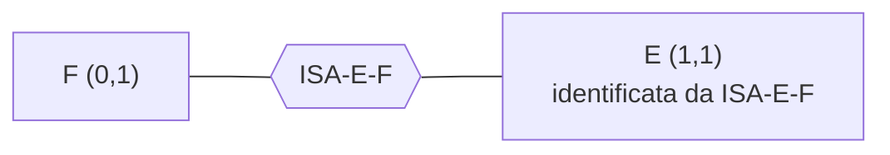

# Eliminazione delle ISA

> [!summary] In breve
> E ISA F diventa una relazione ISA-E-F con E (1,1) e F (0,1), che identifica E; le generalizzazioni diventano più ISA con vincoli di disgiunzione e completezza.

- Schema originale e ristrutturato sono in corrispondenza (funzioni $g$, $h$ con $h(g(I)) = I$).
- Attributi comuni a figlie non disgiunte → vincolo esterno di uguaglianza.
- Nella traduzione l'ISA si **accorpa**: la figlia ha la chiave del padre come chiave primaria e foreign key.
- ISA tra relazioni → vincolo esterno, poi foreign key o inclusione.

## Collegamenti

- **Concetti correlati**: [[ISA e Generalizzazione]] · [[Ristrutturazione dello Schema ER]] · [[Traduzione Diretta]]
- **Mappa**: [[MOC - Basi di Dati]]

> [!info] Approfondimento
> - [[06 - BD - Progettazione Logica#Attività 4, ISA tra entità|Lezione 6 — Attività 4, ISA tra entità]]
> - [[06 - BD - Progettazione Logica#Attività 4, generalizzazioni|Lezione 6 — Attività 4, generalizzazioni]]
> - [[06 - BD - Progettazione Logica#Attività 4, ISA e generalizzazioni tra relazioni|Lezione 6 — Attività 4, ISA e generalizzazioni tra relazioni]]
