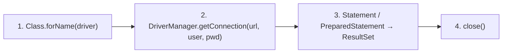

# JDBC

> [!summary] In breve
> API Java standard per eseguire comandi SQL su un DBMS tramite un driver specifico; l'interazione ha quattro fasi.

- URL: `jdbc:postgresql:test`.
- `executeUpdate` (DDL e modifiche, restituisce il numero di tuple) / `executeQuery` (restituisce un ResultSet).
- Stringhe SQL tra apici singoli dentro stringhe Java tra apici doppi, senza `;` finale.

## Collegamenti

- **Concetti correlati**: [[ResultSet]] · [[PreparedStatement]] · [[Accesso da Software Interno ed Esterno]]
- **Mappa**: [[MOC - Basi di Dati]]

> [!info] Approfondimento
> - [[04 - BD - Accesso ai Dati da Software#Il framework JDBC|Lezione 4 — Il framework JDBC]]
> - [[04 - BD - Accesso ai Dati da Software#Le fasi dell'interazione|Lezione 4 — Le fasi dell'interazione]]
> - [[04 - BD - Accesso ai Dati da Software#Terza fase, Statement|Lezione 4 — Terza fase, Statement]]
