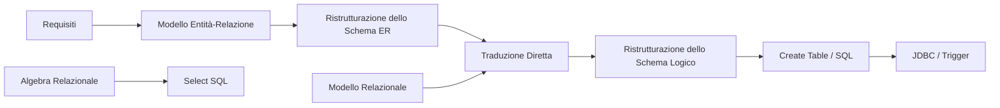

# MOC - Basi di Dati

> [!abstract]
> Mappa del corso di **Basi di Dati** (prof. Maurizio Lenzerini, Sapienza): le lezioni complete e le note atomiche di ripasso, raggruppate per tema.

## Lezioni

| # | Lezione | Argomenti |
|---|---|---|
| 1 | [[01 - BD - Introduzione]] | sistema informativo, base di dati, DBMS, architettura a tre livelli |
| 2 | [[02 - BD - Modello Relazionale]] | relazioni, algebra relazionale, valori nulli, vincoli di integrità |
| 3 | [[03 - BD - SQL]] | select, join, aggregati, DDL, query annidate, viste, transazioni, politiche di reazione |
| 4 | [[04 - BD - Accesso ai Dati da Software]] | PL/pgSQL, stored procedure, trigger, JDBC, SQL injection |
| 5 | [[05 - BD - Progettazione Concettuale]] | modello ER, vincoli, metodologia, pattern, qualità |
| 6 | [[06 - BD - Progettazione Logica]] | ristrutturazione ER, traduzione diretta, ristrutturazione logica, normalizzazione |
| 7 | [[07 - BD - NoSQL]] | NoSQL, MongoDB, JSON, graph database, regular path query |
| 8 | [[08 - BD - Esami Svolti]] | sei appelli con soluzioni |

## Concetti

### Fondamenti
[[Sistema Informativo]] · [[Base di Dati]] · [[DBMS]] · [[Schema e Istanza]]

### Modello relazionale e algebra
- Struttura: [[Modello Relazionale]] · [[Valore Nullo]] · [[Assunzione di Mondo Chiuso]]
- Algebra: [[Algebra Relazionale]] · [[Selezione e Proiezione]] · [[Join]] · [[Theta-Join]] · [[Join Esterno]] · [[Negazione in Algebra Relazionale]]
- Vincoli: [[Vincolo di Integrità]] · [[Superchiave e Chiave]] · [[Chiave Primaria]] · [[Foreign Key]]

### SQL
- Linguaggio: [[SQL]] · [[DDL e DML]] · [[Create Table]] · [[Select SQL]]
- Query: [[Operatori Aggregati]] · [[Group By e Having]] · [[Interrogazioni Annidate]] · [[Vista]]
- Integrità e concorrenza: [[Transazione]] · [[Politiche di Reazione]]

### Accesso ai dati da software
[[Accesso da Software Interno ed Esterno]] · [[Stored Procedure]] · [[Trigger]] · [[JDBC]] · [[ResultSet]] · [[PreparedStatement]] · [[SQL Injection (Basi di Dati)]]

### Progettazione concettuale
- Modello: [[Modello Entità-Relazione]] · [[Entità ER]] · [[Relazione ER]] · [[Ruolo ER]] · [[ISA e Generalizzazione]]
- Vincoli: [[Vincoli di Cardinalità]] · [[Identificatore ER]] · [[Vincolo Esterno]]
- Metodo: [[Metodologia di Progettazione Concettuale]] · [[Entità vs Attributo vs Relazione]] · [[Eventi e Storicizzazione]] · [[Reificazione]] · [[Qualità di uno Schema Concettuale]]

### Progettazione logica
[[Ristrutturazione dello Schema ER]] · [[Eliminazione delle ISA]] · [[Identificatore Principale]] · [[Traduzione Diretta]] · [[Ristrutturazione dello Schema Logico]] · [[Modello di Costo]] · [[Normalizzazione e Denormalizzazione]]

### NoSQL
[[NoSQL]] · [[Database Documentale MongoDB]] · [[JSON]] · [[Graph Database]] · [[Regular Path Query]]

## Percorsi trasversali

- **Dal requisito alla tabella**: [[Metodologia di Progettazione Concettuale]] → [[Modello Entità-Relazione]] → [[Reificazione]] → [[Ristrutturazione dello Schema ER]] → [[Eliminazione delle ISA]] → [[Identificatore Principale]] → [[Traduzione Diretta]] → [[Ristrutturazione dello Schema Logico]] → [[Create Table]].
- **Le chiavi attraverso il corso**: [[Identificatore ER]] → [[Identificatore Principale]] → [[Chiave Primaria]] / [[Superchiave e Chiave]] → `primary key`, `unique`.
- **I riferimenti**: [[Relazione ER]] → [[Vincoli di Cardinalità]] → [[Foreign Key]] → [[Politiche di Reazione]] → [[Transazione]].
- **Dall'algebra a SQL**: [[Selezione e Proiezione]] → [[Join]] → [[Negazione in Algebra Relazionale]] → [[Select SQL]] → [[Interrogazioni Annidate]].
- **I vincoli che il diagramma non esprime**: [[Vincolo Esterno]] → [[Vincolo di Integrità]] → [[Trigger]].
- **Oltre il relazionale**: [[Join]] (costoso) → [[Graph Database]] → [[Regular Path Query]]; [[Modello Relazionale]] (rigido) → [[Database Documentale MongoDB]].

Collegamenti con altri corsi: [[Data Managment - 1 - Introduction|Data Management]] (magistrale), [[SQL Injection]] (Ethical Hacking), [[12 - SO - File System]] (Sistemi Operativi).
