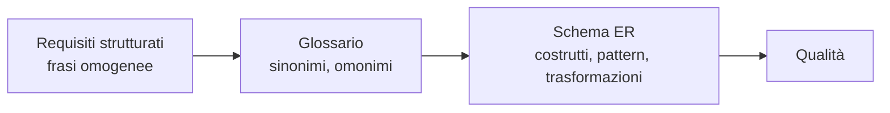

# Metodologia di Progettazione Concettuale

> [!summary] In breve
> Dai requisiti allo schema ER in quattro attività interconnesse: strutturare i requisiti, glossario, costruzione dello schema, controllo di qualità.

- Progettazione: concettuale (cosa) → logica → fisica (come).
- Esempio incrementale (*inside-out*): partecipanti → città → lezioni → docenti.

## Collegamenti

- **Concetti correlati**: [[Modello Entità-Relazione]] · [[Eventi e Storicizzazione]] · [[Reificazione]] · [[Qualità di uno Schema Concettuale]]
- **Mappa**: [[MOC - Basi di Dati]]

> [!info] Approfondimento
> - [[05 - BD - Progettazione Concettuale#5.3 Metodologia per la progettazione concettuale|Lezione 5 — 5.3 Metodologia per la progettazione concettuale]]
> - [[05 - BD - Progettazione Concettuale#Fase 1, strutturazione dei requisiti|Lezione 5 — Fase 1, strutturazione dei requisiti]]
> - [[05 - BD - Progettazione Concettuale#5.4 Esempio, base di dati per un corso di istruzione|Lezione 5 — 5.4 Esempio, base di dati per un corso di istruzione]]
