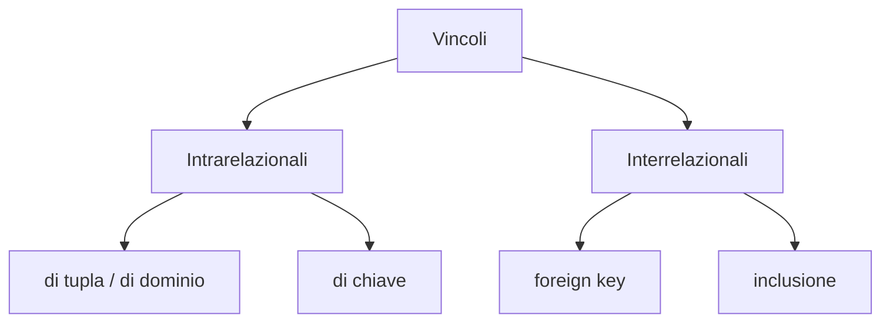

# Vincolo di Integrità

> [!summary] In breve
> Condizione espressa sullo schema che ogni istanza corretta deve soddisfare: un predicato vero/falso su ogni istanza.

- **Tupla**: espressione booleana sui valori di una tupla (es. $\text{Lordo} = \text{Ritenute} + \text{Netto}$); **dominio** se coinvolge un solo attributo.
- "α solo se β" si scrive $\lnot\alpha \lor \beta$.
- In SQL: `not null`, `unique`, `primary key`, `foreign key`, `check`.

## Collegamenti

- **Concetti correlati**: [[Superchiave e Chiave]] · [[Chiave Primaria]] · [[Foreign Key]] · [[Vincolo Esterno]]
- **Mappa**: [[MOC - Basi di Dati]]

> [!info] Approfondimento
> - [[02 - BD - Modello Relazionale#Introduzione|Lezione 2 — Introduzione]]
> - [[02 - BD - Modello Relazionale#Vincoli di tupla e di dominio|Lezione 2 — Vincoli di tupla e di dominio]]
> - [[03 - BD - SQL#Vincoli in SQL|Lezione 3 — Vincoli in SQL]]
