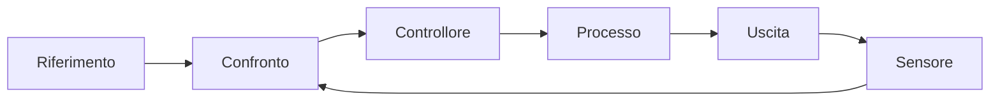

# Introduzione al controllo e modelli fisici

> [!abstract]
> Questa lezione sviluppa introduzione al controllo e modelli fisici seguendo il blocco delle pagine 44–48 della dispensa commentata. Percorso completo: [[MOC - Controlli Automatici]].

**Indicazione nel materiale:** 11/03. La numerazione CA è editoriale e non sostituisce quella del docente.

**Prima:** [[04 - CA - Robustezza margini di stabilità e criterio di Bode]]. **Dopo:** [[06 - CA - Specifiche statiche tipo del sistema ed errore a regime]].

## Riferimento processo controllore e sensore

Vedi [[CA - Sistema di controllo]] · [[CA - Errore di inseguimento]].

Il processo trasforma un comando $u$ in un'uscita $y$. Il controllore usa il riferimento $r$ e le misure per decidere il comando. Un sensore può avere una dinamica e una taratura proprie: ciò che il controllore confronta con $r$ non è sempre direttamente $y$.

Nella retroazione unitaria l'errore è $e=r-y$ e il comando è $u=Ge$. Si ottiene $y=PG(r-y)$, quindi $y/r=PG/(1+PG)$. Il progetto consiste nello scegliere $G$ per stabilità, precisione, rapidità, rigetto dei disturbi e sforzo attuativo. Questi obiettivi possono entrare in conflitto.

Il controllo ad anello aperto non usa la misura dell'effetto ottenuto: può seguire bene un modello nominale ma non corregge spontaneamente variazioni e disturbi. La retroazione confronta continuamente risultato e obiettivo.

_(Dispensa commentata, pagine PDF 44–44; numerazione fisica del file.)_

> [!example]- Materiale originale — pagina PDF 44
> ![[CA-p044-1.jpg]]
> Lo schema introduce processo, comando, riferimento e uscita: il confronto genera l'errore che il controllore deve ridurre.

## Esempio meccanico e controllo proporzionale

Vedi [[CA - Modello massa attrito]] · [[CA - Controllore proporzionale]].

Per una massa soggetta a forza $u$ e attrito viscoso $bv$, $m\dot v+bv=u$. La FdT forza-velocità è $P_v=1/(ms+b)$; se l'uscita è la posizione $q$, si aggiunge l'integratore $\dot q=v$ e $P_q=1/[s(ms+b)]$. È essenziale dichiarare l'uscita prima di scrivere la FdT.

Con $u=k_p(r-v)$ il trasferimento riferimento-velocità è
$$W_v(s)=\frac{k_p}{ms+b+k_p},\quad \tau=\frac{m}{b+k_p},\quad W_v(0)=\frac{k_p}{b+k_p}.$$
Per $m>0,b>0,k_p>0$ l'anello è AS. Aumentare $k_p$ riduce la costante di tempo e l'errore al gradino, ma il guadagno statico resta diverso da uno per ogni $k_p$ finito. Inoltre cresce il comando iniziale: per un gradino $r_0$, $u(0^+)=k_pr_0$ a stato iniziale nullo.

Se all'ingresso del processo si somma una forza costante $d$, il valore finale della velocità cambia di $d/(b+k_p)$. Un guadagno elevato riduce questa sensibilità ma può incontrare limiti di saturazione e dinamiche trascurate.

_(Dispensa commentata, pagine PDF 45–47; numerazione fisica del file.)_

> [!example]- Materiale originale — pagina PDF 45
> ![[CA-p045-1.jpg]]
> Il modello fisico distingue velocità e posizione; integrare la velocità aggiunge un polo nell'origine al trasferimento forza-posizione.

> [!example]- Materiale originale — pagina PDF 46
> ![[CA-p046-1.jpg]]
> Il controllo proporzionale modifica il polo e il guadagno statico del processo meccanico: rapidità e precisione cambiano simultaneamente.

> [!example]- Materiale originale — pagina PDF 47
> ![[CA-p047-1.jpg]]
> Le risposte al gradino confrontano diversi guadagni: l'offset si riduce mentre cresce la richiesta iniziale al comando.

## L’integratore come correzione della precisione

Vedi [[CA - Azione integrale]].

L'integratore accumula l'errore: $u=k_pe+k_i\int e\,dt$, cioè $G=k_p+k_i/s$. Se l'anello chiuso è stabile e si raggiunge un equilibrio con comando finito, un errore costante non nullo farebbe crescere indefinitamente l'integrale: per questo l'azione integrale può annullare l'errore al gradino.

Per il processo di velocità il polinomio chiuso diventa $ms^2+(b+k_p)s+k_i$. Con $m>0$, bastano $b+k_p>0$ e $k_i>0$ per renderlo Hurwitz. L'integratore migliora la precisione, ma aggiunge uno stato: la stabilità va verificata dopo l'inserimento.

_(Dispensa commentata, pagine PDF 48–48; numerazione fisica del file.)_

> [!example]- Materiale originale — pagina PDF 48
> ![[CA-p048-1.jpg]]
> L'integratore del controllore elimina l'errore costante soltanto se la nuova dinamica chiusa rimane stabile.
