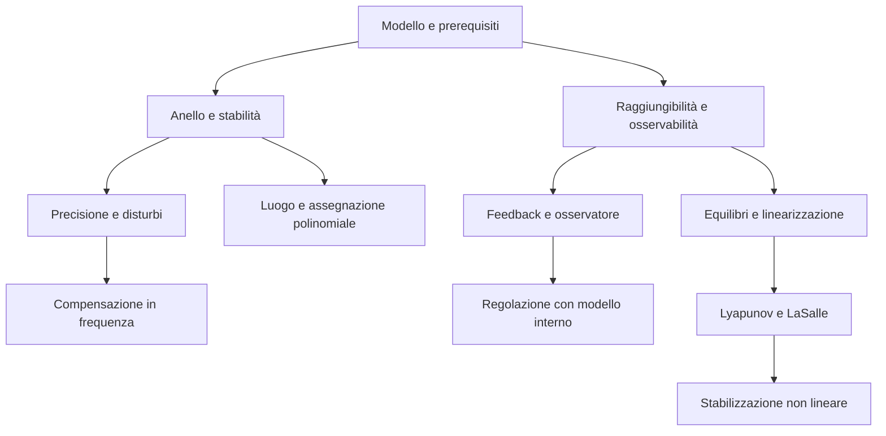

# MOC - Controlli Automatici

> [!abstract]
> Mappa delle lezioni nell’ordine della dispensa, delle note atomiche e delle prove d’esame. Iniziare da [[Guida - Controlli Automatici]] per fonti, numerazione e limiti di lettura.

## Lezioni e richiami

I numeri CA sono editoriali. La dispensa si apre con richiami di TDS e riporta poi «lezione 3»: non sono state inventate le lezioni 1 e 2. I blocchi senza una nuova data chiara mantengono l’ordine fisico del materiale.

| N. | Nota | Pagine PDF | Argomenti |
|---|---|---|---|
| 00 | [[00 - CA - Richiami di Teoria dei Sistemi]] | 2–9 | Modello di stato ed evoluzione; Modi e stabilità interna; Funzione di trasferimento e modi nascosti; Regime permanente e ingressi canonici |
| 01 | [[01 - CA - Risposta armonica e diagrammi di Bode]] | 10–16 | Dal segnale sinusoidale alla risposta armonica; Fattori elementari e somma grafica; Diagramma polare e fattori del secondo ordine |
| 02 | [[02 - CA - Interconnessioni e criterio di Nyquist]] | 17–34 | Serie parallelo e retroazione; Il punto critico e il conteggio di Nyquist; Guadagno variabile e verifica con Routh |
| 03 | [[03 - CA - Retroazione e stabilità al variare del guadagno]] | 35–38 | Stabilità regolare e condizionata; Casi limite e modi non eliminabili |
| 04 | [[04 - CA - Robustezza margini di stabilità e criterio di Bode]] | 39–43 | Perché misurare la distanza dall’instabilità; Attraversamento e margine di fase; Quando si può usare il criterio di Bode |
| 05 | [[05 - CA - Introduzione al controllo e modelli fisici]] | 44–48 | Riferimento processo controllore e sensore; Esempio meccanico e controllo proporzionale; L’integratore come correzione della precisione |
| 06 | [[06 - CA - Specifiche statiche tipo del sistema ed errore a regime]] | 49–54 | Architettura e funzioni di sensibilità; Tipo e costanti di errore; Tradurre correttamente una specifica |
| 07 | [[07 - CA - Disturbi rumore e astaticità]] | 55–60 | Specifiche per riferimenti sinusoidali; Disturbi costanti e posizione degli integratori; Rumore di misura e compromesso con il riferimento |
| 08 | [[08 - CA - Specifiche dinamiche e simulazioni di controllo]] | 61–73 | Rapidità sovraelongazione e banda; Esperimenti con gradino rampa e disturbi; Dall’anello aperto alla risposta chiusa |
| 09 | [[09 - CA - Progetto in frequenza e reti compensatrici]] | 74–92 | Separare precisione e forma dell’anello; Rete anticipatrice; Rete attenuatrice e verifica del progetto; Esercizio riassuntivo con disturbo in uscita |
| 10 | [[10 - CA - Esercizi di compensazione anticipatrice e attenuatrice]] | 93–97 | Leggere l’anello non compensato; Dimensionare e ricontrollare la rete |
| 11 | [[11 - CA - Progetto in frequenza con processi interconnessi]] | 98–100 | Ridurre lo schema senza perdere il disturbo; Dal processo equivalente alla compensazione |
| 12 | [[12 - CA - Dal modello di stato alla sintesi in frequenza]] | 101–105 | Ricavare la FdT dal modello assegnato; Completare il progetto e confrontare le alternative |
| 13 | [[13 - CA - Progetto mediante luogo delle radici]] | 106–112 | Prestazioni come regioni del piano complesso; Condizioni di fase e modulo; Asintoti e frontiere di stabilità |
| 14 | [[14 - CA - Punti multipli e costruzione del luogo delle radici]] | 113–117 | Radici multiple e punti di diramazione; Tracciare un luogo completo |
| 15 | [[15 - CA - Progetto sul luogo con aggiunta di poli e zeri]] | 118–122 | Struttura imposta dalle specifiche statiche; Usare uno zero per modificare la geometria |
| 16 | [[16 - CA - Esercizi di sintesi sul luogo delle radici]] | 123–128 | Compensazione e cancellazioni ammissibili; Intersecare vincoli statici e dinamici |
| 17 | [[17 - CA - Poli dominanti e vincoli sul transitorio]] | 129–134 | Tradurre tempo e smorzamento in geometria; Confronto fra approcci e casi speciali |
| 18 | [[18 - CA - Assegnazione diretta dei poli con retroazione dinamica]] | 135–140 | Equazione diofantea per il controllore; Ordine del controllore e verifica della soluzione |
| 19 | [[19 - CA - Esercizi riepilogativi su controllo classico]] | 141–148 | Processi con disturbi e schemi equivalenti; Verifica finale e schema risolutivo |
| 20 | [[20 - CA - Raggiungibilità osservabilità e forme canoniche]] | 149–155 | Riprendere il modello nello spazio di stato; Cambiamento di coordinate e forma compagna; Esercizi e sottospazi non completi |
| 21 | [[21 - CA - Retroazione dello stato e assegnazione degli autovalori]] | 156–166 | Modificare la dinamica con lo stato misurato; Modi fissi stabilizzabilità e test PBH; Esempi di assegnazione e verifica |
| 22 | [[22 - CA - Osservatore asintotico e rilevabilità]] | 167–174 | Stimare lo stato da ingresso e uscita; Dualità e progetto del guadagno; Esercizio e scelta della velocità di stima |
| 23 | [[23 - CA - Retroazione dinamica dell’uscita e principio di separazione]] | 175–186 | Usare la stima al posto dello stato; Realizzazione del controllore e FdT; Esercizi con parametri e modi fissi |
| 24 | [[24 - CA - Inseguimento di riferimenti e modello interno]] | 187–193 | Dalla stabilizzazione all’inseguimento; Aggiungere l’integrale dell’errore; Verificare il problema aumentato |
| 25 | [[25 - CA - Equilibri e stabilità dei sistemi non lineari]] | 194–212 | Punti di equilibrio e piano delle fasi; Stabilità secondo Lyapunov; Stabilità esponenziale e proprietà globali |
| 26 | [[26 - CA - Metodo diretto di Lyapunov]] | 213–244 | Caso lineare e idea energetica; Definitezza e derivata lungo le traiettorie; Teoremi di stabilità e stabilità asintotica; Instabilità e conclusioni globali; Costruzione di candidate quadratiche |
| 27 | [[27 - CA - LaSalle linearizzazione e studio degli equilibri]] | 245–269 | Derivata semidefinita e insieme invariante; Criterio indiretto e matrice Jacobiana; Procedura completa ed esercizi |
| 28 | [[28 - CA - Stabilizzazione non lineare e linearizzazione esatta]] | 270–297 | Equilibrio forzato e progetto locale; Pendolo attuato e coppia di equilibrio; Cancellazione esatta e trasformazioni di coordinate; Robustezza e controllo diretto non lineare |

## Concetti per tema

### Prerequisiti e analisi della stabilità

- **00**: [[CA - Modello di stato]] · [[CA - Evoluzione libera e forzata]] · [[CA - Stabilità interna]] · [[CA - Funzione di trasferimento]] · [[CA - Cancellazioni pole-zero]] · [[CA - Teorema del valore finale]]
- **01**: [[CA - Risposta armonica]] · [[CA - Diagrammi di Bode]] · [[CA - Poli e zeri in frequenza]] · [[CA - Diagramma polare]] · [[CA - Risonanza del secondo ordine]]
- **02**: [[CA - Interconnessioni]] · [[CA - Retroazione negativa]] · [[CA - Criterio di Nyquist]] · [[CA - Avvolgimenti del punto critico]] · [[CA - Stabilità al variare del guadagno]]
- **03**: [[CA - Stabilità regolare]] · [[CA - Stabilità condizionata]] · [[CA - Modi fissi]] · [[CA - Cancellazioni instabili]]
- **04**: [[CA - Robustezza]] · [[CA - Margine di guadagno]] · [[CA - Pulsazione di attraversamento]] · [[CA - Margine di fase]] · [[CA - Criterio di Bode]]

### Precisione disturbi e prestazioni

- **05**: [[CA - Sistema di controllo]] · [[CA - Errore di inseguimento]] · [[CA - Modello massa attrito]] · [[CA - Controllore proporzionale]] · [[CA - Azione integrale]]
- **06**: [[CA - Funzione di anello]] · [[CA - Sensibilità]] · [[CA - Sensibilità complementare]] · [[CA - Tipo del sistema]] · [[CA - Costanti di errore]] · [[CA - Specifiche di precisione]]
- **07**: [[CA - Errore sinusoidale]] · [[CA - Astaticità]] · [[CA - Disturbo in ingresso]] · [[CA - Disturbo in uscita]] · [[CA - Rumore di misura]]
- **08**: [[CA - Tempo di assestamento]] · [[CA - Sovraelongazione]] · [[CA - Banda passante]] · [[CA - Verifica in simulazione]] · [[CA - Legame tra margine e transitorio]]

### Sintesi in frequenza

- **09**: [[CA - Sintesi in frequenza]] · [[CA - Struttura del controllore]] · [[CA - Rete anticipatrice]] · [[CA - Massimo anticipo di fase]] · [[CA - Rete attenuatrice]] · [[CA - Verifica delle specifiche]] · [[CA - Progetto riassuntivo in frequenza]]
- **10**: [[CA - Diagnosi del difetto di fase]] · [[CA - Bilancio del modulo]] · [[CA - Reti in cascata]] · [[CA - Compensazione mista]] · [[CA - Realizzabilità]]
- **11**: [[CA - Riduzione dello schema]] · [[CA - Canale del disturbo]] · [[CA - Astaticità del processo equivalente]] · [[CA - Progetto con rami paralleli]] · [[CA - Controllo dei segni]]
- **12**: [[CA - Conversione stato trasferimento]] · [[CA - Guadagno a bassa frequenza]] · [[CA - Verifica esatta di Bode]] · [[CA - Scelta della rete]] · [[CA - Poli e zeri dominanti]]

### Luogo e progetto polinomiale

- **13**: [[CA - Luogo delle radici]] · [[CA - Regioni ammissibili dei poli]] · [[CA - Condizione di fase del luogo]] · [[CA - Condizione di modulo del luogo]] · [[CA - Asintoti del luogo]]
- **14**: [[CA - Punti multipli del luogo]] · [[CA - Derivata del guadagno]] · [[CA - Procedura del luogo]] · [[CA - Verifica con Routh]] · [[CA - Simmetria del luogo]]
- **15**: [[CA - Progetto sul luogo]] · [[CA - Integratori e luogo]] · [[CA - Zero del controllore]] · [[CA - Polo aggiuntivo del controllore]]
- **16**: [[CA - Compensazione sul luogo]] · [[CA - Cancellazione di poli stabili]] · [[CA - Intersezione delle specifiche]] · [[CA - Guadagni ammissibili]] · [[CA - Minimo ordine del controllore]]
- **17**: [[CA - Poli dominanti]] · [[CA - Settori di smorzamento]] · [[CA - Progetto in frequenza e sul luogo]] · [[CA - Zeri non a fase minima]] · [[CA - Vincoli strutturali]]
- **18**: [[CA - Assegnazione polinomiale]] · [[CA - Equazione diofantea]] · [[CA - Grado del controllore]] · [[CA - Causalità]] · [[CA - Verifica della realizzazione]]
- **19**: [[CA - Metodo di progetto classico]] · [[CA - Disturbi interni allo schema]] · [[CA - Checklist del progetto]] · [[CA - Valori critici del guadagno]] · [[CA - Controllore completo]]

### Stato osservatori e regolazione

- **20**: [[CA - Matrice di raggiungibilità]] · [[CA - Matrice di osservabilità]] · [[CA - Cambio di coordinate]] · [[CA - Forma canonica raggiungibile]] · [[CA - Forma canonica osservabile]] · [[CA - Scomposizione raggiungibile]] · [[CA - Scomposizione osservabile]]
- **21**: [[CA - Retroazione dello stato]] · [[CA - Assegnazione degli autovalori]] · [[CA - Stabilizzabilità]] · [[CA - Test PBH di controllo]] · [[CA - Confronto dei coefficienti nello stato]] · [[CA - Guadagno nelle coordinate originali]]
- **22**: [[CA - Osservatore di Luenberger]] · [[CA - Errore di stima]] · [[CA - Dualità controllo osservazione]] · [[CA - Rilevabilità]] · [[CA - Test PBH di osservazione]] · [[CA - Velocità dell’osservatore]] · [[CA - Rumore e osservatore]]
- **23**: [[CA - Controllore con osservatore]] · [[CA - Principio di separazione]] · [[CA - Realizzazione del compensatore dinamico]] · [[CA - Poli del controllore e poli chiusi]] · [[CA - Controllo con parametri]] · [[CA - Criterio PBH parametrico]] · [[CA - Verifica del principio di separazione]]
- **24**: [[CA - Prefiltro statico]] · [[CA - Inseguimento nello stato]] · [[CA - Modello interno]] · [[CA - Stato integrale]] · [[CA - Regolazione robusta]] · [[CA - Raggiungibilità aumentata]] · [[CA - Ordine della regolazione]]

### Sistemi non lineari

- **25**: [[CA - Equilibri non lineari]] · [[CA - Piano delle fasi]] · [[CA - Stabilità di Lyapunov]] · [[CA - Attrattività]] · [[CA - Stabilità esponenziale]] · [[CA - Stabilità globale]] · [[CA - Dominio di attrazione]]
- **26**: [[CA - Energia come funzione di Lyapunov]] · [[CA - Stabilità lineare e non lineare]] · [[CA - Funzione definita positiva]] · [[CA - Derivata di Lyapunov]] · [[CA - Forme quadratiche positive]] · [[CA - Criterio diretto di Lyapunov]] · [[CA - Stima del bacino di attrazione]] · [[CA - Criterio di instabilità]] · [[CA - Funzione radialmente illimitata]] · [[CA - Scelta della candidata]] · [[CA - Criterio di Sylvester]]
- **27**: [[CA - Principio di LaSalle]] · [[CA - Insieme invariante]] · [[CA - Massimo insieme invariante]] · [[CA - Jacobiana]] · [[CA - Criterio indiretto di Lyapunov]] · [[CA - Caso critico della linearizzazione]] · [[CA - Studio di un equilibrio]] · [[CA - Analisi parametrica non lineare]] · [[CA - Stima locale e globale]]
- **28**: [[CA - Equilibrio forzato]] · [[CA - Stabilizzazione mediante approssimazione]] · [[CA - Controllo del pendolo]] · [[CA - Equazione di Lyapunov]] · [[CA - Linearizzazione esatta]] · [[CA - Diffeomorfismo]] · [[CA - Dominio della linearizzazione]] · [[CA - Non linearità stabilizzanti]] · [[CA - Robustezza della cancellazione]] · [[CA - Progetto con Lyapunov]]

## Percorsi trasversali

- [[CA - Sensibilità]] → [[CA - Tipo del sistema]] → [[CA - Astaticità]] → [[CA - Modello interno]]
- [[CA - Risposta armonica]] → [[CA - Margine di fase]] → [[CA - Rete anticipatrice]] → [[CA - Verifica delle specifiche]]
- [[CA - Luogo delle radici]] → [[CA - Regioni ammissibili dei poli]] → [[CA - Assegnazione polinomiale]]
- [[CA - Matrice di raggiungibilità]] → [[CA - Stabilizzabilità]] → [[CA - Retroazione dello stato]] → [[CA - Principio di separazione]]
- [[CA - Equilibri non lineari]] → [[CA - Jacobiana]] → [[CA - Caso critico della linearizzazione]] → [[CA - Principio di LaSalle]] → [[CA - Progetto con Lyapunov]]

## Collegamenti con gli altri corsi

- [[MOC - Teoria dei Sistemi]]: Laplace, stabilità, modelli, realizzazioni, feedback e osservatori.
- [[MOC - Geometria]]: rango, cambi di base, autovalori, polinomio caratteristico e forme quadratiche.

## Esercitazioni e prove d’esame

| Blocco | Nota | Pagine eserciziario |
|---|---|---|
| E01 | [[E01 - CA - Prova intermedia 2018-2019]] | 1–5 |
| E02 | [[E02 - CA - Prova intermedia 2019-2020]] | 6–11 |
| E03 | [[E03 - CA - Prova intermedia 2020-2021]] | 12–16 |
| E04 | [[E04 - CA - Prova intermedia 2021-2022]] | 17–23 |
| E05 | [[E05 - CA - Prova intermedia 2022-2023]] | 24–31 |
| E06 | [[E06 - CA - Prova intermedia 2023-2024]] | 32–37 |
| E07 | [[E07 - CA - Prova intermedia 2024-2025]] | 38–45 |
| E08 | [[E08 - CA - Prova finale 2018-2019]] | 46–51 |
| E09 | [[E09 - CA - Prova finale 2019-2020]] | 52–56 |
| E10 | [[E10 - CA - Prova finale 2020-2021]] | 57–62 |
| E11 | [[E11 - CA - Prova finale 2021-2022]] | 63–66 |
| E12 | [[E12 - CA - Prova finale 2022-2023]] | 67–72 |
| E13 | [[E13 - CA - Prova finale 2023-2024 e assegnazione canonica]] | 73–79 |
| E14 | [[E14 - CA - Prova completa del 12 luglio 2019]] | 80–87 |
| E15 | [[E15 - CA - Dimostrazioni e verifiche supplementari]] | 88–94 |

## Ripasso operativo

- **Parte classica:** segnali e segni → trasferimenti → precisione → stabilità → dinamica → verifica.
- **Parte sullo stato:** ranghi e modi fissi → guadagno di stato → osservatore → separazione → eventuale integratore.
- **Parte non lineare:** tutti gli equilibri → Jacobiana → Lyapunov nei casi critici → LaSalle → dominio della conclusione.
