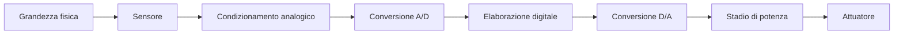

# Introduzione e segnali

> [!abstract]
> Dalla miniaturizzazione alla rappresentazione dell’informazione: serve a capire quali segnali dovranno elaborare i circuiti studiati nel corso.
> Percorso completo: [[MOC - Elettronica]]. Fonte: dispensa di Valerio Spagnoli, pagine PDF 2–7.

Successiva: [[02 - EL - Richiami di teoria dei circuiti]]

## Integrazione e capacità parassite

Per il ripasso: [[EL - Capacità parassite]] · [[EL - Integrazione e dissipazione]].

L’elettronica controlla il movimento delle cariche per acquisire, elaborare e trasmettere informazione. Il transistor e il circuito integrato permettono di costruire molti dispositivi sullo stesso chip. La miniaturizzazione riduce l’area occupata e molte capacità parassite, ma aumenta le difficoltà di interconnessione e di dissipazione del calore.

Le previsioni storiche riportate nel libro descrivono una crescita esponenziale della complessità, non una legge fisica. La tabella della dispensa, riferita al 2004, riporta: area del circuito integrato $1.5\times$ ogni 3 anni; dimensione minima $-30\%$ ogni 3 anni; transistor per circuito $2\times$ ogni 1,5 anni; clock $1.5\times$ ogni 3 anni; costo per transistor $-50\%$ ogni 3 anni; costo della fabbrica $2.3\times$ ogni 3 anni. Sono dati storici del materiale, non specifiche attuali.

Due piste metalliche separate da un isolante formano un condensatore parassita. In regime sinusoidale:
$$Z_C=\frac{1}{j\omega C},\qquad |Z_C|=\frac{1}{\omega C}.$$
All’aumentare della frequenza cresce l’accoppiamento tra le piste. Per un condensatore piano $C\simeq\varepsilon A/d$: ridurre l’area riduce $C$ a distanza e materiale invariati. In una tecnologia reale cambiano anche distanze e geometrie, quindi la dipendenza non è universale.

> [!warning] Correzione
> A p. 3 il testo identifica l’accoppiamento ad alta frequenza con piste «a contatto» e un dielettrico che «non isola più». La corrente di spostamento attraverso una capacità non implica un contatto metallico né la rottura del dielettrico. Il cortocircuito è un’approssimazione circuitale quando $|Z_C|$ è trascurabile rispetto alle altre impedenze.

_(dispensa, pp. 2–3)_

![[EL-p002-1.png]]

La dimensione minima delle memorie scende nel tempo: la scala logaritmica rende visibile la tendenza esponenziale. _(dispensa, p. 2)_

![[EL-p002-2.png]]

La densità delle memorie cresce di molti ordini di grandezza; i punti evidenziati confrontano chip da 64 bit e 1 Gb. _(dispensa, p. 2)_

![[EL-p002-3.png]]

La complessità dei microprocessori cresce lungo la tendenza storica riportata, con esempi di diverse generazioni. _(dispensa, p. 2)_

![[EL-p003-1.png]]

Le piste disegnate sullo stesso livello devono evitare incroci conduttivi indesiderati. _(dispensa, p. 3)_

![[EL-p003-2.png]]

La sezione mostra due piste a livelli diversi: l’isolante separa i metalli ma permette un accoppiamento capacitivo. _(dispensa, p. 3)_

## Sensori, attuatori e sinusoidi

Per il ripasso: [[EL - Sensori e attuatori]] · [[EL - Segnale sinusoidale]].

Un **sensore** traduce una grandezza fisica in una grandezza elettrica: microfono per pressione sonora, termistore o termocoppia per temperatura, fotodiodo per luce, estensimetro per deformazione, accelerometro per accelerazione. Un **attuatore** compie la trasformazione verso il mondo fisico: riscaldatore, LED, solenoide, motore o altoparlante.

La catena tipica è:

Un amplificatore modifica l’ampiezza di un segnale analogico; per convertirlo in una parola digitale occorre invece un convertitore A/D. Un altoparlante riceve normalmente una tensione e una corrente analogiche dallo stadio di potenza.

La sinusoide $v(t)=V_p\sin(\omega t+\varphi)$ è caratterizzata da ampiezza di picco $V_p$, fase $\varphi$, periodo $T$ e frequenza $f=1/T$, con $\omega=2\pi f$. È utile perché un circuito lineare in regime sinusoidale conserva la frequenza e modifica soltanto ampiezza e fase.

_(dispensa, p. 4)_

![[EL-p004-1.png]]

Il generatore di tensione reale si rappresenta con una resistenza serie, che causa attenuazione sotto carico. _(dispensa, p. 4)_

![[EL-p004-2.png]]

Nel generatore di corrente reale la resistenza parallela sottrae parte della corrente erogata. _(dispensa, p. 4)_

![[EL-p004-3.png]]

La stessa sinusoide appare periodica nel tempo e come componente concentrata alla frequenza fondamentale nello spettro. _(dispensa, p. 4)_

## Spettro, banda e velocità dei segnali

Per il ripasso: [[EL - Spettro e banda]].

Una forma d’onda periodica si può scomporre in armoniche. Per un’onda quadra simmetrica di ampiezza $\pm V_p$:
$$v(t)=\frac{4V_p}{\pi}\left[\sin\omega_0t+\frac{\sin3\omega_0t}{3}+\frac{\sin5\omega_0t}{5}+\cdots\right].$$
Le armoniche alte sono necessarie per ricostruire i fronti ripidi. Un circuito a banda limitata le attenua: il segnale diventa più arrotondato anche se il circuito è perfettamente lineare. Occorre distinguere questa distorsione di forma dalla distorsione non lineare, che può generare nuove frequenze.

Per molti segnali non periodici si usa uno spettro continuo. La **banda significativa** dipende dall’applicazione e dalla precisione richiesta: non è sempre un confine netto oltre il quale lo spettro è nullo. Transizioni temporali più rapide richiedono una banda maggiore. Questa relazione sarà quantificata mediante le reti RC e i tempi di salita.

_(dispensa, p. 5)_

![[EL-p005-1.png]]

L’onda quadra richiede armoniche dispari: quelle di ordine alto ricostruiscono i fronti. _(dispensa, p. 5)_

![[EL-p005-2.png]]

Per un segnale non periodico la rappresentazione spettrale è generalmente continua. _(dispensa, p. 5)_

## Analogico, digitale, rumore e conversione A-D

Per il ripasso: [[EL - Conversione analogico-digitale]] · [[EL - Rigenerazione del segnale digitale]].

Un segnale analogico può assumere un insieme continuo di ampiezze. Un segnale digitale codifica l’informazione in un insieme discreto di simboli, spesso due. La tensione fisica che trasporta un bit resta una grandezza continua e impiega un tempo finito per commutare: i livelli logici sono intervalli ammessi di tensione.

Il rumore si sovrappone al segnale. Nel digitale è possibile rigenerare il simbolo se il disturbo resta entro i margini consentiti; un disturbo eccessivo può produrre un errore. Non serve che la tensione sia esattamente 0 V o esattamente il livello alto.

La conversione A/D comprende **campionamento**, **quantizzazione** e codifica. Campionare discretizza il tempo; quantizzare discretizza l’ampiezza. Con $n$ bit si rappresentano $2^n$ codici. Per un convertitore uniforme con intervallo d’ingresso $V_{FS}$, il passo nominale è $\Delta\simeq V_{FS}/2^n$; con arrotondamento e senza sovraccarico, l’errore è compreso circa in $[-\Delta/2,+\Delta/2]$.

> [!note] Tempo di conversione
> Il vincolo $T_s>nt_1$ presentato a p. 7 descrive un trasferimento seriale senza sovrapposizione, con tempo $t_1$ per bit. Non è una legge generale di tutti gli ADC: tempo di conversione, campionamento e trasferimento dipendono dall’architettura.

Collegamento con i sistemi campionati: [[10 - TDS - Esempio a tempo discreto e campionamento]].

_(dispensa, pp. 6–7)_

![[EL-p006-1.png]]

Il confronto mostra che fronti rapidi richiedono una banda più estesa. _(dispensa, p. 6)_

![[EL-p006-2.png]]

La forma analogica assume un insieme continuo di valori di ampiezza. _(dispensa, p. 6)_

![[EL-p006-3.png]]

La tensione digitale rappresenta due simboli tramite livelli fisici, con transizioni nel tempo. _(dispensa, p. 6)_

![[EL-p007-1.png]]

Il convertitore A/D associa all’ingresso analogico una parola di bit. _(dispensa, p. 7)_

![[EL-p007-2.png]]

Le quattro rappresentazioni distinguono segnale originale, campionamento nel tempo e quantizzazione in ampiezza. _(dispensa, p. 7)_

