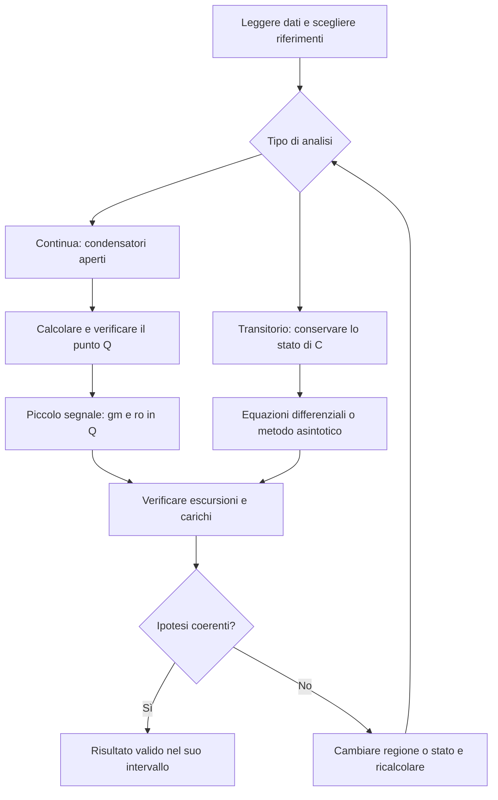

# Esercizi di esame svolti

> [!abstract]
> Tre esercizi completi collegano retroazione, MOSFET e condensatori, mantenendo distinti regime continuo, piccolo segnale e transitorio.
> Percorso completo: [[MOC - Elettronica]]. Fonte: dispensa di Valerio Spagnoli, pagine PDF 186–193.

Precedente: [[13 - EL - Circuiti digitali e logica CMOS]]

## Metodo di risoluzione

Per il ripasso: [[EL - Metodo per esercizi di elettronica]].

Prima dei calcoli si identificano nodi, segni, limiti d’uscita e condizioni iniziali. Poi si sceglie il modello adatto alla domanda:

Non si usa $g_m$ per ricavare da zero la polarizzazione. Non si usa il cortocircuito virtuale dopo il clipping. Una tensione d’uscita ai capi di un condensatore resta continua sotto correnti finite, anche se l’ingresso commuta.

_(dispensa, p. 186)_

![[EL-p186-1.png]]

La consegna del 2013 combina retroazione sul source, controllo del gate e capacità sul drain. _(dispensa, p. 186)_

## Esame 2013 - Retroazione di source e carico capacitivo

Per il ripasso: [[EL - Retroazione di source con operazionale]].

La consegna e lo schema sono nella pagina precedente. Dati: $V_{DD}=10$ V, $R_D=2$ kΩ, $R_1=1$ kΩ, $C=100$ nF, $K=0.5$ mA/V², $V_{th}=1$ V. Il riferimento passa da 0 a 2 V a $t_0=1$ ms. L’AO controlla il gate del MOS confrontando il source con il riferimento.

Se l’AO resta lineare, $V_S=V_{in}$. Dopo il fronte:
$$I_D=\frac{V_S}{R_1}=2\,\mathrm{mA},\qquad V_{GS}=1+\sqrt{2/0.5}=3\,\mathrm V,$$
quindi $V_G=5$ V, entro ±10 V. In condizioni iniziali a regime $v_o(t_0^-)=10$ V. Il nuovo valore finale è $10-I_DR_D=6$ V.

La KCL al drain è:
$$C\frac{dv_o}{dt}=\frac{10-v_o}{R_D}-2\,\mathrm{mA}.$$
Con $\tau=R_DC=0.2$ ms:
$$v_o(t)=\begin{cases}10\,\mathrm V&t<t_0,\\
6\,\mathrm V+4\,\mathrm V\,e^{-(t-t_0)/(0.2\,\mathrm{ms})}&t\ge t_0.
\end{cases}$$
L’assestamento a $5\tau$ si colloca circa a 2 ms. Durante il transitorio $V_D$ varia da 10 a 6 V e $V_S=2$ V: $V_{DS}$ resta tra 8 e 4 V, sempre maggiore dell’overdrive di 2 V. Le ipotesi sono verificate.

> [!note] Perché non vale direttamente $v_o=V_{DD}-I_DR_D$ nel transitorio
> La resistenza alimenta sia il MOS sia il condensatore. La relazione algebrica usata dal libro è valida nei due regimi limite, quando $i_C=0$; tra essi occorre la KCL dinamica.

_(dispensa, p. 187)_

![[EL-p187-1.png]]

Il grafico del sorgente mostra il passaggio da 10 a 6 V con costante di tempo 0.2 ms. _(dispensa, p. 187)_

## Esame 13-02-2020 - Guadagno di una cascata

Per il ripasso: [[EL - Verifica di una cascata AO-MOS]].

Dati: $R_1=R_2=R_3=1$ kΩ, $R_4=5$ kΩ, $R_D=2$ kΩ, $R_L=20$ kΩ, $V_{bias}=1$ V, $V_{DD}=10$ V, condensatore di accoppiamento ideale a centro banda; MOS con $V_{th}=1$ V, $K=0.5$ mA/V² e $\lambda=0$. AO ideale con limiti ±10 V.

**Polarizzazione.** Il partitore sul morsetto + produce 0.5 V. Con il segnale annullato, il guadagno non invertente è $1+R_4/R_3=6$: $V_G=3$ V. Poiché il source è a massa, $V_{GS}=3$ V; quindi $I_D=2$ mA, $V_D=6$ V e $V_{DS}=6$ V. L’AO è lineare e il MOS saturo; $g_m=2$ mS.

**Piccolo segnale.** Si annulla il bias e si porta a massa per il segnale l’alimentazione. Il primo stadio è invertente:
$$A_1=-\frac{R_4}{R_3}=-5.$$
Il secondo vede il carico in parallelo al resistore di drain:
$$A_2=-g_m(R_D\parallel R_L)=-2\,\mathrm{mS}\cdot\frac{40}{22}\,\mathrm{k\Omega}
=-\frac{40}{11}\simeq-3.636.$$
Il prodotto vale:
$$A_v=A_1A_2=\frac{200}{11}\simeq\boxed{18.18}.$$
Il segno è positivo perché entrambi gli stadi invertono. Il carico è disaccoppiato in continua ma presente per il segnale, perciò non modifica la polarizzazione e riduce il guadagno.

> [!warning] Correzione
> P. 191 approssima $R_D\parallel R_L$ con $R_D$ e ottiene circa 20. Il risultato senza questa approssimazione è **18.18**; usare 20 introduce un errore relativo del 10%. A p. 189 l’unità di $g_m$ viene scritta mA: è **mA/V**.

Per validare un’ampiezza specifica d’ingresso si ricostruiscono anche l’uscita dell’AO e le escursioni di $V_{GS}$ e $V_{DS}$: conoscere il solo guadagno non garantisce linearità per segnali arbitrari.

_(dispensa, pp. 188–191)_

![[EL-p188-1.png]]

La consegna del 2020 richiede il guadagno caricato di una cascata AO-MOS. _(dispensa, p. 188)_

![[EL-p189-1.png]]

Nell’analisi continua il riferimento non invertente fissa 3 V al gate del MOS. _(dispensa, p. 189)_

![[EL-p190-1.png]]

Nel piccolo segnale le alimentazioni sono a massa e il condensatore collega il carico al drain. _(dispensa, p. 190)_

![[EL-p190-2.png]]

Il primo stadio si riduce a un invertente di guadagno −R2/R3 con i nomi del disegno semplificato. _(dispensa, p. 190)_

![[EL-p190-3.png]]

Il generatore gm per vgs alimenta il parallelo RD–RL: questo carico determina il secondo guadagno. _(dispensa, p. 190)_

## Esame 05-04-2022 - Integratore e saturazione

Per il ripasso: [[EL - Tempo di saturazione di un integratore]].

Dati: ingresso da 0 a 4 V a $t=0$, MOS con $K=0.25$ mA/V², $V_{th}=1$ V, $\lambda=0$, $V_{DD}=10$ V, $R_D=5$ kΩ, $R_S=1$ kΩ, $C=1$ µF, AO ideale con uscita limitata a ±10 V e condensatore inizialmente scarico.

Prima del fronte il MOS è spento e l’uscita è zero. Nel tratto lineare dell’AO, il morsetto − è a massa virtuale. La polarizzazione dopo il fronte soddisfa:
$$4=V_{GS}+I_DR_S,\qquad I_D=0.25(V_{GS}-1)^2\quad\text{in mA}.$$
La soluzione valida è $V_{GS}=3$ V, $I_D=1$ mA e $V_S=1$ V. Il drain è $V_D=10-1\cdot5=5$ V; quindi $V_{DS}=4$ V è maggiore dell’overdrive di 2 V. Tutta la corrente di source attraversa $R_S$ e carica il condensatore in retroazione:
$$\frac{dv_o}{dt}=-\frac{I_D}{C}=-1\,\mathrm{V/ms}.$$
Il primo tratto è $v_o(t)=-(1\,\mathrm{V/ms})t$. L’uscita raggiunge −10 V a **$t_{sat}=10$ ms**. Con il modello a limitazione ideale:
$$v_o(t)=\begin{cases}
0&t<0,\\
-(1\,\mathrm{V/ms})t&0\le t<10\,\mathrm{ms},\\
-10\,\mathrm V&t\ge10\,\mathrm{ms}.
\end{cases}$$

> [!warning] Correzione
> Il grafico finale di p. 193 etichetta l’istante come **1 ms**, in contrasto con la pendenza e con il testo: deve essere **10 ms**. Dopo il clipping non vale più la massa virtuale; l’uscita resta bloccata nel modello, ma il resto del circuito e la tensione sul condensatore vanno eventualmente ricalcolati, senza prolungare la rampa lineare.

> [!tip] Controllo delle unità
> $1\,\mathrm{mA}/1\,\mu\mathrm F=1000\,\mathrm{V/s}=1\,\mathrm{V/ms}$. Dividere 10 V per questa pendenza dà 10 ms, verificando il tempo senza altre equazioni.

_(dispensa, pp. 192–193)_

![[EL-p192-1.png]]

La consegna del 2022 alimenta l’integratore con la corrente proveniente dal source del MOS. _(dispensa, p. 192)_

![[EL-p193-1.png]]

Il segno della tensione sul condensatore è opposto a quello dell’uscita dell’integratore nel tratto lineare. _(dispensa, p. 193)_

![[EL-p193-2.png]]

Il grafico originale marca erroneamente 1 ms: il limite −10 V si raggiunge a 10 ms, come verificato nel testo. _(dispensa, p. 193)_

