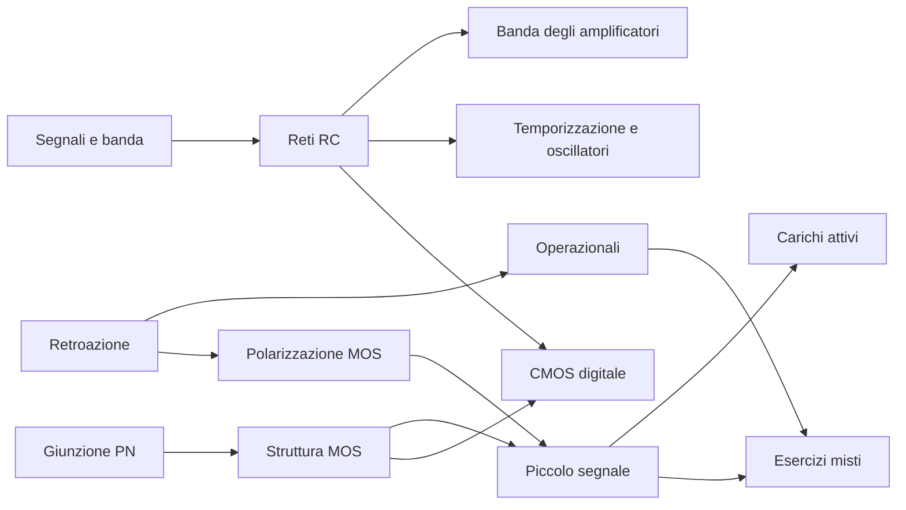

# MOC - Elettronica

> [!abstract]
> Percorso di studio tratto da **Appunti di Elettronica** di Valerio Spagnoli. Lezioni nell’ordine della dispensa, formule riscritte e correzioni esplicite. Le pagine citate sono quelle del PDF e coincidono con i numeri stampati.

Vedi anche [[00 - EL - Indice e criteri degli appunti]] per copertura, trattamento delle immagini e segnalazioni.

## Lezioni

| N. | Lezione | Pagine PDF | Argomenti |
|---|---|---|---|
| 01 | [[01 - EL - Introduzione e segnali]] | 2–7 | Integrazione e capacità parassite, Sensori, attuatori e sinusoidi, Spettro, banda e velocità dei segnali |
| 02 | [[02 - EL - Richiami di teoria dei circuiti]] | 8–23 | Bipoli, leggi di Kirchhoff e collegamenti, Partitori e caratteristiche corrente-tensione, Thévenin, Norton e sovrapposizione |
| 03 | [[03 - EL - Reti a due porte]] | 24–26 | Porte e scelta delle variabili, Parametri di impedenza e parametri ibridi, Parametri ibridi inversi e circuiti equivalenti |
| 04 | [[04 - EL - Amplificatori]] | 27–36 | Guadagno, alimentazione e rendimento, Saturazione e polarizzazione, Impedenze e quattro tipi di amplificatore |
| 05 | [[05 - EL - Reti STC e risposta nel tempo]] | 37–46 | Una costante di tempo e limiti in frequenza, Passa-basso del primo ordine, Passa-alto del primo ordine |
| 06 | [[06 - EL - Retroazione]] | 47–51 | Anello e guadagno retroazionato, Sensibilità e prodotto guadagno-banda, Distorsione e impedenze |
| 07 | [[07 - EL - Amplificatori operazionali]] | 52–84 | Modello ideale e cortocircuito virtuale, Configurazione invertente, Configurazione non invertente e buffer |
| 08 | [[08 - EL - Multivibratori e generatori di forme d’onda]] | 85–94 | Bistabilità e trigger di Schmitt invertente, Schmitt non invertente e attraversamenti dello zero, Astabile RC e onda quadra |
| 09 | [[09 - EL - Semiconduttori e diodi]] | 95–112 | Bande di energia e drogaggio, Drift, diffusione e potenziale di contatto, Polarizzazione e legge di Shockley |
| 10 | [[10 - EL - MOSFET - Struttura e regioni di funzionamento]] | 113–129 | Struttura MOS e formazione del canale, Triodo, pinch-off e saturazione, Leggi di corrente e convenzione per K |
| 11 | [[11 - EL - MOSFET - Polarizzazione e specchi di corrente]] | 130–134 | Partitore di gate e degenerazione di source, Esempio e scelta della radice fisica, Impedenza di ingresso e polarizzazione a corrente |
| 12 | [[12 - EL - MOSFET - Piccolo segnale e carichi attivi]] | 135–164 | Linearizzazione e transconduttanza, Source comune e modello incrementale, Esempio con bypass della resistenza di source |
| 13 | [[13 - EL - Circuiti digitali e logica CMOS]] | 165–185 | Inverter e margini di rumore, Tempi di salita e propagazione, Inverter resistivo - energia, potenza e ritardo |
| 14 | [[14 - EL - Esercizi di esame svolti]] | 186–193 | Metodo di risoluzione, Esame 2013 - Retroazione di source e carico capacitivo, Esame 13-02-2020 - Guadagno di una cascata |

## Segnali e circuiti

**Introduzione e segnali**

- [[EL - Capacità parassite]]
- [[EL - Integrazione e dissipazione]]
- [[EL - Sensori e attuatori]]
- [[EL - Segnale sinusoidale]]
- [[EL - Spettro e banda]]
- [[EL - Conversione analogico-digitale]]
- [[EL - Rigenerazione del segnale digitale]]

**Richiami di teoria dei circuiti**

- [[EL - Leggi di Kirchhoff]]
- [[EL - Generatori ideali e reali]]
- [[EL - Partitori ed effetto di carico]]
- [[EL - Equivalenti di Thévenin e Norton]]
- [[EL - Sovrapposizione degli effetti]]
- [[EL - Generatori controllati]]
- [[EL - Elementi reattivi e continuità]]
- [[EL - Metodo asintotico RC]]
- [[EL - Costante di tempo e assestamento]]
- [[EL - Carica a corrente costante]]

**Reti a due porte**

- [[EL - Reti a due porte]]
- [[EL - Parametri di ammettenza]]
- [[EL - Parametri di impedenza]]
- [[EL - Parametri ibridi]]
- [[EL - Parametri ibridi inversi]]

## Amplificazione e retroazione

**Amplificatori**

- [[EL - Guadagni e decibel]]
- [[EL - Rendimento di un amplificatore]]
- [[EL - Polarizzazione e punto di lavoro]]
- [[EL - Clipping e dinamica]]
- [[EL - Quattro tipi di amplificatore]]
- [[EL - Caricamento degli amplificatori]]
- [[EL - Amplificatori in cascata]]
- [[EL - Banda passante di un amplificatore]]

**Reti STC e risposta nel tempo**

- [[EL - Reti STC]]
- [[EL - Filtro RC passa-basso]]
- [[EL - Filtro RC passa-alto]]
- [[EL - Risposta al gradino RC]]
- [[EL - Risposta a impulsi rettangolari]]
- [[EL - Guadagno a centro banda]]

**Retroazione**

- [[EL - Guadagno di anello]]
- [[EL - Retroazione positiva e negativa]]
- [[EL - Sensibilità del guadagno]]
- [[EL - Prodotto guadagno-banda]]
- [[EL - Retroazione e impedenze]]

## Operazionali e multivibratori

**Amplificatori operazionali**

- [[EL - Operazionale ideale]]
- [[EL - Cortocircuito virtuale]]
- [[EL - Operazionale invertente]]
- [[EL - Transresistenza con operazionale]]
- [[EL - Operazionale non invertente]]
- [[EL - Buffer di tensione]]
- [[EL - Sommatore pesato]]
- [[EL - Integratore di Miller]]
- [[EL - Derivatore con operazionale]]
- [[EL - Amplificatore differenziale e CMRR]]
- [[EL - Amplificatore per strumentazione]]

**Multivibratori e generatori di forme d’onda**

- [[EL - Bistabilità e isteresi]]
- [[EL - Trigger di Schmitt invertente]]
- [[EL - Trigger di Schmitt non invertente]]
- [[EL - Multivibratore astabile]]
- [[EL - Generatore di onda triangolare]]
- [[EL - Multivibratore monostabile]]

## Semiconduttori e MOSFET

**Semiconduttori e diodi**

- [[EL - Drogaggio dei semiconduttori]]
- [[EL - Drift e diffusione]]
- [[EL - Giunzione PN e svuotamento]]
- [[EL - Legge di Shockley]]
- [[EL - Breakdown del diodo]]
- [[EL - Diodo come sensore di temperatura]]
- [[EL - Fotodiodo e cella solare]]
- [[EL - Retta di carico]]
- [[EL - Modelli circuitali del diodo]]
- [[EL - Regolatore Zener]]

**MOSFET - Struttura e regioni di funzionamento**

- [[EL - Struttura MOSFET]]
- [[EL - Inversione e tensione di soglia]]
- [[EL - Regioni di funzionamento NMOS]]
- [[EL - Pinch-off]]
- [[EL - Leggi di corrente del MOSFET]]
- [[EL - Resistenza di canale]]
- [[EL - Modulazione di canale e resistenza di uscita]]
- [[EL - PMOS e tecnologia CMOS]]
- [[EL - MOS ad arricchimento e a svuotamento]]
- [[EL - MOSFET come amplificatore e inverter]]

**MOSFET - Polarizzazione e specchi di corrente**

- [[EL - Polarizzazione con resistenza di source]]
- [[EL - Verifica del punto di lavoro MOS]]
- [[EL - Rete di polarizzazione e impedenza]]
- [[EL - Polarizzazione a corrente imposta]]
- [[EL - Specchio di corrente MOS]]
- [[EL - MOS connesso a diodo]]

## Amplificatori MOS e logica digitale

**MOSFET - Piccolo segnale e carichi attivi**

- [[EL - Piccolo segnale MOS]]
- [[EL - Transconduttanza MOS]]
- [[EL - Amplificatore a source comune]]
- [[EL - Condensatore di bypass]]
- [[EL - Degenerazione di source]]
- [[EL - Capacità interne MOS e banda]]
- [[EL - Carico attivo MOS]]
- [[EL - Effetto body]]
- [[EL - Amplificatore CMOS con carico attivo]]

**Circuiti digitali e logica CMOS**

- [[EL - Margini di rumore]]
- [[EL - Tempi di commutazione e propagazione]]
- [[EL - Potenza dinamica CMOS]]
- [[EL - Inverter resistivo e compromesso potenza-ritardo]]
- [[EL - Inverter CMOS statico]]
- [[EL - Dimensionamento simmetrico CMOS]]
- [[EL - Ritardo di propagazione CMOS]]
- [[EL - Corrente di cortocircuito CMOS]]
- [[EL - Reti pull-up e pull-down]]
- [[EL - Porte NAND e NOR CMOS]]
- [[EL - Logica CMOS complessa]]
- [[EL - XOR e decoder]]

## Metodo ed esercizi d’esame

**Esercizi di esame svolti**

- [[EL - Metodo per esercizi di elettronica]]
- [[EL - Retroazione di source con operazionale]]
- [[EL - Verifica di una cascata AO-MOS]]
- [[EL - Tempo di saturazione di un integratore]]

## Percorsi trasversali

- **Velocità e banda**: [[EL - Spettro e banda]] → [[EL - Costante di tempo e assestamento]] → [[EL - Filtro RC passa-basso]] → [[EL - Tempi di commutazione e propagazione]].
- **Precisione e stabilizzazione**: [[EL - Guadagno di anello]] → [[EL - Cortocircuito virtuale]] → [[EL - Polarizzazione con resistenza di source]] → [[EL - Degenerazione di source]].
- **Dalla fisica al modello**: [[EL - Giunzione PN e svuotamento]] → [[EL - Inversione e tensione di soglia]] → [[EL - Regioni di funzionamento NMOS]] → [[EL - Transconduttanza MOS]] → [[EL - Amplificatore a source comune]].
- **Energia e logica**: [[EL - Carica a corrente costante]] → [[EL - Inverter CMOS statico]] → [[EL - Potenza dinamica CMOS]] → [[EL - Ritardo di propagazione CMOS]].
- **Esercizi**: [[EL - Metodo per esercizi di elettronica]] → [[EL - Verifica del punto di lavoro MOS]] → [[EL - Verifica di una cascata AO-MOS]] → [[EL - Tempo di saturazione di un integratore]].
