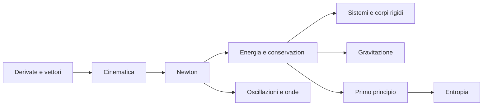

# Mappa di Fisica 1

> [!abstract]
> Capitoli, concetti di ripasso e percorsi trasversali del volume. Parti da [[00 - F1 - Guida allo studio]] per fonti, convenzioni e prerequisiti.

## Capitoli

| N. | Nota | Pagine PDF del capitolo |
|---|---|---|
| 01 | [[01 - F1 - Cinematica del punto]] | 12–47 |
| 02 | [[02 - F1 - Dinamica del punto e leggi di Newton]] | 48–87 |
| 03 | [[03 - F1 - Moti relativi e forze apparenti]] | 88–105 |
| 04 | [[04 - F1 - Lavoro, energia e momento angolare]] | 106–127 |
| 05 | [[05 - F1 - Dinamica dei sistemi di punti materiali]] | 128–149 |
| 06 | [[06 - F1 - Dinamica del corpo rigido]] | 150–193 |
| 07 | [[07 - F1 - Fenomeni di urto]] | 194–211 |
| 08 | [[08 - F1 - Gravitazione]] | 212–227 |
| 09 | [[09 - F1 - Onde meccaniche]] | 228–257 |
| 10 | [[10 - F1 - Proprietà meccaniche dei fluidi]] | 258–283 |
| 11 | [[11 - F1 - Sistemi termodinamici e temperatura]] | 284–309 |
| 12 | [[12 - F1 - Primo principio della termodinamica]] | 310–351 |
| 13 | [[13 - F1 - Secondo principio ed entropia]] | 352–382 |

## Concetti per tema

### Cinematica del punto

[[F1 - Posizione, velocità e accelerazione]] · [[F1 - Moto rettilineo e caduta verticale]] · [[F1 - Moto armonico e accelerazione dipendente dalla posizione]] · [[F1 - Accelerazione tangenziale e normale]] · [[F1 - Moto parabolico]]

### Dinamica del punto e leggi di Newton

[[F1 - Leggi di Newton e riferimento inerziale]] · [[F1 - Quantità di moto, impulso ed equilibrio]] · [[F1 - Peso, vincoli, attrito e fili]] · [[F1 - Forza viscosa e velocità limite]] · [[F1 - Oscillatori e pendolo]]

### Moti relativi e forze apparenti

[[F1 - Trasformazioni galileiane]] · [[F1 - Traslazione accelerata]] · [[F1 - Velocità e accelerazione in un riferimento rotante]] · [[F1 - Forza centrifuga e forza di Coriolis]]

### Lavoro, energia e momento angolare

[[F1 - Lavoro, potenza ed energia cinetica]] · [[F1 - Forze conservative ed energia potenziale]] · [[F1 - Conservazione e dissipazione]] · [[F1 - Momento della forza e momento angolare]]

### Dinamica dei sistemi di punti materiali

[[F1 - Forze interne e centro di massa]] · [[F1 - Conservazione della quantità di moto totale]] · [[F1 - Momento angolare di un sistema]] · [[F1 - Teoremi di König e moto interno]] · [[F1 - Energia e sistemi di forze]]

### Dinamica del corpo rigido

[[F1 - Traslazione, rotazione ed equilibrio]] · [[F1 - Momento di inerzia e teorema di Huygens-Steiner]] · [[F1 - Rotazione attorno a un asse fisso]] · [[F1 - Rotolamento puro]] · [[F1 - Pendolo composto, impulso angolare e precessione]] · [[F1 - Elasticità dei solidi reali]]

### Fenomeni di urto

[[F1 - Approssimazione impulsiva e sistema isolato]] · [[F1 - Urto elastico unidimensionale]] · [[F1 - Urto completamente anelastico]] · [[F1 - Restituzione e urti con corpi rigidi]]

### Gravitazione

[[F1 - Forza, massa e campo gravitazionale]] · [[F1 - Energia potenziale e campo centrale]] · [[F1 - Orbite circolari e leggi di Keplero]] · [[F1 - Fuga e potenziale efficace]] · [[F1 - Limiti della gravitazione newtoniana]]

### Onde meccaniche

[[F1 - Onde progressive e armoniche]] · [[F1 - Equazione delle onde e corda tesa]] · [[F1 - Energia, intensità e onde sonore]] · [[F1 - Effetto Doppler]] · [[F1 - Interferenza, onde stazionarie e battimenti]] · [[F1 - Onde sonore e onde d’urto]]

### Proprietà meccaniche dei fluidi

[[F1 - Pressione e legge di Stevino]] · [[F1 - Spinta di Archimede]] · [[F1 - Continuità e portata]] · [[F1 - Bernoulli e applicazioni]] · [[F1 - Viscosità, Poiseuille e numero di Reynolds]]

### Sistemi termodinamici e temperatura

[[F1 - Sistema, ambiente ed equilibrio]] · [[F1 - Principio zero e scale termometriche]] · [[F1 - Gas ideale ed equazione di stato]] · [[F1 - Calorimetria e cambiamenti di fase]] · [[F1 - Trasmissione del calore e dilatazione]] · [[F1 - Trasformazioni e reversibilità]]

### Primo principio della termodinamica

[[F1 - Convenzione dei segni e primo principio]] · [[F1 - Lavoro di espansione e gas ideale]] · [[F1 - Calori molari e relazione di Mayer]] · [[F1 - Trasformazioni fondamentali del gas ideale]] · [[F1 - Gas reali, cambiamenti di fase e Clapeyron]] · [[F1 - Espansione libera, cicli e teoria cinetica]]

### Secondo principio ed entropia

[[F1 - Enunciati di Kelvin-Planck e Clausius]] · [[F1 - Macchine termiche, frigoriferi e teorema di Carnot]] · [[F1 - Disuguaglianza di Clausius ed entropia]] · [[F1 - Calcolo dell’entropia e produzione interna]] · [[F1 - Energia utilizzabile e significato statistico]] · [[F1 - Temperatura termodinamica e terzo principio]]

## Percorsi trasversali

[[01 - F1 - Cinematica del punto]] → [[02 - F1 - Dinamica del punto e leggi di Newton]] → [[04 - F1 - Lavoro, energia e momento angolare]] → [[08 - F1 - Gravitazione]]

[[05 - F1 - Dinamica dei sistemi di punti materiali]] → [[06 - F1 - Dinamica del corpo rigido]] → [[07 - F1 - Fenomeni di urto]]

[[02 - F1 - Dinamica del punto e leggi di Newton]] → [[09 - F1 - Onde meccaniche]] → [[06 - F2 - Induzione e campi elettromagnetici]] → [[07 - F2 - Onde elettromagnetiche]]

[[04 - F1 - Lavoro, energia e momento angolare]] → [[12 - F1 - Primo principio della termodinamica]] → [[13 - F1 - Secondo principio ed entropia]]

