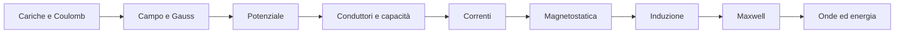

# Mappa di Fisica 2

> [!abstract]
> Capitoli, concetti di ripasso e percorsi trasversali del volume. Parti da [[00 - F2 - Guida allo studio]] per fonti, convenzioni e prerequisiti.

## Capitoli

| N. | Nota | Pagine PDF del capitolo |
|---|---|---|
| 01 | [[01 - F2 - Fenomeni elettrici e legge di Gauss]] | 9–56 |
| 02 | [[02 - F2 - Potenziale elettrostatico]] | 57–96 |
| 03 | [[03 - F2 - Conduttori, condensatori e dielettrici]] | 97–152 |
| 04 | [[04 - F2 - Correnti elettriche stazionarie]] | 153–194 |
| 05 | [[05 - F2 - Campi magnetici stazionari]] | 195–244 |
| 06 | [[06 - F2 - Induzione e campi elettromagnetici]] | 245–296 |
| 07 | [[07 - F2 - Onde elettromagnetiche]] | 297–334 |

## Concetti per tema

### Fenomeni elettrici e legge di Gauss

[[F2 - Carica elettrica e induzione elettrostatica]] · [[F2 - Legge di Coulomb e campo elettrico]] · [[F2 - Sovrapposizione e distribuzioni continue]] · [[F2 - Flusso, angolo solido e legge di Gauss]] · [[F2 - Uso delle simmetrie e divergenza]] · [[F2 - Verifiche sperimentali e unità]]

### Potenziale elettrostatico

[[F2 - Conservatività e differenza di potenziale]] · [[F2 - Potenziale coulombiano e distribuzioni]] · [[F2 - Gradiente e superfici equipotenziali]] · [[F2 - Energia potenziale e dipolo in un campo]] · [[F2 - Rotore, Poisson e Laplace]] · [[F2 - Sviluppo multipolare e dipolo non uniforme]]

### Conduttori, condensatori e dielettrici

[[F2 - Conduttori in equilibrio elettrostatico]] · [[F2 - Capacità e condensatori]] · [[F2 - Collegamenti ed energia elettrostatica]] · [[F2 - Polarizzazione e campo nella materia]] · [[F2 - Condizioni al contorno ed effetto del dielettrico]] · [[F2 - Unicità, immagini, schermo e stabilità]]

### Correnti elettriche stazionarie

[[F2 - Corrente e conservazione della carica]] · [[F2 - Legge di Ohm e modello di conduzione]] · [[F2 - Resistenze, generatori e leggi di Kirchhoff]] · [[F2 - Potenza, effetto Joule e misure]] · [[F2 - Transitorio RC e altri meccanismi di conduzione]] · [[F2 - Conduzione nei mezzi e conversione energetica]]

### Campi magnetici stazionari

[[F2 - Magnetismo, Oersted e forza di Lorentz]] · [[F2 - Campo delle correnti e forze sui circuiti]] · [[F2 - Legge di Ampère e simmetrie]] · [[F2 - Particelle cariche ed effetto Hall]] · [[F2 - Dipoli e proprietà magnetiche della materia]] · [[F2 - Risonanza magnetica e potenziale vettore]]

### Induzione e campi elettromagnetici

[[F2 - Legge di Faraday e verso di Lenz]] · [[F2 - Induzione da movimento e campo elettrico indotto]] · [[F2 - Mutua induzione, autoinduzione ed energia]] · [[F2 - Circuiti LC e transitorio RL]] · [[F2 - Equazioni di Maxwell e corrente di spostamento]] · [[F2 - Corrente alternata, trasformatori e filtri]] · [[F2 - Induttanza mutua, betatrone e propagazione]]

### Onde elettromagnetiche

[[F2 - Equazione delle onde e velocità nel vuoto]] · [[F2 - Onde piane e onde monocromatiche]] · [[F2 - Polarizzazione]] · [[F2 - Energia e vettore di Poynting]] · [[F2 - Quantità di moto, pressione e spettro]] · [[F2 - Irraggiamento e onde in un mezzo]]

## Percorsi trasversali

[[04 - F1 - Lavoro, energia e momento angolare]] → [[02 - F2 - Potenziale elettrostatico]] → [[03 - F2 - Conduttori, condensatori e dielettrici]]

[[01 - F2 - Fenomeni elettrici e legge di Gauss]] → [[05 - F2 - Campi magnetici stazionari]] → [[06 - F2 - Induzione e campi elettromagnetici]]

[[02 - F1 - Dinamica del punto e leggi di Newton]] → [[04 - F2 - Correnti elettriche stazionarie]] → [[06 - F2 - Induzione e campi elettromagnetici]]

[[09 - F1 - Onde meccaniche]] → [[07 - F2 - Onde elettromagnetiche]]

