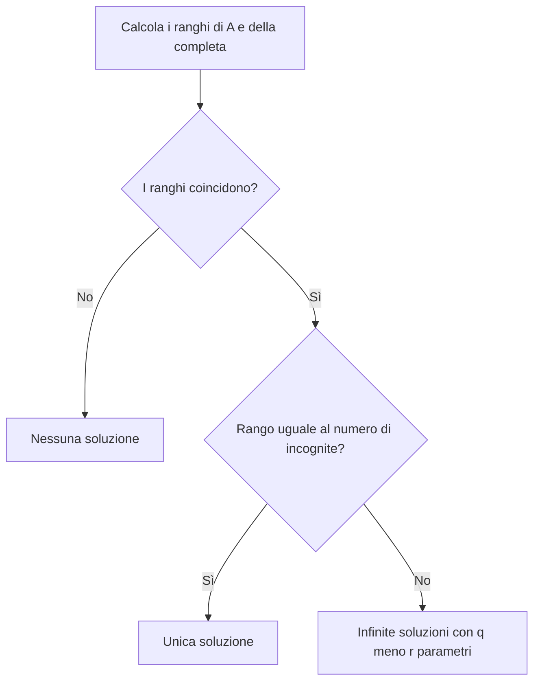

# Sistemi di equazioni lineari

> [!abstract] Scopo e percorso
> Algebra delle matrici e sistemi. Questa nota segue il capitolo 8 del libro e raccoglie definizioni, risultati e passaggi operativi. Indice generale: [[MOC - Geometria]].

> [!note] Come leggere i riferimenti
> Fonte: Giuseppe Accascina e Valerio Monti, *Geometria*, versione 1 del 21 settembre 2015. La pagina PDF è la pagina stampata più 16. Gli esempi di calcolo aggiuntivi sono elaborazioni didattiche; i riferimenti indicano dove il libro tratta il risultato. Le figure originali sono conservate come pagine renderizzate, con il loro contesto.

## 8.1 - Definizioni

Vedi [[GEO - Matrice completa di un sistema]].

Il sistema $Ax=b$ ha matrice dei coefficienti $A\in M(p,q,\mathbb R)$ e matrice completa $[A\mid b]\in M(p,q+1,\mathbb R)$. La completa contiene anche l’informazione sui termini noti.

L’insieme delle soluzioni è $\operatorname{Sol}(S)\subseteq\mathbb R^q$. Un sistema è risolubile o compatibile quando tale insieme non è vuoto. È omogeneo se $b=0$: in questo caso $x=0$ è sempre soluzione.

_(Accascina–Monti, § 8.1, libro pp. 121–124; PDF pp. 137–140.)_

## 8.2 - Teorema di Rouché-Capelli

Vedi [[GEO - Teorema di Rouché-Capelli]].

Il teorema di Rouché-Capelli afferma

$$Ax=b\text{ compatibile}\iff\operatorname{rk}A=\operatorname{rk}[A\mid b].$$

Se il rango comune è $r$, le soluzioni dipendono da $q-r$ parametri liberi. In particolare sono uniche se $r=q$, infinite se $r<q$. Se i ranghi differiscono non esistono soluzioni.

Per $x+y=1$, $2x+2y=3$ il rango di $A$ è $1$ e quello della completa è $2$: il secondo termine noto introduce un vincolo incompatibile. Con termine noto $2$, invece, i ranghi coincidono e le soluzioni sono $(1-t,t)$.

_(Accascina–Monti, § 8.2, libro pp. 124–127; PDF pp. 140–143.)_

## 8.3 - Procedimento di Rouché-Capelli

Vedi [[GEO - Parametri liberi e sistemi ridotti]].

Il procedimento del libro usa un minore invertibile di ordine $r=\operatorname{rk}A$ per scegliere $r$ equazioni e $r$ incognite principali. Si verifica la compatibilità orlando il minore con la colonna dei termini noti; se il sistema è compatibile, le altre $q-r$ incognite diventano parametri e si risolve un sistema crameriano nelle incognite principali.

Per $x+y+z=2$, $2x+2y+2z=4$ basta la prima equazione. Ponendo $y=s$, $z=t$:

$$x=2-s-t,\qquad\operatorname{Sol}(S)=\{(2-s-t,s,t):s,t\in\mathbb R\}.$$

La scelta delle variabili libere non è unica, ma l’insieme delle soluzioni è lo stesso. Nel caso particolare $A=0$, si controlla direttamente $b$: se $b=0$ ogni vettore è soluzione, altrimenti nessuno.

_(Accascina–Monti, § 8.3, libro pp. 127–135; PDF pp. 143–151.)_

## Schema di classificazione

## Ripasso attivo

- **Definizioni:** ricostruisci definizione, ipotesi e procedimento; poi controlla la scheda [[GEO - Matrice completa di un sistema]].
- **Teorema di Rouché-Capelli:** ricostruisci definizione, ipotesi e procedimento; poi controlla la scheda [[GEO - Teorema di Rouché-Capelli]].
- **Procedimento di Rouché-Capelli:** ricostruisci definizione, ipotesi e procedimento; poi controlla la scheda [[GEO - Parametri liberi e sistemi ridotti]].

> [!tip] Allenamento sul libro
> Gli esercizi del capitolo iniziano a p. 140 (PDF p. 156). Prova a svolgerli prima di consultare le soluzioni del libro. Le note riassumono la teoria e propongono esempi svolti; non trascrivono tutte le risoluzioni.

## Collegamenti

Precedente: [[07 - GEO - Rango di una matrice]] · Successiva: [[09 - GEO - Metodo di Gauss]]

[[MOC - Geometria]]
