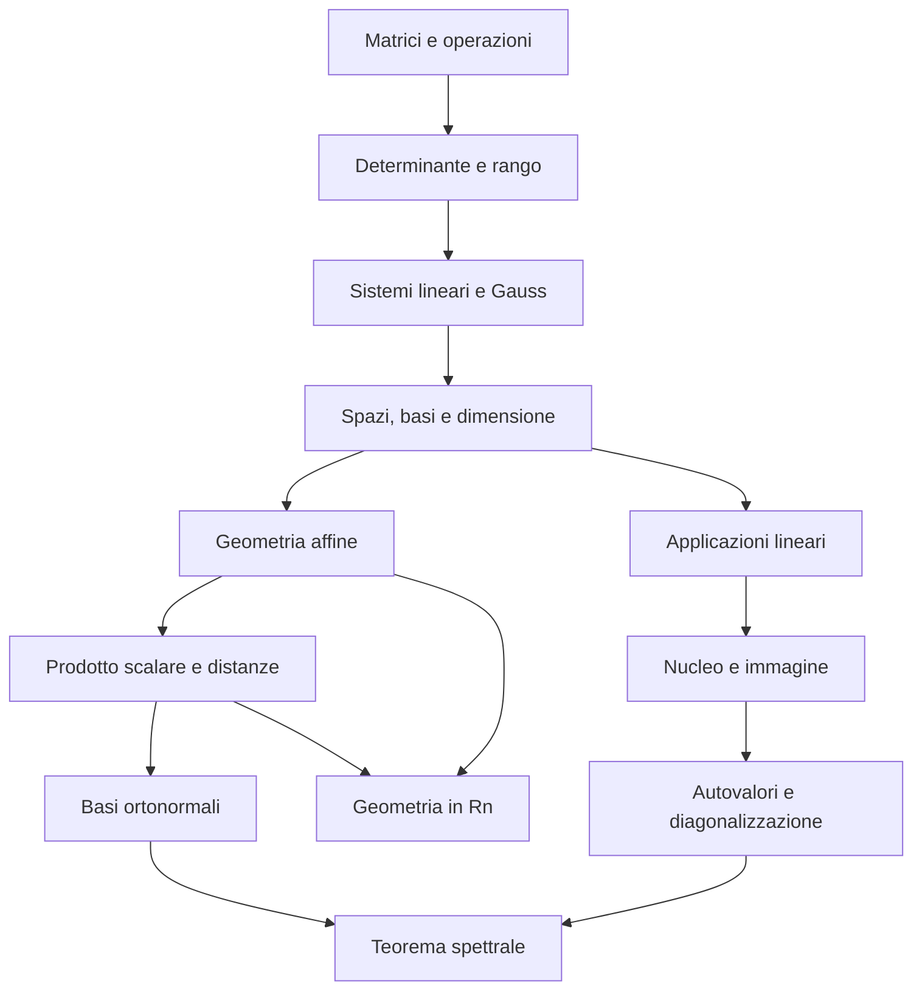

# MOC - Geometria

> [!abstract] Mappa del corso
> Percorso completo della teoria dei 40 capitoli e delle tre appendici del libro di Accascina e Monti, con 166 schede di ripasso. I capitoli seguono l’ordine del libro; gli esercizi sono richiamati con pagine di riferimento e affiancati da esempi svolti nelle note.

## Fonte e convenzioni

Giuseppe Accascina e Valerio Monti, *Geometria*, versione 1, 21 settembre 2015: [apri il libro](../pdf/Geometria.pdf). Il PDF ha 790 pagine: da p. 17 inizia la pagina stampata 1, quindi **pagina PDF = pagina del libro + 16**. Appunti in italiano, sigla `GEO`. Le note preesistenti in inglese sono conservate.

Le 59 pagine con figure geometriche sono renderizzate in `images/`, con nome `GEO-pNNN-1.png`, e accompagnate da una spiegazione. Alcune costruzioni ricompaiono nei sunti e negli esercizi: le ripetizioni sono conservate con il loro contesto originale.

## Capitoli e appendici

| N. | Nota | Pagine libro | Pagine PDF |
|---|---|---|---|
| 1 | [[01 - GEO - Equazioni lineari e numeri|Equazioni lineari e numeri]] | 1–24 | 17–40 |
| 2 | [[02 - GEO - Matrici e insiemi|Matrici e insiemi]] | 25–36 | 41–52 |
| 3 | [[03 - GEO - Lo spazio vettoriale delle matrici|Lo spazio vettoriale delle matrici]] | 37–50 | 53–66 |
| 4 | [[04 - GEO - Moltiplicazione tra matrici|Moltiplicazione tra matrici]] | 51–68 | 67–84 |
| 5 | [[05 - GEO - Determinanti|Determinanti]] | 69–86 | 85–102 |
| 6 | [[06 - GEO - Matrice inversa|Matrice inversa]] | 87–106 | 103–122 |
| 7 | [[07 - GEO - Rango di una matrice|Rango di una matrice]] | 107–120 | 123–136 |
| 8 | [[08 - GEO - Sistemi di equazioni lineari|Sistemi di equazioni lineari]] | 121–140 | 137–156 |
| 9 | [[09 - GEO - Metodo di Gauss|Metodo di Gauss]] | 141–158 | 157–174 |
| 10 | [[10 - GEO - Applicazioni del metodo di Gauss|Applicazioni del metodo di Gauss]] | 159–170 | 175–186 |
| 11 | [[11 - GEO - I vettori geometrici|I vettori geometrici]] | 171–182 | 187–198 |
| 12 | [[12 - GEO - Combinazioni lineari di vettori geometrici|Combinazioni lineari di vettori geometrici]] | 183–192 | 199–208 |
| 13 | [[13 - GEO - Spazi vettoriali sui reali|Spazi vettoriali sui reali]] | 193–200 | 209–216 |
| 14 | [[14 - GEO - Sottospazi vettoriali|Sottospazi vettoriali]] | 201–214 | 217–230 |
| 15 | [[15 - GEO - Generatori|Generatori]] | 215–224 | 231–240 |
| 16 | [[16 - GEO - Dipendenza e indipendenza lineare|Dipendenza e indipendenza lineare]] | 225–234 | 241–250 |
| 17 | [[17 - GEO - Basi di spazi vettoriali|Basi di spazi vettoriali]] | 235–262 | 251–278 |
| 18 | [[18 - GEO - Intersezione e somma di sottospazi|Intersezione e somma di sottospazi]] | 263–290 | 279–306 |
| 19 | [[19 - GEO - Sottospazi affini|Sottospazi affini]] | 291–304 | 307–320 |
| 20 | [[20 - GEO - Equazioni vettoriali di rette e piani|Equazioni vettoriali di rette e piani]] | 305–314 | 321–330 |
| 21 | [[21 - GEO - Riferimenti affini|Riferimenti affini]] | 315–324 | 331–340 |
| 22 | [[22 - GEO - Equazioni parametriche|Equazioni parametriche]] | 325–344 | 341–360 |
| 23 | [[23 - GEO - Equazioni cartesiane nel piano|Equazioni cartesiane nel piano]] | 345–380 | 361–396 |
| 24 | [[24 - GEO - Equazioni cartesiane nello spazio|Equazioni cartesiane nello spazio]] | 381–414 | 397–430 |
| 25 | [[25 - GEO - Funzioni tra insiemi|Funzioni tra insiemi]] | 415–428 | 431–444 |
| 26 | [[26 - GEO - Omomorfismi|Omomorfismi]] | 429–456 | 445–472 |
| 27 | [[27 - GEO - Immagine|Immagine]] | 457–466 | 473–482 |
| 28 | [[28 - GEO - Nucleo|Nucleo]] | 467–486 | 483–502 |
| 29 | [[29 - GEO - Isomorfismi|Isomorfismi]] | 487–494 | 503–510 |
| 30 | [[30 - GEO - Endomorfismi|Endomorfismi]] | 495–508 | 511–524 |
| 31 | [[31 - GEO - Autovalori e autovettori|Autovalori e autovettori]] | 509–532 | 525–548 |
| 32 | [[32 - GEO - Diagonalizzazione|Diagonalizzazione]] | 533–560 | 549–576 |
| 33 | [[33 - GEO - Prodotto scalare di vettori geometrici|Prodotto scalare di vettori geometrici]] | 561–572 | 577–588 |
| 34 | [[34 - GEO - Riferimenti cartesiani|Riferimenti cartesiani]] | 573–576 | 589–592 |
| 35 | [[35 - GEO - Geometria analitica metrica del piano|Geometria analitica metrica del piano]] | 577–604 | 593–620 |
| 36 | [[36 - GEO - Geometria analitica metrica dello spazio|Geometria analitica metrica dello spazio]] | 605–632 | 621–648 |
| 37 | [[37 - GEO - Endomorfismi di V3(O) - Due esempi|Endomorfismi di V 3 (O): due esempi]] | 633–638 | 649–654 |
| 38 | [[38 - GEO - Prodotto scalare in Rn|Prodotto scalare in Rn]] | 639–662 | 655–678 |
| 39 | [[39 - GEO - Diagonalizzazione di matrici simmetriche|Diagonalizzazione di matrici simmetriche]] | 663–678 | 679–694 |
| 40 | [[40 - GEO - Geometria in Rn|Geometria in Rn]] | 679–712 | 695–728 |
| A | [[A - GEO - Approfondimenti|Approfondimenti]] | 713–738 | 729–754 |
| B | [[B - GEO - Richiami di geometria del piano|Richiami di geometria del piano]] | 739–764 | 755–780 |
| C | [[C - GEO - Richiami di geometria dello spazio|Richiami di geometria dello spazio]] | 765–774 | 781–790 |

## Concetti per tema

### Algebra delle matrici e sistemi

- **1 — Equazioni lineari e numeri:** [[GEO - Equazione lineare in una incognita]] · [[GEO - Sistemi in due incognite]] · [[GEO - Sistemi lineari generali]] · [[GEO - Equivalenza dei sistemi]] · [[GEO - Insiemi numerici]]
- **2 — Matrici e insiemi:** [[GEO - Tipi di matrici]] · [[GEO - Intersezione e unione di insiemi]] · [[GEO - Matrice trasposta]]
- **3 — Lo spazio vettoriale delle matrici:** [[GEO - Somma di matrici]] · [[GEO - Prodotto di una matrice per uno scalare]]
- **4 — Moltiplicazione tra matrici:** [[GEO - Prodotto tra matrici]] · [[GEO - Forma matriciale dei sistemi]] · [[GEO - Proprietà del prodotto matriciale]]
- **5 — Determinanti:** [[GEO - Determinante e sviluppo di Laplace]] · [[GEO - Proprietà del determinante]]
- **6 — Matrice inversa:** [[GEO - Matrice identità]] · [[GEO - Matrice inversa]] · [[GEO - Proprietà della matrice inversa]] · [[GEO - Teorema di Cramer]]
- **7 — Rango di una matrice:** [[GEO - Rango e minori]] · [[GEO - Teorema dell’orlare]]
- **8 — Sistemi di equazioni lineari:** [[GEO - Matrice completa di un sistema]] · [[GEO - Teorema di Rouché-Capelli]] · [[GEO - Parametri liberi e sistemi ridotti]]
- **9 — Metodo di Gauss:** [[GEO - Eliminazione delle incognite]] · [[GEO - Metodo di Gauss e pivot]]
- **10 — Applicazioni del metodo di Gauss:** [[GEO - Operazioni elementari di riga]] · [[GEO - Determinante con Gauss]] · [[GEO - Rango con Gauss]]

### Vettori, spazi e basi

- **11 — I vettori geometrici:** [[GEO - Vettori geometrici del piano]] · [[GEO - Somma e differenza di vettori]] · [[GEO - Multipli di un vettore geometrico]] · [[GEO - Vettori geometrici dello spazio]] · [[GEO - Direzioni per l’origine]] · [[GEO - Punto medio vettoriale]]
- **12 — Combinazioni lineari di vettori geometrici:** [[GEO - Combinazioni lineari e geometria]]
- **13 — Spazi vettoriali sui reali:** [[GEO - Assiomi di spazio vettoriale]] · [[GEO - Spazi di matrici e polinomi]] · [[GEO - Proprietà degli spazi vettoriali]]
- **14 — Sottospazi vettoriali:** [[GEO - Criterio di sottospazio vettoriale]] · [[GEO - Sottospazi geometrici]]
- **15 — Generatori:** [[GEO - Span e generatori]]
- **16 — Dipendenza e indipendenza lineare:** [[GEO - Dipendenza e indipendenza lineare]]
- **17 — Basi di spazi vettoriali:** [[GEO - Basi e coordinate]] · [[GEO - Dimensione di uno spazio vettoriale]] · [[GEO - Base di un sistema omogeneo]] · [[GEO - Dimensione dei sottospazi]] · [[GEO - Estrazione di una base]]
- **18 — Intersezione e somma di sottospazi:** [[GEO - Intersezione di sottospazi]] · [[GEO - Somma di sottospazi e Grassmann]] · [[GEO - Somma diretta]]

### Geometria affine nel piano e nello spazio

- **19 — Sottospazi affini:** [[GEO - Retta come traslazione]] · [[GEO - Piano come traslazione]] · [[GEO - Sottospazio affine]] · [[GEO - Soluzione particolare e omogeneo associato]]
- **20 — Equazioni vettoriali di rette e piani:** [[GEO - Equazione vettoriale di una retta]] · [[GEO - Segmenti e semirette vettoriali]] · [[GEO - Equazione vettoriale di un piano]] · [[GEO - Criteri vettoriali di allineamento e complanarità]]
- **21 — Riferimenti affini:** [[GEO - Riferimento affine nel piano]] · [[GEO - Riferimento affine nello spazio]] · [[GEO - Coordinate del punto medio]] · [[GEO - Rango e configurazioni di punti]]
- **22 — Equazioni parametriche:** [[GEO - Retta parametrica nel piano]] · [[GEO - Posizione di rette parametriche nel piano]] · [[GEO - Retta parametrica nello spazio]] · [[GEO - Piano parametrico]] · [[GEO - Vincoli sui parametri geometrici]]
- **23 — Equazioni cartesiane nel piano:** [[GEO - Equazione cartesiana della retta]] · [[GEO - Passaggio tra forme di una retta]] · [[GEO - Retta per due punti]] · [[GEO - Intersezione di rette cartesiane]] · [[GEO - Fasci di rette]] · [[GEO - Semipiani cartesiani]]
- **24 — Equazioni cartesiane nello spazio:** [[GEO - Equazione cartesiana del piano]] · [[GEO - Passaggio tra forme di un piano]] · [[GEO - Piano per tre punti]] · [[GEO - Intersezione di piani]] · [[GEO - Retta come intersezione di piani]] · [[GEO - Fasci e stelle di piani]] · [[GEO - Semispazi e semipiani nello spazio]]

### Funzioni e applicazioni lineari

- **25 — Funzioni tra insiemi:** [[GEO - Immagine e controimmagine di una funzione]] · [[GEO - Iniettività suriettività e biiettività]] · [[GEO - Funzione inversa]] · [[GEO - Composizione di funzioni]]
- **26 — Omomorfismi:** [[GEO - Applicazione lineare]] · [[GEO - Matrice di un’applicazione lineare]] · [[GEO - Applicazione lineare assegnata su una base]]
- **27 — Immagine:** [[GEO - Immagine di un’applicazione lineare]] · [[GEO - Base dell’immagine e suriettività]]
- **28 — Nucleo:** [[GEO - Nucleo e iniettività]] · [[GEO - Calcolo del nucleo e rango-nullità]] · [[GEO - Controimmagini affini]]
- **29 — Isomorfismi:** [[GEO - Isomorfismi di spazi vettoriali]]
- **30 — Endomorfismi:** [[GEO - Endomorfismi e composizione]] · [[GEO - Cambiamento di base e similitudine]]

### Autovalori e diagonalizzazione

- **31 — Autovalori e autovettori:** [[GEO - Autovalori autovettori e autospazi]] · [[GEO - Polinomio caratteristico]] · [[GEO - Molteplicità algebrica e geometrica]] · [[GEO - Calcolo degli autospazi]]
- **32 — Diagonalizzazione:** [[GEO - Criterio di diagonalizzabilità]]

### Geometria metrica e prodotto scalare

- **33 — Prodotto scalare di vettori geometrici:** [[GEO - Norma di un vettore geometrico]] · [[GEO - Prodotto scalare geometrico]] · [[GEO - Base ortonormale nel piano]] · [[GEO - Base ortonormale nello spazio]] · [[GEO - Angolo tra vettori]]
- **34 — Riferimenti cartesiani:** [[GEO - Riferimento cartesiano ortonormale]] · [[GEO - Distanza tra punti]]
- **35 — Geometria analitica metrica del piano:** [[GEO - Ortogonalità di rette nel piano]] · [[GEO - Angolo tra rette nel piano]] · [[GEO - Distanza punto-retta nel piano]] · [[GEO - Distanza tra rette parallele nel piano]] · [[GEO - Bisettrici cartesiane]] · [[GEO - Circonferenze cartesiane]]
- **36 — Geometria analitica metrica dello spazio:** [[GEO - Ortogonalità di rette nello spazio]] · [[GEO - Angolo tra rette nello spazio]] · [[GEO - Ortogonalità retta-piano]] · [[GEO - Ortogonalità tra piani]] · [[GEO - Costruzioni ortogonali nello spazio]] · [[GEO - Distanze nello spazio]] · [[GEO - Sfere e sezioni circolari]]
- **37 — Endomorfismi di V 3 (O): due esempi:** [[GEO - Proiezione ortogonale su un piano]] · [[GEO - Proiezione obliqua su un piano]]
- **38 — Prodotto scalare in Rn:** [[GEO - Prodotto scalare standard in Rn]] · [[GEO - Ortonormalizzazione di Gram-Schmidt]] · [[GEO - Matrici ortogonali]]
- **39 — Diagonalizzazione di matrici simmetriche:** [[GEO - Teorema spettrale reale]] · [[GEO - Diagonalizzazione ortogonale]]

### Geometria in dimensione n

- **40 — Geometria in Rn:** [[GEO - Affini in Rn]] · [[GEO - Parallelismo affine in Rn]] · [[GEO - Inviluppo affine]] · [[GEO - Iperpiani]] · [[GEO - Normale a un iperpiano]] · [[GEO - Insiemi convessi e semispazi]]

### Appendici

- **A — Approfondimenti:** [[GEO - Dimostrazione dell’equivalenza dei sistemi]] · [[GEO - Dimostrazione dell’associatività matriciale]] · [[GEO - Multilinearità e alternanza del determinante]] · [[GEO - Dimostrazione del criterio di invertibilità]] · [[GEO - Invarianza del rango per operazioni di riga]] · [[GEO - Lemma del completamento]] · [[GEO - Dimostrazione della formula di Grassmann]] · [[GEO - Indipendenza degli autospazi distinti]] · [[GEO - Dimostrazioni di Schwarz e della triangolare]]
- **B — Richiami di geometria del piano:** [[GEO - Punti e rette euclidee]] · [[GEO - Convessità e regioni del piano]] · [[GEO - Poligoni e parallelogrammi]] · [[GEO - Distanza euclidea e punto medio]] · [[GEO - Parallelismo euclideo nel piano]] · [[GEO - Angoli euclidei]] · [[GEO - Perpendicolari nel piano]] · [[GEO - Teoremi sui triangoli]] · [[GEO - Distanza tra insiemi]] · [[GEO - Simmetrie del piano]] · [[GEO - Bisettrici come luoghi geometrici]] · [[GEO - Circonferenza euclidea]] · [[GEO - Punti notevoli di un triangolo]]
- **C — Richiami di geometria dello spazio:** [[GEO - Enti della geometria dello spazio]] · [[GEO - Incidenza nello spazio]] · [[GEO - Semispazi euclidei]] · [[GEO - Rette sghembe e complanari]] · [[GEO - Posizione reciproca di piani]] · [[GEO - Posizione reciproca retta-piano]] · [[GEO - Angoli e parallelogrammi nello spazio]] · [[GEO - Perpendicolare comune e ortogonalità]] · [[GEO - Distanze euclidee nello spazio]] · [[GEO - Sfera euclidea e circonferenze nello spazio]]

## Percorsi trasversali

- [[GEO - Rango e minori]] → [[GEO - Teorema di Rouché-Capelli]] → [[GEO - Metodo di Gauss e pivot]] → [[GEO - Base di un sistema omogeneo]]
- [[GEO - Span e generatori]] → [[GEO - Dipendenza e indipendenza lineare]] → [[GEO - Basi e coordinate]] → [[GEO - Dimensione di uno spazio vettoriale]]
- [[GEO - Matrice di un’applicazione lineare]] → [[GEO - Calcolo del nucleo e rango-nullità]] → [[GEO - Controimmagini affini]] → [[GEO - Soluzione particolare e omogeneo associato]]
- [[GEO - Cambiamento di base e similitudine]] → [[GEO - Calcolo degli autospazi]] → [[GEO - Criterio di diagonalizzabilità]] → [[GEO - Diagonalizzazione ortogonale]]
- [[GEO - Prodotto scalare standard in Rn]] → [[GEO - Ortonormalizzazione di Gram-Schmidt]] → [[GEO - Matrici ortogonali]] → [[GEO - Teorema spettrale reale]]
- [[GEO - Sottospazio affine]] → [[GEO - Inviluppo affine]] → [[GEO - Iperpiani]] → [[GEO - Insiemi convessi e semispazi]]

## Correzioni al materiale

- [[29 - GEO - Isomorfismi#29.1 - Isomorfismi|Cap. 29, p. 491 / PDF 507]]: direzione della funzione inversa, da $B$ verso $A$.
- [[37 - GEO - Endomorfismi di V3(O) - Due esempi#Proiezione obliqua - Esempio 37.5|Cap. 37, p. 638 / PDF 654]]: la proiezione obliqua ha una base di autovettori, ma non una base ortonormale di autovettori; l’elemento centrale della matrice è $1/2$ invece di $3/4$.

## Collegamenti con le note esistenti

[[Invertible Matrix]] · [[Squared Euclidean Norm]] · [[Convex Function]] · [[Concave Function]] · [[Linear Regression]]
