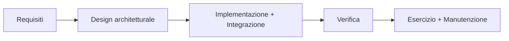

# Software Development Process

> [!abstract]
> Prima lezione di contenuto: **come si organizza lo sviluppo di un software** perché il progetto non fallisca. Si distingue il software *su commessa* (project-based) da quello *di prodotto* (product-based), si introduce il **ciclo di vita** del software e si confrontano le due grandi famiglie di processi: **Plan-and-Document** (Waterfall, Spiral, RUP) e **Agile** (sviluppo incrementale, Extreme Programming, Scrum).
>
> Il corso adotta un approccio Agile: le idee qui introdotte (user story, TDD, iterazioni brevi) tornano in [[08 - LASS - Behavior-Driven Development]] e [[15 - LASS - Testing BDD e TDD]]. La lezione successiva, [[02 - LASS - Software Architectures]], passa da *come si lavora* a *come si struttura il sistema*.
>
> Indice dei concetti: [[MOC - Lab Architetture Software e Sicurezza]]. Parte del materiale deriva dalle slide dei proff. John Yang e Ian Sommerville.

---

## Introduzione alla Software Engineering

La **software engineering** (ingegneria del software) nasce da una domanda pratica: **come evitare che un progetto software fallisca?** Le cause tipiche di fallimento sono:

- una soluzione di **bassa qualità** (piena di bug, inaffidabile);
- **fuori budget** (costa più del previsto);
- **fuori tempo** (consegnata in ritardo);
- un **fraintendimento delle aspettative del cliente** (si costruisce la cosa sbagliata);
- molte altre.

Un processo di sviluppo serve proprio a tenere sotto controllo questi rischi.

### Software project-based

Vedi [[Project-based vs Product-based Software]].

All'inizio aziende e governi volevano **automatizzare le proprie attività** e commissionavano **software personalizzato** (*custom software*). In questo modello:
- c'è un **cliente esterno** che decide le funzionalità del sistema;
- cliente e azienda di sviluppo firmano un **contratto legale**.

![[LASS-L01-p03.png]]

Il diagramma riassume il *project-based software engineering*: il **cliente** ha un **problema**, il problema **genera** dei **requisiti** (scritti insieme da cliente e sviluppatore), lo **sviluppatore** realizza un **software** che **implementa** i requisiti e che **aiuta** a risolvere il problema. Il punto di partenza è il problema del cliente.

### Software product-based

Col tempo ci si è accorti che molte aziende avevano **problemi comuni** e non avevano bisogno di software su misura: si passa dal software *project-based* a quello **product-based** (un prodotto venduto a molti clienti, come un gestionale o un'app).

- Il punto di partenza è un'**opportunità** di mercato, non il problema di un cliente.
- **Non c'è un cliente esterno** che scrive i requisiti: li decide lo sviluppatore.
- Spesso è **critico arrivare presto sul mercato** (*time to market*).

![[LASS-L01-p04.png]]

Stesso schema di prima, ma ora è tutto in mano allo **sviluppatore**: un'**opportunità** ispira le **funzionalità del prodotto** (*product features*), che vengono implementate nel **software**, il quale a sua volta realizza l'opportunità.

| | Project-based | Product-based |
|---|---|---|
| Punto di partenza | problema del cliente | opportunità di mercato |
| Chi decide i requisiti | cliente (con lo sviluppatore) | sviluppatore |
| Vincolo | contratto legale | time to market |
| Esempio | gestionale su misura per un ente | app venduta a molti utenti |

### Definizioni di software engineering

![[LASS-L01-p05.png]]

La slide riporta l'elenco di definizioni di Wikipedia, con alcune parole evidenziate. In sintesi, la software engineering è:
- *"the systematic application of scientific and technological knowledge, methods, and experience to the **design, implementation, testing, and documentation** of software"* (IEEE);
- *"the application of a systematic, disciplined, **quantifiable** approach to the development, operation, and maintenance of software"* (IEEE);
- una disciplina che si occupa di **tutti gli aspetti della produzione del software** (Sommerville);
- *"programming integrated over time"* (Software Engineering at Google).

Il filo comune: non basta saper programmare, serve un **approccio sistematico e misurabile** che copra l'intera vita del software.

## Ciclo di vita del software

Vedi [[Ciclo di Vita del Software]].

![[LASS-L01-p06.png]]

Il **software lifecycle** è la sequenza di fasi che un software attraversa, disegnata come un ciclo:

1. **System investigation**: si studia il problema e si valuta se conviene risolverlo;
2. **Analysis**: si raccolgono e analizzano i requisiti;
3. **Design**: si progetta la soluzione (architettura, componenti);
4. **Development**: si scrive il codice;
5. **Testing**: si verifica che funzioni;
6. **Maintenance**: si correggono bug e si aggiungono funzionalità dopo il rilascio, e il ciclo ricomincia.

Il disegno è circolare perché la manutenzione porta a nuove indagini e nuove versioni: un software usato non è mai davvero "finito".

## Processi di sviluppo del software

Esistono diversi **modelli di processo di sviluppo**. Si distinguono per le **attività previste** e per i **documenti prodotti**. Due grandi famiglie:

- **Plan-and-Document**: prima si pianifica e si documenta tutto, poi si esegue;
- **Agile**: si sviluppa per piccoli incrementi, con il cliente sempre coinvolto.

### Processi Plan-and-Document

Vedi [[Plan-and-Document]].

- **Prima di scrivere codice si fa il piano**.
- Si scrive una **documentazione dettagliata** per tutte le fasi del piano.
- Il **progresso si misura rispetto al piano**.
- Ogni **cambiamento** del progetto va riportato nella documentazione e, se serve, nel piano.

Conseguenza: un **overhead significativo** in pianificazione, progettazione e documentazione.

> [!quote] Sommerville
> "In the 1980s and early 1990s, there was a widespread view that the best way to create good software was to use controlled and rigorous software development processes."

### Waterfall

Vedi [[Modello Waterfall]].

Il modello **a cascata** esegue le fasi una dopo l'altra, senza tornare indietro:

1. analisi e specifica dei requisiti;
2. progettazione architetturale;
3. implementazione e integrazione;
4. verifica;
5. messa in esercizio e manutenzione.

- **Pro**: prima si trova un errore, meno costa correggerlo; con una fase di analisi accurata molti errori emergono presto.
- **Problema 1**: errori, omissioni e fraintendimenti nella **specifica** vengono spesso scoperti solo dopo aver implementato una parte consistente del sistema.
- **Problema 2**: i clienti capiscono meglio cosa vogliono quando **vedono un prototipo**, e spesso **cambiano idea**; propagare i cambiamenti all'indietro lungo la cascata richiede tempo.

### Spiral

Vedi [[Modello a Spirale]].

Il **modello a spirale** combina Waterfall e **prototipi**: il progetto procede per **iterazioni**, e ogni giro della spirale produce un prototipo più completo.

![[LASS-L01-p10.png]]

La figura mostra la spirale divisa in quattro quadranti, che corrispondono alle quattro attività di ogni iterazione:

1. **determinare obiettivi e vincoli** dell'iterazione (in alto a sinistra);
2. **valutare le alternative, identificare e risolvere i rischi** (in alto a destra);
3. **sviluppare e verificare il prototipo** dell'iterazione (in basso a destra: Prototype 1, 2, 3, poi l'*operational prototype*);
4. **pianificare l'iterazione successiva** (in basso a sinistra).

A ogni giro la spirale si allarga: il prototipo cresce fino al sistema completo. La differenza rispetto a Waterfall è che **il cliente viene coinvolto prima che il prodotto sia finito**, a ogni iterazione.

### Rational Unified Process (RUP)

Vedi [[Rational Unified Process]].

Il RUP è *"allied closer to business than technical issues"*: è un processo più vicino agli aspetti di business che a quelli tecnici. Ha quattro fasi:

1. **Inception**: si costruisce il *business case*, si definisce l'ambito del progetto, si giustificano i costi e si valutano i rischi;
2. **Elaboration**: si identificano i **casi d'uso** con i clienti, si fissa il piano di sviluppo e si costruisce un prototipo;
3. **Construction**: si scrive e si testa il prodotto, fino al primo rilascio esterno;
4. **Transition**: si porta il prodotto dal rilascio alla produzione.

![[LASS-L01-p11.png]]

Il grafico (il classico "diagramma a gobbe" del RUP) mette sulle **colonne le fasi** nel tempo (Inception I1, Elaboration E1–E2, Construction C1–C4, Transition T1–T2, cioè le iterazioni di ciascuna fase) e sulle **righe le discipline** (*business modeling, requirements, analysis & design, implementation, test, deployment*). L'altezza di ogni "onda" indica **quanto lavoro** si fa su quella disciplina in quel momento: la modellazione di business e i requisiti pesano all'inizio, l'implementazione nella Construction, il deployment nella Transition. Il messaggio è che le discipline **si sovrappongono**: non sono fasi rigide come in Waterfall.

## Metodi Agile

Vedi [[Agile Manifesto]].

Negli anni '90 nasce una reazione al Plan-and-Document: concentrarsi **sullo sviluppo del software stesso** più che sulla sua progettazione e documentazione. I valori dell'**Agile Manifesto** (agilemanifesto.org):

| Si preferisce… | …a |
|---|---|
| **individui e interazioni** | processi e strumenti |
| **software funzionante** | documentazione esaustiva |
| **collaborazione con il cliente** | negoziazione del contratto |
| **rispondere al cambiamento** | seguire un piano |

Le conseguenze pratiche:
- **accogliere il cambiamento** (*embrace change*) invece di combatterlo;
- **raffinare continuamente un prototipo funzionante ma incompleto**;
- affidarsi a un **feedback rapido e costante del cliente**;
- dare enfasi al **test-driven development** (TDD, vedi [[15 - LASS - Testing BDD e TDD#Test-Driven Development|lezione 15]]);
- usare le **user story** per mettersi d'accordo con il cliente (vedi [[08 - LASS - Behavior-Driven Development#Discovery - User Story|lezione 8]]);
- misurare il progresso con la **velocity** (quanto lavoro il team completa per iterazione).

### Sviluppo incrementale

Vedi [[Sviluppo Incrementale]].

![[LASS-L01-p13.png]]

Il diagramma mostra il ciclo dello **sviluppo incrementale**: si parte dalla **lista delle funzionalità del prodotto** (*product feature list*), si **scelgono le funzionalità da includere nell'incremento**, si **raffina la descrizione** di quelle funzionalità, si **implementano e testano**, si **integrano nel sistema**, si **consegna l'incremento**. Se tutte le funzionalità sono complete si rilascia il sistema, altrimenti si torna a scegliere le prossime. Il software cresce un pezzo alla volta, e ogni pezzo è già funzionante.

### Extreme Programming (XP)

Vedi [[Extreme Programming]].

Principio guida: **YAGNI**, *"You Ain't Gonna Need It"* (non ne avrai bisogno):
- si includono **solo le funzionalità richieste**, senza anticipare bisogni futuri ipotetici;
- però **i clienti raramente capiscono i problemi a livello di sistema** come **sicurezza** e **affidabilità**: lo sviluppatore deve occuparsene anche se nessuno li chiede;
- bisogna saper gestire situazioni che i clienti difficilmente prevedono.

![[LASS-L01-p14.png]]

La stella elenca le **pratiche di Extreme Programming**:

| Pratica | Significato |
|---|---|
| Test-first development | si scrivono i test prima del codice (TDD) |
| Refactoring | si migliora il codice senza cambiarne il comportamento |
| Small releases | rilasci piccoli e frequenti |
| Simple design | il design più semplice che soddisfa i requisiti attuali |
| On-site customer | un rappresentante del cliente lavora con il team |
| Sustainable pace | ritmo di lavoro sostenibile, niente straordinari cronici |
| Pair programming | due programmatori allo stesso computer |
| Collective ownership | tutti possono modificare qualunque parte del codice |
| Incremental planning | pianificazione per incrementi (user story) |
| Continuous integration | il codice si integra e si testa continuamente |

### Scrum

Vedi [[Scrum]].

I manager hanno bisogno di sapere **cosa sta succedendo** e se il progetto **consegnerà in tempo e nel budget**. **Scrum non è un insieme di pratiche tecniche** (come XP), ma un **framework per organizzare un progetto agile**.

![[LASS-L01-p16.png]]

Il diagramma mostra il ciclo di Scrum:
- si parte dal **product backlog** (l'elenco di tutto ciò che il prodotto dovrebbe fare), che viene periodicamente rivisto (*review product backlog*);
- si **selezionano gli elementi da implementare** e si **pianifica lo sprint** (*plan sprint*), producendo lo **sprint backlog**;
- durante lo **sprint** si sviluppa e si testa il software, con un incontro quotidiano (lo **Scrum**);
- alla fine si fa la **review dello sprint** e si ottiene un **incremento del prodotto rilasciabile** (*shippable product increment*).

I punti chiave:
- uno **sprint** è un'attività di **durata fissa (2–4 settimane)**;
- il team fa **riunioni quotidiane** (gli *Scrum*, o *daily stand-up*) per rivedere il lavoro fatto e concordare le attività del giorno;
- lo **sprint backlog** tiene traccia del lavoro da fare;
- a fine sprint c'è una **review meeting** con tutto il team: si impara gli uni dagli altri per evitare problemi e migliorare la produttività negli sprint successivi.

> [!summary] Riepilogo
> | Famiglia | Modelli | Idea |
> |---|---|---|
> | Plan-and-Document | Waterfall, Spiral, RUP | pianificare e documentare tutto prima; il progresso si misura rispetto al piano |
> | Agile | sviluppo incrementale, XP, Scrum | piccoli incrementi funzionanti, feedback continuo del cliente, accogliere il cambiamento |
>
> Quando conviene l'uno o l'altro è discusso alla fine di [[08 - LASS - Behavior-Driven Development#Takeaway sul BDD|BDD]]: Agile per requisiti incerti o in evoluzione, Plan-and-Document per progetti molto grandi o *safety critical*.
