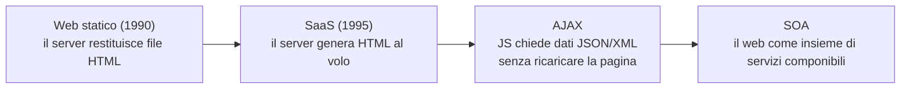
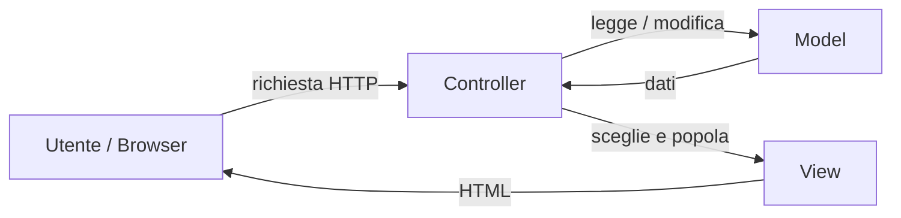

# SaaS Essentials

> [!abstract]
> I fondamenti tecnici di una web application **Software as a Service**: il modello **client-server**, i protocolli con cui client e server comunicano (TCP/IP, **HTTP**), la natura *stateless* di HTTP e i **cookie**, l'evoluzione del web verso **AJAX** e la **Service Oriented Architecture**, il concetto di **API**, lo stile architetturale **REST** con le operazioni **CRUDI**, le **route** HTTP (metodo + URI), il passaggio dei parametri e il formato **JSON**, l'autorizzazione con API key, i **codici di stato** HTTP. Chiude con il design pattern **Model-View-Controller** e un richiamo a HTML e CSS.
>
> Riprende il SaaS introdotto in [[02 - LASS - Software Architectures#Modelli di esecuzione del software|lezione 2]] e prepara tutto ciò che Rails automatizza in [[05 - LASS - Rails Parte 1]]: route RESTful, MVC, rendering di HTML. HTTP è trattato in dettaglio in Telecomunicazioni ([[Protocollo HTTP]], [[Messaggi HTTP]], [[Cookie HTTP]]).
>
> Indice dei concetti: [[MOC - Lab Architetture Software e Sicurezza]]. Materiale basato sulle slide dei proff. John Yang e Ian Sommerville e sul libro *Engineering Software as a Service* (Fox, Patterson).

---

## Modelli di esecuzione del software

Vedi [[Modelli di Esecuzione del Software]].

![[LASS-L04-p02.png]]

Lo stesso schema della [[02 - LASS - Software Architectures#Modelli di esecuzione del software|lezione 2]]: esecuzione **stand-alone** (tutto sul computer dell'utente, il produttore manda solo aggiornamenti), **ibrida** (funzionalità divise tra utente e server) e **software as a service** (sull'utente c'è solo l'interfaccia, funzionalità e dati stanno sui server del produttore). Il resto della lezione si concentra sul terzo modello.

## Vantaggi del SaaS

Vedi [[Software as a Service]].

1. **Nessuna installazione locale**: niente requisiti di compatibilità hardware.
2. **I dati restano nel servizio**: il cliente non si preoccupa di backup e perdite di dati.
3. **Una sola copia del software server** gira in un ambiente scelto e controllato dagli sviluppatori (non bisogna preoccuparsi del sistema operativo dell'utente).
4. Gli **aggiornamenti** si possono fare senza interferire con l'esperienza utente.
5. È più facile per gruppi di utenti **interagire sugli stessi dati**.
6. L'accesso remoto è comodo per **dati grandi o aggiornati spesso**.

Svantaggi? Vedi la discussione in [[02 - LASS - Software Architectures#Vantaggi del SaaS|lezione 2]]: dipendenza dalla rete, dati in mano al fornitore, latenza, superficie d'attacco centralizzata.

## Client-Server

Vedi [[Modello Client-Server]].

- I **client** sono programmi specializzati nel **chiedere informazioni ai server** e (di solito) nel permettere all'utente di interagire con quelle informazioni.
- I **server** sono programmi specializzati nel **servire in modo efficiente un gran numero di client contemporaneamente**.
- Un server appare al client come **un'unica entità logica**: il client può ignorare completamente la **topologia di deployment** del server (quante macchine ci sono dietro, come sono organizzate).
- Distinguere client e server permette a ciascuno di **specializzarsi**: il client può avere un'interfaccia reattiva e gradevole, il server si concentra sul servire molti client.

![[LASS-L04-p04.png]]

Più client (Client 1, 2, 3, …) mandano **richieste** (*request*) e ricevono **risposte** (*response*). Le richieste arrivano a un **load balancer**, che le distribuisce su un gruppo di **server**. Per il client c'è "un" server; in realtà sono molti, ed è il load balancer a nasconderlo.

## Come comunicano client e server SaaS

La **suite di protocolli Internet**, nota come **TCP/IP**, è l'insieme dei protocolli di comunicazione usati in Internet. Quelli rilevanti per il SaaS, dal basso verso l'alto:

| Protocollo | Ruolo | Protocollo associato |
|---|---|---|
| **IP** | indirizza i pacchetti tra host | **DNS** traduce i nomi (`www.example.com`) in indirizzi IP |
| **TCP** | connessione affidabile e ordinata tra due processi | **TLS** cifra il canale |
| **HTTP** | protocollo applicativo richiesta/risposta | **HTTPS** = HTTP su TLS |

Approfondimenti: [[DNS]], [[TCP]], [[Protocollo HTTP]] (Telecomunicazioni), [[Modello OSI e TCP-IP]] (Sistemi di Calcolo 2).

## HTTP

Vedi [[HTTP Request e Response]].

Il protocollo **HTTP** definisce le regole per fare una **richiesta** e ricevere una **risposta**:

1. Il client **apre una connessione TCP/IP** con il server indicando indirizzo IP e **porta** (di solito 80).
2. Se la connessione riesce, il client invia subito una **richiesta HTTP** che descrive l'operazione che vuole fare su una **risorsa**.
3. Il server invia una **risposta HTTP** che soddisfa la richiesta oppure riporta gli **errori** che lo hanno impedito. La risposta può includere un **cookie** che permette al server di riconoscere lo stesso client nelle interazioni future.

> [!note]
> La porta 80 è quella di HTTP in chiaro; con **HTTPS** la porta standard è la **443**. Oggi quasi tutto il traffico web è HTTPS, come raccomandato in [[17 - LASS - Sicurezza delle Web Application#A6 – Sensitive Data Exposure|lezione 17]].

### Struttura di richiesta e risposta

![[LASS-L04-p07.png]]

La slide mostra la struttura dei due messaggi:
- **richiesta**: una prima riga con **verbo HTTP**, **URI** e **versione** (la coppia verbo + URI, cerchiata, è la **route**), poi gli **header** di richiesta, poi il **body** (opzionale);
- **risposta**: una prima riga con **versione** e **codice di risposta**, poi gli **header** di risposta, poi il **body**.

Sotto ci sono due esempi reali:

```http
GET /somedir/page.html HTTP/1.1
Host: www.someschool.edu
Connection: close
User-agent: Mozilla/5.0
Accept-language: fr
```

La richiesta chiede la pagina `/somedir/page.html` al server `www.someschool.edu`, chiede di chiudere la connessione dopo la risposta, dichiara il browser (*user agent*) e la lingua preferita (francese).

```http
HTTP/1.1 200 OK
Connection: close
Date: Tue, 18 Aug 2015 15:44:04 GMT
Server: Apache/2.2.3 (CentOS)
Last-Modified: Tue, 18 Aug 2015 15:11:03 GMT
Content-Length: 6821
Content-Type: text/html

(data data data data data ...)
```

La risposta dice che è andato tutto bene (`200 OK`), indica data, tipo di server, data di ultima modifica della risorsa, lunghezza (6821 byte) e tipo del contenuto (HTML). Dopo la riga vuota c'è il body con la pagina vera e propria.

![[LASS-L04-p08.png]]

Secondo esempio, più vicino a un servizio web: il client chiede `GET incidents/A90/stonehaven/` all'host `trafficinfo.net`, dichiarando con `Accept` di accettare JSON, XML o testo. Il server risponde `200` con `Content-Type: text/json` e un body con due incidenti stradali sulla strada A90 vicino a Stonehaven: per ognuno numero, data, ora, strada, luogo, direzione, gravità e descrizione. Qui il server **non restituisce una pagina ma dati**, che il client userà come vuole: è il modello delle API (vedi [[#Shift of Web Technologies|più avanti]]).

> [!warning] Correzione
> Il body della risposta nella figura (presa dal libro di Sommerville) **non è JSON valido**: ci sono due oggetti `{...}` uno dopo l'altro senza separatore. Per restituirne due servono le parentesi quadre e una virgola: `[ {...}, {...} ]`. Inoltre il tipo MIME standard per JSON è `application/json`, non `text/json`. Le virgolette tipografiche (“ ”) sono un effetto dell'impaginazione: in JSON vanno quelle dritte (`"`).

### HTTP è stateless: i cookie

Vedi [[Cookie HTTP]].

HTTP è un protocollo **stateless** (senza stato): **ogni richiesta è indipendente** da tutte le precedenti. Il server non "ricorda" chi sei tra una richiesta e l'altra.

Per avere uno stato si usano i **cookie**:
- la prima volta che un client contatta un server, il server può includere nella risposta un header **`Set-Cookie:`** con un pezzo di informazione che userà per **identificare il client** nelle richieste future;
- è **responsabilità del client** memorizzare quell'informazione e rimandarla nell'header **`Cookie:`** in **ogni richiesta successiva** allo stesso server.

![[LASS-L04-p10.png]]

Il diagramma (dal libro di Kurose-Ross, lo stesso di Telecomunicazioni) segue un utente nel tempo:
1. il client, che ha già un cookie di eBay (`ebay: 8734`), manda una normale richiesta HTTP ad Amazon;
2. il server di Amazon **crea l'ID 1678** per l'utente, lo registra nel suo **database di backend** e lo manda con `Set-cookie: 1678`;
3. il client salva il cookie (`amazon: 1678`) e lo allega alla richiesta successiva (`cookie: 1678`); il server lo usa per un'**azione specifica** per quell'utente (carrello, preferenze), consultando il database;
4. **una settimana dopo** il client rimanda lo stesso cookie, e il server lo riconosce ancora.

Il cookie è quindi l'"etichetta" che trasforma richieste indipendenti in una **sessione**. Proprio per questo è prezioso per un attaccante: rubare il cookie di sessione significa impersonare l'utente (vedi [[17 - LASS - Sicurezza delle Web Application#A2 – Broken Authentication and Session Management|lezione 17]]).

## Shift of Web Technologies

Vedi [[AJAX]].

**Web statico (1990)**: quando nasce il Web, i server HTTP servono soprattutto **contenuti statici** che il browser visualizza. A ogni richiesta il server consegna una nuova pagina.

**Web dinamico (SaaS, dal 1995 circa)**: invece di restituire copie di pagine statiche, i server **eseguono un programma** e **creano le pagine HTML al volo**, implementando l'interfaccia utente di quel programma.

**AJAX** (*Asynchronous JavaScript And XML*): le pagine possono contenere codice **JavaScript** che fa **nuove richieste HTTP al server senza ricaricare la pagina**. In risposta il server non restituisce una pagina HTML ma una **struttura dati in XML o JSON**; il codice JavaScript nel browser la usa per modificare l'aspetto o il comportamento della pagina, sempre senza ricaricarla (pensa ai suggerimenti mentre scrivi nella barra di ricerca). Vedi anche [[JavaScript]] (Linguaggi e Tecnologie per il Web).

AJAX è stato un **punto di svolta**: il client non riceve più pagine da mostrare, ma **chiama una funzione sul server remoto e si aspetta dei dati in risposta**, come se chiamasse una funzione di libreria. Il Web diventa così un **insieme di servizi indipendenti che si possono comporre** per costruire siti più grandi: la **Service Oriented Architecture (SOA)**.



## Service Oriented Architecture

Vedi [[Service-Oriented Architecture]].

La **SOA** è un approccio allo sviluppo in cui **i sottosistemi possono accedere ai dati degli altri solo tramite interfacce esterne**. Ogni servizio fornisce un **insieme ben definito di operazioni** su uno o pochi tipi di **risorse** correlate.

Le app SaaS diventano "servizi" che accettano **chiamate di procedura remota** dai client. Per farlo bisogna poter:
- **identificare il servizio**;
- **identificare l'operazione** da chiamare;
- **passare dati** al servizio e **riceverne**;
- **gestire gli errori**.

Il resto della lezione risponde a queste quattro esigenze: le API e REST (identificare servizio e operazione), parametri e JSON (passare dati), codici di stato (errori).

## API

Vedi [[API]].

Il termine **API** (*Application Programming Interface*) indica il **"contratto" tra chiamante e chiamato**, che si tratti di un programma che chiama una funzione di libreria o di un client SaaS che invoca un servizio su un server.

La **documentazione di un'API** specifica:
- quali **operazioni** sono disponibili;
- come costruire gli **URI** per invocarle;
- come vengono **riportati gli errori**;
- gli altri **requisiti operativi** (es. limite al numero di chiamate al giorno, obbligo di includere un identificativo di account o una password in ogni chiamata).

## REST

Vedi [[REST]].

**REST** (*REpresentational State Transfer*) **non è uno standard**: è uno **stile architetturale**, una presa di posizione su come costruire un servizio e, di conseguenza, su come deve essere la sua API:
- **rappresentare le entità** manipolate da una web app come **risorse**;
- costruire le route in modo che **ogni richiesta HTTP contenga tutte le informazioni necessarie** per identificare sia la **risorsa** sia l'**azione** da compiere su di essa (**stateless**).

Un'API che segue queste linee guida si dice **RESTful**, e le route (metodo HTTP + URI) che definisce si dicono **route RESTful**.

### CRUDI

Vedi [[CRUDI]].

In generale un'API RESTful definisce fino a **cinque operazioni** su una risorsa, riassunte dall'acronimo **CRUDI**:

| Lettera | Operazione | Significato |
|---|---|---|
| **C** | Create | crea una nuova istanza della risorsa |
| **R** | Retrieve (Read) | ottieni una copia di una risorsa |
| **U** | Update | modifica una risorsa |
| **D** | Delete | cancella una risorsa |
| **I** | Index | elenca tutte le risorse di un tipo, eventualmente filtrate |

Quasi sempre ogni risorsa ha un **ID univoco** (di solito un numero), che fa da **"maniglia permanente"** (*permanent handle*) verso quella risorsa e **non viene mai riusato**, nemmeno dopo la cancellazione. Così un vecchio link a `/movies/3` non punterà mai per errore a un altro film.

## HTTP Route

Vedi [[Route HTTP e URI]].

Una **route** è la coppia:
- **metodo HTTP**: di solito `GET`, `POST`, `PUT`, `PATCH` o `DELETE`;
- **URI** (*Uniform Resource Identifier*): il nome di una risorsa disponibile su Internet.

Lo **stesso URI con metodi diversi** può avere **significati diversi** per un'app SaaS (`GET /movies/3` legge il film 3, `DELETE /movies/3` lo cancella).

![[LASS-L04-p18.png]]

L'anatomia di un URI, sull'esempio `GET http://srch.com:80/main/search?q=cloud&lang=en#top`:

| Parte | Esempio | Significato |
|---|---|---|
| metodo HTTP | `GET` | l'azione |
| scheme | `http` | il protocollo |
| hostname | `srch.com` | il server |
| port | `:80` | la porta (opzionale) |
| resource path | `/main/search` | la risorsa |
| query | `?q=cloud&lang=en` | parametri `chiave=valore` separati da `&` (o `;`) |
| fragment | `#top` | una posizione nella pagina (non viene inviata al server) |

Sotto c'è l'esempio `POST http://localhost:3000/movies/3`, che sarà tipico delle app Rails in sviluppo (porta 3000).

- **`GET`** significa tipicamente *"consegna una copia della risorsa al client senza modificarla e senza effetti collaterali"*.
- **`POST`, `PUT`, `PATCH`, `DELETE`** servono di solito per operazioni che **creano, modificano o cancellano** una risorsa.

La stessa immagine, nella slide successiva, accompagna questa distinzione: in alto una route di lettura, in basso una di modifica.

> [!tip] Perché GET non deve avere effetti collaterali
> Browser, proxy e crawler si sentono liberi di ripetere o precaricare le richieste GET. Se un link `GET /delete/5` cancellasse qualcosa, basterebbe un crawler per svuotare il database. È anche la base degli attacchi [[17 - LASS - Sicurezza delle Web Application#A8 – Cross Site Request Forgery (CSRF)|CSRF]] tramite tag ``.

## RESTful URI

Le API RESTful seguono alcune convenzioni nella costruzione degli URI:
- l'**hostname** indica quale server fornisce il servizio (es. `https://api.themoviedb.org`, l'API di The Movie Database usata nel libro);
- molti server specificano un **base URI**, un prefisso comune da anteporre a tutte le chiamate (es. `https://api.themoviedb.org/4/`, dove `4` è la versione dell'API). È l'**API endpoint** che i client contattano;
- le **componenti del path** dopo il prefisso indicano l'**operazione** e la **risorsa** su cui farla.

La documentazione usa spesso i **due punti** `:` o le **graffe** `{}` per indicare una parte dell'URI che corrisponde all'**ID di una risorsa**: la route `GET /movie/{movie_id}` (o `GET /movie/:movie_id`) chiede i dettagli del film il cui ID numerico va sostituito a `{movie_id}`. Un esempio reale è la documentazione delle Web API di Spotify (*get an artist's albums*: `GET /artists/{id}/albums`).

![[LASS-L04-p22.png]]

La tabella (Figura 3.6 del libro di Fox e Patterson) confronta un sito **non RESTful** con uno **RESTful** per la stessa sequenza di operazioni: login, pagina di benvenuto, aggiunta dell'articolo 427 al carrello, visualizzazione del carrello, checkout.

- Nel sito non RESTful, dopo il login le route sono `GET /welcome`, `POST /add/427`, `GET /cart`, `POST /checkout`: **non dicono di chi è** il carrello. Il server lo sa solo grazie a informazioni **implicite** accumulate nelle richieste precedenti (il login al passo 1, il carrello creato al passo 3).
- Nel sito RESTful ogni route contiene l'**utente 301**: `GET /user/301/cart` è autosufficiente.

La didascalia spiega la conseguenza: in una SOA, un client del sito RESTful può chiedere **subito** il carrello (passo 4), mentre un client del sito non RESTful deve prima ripetere i passi 1–3 per ricreare lo stato implicito da cui dipende il passo 4.

> [!warning] REST non è autorizzazione
> Mettere `301` nell'URI rende la richiesta autosufficiente, ma **non** basta a proteggerla: il server deve comunque verificare che chi chiede `/user/301/cart` sia davvero l'utente 301. Altrimenti basta cambiare il numero per vedere il carrello di un altro: è la vulnerabilità [[17 - LASS - Sicurezza delle Web Application#A4 – Insecure Direct Object References|Insecure Direct Object Reference]].

## Come si scambiano parametri e dati

Tre modi per passare parametri da un client HTTP a un servizio:
1. **nell'URI**: `GET /search/movies?query=Batman+Returns` (lo spazio diventa `+`);
2. **nel body della richiesta** (per `POST` o `PUT`);
3. (raramente) come valore di un **header HTTP**.

Se i parametri sono pochi si mettono nell'URI. Se i dati sono complessi, o l'operazione **cambia lo stato** (`POST`, `PUT`), vanno nel **body**. Il body delle richieste `GET` viene di solito **ignorato**.

Il formato di scambio comune nella comunità SOA è **JSON**.

## JSON

Vedi [[JSON]].

![[LASS-L04-p24.png]]

**JSON** (*JavaScript Object Notation*) è un formato standard di interscambio dati:
- essenzialmente è un **insieme non ordinato di coppie chiave/valore**;
- la **chiave** (o *slot*) è una **stringa tra virgolette doppie**;
- il **valore** può essere un tipo semplice (stringa, numero, `true`, `false`, `null`), un **array** (i cui elementi possono essere uno qualsiasi di questi) o un **altro oggetto** (con gli stessi vincoli);
- gli **spazi** (spazi, tab, a capo) sono facoltativi; la maggior parte dei server restituisce JSON senza spazi, per risparmiare byte.

L'esempio della figura descrive una persona: `firstName` e `lastName` (stringhe), `isAlive` (booleano), `age` (numero), `address` (un oggetto annidato con via, città, stato, CAP), `phoneNumbers` (un **array di oggetti**, uno per il telefono di casa e uno per l'ufficio), `children` (array vuoto) e `spouse` (`null`). Mostra in un colpo solo tutti i tipi di valore ammessi. JSON compare anche in Basi di Dati, come formato dei documenti MongoDB ([[07 - BD - NoSQL]]).

## Autorizzazione delle API

Quasi tutte le API richiedono un'**autorizzazione**: il client deve dimostrare di avere il diritto di fare ogni chiamata.
- Lo schema più comune è includere in ogni richiesta una **API key** specifica del client, nell'URI, nell'header HTTP `Authorization:`, o in entrambi.
- Le API key si richiedono di solito **a mano** (registrandosi sul sito del servizio) e possono essere **gratuite o a pagamento**.
- Il servizio può imporre **limiti**, come il numero di chiamate al giorno (*rate limiting*).

> [!tip]
> Una API key è un segreto: non va mai messa nel codice pubblicato su GitHub. In Rails si usano le *credentials* o le variabili d'ambiente. È un caso di [[17 - LASS - Sicurezza delle Web Application#A6 – Sensitive Data Exposure|Sensitive Data Exposure]].

## Codici di stato HTTP

Vedi [[Codici di Stato HTTP]].

I servizi usano i **codici di stato** per indicare i vari tipi di esito:

| Classe | Significato | Esempi |
|---|---|---|
| **2xx** | successo | 200 OK, 201 Created |
| **3xx** | il client deve fare un'altra azione (es. seguire un redirect) | 301 Moved Permanently, 302 Found |
| **4xx** | il servizio ha incontrato un errore applicativo nel gestire la richiesta | 400 Bad Request, 401 Unauthorized, 402 Payment Required, 404 Not Found |
| **5xx** | problema nell'infrastruttura del servizio stesso, che ha impedito persino di completare la chiamata | 500 Internal Server Error, 503 Service Unavailable |

Riferimento: developer.mozilla.org/en-US/docs/Web/HTTP/Status. In caso di errore, il **body** della risposta contiene di solito un messaggio che spiega cosa è andato storto.

> [!note] Precisazione
> Lo standard HTTP chiama i 4xx *client error*: la richiesta è sbagliata o non autorizzata (parametri mancanti, risorsa inesistente, credenziali assenti), quindi il client non dovrebbe ripeterla uguale. I 5xx sono *server error*: la richiesta poteva essere valida, ma il server non è riuscito a gestirla. La formulazione della slide ("application error") va letta così.

## RESTful design

**Pensare in termini di risorse.** La progettazione di un'API RESTful dovrebbe iniziare con queste domande:
- **che tipo di risorsa** è?
- **quali operazioni** sono disponibili su di essa?
- **cosa può andare storto** in ciascun tipo di operazione?
- come è **memorizzata** sul server ogni risorsa, e **a quali condizioni può essere cancellata**?
- come fa il client a **riferirsi a una risorsa creata in precedenza**, anche se l'utente si è allontanato dalla tastiera per molto tempo?

L'errore comune è ragionare invece in termini di **URI, azioni dell'utente e viste**, cioè tenere traccia di cosa sta facendo l'utente e scrivere logica per stargli dietro: è esattamente lo stile non RESTful della tabella vista sopra.

## Model View Controller (MVC)

Vedi [[Model-View-Controller]].

**MVC** è un **design pattern** per l'architettura e l'organizzazione dell'applicazione **server**. Un'app MVC è composta da tre tipi di codice:

1. **Model** (funzionalità di base e dati):
   - si occupano dei **dati** manipolati dall'applicazione: come memorizzarli, come operare su di essi, come modificarli;
   - tipicamente c'è **un model per ogni tipo di entità** manipolata dall'app (es. `Movie`, `Review`, `Moviegoer`).
2. **View** (mostrano le informazioni all'utente):
   - sono presentate all'utente e contengono informazioni sui model con cui l'utente può interagire;
   - fanno da **interfaccia tra gli utenti del sistema e i suoi dati**.
3. **Controller** (mediano l'interazione nei due sensi):
   - quando l'utente interagisce con una view, viene invocata una specifica **azione del controller** corrispondente a quell'attività;
   - **ogni controller è associato a un model**;
   - il controller può chiedere al model di **leggere o modificare** informazioni; in base al risultato **decide quale view presentare** all'utente e le fornisce le informazioni necessarie.

![[LASS-L04-p31-1.png]]

Prima figura: MVC applicato al **web**. Il **browser** manda le richieste HTTP al **controller** (elaborazione delle richieste HTTP, logica specifica dell'applicazione, validazione dei dati), che chiede al **model** (logica di business, database) di **aggiornare** i dati; il model **notifica i cambiamenti** alla **view** (generazione dinamica delle pagine, gestione dei form), che a sua volta può chiedere al model di aggiornarsi (*refresh request*) e restituisce al browser il **form da visualizzare**. Gli *user events* vanno dalla view al controller.

![[LASS-L04-p31-2.png]]

Seconda figura: lo schema **generale** del pattern. Il **controller** mappa le azioni dell'utente sugli aggiornamenti del model e seleziona la view; la **view** visualizza il model, chiede aggiornamenti al model e invia gli eventi utente al controller; il **model** incapsula lo stato dell'applicazione e notifica alla view i cambiamenti di stato. Le frecce mostrano *state change* (controller → model), *state query* (view → model), *change notification* (model → view), *view selection* (controller → view), *user events* (view → controller).



Il vantaggio è la **separazione delle responsabilità** (vedi [[02 - LASS - Software Architectures#Linee guida per la progettazione architetturale|separation of concerns]]): si può cambiare l'aspetto delle pagine senza toccare la logica, o il database senza toccare le pagine. Rails è costruito interamente su questo pattern ([[05 - LASS - Rails Parte 1#Rails e MVC|lezione 5]]).

## View: la pagina HTML

L'**HTML** (*HyperText Markup Language*) è il linguaggio di markup standard per i documenti da visualizzare in un browser.
- I browser ricevono documenti HTML dal server e li **visualizzano** (*render*).
- HTML descrive la **struttura** di una pagina e dà (alcune) indicazioni sul suo aspetto. È affiancato da tecnologie come **CSS** e linguaggi di scripting come **JavaScript**.

Il **CSS** (*Cascading Style Sheets*) è un linguaggio di fogli di stile che descrive **come presentare** un documento scritto in HTML. È pensato per **separare presentazione e contenuto** (layout, colori, font): lo stesso principio di separazione di MVC, applicato alla pagina.

### HTML

![[LASS-L04-p33.png]]

```html
<!DOCTYPE html>
<html>
  <head>
    <title>This is a title</title>
  </head>
  <body>
    <div>
      <p>Hello world!</p>
    </div>
  </body>
</html>
```

- il testo tra `<html>` e `</html>` descrive la pagina web;
- il testo tra `<body>` e `</body>` è il **contenuto visibile**;
- il tag `<div>` definisce una **sezione** della pagina, usata per applicare stili facilmente;
- dentro `<head>` si possono mettere elementi `<meta>` per definire i **metadati** della pagina (codifica, descrizione, viewport); `<title>` è il titolo mostrato nella scheda del browser.

Riferimento: developer.mozilla.org/en-US/docs/Learn/Getting_started_with_the_web/HTML_basics.
