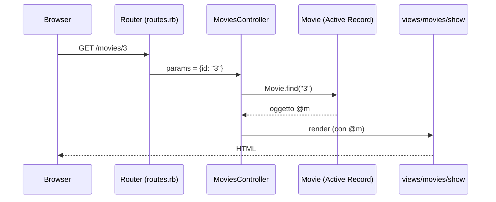

# Rails Parte 1

> [!abstract]
> Primo contatto con **Ruby on Rails**: cos'è, perché è *opinionated*, i due principi **DRY** e **Convention over Configuration**, come si crea e si avvia un'app di prova, com'è fatta la sua cartella. Poi si vede come Rails implementa **MVC**: i model come classi **Active Record** collegate a tabelle di un database relazionale, le **migration** che creano lo schema, la console per creare e cercare record, e infine controller, view e **route di default** che realizzano le operazioni **CRUDI**.
>
> Mette in pratica i concetti astratti di [[04 - LASS - SaaS Essentials]] (REST, CRUDI, MVC) usando il linguaggio di [[03 - LASS - Ruby Essentials]]. Prosegue in [[06 - LASS - Rails Parte 2]] (controller, view, form, validazioni) e [[07 - LASS - Rails Parte 3]] (associazioni, transazioni, query). L'esempio di riferimento è **RottenPotatoes**, l'app di recensioni di film del libro di Fox e Patterson.
>
> Indice dei concetti: [[MOC - Lab Architetture Software e Sicurezza]]. Materiale basato sulle slide dei proff. Armando Fox e Roberto Beraldi.

---

## Rails

Vedi [[Ruby on Rails]].

**Rails** è un **framework per lo sviluppo di web application scritto in Ruby** (guida: guides.rubyonrails.org/getting_started.html; su Windows si consiglia WSL).

Rails rende più facile programmare web app **facendo delle assunzioni** su ciò di cui ogni sviluppatore ha bisogno per partire: *"how to do more with less"*, fare di più scrivendo meno codice rispetto ad altri linguaggi e framework.

Rails è un software **opinionated** ("con le sue opinioni"): assume che esista un modo **"migliore"** di fare le cose ed è progettato per **incoraggiarlo** (e, in alcuni casi, scoraggiare le alternative). Se si seguono le sue convenzioni si scrive pochissimo codice; se si va contro, si fatica.

## La filosofia di Rails

Rails è pensato per app che seguono il pattern **Model-View-Controller** (vedi [[04 - LASS - SaaS Essentials#Model View Controller (MVC)|lezione 4]]). La sua filosofia ha due principi guida:

### Don't Repeat Yourself

Vedi [[Don't Repeat Yourself]].

**DRY** è un principio dello sviluppo software secondo cui *"ogni elemento di conoscenza deve avere una rappresentazione unica, non ambigua e autorevole all'interno di un sistema"*. Se la stessa informazione (una regola di validazione, la struttura di una tabella, un pezzo di HTML) è scritta in due posti, prima o poi le due copie divergeranno. È la linea guida *implement once* di [[02 - LASS - Software Architectures#Linee guida per la progettazione architetturale|lezione 2]].

### Convention over Configuration

Vedi [[Convention over Configuration]].

Rails ha delle opinioni sul modo migliore di fare molte cose in una web app e usa per default **un insieme di convenzioni**: non serve specificare ogni dettaglio in lunghi file di configurazione. Esempio: se il model si chiama `Movie`, Rails assume da solo che la tabella si chiami `movies`, il controller `MoviesController`, le view stiano in `app/views/movies/`. Nessun file di configurazione lo dice: è la convenzione.

## Rails nell'architettura di una web app

![[LASS-L05-p04.png]]

Rails è un **framework lato server**: **mappa le route HTTP sul codice dell'app** che esegue l'azione giusta. Il suo sottosistema di view è pensato per **generare pagine HTML**, perché è nato per app il cui client è un browser.

La figura mostra il percorso di una richiesta:
1. l'**utente** interagisce con la **GUI** di un **client HTTP** (browser su PC o telefono);
2. il client parla con l'**HTTP server** tramite il **protocollo HTTP**;
3. l'HTTP server passa la richiesta a Rails, dove le **operazioni CRUD** arrivano al **router**;
4. il router smista ogni richiesta al **controller** giusto;
5. il controller usa il **model**, che legge e scrive nel **database**;
6. il controller fa generare alla **view** la risposta, che torna all'HTTP server e quindi al client.

## Creare un'app Rails di prova

```bash
rails new testapp \ # add flags below for faster creation
--skip-test-unit --skip-webpack-install --skip-javascript
cd testapp
bin/rails server
```

- `rails new testapp` crea lo scheletro di una nuova app nella cartella `testapp`. I flag saltano alcune parti per fare prima: il framework di test predefinito (si useranno RSpec e Cucumber, vedi [[15 - LASS - Testing BDD e TDD]]), l'installazione di Webpack e JavaScript.
- `bin/rails server` avvia il server di sviluppo.

Riferimenti: il file `BIAR.md` del corso (istruzioni per la macchina virtuale del laboratorio) e la guida ufficiale.

> [!warning] Correzione
> Così come è scritto nella slide, il comando non funziona in una shell: il `\` serve a continuare il comando sulla riga successiva **solo se è l'ultimo carattere della riga**. Il commento `# add flags…` dopo il backslash fa sì che `rails new testapp` venga eseguito da solo e che la riga dopo (`--skip-test-unit …`) dia errore. Va scritto tutto su una riga, oppure senza commento:
> ```bash
> rails new testapp --skip-test-unit --skip-webpack-install --skip-javascript
> ```
> Nelle versioni recenti di Rails il flag per saltare i test si chiama `--skip-test` (o `-T`).

![[LASS-L05-p06.png]]

Il terminale mostra l'avvio del server: Rails 6.1.7.2 in ambiente *development*, server web **Puma** (versione 5.6.5) con Ruby 2.7.2, in ascolto su `http://127.0.0.1:3000` e `http://[::1]:3000` (IPv4 e IPv6 locali). Più sotto si vede il log della prima richiesta: `Started GET "/"`, elaborata da `Rails::WelcomeController#index`, che renderizza la pagina di benvenuto e risponde `Completed 200 OK`. Ogni richiesta lascia una traccia di questo tipo nel log, utile per il [[06 - LASS - Rails Parte 2#Debugging|debugging]].

![[LASS-L05-p07.png]]

Aprendo `localhost:3000` nel browser compare la pagina di benvenuto **"Yay! You're on Rails!"** con le versioni di Rails (6.1.7.2) e di Ruby (2.7.2). Significa che l'app è stata creata correttamente e il server funziona.

## Contenuto di un'app Rails

![[LASS-L05-p08.png]]

La prima parte della tabella della guida ufficiale:

| File/cartella | Scopo |
|---|---|
| `app/` | controller, model, view, helper, mailer, channel, job e asset dell'app: **qui si lavora quasi sempre** |
| `bin/` | lo script `rails` che avvia l'app e altri script per setup, aggiornamento, deploy |
| `config/` | configurazione di route, database e altro |
| `config.ru` | configurazione **Rack** per i server basati su Rack che avviano l'app |
| `db/` | lo schema attuale del database e le **migration** |

![[LASS-L05-p09.png]]

Seconda parte:

| File/cartella | Scopo |
|---|---|
| `Gemfile`, `Gemfile.lock` | le **gem** (librerie Ruby) da cui dipende l'app, gestite da **Bundler** |
| `lib/` | moduli estesi per l'app |
| `log/` | i file di log |
| `public/` | file statici e asset compilati, serviti così come sono |
| `Rakefile` | carica i **task** eseguibili da riga di comando (`rake db:migrate` ecc.); i task propri vanno in `lib/tasks` |
| `README.md` | manuale d'istruzioni dell'app |
| `storage/` | file di Active Storage per il Disk Service |

![[LASS-L05-p10.png]]

Terza parte:

| File/cartella | Scopo |
|---|---|
| `storage/` | (ripetuto) file di Active Storage |
| `test/` | unit test, fixture e altri apparati di test |
| `tmp/` | file temporanei (cache, file pid) |
| `vendor/` | codice di terze parti (es. gem *vendorizzate*) |
| `.gitattributes` | metadati per percorsi specifici del repository git |
| `.gitignore` | file (o pattern) che git deve ignorare |
| `.ruby-version` | la versione di Ruby predefinita |

## Model View Controller in Rails

Richiamo dalla [[04 - LASS - SaaS Essentials#Model View Controller (MVC)|lezione 4]]: un'app MVC è fatta di
1. **model**: funzionalità e dati, tipicamente uno per ogni tipo di entità;
2. **view**: mostrano all'utente le informazioni sui model (i dati) con cui può interagire;
3. **controller**: mediano nei due sensi, **uno per model**; quando l'utente interagisce con una view viene invocata un'azione del controller, che chiede al model di leggere o modificare dati e aggiorna la view in base al risultato.

### Rails e MVC

Rails fornisce delle **classi base** da cui l'app eredita model, view e controller.

- Ogni **model Rails** è un **tipo di risorsa** le cui istanze sono **righe di una tabella** di un database relazionale. I model memorizzati nel database sono esposti al codice Ruby tramite il design pattern **Active Record**.
- Un'app Rails è una **collezione di risorse RESTful**: ognuna ha il proprio model, il proprio insieme di view e il proprio controller.
- Le risorse possono avere **relazioni** (un `Movie` può avere molte `Review`): sono rappresentate da **foreign key** nelle tabelle (vedi [[Foreign Key]], Basi di Dati, e le associazioni in [[07 - LASS - Rails Parte 3#Associations|lezione 7]]).

![[LASS-L05-p13.png]]

La figura collega MVC alle cartelle e alle classi di Rails:
- **model** → `models/*.rb`, **sottoclassi di `ActiveRecord::Base`**, uno strato di **object-relational mapping** che corrisponde alle **tabelle** del database relazionale;
- **view** → `views/*.html.haml`, **sottoclassi di `ActionView`**, gestite dal *Rails rendering*;
- **controller** → `controllers/*.rb`, **sottoclassi di `ApplicationController`**, raggiunte tramite il *Rails routing*.

Il tutto ("your app") sta tra il database relazionale e il server web, che parla con il browser.

> [!note]
> La figura usa view `.html.haml` (HAML è un linguaggio di template alternativo, più compatto); nel corso e nelle versioni attuali di Rails il formato predefinito è `.html.erb` (vedi [[06 - LASS - Rails Parte 2#Controllers and Views|lezione 6]]).

## Rails e RDBMS

Un'applicazione ha bisogno di **memorizzare e manipolare dati persistenti**. Due esigenze di base:
1. **memorizzare diversi tipi di dati**, dove tutte le istanze di un certo tipo di entità hanno lo stesso insieme di **attributi** (ogni istanza con i propri valori);
2. esprimere le **relazioni** tra entità di tipi diversi.

Sono esigenze ben note, e un **DBMS relazionale** (RDBMS) offre un formalismo naturale per rappresentarle (tabelle e foreign key, vedi [[02 - BD - Modello Relazionale]]). In Rails i dati sono un insieme di **risorse memorizzate in un database relazionale**.

Restano due domande:
- per (1): qual è la **corrispondenza** tra una risorsa memorizzata nel DB e come la vede Ruby (un oggetto)?
- per (2): come vengono **mediate** le due rappresentazioni delle relazioni (foreign key da una parte, riferimenti tra oggetti dall'altra)?

La risposta alla prima è Active Record; alla seconda, le associazioni della [[07 - LASS - Rails Parte 3|lezione 7]].

## Active Record

Vedi [[Active Record]].

Rails implementa il pattern architetturale **Active Record**:
- un **model Rails** è una **classe associata a una tabella** specifica di un RDBMS;
- un'**istanza** della classe corrisponde a **una singola riga** di quella tabella;
- Active Record dà a ogni model la **conoscenza di come creare, leggere, aggiornare e cancellare** le proprie istanze nel database (**CRUD**);
- la combinazione **nome della tabella + ID** identifica univocamente un'istanza.

Il model ha **comportamenti già pronti** che operano direttamente sul database per le quattro operazioni CRUD (es. creare una nuova riga per un nuovo oggetto). Tutta la logica per **"parlare" con il database** e per fare il **marshalling/unmarshalling** (cioè serializzare e deserializzare) degli attributi è inclusa implicitamente in ogni model.

Basta definire una classe che **eredita da `ActiveRecord::Base`** per avere tutto il meccanismo che la "collega" al database. La cartella `app/models` contiene **un file Ruby per model**, con precise **convenzioni sui nomi**; convenzioni simili valgono per i nomi delle tabelle, degli attributi e dei loro tipi, e per i costruttori (capitolo 4.2 del libro).

| Ruby | Database |
|---|---|
| classe `Movie` (singolare, CamelCase) | tabella `movies` (plurale, snake_case) |
| istanza `m = Movie.find(3)` | riga con `id = 3` |
| attributo `m.title` | colonna `title` |
| `m.save` | `INSERT` o `UPDATE` |
| `m.destroy` | `DELETE` |

## Active Record e migration

Vedi [[Migration Rails]].

Una **migration** è uno **script Ruby che crea o modifica lo schema del database**.

Le migration mantengono **sincronizzati** i tre ambienti di un'app Rails, ognuno con un database distinto:
- **development** (sviluppo sul proprio computer);
- **production** (l'app in uso);
- **test** (per i test automatici, svuotato a ogni esecuzione).

Il file `config/database.yml` dice come connettersi al database (default: **SQLite**). Rails può generare un file Ruby con una **classe migration** che eredita da `ActiveRecord::Migration` e ha un metodo d'istanza **`change`** da riempire con le modifiche allo schema desiderate.

Il vantaggio rispetto a scrivere SQL a mano: le migration sono **versionate** insieme al codice (in git), si applicano in ordine, e ogni sviluppatore del gruppo ottiene lo stesso schema eseguendo `rake db:migrate`.

### Creare il model e la migration

Si crea un file `movie.rb` con una classe `Movie` sottoclasse di `ActiveRecord::Base`:

![[LASS-L05-p18.png]]

```ruby
class Movie < ActiveRecord::Base
end
```

Due righe, e la classe è vuota: eppure `Movie` sa già leggere e scrivere la tabella `movies`, perché lo eredita da `ActiveRecord::Base` e ricava i nomi delle colonne dallo schema del database. Questo è *Convention over Configuration* in azione.

Poi si genera e si applica la migration:

```bash
bin/rails generate migration CreateMovies
bin/rake db:migrate
```

![[LASS-L05-p19-1.png]]

Il contenuto di `initial_migration.rb`:

```ruby
class CreateMovies < ActiveRecord::Migration
  def change
    create_table 'movies' do |t|
      t.string 'title'
      t.string 'rating'
      t.text 'description'
      t.datetime 'release_date'
      # Add fields that let Rails automatically keep track
      # of when movies are added or modified:
      t.timestamps
    end
  end
end
```

- `create_table 'movies' do |t| ... end` crea la tabella; dentro il blocco `t` rappresenta la tabella e ogni riga aggiunge una colonna con il suo tipo (`string`, `text` per testi lunghi, `datetime`);
- la colonna **`id`** (chiave primaria, intero autoincrementale) viene aggiunta **automaticamente**;
- `t.timestamps` aggiunge le colonne `created_at` e `updated_at`, che Rails aggiorna da solo.

![[LASS-L05-p19-2.png]]

La seconda versione è identica, ma la classe eredita da **`ActiveRecord::Migration[6.1]`**. Il commento spiega: sostituire `6.1` con la propria versione di Rails se non si usa la macchina virtuale BIAR con Ruby 2.7.2. Da Rails 5 in poi la versione tra parentesi quadre è **obbligatoria** (senza, si ottiene un errore): serve a Rails per sapere con quale semantica interpretare la migration anche dopo un aggiornamento del framework. La prima versione è quindi quella del libro (Rails 4), la seconda quella da usare.

### Usare il model dalla console

```ruby
# bin/rails console
m = Movie.new
m.title = 'Mio Titolo'
m.title          # => "Mio Titolo"
m.save!          # INSERT nel database
movie = Movie.where(:id => i).first
```

- `Movie.new` crea un oggetto **in memoria**, non ancora nel database;
- `m.title = ...` usa il setter generato automaticamente dalla colonna `title`;
- `save!` lo **salva** nel database (con il `!` solleva un'eccezione se il salvataggio fallisce, vedi [[03 - LASS - Ruby Essentials#Metodi e convenzioni sui nomi|convenzioni sui nomi]]);
- `Movie.where(:id => i).first` cerca il film con un certo id (`where` restituisce una collezione, `first` ne prende il primo). Le query sono approfondite in [[07 - LASS - Rails Parte 3#ActiveRecord Query Interface|lezione 7]].

Per popolare il database con dati di esempio si può usare il file `seeds.rb` del repository del corso (`bin/rails db:seed`).

### Tutto in un comando

```bash
bin/rails generate model MovieV2 title:string rating:string description:text release_date:datetime
```

`generate model` crea **in un colpo solo** il file del model e la migration con le colonne indicate (`nome:tipo`). È la via abituale: le due fasi precedenti servivano a capire cosa succede dietro le quinte.

## Controller e View

- Il **controller** chiede al model di leggere o modificare informazioni e, in base al risultato, **decide quale view** (e quali informazioni) presentare all'utente.
- Con un solo model `Movie` ci sarà **un solo controller**: il `MoviesController`.
- Le **azioni** definite nel controller gestiscono ogni tipo di interazione dell'utente con le view dei film (click su link e pulsanti) e contengono la logica per ottenere dai model i dati da mostrare.
- La definizione MVC di view è ampia, ma una **view Rails** è un caso particolare chiamato **template** (*template view*): **markup statico** inframmezzato da **sostituzioni di variabili**, elaborato da un motore generico (ERB, vedi [[06 - LASS - Rails Parte 2#Controllers and Views|lezione 6]]).

## Route di default e CRUDI

Vedi [[Routing in Rails]].

Il file **`config/routes.rb`** stabilisce quale codice dell'app deve gestire una richiesta in arrivo, in forma di route HTTP. Ci sono dei default:

![[LASS-L05-p23.png]]

La slide (dal corso di Berkeley) mostra cosa genera la singola riga `resources :movies` in `routes.rb`:

```ruby
get    '/movies'          => 'movies#index',   :as => 'movies'
get    '/movies/:id/new'  => 'movies#new',     :as => 'new_movie'
post   '/movies'          => 'movies#create',  :as => 'movie'
get    '/movies/:id'      => 'movies#show',    :as => 'movie'
get    '/movies/:id/edit' => 'movies#edit',    :as => 'edit_movie'
put    '/movies/:id'      => 'movies#update',  :as => 'movie'
delete '/movies/:id'      => 'movies#destroy', :as => 'movie'
```

Ogni riga associa una route (metodo + URI) a un'**azione** di un controller (`movies#index` = metodo `index` di `MoviesController`); `:as` dà il nome all'**helper** che genera l'URI (vedi [[06 - LASS - Rails Parte 2#Routes and Controllers|lezione 6]]). Le lettere a destra (I, C, R, U, D) indicano a quale operazione [[CRUDI]] corrisponde ciascuna riga.

La tabella sotto riassume:

| Route | Azione RESTful |
|---|---|
| `GET /movies` | **I**: elenca tutti i film (eventualmente filtrati) |
| `POST /movies` | **C**: crea un nuovo film dai dati del form allegato |
| `GET /movies/3` | **R**: mostra le informazioni del film con ID 3 |
| `PUT /movies/5` | **U**: aggiorna il film 5 con i dati del form allegato |
| `DELETE /movies/5` | **D**: cancella il film con ID 5 |

> [!warning] Correzione
> Nella seconda riga della slide la route di `new` è scritta `'/movies/:id/new'`. In Rails la route generata da `resources :movies` è **`GET /movies/new`**, senza `:id`: un film che non esiste ancora non ha un ID. Anche gli helper `:as` della slide sono semplificati: Rails genera `movies` per index e create, `new_movie`, `edit_movie` e `movie` per show, update e destroy (vedi la tabella in [[06 - LASS - Rails Parte 2#Routes and Controllers|lezione 6]]). Infine, oltre a `PUT` Rails accetta anche `PATCH` per l'update.

### Il viaggio di una richiesta

![[LASS-L05-p24.png]]

I parametri estratti dalla route finiscono nell'hash **`params[]`** preparato per il controller. La slide *"A trip through a Rails app"* lo mostra in tre passi:
1. le **route** (in `routes.rb`) mappano gli URL in arrivo sulle **azioni dei controller** ed estraggono eventuali **parametri**;
2. le azioni del controller impostano delle **variabili d'istanza**, visibili alle **view**; sottocartelle e nomi dei file in `views/` corrispondono ai nomi di controller e azioni;
3. l'azione del controller alla fine **renderizza una view**, che può essere una pagina HTML, un oggetto JSON, ecc.

Nell'esempio, l'utente visita `http://localhost:3000/movies/3`; `config/routes.rb` contiene `get '/movies/:id' => 'movies#show'`, quindi la richiesta va al metodo `show` di `app/controllers/movies_controller.rb`:

```ruby
def show
  id = params[:id]       # "3", estratto dall'URI
  @m = Movie.find(id)
end
```

e il controller renderizza la view `app/views/movies/show.html.haml`, che usa `@m.rating` per mostrare la valutazione.



## Hands-on

- Laboratorio: github.com/dcdelia/lab-assi, cartella `rails-intro/book-lab`.
- Documentazione degli elementi HTML: developer.mozilla.org/en-US/docs/Web/HTML/Element.
